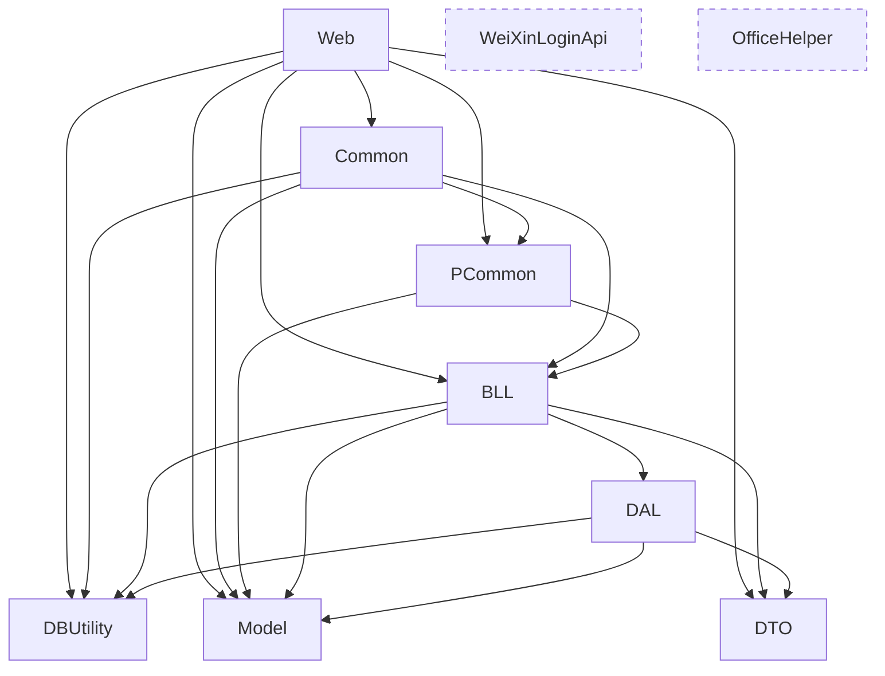

# 01 旧项目底层能力盘点

> 目的：为新框架设计做准备，只盘点底层框架层面，不展开业务逻辑。
> 基线：`main` @ `1d500fe`；数据库统计来自测试库（只读查询），兼容级别等结论需在生产核实。
> 标注：`待确认` = 需要核实的事实；`假设` = 根据代码推断、未实际验证。
> 业务细节见 `docs/legacy/01-legacy-analysis.md`。
> 状态：已确认（2026-11-04）；第 7 节待确认清单已标明各项去向。

---

## 0. 结论速览

- 旧系统是 .NET Framework 4.8 的 WebForms 单体。名义上分 Model / DAL / BLL / Web 三层，实际上大量逻辑和 SQL 直接写在页面与 ashx 里。
- 底层能力大多“有，但分散、不统一”：
  - 数据访问有 4 套；
  - Excel 库有 4 套；
  - 上传组件有 4～5 套；
  - Common 和 PCommon 里有 6 组同名帮助类重复。
- 安全基础薄弱：
  - 身份存在加密 Cookie 里，后台不保存会话；
  - 密码明文存储；
  - SQL 大量拼接，靠关键字/字符黑名单过滤。
- **最容易漏的是隐性约定**：日期大多存成字符串、多值 ID 用逗号拼接、审计和软删除字段名五花八门、冗余名称字段靠触发器同步、业务数据跨库写入、业务参数和审批人 ID 写在 Web.config 里。新框架如果不显式处理，迁移时一定出问题。

---

## 1. 技术栈与主要第三方库

### 1.1 后端

| 项 | 现状 |
|---|---|
| 运行时 | .NET Framework 4.8，IIS 托管 |
| 项目格式 | 老式 csproj + `packages.config`，MSBuild 2019 构建 |
| Web | ASP.NET WebForms（aspx/ascx）+ 通用处理程序（ashx）；引用了 Web API 2 但未使用 |
| 启动 | `Global.asax`（错误处理、POST 拦截）+ OWIN `Startup`（仅挂载 Hangfire；`OwinStartup` 特性已注释，靠约定发现，`待确认` 生产是否生效） |
| 数据库 | SQL Server，4 个库在同一实例；测试库实例为 SQL Server 2025（17.0），**4 个库兼容级别均为 130（2016）**；生产版本 `待确认` |
| 部署 | `deploy-pre.bat`、`pre-to-produ.bat`（打包 → 备份 → robocopy → IIS 应用池），`脚本/*.template` 分 dev/pre/prod |
| 测试 | `Web.Tests` 非标准测试项目，PowerShell 调 `csc.exe` 编译 + 自定义断言，只覆盖少数模块 |

### 1.2 第三方库

| 类别 | 库 | 用途 / 现状 |
|---|---|---|
| 数据访问 | Dapper、Dapper.Contrib | 新代码主力（`DapperHelper`） |
| | FreeSql | 只在 AR 账龄、ERP BP 两个新模块中使用 |
| | EntityFramework 6 | 只有引用，未见使用 |
| | MySql.Data、OracleClient | DBUtility 里有帮助类，业务未使用 |
| 定时任务 | Hangfire（SqlServer 存储） | 存储在主库 `HangFire` schema |
| 序列化 | Newtonsoft.Json | 全局使用 |
| 映射 | Mapster | 只在 DTO 项目中使用 |
| Excel | NPOI、EPPlus、MiniExcel、MyXls | 四套并存 |
| Word/PDF | Aspose.Words、iTextSharp | 合同/报价单生成、PDF |
| 压缩 | SharpZipLib、System.IO.Compression | 打包下载 |
| 短信 | aliyun-net-sdk-dysmsapi | 登录验证码 |
| 邮件 | System.Net.Mail（SMTP） | 另引用了 Outlook Interop，实际未用 |
| 其他 | URLRewriter、AspNetPager、ChnCharInfo（拼音）、MathNet.Numerics、JWT（未见核心使用） | |

### 1.3 前端（只列与后端交互相关的部分）

- layui 2.4.5（layuiadmin 框架）+ jQuery（1.7.2 为主，共 7 个版本混用），约 50 个页面局部用了 Vue 2.6。
- 交互方式：aspx 输出页面壳，jQuery / layui table 调同目录 `GetJson.ashx?Ctype=xxx` 取 JSON。返回格式沿用 layui 约定 `{code, msg, count, data}`，但各接口细节不统一。
- 主框架 `Manage/Index.aspx` 是 iframe 多标签页，页面之间通过 `parent` 互相调用。

---

## 2. 项目分层与依赖

### 2.1 项目职责与规模

| 项目 | 命名空间 | 职责 | 规模 |
|---|---|---|---|
| Model | `Jia.Model` | 表实体（动软代码生成器生成，一表一类） | 247 文件 / 6.0 万行 |
| DTO | `DTO` | 新模块的查询参数与返回对象 | 27 文件 / 0.2 万行 |
| DBUtility | `Maticsoft.DBUtility` | 数据库帮助类、连接串 | 20 文件 / 1.1 万行 |
| DAL | `Jia.DAL` | 每表 CRUD + `strWhere` 查询 | 234 文件 / 12.4 万行 |
| BLL | `Jia.BLL` | 基本是 DAL 透传 | 233 文件 / 4.1 万行 |
| PCommon | `PCommon` | 邮件、节假日、PDF、字典等 | 18 文件 / 0.3 万行 |
| Common | `Jia.Common` | 页面基类、Cookie、权限、上传、日志、请求参数等 | 56 文件 / 1.6 万行 |
| OfficeHelper | `OfficeHelper` | EPPlus 导入导出 | 3 文件 |
| Web | `Web` | 页面、ashx、Hangfire 作业、新模块 Service | 752 aspx / 166 ashx / `Manage` 下 C# 约 24 万行 |
| WeiXinLoginApi | — | 微信登录，Web 未引用 | 8 文件 |

### 2.2 依赖关系

问题：
- **工具层依赖业务层**：Common、PCommon 都引用 BLL，工具和业务缠在一起，无法单独复用。
- **Web 越层直连数据库**：页面里 `DbHelperSQL.*` 约 1180 处、`DapperHelper.*` 约 166 处。BLL/DAL 只是可选路径，三层形同虚设。
- 新模块（AR 账龄、ERP BP）采用 “ashx + Service + FreeSql 实体” 的写法，放在 `Web/Manage/<模块>/` 下，没有独立项目。

### 2.3 业务模块（只列名称与规模）

按菜单 `Base_SysMenu` 统计，共 444 项：25 个目录、142 个页面、277 个按钮权限。

| 模块 | 主要目录 | aspx / ashx | 规模 |
|---|---|---|---|
| 系统管理 | SysMenu、Role、UserInfo、UserCode、SystemSet 等 | ~45 / ~12 | 中 |
| BP 管理（客户/代理商/Leads） | Customer_Up、Customer、AgentManagement、Leads | ~68 / ~13 | 大 |
| 商机管理 | Project_Up、Project | ~110 / ~20 | 很大 |
| 报价 & 合同 | Quotation、Quotation_Temp*、Quotation_RFQ 等 | ~120 / ~27 | 很大 |
| 任务平台（RFQ/文控/排产/审核） | QuotationShenhe、QuotationPaichan、Task | ~90 / ~10 | 很大 |
| 特殊合同/规格/交货期评审 | TeshuhetongShenqin2 等 | ~60 / ~3 | 很大 |
| 技术服务（售后） | AfterSale | 77 / 12 | 大 |
| 每日活动 / 周报 | Weekly_New、Weekly、WeeklyActivity | ~44 / ~10 | 中 |
| Open Order | OpenOrder | 7 / 1 | 中 |
| 收款与承兑汇票 | Bank_Order | 20 / 4 | 中 |
| Forecast 与业绩 | Target、Charts、Order、ErpBP、Address | ~30 / ~4 | 中 |
| AR 账龄 | ARAging | 3 / 1 | 中 |
| Worktop / 人事行政 | WorkTop、HR | 23 / 2 | 小 |
| 模板与消息 | TempManage、Message 等 | ~10 / ~7 | 小 |
| 回收箱 | DeleteList | 4 / 4 | 小 |
| 产品配置器对接 | Ajax/GetConfiguratorToken、ConfigReport | 3 / 2 | 小 |
| 首页 / 看板 / 全局搜索 | Index、WebForm_*、Charts | ~40 / ~3 | 中 |

---

## 3. 现有基础能力及实现方式

每项按“怎么做的 → 问题”列出。

### 3.1 认证

- **登录入口**：`Manage/Login.aspx` + `Ajax/LoginOn.ashx`（账号密码）、`PhoneLoginOn.ashx`（手机验证码）、`LoginYanzheng.ashx`；售后另有一套 `AfterSale/Ajax/PhoneLoginOn.ashx`。
- **凭据校验**：从 `Base_UserInfo` 取用户后明文比对 `UserPwd`（MD5 代码已注释）。
- **身份保持**：登录成功后用 DES 加密写入多个 Cookie：`ab`（用户 ID）、`role`（当前角色）、`abName`、`gonghao`、`roleList`、`hyid`、`daquid`、`usrname`（手机登录还有 `UserPhone`、`Phone`）。之后每次请求都从 Cookie 解密取身份，**没有服务端 Session**。
- **单设备登录**：生成 `DengluBiaoshi_PC` / `DengluBiaoshi_PHONE` 写入用户表和 Cookie `Token` / `PhoneToken`（`假设` 用于挤下线，校验位置未完整核实）。
- **验证码**：短信验证码明文放在 Cookie（`CheckCode`、`CheckPhones`）里比对，开关是 `DuanxianYanzhengma`。
- **接口鉴权**：每个 ashx 自己读 Cookie 判断 `userid` 是否为空，返回格式各不相同。统一的 `ApiAuthenticationHelper` 只有 1 处使用。
- **问题**：
  - Cookie 用固定 DES 密钥加密，没有签名、没有服务端过期，密钥泄露即可伪造任意身份；
  - 无法主动让会话失效；
  - 密码明文；
  - 验证码可被客户端篡改；
  - 鉴权全靠各接口自觉，漏写就是未授权访问。

### 3.2 授权

- **功能权限**：菜单、页面、按钮统一存在 `Base_SysMenu`，`MenuType` 取值 1=目录、2=页面、3=按钮。用户权限 = 当前角色的 `Base_Role_Class` ∪ 用户个人的 `Base_User_Class`。
- **页面校验**：`BasePage.PermissionID` + `GetQuanxian(url)`，无权限时输出 `alert` 脚本后 `history.back()`。
- **按钮校验**：`BasePage.SetQX(按钮ID)`，按钮 ID 以数字硬编码在代码里（如 10224、10267）。只有 `PermissionNames` 收录了 4 个常量。
- **多角色**：用户有角色列表 `RoleId_List`（逗号分隔），登录时选择一个“当前角色”。
- **身份切换**：管理员可在用户管理中“切换身份”，本质是改写 Cookie 中的用户和角色。
- **问题**：
  - 权限 ID 是魔法数字；
  - `BasePage.btnds` 是 `public static DataSet`，所有用户共享，有并发串数据风险；
  - 权限判断里拼接 SQL；
  - 身份切换没有审计。

### 3.3 数据访问

| 方式 | 来源 | 使用情况 | 特点 |
|---|---|---|---|
| 动软 DAL + `DbHelperSQL` | 代码生成器 | DAL/BLL、旧页面 | `GetList(string strWhere)` 由调用方拼 where 条件；DAL 中 `strWhere` 约 1675 处，只有约 95 个文件用了参数 |
| `DbHelperSQL_AfterSale/_Log/_Order` | 复制 `DbHelperSQL` | 各 1100 行左右 | 每个库一份几乎相同的代码 |
| 页面直写 SQL | — | 约 1180 处 | 不少直接拼接请求参数 |
| `DapperHelper.Kelong/Log/AfterSale/Order` | 自写 | 新代码，约 166 处 | 参数化；`Insert/Update` 按对象生成 SQL，`QueryPage` 分页 |
| FreeSql | — | 2 个新模块 | 单例 `IFreeSql` |

- **连接**：`PubConstant` 从 `appSettings` 读 4 个连接串，支持 `ConStringEncrypt` 加密开关（当前关闭）。
- **防注入**：`RequestHelper.GetString(name, sqlSafeCheck)` 用正则黑名单拦截 `- ; , / ( ) [ ] { } % @ * ! '` 等字符。这种做法既拦不全，也会误伤正常输入。
- **问题**：
  - 四套并存；
  - 拼接 SQL 是主流写法；
  - DBUtility 里有大量从未使用的帮助类（MySQL、Oracle、OleDb、IBatis、SQLHelper、DbHelperSQLP、DbHelperSQL2）。

### 3.4 事务

- `DbHelperSQL.ExecuteSqlTran(List<CommandInfo>)` 批量执行，以及手写 `BeginTransaction`，约 130 处。
- 大部分“写多张表”的操作没有事务。
- 跨库写入（例如主库和日志库各写一份）分别在不同连接中执行，无法保证一致。
- **并发控制**：
  - 没有乐观锁，主库只有 3 个 `rowversion` 列；
  - `Quotation/GetJson.ashx` 等 3 个 handler 用进程内 `static lock` 包住整个请求，把所有用户的请求串行化。只在单服务器下有效，而且严重影响吞吐。

### 3.5 异常处理

- **页面级**：`BasePage.PageBase_Error` 写文本日志，然后用 `alert` 把异常消息直接弹给用户。
- **应用级**：`Global.Application_Error` 写日志并发错误邮件。邮件按“异常 + 消息”1 小时去重；白名单规则存在字典表 `GLOBAL_ERROR_EMAIL_WHITELIST_*`，格式为“关键词 && 关键词”；模板也在字典表。
- **接口级**：ashx 普遍 `try/catch` 后返回 `{"code":1,"msg":...}`，没有统一错误码。
- **问题**：
  - 异常信息直接暴露给用户；
  - 没有错误码体系，前端只能按 `msg` 文字判断；
  - 没有区分业务异常和系统异常。
- **值得保留**：错误邮件的去重、白名单和模板思路。

### 3.6 日志

- **文本日志**：`Jia.Common.WriteInLog` 写到 `Web/Log` 目录，开关是 `LogInFile`。错误日志格式统一，包含服务器、用户、地址、参数（`ErrorRequestParamHelper`）和堆栈。
- **业务操作日志**：散落写入：
  - `Kelong_Log` 库的各类 `*_Log` 表；
  - 主库的 `*_Log` 表；
  - `kelong_order` 库的 `*_Log` 表。
  每张表结构各不相同。
- **其他日志**：登录日志 `J_LoginLog`；导出日志（`isSaveToExcelLog`，导出文件留存在 `userfiles/ToExcelLog*`）；邮件发送记录 `Kelong_Log.Email_SendDate`。
- **问题**：
  - 没有日志级别和结构化字段；
  - 没有请求追踪 ID，错误日志、操作日志、邮件之间串不起来；
  - 没有字段级变更审计的统一机制。

### 3.7 配置

- 全部放在 `Web.config` 的 `appSettings`，约 130 项，内容混杂：
  - 连接串、SMTP 账号密码、短信密钥（明文）；
  - 技术开关（`LogInFile`、`EnableRecurringJobs`）；
  - 业务参数：税率、当前年份、产品名单、中石化标签、国外工厂、敏感客户关键词；
  - 审批人用户 ID、邮件收件人。
- **运行时写回 Web.config**：`ConfigHelper.WriteConfig` 约 79 处调用（`CurrentYear`、`SystemSwitch`、`PageSize`、各类收件人等）。每次写入都会导致应用池重启，多服务器之间也不会同步。
- 还有另外三处配置存储：`PreferenceConfig`（JSON 格式，有 JSON 校验约束）、`Base_Dictionary`、`Rule_Tongyong`。
- 多环境靠 `Web.Debug/Release.config` 转换和构建模板。
- **问题**：
  - 密钥和业务参数混在一起，且已进入 Git 历史；
  - 运行时改配置文件；
  - 配置存储有四处。

### 3.8 缓存

- `DataCache`（Common、PCommon 各一份）封装 `HttpRuntime.Cache`，用于菜单权限 `GetTableByCache`、字典、错误邮件去重等。
- 配置项 `ModelCache`、`DataTableCache` 当前为 0，即关闭。
- **问题**：
  - 只有进程内缓存，多实例时不一致；
  - 缓存键没有规范；
  - 存在用静态字段存放用户相关数据的写法。

### 3.9 定时任务

- **Hangfire**：
  - 在 Web 进程内运行，存储在主库，`WorkerCount = CPU × 5`，设置了 `DisableGlobalLocks = true`；
  - 由 `EnableRecurringJobs` 控制，入口是 `Jobs/JobScheduler`；
  - 已注册的任务：客户行业标识（0:00）、维修提醒（7:00）、配置器特殊规格同步（2:00）；
  - Forecast 通知、特殊合同评审超时检查已注释。
- **Dashboard**：挂在 `/hangfire`，用 Basic 认证，账号密码写死在代码里。
- **其他“定时”逻辑**：
  - 首页加载时按日期执行的一次性代码；
  - 部分超时检查可通过 ashx 手动触发；
  - SQL Server Agent 作业 `待确认`。
- **问题**：
  - 任务没有统一的执行日志和告警；
  - 面板认证薄弱；
  - 多实例时的锁策略需要复核。

### 3.10 文件处理

- 全部存放在站点本地目录 `Web/userfiles/...`，按业务分子目录，**相对 URL 直接存在业务表字段里**。
- 上传组件有多套：`UpLoadFile`、`UploadFile_1`、`Upload`、`UpLoadImg_File`、PCommon `UploadFile`、uploadify 的 `Uploadify.ashx`、`Ajax/UploadFile.ashx`。较新的 `UploadSecurityHelper` 统一做认证、目录和扩展名校验（扩展名黑名单 `UploadBlockedExtensions`），`待确认` 旧组件是否都已接入。
- 文件可通过 IIS 静态路径直接下载，**没有下载鉴权**。
- 图片压缩用 `ImageHelper`（Common、PCommon 各一份）。
- **问题**：
  - 多套上传组件；
  - 只有扩展名黑名单，没有内容校验；
  - 下载不鉴权；
  - 文件和站点目录耦合，部署时要特别保护。

### 3.11 邮件、短信与消息

- **邮件**：
  - `PCommon.OutlookDotComMail(n)` 按编号选 4 组发件账号（默认、盖章、售后、Outlook 365），每组有 `IsSendEmail_*` 开关；测试环境主题加 `EmailTest` 前缀；
  - 另有 `Common/SendMail.cs`、`AfterSale/SendEmail.cs`（6300 行）。邮件内容大多在代码里拼接，部分模板在主库模板表和售后库 `Table_Email`；
  - 在请求线程内**同步发送**，没有队列和重试，失败只记日志（另有“邮件发送失败记录”表）。
- **短信**：阿里云 SDK，签名和模板号在配置中。
- **站内消息**：`Base_MessageInfo`、`Base_ShenHeMessage`（审批消息）、`Base_RenwuRead`（任务已读）。
- **问题**：
  - 同步发送拖慢请求；
  - 业务回滚后邮件已经发出；
  - 测试环境没有可靠的拦截机制（目前靠开关和前缀）。

### 3.12 第三方集成

| 对象 | 方式 |
|---|---|
| 产品配置器（configurator / price 测试版） | 菜单 URL 中的 `{{AuthorizeToken}}` 占位符由 `GetConfiguratorToken.ashx` 签发令牌替换；每天定时 HTTP 同步 |
| ERP | 以 Excel / 数据导入为主：BP、Incoming、Actual、Open Order、SO 号 |
| Power BI | 直接读视图 `PowerBI_ForecastTarget` |
| 阿里云 DTS | 4 个库都有 `dts_*` 表和 DDL 触发器，做数据库级同步 |
| 中国银行汇率 | 页面抓取 `boc.cn`，`待确认` 是否在用 |
| 外部 HTTP | `Common/HttpHelper`（921 行，第三方抄来的通用类）、`GetRemoteObj` |
| 已废弃（`假设`） | 微信登录、传真、电信 ISMP、支付宝 |

### 3.13 导入导出与文档生成

- **导出**：
  - 各模块的 `Daochu*.ashx` 在后端生成 Excel，混用 EPPlus、NPOI、MiniExcel、MyXls；
  - 导出口径大量固化在数据库视图 `Daochu_*` 中；
  - 同步生成，大数据量时依赖 `executionTimeout=3600`。
- **导入**：每个模块各写一套解析和校验。AR 账龄模块实现了“上传 → 预检（暂存表）→ 确认导入”的完整模式，是目前最规范的写法。
- **Word/PDF**：Aspose.Words 套模板生成合同和报价单；iTextSharp 生成 PDF。

---

## 4. 公共代码盘点

“引用”列为按类名粗略统计的引用文件数，只用来判断使用面。

### 4.1 基类

| 类 | 作用 | 评价 |
|---|---|---|
| `Jia.Common.BasePage`（1544 行，约 600 个页面继承） | 从 Cookie 取用户字段、页面/按钮权限、错误处理；另外混入了大量业务方法：上级领导、中石化判断、产品类型、审批类型 where 拼接等 | **思路保留**：统一入口提供当前用户、权限检查、错误处理。**问题**：基类臃肿、混入业务、静态共享字段、拼接 SQL |
| `BasePageWeb` | 前台页面基类 | 基本无用 |
| ashx（`IHttpHandler`） | 没有基类，每个 handler 自己取用户、判登录、分发 `Ctype` | **问题**：重复代码多，一个大文件里放几十个动作 |

### 4.2 帮助类

| 类 | 引用 | 评价 |
|---|---|---|
| `RequestHelper`（取 Query/Form 参数，可选 SQL 黑名单检查） | ~550 | 新框架由模型绑定代替；黑名单思路废弃 |
| `ConfigHelper`（读写 appSettings，Common/PCommon 各一份） | ~330 | 读取改用强类型配置；写配置文件的能力废弃 |
| `CookieHelper` + `DESEncrypt`（Common、DBUtility 各一份） | ~180 | 废弃，改用框架认证 |
| `DataCache`（两份） | ~190 | 由统一缓存抽象代替 |
| `DapperHelper` | 43 个文件 | **思路保留**：按库区分的入口（`Kelong/Log/AfterSale/Order`）、参数化、分页封装 |
| `DbHelperSQL` 及其 3 个复制品 | ~200 | 废弃 |
| `PageHelper`（分页） | ~60 | 由统一分页模型代替 |
| `MessageBox`（输出 alert 脚本） | ~20 | 废弃 |
| `Utils`（3434 行杂项） | 少量 | 逐个甄别，大部分不需要 |
| `HolidayHelper`（单例，读 `xmlconfig/holidayConfig.json`） | 1 | **思路保留**：工作日计算。**问题**：数据在 json 文件里，同时还有节假日设置页面和库表，`待确认` 哪个是权威来源 |
| `DictionaryHelper`（按类型取字典，带缓存，按启用状态过滤） | 4 | **思路保留** |
| `CompareDataHelper`（比较实体差异） | 4 | **思路保留**：可用于字段级变更日志 |
| `NumberExtensions`（数字格式化） | 7 | 可保留 |
| `ErrorEmailTemplateEngine` / `ErrorRequestParamHelper` / `ErrorUserInfoHelper` | Global 使用 | **思路保留**：错误通知内容完整，参数记录已考虑脱敏 |
| `UploadSecurityHelper` | 2 | **思路保留**：上传统一校验 |
| `OutlookDotComMail` | Global 等 | **思路保留**：多发件账号按场景选择；同步发送的方式废弃 |
| `HttpHelper`、`GetRemoteObj` | 0 | 废弃，改用 HttpClient |
| `Chs2py`、`ChnCharInfo` | 少量 | 拼音能力如果业务需要可保留（`待确认` 用于搜索还是排序） |

### 4.3 重复与无用代码

- Common 与 PCommon 同名重复的类：`ConfigHelper`、`DataCache`、`FileHelper`、`ImageHelper`、`StrHelper`、`TimeParser`。
- 未被引用的类：`AliPay`、`FaxService`、`IsmpSpEngineService`、`OleDbHelper`、`NoLink`、`ToServiceXML`、`TypeParse`、`UniqueCheck`、`XSSFilter`、`WriteLog`（`WriteInLog` 通过类名引用，需复核）、DBUtility 中的 MySQL/Oracle/OleDb/IBatis 帮助类。
- 副本和测试文件被编译进项目：如 `GetJson.ashx - 副本.cs`、`WebForm1/2.aspx`、`ceshi*.aspx`。
- **文件编码混用**：部分文件是 GBK，部分是 UTF-8，在 UTF-8 工具中会显示乱码。

---

## 5. 隐性约定（重点）

这些约定没有写在任何文档或基类里，靠业务代码各自遵守，是迁移时最容易漏的部分。

### 5.1 审计字段

列名没有统一，按出现的表数统计：

| 含义 | 列名（KelongV2 中的表数） | 类型 |
|---|---|---|
| 创建时间 | `AddDate`(51)、`CreateDate`(15)、`CreateTime`(14)、`AddTime`(3)、`CreatedAt`(2) | 多为 `datetime`；售后库 `AddDate` 是 `varchar` |
| 创建人 | `CreateId`(22) + `CreateName`(22)、`CreatedBy`(2)、`CreateUserId`(1)、`User_ID`/`UserID`/`U_ID` | bigint / varchar 混用 |
| 修改时间 | `UPdateDate`(21，**nvarchar**)、`UpdateTime`(10)、`ModifyDate`(4) | 字符串和日期混用 |
| 修改人 | `ModifyUserId`/`ModifyUserName`、`UpdateUserID`（nvarchar） | |

- 赋值全靠业务代码手写，经常漏写或格式不一致。
- 同时记录 ID 和姓名（`CreateId` + `CreateName`），姓名是冗余字段，见 5.6。

### 5.2 软删除

| 列名 | 表数（主库 / 售后库） | 说明 |
|---|---|---|
| `DeleteMark` | 19 / 0 | bit |
| `IsDel` | 10 / 18 | bit |
| `IsDeleted` | 8 / 1 | bit，较新的表 |
| `IsOn` | 14 / — | 启用/停用，不是删除 |
| `Status` | 3 / — | 用户状态等 |

- 查询时由业务代码在 where 里手写 `DeleteMark=0`、`IsDel=0`，漏写就会查出已删数据。
- 回收箱模块依赖软删除做恢复。
- 有些表同时有删除标记和启用标记，“删除”和“禁用”的语义需要区分。项目规则要求：已删除/禁用的字典项和关联数据，历史记录保留原值，当前值显示 `[已删除]` / `[已禁用]`，新数据不可再选择。

### 5.3 日期与时间

- **日期大量存成字符串**：名称像日期的列中，主库字符串类型 329 个、日期类型 97 个；售后库字符串 111 个、日期类型只有 5 个。
- 代码里常见格式是 `yyyy/MM/dd HH:mm`、`yyyy/MM/dd HH:mm:ss`（`PCommon.TimeParser` 注释写的是统一格式 `yyyy/MM/dd HH:mm:ss`），也有 `yyyy-MM-dd`。`假设` 存量数据中格式不统一。
- 字符串日期的比较和排序依赖格式一致，跨格式时结果会出错。
- 全部使用服务器本地时间（北京时间），没有时区概念。

### 5.4 主键与编号

- **主键**：主库多为 `bigint` 自增（114 张表）或 `int` 自增（35 张）；另有 `nvarchar`/`varchar` 主键 15 张、`uniqueidentifier` 2 张；25 张表没有主键。
- **外键**：主库只有 2 个外键，表之间的关系全靠代码里的字段约定（如 `QID`、`HTID`、`ProjectTrack_ID`、`PingshenID`、`QSID`）。
- **业务编号**：报价单号、合同号、SQ 号、年度特殊评审号（`Table_TeshuPingshenNum`）等由代码生成。常见做法是查当前最大值或计数后加 1，再拼接前缀和属性后缀；并发安全依赖进程内 `static lock`。多实例部署时会重号。

### 5.5 多值字段（逗号分隔）

- 用户的角色列表 `RoleId_List`、负责人 `FzrIDs` / `FzrNames`、任务分类授权人员 `Quanxian`、大区范围 `Daqu_RangeIDs`、审批人 `ShenpiUserIDs` 等，都是“多个 ID 用逗号拼成字符串”存储。
- 末尾有时带逗号，例如 `10415,10512,...,10300,`。
- 判断方式多为 `like '%' + userid + '%'`：**ID 是另一个 ID 的子串时会误匹配**，例如 `1041` 会匹配到 `10415`。这是权限判断里的实际隐患。
- 数据库提供 `fn_split` 函数配合拆分。

### 5.6 冗余名称字段与触发器同步

- 业务表中普遍冗余存放姓名或名称（`CreateName`、`FzrNames`、`Xiaoshou`、`DayuName`、客户名、行业名等）。
- 名称变化时由**数据库触发器**批量刷新冗余字段：用户、客户、代理商、行业、商机（含 MRO/OEM）共 7 个触发器。另有 `Update_info`、`Update_hetongbanben` 在合同表上维护派生字段，后者会跨库读售后库。
- 触发器写法是 `SELECT @x = col FROM INSERTED`，**只对单行更新生效**；内部还会临时 `disable/enable trigger all`。
- 对 ORM 的影响：EF Core 等框架在有触发器的表上默认生成的 SQL 可能不兼容，需要显式声明（新框架设计时处理）。

### 5.7 数据权限（数据范围）

- 没有统一机制，散落在约 170 处代码里，常见维度：
  - 本人：`FzrIDs` 包含当前用户；
  - 上级链：`ZhuyaoShangjiID` / `ZhuyaoShangjiID2` / `ZhuyaoShangjiID3`、`Base_User_Parent`，周报另有 `Base_User_Parent_Weekly`；
  - 大区 / 大区分组：`DayuId`、`DaquID`、`Base_UserDaquFenzu`；
  - 行业：`Industry_ID`（登录时写入 Cookie `hyid`）；
  - 额外授权查看：`Base_UserSee`；
  - 任务类型授权：`Rule_*.Quanxian`；
  - “全部”：拥有某个经理按钮权限时放开，如 `SetQX(10224)`。
- 范围条件以字符串拼进 SQL。

### 5.8 多租户

- **没有多租户**。单公司使用，组织维度是大区 / 行业 / 上下级。新框架 `待确认` 是否需要预留。

### 5.9 跨库约定

- 4 个库在同一实例，靠三段式名称互访（`Kelong_Shouhuo.dbo.xxx`），库名在 SQL 和触发器里写死。
- 一条业务可能同时写多个库：例如主库写主数据，`Kelong_Log` 写任务级快照。`Kelong_Log` **不只存日志，也存被页面读取的业务快照**。
- 邮件模板 `Table_Email` 在售后库，但主库模块也在用。
- `kelong_order` 有 `__EFMigrationsHistory` 和 `Users` 表，`待确认` 是否有其他系统写入。

### 5.10 字符串与排序规则

- 主库字符串列中 `varchar` 1920 个、`nvarchar` 618 个，另有 `text` / `ntext` 共 100 个。中文存在 `varchar` 里，依赖排序规则 `Chinese_PRC_CI_AS`（代码页 936）。
- 字符串比较不区分大小写。
- 对新框架的影响：参数类型如果与列类型（varchar / nvarchar）不一致，会引发隐式转换和索引失效；生僻字可能无法存入 `varchar` 列。

### 5.11 业务参数与硬编码

- 审批人、经理等用户 ID 写在 Web.config 中，例如 `Teshupingshen_IsKOGJingliID`、`Teshupingshen_Jituanguanli`、`BPUnLockLastShenpi`。
- 按钮权限 ID 写在代码中。
- 产品名单、中石化标签、国外工厂、价格类型、敏感关键词、税率、年份写在 Web.config 中。
- 兜底收件人邮箱写在代码中。
- 任务分类的 `TID`、审批状态值（如 `IsShenhe` 的 -1 草稿 / 0 待审 / 1 通过……）以数字直接出现在 SQL 和代码里，没有枚举。

### 5.12 工作日

- 审批时效、超时提醒、周报应填天数都按工作日计算。数据来源有 `holidayConfig.json`、节假日设置页面及其表、`审批所用工作日计算.xlsx`，`待确认` 三者口径是否一致。

### 5.13 其他约定

- 分页大小来自配置 `PageSize=30`。
- 返回 JSON 沿用 layui table 格式 `{code:0, msg, count, data}`，`code=0` 表示成功，部分接口用 `code=1` 表示失败或登录超时。
- 测试环境靠 Web.config 的标题和邮件前缀区分（`《测试》`、`EmailTest`）。
- 首页 `Index.aspx` 加载时会执行按日期触发的配置和数据修改。

---

## 6. 主要问题与技术债

### 6.1 安全
1. 密码明文存储与比对。
2. 身份靠可逆加密的 Cookie，没有服务端会话，固定密钥。
3. SQL 拼接是主流写法，防注入靠字符黑名单。
4. 权限判断用 `like '%ID%'`，存在误匹配。
5. `validateRequest="false"`、`enableEventValidation="false"`，异常信息直接 `alert` 给用户。
6. 数据库、SMTP、短信、Hangfire 等凭据明文写在配置和代码中，并已进入 Git 历史。
7. 接口鉴权依赖各 handler 自觉；文件下载没有鉴权。
8. 生产配置 `compilation debug="true"`（`待确认` 发布时是否转换掉）。

### 6.2 架构
1. 三层架构形同虚设，业务和 SQL 写在页面与 ashx 里。
2. 工具层（Common、PCommon）反向依赖业务层（BLL）。
3. 巨型 ashx：单文件 3000～1.4 万行，用 `switch(Ctype)` 分发。
4. 跨库耦合：触发器、视图、业务写入都跨库。
5. 前端 iframe 框架，页面之间通过 `parent` 调用。

### 6.3 一致性与可靠性
1. 多数多表写入没有事务，跨库写入无法保证一致。
2. 没有乐观锁；靠进程内全局锁防并发，多实例时无效。
3. 触发器只处理单行更新。
4. 邮件同步发送，业务回滚后邮件仍已发出。
5. 运行时修改 Web.config 导致应用重启。

### 6.4 可维护性
1. 数据访问 4 套、Excel 4 套、上传 4～5 套、重复帮助类 6 组。
2. 命名拼音和英文混用，同一概念有多种拼写（`Pingshen` / `pingshen`、`HeTong` / `Hetong`、`pruduct`）。
3. 魔法数字和硬编码 ID 多。
4. 文件编码 GBK / UTF-8 混用。
5. 测试不规范、覆盖少；没有数据库迁移工具，表结构靠手工脚本维护。
6. 大量死代码、副本文件和测试页面。

### 6.5 可观测性
1. 没有追踪 ID、日志级别和结构化日志。
2. 定时任务没有统一的执行记录和告警。
3. 没有健康检查。

---

## 7. 待确认清单

“去向”说明每一项在新系统中由谁、在什么时候处理（2026-11-04 随 01、02 收尾补充）。

| # | 事项 | 去向 |
|---|---|---|
| 1 | 生产 SQL Server 版本与兼容级别（测试库为 2025 实例、兼容级别 130） | 数据迁移分析（08 并行线 C） |
| 2 | 生产 Web 服务器数量、是否有负载均衡 | 运行环境盘点（08 并行线 D），写入运维文档“旧项目怎么做” |
| 3 | OWIN / Hangfire 在生产是否实际启动，`EnableRecurringJobs` 的生产值；是否有 SQL Server Agent 作业 | 数据迁移分析：盘点需要迁移的定时任务 |
| 4 | 单设备登录（`DengluBiaoshi_*`）的校验位置与生效范围 | 新框架不沿用；会话机制见 05-04。是否需要“单设备登录”属于业务需求，提出时按 05-04 的会话模型设计 |
| 5 | 手机验证码登录生产是否开启 | 新框架已支持（FR-AUTHN-07，05-04 第 7.3 节）；是否开启属于部署配置 |
| 6 | 节假日数据的权威来源 | 属于业务（02 第 6 节按需能力），随对应业务模块设计 |
| 7 | 字符串日期列的实际存量格式 | 数据迁移分析 |
| 8 | 旧上传组件是否都已接入 `UploadSecurityHelper` | 不影响新框架（05-11 重新设计）；数据迁移分析时核对历史文件 |
| 9 | `kelong_order` 是否有其他系统写入；DTS 同步的目标与使用方 | 数据迁移分析；新旧过渡方案 |
| 10 | 微信登录、传真、ISMP、支付宝、中国银行汇率抓取是否已废弃 | 业务模块划分时与业务确认 |
| 11 | 是否需要多租户 | 已确认：不预留（ADR-0023） |
| 12 | 拼音能力的用途（搜索 / 排序） | 按需能力（02 第 6 节），业务提出时再定 |
