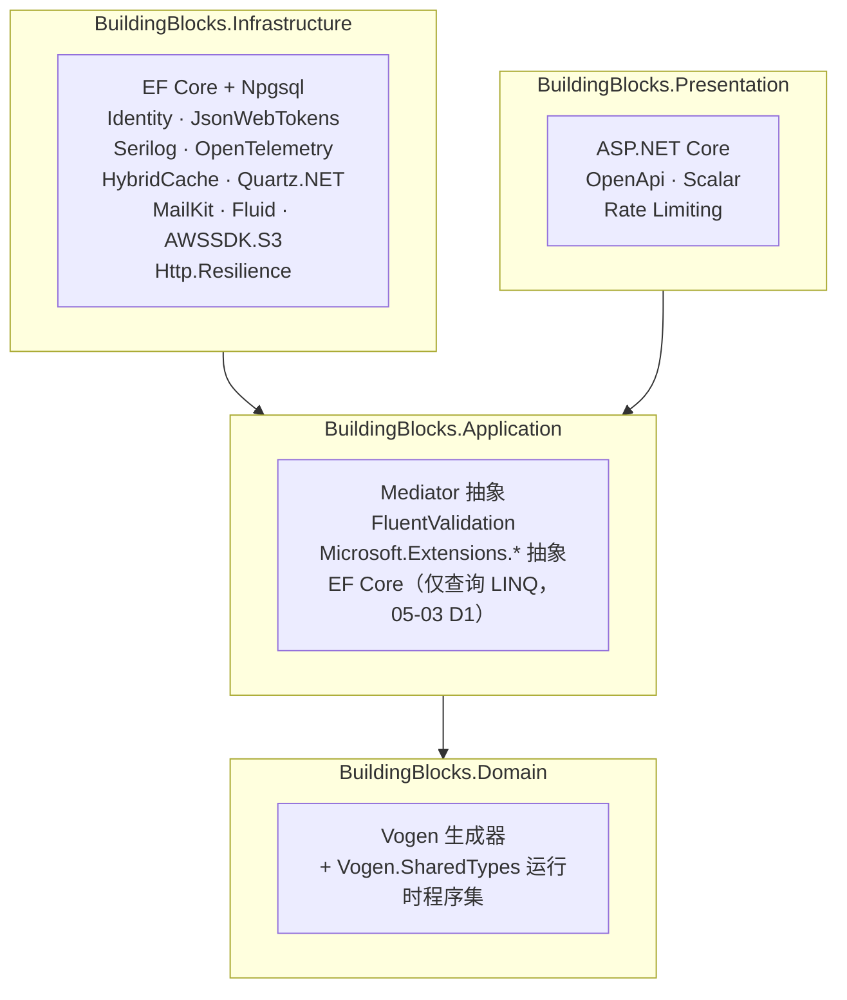

# 03 技术选型

> 目的：确定框架层面使用的运行平台、库和工具。
> 范围：只覆盖 02 需求清单中框架范围内的能力；按需能力（Excel、Word/PDF 等，见 02 第 6 节）不在本文选型。
> 标注：`待决` = 需要负责人拍板；`待确认` = 需要核实的事实；`假设` = 未验证的推断。
> **版本与许可说明**：2026-11-03 已联网核实一轮，结果见第 7 节。部分信息来自第三方索引站或缓存页面，已在表中注明可信度；2026-11-05 阶段 0 已按官方一手数据锁定全部版本并复核许可，结果见 `docs/implementation/S0-04-版本与许可.md`；第 7 节保留为当时的核实记录。
> 修订：之后的修订见文末“修订记录”。

---

## 0. 结论速览

- 大部分选型已在 ADR 中确定（第 3 节），本文只汇总。
- 本文新做的选型共 10 项（第 4 节），**已于 2026-11-03 按建议确认**；镜像扫描工具随 CI 平台于 2026-11-04 确定（ADR-0032）：

| # | 能力 | 建议 |
|---|---|---|
| 4.1 | 中介者 | Mediator（martinothamar，源码生成） |
| 4.2 | 强类型 ID | Vogen（源码生成） |
| 4.3 | 智能枚举、状态机 | 自建 |
| 4.4 | 通知模板引擎 | Fluid |
| 4.5 | 前端类型生成 | openapi-typescript + openapi-fetch |
| 4.6 | 架构测试 | ArchUnitNET |
| 4.7 | 测试断言与替身 | Shouldly + NSubstitute |
| 4.8 | 对象映射 | 不引入映射库，手写映射 |
| 4.9 | S3 客户端 | AWSSDK.S3 |
| 4.10 | 代码分析与 CI 检查工具 | 内置分析器 + Meziantou.Analyzer；oasdiff；镜像扫描 Grype + Syft（ADR-0032），并强制执行 CI 供应链加固规则 |

- 联网核实后的两项重要发现：
  - Trivy 在 2026 年 2～3 月遭遇供应链攻击（CVE-2026-33634），因此 4.10 增加了 CI 供应链加固规则；
  - AWSSDK.S3 新版默认开启的完整性校验可能与 S3 兼容存储不兼容，因此 4.9 增加了配置约束。

- 第 5 节列出明确**不引入**的库，避免以后被“顺手”加进来。

---

## 1. 选型原则

旧项目：同一能力有多套库（数据访问 4 套、Excel 4 套、上传 4～5 套），引用了未使用的库（EF6、Web API 2、JWT、Outlook Interop），版本分散在各项目的 `packages.config` 中 → 新框架按以下原则选型：

1. **官方优先**：.NET 官方或微软维护的方案能满足需求时，不引入第三方。
2. **许可稳定**：不选商业许可的库，也不选近期改为商业许可或“开源核心 + 商业功能”的库（如 MediatR、AutoMapper、FluentAssertions 8、MassTransit 9）。
3. **一种能力只有一套实现**：选定后，由架构测试或 BannedApiAnalyzers 禁止引入同类替代库。
4. **领域层零运行时依赖**：Domain 项目只允许引用框架的 `BuildingBlocks.Domain`，以及**没有运行时行为的源码生成器**（生成的代码进入本程序集）。理由：领域模型是系统中寿命最长的代码，不应受第三方库升级和许可变化影响（ADR-0008）。
5. **业务代码不直接引用第三方库的类型**：Serilog、Quartz、MailKit 等都在框架内封装，业务模块只依赖框架的抽象或 .NET 标准抽象（如 `ILogger`）。
6. **版本集中管理**：所有包版本只出现在 `Directory.Packages.props` 中（ADR-0021）。

---

## 2. 运行平台

| 项 | 旧项目 | 新框架 | 说明 |
|---|---|---|---|
| 运行时 | .NET Framework 4.8 + IIS | **.NET 10（LTS）** + Kestrel | LTS 支持到 2028 年 11 月 |
| 语言 | C# 7.3 左右 | C# 14 | 随 .NET 10 |
| 数据库 | SQL Server，4 个库，兼容级别 130 | **PostgreSQL 18** | 见下 |
| ORM | Dapper、FreeSql、DbHelperSQL 并存 | **EF Core 10 + Npgsql 10** | ADR-0012 |
| 宿主 | IIS 应用池 | Docker 容器（chiseled-extra） | ADR-0022 |
| 本地编排 | 无 | .NET Aspire | ADR-0016 |

**PostgreSQL 版本**：

| 选项 | 优点 | 缺点 |
|---|---|---|
| **PG 18** | 当前最新大版本；内置 `uuidv7()`（迁移脚本、运维 SQL 可直接生成与应用一致的 ID）；异步 I/O 提升读性能；支持周期最长 | 发布时间较短，托管云服务和周边工具的支持可能略晚 |
| PG 17 | 更成熟，托管服务支持普遍 | 没有内置 `uuidv7()`；支持周期少一年 |

- **建议**：PG 18。新项目从零开始，没有存量兼容负担；应用侧用 `Guid.CreateVersion7()` 生成 ID，数据库侧可用 `uuidv7()`，两边一致。
- **取舍**：如果生产最终使用的托管服务尚未提供 PG 18，退回 PG 17，对应用代码没有影响。
- **状态**：已确认：PG 18。生产使用阿里云 RDS PostgreSQL，已于 2025-12 提供 PG 18（09 D1），不需要退回 17；ICU 排序规则、`pg_trgm` 等依赖由 08 第 4 节原型 #13 实测。

---

## 3. 已在 ADR 中确定的选型

| 能力 | 旧项目 | 新框架 | 依据 |
|---|---|---|---|
| 账号与密码哈希 | 明文比对 | ASP.NET Core Identity | ADR-0001 |
| JWT 签发与验证 | 无（DES Cookie） | `Microsoft.IdentityModel.JsonWebTokens`（官方） | ADR-0001 |
| Web 接口 | WebForms + ashx | Minimal API + 自研 `IEndpoint` | ADR-0014 |
| 输入校验 | 正则黑名单 | FluentValidation | ADR-0017 |
| 错误响应 | `{code,msg}` | 内置 ProblemDetails + 自建 Result | ADR-0010、ADR-0014 |
| JSON | Newtonsoft.Json | System.Text.Json | ADR-0014 |
| OpenAPI | 无 | 内置 `Microsoft.AspNetCore.OpenApi` + Scalar | ADR-0014 |
| 日志 | 文本文件 | `ILogger` + Serilog | ADR-0016 |
| 追踪与指标 | 无 | OpenTelemetry | ADR-0016 |
| 缓存 | `HttpRuntime.Cache` | HybridCache（可选 Redis） | ADR-0016 |
| 功能开关 | Web.config 开关 | Microsoft.FeatureManagement | ADR-0016 |
| 本地化 | 无 | 内置 `IStringLocalizer` | ADR-0016 |
| 定时任务 | Hangfire | Quartz.NET（数据库集群模式） | ADR-0019 |
| Outbox / Inbox | 无 | 自建 | ADR-0019 |
| 外部调用韧性 | 自写 `HttpHelper` | Microsoft.Extensions.Http.Resilience | ADR-0020 |
| 邮件 | System.Net.Mail，同步 | MailKit，经 Outbox | ADR-0020 |
| 限流 | 无 | 内置 Rate Limiting | ADR-0022 |
| 健康检查 | 无 | 内置 Health Checks | ADR-0022 |
| 测试 | 自写脚本 | xUnit v3 + Testcontainers + `WebApplicationFactory` | ADR-0021 |
| 禁用 API | 无 | Microsoft.CodeAnalysis.BannedApiAnalyzers | ADR-0021 |

---

## 4. 本文需要决定的选型

### 4.1 中介者（ADR-0005）

旧项目：没有中介者，每个 ashx 手写取用户、判登录、`try/catch`，横切逻辑经常遗漏 → 新框架：ADR-0005 已确定使用源码生成式中介者，这里选具体的库。

| 选项 | 许可 | 做法 | 优点 | 缺点 |
|---|---|---|---|---|
| **Mediator**（martinothamar/Mediator） | MIT | 编译期生成分发代码，API 与 MediatR 相近 | 无反射；区分 `ICommand` / `IQuery` 等消息类型，管道行为可以按消息类型约束（例如事务行为只作用于命令）；支持管道行为、通知、流式请求 | 单人主导维护，社区比 MediatR 小 |
| Immediate.Handlers | MIT | 源码生成，处理器直接注入调用，没有中心中介者 | 链路最短，行为按处理器声明 | 行为需要在每个处理器上声明或按程序集默认，**“所有请求必须经过同一管道”不能由结构保证**；与 ADR-0005 的“统一分发”模型不一致 |
| MediatR | 商业（v13 起） | 运行时反射 | 生态最成熟 | 违反选型原则 2 |
| 自建源码生成器 | — | 自己写 Roslyn 生成器 | 完全可控 | 生成器开发与维护成本高，没有必要 |

- **建议**：Mediator（martinothamar）。
- **理由**：
  - 消息类型区分（`ICommand<T>`、`IQuery<T>`）正好对应 CQRS。ADR-0011 规定“幂等、事务只作用于命令”，可以用泛型约束在类型层面表达，不需要在行为里写运行时判断；
  - 所有请求经过中心中介者，非 HTTP 入口（Quartz、Outbox 投递）也能走同一管道（ADR-0005）。
- **取舍**：依赖一个社区规模较小的库。缓解措施：业务代码只使用框架定义的 `ICommand` / `IQuery` / `ICommandHandler` 等接口（由框架继承 Mediator 的接口），万一需要更换，影响限于框架。
- **核实结果**：MIT 许可；3.0.x 为稳定版（所见最新 3.0.2），3.1.0 处于 RC 阶段（2026-03）。使用时需同时引用 `Mediator.Abstractions` 和 `Mediator.SourceGenerator`。建议锁定 3.0.x 稳定版。
- **状态**：已确认（2026-11-03）

### 4.2 强类型 ID（ADR-0009）

旧项目：主键是 `bigint` / `int` / 字符串混用，关联靠 `QID`、`HTID` 等字段约定，传错 ID 编译器无法发现 → 新框架：ADR-0009 已确定使用强类型 ID，这里选实现方式。

每个强类型 ID 需要：EF Core 值转换、JSON 转换（字符串）、路由与查询参数绑定（`IParsable`）、OpenAPI 显示为 `string/uuid`、禁止未初始化的默认值。

| 选项 | 做法 | 优点 | 缺点 |
|---|---|---|---|
| **Vogen** | 源码生成，`[ValueObject<Guid>]` 标注 `partial` 类型，生成全部转换代码 | 一处声明，转换代码全部生成；**自带分析器**，禁止 `new CustomerId()` 和 `default(CustomerId)` 等未经校验的创建方式；社区活跃 | 生成的代码较多；需要遵守它的写法约定 |
| StronglyTypedId（andrewlock） | 源码生成 | 专门为 ID 设计，轻量 | 1.0 至今仍是 beta（最新所见 1.0.0-beta08，2024-04），没有稳定版；没有防默认值的分析器 |
| 自建：`readonly record struct` + 框架泛型约定 | 框架提供接口，EF / JSON 转换器按约定扫描注册 | 零第三方依赖 | 每个 ID 仍要手写 `IParsable` 等样板代码；**无法阻止 `default` 和无参构造**，需要另写分析器 |

- **建议**：Vogen。
- **理由**：强类型 ID 的价值在于“不可能传错、不可能未初始化”。Vogen 是唯一在编译期同时保证这两点的选项；自建方案要达到同等保证，等于重写一个 Vogen。
- **符合选型原则 4**：Vogen 是源码生成器，生成的代码在本模块程序集内。
- **核实结果**：Apache-2.0 许可；8.0.x 为稳定版（所见最新 8.0.7）。引用方式：`PrivateAssets="analyzers;build;buildtransitive;contentfiles"`——生成器与分析器不传给引用方，**运行时程序集** `Vogen.SharedTypes.dll` 照常传递（写成 `PrivateAssets="all"` 时它不会到达引用方，测试项目运行即缺失）。官方说明中“设置 `ExcludeAssets="runtime"` 后运行时不需要它”只在 ID 不写 `Validate` 方法时成立；本框架的每个 ID 都用 `Validate` 拒绝 `Guid.Empty`（05-01 第 4.1 节），它返回的 `Validation` 类型与 `From` 抛出的 `ValueObjectValidationException` 都在这个程序集中，排除后运行时即抛 `FileNotFoundException`（2026-11-10 阶段 2 实测）。所以模块 Domain 有一个很小的第三方运行时依赖（Vogen.SharedTypes，Apache-2.0）。
- **取舍**：引入一个外部源码生成器，升级时需要回归验证生成代码；ID 的生成仍由框架统一提供（`Guid.CreateVersion7()`，ADR-0009）。
- **状态**：已确认（2026-11-03）

### 4.3 智能枚举与状态机（ADR-0011）

旧项目：状态用数字（`IsShenhe = -1/0/1/2`）散落在 SQL 和代码中，状态转换的合法性靠各处 `if` 判断 → 新框架：ADR-0011 要求智能枚举与状态机构件，状态转换自动写入业务历史（ADR-0018），非法转换返回 `Result` 错误（ADR-0010）。

| 选项 | 优点 | 缺点 |
|---|---|---|
| Ardalis.SmartEnum + Stateless | 成熟，开箱即用 | 两者都是运行时库，进入 Domain，违反选型原则 4；Stateless 对非法触发默认抛异常，与“业务失败用 Result”（ADR-0010）冲突，需要逐处包装；与业务历史的联动、EF 映射仍要自己写 |
| **自建** | 状态机直接返回 `Result`；转换时直接产出业务历史记录；与智能枚举、EF 值转换统一设计；Domain 零依赖 | 需要自己开发和测试（规模约几百行） |

- **建议**：自建，放在 `BuildingBlocks.Domain`。
- **理由**：这两个构件和 Result、业务历史、EF 映射紧密耦合，第三方库只能解决其中最简单的部分（声明转换表），联动部分无论如何都要自己写。
- **取舍**：多一份需要维护和测试的框架代码；状态机只支持“状态 + 动作 → 新状态 + 守卫条件”，不支持层级状态、并行状态等高级特性（业务单据流转通常用不到）。
- **状态**：已确认（2026-11-03）

### 4.4 通知模板引擎（ADR-0020）

旧项目：邮件内容大多在代码中拼接（售后 `SendEmail.cs` 6300 行），部分模板在数据库 → 新框架：ADR-0020 已确定使用沙箱化的 Liquid 类引擎，在 Fluid 和 Scriban 中选择。

| 选项 | 许可 | 优点 | 缺点 |
|---|---|---|---|
| **Fluid** | MIT | 语法就是标准 Liquid，模板编写者可以参考大量公开资料；**默认只能访问显式登记的类型和成员**，沙箱边界清楚；性能好；Orchard Core 在用 | 只有 Liquid 的能力，复杂逻辑写不了（这对通知模板反而是好事） |
| Scriban | BSD-2 | 功能更多，有自己的脚本语言，也兼容 Liquid | 能力越强，模板里越容易写进业务逻辑；默认可以访问的范围更宽，沙箱需要额外配置 |

- **建议**：Fluid。
- **理由**：通知模板应该只做“数据 + 版式”，模板语言能力受限是优点；Fluid 的“显式登记才能访问”与 ADR-0020 “防止模板执行任意代码”的目标一致。
- **取舍**：模板中需要的格式化（日期、金额）要由框架以自定义过滤器的形式提供。
- **核实结果**：MIT 许可。最新稳定版为 2.25.0（2025-07，目标框架 net8.0 / net9.0 / netstandard2.0，可在 .NET 10 上运行）；3.0 仍是 beta（所见 3.0.0-beta.7，2026-08）。建议先锁定 2.x 稳定版，3.0 正式发布后再评估升级。
- **注意**：稳定版距今已超过一年，且 3.0 一直处于 beta。这不影响首期使用（模板引擎被封装在框架内，ADR-0020），但需要关注维护节奏；如果 3.0 长期不发布，届时再评估 Scriban。
- **状态**：已确认（2026-11-03）

### 4.5 前端类型与请求代码生成（ADR-0014）

旧项目：前端用 jQuery 手写 `GetJson.ashx?Ctype=xxx`，接口字段靠约定，后端改字段前端无感知 → 新框架：ADR-0014 已确定前端根据 OpenAPI 文档生成 TypeScript 代码，这里选工具。

| 选项 | 生成内容 | 优点 | 缺点 |
|---|---|---|---|
| **openapi-typescript + openapi-fetch** | 只生成类型；请求用一个约 6 KB 的类型安全 fetch 封装 | 生成物最少，没有需要评审的生成运行时代码；路径、参数、响应全部有类型检查；支持 OpenAPI 3.1 | 不生成 Vue Query 等数据请求钩子，需要前端自己封装一层 |
| Orval | 类型 + 请求函数 + Vue Query 钩子 | 生成即用 | 生成代码量大；与特定请求库绑定 |
| @hey-api/openapi-ts | 类型 + SDK，插件化 | 功能全、活跃 | 主版本变化较快 |
| Kiota（微软） | 完整 SDK | 多语言统一 | 生成代码重，更适合公开 SDK，不适合自家前端 |
| NSwag | 类型 + 客户端 | .NET 生态老牌 | 对 .NET 10 内置 OpenAPI（3.1）的配合不如前几项 |

- **建议**：openapi-typescript + openapi-fetch。
- **理由**：后端契约是唯一可信来源，前端只需要“类型正确”的保证；生成物越少，后端改动在前端的差异越清楚，越容易评审。
- **取舍**：数据请求钩子、缓存等由前端框架设计时自行决定（不在本阶段范围）。
- **状态**：已确认；前端框架设计时可复核请求层封装方式。

### 4.6 架构测试（ADR-0008）

旧项目：没有任何机制阻止越层 → 新框架：ADR-0008 的规则由架构测试守护。

| 选项 | 许可 | 优点 | 缺点 |
|---|---|---|---|
| **ArchUnitNET** | Apache-2.0 | 规则表达力强（依赖方向、命名、继承、特性标注、循环依赖）；规则描述可读；持续维护 | 加载程序集较慢，需要在测试中缓存架构模型 |
| NetArchTest.Rules | MIT | API 简单 | 表达力有限；最后一次发布是 1.3.2（2021-05），已基本停止维护 |
| 自写反射测试 | — | 无依赖 | 复杂规则（传递依赖、循环依赖）要自己实现 |

- **建议**：ArchUnitNET，再加少量自写测试处理特殊规则：
  - “SQL 和 EF 映射中不出现其他模块的 schema”，通过检查 EF 模型元数据实现；
  - “一个工作单元只修改一个模块的数据”，通过运行时拦截器在集成测试中断言。
- **取舍**：架构测试运行比普通单元测试慢，放在单独的测试项目中。
- **核实结果**：Apache-2.0 许可，持续发布（0.13.x，2025-12 至 2026 年仍有新版本），并提供 xUnit v3 专用包 `TngTech.ArchUnitNET.xUnitV3`，与 ADR-0021 选定的 xUnit v3 匹配。
- **状态**：已确认（2026-11-03）

### 4.7 测试断言与替身

旧项目：自定义断言 → 新框架：

| 用途 | 选项 | 说明 |
|---|---|---|
| 断言 | **Shouldly** | BSD-3-Clause（来自第三方索引，锁定时以 nuget.org 为准）；最新 4.3.0；失败信息可读，API 稳定 |
| | FluentAssertions 8 | 已确认：8.0 起改为 Xceed 社区许可，商用需付费（约 130 美元 / 开发者 / 年），不采用 |
| | AwesomeAssertions | FluentAssertions 7（最后一个 Apache-2.0 版本）的社区分支，API 兼容；分支本身的许可与长期维护`待确认` |
| | xUnit 自带 `Assert` | 零依赖，但集合、异常、对象比较的失败信息较差 |
| 替身 | **NSubstitute** | BSD-3-Clause；6.x 于 2026 年发布（来自第三方生命周期站点，`待确认`）；语法简洁，社区成熟 |
| | Moq | 已确认：4.20.0 引入闭源的 SponsorLink，读取本机 Git 配置中开发者邮箱的哈希并上传，引发信任危机，不采用 |

- **建议**：Shouldly + NSubstitute。
- **约定**：替身只用于外部边界（外部系统客户端、文件存储、通知渠道）。数据库不用替身，使用 Testcontainers（ADR-0021）；时间用 `FakeTimeProvider`（官方 `Microsoft.Extensions.TimeProvider.Testing`）。
- **取舍**：Shouldly 的高级对象比较能力弱于 FluentAssertions，复杂比较需要手写断言辅助方法。
- **状态**：已确认（2026-11-03）

### 4.8 对象映射

旧项目：Mapster 只在 DTO 项目中使用 → 新框架：

| 选项 | 优点 | 缺点 |
|---|---|---|
| **不引入映射库，手写映射** | 映射逻辑可见、可调试、可查找引用；编译期发现字段遗漏（配合 `required` 属性） | 写起来比自动映射多几行 |
| Mapperly | 源码生成，无反射，MIT | 多一个生成器；收益有限 |
| Mapster / AutoMapper | 写法少 | 运行时映射，字段改名后静默丢值；AutoMapper 已改为商业许可 |

- **建议**：不引入映射库。
- **理由**：
  - 查询侧直接用 LINQ 投影到 DTO（ADR-0012），本来就不需要映射；
  - 命令侧由请求创建值对象和调用聚合方法，不是简单的字段复制，自动映射反而会绕过工厂方法和校验（ADR-0011）。
  剩下需要映射的地方很少，手写成本很低。
- **取舍**：个别字段很多的响应模型需要手写较长的映射代码。
- **状态**：已确认（2026-11-03）

### 4.9 S3 兼容存储客户端（ADR-0020）

| 选项 | 优点 | 缺点 |
|---|---|---|
| **AWSSDK.S3** | 事实标准，兼容 MinIO 和各云厂商的 S3 兼容接口；预签名链接、分段上传完整 | 包较大 |
| Minio .NET SDK | 轻量 | 主要面向 MinIO；云厂商兼容性和功能完整性不如前者 |

- **建议**：AWSSDK.S3，只在 `BuildingBlocks.Infrastructure` 的 `IFileStorage` 实现中使用。
- **理由**：生产对象存储选 MinIO 还是云服务仍待决（ADR-0020），AWSSDK.S3 对两者都适用，这个选型不受该待决项影响。
- **核实发现：默认完整性校验的兼容问题**
  - AWSSDK.S3 从 3.7.412.0 起（v4 延续），默认在所有上传请求中附加额外校验和，并校验下载的响应（`RequestChecksumCalculation` 默认 `WHEN_SUPPORTED`）。
  - AWS 官方说明：SDK 可能在第三方 S3 兼容服务支持之前就默认启用新特性。MinIO 及部分云厂商的 S3 兼容接口可能因此拒绝请求或校验失败。
  - **约束**：`IFileStorage` 的 S3 实现把 `RequestChecksumCalculation` 和 `ResponseChecksumValidation` 作为配置项；对接非 AWS 存储时默认设为 `WHEN_REQUIRED`。集成测试使用 Testcontainers 启动 MinIO，覆盖上传、下载、分段上传、预签名链接。
  - `待确认`：生产存储已定为阿里云 OSS（09 D2），在 08 原型 #14 中验证默认设置是否可用。
- **版本**：v4（4.0.104.9，S0-04），以上约束按 v4 的配置项落实。
- **状态**：已确认（2026-11-03）

### 4.10 代码分析与 CI 检查工具（ADR-0021、ADR-0022）

| 用途 | 建议 | 说明 |
|---|---|---|
| 通用代码分析 | .NET 内置分析器（`AnalysisLevel` = latest-recommended）+ **Meziantou.Analyzer** | Meziantou 补充异步、字符串比较、`CancellationToken` 传递等规则，与内置规则重叠少 |
| 禁用 API | BannedApiAnalyzers | 已确定（ADR-0021） |
| 自定义规则 | 框架自建 Roslyn 分析器项目 | 值对象写法、领域层不抛业务异常等（ADR-0011、ADR-0021） |
| OpenAPI 破坏性变更 | **oasdiff** | 开源命令行工具，对比两个版本的 OpenAPI 文档，可在 CI 中按规则阻断 |
| 依赖漏洞 | `dotnet list package --vulnerable` | 官方，基于 NuGet 漏洞数据库 |
| 镜像漏洞 | Trivy 或 Grype，随 CI 平台确定 | 见下方供应链说明 |

- **取舍**：Meziantou 规则较多，初期需要逐条确认启用级别，写入 `.editorconfig`。

**核实发现：Trivy 供应链攻击**

- 2026 年 2 月底至 3 月，攻击者获取了 Trivy 发布流程的凭据：
  - 发布了恶意的 Trivy v0.69.4；
  - 把 `trivy-action` 77 个版本标签中的 76 个、`setup-trivy` 的全部 7 个标签，强制改指向窃取凭据的恶意代码；
  - 恶意代码会读取 CI 运行器内存，窃取 SSH 密钥、云凭据和 Kubernetes 令牌。
- 该事件编号 CVE-2026-33634，已列入美国 CISA 的“已知被利用漏洞”清单。已知安全版本：Trivy v0.69.2 / v0.69.3、trivy-action 0.35.0、setup-trivy 0.2.6。
- 结论：问题出在发布流程被攻破，不是扫描能力本身。但它说明 **CI 中的任何第三方工具都可能成为窃取密钥的入口**，所以不只针对 Trivy，而是对所有 CI 工具制定规则。

**CI 供应链加固规则**（新增，适用于 ADR-0022 的流水线）：

1. 第三方 CI 动作按**提交 SHA** 固定，不使用可被改写的版本标签；工具二进制和容器镜像按**摘要（digest）**固定。
2. 扫描、测试等步骤所在的作业**不持有**镜像推送、部署凭据；推送和部署放在独立作业中，只在扫描通过后执行。
3. CI 凭据使用短时效令牌，按作业最小授权。
4. 升级 CI 工具版本走与代码相同的评审流程。

| 镜像扫描选项 | 优点 | 缺点 |
|---|---|---|
| Trivy | 功能最全（镜像、依赖、IaC、密钥）；社区最大 | 2026 年刚发生供应链事件，需要确认维护方的整改情况 |
| Grype（Anchore） | 专注漏洞扫描；与 Syft（SBOM 生成）配合 | 功能范围比 Trivy 窄；当前状态`待确认` |
| CI 平台 / 镜像仓库自带扫描 | 不引入额外工具 | 取决于平台，能力差异大 |

- **建议**：工具随 CI 平台一起选（ADR-0022 待决项）；无论选哪一个，上面 4 条加固规则都强制执行。
- **状态**：已确认（Meziantou.Analyzer、oasdiff、CI 供应链加固规则）。镜像扫描工具随 CI 平台确定（ADR-0032）：CI 平台为 Gitea Actions，镜像扫描为 **Grype + Syft**（Syft 生成 SBOM），阻断标准、漏洞库缓存与版本固定见 ADR-0032 第 6 节；上面 4 条加固规则由 ADR-0032 第 4、10 节落到执行机与凭据配置。

---

## 5. 明确不引入的库

| 库 | 不引入的原因 | 替代 |
|---|---|---|
| MediatR | 商业许可；运行时反射 | 4.1 |
| AutoMapper、Mapster | AutoMapper 商业许可；运行时映射会静默丢值 | 手写映射（4.8） |
| FluentAssertions 8+ | 商业许可 | Shouldly（4.7） |
| Moq | 信任风险 | NSubstitute（4.7） |
| MassTransit、Wolverine、NServiceBus | 与自建 Outbox / Inbox、中介者重叠；MassTransit 9 起商业许可 | 自建 Outbox（ADR-0019） |
| Hangfire | 序列化方法调用，改名后任务失败 | Quartz.NET（ADR-0019） |
| Dapper（作为框架标准） | 一套技术统一拦截器（ADR-0012） | EF Core 原生 SQL；个别场景经评审可局部使用 |
| Newtonsoft.Json | 官方已有 System.Text.Json | System.Text.Json |
| FastEndpoints、Carter | 不引入第三方端点框架（ADR-0014） | 自研 `IEndpoint` |
| Swashbuckle、NSwag（服务端） | .NET 已内置 OpenAPI 生成 | `Microsoft.AspNetCore.OpenApi` |
| Ardalis.SmartEnum、Stateless | 运行时依赖进入 Domain | 自建（4.3） |
| 直接引用 Polly | 官方韧性库已基于 Polly v8 封装 | Microsoft.Extensions.Http.Resilience |
| EF Core 内存数据库、SQLite（测试用） | 不支持依赖的 PG 特性（ADR-0021） | Testcontainers |

这些库加入 BannedApiAnalyzers 或架构测试的禁用清单。

---

## 6. 依赖分布

各框架构件项目允许引用的主要包：

- 模块的 Domain 项目只引用 `BuildingBlocks.Domain` 和 Vogen（生成器 + `Vogen.SharedTypes` 运行时程序集，见 4.2）。
- 模块的 Application 项目可以引用 FluentValidation（编写校验器），以及框架包装的中介者接口；不直接引用 Mediator 的类型（4.1）。
- 模块的 Application 项目可以引用 `Microsoft.EntityFrameworkCore`（不含 Npgsql），**仅用于查询处理器**通过模块的 `IXxxQueryDb` 接口编写 LINQ 查询；`DbContext`、`SaveChanges`、`ExecuteUpdate`、`ExecuteDelete`、`FromSql` 等由 BannedApiAnalyzers 禁止（2026-11-04 补充，见 05-03 D1）。
- Serilog、Quartz、MailKit、Fluid、AWSSDK.S3 只出现在 `BuildingBlocks.Infrastructure` 中，模块不直接引用（选型原则 5）。

---

## 7. 联网核实结果（2026-11-03）

可信度：**高** = 官方页面或多个来源一致；**中** = 单一第三方索引或缓存页面；**未核实** = 没有找到可靠来源。

| 项 | 许可 | 版本 / 维护状态 | 可信度 | 对结论的影响 |
|---|---|---|---|---|
| PostgreSQL 18 | PostgreSQL 许可 | 2025-09 发布，内置 `uuidv7()`（遵循 RFC 9562） | 高 | 支持第 2 节建议 |
| Npgsql EF Core 提供程序 | PostgreSQL 许可 | 10.0.x 稳定版（10.0.0 于 2025-11 发布），11.0 预览中 | 高 | 无 |
| Mediator（martinothamar） | MIT | 3.0.x 稳定（所见 3.0.2），3.1 RC | 高 | 锁定 3.0.x |
| Vogen | Apache-2.0 | 8.0.x 稳定（所见 8.0.7）；`SharedTypes` 在运行时非必需（阶段 2 更正：写了 `Validate` 时必需，见 4.2） | 高 | 采用 `PrivateAssets` 引用，保留运行时程序集 |
| StronglyTypedId | MIT | 1.0 仍是 beta（beta08，2024-04） | 高 | 支持不选它 |
| Fluid | MIT | 稳定 2.25.0（2025-07）；3.0 beta.7（2026-08） | 中 | 锁定 2.x；关注维护节奏 |
| ArchUnitNET | Apache-2.0 | 0.13.x，2026 年仍有发布；有 xUnit v3 包 | 高 | 无 |
| NetArchTest.Rules | MIT | 1.3.2（2021-05）后无发布 | 高 | 支持不选它 |
| Shouldly | BSD-3-Clause | 4.3.0 | 中 | 锁定时以 nuget.org 为准 |
| NSubstitute | BSD-3-Clause | 6.x（2026） | 中 | 锁定时以 nuget.org 为准 |
| FluentAssertions 8 | Xceed 社区许可（商用付费） | — | 高 | 支持不选它 |
| AwesomeAssertions | `未核实` | — | 未核实 | 只作备选 |
| Moq | — | 4.20.0 SponsorLink 事件属实 | 高 | 支持不选它 |
| MediatR、AutoMapper | 2025 年起转为商业许可 | — | 中（二手来源） | 支持不选它 |
| MassTransit v9 | 商业许可，2026 年一季度正式发布；v8 继续提供安全补丁 | — | 高（官方公告） | 支持 ADR-0019 |
| Quartz.NET | `未核实`（通常为 Apache-2.0） | 3.x 最新所见 3.18.2（2026-06）；官方文档称 4.x 为当前版本 | 中 | 已确认使用 4.x 稳定版（附前提），见第 8 节 |
| openapi-typescript | MIT | 支持 OpenAPI 3.0 / 3.1 | 中 | 无 |
| openapi-fetch | `未核实` | — | 未核实 | 随前端设计确认 |
| Meziantou.Analyzer | MIT | 3.0.x（2026-02）持续发布 | 中 | 无 |
| oasdiff | 早期为 Apache-2.0（Tufin），现迁至 oasdiff 组织 | 持续维护 | 中 | 当前许可`待确认` |
| Trivy | Apache-2.0 | 2026 年供应链事件（CVE-2026-33634） | 高 | 新增 CI 加固规则（4.10） |
| AWSSDK.S3 | Apache-2.0 | 3.7.412.0 起默认开启完整性校验 | 高（AWS 官方文档） | 新增配置约束（4.9） |
| .NET 10 chiseled-extra 镜像 | MIT | “extra”变体包含 ICU 与 tzdata 已有官方说明，但该说明只列出 .NET 6/7/8；.NET 10 的对应标签未找到直接说明 | 中 | 开始实施时用 `docker run … ls /usr/share/zoneinfo` 实测（ADR-0022） |

**来源**（主要）：
- [Mediator 发布页](https://github.com/martinothamar/Mediator/releases)、[Mediator.SourceGenerator（NuGet）](https://www.nuget.org/packages/Mediator.SourceGenerator)
- [Vogen（NuGet）](https://www-1.nuget.org/packages/Vogen)、[Vogen 8.0.7（NuGet 源）](https://feed.nuget.org/packages/Vogen)
- [StronglyTypedId 1.0.0-beta04（NuGet）](https://nuget.org/packages/StronglyTypedId/1.0.0-beta04)
- [Fluid 仓库](https://github.com/sebastienros/fluid)、[Fluid.Core 2.25.0（NuBrowse）](https://nubrowse.com/packages/Fluid.Core/2.25.0)、[Fluid.Core（nugetmusthaves）](https://nugetmusthaves.com/Package/Fluid.Core)
- [TngTech.ArchUnitNET.xUnitV3（NuGet）](https://www.nuget.org/packages/TngTech.ArchUnitNET.xUnitV3/)、[NetArchTest 作者主页（NuGet）](https://www.nuget.org/profiles/BenMorris)
- [Shouldly（depscope）](https://depscope.dev/pkg/nuget/Shouldly)、[NSubstitute 版本周期（versio.io）](https://www.versio.io/en/product-release-end-of-life-eol-anthony-egertondavid-tchepakalexandr-nikitinoleksandr-povar-nsubstitute.html)
- [FluentAssertions 许可变更（DevClass）](https://www.devclass.com/development/2025/01/16/another-open-source-project-shifts-to-restrictive-license-fluent-assertions-following-xceed-partnership/1621343)
- [Moq SponsorLink（BleepingComputer）](https://www.bleepingcomputer.com/tag/moq/)
- [MassTransit v9 公告](https://masstransit.io/introduction/v9-announcement)、[MediatR 与 MassTransit 转商业（Milan Jovanović）](https://milanjovanovic.tech/blog/mediatr-and-masstransit-going-commercial-what-this-means-for-you)、[AutoMapper / MediatR / MassTransit 转商业（ABP）](https://abp.io/community/articles/automapper-mediatr-and-masstransit-are-going-commercial-whats-happening-3vrljuxr)
- [Quartz（NuGet）](https://www.nuget.org/packages/quartz/)、[Quartz.NET 3.x 迁移指南](https://www.quartz-scheduler.net/documentation/quartz-3.x/migration-guide.html)
- [openapi-typescript（npm）](https://www.npmjs.com/openapi-typescript)
- [Meziantou.Analyzer（ecosyste.ms）](https://awesome.ecosyste.ms/projects/220822)、[oasdiff 仓库](https://github.com/oasdiff/oasdiff)、[tufin/oasdiff（pkg.go.dev）](https://pkg.go.dev/github.com/tufin/oasdiff@v0.1.19)
- [Trivy 供应链事件（SafeDep）](https://safedep.io/trivy-teampcp-supply-chain-compromise/)、[CVE-2026-33634](https://stack.watch/vuln/CVE-2026-33634/)、[Barracuda 通告](https://trust.barracuda.com/security/information/trivy-supply-chain-compromise)
- [AWS SDK 数据完整性保护](https://docs.aws.amazon.com/sdkref/latest/guide/feature-dataintegrity.html)、[aws-sdk-net #3610](https://github.com/aws/aws-sdk-net/issues/3610)
- [UUIDv7 in PostgreSQL 18（Nile）](https://thenile.dev/blog/uuidv7)、[Npgsql EF Core 提供程序（NuGet）](https://www.nuget.org/packages/npgsql.entityframeworkcore.postgresql/)
- [Ubuntu Chiseled extra 变体（dotnet-docker 讨论）](https://github.com/dotnet/dotnet-docker/discussions/5092)

---

## 8. 决策与待确认汇总

| # | 事项 | 类型 | 位置 |
|---|---|---|---|
| 1 | PostgreSQL 版本：18（阿里云 RDS 已提供） | 已确认 | 第 2 节 |
| 2 | 中介者：Mediator（martinothamar） | 已确认 | 4.1 |
| 3 | 强类型 ID：Vogen | 已确认 | 4.2 |
| 4 | 智能枚举与状态机：自建 | 已确认 | 4.3 |
| 5 | 模板引擎：Fluid | 已确认 | 4.4 |
| 6 | 前端类型生成：openapi-typescript + openapi-fetch | 已确认 | 4.5 |
| 7 | 架构测试：ArchUnitNET | 已确认 | 4.6 |
| 8 | 测试断言与替身：Shouldly + NSubstitute | 已确认 | 4.7 |
| 9 | 不引入映射库 | 已确认 | 4.8 |
| 10 | S3 客户端：AWSSDK.S3 | 已确认 | 4.9 |
| 11 | 分析器与 CI 工具：Meziantou.Analyzer、oasdiff；镜像扫描工具 Grype + Syft（ADR-0032）；CI 供应链加固规则 | 已确认 | 4.10 |
| 12 | Quartz.NET 锁定 3.x 还是 4.x：3.x 仍在维护、资料多；4.x 为官方当前版本。采用 4.x 稳定版（已锁定 4.7.2，S0-04）；PG 集群模式在阶段 2 实现时验证 | 已确认 | 第 7 节 |
| 13 | 标为“中”和“未核实”的条目：Mediator MIT、openapi-fetch MIT、oasdiff Apache-2.0、Quartz.NET Apache-2.0、Meziantou.Analyzer MIT、Fluid 2.x 维护活跃（2.41.1） | 已核实（S0-04） | 第 7 节 |
| 14 | .NET 10 chiseled-extra 镜像包含时区数据与 ICU，实施时实测 | 已确认（2026-11-12，实测，见实施待办 T-14） | 第 7 节 |
| 15 | S3 校验和配置在目标生产存储（OSS）上验证 | 待确认（原型 #14） | 4.9 |

---

## 9. 修订记录

| 日期 | 内容 | 来源 |
|---|---|---|
| 2026-11-04 | 第 2 节：生产 RDS 已提供 PG 18，“退回 17”的预案取消 | 09 D1 |
| 2026-11-04 | 第 4.10 节：镜像扫描工具定为 Grype + Syft，CI 平台为 Gitea Actions | ADR-0032 |
| 2026-11-05 | 版本锁定与许可复核：第 8 节第 12、13 项关闭；第 4.9 节 AWSSDK.S3 为 v4 | S0-04 |
| 2026-11-10 | 文档整合：以上补充说明并入正文，决定不变 | R01 L2（S0-08） |
| 2026-11-10 | 第 4.2、6、7 节：更正 Vogen 的引用方式——ID 写了 `Validate`，运行时需要 `Vogen.SharedTypes`，不能排除运行时程序集；选型不变 | 阶段 2 S2-01 实测 |
| 2026-11-12 | 第 8 节第 14 项实测完成：chiseled-extra 含时区数据与 ICU，普通 chiseled 不含（见实施待办 T-14）；第 7 节该条的“中 / 待实测”风险关闭 | S2-18 |
