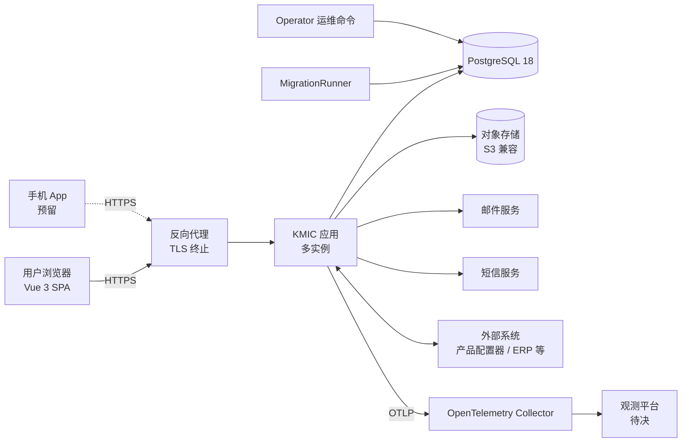
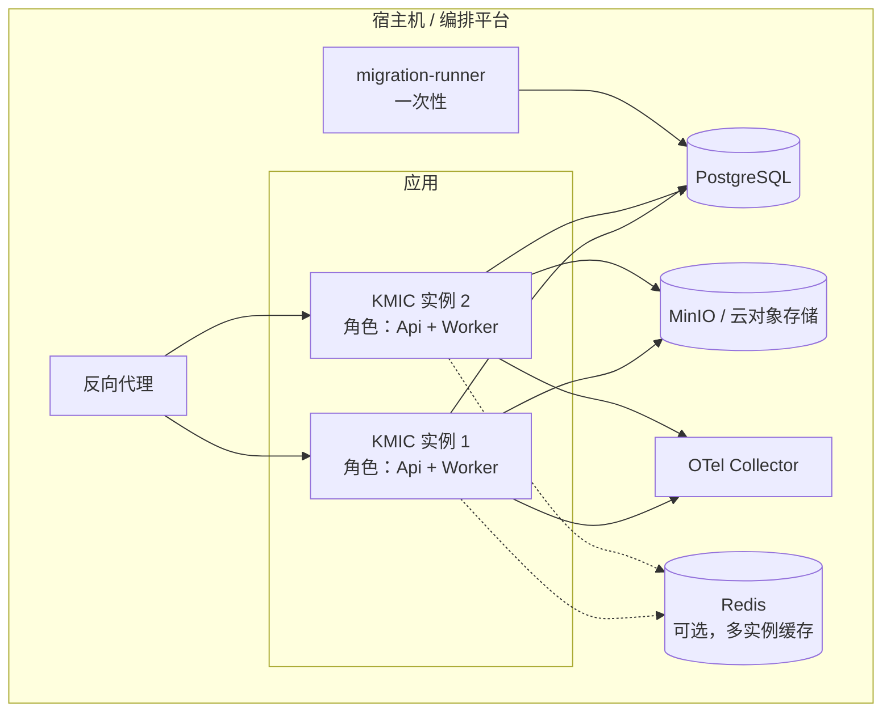
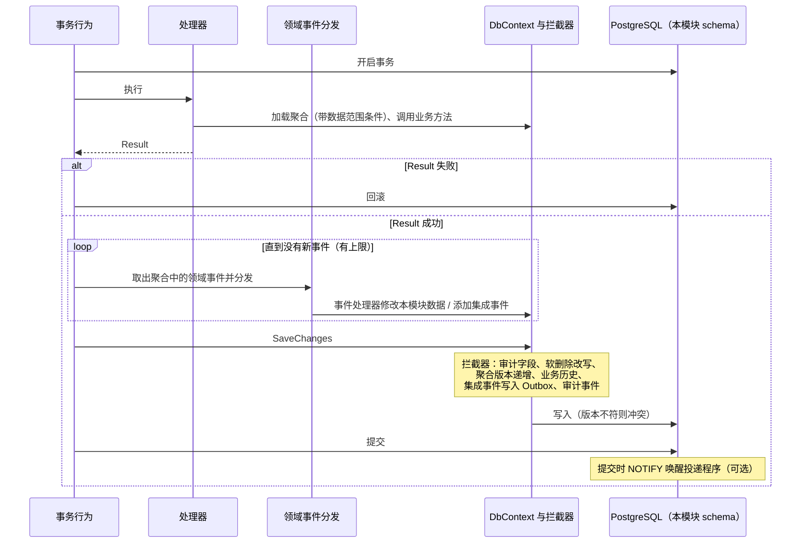
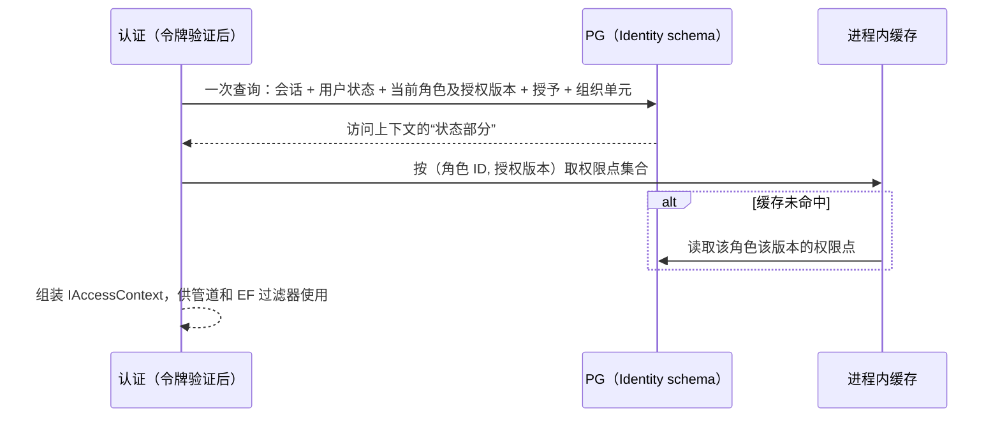
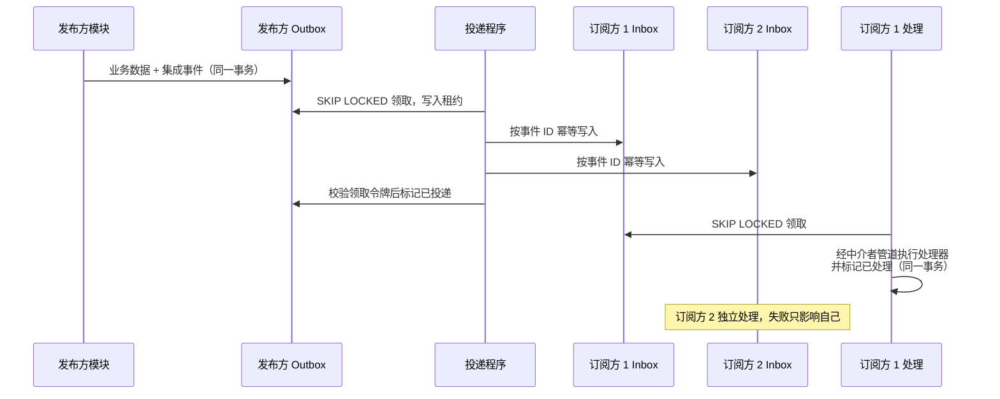
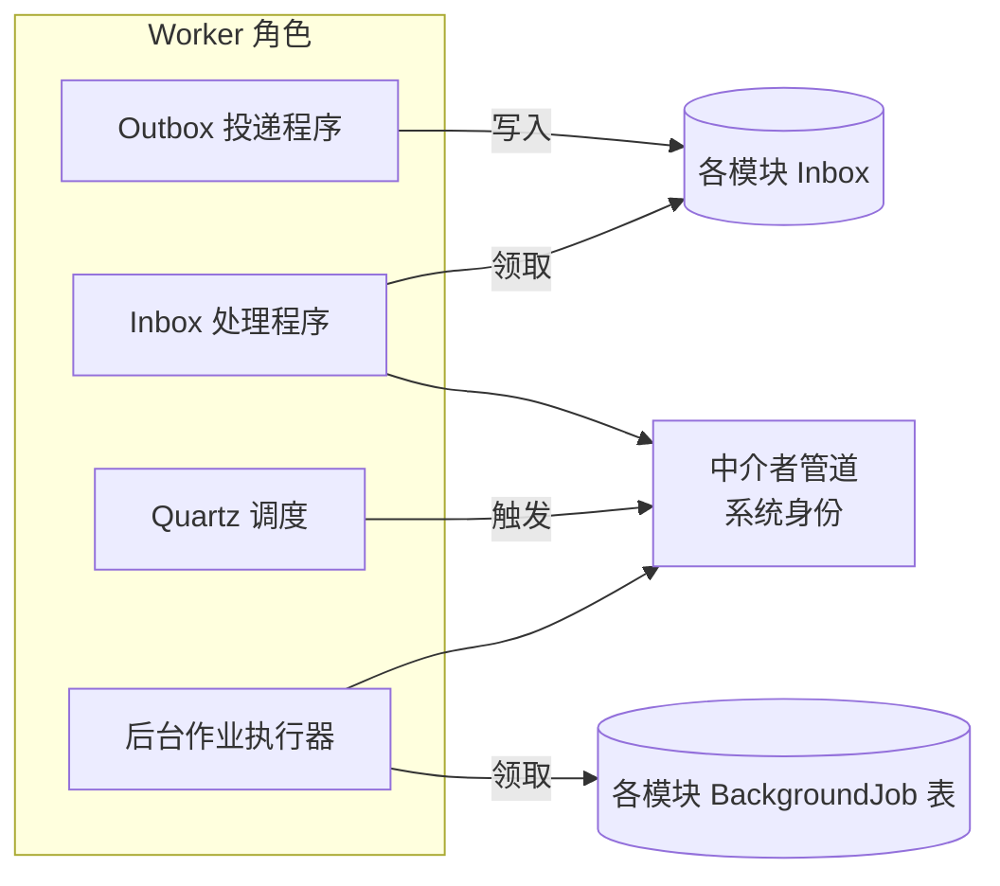
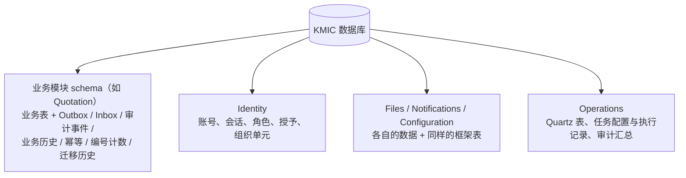
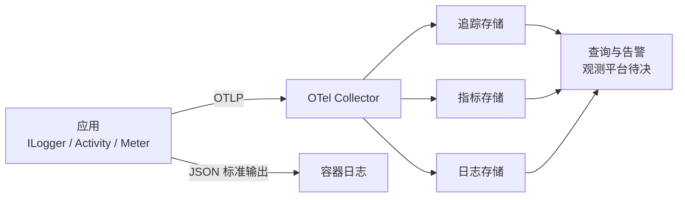

# 04 整体架构

> 目的：把已确认的 ADR 和技术选型组装成一张完整的架构图，说明运行时各部分如何协作，并细化 ADR 中留给架构文档的事项。
> 范围：只涉及底层框架，不划分具体业务模块。图中出现的“客户”“报价”等模块名只用于举例。
> 标注：`待决` = 需要负责人拍板；`待确认` = 需要核实的事实；`假设` = 未验证的推断。

---

## 0. 结论速览

- 本文按“系统上下文 → 部署 → 代码结构 → 请求链路 → 访问上下文 → 平台能力承载 → 模块间通信 → 后台处理 → 数据库 → 可观测性”的顺序展开。
- 细化了 ADR 中留给架构文档的 4 项：
  - 管道行为的最终顺序（ADR-0005）；
  - 跨模块报表（ADR-0006）；
  - 不区分大小写的列约定（02 第 4 节）；
  - 组织层级的归属（ADR-0015）。
- 新提出的 **7 项决策**已于 2026-11-03 确认（第 13 节，ADR-0025～0031），其中影响最大的三项：
  - **D3 平台能力的承载方式**：账号、附件、通知、配置这类“框架提供、但需要存数据”的能力放在哪里；
  - **D4 集成事件的投递方式**：一个事件有多个订阅方时，如何做到互不影响；
  - **D7 组织层级的归属**：它决定每次请求能否用一次查询加载完访问上下文。

---

## 1. 旧项目怎么做的 → 新框架怎么做

| 方面 | 旧项目 | 新框架 |
|---|---|---|
| 进程 | IIS 中一个 WebForms 站点，Hangfire 跑在同一进程 | 一个镜像，可按角色运行为 API 或后台处理（D1） |
| 代码边界 | 名义三层，页面直写 SQL | 模块化单体，每个模块 5 个项目，编译期约束 |
| 数据 | 4 个库，三段式名称互访，触发器同步 | 1 个 PG 库，每个模块一个 schema，禁止跨 schema 访问 |
| 请求处理 | 每个 ashx 自己取用户、判登录、`try/catch` | 中间件 + 中介者管道统一处理 |
| 身份 | DES Cookie，无服务端会话 | JWT + 服务端会话，每个请求加载访问上下文 |
| 副作用 | 请求内同步发邮件、跨库写入 | Outbox / Inbox 异步、可重试 |
| 观测 | 文本日志 | 日志、追踪、指标统一经 OpenTelemetry 输出 |

---

## 2. 系统上下文

- 前端与 API 同域部署，由反向代理分发静态资源和 `/api` 请求（ADR-0022）。
- 外部系统的具体对接属于按需能力（02 第 6 节），这里只表示存在这类依赖。

---

## 3. 部署视图

### 3.1 容器

- 部署顺序：`migration-runner` 成功退出后，才启动或滚动更新应用容器（ADR-0022）。
- 应用实例没有本地状态，可以水平扩展。多实例下靠以下机制保证正确：
  - Outbox / Inbox 领取：`SKIP LOCKED`；
  - Quartz：数据库集群模式；
  - 业务编号：计数表 + 行锁；
  - 会话与授权：每个请求查库。

### 3.2 D1 后台处理是否独立运行（已确认）

ADR-0021 只规划了 `Kmic.Api` 一个 Web 宿主。Outbox 投递、Inbox 处理、Quartz 触发、后台作业放在哪个进程里，需要明确。

| 选项 | 做法 | 优点 | 缺点 |
|---|---|---|---|
| A 同进程 | 每个 API 实例都同时跑后台处理 | 最简单，部署单元最少 | 大批量导入、积压投递会抢占 API 的 CPU 和连接池，影响接口响应 |
| B 独立宿主 | 新增 `Kmic.Worker` 项目和镜像 | 负载彻底隔离 | 多一个宿主项目和镜像，两者的模块注册要保持一致 |
| **C 同一镜像，按配置分角色** | 同一个程序，配置 `Roles = Api, Worker` 决定启用哪些部分 | 开发和单实例部署时一个容器包办；生产可以拆成“只跑 Api”和“只跑 Worker”两组容器，只改配置 | 启动代码需要按角色条件注册；角色配置错误时（如没有任何实例跑 Worker）消息会积压，需要启动检查和积压告警兜底 |

- **建议**：C。
- **理由**：
  - 首期流量下 A 已经够用，C 在默认配置下与 A 完全一样；
  - 以后出现负载干扰时只需改部署配置，不需要新增项目，也不存在两个宿主模块注册不一致的问题；
  - Worker 角色复用相同的模块注册（ADR-0021 的 `IModule`），处理逻辑依然经过中介者管道（ADR-0005）。
- **取舍**：启动代码多一层角色判断；必须有“Outbox 积压、最老消息等待时长”告警（FR-OBS-03）来发现“没有实例跑 Worker”的配置错误。

---

## 4. 代码结构视图

解决方案结构和项目依赖见 ADR-0004、ADR-0021。框架构件内部的主要组件如下：

| 项目 | 主要组件 |
|---|---|
| `BuildingBlocks.Domain` | `Entity`、`AggregateRoot`、值对象基础、智能枚举、状态机、领域事件、`Result` / `Error` |
| `BuildingBlocks.Application` | `ICommand` / `IQuery` 及处理器接口、管道行为、`ICurrentUser`、`IAccessContext`、授权与数据范围抽象、资源策略接口、分页与排序模型、集成事件发布接口、编号服务接口 |
| `BuildingBlocks.Infrastructure` | 模块 DbContext 基类与 EF 约定、拦截器（审计字段、软删除、版本、领域事件）、Outbox / Inbox、投递程序、Quartz 集成、HybridCache 配置、`IFileStorage` 实现、通知渠道、Fluid 模板、韧性 HTTP 客户端约定、OpenTelemetry 与 Serilog 配置 |
| `BuildingBlocks.Presentation` | `IEndpoint` 自动注册、路由组约定、Result → HTTP 转换、ProblemDetails 扩展、OpenAPI 与 JSON 转换器、限流策略、健康检查端点 |
| 框架分析器项目 | 值对象写法、领域层不抛业务异常等自定义规则（ADR-0021） |

---

## 5. 一个请求的完整链路

### 5.1 HTTP 中间件顺序

| 顺序 | 中间件 | 作用 | 依据 |
|---|---|---|---|
| 1 | 转发头 | 只信任已登记代理传来的客户端 IP 与协议 | ADR-0022 |
| 2 | 全局异常处理 | 未处理异常 → 500 ProblemDetails，带 `traceId`，不暴露堆栈 | ADR-0010 |
| 3 | 安全响应头、HSTS | 统一输出 | ADR-0022 |
| 4 | 请求大小限制 | 全局限制，上传端点单独放宽 | ADR-0022 |
| 5 | 路由 | 匹配端点，获得端点元数据（匿名标注、限流策略） | ADR-0014 |
| 6 | 认证 | 验证 JWT 签名与有效期；**令牌验证通过后加载访问上下文**（见第 6 节）；会话无效时按认证失败返回 401 | ADR-0001 |
| 7 | 限流 | 匿名端点按 IP，已登录按用户，高消耗端点单独策略 | ADR-0022 |
| 8 | 授权 | 只检查“是否已登录”；匿名端点必须显式标注 | ADR-0011 |
| 9 | 端点 | 绑定请求 → 发送到中介者 → Result 转 HTTP | ADR-0014 |

- 限流放在认证之后，才能按用户分区；匿名端点没有用户，按 IP 分区。
- 访问上下文在认证阶段加载，而不是放在单独的中间件里，这样“会话已失效”自然就是认证失败（401），不会出现“令牌有效、但上下文为空”的中间状态。

### 5.2 中介者管道的最终顺序

ADR-0011 给出了顺序，这里细化每个行为的职责和适用范围：

| 顺序 | 行为 | 适用 | 职责 |
|---|---|---|---|
| 1 | 日志与追踪 | 全部 | 创建 Activity，记录操作名、耗时、结果类型 |
| 2 | 异常转换 | 全部 | 把**已知的**基础设施异常转为 `Result`：并发冲突 → `VersionConflict`（409）；唯一约束冲突 → 对应模块的冲突错误。其他异常继续向外抛，由全局异常处理返回 500 |
| 3 | 校验 | 全部 | FluentValidation，失败返回 400 |
| 4 | 授权 | 全部 | 检查命令 / 查询上声明的权限点（第 1 层）；系统身份必须由用例显式允许 |
| 5 | 幂等 | 标记了幂等的命令 | 检查或登记幂等记录（ADR-0011） |
| 6 | 事务 | 命令 | 见 5.3 |
| 7 | 处理器 | 全部 | 加载数据（数据范围第 2 层）→ 资源策略（第 3 层）→ 聚合方法（第 4 层）→ 保存（第 5 层） |

- 行为之间的类型约束由 Mediator 的消息类型表达：事务、幂等行为只对 `ICommand` 生效（03 第 4.1 节）。
- “领域事件分发 → 写入 Outbox → 提交”不是独立的管道行为，而是事务行为内部的固定步骤，见 5.3。这样可以保证它们一定在同一个事务中、按固定顺序执行。

### 5.3 命令事务内部

- 领域事件处理器可能产生新的领域事件，分发循环有最大轮次，超过即视为程序缺陷并抛异常。
- 业务历史、Outbox（含审计事件消息，2026-11-04 随 05-09 D3 修订）都写在**本模块 schema** 中，与业务数据同一事务，因为 ADR-0006 规定一个事务只能修改一个模块的数据。这也是第 7 节 D3 的约束来源。
- PG 的 `NOTIFY` 只在事务提交后送达，回滚时不会误唤醒投递程序。

### 5.4 查询链路

- 查询不经过事务和幂等行为。
- 处理器直接使用本模块的查询 DbContext（不跟踪），数据范围由 EF 命名查询过滤器自动套用（ADR-0015）。
- 查询顺序固定为：数据源 → 授权范围 → 资源可见性 → 业务筛选 → 排序 → 分页（ADR-0015）。

---

## 6. 访问上下文

### 6.1 内容

| 字段 | 来源 | 用途 |
|---|---|---|
| 用户 ID、会话 ID | JWT（`sub`、`sid`）+ 会话表 | `ICurrentUser`、审计 |
| 会话状态、用户状态 | 会话表、用户表 | 已退出、已禁用 → 401 |
| 当前角色、角色状态、角色授权版本 | 会话表、角色表 | 角色被停用或收回 → 拒绝；版本变化 → 响应头通知前端（ADR-0015） |
| 用户在当前角色上的授予（含绝对数据范围） | “用户-角色”授予表 | 数据范围计算 |
| 用户所属组织单元 | 用户表 / 组织单元表 | 相对数据范围计算 |
| 模拟身份信息 | 会话表 | 实际操作人、审计 |
| 当前角色的权限点集合 | 角色权限表 | 管道授权行为 |

### 6.2 加载方式

ADR-0001、ADR-0016 要求：每个请求从数据库**一次查询**加载会话与访问上下文，不跨请求缓存，保证“禁用、改权限立即生效”。

**D2 权限点集合是否按版本缓存（已确认）**

| 选项 | 做法 | 优点 | 缺点 |
|---|---|---|---|
| A 全部每次查库 | 状态和权限点集合都在每个请求中查询 | 最直接，与 ADR-0016 字面一致 | 权限点集合可能有几百行，每个请求都传输一遍 |
| **B 状态每次查库，权限点集合按版本缓存** | 每个请求查询“状态部分”（含授权版本）；权限点集合以“角色 ID + 授权版本”为缓存键 | 缓存键包含版本，版本一变就自然换键，**不可能读到过期的权限**；每个请求的查询保持很小 | 需要保证“权限变化必定递增版本”，由框架在角色权限的写入路径上统一处理，并用测试覆盖 |

- **建议**：B。
- **理由**：ADR-0016 不缓存的目的是“变更立即生效”。按版本缓存的是**不可变的内容**：同一个版本号对应的权限集合永远不变，所以不违背这个目的，同时避免每个请求重复读取大量权限数据。
- **取舍**：多了一条必须守住的不变量（改权限必须递增版本）；违反时会读到旧权限，所以必须由框架统一写入路径，而不是由业务代码自觉维护。

### 6.3 数据范围的计算

- 每个请求在首次需要时计算一次，并在请求内缓存（不跨请求）。
- 计算结果是结构化条件，例如“所属人 = 当前用户”“所属组织 ∈ {集合}”“全部”，由 EF 命名过滤器转为参数化 SQL。**不拼接字符串，不使用 `like`**（对应旧系统 5.5 的误匹配问题）。
- “本组织及下级”需要组织单元树，见 D7。

### 6.4 D7 组织层级的归属（已确认）

ADR-0015 写的是“组织层级由框架定义抽象接口，由组织架构模块实现”。但第 6.2 节要求访问上下文**一次查询**加载完，而 ADR-0006 禁止跨 schema 查询。如果组织单元树放在另一个模块里，这两条就无法同时成立。

| 选项 | 做法 | 优点 | 缺点 |
|---|---|---|---|
| **A 最小组织单元树放在 Identity 平台模块** | Identity 模块保存组织单元的 ID、上级、名称、状态和用户归属；业务上的组织属性（如大区分组、行业）由业务模块各自维护 | 一次查询加载完访问上下文；数据范围不依赖任何业务模块 | Identity 模块多承担一块数据；组织架构的维护界面归 Identity 模块 |
| B 组织架构作为独立模块，Identity 维护副本 | 组织模块拥有数据，通过集成事件同步副本到 Identity | 职责划分更细 | 副本是最终一致的：调整组织后，数据范围有秒级延迟才生效，与“改权限立即生效”的要求冲突 |
| C 组织架构作为独立模块，每个请求同步调用其 Contracts | 访问上下文分两步加载 | 数据实时 | 每个请求多一次调用；打破“一次查询加载” |

- **建议**：A。
- **理由**：组织单元树在这里是**授权的输入**，不是业务数据。它和角色、授予一样，必须与会话在同一处、实时一致。业务上对组织的其他描述（大区分组、行业归属等）仍由业务模块定义，并通过 Identity 的 Contracts 引用组织单元 ID。
- **取舍**：Identity 平台模块的范围变大；组织维护界面不能放在某个业务模块里。
- 已据此修订 ADR-0015（见 ADR-0031）。

---

## 7. 平台能力的承载方式

### 7.1 问题

账号与会话、附件、通知、字典与设置、任务记录等能力**与业务无关、由框架提供，但都需要存数据**。按 ADR-0006，任何数据都必须属于某个模块的 schema。需要决定这些表放在哪里。

### 7.2 D3 平台能力的承载方式（已确认）

| 选项 | 做法 | 优点 | 缺点 |
|---|---|---|---|
| A 共享表 | BuildingBlocks 自带一组公共表（如 `public` schema），所有模块直接读写 | 实现最简单 | 违反 ADR-0006；公共表会成为新的“任何人都能写”的地方，重演旧系统 |
| **B 平台模块 + 模块内框架表** | 需要独立数据的平台能力做成**平台模块**（与业务模块同样的 5 个项目、独立 schema、Contracts）；必须与业务同事务的框架表（Outbox、Inbox、审计事件、业务历史、幂等记录、编号计数表）放在**每个模块自己的 schema** 中，由框架统一映射 | 完全符合 ADR-0006；同事务的要求得到满足；以后拆分服务时，平台模块可以直接独立 | 平台模块要按业务模块的标准写，开发量更大；部分框架表在每个 schema 中各有一份 |
| C 全部放进各模块 | 连附件、通知模板也由每个模块各存一份 | 模块完全自包含 | 同一能力重复多份，违反“一种能力一套实现” |

- **建议**：B。
- **理由**：判断标准只有一个——**是否必须与业务数据同一事务提交**。必须同事务的放在模块内；可以通过 Contracts 或事件协作的，做成平台模块。

**建议的划分**：

| 位置 | 内容 | 理由 |
|---|---|---|
| 每个模块的 schema（框架表） | Outbox、Inbox、业务历史、幂等记录、后台作业、编号计数表（审计事件经 Outbox 汇总到 Operations，05-09 D3） | 与业务同事务（ADR-0006、ADR-0018、ADR-0011、ADR-0024） |
| Identity 平台模块 | 账号、会话、角色、权限点、授予、数据范围配置、组织单元树、安全事件 | 访问上下文一次加载（第 6 节、D7）；安全事件走独立通道（ADR-0018） |
| Files 平台模块 | 附件元数据、生命周期、配额 | 所有模块共用一套附件模型（ADR-0020） |
| Notifications 平台模块 | 模板及版本、发送记录、站内消息、非生产捕获存储 | 通知经事件触发，不需要与业务同事务（ADR-0020） |
| Configuration 平台模块 | 字典、系统设置、偏好 | 读多写少，经缓存读取（ADR-0016） |
| Operations 平台模块 | Quartz 表、任务配置与执行记录、后台作业与死信积压的**汇总管理视图**（作业表本身在各模块 schema 中，2026-11-04 随 05-08 D6 修订） | 运维能力集中管理（ADR-0019） |

**几个协作细节**：

- **附件关联**：附件“属于哪个业务对象”的关联记录在业务模块自己的 schema 中（同事务）；Files 模块只管文件本身。下载由业务模块的端点先校验资源策略，再通过 Files 的 Contracts 读取文件流，满足“下载权限继承业务对象”（ADR-0020）。
- **审计查询**：审计事件随业务事务写入本模块 Outbox（同事务，不会丢），由 Operations 订阅写入 `AuditLog`，Operations 是审计的唯一长期存储（最终一致）；模块不再保留审计表（2026-11-04 随 05-09 D3 修订）。
- **平台模块不是“共享内核”**：它们和业务模块一样只能通过 Contracts 和事件被使用；BuildingBlocks 里依然不能出现任何业务概念或表（ADR-0008）。

- **取舍**：平台模块按完整标准开发，首期工作量增加；框架表在每个模块 schema 中重复，需要由模块模板统一生成，避免手写。

---

## 8. 模块间通信

### 8.1 同步：Contracts 接口

- 接口定义在提供方的 `Contracts` 项目中，实现在提供方的 Application 层，由提供方的 `IModule` 注册。
- 调用方只依赖接口，调用在进程内完成；以后拆成服务时，换成远程调用的实现即可。
- 按 ID 查询必须支持批量（ADR-0013）。
- Contracts 调用**不开启**调用方的事务语义：调用方不能把“调用对方修改数据”和“自己修改数据”放在一个事务中（ADR-0006）。需要对方修改数据时，一律通过集成事件。

### 8.2 异步：D4 集成事件的投递方式（已确认）

一个集成事件可能有多个订阅方（例如“客户名称变更”同时被报价、商机、报表三个模块订阅）。如果其中一个订阅方处理失败，不能影响其他订阅方，也不能导致已经成功的订阅方重复处理。

| 选项 | 做法 | 优点 | 缺点 |
|---|---|---|---|
| A 单阶段 | 投递程序领取 Outbox 消息后，依次调用每个订阅方的处理器；在 Outbox 中记录每个订阅方的投递状态 | 链路短，延迟低 | 发布方的 Outbox 要知道订阅方列表并记录各自状态，发布方与订阅方耦合；一个慢的订阅方会拖住整条消息 |
| **B 两阶段：Outbox → 各订阅方 Inbox** | 投递程序把事件幂等写入每个订阅模块的 Inbox 表后，标记 Outbox 已投递；各模块的 Inbox 处理程序分别领取、处理、重试、进入死信 | 订阅方之间完全隔离：各自重试、各自死信；“处理事件 + 标记已处理”在订阅方自己的 schema 中同一事务完成；拆成服务后，“写入 Inbox”正好对应消息队列的消费，结构不变 | 多一次落库，延迟略增；行数翻倍，清理任务要同时覆盖两张表 |

- **建议**：B。
- **理由**：订阅方之间的故障隔离是模块边界在运行时的延伸；“处理 + 标记”在订阅方自己的 schema 中同事务完成，正好满足 ADR-0006 和 ADR-0007 的 Inbox 语义。
- **取舍**：事件可见延迟多一个轮询周期（可用 `NOTIFY` 唤醒缓解）；存储量增加。
- 投递程序是框架基础设施，向订阅方 Inbox 写入不算“模块访问其他模块的数据”。订阅关系由各模块在 `IModule` 中声明，启动时汇总。

### 8.3 事件处理的身份与追踪

- 集成事件处理以**系统身份**执行，同时携带原始操作人信息，用于审计（ADR-0011）。
- Outbox 记录保存发布时的追踪上下文（W3C `traceparent`），投递和处理时以“链接”的方式关联原始请求，在观测平台上可以从一次请求追到它引发的全部异步处理（ADR-0016）。

### 8.4 跨模块报表（细化 ADR-0006 第 6 条）

- 跨模块统计、看板、报表统一采用 ADR-0013 的模式 C：独立的报表模块订阅各模块的集成事件，在自己的 schema 中维护统计数据。
- 报表模块同样遵守数据范围：统计数据要保存归属信息（所属人、所属组织），查询时套用同一套数据范围过滤（ADR-0015）。
- 读模型和报表数据必须能从源模块重建（ADR-0013）。
- 外部 BI 取数属于按需能力（02 第 6 节），届时倾向由报表模块提供只读视图。

### 8.5 强不变量决定模块边界（2026-11-05 随 R02 新增，已确认）

- “一个事务只改一个模块”（ADR-0006）不变，框架不提供跨模块事务。
- 必须在同一次提交中成立的规则（强不变量）涉及的数据必须归同一个模块；跨了两个模块时，合并模块或调整数据归属。
- 模块划分时按 07 第 6.3 节的检查表逐项确认，结论写进模块设计文档。

---

## 9. 后台处理

| 组件 | 领取方式 | 结果记录 | 依据 |
|---|---|---|---|
| Outbox 投递程序 | 遍历各模块 Outbox，`SKIP LOCKED` + 租约 + 领取令牌 | Outbox 状态 | ADR-0019 |
| Inbox 处理程序 | 各模块 Inbox，同样的领取机制 | Inbox 状态、死信 | D4 |
| Quartz | 数据库集群模式，表在 Operations schema | 任务执行记录 | ADR-0019 |
| 后台作业执行器 | 各模块作业表（模块内框架表，05-08 D6），`SKIP LOCKED` 领取 | 作业状态、进度、检查点、结果文件 | ADR-0019、05-08 |

- 所有后台入口最终都发送中介者命令，享有同一套日志、授权、事务和审计（ADR-0005）。
- 优雅停机：收到停止信号后，停止领取新的消息和作业，等待进行中的处理完成，或在租约到期前释放（ADR-0022）。
- 积压、最老消息等待时长、死信数量作为指标输出，并配置告警（FR-OBS-03、FR-OBS-06）。

---

## 10. 数据库

### 10.1 schema 布局

- 一个 PostgreSQL 数据库，每个模块一个 schema，迁移历史表放在各自 schema 中（ADR-0012）。
- schema 名与模块名一致，使用大驼峰（ADR-0012）。

### 10.2 D5 数据库账号（已确认）

| 选项 | 做法 | 优点 | 缺点 |
|---|---|---|---|
| **A 迁移账号与运行账号分离** | 迁移账号拥有 DDL 权限，只给 MigrationRunner 使用；应用运行账号只有 DML 权限，所有模块共用 | 应用被攻破时无法改表结构、删表；连接池只有一个 | 模块之间的隔离仍靠编译期约束和架构测试（ADR-0008），数据库层面不拦截 |
| B 在 A 基础上，每个模块一个运行账号 | 每个模块的 DbContext 使用只能访问本模块 schema 的账号 | 隔离在数据库层面也被强制 | 每个模块一个连接池，实例数 × 模块数 × 池大小可能超出 PG 连接上限，需要引入 PgBouncer 等连接池中间件；连接配置和密钥数量成倍增加 |

- **建议**：A；B 作为以后拆分服务或安全审计提出要求时的升级路径。
- **理由**：跨 schema 访问已经由三道防线拦截（项目引用、架构测试检查 EF 模型、代码评审检查手写 SQL）。B 带来的连接数问题是确定的运维成本，换来的是第四道防线。
- **取舍**：数据库层面不拦截跨 schema 访问。

### 10.3 D6 不区分大小写的列约定（已确认，细化 02 第 4 节）

旧系统依赖 SQL Server 的 `Chinese_PRC_CI_AS`，字符串比较默认不区分大小写。PG 默认区分大小写。

| 选项 | 做法 | 优点 | 缺点 |
|---|---|---|---|
| **A 默认区分；需要的列用 ICU 非确定性排序规则** | 迁移中创建一个 ICU 排序规则（大小写不敏感）；框架提供映射约定，在需要的列上显式声明 | 等值比较、唯一索引都不区分大小写，查询写法不变 | 非确定性排序规则对 `LIKE` 等模式匹配的支持有限制（PG 18 有改进，`待确认` 具体范围）；只能用于明确需要的列 |
| B `citext` 扩展 | 列类型改为 `citext` | 简单直观 | 需要安装扩展；对非 ASCII 字符的大小写规则不如 ICU 完整；类型特殊，EF 和手写 SQL 都要留意 |
| C 规范化影子列 | 另存一列小写值并建索引，查询时比较该列 | 无任何特殊特性 | 每个这样的字段多一列，写入时必须同步，容易遗漏 |

- **建议**：A。
- **理由**：大部分中文业务字段不存在大小写问题，不需要改变默认行为；真正需要的通常是账号、邮箱、编号、外部系统代码这类少数字段，按列显式声明最清楚。
- **取舍**：使用了 PG 的较新特性，模糊查询的写法需要在编码规范中给出示例。
- `待确认`：PG 18 对非确定性排序规则下 `LIKE` 的支持范围，实施时用测试验证。

---

## 11. 可观测性

- 应用只输出数据；脱敏在应用内完成，不依赖 Collector（ADR-0016）。
- 追踪的贯穿范围：HTTP → 中介者管道 → EF → Outbox（`traceparent`）→ Inbox 处理 → 外部调用（ADR-0016、第 8.3 节）。
- 告警规则在观测平台中配置（FR-OBS-06）。

---

## 12. 扩展点

| 扩展点 | 当前实现 | 以后的替换 / 扩展 | 依据 |
|---|---|---|---|
| 事件传输 | 进程内投递到 Inbox | 消息中间件 | ADR-0007 |
| 二级缓存 | 无 | Redis | ADR-0016 |
| 文件存储 | 本地磁盘 / S3 兼容 | 其他存储 | ADR-0020 |
| 病毒扫描 | 空实现 | ClamAV 等 | ADR-0020 |
| 通知渠道 | 邮件、短信、站内消息 | 企业微信等 | ADR-0020 |
| 数据范围维度 | 所属人、所属组织 | 行业等新维度 | ADR-0015 |
| 资源关系授权 | 业务数据中的关系 | 关系授权服务（如 OpenFGA） | ADR-0015 |
| 授权服务器 | 自建 JWT 签发 | OpenIddict | ADR-0001 |
| 后台处理部署 | 与 API 同实例 | 独立 Worker 容器（D1） | 第 3.2 节 |

---

## 13. 决策汇总

| # | 事项 | 结论 | 位置 | ADR |
|---|---|---|---|---|
| D1 | 后台处理是否独立运行 | 同一镜像，按配置分角色 | 3.2 | ADR-0025 |
| D2 | 权限点集合是否按版本缓存 | 状态每次查库，权限集合按“角色 + 授权版本”缓存 | 6.2 | ADR-0026 |
| D3 | 平台能力的承载方式 | 平台模块 + 模块内框架表 | 7.2 | ADR-0027 |
| D4 | 集成事件投递方式 | 两阶段：Outbox → 各订阅方 Inbox | 8.2 | ADR-0028 |
| D5 | 数据库账号 | 迁移账号与运行账号分离，运行账号共用 | 10.2 | ADR-0029 |
| D6 | 不区分大小写的列 | 默认区分，需要的列用 ICU 非确定性排序规则 | 10.3 | ADR-0030 |
| D7 | 组织层级归属 | 最小组织单元树放在 Identity 平台模块 | 6.4 | ADR-0031（修订 ADR-0015） |

以上全部于 2026-11-03 确认。下一步据此编写 05 各项基础能力的详细设计。

## 补充说明（2026-11-04，随 09 确认）

- 第 3 节部署图中的待决项已定：观测平台为自建 Grafana 栈（09 D6）；对象存储为阿里云 OSS（09 D2）；数据库为阿里云 RDS PostgreSQL 18 高可用版（09 D1）；入口为 ALB + WAF（09 D3、D4）；Redis 首期不部署（09 D7）。生产拓扑见 09 第 2 节。
