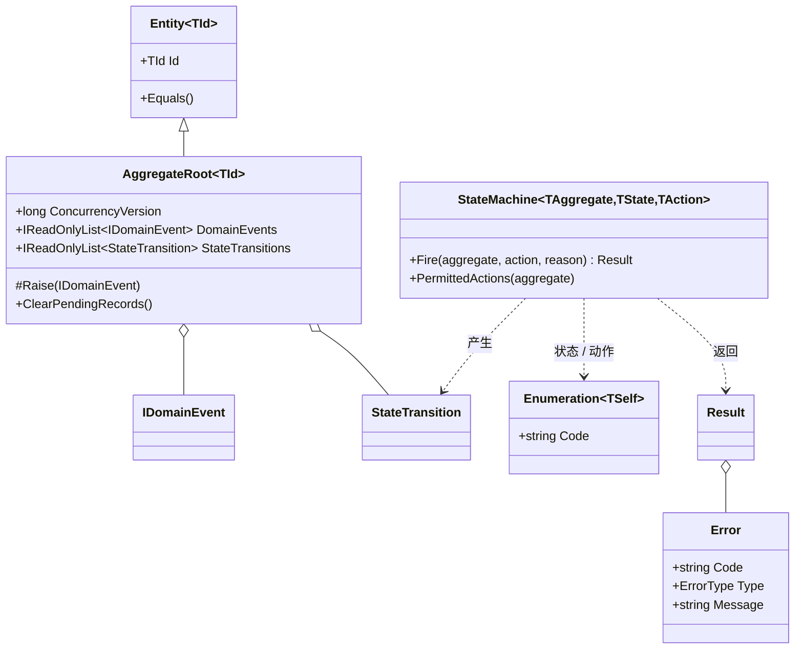
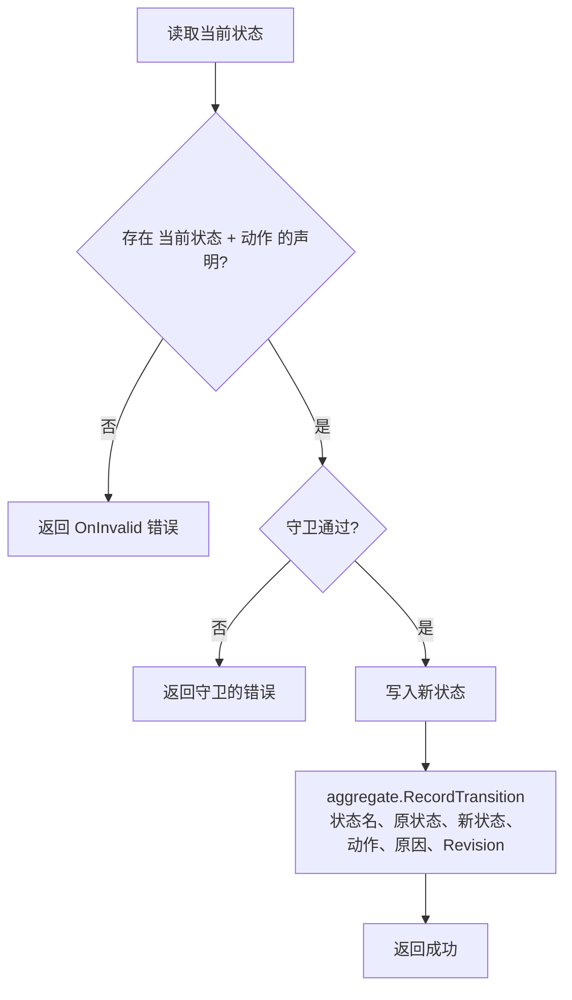
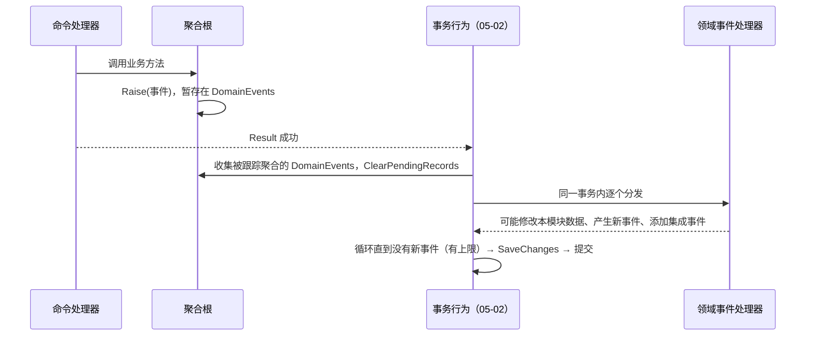

# 05-01 领域基础构件

- 状态：已确认（2026-11-04，D1～D8 均按建议确定）；2026-11-04 随 05-02 补充 `ErrorType.Unavailable`
- 日期：2026-11-04
- 所在项目：`Kmic.BuildingBlocks.Domain`（以及框架分析器项目中与领域层相关的规则）
- 依据：ADR-0003、ADR-0008、ADR-0009、ADR-0010、ADR-0011、ADR-0012、ADR-0017、ADR-0018；03 第 4.2、4.3 节

## 0. 范围

本文设计领域层的全部框架构件，写到可直接开发的程度：

| 构件 | 本文内容 | 相关但不在本文 |
|---|---|---|
| `Result` / `Error` | 类型形态、错误目录写法 | Result → HTTP 映射（05-06） |
| `Entity` / `AggregateRoot` | 基类、相等性、创建方式、并发版本属性 | 版本递增拦截器、软删除（05-03） |
| 强类型 ID | Vogen 的统一配置与声明方式 | EF 转换器注册（05-03）、OpenAPI 显示（05-06） |
| 值对象 | 写法约束、分析器规则 | EF 映射（05-03） |
| 智能枚举 | 基类、存储与序列化约定 | EF / JSON 转换器注册（05-03、05-06） |
| 状态机 | 声明方式、执行、与业务历史的联动点 | 业务历史表与写入（05-09）、`allowedActions`（05-05） |
| 领域事件 | 事件定义、收集方式 | 分发循环与处理器接口（05-02） |
| 领域层规则 | 分析器与架构测试规则清单 | 分析器工程本身（06 编码规范） |

不在本文：版本化规则集（FR-DOM-08，P2）——按“未用到的不提前设计”的原则，等第一个需要它的业务出现时再单独设计（见第 10 节）。

### 构件关系



---

## 1. 旧项目怎么做 → 新框架怎么做

| 问题 | 旧项目 | 新框架 | 本文章节 |
|---|---|---|---|
| 业务失败的表达 | 页面直接 `alert` 异常消息；ashx 返回 `{"code":1,"msg":"..."}`，前端靠匹配文字判断 | `Result` + 错误目录，错误码 `模块.错误名` 稳定可枚举 | 2 |
| 业务规则的位置 | 散落在页面、ashx、SQL 中，BLL 基本透传 | 聚合方法 + 状态机集中表达，属性对外只读 | 3、7 |
| 主键 | bigint / int 自增、字符串、GUID 混用，25 张表无主键；`QID`、`HTID` 传错编译器发现不了 | UUID v7 + 强类型 ID，传错类型编译不过 | 4 |
| 字段校验 | 每个页面各写一遍，或干脆不校验 | 值对象工厂方法校验一次，之后处处可信 | 5 |
| 状态值 | `IsShenhe = -1/0/1/2` 等魔法数字出现在 SQL 和代码里 | 智能枚举，存储为可读的编码 | 6 |
| 状态流转 | 各处 `if` 判断能否审核、能否修改，规则重复且不一致 | 状态机集中声明合法转换，非法转换返回错误，并自动产生业务历史 | 7 |
| “做完这件事还要做那件事” | 同一个方法里顺手写日志、发邮件、改别的表 | 领域事件：本模块内同事务处理，对外副作用走 Outbox | 8 |
| 时间与操作人 | 领域逻辑里直接 `DateTime.Now`、读 Session | 由应用层作为参数传入，领域层不依赖运行环境 | 9 |

---

## 2. Result 与 Error

### 2.1 错误类型

```csharp
public enum ErrorType
{
    Validation,     // 输入不合法          → 400
    NotFound,       // 不存在或不可见      → 404
    Conflict,       // 并发 / 状态 / 唯一冲突 → 409
    Forbidden,      // 已登录但无权        → 403
    BusinessRule,   // 违反业务规则        → 422
    Unavailable,    // 瞬时故障，可重试    → 503（仅框架使用，05-02 第 8 节）
}
```

- 前五种与 ADR-0010 的五种错误类型一一对应；`Unavailable` 是 05-02 确认时补充的第六类，只用于框架把死锁、序列化失败等瞬时故障转为可重试的 503，业务错误目录不得使用（分析器 KM0101 检查）。HTTP 映射在 05-06 实现，这里的注释只作说明。
- 401（未认证）、429 以及依赖服务不可用的 503 不属于领域或应用错误，由中间件或全局异常处理产生，不进入 `ErrorType`。
- **“无权”与“不可见”的区分**：数据范围之外的资源按 ADR-0018 第 4 条对外返回 `NotFound`，这是授权层的决定（05-05），领域层不关心。

### 2.2 Error

```csharp
public sealed record Error
{
    public string Code { get; }                      // "Quotation.AlreadySubmitted"
    public ErrorType Type { get; }
    public string Message { get; }                   // 固定提示，对应 ProblemDetails.title
    public string? Detail { get; }                   // 带参数的具体说明，对应 ProblemDetails.detail
    public IReadOnlyList<object?> DetailArgs { get; }        // 预留给多语言，暂不使用（D3）
    public IReadOnlyList<FieldError> FieldErrors { get; }   // 仅 Validation 使用
    public IReadOnlyDictionary<string, object?> Metadata { get; } // 见 D2

    private Error(...) { ... }

    public static Error Validation(string code, string message, IReadOnlyList<FieldError>? fieldErrors = null);
    public static Error NotFound(string code, string message);
    public static Error Conflict(string code, string message);
    public static Error Forbidden(string code, string message);
    public static Error BusinessRule(string code, string message);
    public static Error Unavailable(string code, string message);    // 仅框架 CommonErrors 使用

    public Error WithDetail(string detail);                      // 返回新实例
    public Error WithMetadata(string key, object? value);        // 返回新实例
}

public sealed record FieldError(string Path, string Code, string Message); // Path 如 "items[2].quantity"
```

- 错误码格式由工厂方法在构造时校验：`^[A-Z][A-Za-z0-9]*\.[A-Z][A-Za-z0-9]*$`，不符合即抛异常（程序缺陷，单元测试即可发现）。
- `Error` 不可变；`WithDetail` / `WithMetadata` 返回新实例，错误目录中的静态实例不会被污染。

### 2.3 Result

```csharp
public class Result
{
    public bool IsSuccess { get; }
    public bool IsFailure => !IsSuccess;
    public Error Error { get; }          // 成功时访问 → InvalidOperationException（程序缺陷）

    public static Result Success();
    public static Result Failure(Error error);
    public static implicit operator Result(Error error);
}

public sealed class Result<T> : Result
{
    public T Value { get; }              // 失败时访问 → InvalidOperationException（程序缺陷）

    public static implicit operator Result<T>(T value);
    public static implicit operator Result<T>(Error error);
}
```

配套方法只提供最常用的几个，避免把业务代码写成难读的链式调用：

| 方法 | 用途 |
|---|---|
| `Map(Func<T, TOut>)` | 成功时转换值 |
| `Bind(Func<T, Result<TOut>>)` | 成功时继续执行下一步可能失败的操作 |
| `Match(onSuccess, onFailure)` | 两个分支归一，主要给接口层用 |
| `Result.FirstFailure(params Result[])` | 多个值对象一起创建时，取第一个失败 |

典型写法（领域层）：

```csharp
public Result Submit(DateTimeOffset now, string? reason)
{
    // “没有明细不能提交”声明为状态机守卫（第 7.2 节），失败时返回 SampleErrors.NoItems
    var fired = Machine.Fire(this, SampleAction.Submit, reason);
    if (fired.IsFailure)
        return fired;

    SubmittedAt = now;
    Raise(new SampleSubmitted(Id));
    return Result.Success();
}
```

### 2.4 错误目录

每个模块在 Domain 项目中有**唯一一个**错误目录文件夹 `Errors/`，按聚合分文件：

```csharp
public static class SampleErrors
{
    public static readonly Error NotFound =
        Error.NotFound("Sample.NotFound", "单据不存在");

    public static readonly Error NoItems =
        Error.BusinessRule("Sample.NoItems", "单据没有明细，不能提交");

    public static readonly Error InvalidTransition =
        Error.BusinessRule("Sample.InvalidTransition", "当前状态不允许此操作");

    // 带参数的错误：方法而不是字段，参数只进入 Detail
    public static Error AlreadySubmitted(string number) =>
        Error.BusinessRule("Sample.AlreadySubmitted", "单据已提交")
             .WithDetail($"单据 {number} 已提交，不能重复提交");
}
```

- “业务代码中不允许临时创建错误”（ADR-0010 第 5 条）由分析器 KM0101 检查：`Error.Validation / NotFound / ...` 只能在命名为 `*Errors` 的静态类中调用。
- 应用层专属的错误（如“幂等键重复使用”）放在应用层同样命名的静态类中；框架自身的错误（`Common.VersionConflict`、`Common.IdempotencyKeyReused`、`Common.RulesChanged`）放在 `BuildingBlocks` 的 `CommonErrors` 中。
- 架构测试扫描全部错误目录：**错误码全局唯一**、前缀与所在模块名一致（框架为 `Common`）。
- 错误目录可以导出为前端使用的错误码清单（CI 产物），供前端按错误码翻译（ADR-0016 第 4 条）。

### 2.5 异常的边界

| 情况 | 表达方式 |
|---|---|
| 违反业务规则、输入不合法、状态不允许 | `Result` 失败 |
| 调用方违反了契约（如向工厂传入 `null`、访问失败 Result 的 `Value`） | `ArgumentException` / `InvalidOperationException` |
| 聚合内部不变量被破坏（理论上不可能发生，发生即程序缺陷） | `DomainInvariantException`（框架提供，唯一允许在领域层显式抛出的自定义异常） |

分析器 KM0102：Domain 项目中 `throw` 的类型只能是上表三种，其余一律报错。

### 2.6 本节决策

**D1 Result 用类还是结构体**

| 选项 | 优点 | 缺点 |
|---|---|---|
| **A 类（`class`）** | `default` 不可能是“成功”；可以继承（`Result<T> : Result`），一个管道行为能统一处理两种结果 | 每次返回一个小对象分配 |
| B 只读结构体 | 无堆分配 | `default(Result)` 是一个既非成功也非失败的非法值，需要额外分析器防护；`Result<T>` 无法继承 `Result`，管道行为要分别处理两种类型 |

- **决定（已确认，2026-11-04）**：A。
- **理由**：一次命令至少有一次数据库往返，Result 的分配成本可以忽略；而“非法的默认值”和“管道里两套处理”是长期的正确性和复杂度成本。
- **取舍**：放弃极端热点路径上的零分配；领域内如有高频纯计算，可直接返回值而非 Result。

**D2 Error 的附加数据怎么携带**

ADR-0014 要求错误响应在特定情况下带 `errors`（字段错误）、`currentVersion`（并发冲突）。

| 选项 | 优点 | 缺点 |
|---|---|---|
| A 只用通用字典 `Metadata` | 扩展灵活 | 键名是字符串，拼错了编译器发现不了；接口契约不清晰 |
| B `Error` 派生子类型（`ValidationError`、`ConflictError`…） | 强类型 | `Error` 变成继承体系，错误目录写法变复杂；与 `sealed record` 冲突 |
| **C 已知字段强类型 + 少量扩展字典** | `FieldErrors` 为强类型字段；`currentVersion` 等少数框架级数据通过 `Metadata` 携带，键名统一定义为 `ErrorMetadataKeys` 常量；Presentation 只把白名单键输出到 ProblemDetails | 两种方式并存，需要规定什么进字段、什么进字典 |

- **决定（已确认，2026-11-04）**：C。
- **理由**：字段错误是高频、结构固定的数据，值得强类型；`currentVersion` 只有框架异常转换行为会写入，用常量键足够安全，且不必让领域层的 `Error` 认识“并发版本”这一基础设施概念。
- **取舍**：`Metadata` 中的值需要白名单才能输出，新增键要同时改 Presentation。

**D3 提示文字与多语言**

ADR-0016 规定多语言“预留，暂不实现”，面向用户的提示文字最终通过 `IStringLocalizer` 读取。但领域层不能依赖本地化组件。

| 选项 | 优点 | 缺点 |
|---|---|---|
| **A 错误目录写中文默认文字；接口层按错误码查资源，查不到用默认文字** | 现在零成本；错误目录一眼能看懂；将来加语言时只增加资源文件 | `Detail` 中已经拼好的参数化文字无法翻译，需要将来改为“模板 + 参数” |
| B 现在就用“模板键 + 参数”，领域层不出现任何中文 | 将来多语言无需改错误目录 | 现在就要维护资源文件；读错误目录看不到实际文字，开发体验差；与“暂不实现”冲突 |
| C `Detail` 也存为“模板 + 参数”，`Message` 写中文默认文字 | 将来可翻译 `Detail` | `WithDetail` 的调用方式变复杂 |

- **决定（已确认，2026-11-04）**：A；同时在 `Error` 中保留 `DetailArgs`（参数数组）字段但暂不使用，将来启用多语言时改为 C，不改变错误码和接口契约。
- **理由**：符合 ADR-0016“预留不实现”；错误码才是前端依赖的稳定契约，文字可以晚些再处理。
- **取舍**：启用多语言时，需要把所有带参数的错误改一遍写法（数量有限，且分析器可以列出全部位置）。

---

## 3. 实体与聚合根

### 3.1 基类

```csharp
public abstract class Entity<TId> : IEquatable<Entity<TId>>
    where TId : notnull
{
    public TId Id { get; protected init; }

    protected Entity(TId id) => Id = id;
    protected Entity() { Id = default!; }   // 仅供 EF 使用，派生类以 private 构造函数调用

    // 相等性：同一运行时类型 + 同一 Id
    public bool Equals(Entity<TId>? other);
    public override bool Equals(object? obj);
    public override int GetHashCode();
    public static bool operator ==(...); public static bool operator !=(...);
}

public abstract class AggregateRoot<TId> : Entity<TId>, IAggregateRoot
    where TId : notnull
{
    private readonly List<IDomainEvent> _domainEvents = [];
    private readonly List<StateTransition> _stateTransitions = [];

    public long ConcurrencyVersion { get; private set; }   // 由拦截器递增（ADR-0012 第 4 条）

    public IReadOnlyList<IDomainEvent> DomainEvents => _domainEvents;
    public IReadOnlyList<StateTransition> StateTransitions => _stateTransitions;

    protected void Raise(IDomainEvent domainEvent);
    internal void RecordTransition(StateTransition transition);  // 只有状态机能调用
    public void ClearPendingRecords();                           // 事务行为在取出后调用
}

public interface IAggregateRoot   // 非泛型标记，供拦截器、仓储约束、架构测试使用
{
    long ConcurrencyVersion { get; }
    IReadOnlyList<IDomainEvent> DomainEvents { get; }
    IReadOnlyList<StateTransition> StateTransitions { get; }
    void ClearPendingRecords();
}
```

- **因为 ID 在创建时就生成（ADR-0009），不存在“未保存实体 Id 为空”的问题**，相等性不需要处理临时实体这一特殊情况。
- 相等性比较运行时类型，用于防止 EF 代理或继承类型的误判；框架不启用 EF 延迟加载代理（05-03），这一条主要是防御性的。
- `ConcurrencyVersion` 在领域层只读，递增由拦截器通过 EF 属性访问完成；暴露它是因为详情查询和命令结果都需要返回给前端（ADR-0012）。
- 业务版本 `Revision`（ADR-0012 第 4 条）**不进基类**：只有部分聚合有业务版本概念。需要的聚合实现 `IHasRevision { int Revision { get; } }`，业务历史记录会自动带上它（第 7.5 节）。

### 3.2 创建与修改

| 规则 | 写法 | 守护方式 |
|---|---|---|
| 通过工厂方法创建 | `public static Result<Sample> Create(...)`；不会失败的可以返回 `Sample` | 分析器 KM0103：聚合根、实体不得有 `public` / `internal` 构造函数 |
| EF 所需构造函数私有 | `private Sample() { }` | 同上 |
| 属性对外只读 | `public SampleStatus Status { get; private set; }` | 分析器 KM0104：领域实体属性不得有 `public set` / `init` |
| 集合不可从外部修改 | `private readonly List<SampleItem> _items = []; public IReadOnlyList<SampleItem> Items => _items;` | 分析器 KM0105：实体不得公开 `List<T>`、数组等可变集合 |
| 子实体只能经聚合根修改 | 子实体的修改方法设为 `internal`，由聚合根方法调用 | 代码评审 + 子实体不得 `Raise` 事件（它没有这个方法） |
| 聚合之间按 ID 引用 | `public CustomerRef CustomerId { get; private set; }`，不持有其他聚合对象 | 架构测试：聚合根的属性类型不得是另一个聚合根 |

示例：

```csharp
public sealed class Sample : AggregateRoot<SampleId>
{
    private readonly List<SampleItem> _items = [];

    public string Title { get; private set; } = null!;
    public SampleStatus Status { get; private set; } = null!;
    public IReadOnlyList<SampleItem> Items => _items;

    private Sample() { }   // EF

    public static Result<Sample> Create(string title, string? reason)
    {
        if (string.IsNullOrWhiteSpace(title))
            return SampleErrors.TitleRequired;

        var sample = new Sample(SampleId.New()) { Title = title.Trim() };
        Machine.Start(sample, reason);           // 记录初始状态（第 7.4 节）
        sample.Raise(new SampleCreated(sample.Id));
        return sample;
    }

    private Sample(SampleId id) : base(id) { }
}
```

### 3.3 跨模块引用的 ID

模块的 Domain 只能引用 `BuildingBlocks.Domain`（03 选型原则 4），因此不能使用其他模块定义的 `CustomerId`。

- **做法**：Contracts 中对外的 ID 一律为 `Guid`；引用方在自己的 Domain 中声明一个引用类型的强类型 ID（命名为 `XxxRef`，如 `CustomerRef`），在应用层转换。
- **取舍**：同一个“客户 ID”在两个模块里是两个类型，需要在应用层显式转换一次；换来的是模块的领域模型完全不依赖其他模块，符合 ADR-0006。
- 这里没有其他可行选项（让 Domain 引用别的模块 Contracts 会违反 ADR-0006 和选型原则 4），因此不列为决策项。

---

## 4. 强类型 ID

### 4.1 声明方式

全框架统一的 Vogen 配置放在 `BuildingBlocks.Domain` 提供的 `Directory.Build.props` 片段和程序集级特性中，各模块 Domain 项目引入：

```csharp
// 每个模块 Domain 项目的 AssemblyInfo.cs（由模块模板生成）
[assembly: VogenDefaults(
    underlyingType: typeof(Guid),
    conversions: Conversions.SystemTextJson | Conversions.TypeConverter,
    parsableForPrimitives: ParsableForPrimitives.HoistMethodsAndInterfaces,
    toPrimitiveCasting: CastOperator.None,
    fromPrimitiveCasting: CastOperator.None)]
```

```csharp
// 一个 ID 的全部声明
[ValueObject]
public readonly partial struct SampleId : IStronglyTypedId
{
    public static SampleId New() => From(Guid.CreateVersion7());

    private static Validation Validate(Guid value) =>
        value == Guid.Empty ? Validation.Invalid("ID 不能为空") : Validation.Ok;
}
```

| 约定 | 说明 |
|---|---|
| `readonly partial struct` | 无分配；Vogen 的分析器禁止 `new SampleId()` 和 `default(SampleId)` |
| `New()` 使用 `Guid.CreateVersion7()` | ADR-0009；`Guid.NewGuid()` 在全解决方案中被 BannedApiAnalyzers 禁用 |
| 禁止与 `Guid` 隐式 / 显式转换 | 转换只能通过 `From` / `Value`，防止不同 ID 经由 `Guid` 绕过类型检查 |
| `IStronglyTypedId` 标记接口 | 框架提供，供 EF 约定扫描、OpenAPI 架构转换器、架构测试识别 |
| 命名以 `Id` 结尾，跨模块引用以 `Ref` 结尾 | 架构测试检查 |

### 4.2 各类转换在哪里生成

| 转换 | 生成位置 | 理由 |
|---|---|---|
| System.Text.Json、`TypeConverter`、`IParsable` | Domain 项目内（Vogen 生成） | 只依赖 BCL，不引入第三方运行时依赖 |
| EF Core 值转换器 | 模块 Infrastructure 项目，通过 Vogen 的“转换器标记”声明 | 生成的转换器引用 EF Core，不能进入 Domain |
| OpenAPI 显示为 `string/uuid` | `BuildingBlocks.Presentation` 的架构转换器，按 `IStronglyTypedId` 统一处理 | 05-06 |

- `待确认`：Vogen 8.0.x 中“在其他项目生成 EF 转换器”的标记特性的确切名称与用法（文档所见为 `EfCoreConverter<T>` 标记），实施前用一个原型项目验证；如不支持，退而在 Infrastructure 中按 `IStronglyTypedId` 约定扫描、用一个泛型转换器统一注册。

### 4.3 不使用强类型 ID 的地方

- 纯关联表的复合主键各列（ADR-0009 第 5 条）仍使用对应的强类型 ID。
- **框架表**（Outbox、Inbox、幂等记录、审计事件等）的主键使用 `Guid`，不为它们声明强类型 ID：这些表不进入领域模型，不会出现“ID 传错”的业务风险。

---

## 5. 值对象

### 5.1 写法

```csharp
public sealed record EmailAddress
{
    public string Value { get; }

    private EmailAddress(string value) => Value = value;

    public static Result<EmailAddress> Create(string? input)
    {
        var normalized = input?.Trim().ToLowerInvariant();
        if (string.IsNullOrEmpty(normalized))
            return CommonErrors.EmailRequired;
        if (normalized.Length > 256 || !normalized.Contains('@'))
            return CommonErrors.EmailInvalid;
        return new EmailAddress(normalized);
    }

    // EF 物化使用：跳过校验但不对外公开（见 5.3）
    private EmailAddress() => Value = null!;
}
```

| 规则（ADR-0011 第 3 条） | 分析器 |
|---|---|
| 必须是 `sealed record`，不得用位置参数写法 | KM0201 |
| 构造函数全部私有 | KM0202 |
| 属性只能是 `{ get; }`，不得有 `set` / `init` | KM0203（同时阻止 `with` 表达式绕过校验——没有 `init` 的属性不能出现在 `with` 中） |
| 至少有一个返回 `Result<T>` 的静态工厂方法 | KM0204 |
| 不得包含可变集合；集合属性必须是 `IReadOnlyList<T>` 并自行重写相等性 | KM0205（record 默认按引用比较集合，必须显式处理） |
| 规范化在工厂方法中完成（去空格、大小写），保证相等性比较有意义 | 代码评审 |

- **识别值对象的方式**：Domain 项目中所有 `record` 都按值对象检查，领域事件除外（领域事件实现 `IDomainEvent`，有自己的规则，见第 8 节）。
- **框架不提供 `ValueObject` 基类**：record 已经提供了相等性；基类只会增加一层继承而没有额外价值。

### 5.2 本节决策

**D4 单值值对象是否也用 Vogen**

“邮箱”“手机号”这类只包一个原始值的值对象，可以用 record（5.1），也可以像强类型 ID 一样用 Vogen。

| 选项 | 优点 | 缺点 |
|---|---|---|
| **A 只有 ID 用 Vogen，值对象一律用 record** | 值对象只有一种写法；工厂方法直接返回 `Result`，与错误目录一致 | 单值值对象的 EF 映射要用复杂类型或手写转换器；JSON 序列化默认是对象 `{ "value": ... }`，需要框架提供单值转换约定 |
| B 单值值对象用 Vogen，多值用 record | EF / JSON / 路由转换全部生成；存储为单列 | 两种写法；Vogen 的校验以 `Validation` 表达，`From` 失败时抛异常，与“业务失败用 Result”冲突，必须统一改用 `TryFrom` 再转成 `Result`，否则错误码无法进入错误目录 |

- **决定（已确认，2026-11-04）**：A；框架提供 `ISingleValueObject<TValue>` 接口，EF 和 JSON 按该接口统一映射为单列 / 原始值。
- **理由**：值对象的核心价值是“创建时校验、失败时返回带错误码的 Result”，Vogen 的异常式校验正好与之相反；一种写法也更容易用分析器约束。
- **取舍**：框架要多写一个单值约定（EF 转换器 + JSON 转换器，约几十行），且单值值对象在接口层需要 DTO 与值对象之间显式转换。

### 5.3 持久化时的校验

数据库中读出的值不再经过工厂方法校验（私有无参构造 + EF 属性赋值）。

- **理由**：数据已经在写入时校验过；读取时再校验，一旦规则收紧（如邮箱长度从 256 改为 128），旧数据会导致聚合无法加载，连修正都做不到。
- **规则收紧的处理**：通过数据迁移修正旧数据，或者让新规则只在工厂方法中生效、旧值可读不可新建。

---

## 6. 智能枚举

### 6.1 基类

```csharp
public abstract class Enumeration<TSelf> : IEquatable<TSelf>
    where TSelf : Enumeration<TSelf>
{
    public string Code { get; }     // 稳定编码：存储、JSON、错误信息都用它，如 "Submitted"
    public string Name { get; }     // 默认中文显示名

    protected Enumeration(string code, string name);

    public static IReadOnlyList<TSelf> All { get; }               // 反射一次，缓存
    public static TSelf FromCode(string code);                     // 找不到 → InvalidOperationException（数据损坏，程序缺陷）
    public static bool TryFromCode(string code, out TSelf? value); // 来自外部输入时使用
    // 相等性按 Code；== / != 运算符
}
```

带行为的示例：

```csharp
public sealed class SampleStatus : Enumeration<SampleStatus>
{
    public static readonly SampleStatus Draft     = new("Draft",     "草稿",   editable: true);
    public static readonly SampleStatus Submitted = new("Submitted", "已提交", editable: false);
    public static readonly SampleStatus Approved  = new("Approved",  "已通过", editable: false);
    public static readonly SampleStatus Rejected  = new("Rejected",  "已驳回", editable: true);

    public bool Editable { get; }

    private SampleStatus(string code, string name, bool editable) : base(code, name) => Editable = editable;
}
```

| 约定 | 说明 |
|---|---|
| `Code` 一经发布不得修改 | 它进入数据库和接口契约；改名只改 `Name` |
| `Code` 用英文大驼峰 | 与 JSON 中强类型 ID、普通枚举的字符串形式风格一致（FR-API-07） |
| 派生类必须 `sealed`，构造函数私有，实例为 `static readonly` 字段 | 分析器 KM0301 |
| 外部输入（接口参数）一律 `TryFromCode`，失败返回校验错误 | 由 JSON 转换器和模型绑定统一处理（05-06） |
| 普通枚举（无行为的简单分类）也以字符串存储和序列化 | 与智能枚举保持一致，数据库中不出现数字状态 |

### 6.2 本节决策

**D5 数据库中存编码字符串还是数字**

| 选项 | 优点 | 缺点 |
|---|---|---|
| **A 存 `Code`（`varchar(64)`）** | 数据库中直接可读，手写 SQL 和报表不再出现魔法数字（正是旧系统 `IsShenhe` 的问题）；新增值不怕编号冲突 | 每行多占若干字节；索引略大 |
| B 存数字（`smallint`），代码中维护映射 | 存储最小 | 重演旧系统的魔法数字问题；手写 SQL 必须查映射表 |
| C 存数字 + 建 PG 查找表 / 枚举类型 | 数据库层可约束 | 每增加一个值都要迁移；PG 枚举类型删值困难 |

- **决定（已确认，2026-11-04）**：A，并由 EF 约定为每个智能枚举列自动生成 `CHECK ("Status" IN (...))` 约束（05-03 实现）。
- **理由**：消除魔法数字是本构件存在的主要原因；在当前数据量下存储差异可忽略。
- **取舍**：存储空间稍大；`Code` 变成数据库契约，不能随意改名（改名需要数据迁移）。

---

## 7. 状态机

### 7.1 设计目标

- 一个聚合的全部合法流转**集中在一处声明**，读一段代码就能知道单据的完整生命周期。
- 非法流转返回 `Result` 错误（不抛异常）。
- 每次流转自动产生一条 `StateTransition`，由基础设施写入业务历史（ADR-0018 第 2 条），业务代码只提供原因。
- 能回答“当前状态下哪些动作可用”，供 `allowedActions`（05-05）使用。
- 只支持“状态 + 动作 → 新状态 + 守卫条件”，不支持层级状态、并行状态（03 第 4.3 节已确认的取舍）。

### 7.2 声明

```csharp
public sealed class Sample : AggregateRoot<SampleId>
{
    private static readonly StateMachine<Sample, SampleStatus, SampleAction> Machine =
        StateMachine<Sample, SampleStatus, SampleAction>
            .Define(s => s.Status, (s, v) => s.Status = v)
            .Initial(SampleStatus.Draft)
            .OnInvalid(SampleErrors.InvalidTransition)
            .Permit(SampleStatus.Draft,     SampleAction.Submit,  SampleStatus.Submitted,
                    guard: s => s._items.Count > 0 ? Result.Success() : SampleErrors.NoItems)
            .Permit(SampleStatus.Submitted, SampleAction.Approve, SampleStatus.Approved)
            .Permit(SampleStatus.Submitted, SampleAction.Reject,  SampleStatus.Rejected)
            .Permit(SampleStatus.Rejected,  SampleAction.Submit,  SampleStatus.Submitted)
            .Build();
    ...
}
```

- `TState` 必须是智能枚举或普通枚举；`TAction` 同样，`SampleAction` 的 `Code` 写入业务历史的“动作”列。
- `Build()` 时检查：同一（状态, 动作）不得重复声明；所有状态必须可从初始状态到达；`OnInvalid` 必须提供。违反即抛异常——静态字段初始化失败，第一次单元测试就会暴露。
- `OnInvalid` 的错误必须来自本模块错误目录，满足 ADR-0010“错误码为 `模块.错误名`”。
- 守卫返回 `Result`，失败时把守卫的错误原样返回，而不是统一的“非法流转”，前端可以得到具体原因。

### 7.3 执行

```csharp
public Result Approve(string? reason)
{
    var fired = Machine.Fire(this, SampleAction.Approve, reason);
    if (fired.IsFailure) return fired;

    Raise(new SampleApproved(Id));
    return Result.Success();
}
```

`Fire` 的步骤：



- 状态属性只能由状态机改写：分析器 KM0401 检查被 `Define` 注册的属性，其 setter 只能在状态机的 lambda 中出现。`待确认`：该分析器的实现难度，若成本过高，退而由架构测试 + 代码评审守护。
- `Fire` 不自动发布领域事件：流转是否需要通知其他部分，是业务决定，由聚合方法显式 `Raise`（见 D6）。

### 7.4 初始状态与查询

| 方法 | 用途 |
|---|---|
| `Start(aggregate, reason)` | 在工厂方法中调用，设置初始状态并记录一条“原状态为空”的流转，业务历史由此从创建开始完整 |
| `CanFire(aggregate, action)` | 返回 `Result`，不改变状态 |
| `PermittedActions(aggregate)` | 当前状态下声明了的且守卫通过的全部动作；05-05 的 `allowedActions` 与资源策略的结果取交集后返回给前端 |
| `ToMermaid()` | 导出状态图；模块的文档测试把它写入模块文档，保证文档与代码一致 |

### 7.5 与业务历史的联动点

领域层只产生记录，不知道操作人、时间、追踪 ID（ADR-0011 第 6 条）：

```csharp
public sealed record StateTransition(
    string StateName,       // 被注册的属性名，如 "Status"；一个聚合有多个状态字段时用于区分
    string? FromCode,       // 初始化时为 null
    string ToCode,
    string ActionCode,
    string? Reason,
    int? Revision);         // 聚合实现 IHasRevision 时填写
```

保存时，基础设施的拦截器取出 `StateTransitions`，补上操作人、实际操作人、当前角色、发生时间（`TimeProvider`）、追踪 ID，写入本模块的业务历史表，与业务数据同一事务（05-09）。

### 7.6 本节决策

**D6 状态流转是否自动发布领域事件**

| 选项 | 优点 | 缺点 |
|---|---|---|
| **A 不自动，业务方法显式 `Raise`** | 事件名表达业务含义（`SampleApproved`），而不是通用的“状态变了”；没有订阅者的流转不产生无用事件 | 每个需要通知的流转要多写一行 |
| B 每次流转自动发布通用的 `StateChanged<TAggregate>` 事件 | 不会漏发 | 订阅者要在处理器里判断“从哪到哪”，业务含义被稀释；事件契约绑定在状态编码上，改状态即破坏订阅者 |

- **决定（已确认，2026-11-04）**：A。
- **理由**：领域事件是业务语言的一部分；“记录发生了什么”已经由业务历史自动保证，不需要再用通用事件重复一遍。
- **取舍**：依赖开发人员在需要时记得 `Raise`，由代码评审把关。

---

## 8. 领域事件

### 8.1 定义

```csharp
public interface IDomainEvent { }   // 框架提供的唯一标记，不依赖 Mediator

public sealed record SampleSubmitted(SampleId SampleId) : IDomainEvent;
```

| 约定 | 说明 | 守护 |
|---|---|---|
| `sealed record`，过去时命名 | `SampleSubmitted`，而非 `SubmitSample` | 架构测试（命名） |
| 只携带 ID 和必要的值，不携带实体对象 | 处理器需要更多数据时自行加载；防止处理器修改别的聚合的内存对象而绕过其业务方法 | 分析器 KM0501：事件属性类型不得是实体或聚合根 |
| 不带发生时间 | 领域层不取时间；需要时由分发器在信封中补上（05-02） | — |
| 只在聚合根上 `Raise` | 子实体通过聚合根方法间接产生 | 基类设计保证（`Raise` 是聚合根的 `protected` 方法） |
| 领域事件不出模块 | 跨模块用集成事件（定义在 Contracts，由处理器写入 Outbox），两者是不同类型 | 架构测试：`IDomainEvent` 的实现不得出现在 Contracts 中 |

### 8.2 生命周期



- 处理器失败（返回失败 Result）时，整个命令失败并回滚：领域事件处理器与命令处于同一事务，属于命令的一部分。
- `ClearPendingRecords` 只清领域事件，`StateTransitions` 由拦截器在 `SaveChanges` 中取出后清除。两者都在聚合根上，但取出时机不同，见 05-02 与 05-09。

### 8.3 本节决策

**D7 领域事件处理器能否让命令失败**

| 选项 | 优点 | 缺点 |
|---|---|---|
| **A 处理器返回 `Result`，失败则整个命令失败** | 与“同一事务、属于命令的一部分”一致；处理器中的业务规则（如“联动更新的对象已锁定”）可以正常表达为业务错误 | 发起命令的聚合方法看不到这个失败原因的来源，调试时要看事件链 |
| B 处理器不返回值，只能抛异常 | 处理器写法简单 | 处理器中的业务失败只能用异常表达，违反 ADR-0010 |

- **决定（已确认，2026-11-04）**：A。
- **理由**：同事务处理器本质上是命令的延续，它的业务失败就是命令的业务失败，必须能用 Result 表达。
- **取舍**：错误来源不直观，由日志与追踪中的事件链补足（05-12）。

---

## 9. 领域层中的时间、操作人与领域服务

| 需求 | 做法 | 守护 |
|---|---|---|
| 当前时间 | 业务方法接收 `DateTimeOffset now` 参数，应用层从 `TimeProvider` 取得后传入 | BannedApiAnalyzers：Domain 中禁用 `DateTime.Now`、`DateTime.UtcNow`、`DateTimeOffset.Now`、`DateTimeOffset.UtcNow`、`TimeProvider`（领域层连 `TimeProvider` 也不持有） |
| 操作人 | 需要记录在业务字段中的操作人（如“审批人”）作为参数传入（`UserRef approver`） | 架构测试：Domain 不得引用 `ICurrentUser` 所在程序集 |
| 依赖外部数据的业务判断 | 应用层先查好数据，作为参数或“规格对象”传入聚合方法 | Domain 不得引用 EF、仓储接口之外的任何基础设施 |
| 跨多个聚合的纯业务计算（计算策略） | **领域服务**：Domain 中的普通类，无状态，不依赖基础设施，命名以 `Service` / `Calculator` / `Policy` 结尾 | 架构测试：领域服务的构造函数参数只能是领域类型 |

- 仓储接口：每个聚合根一个，定义在模块 Domain（如 `ISampleRepository`），实现在 Infrastructure；只提供按 ID 加载和添加，不提供通用查询（查询走 CQRS 读侧）。基类 `IRepository<TAggregate, TId>` 由框架提供，具体约定见 05-03。

---

## 10. 策略与规则集（FR-DOM-07、FR-DOM-08）

ADR-0017 的三类策略在本框架中的落点：

| 类型 | 落点 | 框架是否提供基类 |
|---|---|---|
| 授权策略 | 应用层资源策略 | 是，见 05-05 |
| 业务策略 | 聚合方法、状态机守卫（第 3、7 节） | 否，就是领域模型本身 |
| 计算策略 | 领域服务（第 9 节） | 否 |

**D8 是否为业务策略和计算策略提供统一的 `IPolicy` 接口**

| 选项 | 优点 | 缺点 |
|---|---|---|
| **A 不提供，用领域模型和领域服务本身表达** | 没有额外抽象；规则就写在最自然的位置 | “项目里有哪些策略”无法靠接口扫描列出，只能靠命名约定 |
| B 提供 `IBusinessPolicy<TContext>`、`ICalculationPolicy<TIn, TOut>` | 可以统一扫描、统一记录日志 | 大部分策略只是一个方法，强行接口化会产生大量只有一个实现的接口；容易把规则从聚合中抽走，聚合退化为数据容器 |

- **决定（已确认，2026-11-04）**：A；通过命名约定（`*Policy`、`*Calculator`）和架构测试保证可发现性。
- **取舍**：缺少统一入口；如以后需要“策略调用日志”，再在应用层加。

**版本化规则集（FR-DOM-08，P2）**：本次不设计。它需要规则存储表、版本管理界面、签名算法，属于“事后补成本不高”（只影响用到它的业务表多一个“规则集版本”列）且目前没有业务用到的能力，按框架范围标准暂缓；框架现在只预留 `Common.RulesChanged` 错误码（第 2.4 节）。

---

## 11. 分析器与架构测试规则汇总

分析器编号 `KMxxxx` 为框架自定义分析器（ADR-0021），全部为 Error 级别。

| 编号 | 规则 | 作用范围 |
|---|---|---|
| KM0101 | `Error` 工厂方法只能在 `*Errors` 静态类中调用；`Error.Unavailable` 只能在框架的 `CommonErrors` 中使用 | 全部模块 |
| KM0102 | Domain 中只能抛出 `ArgumentException` 系、`InvalidOperationException`、`DomainInvariantException` | Domain |
| KM0103 | 实体、聚合根不得有非私有构造函数 | Domain |
| KM0104 | 实体属性不得有 `public set` / `init` | Domain |
| KM0105 | 实体不得公开可变集合 | Domain |
| KM0201～KM0205 | 值对象写法（第 5.1 节） | Domain |
| KM0301 | 智能枚举派生类 `sealed`、私有构造、`static readonly` 实例 | Domain |
| KM0401 | 状态属性只能由状态机改写（`待确认` 实现难度） | Domain |
| KM0501 | 领域事件不得携带实体对象 | Domain |

| 架构测试 | 依据 |
|---|---|
| Domain 只引用 `BuildingBlocks.Domain`（Vogen 仅编译期） | 03 选型原则 4 |
| Domain 不引用 `ICurrentUser`、EF Core、Mediator | ADR-0011 第 6 条 |
| 错误码全局唯一，前缀等于模块名 | ADR-0010 |
| 聚合根属性不得是其他聚合根类型 | 第 3.2 节 |
| 强类型 ID 命名以 `Id` / `Ref` 结尾，实现 `IStronglyTypedId` | 第 4.1 节 |
| `IDomainEvent` 实现为 `sealed record`、过去时命名、不在 Contracts 中 | 第 8.1 节 |
| 每个状态机 `Build()` 成功（启动全部状态机的静态初始化） | 第 7.2 节 |
| BannedApiAnalyzers：`Guid.NewGuid`、`DateTime.Now` 等 | ADR-0009、ADR-0011 |

---

## 12. 测试要点

框架自身（`BuildingBlocks.Domain.Tests`）：

| 构件 | 必测场景 |
|---|---|
| `Result` / `Error` | 失败时访问 `Value` 抛异常；隐式转换；`Map` / `Bind` 短路；错误码格式非法时抛异常；`WithDetail` 不修改原实例 |
| `Entity` | 同类型同 ID 相等；不同类型同 ID 不相等；`==` 与 `Equals` 一致；可作为字典键 |
| `AggregateRoot` | `Raise` 后可取出；`ClearPendingRecords` 只清事件；版本属性外部不可写 |
| 强类型 ID | `New()` 生成 v7；`Guid.Empty` 被拒绝；JSON 往返为字符串；`IParsable` 解析非法字符串返回失败 |
| 智能枚举 | `All` 完整且顺序稳定；`FromCode` 未知编码抛异常；`TryFromCode` 返回 false；相等性按 `Code` |
| 状态机 | 合法流转改变状态并记录 `StateTransition`；非法流转返回 `OnInvalid` 错误且状态不变；守卫失败返回守卫错误且不记录；`PermittedActions` 正确；`Build()` 对重复声明、不可达状态、缺少 `OnInvalid` 抛异常；`Start` 记录 `FromCode = null` |
| 分析器 | 每条规则一组“应报错 / 不应报错”的源码用例（Roslyn 分析器测试框架） |

业务模块（由模块模板生成测试骨架，07 详述）：

- 每个聚合方法测“成功路径 + 每个错误码至少一次”；
- 每个状态机有一个测试导出 `ToMermaid()` 并与模块文档比对（快照测试）。

---

## 13. 与其他文档的接口

| 本文提供 | 使用方 |
|---|---|
| `IAggregateRoot.DomainEvents`、`ClearPendingRecords` | 05-02 事务行为的领域事件分发循环 |
| `Result` / `Error`、`ErrorMetadataKeys` | 05-02 管道行为、05-06 ProblemDetails 映射 |
| `ConcurrencyVersion`、`IStronglyTypedId`、`Enumeration<T>`、`ISingleValueObject<T>` | 05-03 EF 约定与拦截器 |
| `StateMachine.PermittedActions` | 05-05 `allowedActions` |
| `StateTransition`、`IHasRevision` | 05-09 业务历史写入 |
| `CommonErrors.RulesChanged`（预留） | 将来的规则集设计 |

---

## 14. 决策汇总

| 编号 | 事项 | 决定（均已确认） |
|---|---|---|
| D1 | `Result` 用类还是结构体 | 类 |
| D2 | `Error` 附加数据的携带方式 | 强类型 `FieldErrors` + 白名单键的 `Metadata` |
| D3 | 提示文字与多语言 | 现在错误目录写中文默认文字，预留 `DetailArgs`，启用多语言时改为模板 + 参数 |
| D4 | 单值值对象是否用 Vogen | 不用，值对象一律 record + 框架单值约定 |
| D5 | 智能枚举存编码还是数字 | 存编码字符串 + 自动 CHECK 约束 |
| D6 | 状态流转是否自动发布领域事件 | 不自动，业务方法显式 `Raise` |
| D7 | 领域事件处理器能否让命令失败 | 能，处理器返回 `Result` |
| D8 | 是否为业务 / 计算策略提供统一接口 | 不提供，靠命名约定和架构测试 |

| 待确认 | 处理方式 |
|---|---|
| Vogen 8.0.x 在其他项目生成 EF 转换器的标记特性 | 实施前原型验证，备选为约定扫描 |
| KM0401“状态属性只能由状态机改写”分析器的实现难度 | 实施时评估，备选为架构测试 + 评审 |
