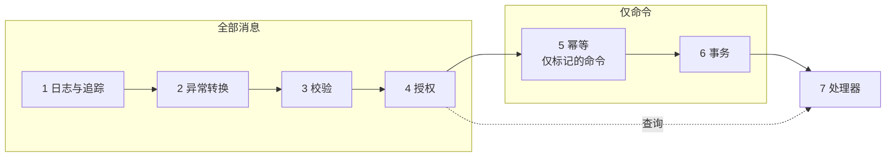
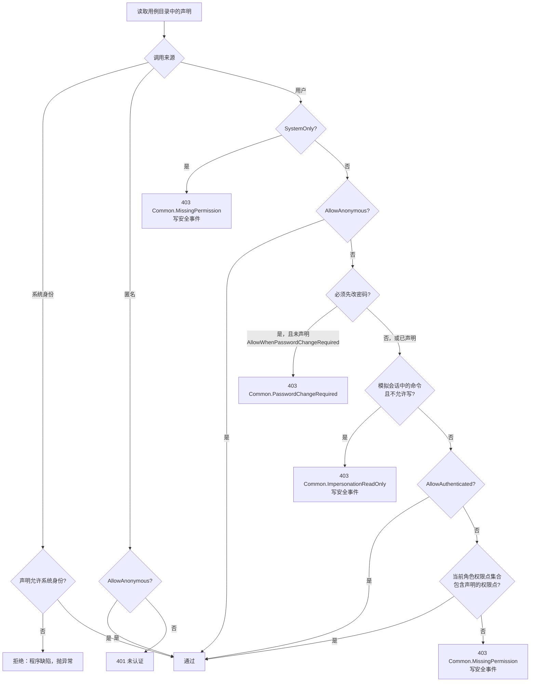
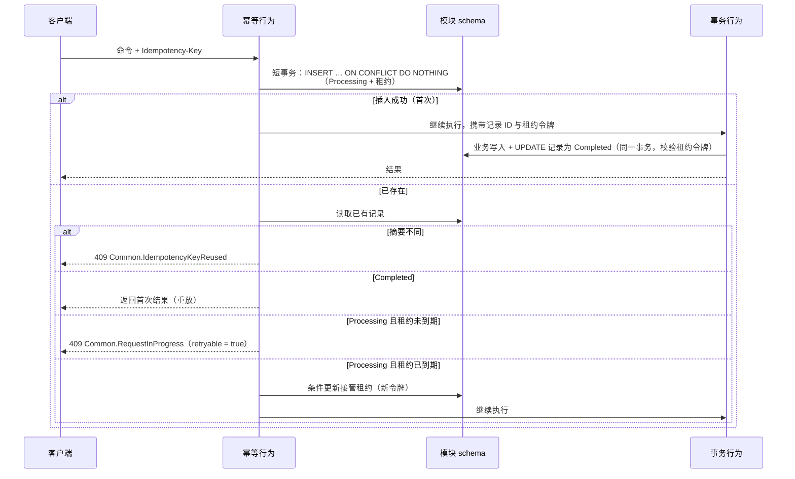
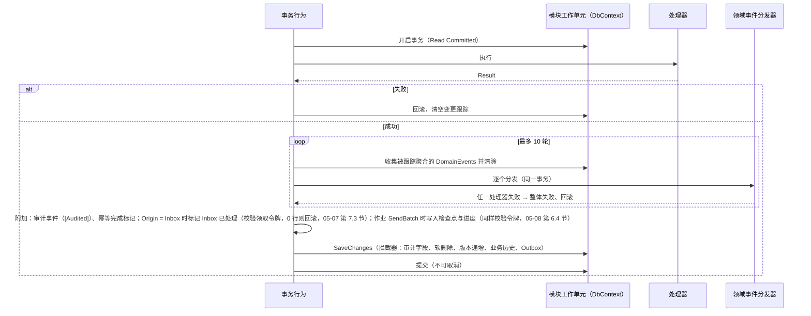

# 05-02 应用层与中介者管道

- 状态：已确认（2026-11-04，D1～D7 均按建议确定）；之后的修订见文末“修订记录”
- 日期：2026-11-04
- 所在项目：`Kmic.BuildingBlocks.Application`（抽象与大部分行为）、`Kmic.BuildingBlocks.Infrastructure`（依赖 EF / Npgsql 的部分）
- 依据：ADR-0005、ADR-0010、ADR-0011、ADR-0015、ADR-0017、ADR-0018、ADR-0026、ADR-0028；03 第 4.1 节；04 第 5、8、9 节；05-01

## 0. 范围

| 本文内容 | 相关但不在本文 |
|---|---|
| 消息类型（命令 / 查询）与处理器接口 | 端点如何发送消息（05-06） |
| 用例的声明方式：授权、幂等、审计标记 | 权限点声明与同步、数据范围、资源策略（05-05） |
| 七个管道行为的职责、适用范围和实现要点 | — |
| 事务行为内部步骤：领域事件分发循环、提交 | 拦截器、仓储、并发版本（05-03）；Outbox 写入（05-07）；审计与业务历史写入（05-09） |
| 幂等：记录表、状态流转、“结果未知”的处理 | 幂等记录清理任务（05-08） |
| 执行上下文：`ICurrentUser`、调用来源、系统身份 | 访问上下文的加载（05-04） |

---

## 1. 旧项目怎么做 → 新框架怎么做

| 问题 | 旧项目 | 新框架 | 章节 |
|---|---|---|---|
| 横切逻辑 | 每个 ashx 手写取用户、判登录、`try/catch`，经常遗漏 | 所有请求经中介者管道，横切逻辑写一次 | 4 |
| 权限检查 | 只在页面入口检查，后台逻辑和 ashx 直接调用没有保护 | 授权声明在命令 / 查询上，HTTP、定时任务、事件处理、模块调用走同一检查 | 3、4.4 |
| 输入校验 | 各页面零散校验或不校验 | FluentValidation 统一校验，字段错误按路径返回 | 4.3 |
| 重复提交 | 只靠前端防连点 | `Idempotency-Key` + 幂等记录，覆盖超时重试与“结果未知” | 5 |
| 事务 | 各处手写 `SqlTransaction`，或没有事务；“改主表、写日志、发邮件”混在一起 | 命令统一由事务行为包裹；对外副作用走 Outbox，提交后才发生 | 6 |
| 当前用户与时间 | 到处读 Session、`DateTime.Now` | `ICurrentUser`、`TimeProvider` 注入；后台任务有明确的系统身份 | 7 |
| 错误返回 | 异常直接 `alert`；`{code,msg}` 靠文字判断 | 处理器返回 `Result`；已知的基础设施异常转为带错误码的 `Result` | 4.2 |

---

## 2. 消息与处理器

### 2.1 接口

业务代码只使用框架定义的接口，不直接引用 Mediator 的类型（03 第 4.1 节）。框架接口继承 Mediator 的对应接口，由 Mediator 的源码生成器生成分发代码。

```csharp
// 命令：修改数据，经过事务
public interface ICommand : Mediator.ICommand<Result> { }
public interface ICommand<TResponse> : Mediator.ICommand<Result<TResponse>> { }

// 查询：只读，不经过事务和幂等
public interface IQuery<TResponse> : Mediator.IQuery<Result<TResponse>> { }

public interface ICommandHandler<TCommand> : Mediator.ICommandHandler<TCommand, Result>
    where TCommand : ICommand { }
public interface ICommandHandler<TCommand, TResponse> : Mediator.ICommandHandler<TCommand, Result<TResponse>>
    where TCommand : ICommand<TResponse> { }
public interface IQueryHandler<TQuery, TResponse> : Mediator.IQueryHandler<TQuery, Result<TResponse>>
    where TQuery : IQuery<TResponse> { }

// 发送入口：框架包装，不暴露 Mediator 的 IMediator；命令与查询分开（见 D5）
public interface ICommandSender
{
    ValueTask<Result> SendAsync(ICommand command, CancellationToken ct);
    ValueTask<Result<T>> SendAsync<T>(ICommand<T> command, CancellationToken ct);
}

public interface IQuerySender
{
    ValueTask<Result<T>> SendAsync<T>(IQuery<T> query, CancellationToken ct);
}

public interface ISender : ICommandSender, IQuerySender { }   // 端点、后台入口使用
```

- 返回值固定为 `Result` / `Result<T>`（ADR-0010 第 3 条），行为可以统一构造失败结果。
- 为了让行为能“泛型地”构造失败结果，`Result` 与 `Result<T>` 实现框架内部接口 `IResultFactory<TSelf> { static abstract TSelf Fail(Error error); }`，行为以 `where TResponse : Result, IResultFactory<TResponse>` 约束。

### 2.2 写法约定

```text
Kmic.Sample.Application/
└─ Samples/
   ├─ Submit/
   │  ├─ SubmitSampleCommand.cs          命令（含授权、幂等、审计声明）
   │  ├─ SubmitSampleCommandValidator.cs 校验器
   │  └─ SubmitSampleCommandHandler.cs   处理器
   └─ GetDetail/
      ├─ GetSampleDetailQuery.cs
      ├─ SampleDetailResponse.cs
      └─ GetSampleDetailQueryHandler.cs
```

| 约定 | 守护 |
|---|---|
| 命令以 `Command` 结尾、动词开头（`SubmitSampleCommand`）；查询以 `Query` 结尾（`GetSampleDetailQuery`） | 架构测试 |
| 消息为 `sealed record`，属性只用原始类型、强类型 ID、DTO；不使用领域实体或值对象 | 架构测试（值对象由处理器创建，校验失败才能返回带错误码的 Result） |
| 响应类型不得是领域实体或值对象 | 架构测试 |
| 命令、查询处理器 `public sealed`；除 Mediator 生成的代码外，任何类型不得引用处理器类型（原因见本节末） | 架构测试 |
| 一个消息只有一个处理器 | Mediator 生成器编译期保证 |
| 命令处理器只能注入 `IQuerySender`，不得注入 `ISender` / `ICommandSender`（见 D5） | 运行时守卫 + 架构测试 |
| 命令中经 `IQuerySender` 发送的本模块查询看不到本命令未提交的修改：用于判断与修改的数据一律经仓储读取，`IQuerySender` 只读已提交的参考数据（见 05-03 第 2.1 节） | 开发与测试环境运行时守卫 + 评审 |
| 命令响应默认只是**收据**：属性只能是标识（强类型 ID、`Guid`、单号等编码）、版本号、状态编码、错误码、计数、时刻与布尔值，不含业务内容（名称、金额、备注等文字）与嵌套对象；集合只允许批量命令的“逐条收据”（05-05 D10：每个元素同样只含上述属性，不再嵌套）。业务内容一律经查询获取（查询套用当前数据范围）。`[SystemOnly]` 命令不能经 HTTP 调用、不会重放给用户，不受此限（如定时任务的 `ScheduledJobOutcome`，05-08 第 5.1 节）。确需例外时按 06 D1 写明理由（重放的授权见第 5.3 节） | 架构测试（结构）+ 评审（语义：收据字段是否只是本人可取回的最小信息） |

示例：

```csharp
[RequirePermission(SamplePermissions.Submit)]
[Idempotent]
[Audited]
public sealed record SubmitSampleCommand(SampleId SampleId, long ExpectedVersion, string? Reason)
    : ICommand<SubmitSampleResponse>;

public sealed class SubmitSampleCommandHandler(
    ISampleRepository repository,
    IResourceAuthorizer<Sample, SampleAction> authorizer,
    TimeProvider time) : ICommandHandler<SubmitSampleCommand, SubmitSampleResponse>
{
    public async ValueTask<Result<SubmitSampleResponse>> Handle(SubmitSampleCommand command, CancellationToken cancellationToken)
    {
        var sample = await repository.GetForUpdateAsync(command.SampleId, command.ExpectedVersion, cancellationToken); // 第 2、5 层
        if (sample.IsFailure) return sample.Error;

        var allowed = authorizer.Check(sample.Value, SampleAction.Submit);                  // 第 3 层
        if (allowed.IsFailure) return allowed.Error;

        var submitted = sample.Value.Submit(time.GetUtcNow(), command.Reason);                 // 第 4 层
        if (submitted.IsFailure) return submitted.Error;

        return new SubmitSampleResponse(sample.Value.Id, sample.Value.ConcurrencyVersion); // 版本由拦截器在提交时递增，见 6.4
    }
}
```

处理器只做编排（ADR-0017 第 3 节），不调用 `SaveChanges`、不开事务、不写 Outbox——这些都由事务行为完成。

**处理器的可见性**：命令、查询处理器是 `public sealed`，不是 `internal`。Mediator 的源码生成器在宿主中生成分发代码，直接引用处理器类型（不用反射），`internal` 处理器在宿主中无法访问，且没有绕过的配置项（`docs/framework/spikes/01-mediator.md` D1）。封装靠架构测试守住：除 Mediator 生成的代码外，任何类型不得引用处理器类型；其他模块本来只能引用对方的 Contracts 项目，看不到处理器。领域事件处理器、作业处理器、校验器、端点不经 Mediator 生成的代码，仍为 `internal sealed`。

---

## 3. 用例的声明

每个命令 / 查询通过特性声明它需要的横切处理，管道行为读取这些声明。

| 特性 | 含义 | 适用 | 读取者 |
|---|---|---|---|
| `[RequirePermission(...)]` | 需要当前角色具有某个权限点（第 1 层） | 命令、查询 | 授权行为 |
| `[AllowAuthenticated]` | 任何已登录用户都可执行（如“读取我的偏好”） | 命令、查询 | 授权行为 |
| `[AllowAnonymous]` | 未登录也可执行（登录、刷新、发送短信验证码、重置密码）；**只允许 Identity 模块使用**（05-04 第 4 节） | 命令、查询 | 授权行为 |
| `[AllowWhenPasswordChangeRequired]` | 用户处于“必须先改密码”状态时仍可执行（修改密码、`me`、退出）；只能与 `[AllowAuthenticated]` 叠加 | 命令、查询 | 授权行为 |
| `[AllowSystem]` | 允许以系统身份执行（定时任务、事件处理） | 命令、查询 | 授权行为 |
| `[SystemOnly]` | **只能**以系统身份执行，HTTP 调用一律拒绝 | 命令、查询 | 授权行为 |
| `[ContractQuery(...)]` | 模块间 Contracts 查询，只能以 `ModuleCall` 来源执行；`Reference` / `CallerScoped` / `SystemOnly` 三种授权语义（05-07 D3） | 查询 | 授权行为 |
| `[Idempotent]` | 需要幂等键（ADR-0011 第 10 条） | 命令 | 幂等行为 |
| `[Audited]` / `[NotAudited("原因")]` | 写 / 不写审计事件（ADR-0018 第 3 条）；每个命令必须二选一（05-09 D1） | 命令 | 拦截器 6（05-09） |
| `[AuditedRead]` | 查询成功后写审计事件；需要敏感权限点的查询必须使用（05-09 D5） | 查询 | 审计行为（05-09 第 3.6 节） |

**强制规则**（启动时校验，失败则拒绝启动；同时作为架构测试进入 CI）：

1. 每个消息**必须且只能**有 `[RequirePermission]`、`[AllowAuthenticated]`、`[AllowAnonymous]`、`[SystemOnly]`、`[ContractQuery]` 五者之一；`[AllowSystem]` 只能与 `[RequirePermission]`、`[AllowAuthenticated]` 叠加；`[AllowWhenPasswordChangeRequired]` 只能与 `[AllowAuthenticated]` 叠加。没有声明 = 启动失败，不存在“忘了写所以默认放行”。
   - `[AllowAnonymous]`、`[AllowWhenPasswordChangeRequired]` 只允许出现在 Identity 模块，由架构测试检查（05-04）。
2. `[Idempotent]`、`[Audited]`、`[NotAudited]` 只能用于命令，`[AuditedRead]` 只能用于查询；每个命令必须且只能有 `[Audited]`、`[NotAudited]` 之一，需要敏感权限点、使用 `IPurge`、标了 `[Idempotent]` 的命令必须 `[Audited]`（05-09 D1）。
3. 创建、提交、审批、支付类命令必须标 `[Idempotent]`：以命名约定（`Create*`、`Submit*`、`Approve*`、`Pay*`…）为线索由架构测试提示，豁免需要显式写 `[NotIdempotent("原因")]`。

启动时，框架把全部消息的声明读成一张**用例目录**（消息类型 → 模块、权限、幂等、审计、消息种类），行为只查这张表，运行时不再反射。用例目录同时用于：权限点同步核对（05-05）、生成“权限点 ↔ 用例”对照文档。

### 3.1 本节决策

**D1 用例声明用特性还是接口的静态成员**

| 选项 | 做法 | 优点 | 缺点 |
|---|---|---|---|
| **A 特性 + 启动校验 + 架构测试** | 如上 | 声明一眼可见，写法简洁；用例目录在启动时一次构建 | “必须声明授权”不是编译期保证，而是启动失败 + CI 失败 |
| B 接口的静态抽象成员 | `ICommand` 要求实现 `static abstract AuthorizationRequirement Authorization { get; }`，不写就编译不过 | 编译期强制 | 带静态抽象成员的接口不能作为泛型类型实参（C# 限制 CS8920），框架和 Mediator 生成代码中凡是把 `ICommand` 当类型实参的地方都会受影响，`待确认` 与 Mediator 的兼容性；每个消息多写几行样板 |

- **决定（已确认，2026-11-04）**：A。
- **理由**：启动校验在开发者本机第一次运行时就会失败，实际效果接近编译期；B 的语言限制会波及框架的泛型设计，风险大于收益。
- **取舍**：遗漏声明在“编译通过、启动失败”时才发现，而不是写代码时。

---

## 4. 管道行为

### 4.1 总览



| 顺序 | 行为 | 泛型约束 | 所在项目 | 失败时 |
|---|---|---|---|---|
| 1 | `LoggingBehavior` | 全部 | Application | 不拦截，只记录 |
| 2 | `ExceptionTranslationBehavior` | 全部 | **Infrastructure**（需要识别 EF / Npgsql 异常） | 已知异常 → `Result` 失败；其余继续抛 |
| 3 | `ValidationBehavior` | 全部 | Application | 400 `Common.ValidationFailed` |
| 4 | `AuthorizationBehavior` | 全部 | Application | 403 `Common.MissingPermission` |
| 5 | `IdempotencyBehavior` | `ICommand` / `ICommand<T>` | Infrastructure（读写幂等表） | 409 / 400，见第 5 节 |
| 6 | `TransactionBehavior` | `ICommand` / `ICommand<T>` | Infrastructure | 回滚 |

- 顺序在框架的 Mediator 注册处**一次性声明**，模块不能增减或调整行为。
- 异常转换放在第 2 位，因此能捕获事务提交时抛出的并发冲突和唯一约束冲突（它们发生在第 6 位内部）。
- 校验、授权、幂等都在事务之外（ADR-0011 第 12 条）。
- 注册方式（原型 #1 已验证，`docs/framework/spikes/01-mediator.md`）：只有宿主引用 `Mediator.SourceGenerator`，在 `AddMediator` 中声明 `ServiceLifetime = Scoped`（处理器注入作用域服务）、`GenerateTypesAsInternal = true`、`PipelineBehaviors` 按上表顺序列出（数组顺序即执行顺序，带泛型约束的行为只作用于满足约束的消息）。**不写 `Assemblies`**，由生成器扫描宿主引用的全部程序集——消息缺少处理器时宿主编译即报 MSG0005，而显式列表漏写模块只会在运行时报错。
- 需要完整管道的测试项目同样引用生成器，管道顺序与宿主共用同一处声明（阶段 2 由测试基础设施提供）。

### 4.2 日志与追踪

- 为每个消息创建一个 `Activity`：名称 `{模块}.{消息名}`，标签 `kmic.message.kind`（command / query）、`kmic.origin`（第 7.2 节）、`kmic.result`（success / 错误码 / exception）。
- 记录一条结构化日志：消息名、耗时、结果、用户 ID、当前角色 ID。**不记录消息内容**（可能含敏感字段），需要排查时依靠追踪 ID 关联请求日志。
- 慢消息阈值（默认 1 秒，可配置）超过时记 Warning。
- 指标：按消息名、结果的计数和耗时直方图（05-12）。

### 4.3 异常转换

只转换**已知的、可以归因于业务的**基础设施异常：

| 异常 | 转换为 | 说明 |
|---|---|---|
| `DbUpdateConcurrencyException`（并发版本不符） | 409 `Common.VersionConflict`，`Metadata.currentVersion` = 数据库中最新版本 | 最新版本由转换器用一次只读查询取得；聚合已被删除时不带版本 |
| `PostgresException` SQLSTATE `23505`（唯一约束） | 按 schema 与约束名查映射，得到模块错误（如 `Sample.NumberDuplicated`） | 模块在实体配置中用 `MapsToError` 声明（05-03 第 7.3 节） |
| 未登记的 `23505` | 见 D2 | — |
| `PostgresException` `40001`（序列化失败）、`40P01`（死锁） | 503 `Common.TransientConflict`，`retryable = true` | 客户端用同一幂等键重试 |
| 其他所有异常 | 不转换，继续抛出 | 全局异常处理返回 500 + `traceId`（ADR-0010） |

**D2 未登记映射的唯一约束冲突如何返回**

| 选项 | 优点 | 缺点 |
|---|---|---|
| **A 通用 409 `Common.DuplicateValue`，并记 Warning 日志（带约束名）** | 对用户而言是“数据重复”，语义正确；Warning 能提醒开发补映射 | 前端拿到的是通用错误码，提示不够具体 |
| B 当作程序缺陷，返回 500 | 强迫每个唯一约束都登记映射 | 用户看到“系统错误”，而实际上只是输入了重复值 |

- **决定（已确认，2026-11-04）**：A；另由集成测试扫描模块的全部唯一索引，未登记映射时测试失败（把问题前移到 CI）。
- **取舍**：线上偶有通用提示；换来不会因为漏一条映射而对用户报“系统错误”。

### 4.4 校验

- 使用 FluentValidation，自动发现消息的全部校验器（`IValidator<TMessage>`），全部执行后汇总。
- 失败返回 `Error.Validation("Common.ValidationFailed", ...)`，`FieldErrors` 中每项为 `{ path, code, message }`：
  - `path` 使用小驼峰并带数组下标（`items[2].quantity`），与 JSON 一致；
  - `code` 为校验规则的错误码，框架为常用规则预设（`Required`、`MaxLength`、`Range`、`Format`…），自定义规则必须显式 `.WithErrorCode(...)`。
- **校验器只检查形状和基本取值**（ADR-0017）：
  - 不得注入 DbContext、仓储、Contracts 接口——架构测试检查校验器的构造函数参数；
  - “编号是否已存在”“状态是否允许”属于业务规则，在处理器 / 聚合中判断。
- 没有校验器的消息直接通过（只读的简单查询常见）。

### 4.5 授权

本节只规定行为的职责，权限点、数据范围、资源策略的设计见 05-05。



- 权限点集合、“必须先改密码”状态、模拟会话是否允许写，都来自 `IAccessContext`（ADR-0026、05-04 第 6.2 节），本行为不查库。
- 检查顺序的含义：“必须先改密码”和“模拟只读”是会话级的限制，先于权限点判断。授权行为位于 BuildingBlocks，只读取 `IAccessContext` 的对应属性，不依赖 Identity 模块，所以这两个错误码定义在 `CommonErrors`（第 8 节）。
- 匿名请求（没有有效令牌）只能执行 `[AllowAnonymous]` 的用例；一般端点在进入中介者之前就已被认证中间件拒绝，这里是第二道检查。`ErrorType` 没有 401（401 只由认证中间件产生，05-06 第 4.2 节），所以这道检查返回 403 `Common.MissingPermission` 并写安全事件；上图中“401 未认证”在实现中即此。
- 拒绝时通过 `ISecurityEventWriter` 写安全事件——独立连接、独立事务，不随业务回滚（ADR-0018 第 4 条），写入失败只记日志，不影响响应。
- 系统身份执行了未声明 `[AllowSystem]` 的用例，说明是代码写错了（例如定时任务发送了一个只给用户用的命令），按程序缺陷抛异常，而不是返回 403。
- 本行为只做第 1 层；第 2～5 层在处理器内依次完成（04 第 5.2 节）。
- `[ContractQuery]`：来源不是 `ModuleCall` 时拒绝（HTTP → 403，其他 → 程序缺陷异常）；不检查权限点；`CallerScoped` 交由 `DataScope` 过滤器套用调用方范围，`Reference` 不套范围，`SystemOnly` 要求系统身份。细节见 05-07 第 4.3 节。

---

## 5. 幂等

### 5.1 适用范围

- 只对标了 `[Idempotent]` 的命令，且**调用来源为 HTTP** 时生效。
- 非 HTTP 来源已有各自的幂等保证：Inbox 按事件 ID 去重（ADR-0028）、后台作业按作业 ID 领取（05-08），不再叠加。
- 标了 `[Idempotent]` 的命令，HTTP 请求缺少 `Idempotency-Key` 时返回 400 `Common.IdempotencyKeyRequired`。键长 1～100 个字符，建议前端用 UUID。

### 5.2 幂等记录表（模块内框架表）

每个模块的 schema 中一张，由框架统一映射（04 第 7.2 节）：

| 列 | 类型 | 说明 |
|---|---|---|
| `Id` | `uuid` | 主键 |
| `UserId` | `uuid` | 用户 |
| `RoleId` | `uuid` | 当前角色 |
| `Operation` | `varchar(200)` | 消息全名，如 `Sample.SubmitSampleCommand` |
| `Key` | `varchar(100)` | 幂等键 |
| `RequestHash` | `bytea` | 请求摘要，SHA-256 |
| `Status` | `varchar(32)` | `Processing` / `Completed` |
| `LeaseToken` | `uuid` | 当前持有者的令牌 |
| `LeaseExpiresAt` | `timestamptz` | 租约到期时间（默认 2 分钟） |
| `ResponseBody` | `jsonb` | 成功时的 `Result<T>.Value` 序列化结果；`Result` 无值时为 `null` |
| `CreatedAt` | `timestamptz` | |
| `CompletedAt` | `timestamptz` | |
| `ExpiresAt` | `timestamptz` | 默认创建后 24 小时，可配置 |

- 唯一索引：`(UserId, RoleId, Operation, Key)`。
- 索引：`ExpiresAt`（供清理任务使用，05-08）。
- 请求摘要：对命令对象做 System.Text.Json 序列化（框架统一的选项，属性顺序按声明顺序，稳定）后计算 SHA-256。

### 5.3 流程

关键点：**“标记已完成”与业务数据在同一个事务中提交**。如果分开提交，进程在两次提交之间崩溃，就会出现“业务已生效、记录仍是处理中”，客户端重试时无法判断——正是要避免的“结果未知”。



| 情况 | 处理 | 理由 |
|---|---|---|
| 处理器返回失败 `Result` | 条件删除这条记录（独立短事务，条件见下文“失败路径的状态条件”），返回失败 | 业务事务已回滚，没有任何影响；允许用户修正状态后以同一键重试（见 D3） |
| 处理中抛出异常 | 尽力条件删除记录；删除失败则等租约到期 | 同上；进程崩溃时由租约到期兜底 |
| 租约已到期而原执行仍在进行 | 原执行在提交时校验租约令牌失败 → 回滚，返回 409 `Common.RequestInProgress` | 防止两个执行同时提交 |
| 重放 | 授权行为在幂等行为之前，重放前已重新检查第 1 层 | ADR-0011：不向已失权的主体返回历史结果。记录按用户 + 角色隔离，其他人拿不到 |

- 重放返回的 HTTP 状态码与首次相同（创建为 201，其余为 200），并加响应头 `Idempotent-Replayed: true`。
- **“结果未知”**（客户端超时、断线）：客户端必须用原键重试，得到的只可能是“首次结果”“处理中”或“重新执行一次”，三者都是安全的（ADR-0011 第 10 条）。

**失败路径的状态条件与重放授权**

1. 上表“处理器返回失败 `Result`”“处理中抛出异常”两行的删除都是条件删除：`DELETE … WHERE "Id" = @id AND "Status" = 'Processing' AND "LeaseToken" = @token`；成功时的完成标记同样带 `"Status" = 'Processing'` 条件。不带条件会出错：提交已在数据库生效、确认在返回前丢失（连接断开）时，异常路径会删掉已经是 `Completed` 的记录，客户端用原键重试就会重新执行。
2. 影响 0 行时重新读取记录再分类，不做推断。提交中的事务持有该记录的行锁，条件删除会等它结束后再判断，所以不会把“正在提交”误判为“未提交”：

| 重新读取的结果 | 含义 | 返回 |
|---|---|---|
| `Completed`（无论令牌） | 业务已提交（本次或接管者），只是确认丢失 | 按重放返回首次结果（原状态码 + `Idempotent-Replayed`） |
| `Processing`，令牌不同 | 已被其他执行接管 | 409 `Common.RequestInProgress`（`retryable`） |
| 不存在 | 本次没有提交：提交必然在同一事务中把记录改为 `Completed`，且提交时校验令牌，记录被删则提交回滚 | 原来的失败 |
| 读取失败 | 无法判定 | 503 `Common.ResultUnknown`（`retryable`）：客户端必须用原键重试，不得换键 |

3. 任何情况都不推断成功，也不换键重新执行。同一原则适用于 05-07 第 6.2、7.3 节与 05-08 的结果写入。
4. **重放的授权是一条产品规则**：重放 = 本人在原角色下取回自己那次操作的最小收据。条件为同一用户、同一角色（唯一键已保证）、仍具备该命令的功能权限（第 1 层）；不重查数据范围与资源策略，也不重跑业务校验（成功的操作本身可能已经改变了状态）。前提是命令响应只是收据（第 2.2 节）；高风险命令的收据字段在评审中逐个确认——架构测试只能限制结构，不能证明字段的语义安全。

**D3 处理器返回业务失败时，幂等记录删除还是保存**

| 选项 | 优点 | 缺点 |
|---|---|---|
| **A 删除** | 失败没有产生任何影响，同一键可以在用户处理后重试成功；表里只留成功记录 | 同一个键先后可能得到“失败”“成功”两种结果 |
| B 保存失败结果，重放时返回同样的失败 | 同键结果始终一致 | 用户解决问题后（比如对方先撤回了单据）必须换新键才能重试，前端需要区分“该换键”的情况 |

- **决定（已确认，2026-11-04）**：A。
- **理由**：幂等的目的是“副作用只发生一次”，失败没有副作用，没有必要锁定结果；前端规则也最简单——“同一次用户操作始终用同一个键”。
- **取舍**：放弃“同键结果永远相同”这一更强的语义。

### 5.4 长期结果核对

幂等记录保留 24 小时，只解决传输层的重试（网络重试、重复点击）；超过保留期，同一个键会被当作新请求执行。“这次操作到底成功没有”的长期核对由业务记录承担，不建框架级的永久收据表。

| 框架负责 | 业务负责 |
|---|---|
| 24 小时幂等与结果未知的处理（5.3、6.1） | 判断哪些用例属于高风险，在模块设计中逐项写明核对方式 |
| 业务历史（05-09）记录每次状态流转的操作人、时间、动作 | 高风险用例的核对入口（详情、列表 + 业务历史） |
| 可选构件“创建键”（已登记延后事项，第一个需要的模块时实现） | 是否拦截隔天的重复创建 |
| Outbox `MessageId` 作为外部调用的幂等键（05-07 第 7.6 节） | 每个外部系统幂等能力的核实（05-11 第 9 节） |

按操作类型（以下例子均为**示例**，不代表业务规则）：

| 操作类型 | 怎样保证结果可核对 |
|---|---|
| 状态流转（示例：提交、审批） | 状态机 + `ExpectedVersion` 防止重复修改；是谁完成的由业务历史证明——409 本身不能证明第一次操作是谁完成的 |
| 创建（示例：新建报价） | 24 小时幂等防网络重试；需要拦截隔天的重复创建时使用“创建键”：前端在建草稿时生成并随草稿保存，聚合保存该键，`(CreatedBy, CreationKey)` 唯一，可按键查询 |
| 不幂等的增减（示例：占用额度、登记付款） | 必须建模为有 ID 的业务单据（调整单、占用记录），单据就是永久收据与结果查询入口；禁止用“没有记录的增量命令”直接修改金额、额度（06 第 14 节评审清单） |
| 外部副作用（示例：短信、调用外部接口） | 对方接受幂等键时传 `MessageId`；对方的保留期、能否查询结果写进该集成的说明；不支持时列为已知风险，并提供人工核对手段 |

- 前端对“结果未知”的操作把幂等键保存在浏览器存储中，直到核对完成——幂等键保留多久是客户端的选择，不是固定前提（前端 F03 第 7.5 节，前端工作恢复时补充）。

---

## 6. 事务行为

### 6.1 步骤



| 要点 | 说明 |
|---|---|
| 事务属于哪个模块 | 由用例目录中的“消息 → 模块”得到对应模块的工作单元；一个命令只开启一个模块的事务（ADR-0006） |
| 隔离级别 | 固定 Read Committed（见 D7）；共享额度靠条件更新、行锁、约束保护（ADR-0012） |
| 分发循环上限 | 超过 10 轮仍有新事件，视为程序缺陷（事件循环）抛异常 |
| 处理器失败 | 回滚，并清空变更跟踪器，防止同一作用域内残留的已修改实体被后续操作误保存 |
| 取消 | 提交之前响应 `CancellationToken`（客户端断开即回滚）；**提交本身使用 `CancellationToken.None`**，避免“提交发出后被取消”造成的结果未知 |
| 跨模块 | 处理器可以调用其他模块的 Contracts **查询**；不能让其他模块修改数据（04 第 8.1 节），需要对方改数据一律发集成事件 |

**提交结果未知**

提交阶段的异常（如连接在提交确认返回前断开）表示结果未知。事务行为把它包装为框架内部的 `CommitOutcomeUnknownException`，各入口按同一原则处理：先用本入口自己的记录重新读取判断，判断不了就保持“结果未知”，既不推断成功，也不按回滚处理。

| 入口 | 处理 |
|---|---|
| HTTP，`[Idempotent]` 命令 | 重新读取幂等记录（第 5.3 节） |
| HTTP，非幂等命令 | 503 `Common.ResultUnknown`，`retryable = false`，提示刷新后确认（这类命令通常带 `ExpectedVersion`，重复提交会得到 409） |
| Inbox | 重新读取 Inbox 行（05-07 第 7.3 节） |
| 后台作业批次 | 执行器停止、不在进程内重试本批，由领取流程按检查点续跑（05-08 第 6.4 节） |
| 定时任务 | 执行记录标为 `Unknown` 并告警（05-08 第 5.4 节） |

### 6.2 领域事件处理器

```csharp
public interface IDomainEventHandler<in TEvent> where TEvent : IDomainEvent
{
    ValueTask<Result> HandleAsync(TEvent domainEvent, CancellationToken ct);   // 05-01 D7：可以让命令失败
}
```

- 分发器是框架自建的（领域事件不能依赖 Mediator，05-01 第 8 节）：按事件运行时类型解析全部处理器，委托按类型缓存。
- 同一事件的多个处理器**不保证顺序**，处理器之间不得相互依赖；有先后关系的逻辑写在同一个处理器里。
- 处理器只能修改本模块数据（架构测试：领域事件处理器只能依赖本模块的仓储和 Application 抽象）；需要通知外部时调用 `IIntegrationEventPublisher.Add(...)`，事件在 `SaveChanges` 时写入 Outbox（05-07）。
- 分发时附带的信封（发生时间取自 `TimeProvider`、追踪 ID、执行上下文）由分发器提供给日志，不进入事件本身。

### 6.3 提交后的动作

部分非关键动作只应在提交成功之后发生，例如清除缓存（05-10）。

```csharp
public interface IAfterCommit
{
    void Enqueue(Func<CancellationToken, ValueTask> action);
    void InvalidateTags(params IEnumerable<string> tags);   // 05-10 第 4.2 节
}
```

- 只用于**失败也无妨**的动作：执行失败只记 Warning，不影响已返回的结果。
- 任何必须可靠送达的动作（通知、跨模块同步、外部调用）不得使用它，必须走 Outbox。由代码评审把关，框架文档中列出允许的用途清单（目前只有缓存失效：`IAfterCommit.InvalidateTags`，提交后本实例失效并经 PG `NOTIFY` 广播到其他实例，见 05-10 第 4.2、4.3 节）。

### 6.4 返回值中的新版本号

命令返回的 `ConcurrencyVersion` 应是**提交后**的值。版本递增发生在 `SaveChanges` 的拦截器中，晚于处理器返回。

- 做法：处理器返回的响应如果实现 `IHasConcurrencyVersion`，事务行为在 `SaveChanges` 之后用聚合的最新版本回填（通过 `with` 生成新响应）。处理器中按当前值填写即可，示例代码中的注释即指此处。
- 这是框架统一处理的，避免每个处理器自己算“版本 + 1”。

### 6.5 本节决策

**D4 命令遇到瞬时数据库故障是否自动重试**

| 选项 | 优点 | 缺点 |
|---|---|---|
| **A 命令不自动重试；返回 503 `retryable`，由客户端用同一幂等键重试** | 一次请求只执行一次处理器，行为可预测；与幂等机制配合，重试的安全性有明确保证 | 网络抖动时用户可能看到一次“请重试”（前端可自动重试一次） |
| B 启用 EF 的重试执行策略，整个事务（含处理器）自动重做 | 对用户透明 | 处理器被执行多次，内存中的聚合、领域事件、`IAfterCommit` 队列都必须能完全重置；提交阶段的瞬时故障仍可能是“结果未知”，重做反而危险 |

- **决定（已确认，2026-11-04）**：A；查询启用重试执行策略（查询无副作用，重试安全）。
- **查询的重试策略**（原型 #15 D1，2026-11-10 确认）：框架自己的策略，继承 `NpgsqlRetryingExecutionStrategy`。**借连接超时不重试**：这说明应用自己的连接池已经饱和，重试只会让请求排得更久，应尽快返回 503 `retryable`，由前端提示稍后再试。最多重试 2 次、单次退避最长 1 秒；连接断开、主备切换等其余暂时性故障照常重试。
  - 原型中的实测（读池已被占满、连接串借连接超时 1 秒）：EF 默认策略把借连接超时也当作暂时性故障，重试 6 次、约 65 秒后才失败；框架策略约 1 秒（一次借连接超时）后失败。这两个数字只对应这组参数，实际时长取决于连接串的 `Timeout` 与退避参数。
  - Npgsql 没有专门的“借连接超时”异常类型，策略按异常消息识别；框架测试固定这个场景，升级 Npgsql 时消息一变测试就失败（实施待办 T-22）。
  - 本策略不承诺请求的总时长；需要承诺时，另行定义请求级的总预算。
- **理由**：命令的正确性优先于透明度；把“重试”这件事统一交给已经设计好的幂等机制，而不是引入第二套机制。
- **取舍**：瞬时故障对用户可见（前端可以对 `retryable = true` 自动重试一次来缓解）。

**D5 命令处理器能否再发送命令**

| 选项 | 优点 | 缺点 |
|---|---|---|
| **A 禁止；可以发送查询** | 一个请求 = 一个命令 = 一个事务，链路清晰；不存在“内层命令的授权、幂等、事务如何嵌套”的问题 | 想复用另一个命令的逻辑时，要把逻辑提取到领域服务或应用服务中 |
| B 允许，内层命令加入外层事务 | 复用方便 | 内层命令的授权按谁算、幂等是否生效、审计记几条都要额外规定；容易回到旧系统“一个方法什么都做”的状态 |

- **决定（已确认，2026-11-04）**：A。执行上下文记录“当前是否在命令内”，命令内再发命令时抛异常；架构测试检查命令处理器不依赖 `ISender` 发送命令的重载（即 2.1 节中把发送入口拆成 `ICommandSender` 与 `IQuerySender`，命令处理器只允许注入后者）。
- **取舍**：复用逻辑需要多一层领域服务；换来每个命令的横切处理只执行一次、含义明确。

**D6 是否提供“提交后动作”（6.3）**

| 选项 | 优点 | 缺点 |
|---|---|---|
| **A 提供，限定为可丢失的动作（目前只有缓存失效）** | 缓存失效时机正确（提交前清除会被并发请求重新填入旧值） | 有被误用于“可靠动作”的风险 |
| B 不提供，缓存失效也走 Outbox | 只有一种机制 | 缓存失效延迟一个投递周期；为本地缓存走一遍两阶段投递过重 |

- **决定（已确认，2026-11-04）**：A，配合允许用途清单与代码评审。
- **取舍**：多一个需要约束用法的扩展点。

**D7 是否允许个别命令提高事务隔离级别**

| 选项 | 优点 | 缺点 |
|---|---|---|
| **A 不允许，固定 Read Committed** | 行为统一；不会出现需要重试的序列化失败（与 D4 配合） | 需要更强一致性的场景必须显式加锁或条件更新，开发者要懂这些手段 |
| B 允许命令声明 `[Isolation(Serializable)]` | 某些场景写法简单 | Serializable 在 PG 中冲突时直接失败（`40001`），按 D4 会返回 503，实际体验是“偶尔要重试”；开发者容易把它当作万能解法 |

- **决定（已确认，2026-11-04）**：A；框架在 05-03 提供 `SELECT … FOR UPDATE` 加载与原子条件更新的标准写法。
- **取舍**：一致性需要靠显式手段，对开发者要求更高。

---

## 7. 执行上下文与身份

### 7.1 接口

```csharp
public interface ICurrentUser
{
    UserId? UserId { get; }            // 系统身份时为 null
    RoleId? RoleId { get; }            // 当前角色
    bool IsSystem { get; }
    bool IsImpersonating { get; }
    UserId? ActualUserId { get; }      // 模拟身份时的实际操作人
    SessionId? SessionId { get; }
    UserId? OnBehalfOf { get; }        // 系统身份处理事件时，引发它的原始操作人（仅用于审计）
}

public enum CallOrigin { Http, ModuleCall, Inbox, ScheduledJob, BackgroundJob, Startup }

public interface IExecutionContext
{
    CallOrigin Origin { get; }
    ICurrentUser User { get; }
    IAccessContext? Access { get; }    // 用户身份时有值；系统身份时为 null
    bool InCommand { get; }            // D5 的运行时守卫
}
```

- `UserId`、`RoleId`、`SessionId` 是 Identity 模块定义的强类型 ID 在 BuildingBlocks 中的对应类型——它们是横切所有模块的身份标识，属于框架概念，不是业务概念。
- `IAccessContext`（权限点集合、数据范围输入）的结构见 05-04、05-05。

### 7.2 各入口如何建立执行上下文

| 入口 | Origin | 身份 | 说明 |
|---|---|---|---|
| HTTP 请求 | `Http` | 令牌中的用户 + 会话中的当前角色 | 认证阶段加载访问上下文（ADR-0026） |
| 模块间 Contracts 调用 | `ModuleCall` | **沿用调用方的身份** | 由 `IContractQuerySender` 在调用期间切换来源；授权按 `[ContractQuery]` 的三种语义（05-07 第 4.2、4.3 节） |
| Inbox 处理集成事件 | `Inbox` | 系统身份，`OnBehalfOf` = 事件中的原始操作人 | ADR-0028、04 第 8.3 节 |
| Quartz 定时任务 | `ScheduledJob` | 系统身份 | ADR-0019 |
| 后台作业（如导出） | `BackgroundJob` | **提交作业的用户**（提交时的角色），执行时重新加载其访问上下文 | 导出必须遵守提交人的数据范围；用户已禁用、角色已收回或失去作业权限点则作业失败。系统提交的作业以系统身份执行。细节见 05-08 第 6.5 节 |
| 启动任务（种子数据、权限点同步） | `Startup` | 系统身份 | — |

- 非 HTTP 入口通过 `IExecutionScopeFactory` 创建 DI 作用域并设置执行上下文，再经 `ISender` 发送消息，享有完整管道（ADR-0005）。
- 系统身份没有权限点集合，只能执行声明了 `[AllowSystem]` / `[SystemOnly]` 的用例（第 4.5 节）。
- 数据库连接按来源选择数据源（05-08 D2）：`Http` 用前台数据源，`Inbox`、`ScheduledJob`、`BackgroundJob`、`Startup` 用后台数据源，`ModuleCall` 沿用调用方。

### 7.3 时间

- 应用层统一注入 `TimeProvider`（ADR-0011 第 7 条），传给聚合方法的 `now` 由处理器从 `time.GetUtcNow()` 取得。
- 测试中用 `FakeTimeProvider`（`Microsoft.Extensions.TimeProvider.Testing`）控制时间。
- 业务时区相关的换算方法见 05-13。

---

## 8. 框架错误码

本文引入的框架错误，全部定义在 `CommonErrors`（05-01 第 2.4 节）：

| 错误码 | 类型 | HTTP | 场景 |
|---|---|---|---|
| `Common.ValidationFailed` | Validation | 400 | 校验失败，带 `errors` |
| `Common.MissingPermission` | Forbidden | 403 | 第 1 层拒绝 |
| `Common.PasswordChangeRequired` | Forbidden | 403 | 必须先改密码时调用了未声明 `[AllowWhenPasswordChangeRequired]` 的用例（05-04 第 6.2 节） |
| `Common.ImpersonationReadOnly` | Forbidden | 403 | 只读模拟会话中执行命令（05-04 D7） |
| `Common.IdempotencyKeyRequired` | Validation | 400 | 缺少幂等键 |
| `Common.IdempotencyKeyReused` | Conflict | 409 | 同键不同请求 |
| `Common.RequestInProgress` | Conflict | 409 | 同键请求正在处理，`retryable = true` |
| `Common.VersionConflict` | Conflict | 409 | 并发版本不符，带 `currentVersion` |
| `Common.DuplicateValue` | Conflict | 409 | 未登记映射的唯一约束冲突（D2） |
| `Common.TransientConflict` | Unavailable | 503 | 死锁、序列化失败，`retryable = true` |
| `Common.ResultUnknown` | Unavailable | 503 | 提交结果无法判定（第 5.3、6.1 节）；幂等命令 `retryable = true`（必须用原键重试），非幂等命令 `retryable = false`（提示刷新后确认） |
| `Common.MessagingSuspended`（定义见 05-07 第 9.5 节） | Unavailable | 503 | 容量保护拒绝产生消息的写入，`retryable = true` |

`Common.TransientConflict` 等 503 错误不属于 ADR-0010 的五种错误类型，使用 `ErrorType` 的第六类 `Unavailable`（→ 503）：专供框架使用，业务错误目录不得使用（分析器 KM0101 检查，05-01 第 2.1 节）。

---

## 9. 测试要点

**框架自身**（`BuildingBlocks.Application.Tests`、`BuildingBlocks.Infrastructure.Tests`，后者用 Testcontainers 起真实 PG）：

| 对象 | 必测场景 |
|---|---|
| 管道顺序 | 用一个记录调用顺序的测试行为，验证 1～6 的顺序；查询不经过 5、6 |
| 用例目录 | 缺少授权声明、声明冲突、`[Idempotent]` 用在查询上 → 启动失败 |
| 异常转换 | 并发冲突带回最新版本；已登记 / 未登记的唯一约束；`40001`、`40P01`；未知异常原样抛出 |
| 校验 | 多校验器汇总；嵌套与数组路径；校验器注入 DbContext 被架构测试拦截 |
| 授权 | 有 / 无权限点；`AllowAuthenticated`；`AllowAnonymous` 出现在 Identity 以外的模块时架构测试失败；匿名调用未声明 `AllowAnonymous` 的用例被拒；须改密码状态下只放行 `AllowWhenPasswordChangeRequired`；只读模拟会话中命令被拒、查询放行；系统身份执行未声明 `AllowSystem` 的用例抛异常；`SystemOnly` 被 HTTP 调用返回 403；拒绝写入安全事件且业务回滚后安全事件仍在 |
| 幂等 | 首次执行；成功后重放（状态码与响应体一致、带重放头）；摘要不同 409；并发两个同键请求只有一个执行；处理器失败后同键重试可成功；**进程在业务提交前崩溃**（模拟）→ 租约到期后可接管；**租约过期后原执行提交**被拒绝 |
| 幂等：确认丢失（原型 #16） | 提交在数据库生效、确认返回前断开连接 → 条件删除影响 0 行 → 重新读取为 `Completed` → 返回重放结果；随后同键重试仍得到重放，业务只执行一次 |
| 幂等：失败路径 | 失败路径不删除 `Completed` 记录；被接管的原执行失败时不删除接管者的记录；重新读取失败返回 `Common.ResultUnknown` |
| 结果未知 | 非幂等命令提交时断开连接，返回 `Common.ResultUnknown`（`retryable = false`） |
| 收据 | 命令响应类型只含允许的属性（架构测试）；用户失去数据范围后，重放只返回收据 |
| 事务 | 处理器失败回滚；领域事件处理器失败回滚整个命令；事件循环超过 10 轮抛异常；提交后动作只在提交成功后执行；响应中的版本号为提交后的值 |
| D5 守卫 | 命令处理器内发送命令抛异常；发送查询正常 |
| 执行上下文 | 各入口的 Origin 与身份正确；后台作业提交人被禁用后作业失败 |

**业务模块**（由模块模板生成骨架）：每个命令至少一个“经过完整管道”的集成测试（真实 PG），覆盖成功、无权限、校验失败各一次。

---

## 10. 与其他文档的接口

| 本文提供 / 需要 | 对方 |
|---|---|
| 用例目录（消息 → 模块、权限点、标记） | 05-05 权限点同步核对；05-06 端点生成 OpenAPI 时显示所需权限 |
| `IExecutionContext`、`ICurrentUser` | 05-03 审计字段拦截器；05-09 审计与业务历史；05-12 日志富化 |
| 需要：`IAccessContext` 的加载 | 05-04 |
| 需要：数据范围过滤、资源策略接口 | 05-05 |
| 需要：模块工作单元、`GetForUpdateAsync`、唯一约束映射登记 | 05-03 |
| 需要：`IIntegrationEventPublisher` 与 Outbox 写入；提供：Inbox 已处理标记的挂接点 | 05-07（已确认） |
| 幂等记录表、`IExecutionScopeFactory` | 05-08 清理任务与各后台入口 |
| `IAfterCommit` | 05-10 缓存失效 |
| `ErrorType.Unavailable` | 05-01 第 2.1 节、05-06 映射 |
| 失败路径条件与结果未知的统一原则 | 05-07 第 6.2、7.3 节；05-08 第 4.1、5.4、5.7、6.4 节 |
| 命令收据与高风险核对 | 06 第 14、15.4 节；创建键见 00-README 延后事项；外部系统幂等能力见 05-11 第 9 节；前端保存幂等键见 F03 第 7.5 节 |

---

## 11. 决策汇总

| 编号 | 事项 | 决定（均已确认） |
|---|---|---|
| D1 | 用例声明用特性还是接口静态成员 | 特性 + 启动校验 + 架构测试 |
| D2 | 未登记映射的唯一约束冲突 | 通用 409 + Warning，集成测试扫描未登记的唯一索引 |
| D3 | 业务失败时幂等记录删除还是保存 | 删除（带状态与令牌条件，影响 0 行时重新读取分类，第 5.3 节） |
| D4 | 命令遇瞬时故障是否自动重试 | 不重试，返回 503 `retryable`；查询可重试 |
| D5 | 命令处理器能否再发命令 | 禁止，只能发查询（`ICommandSender` / `IQuerySender` 拆分） |
| D6 | 是否提供提交后动作 | 提供，限定为可丢失动作（目前只有缓存失效） |
| D7 | 是否允许提高事务隔离级别 | 不允许，固定 Read Committed |

本文的待确认事项已全部关闭（见修订记录）。

---

## 12. 修订记录

| 日期 | 内容 | 来源 |
|---|---|---|
| 2026-11-04 | 第 2.2 节：命令中经 `IQuerySender` 的查询看不到未提交的修改 | R01 H2 |
| 2026-11-04 | 第 3、4.5 节增加 `[ContractQuery]`；第 6.1 节增加 Inbox 已处理标记 | 05-07 确认 |
| 2026-11-04 | 第 6.1 节增加作业检查点写入；第 7.2 节按来源选择数据源 | 05-08 确认 |
| 2026-11-04 | 第 3 节增加审计声明规则（`[Audited]` / `[NotAudited]` 二选一、`[AuditedRead]`） | 05-09 确认 |
| 2026-11-04 | 第 8 节：`ErrorType` 增加第六类 `Unavailable`，同步修订 05-01 | 本文确认时 |
| 2026-11-05 | 第 2.2 节命令响应只是收据；第 5.3 节失败路径改为条件删除、影响 0 行时重新读取分类、重放授权规则；新增第 5.4 节长期结果核对；第 6.1 节提交结果未知的统一处理；第 8 节新增 `Common.ResultUnknown`、`Common.MessagingSuspended`；第 9 节新增必测场景。D3 不变 | R02 |
| 2026-11-05 | 修正：第 2.2 节收据规则初稿禁止一切集合，与 05-05 D10“批量命令返回逐条结果”冲突，也会拦下定时任务的 `ScheduledJobOutcome`（05-08 第 5.1 节）；改为允许“逐条收据”、增加错误码与计数、`[SystemOnly]` 命令不受此限。06 第 15.4 节同步 | 审核前自查 |
| 2026-11-06 | 第 2.2 节：命令、查询处理器由 `internal sealed` 改为 `public sealed`，守护改为架构测试；第 4.1 节：Mediator 注册方式确定（不写 `Assemblies`），待确认关闭 | 原型 #1 D1、D2 |
| 2026-11-10 | 文档整合：以上补充说明并入正文，决定不变 | R01 L2（S0-08） |
| 2026-11-10 | D4：查询使用框架自己的重试策略，借连接超时不重试 | 原型 #15 D1 |
| 2026-11-10 | 第 4.5 节：匿名请求的第二道检查返回 403（`ErrorType` 无 401） | 阶段 2 S2-04 |
| 2026-11-10 | 第 6.3 节：`InvalidateTags` 列为 `IAfterCommit` 的成员 | 阶段 2 S2-04 |
| 2026-11-11 | 第 4.3 节：唯一约束的映射改写为“实体配置中 `MapsToError`”，与 05-03 第 7.3 节一致（原写“在 `IModule` 中登记”，写法不一致，决定不变） | S2-06 实现 |
| 2026-11-11 | 实现时补全（决定不变）：第 4.1 节三个行为在 `Kmic.BuildingBlocks.Infrastructure.Pipeline`，事务行为按用例所属模块取写入上下文（`AddModuleDbContexts` 登记，模块名与用例目录同样取自程序集名）。第 4.3、8 节 `retryable` 经 `Error.Metadata` 的 `ErrorMetadataKeys.Retryable` 携带；提交结果未知时幂等命令 `retryable = true`、其余 `false`。第 5 节幂等键经作用域内的 `RequestMetadata` 传入（接口层从请求头设置），重放时置 `Replayed` 供接口层加响应头；键为空或超过 100 个字符返回 `Common.IdempotencyKeyRequired`；没有用户身份的请求执行 `[Idempotent]` 命令按程序缺陷抛异常（记录按用户隔离）；读到已过期的记录时先删除再按新请求领取。第 6.1 节顺序细化为：处理器 → 领域事件 → `SaveChanges` → 回填版本 → 提交前的框架记录（幂等完成标记等，与业务数据同一事务）→ 提交：完成标记要保存回填版本后的收据。第 6.4 节收据类型 `CreatedResponse<TId>`、`VersionedResponse<TId>` 实现 `IHasConcurrencyVersion`，按 `AggregateId` 找到被跟踪的聚合回填。第 6.3 节 `InvalidateTags` 随 S2-09 实现 | S2-06 实现 |
| 2026-11-11 | 示例中处理器的参数名改为 `command` / `query` / `cancellationToken`：Mediator 接口规定了参数名，写成 `cmd`、`q`、`ct` 会触发 CA1725 编译不过（决定不变，06 第 4.2 节已补充这条例外） | 注释与风格复查 |
