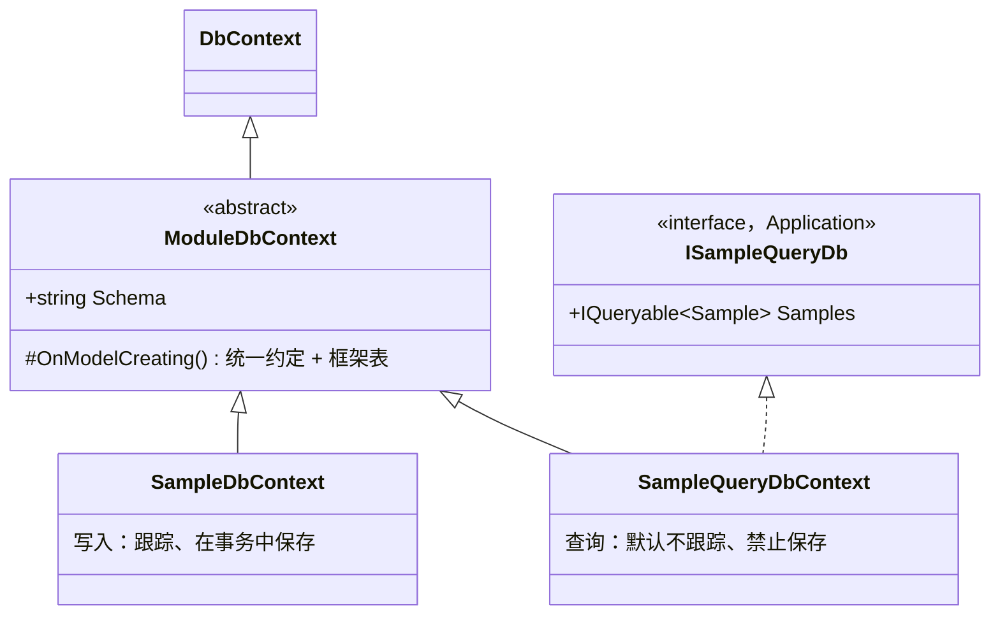
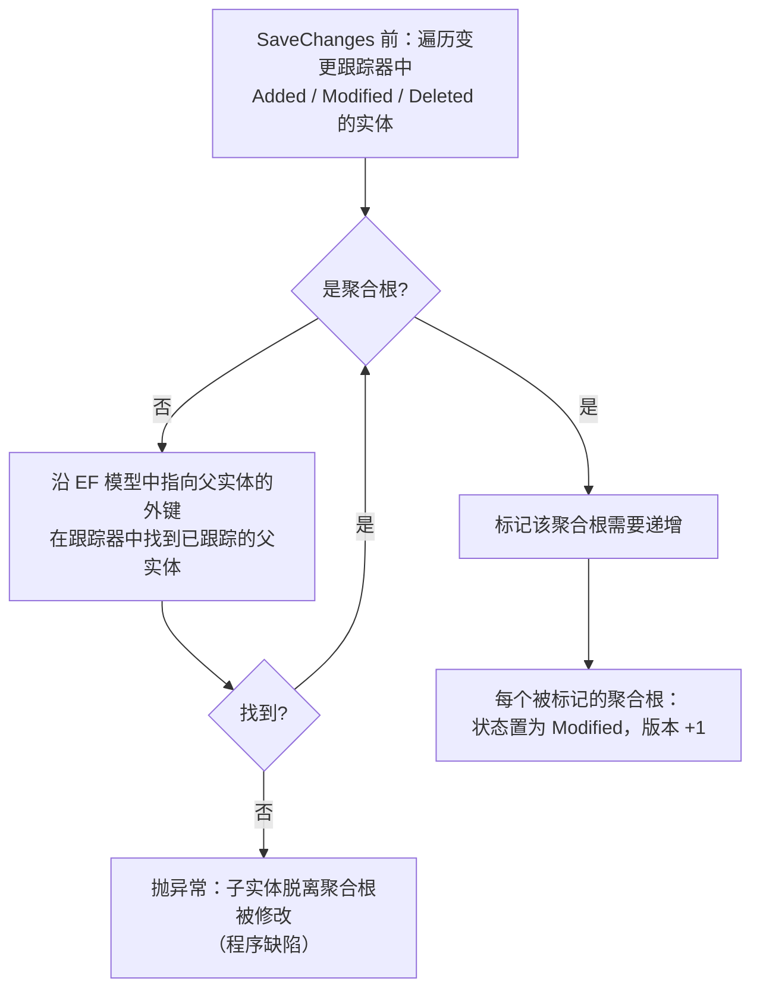
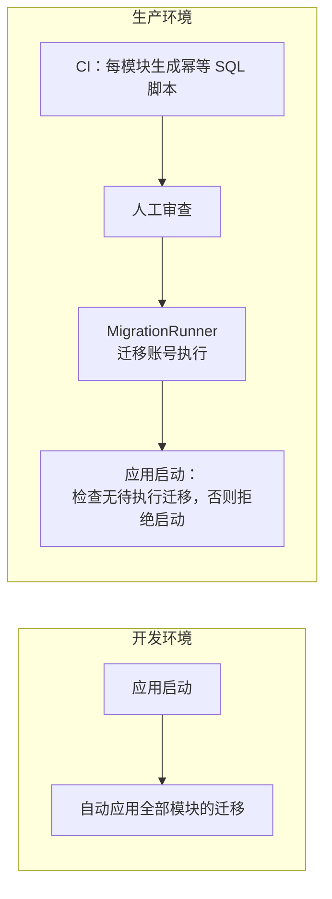

# 05-03 数据访问

- 状态：已确认（2026-11-04，D1～D5 均按建议确定）；2026-11-04 随 05-07 补充读模型豁免与 Outbox / Inbox 映射；随 05-08 补充作业表与按来源选择数据源；随 05-09 调整审计事件写入与只追加表；2026-11-05 随 R02 补充第 5.1、11、12 节（`IPurge`，已确认）
- 日期：2026-11-04
- 所在项目：`Kmic.BuildingBlocks.Infrastructure`（DbContext 基类、约定、拦截器、仓储基类、迁移工具）、`Kmic.MigrationRunner`
- 依据：ADR-0006、ADR-0009、ADR-0011、ADR-0012、ADR-0015、ADR-0027、ADR-0029、ADR-0030；04 第 7、10 节；05-01、05-02

## 0. 范围

| 本文内容 | 相关但不在本文 |
|---|---|
| 模块 DbContext 基类：写入上下文、查询上下文 | — |
| EF 映射约定：命名、强类型 ID、智能枚举、值对象、精度、字符串、时间、大小写 | JSON 序列化约定（05-06） |
| 审计字段、软删除、并发版本 | 审计事件、业务历史（05-09） |
| 保存拦截器的顺序 | Outbox 写入拦截器的内容（05-07） |
| 仓储基类、加锁加载、原子条件更新 | 数据范围过滤器的条件内容（05-05） |
| 唯一约束与错误码的映射 | 异常转换行为（05-02 第 4.3 节） |
| 模块内框架表的统一映射 | 各框架表的具体结构（05-02 幂等、05-07、05-09、05-13） |
| 迁移：每模块一套、迁移执行程序、运行账号授权 | CI 流水线本身（08） |

---

## 1. 旧项目怎么做 → 新框架怎么做

| 问题 | 旧项目 | 新框架 | 章节 |
|---|---|---|---|
| 数据访问技术 | Dapper、FreeSql、`DbHelperSQL` 并存 | 只用 EF Core 10 + Npgsql，复杂查询用 EF 原生 SQL | 2 |
| 跨库耦合 | 主库触发器、视图、存储过程直接引用其他库 | 每模块一个 schema，DbContext 只映射本 schema；跨模块走 Contracts / 事件 | 2、3 |
| 冗余字段同步 | 9 个数据库触发器刷新冗余名称，内部临时禁用触发器，并发有风险 | 不使用触发器；冗余数据用读模型 + 集成事件（ADR-0013） | — |
| 日期存储 | 大量日期存为字符串 | `timestamptz` / `date` / `time`，模型中禁止 `DateTime` | 3.6 |
| 审计字段 | 各处手写赋值，经常遗漏 | 影子属性，拦截器统一写入 | 4 |
| 软删除 | `DeleteMark`、`IsDel`、`IsDeleted` 多种写法，业务代码手写过滤 | `ISoftDeletable` + 命名全局过滤器 + 部分唯一索引 | 5 |
| 并发 | 没有乐观并发控制，后保存的覆盖先保存的 | 聚合根 `ConcurrencyVersion`，子实体变化也递增 | 6 |
| 约束 | 几乎没有外键与约束，25 张表无主键 | 每表主键；聚合内外键；智能枚举 CHECK 约束；唯一约束映射到错误码 | 3、7.3 |
| 表结构变更 | 手工 SQL 脚本 | 每模块一套 EF Migrations，迁移账号与运行账号分离 | 9 |
| 大小写 | 依赖 `Chinese_PRC_CI_AS`，默认不区分 | 默认区分；需要的列显式声明 ICU 非确定性排序规则 | 3.7 |

---

## 2. DbContext

### 2.1 每个模块两个上下文



| | 写入上下文 `SampleDbContext` | 查询上下文 `SampleQueryDbContext` |
|---|---|---|
| 使用者 | 仓储实现、事务行为（05-02） | 查询处理器（通过 `ISampleQueryDb`，见 D1） |
| 跟踪 | 跟踪 | `QueryTrackingBehavior.NoTracking` |
| 保存 | 只能由事务行为调用 `SaveChanges`（见 7.4 的守卫） | `SaveChanges` 一律抛异常 |
| 全局过滤器 | 软删除、数据范围 | 软删除、数据范围 |
| 模型 | 同一套映射（两者共用 `OnModelCreating`） | 同左 |

- 两个上下文共用一个 `NpgsqlDataSource`（运行账号，ADR-0029），即全应用一个连接池。
- `ModuleDbContext` 在 `OnModelCreating` 中依次：设置默认 schema → 应用本模块全部 `IEntityTypeConfiguration` → 应用框架约定（第 3 节）→ 映射模块内框架表（第 8 节）→ 注册全局过滤器（第 5 节、05-05）。
- 命令处理器不得注入查询上下文：查询上下文用另一个连接，看不到当前事务中未提交的修改，在命令中使用会读到旧数据。由架构测试检查。

> **补充说明（2026-11-04，随 R01 H1、H2 确认）**
>
> - **连接池（H1）**：上文“两个上下文共用一个 `NpgsqlDataSource`”修订为：每个来源（前台 / 后台，05-08 D2）再分**事务池**与**读池**，共 4 个数据源。写入上下文只用事务池，查询上下文只用读池。命令最多持有 1 个事务池连接；命令执行期间的嵌套读取（本模块查询、Contracts 查询）一律从读池获取；读池连接不会在“等待另一个连接”时被持有，因此不会出现“所有连接都在等第二个连接”的自锁。读池第一阶段仍指向主库（指向只读实例会带来复制延迟，另行决定）。`application_name` 分别为 `kmic-api-tx`、`kmic-api-read`、`kmic-worker-tx`、`kmic-worker-read`。
> - **可见性（H2）**：命令处理器经 `IQuerySender` 发送的本模块查询，与直接注入查询上下文一样，**看不到本命令尚未提交的修改**。规则：命令中用于判断与修改的数据一律经仓储读取（同一事务）；`IQuerySender` 只用于读取已提交的参考数据（如返回投影、引用信息）。开发与测试环境提供运行时守卫：同一命令内，写入上下文已有未保存的修改后，再发送本模块查询即抛异常。

补充说明（2026-11-06，随原型 #2 确认，`docs/framework/spikes/02-data-scope-filter.md` D2）：**不开启 Npgsql 自动预备语句**（`Max Auto Prepare` 保持默认的 0），注册数据源时检查连接串，开启了就拒绝启动。数据范围过滤器中的 `@unrestricted OR …`、`@all OR …` 只有按实际参数值做计划时才能消去并用上索引；预备语句可能改用通用计划，实测退化为全表扫描。代价是每次执行多一次计划（实测约 0.3 ms）。

### 2.2 本节决策

**D1 查询处理器如何访问数据库**

ADR-0004 规定 Application 只依赖 Domain 和抽象，03 第 6 节的依赖图中 Application 也没有 EF Core；而 ADR-0012 要求“查询处理器直接使用查询 DbContext，不经过仓储”。两条需要统一。

| 选项 | 做法 | 优点 | 缺点 |
|---|---|---|---|
| **A Application 引用 EF Core（不含 Npgsql），通过模块定义的 `ISampleQueryDb` 接口查询** | 接口在 Application，只暴露 `IQueryable<T>`；实现是 Infrastructure 中的查询上下文。处理器使用 `ToListAsync`、`EF.Property` 等 EF 的 LINQ 扩展 | 用例的查询、校验器、处理器仍在同一文件夹（ADR-0003 的“按用例组织”）；LINQ 投影写法最自然 | Application 多一个 EF Core 依赖；需要用 BannedApiAnalyzers 禁止 Application 使用 `DbContext`、`SaveChanges`、`ExecuteUpdate`、`FromSql` 等，只保留查询用的 LINQ 扩展 |
| B 查询处理器放在 Infrastructure | Application 只放查询消息与响应 DTO，处理器在 Infrastructure 的 `Queries/` 下 | Application 完全不依赖 EF | 一个用例拆在两个项目里；查询处理器能接触到 Infrastructure 的一切（DbContext 写入、外部服务），约束反而更弱 |
| C Application 自定义查询抽象，不引用 EF | 框架包装 `IQueryExecutor.ToListAsync(IQueryable)` 等 | Application 不依赖 EF | 等于重新包装 EF 的异步 LINQ；`EF.Functions`（如模糊查询）、`EF.Property`（读审计影子属性）都无法使用，包装会越来越多 |

- **决定（已确认，2026-11-04）**：A；已同步修订 03 第 6 节依赖图，并在 ADR-0004 中补充说明（Application 允许引用 `Microsoft.EntityFrameworkCore`，仅用于查询 LINQ）。
- **理由**：CQRS 读侧的价值就是“直接、按需投影”，A 保持了这一点，又通过接口和禁用 API 把 Application 能做的事限定在只读查询内。
- **取舍**：Application 不再是“零第三方依赖”；靠禁用 API 而不是项目引用来防止在 Application 中写数据。

**D2 是否使用 DbContext 池**

| 选项 | 优点 | 缺点 |
|---|---|---|
| **A 不使用池，每个作用域新建 DbContext** | 全局过滤器读取的“当前用户 / 数据范围”是作用域内的状态，不存在池化实例残留上一个请求状态的风险 | 每次请求多一次 DbContext 构造（官方测得的差异在每秒数万请求量级才明显） |
| B `AddDbContextPool` | 构造开销更低 | 过滤器依赖的状态必须在每次租用时重置，一旦遗漏就是**数据越权**；与模块化的多上下文组合后更容易出错 |

- **决定（已确认，2026-11-04）**：A。
- **理由**：池化省下的是微秒级开销，而它的失败模式是数据越权，不值得。
- **取舍**：放弃极端吞吐下的少量性能。

---

## 3. 映射约定

框架约定在 `ModuleDbContext.ConfigureConventions` 与模型构建完成阶段统一应用，模块的实体配置只写业务相关的部分。

### 3.1 命名

| 对象 | 规则 | 例 |
|---|---|---|
| schema | 模块名 | `"Sample"` |
| 表 | 实体类名（单数），不用 `DbSet` 属性名 | `"Sample"."SampleItem"` |
| 列 | 属性名 | `"CreatedAt"` |
| 值对象列 | 属性名 + 成员名，无下划线 | `ContactEmail`、`AmountValue`、`AmountCurrency` |
| 约束 / 索引 | EF 默认：`PK_`、`FK_`、`IX_` | `IX_Sample_Number` |

- 全部大驼峰（ADR-0012 第 1 条），手写 SQL 必须加双引号。
- 架构测试读取 EF 模型，检查每个实体的 schema 等于所属模块名（防止映射到其他模块的 schema）。

### 3.2 主键与强类型 ID

- 主键属性名固定为 `Id`，`ValueGeneratedNever()`（ID 由程序生成，ADR-0009）。
- 强类型 ID：EF 转换器按 05-01 第 4.2 节生成；约定按 `IStronglyTypedId` 扫描模块程序集，统一注册 `Properties<TId>().HaveConversion<...>()`，实体配置中不需要逐个写。
- 纯关联表：复合主键（ADR-0009 第 5 条）。

补充说明（2026-11-06，随原型 #4 验证）：上面“约定按 `IStronglyTypedId` 扫描模块程序集”与 05-01 第 4.2 节不一致（扫描是 05-01 的备选方案），更正为：由 Vogen 按 Infrastructure 中的 `[EfCoreConverter<T>]` 标记生成的注册方法统一注册，实体配置中仍不需要逐个写。框架 ID 与模块 ID 的分工见 `docs/framework/spikes/04-vogen-ef-converters.md` 第 3 节。

### 3.3 智能枚举与普通枚举

- 列类型 `varchar(64)`，存 `Code`（05-01 D5）。
- 模型构建完成时，约定为每个这样的列生成 `CHECK ("Status" IN ('Draft','Submitted',...))`，约束名 `CK_{表}_{列}`。新增枚举值时 `dotnet ef migrations add` 会产生约束变更，迁移中可见。
- 普通枚举同样以字符串存储并生成 CHECK 约束。

### 3.4 值对象

| 值对象形态 | 映射方式 |
|---|---|
| 单值（实现 `ISingleValueObject<T>`，05-01 D4） | 值转换器，映射为一列，列名即属性名 |
| 多值 | EF 复杂类型（`ComplexProperty`），每个成员一列 |
| 可空的多值值对象 | EF 10 的可选复杂类型 |
| 值对象集合 | 复杂类型集合映射为 `jsonb` 列 |

- 不使用“拥有实体”（Owned Entity）表达值对象：拥有实体有隐藏的标识，与值对象“按值相等”的语义冲突，EF 官方也推荐值对象使用复杂类型。
- `待确认`：Npgsql 10 对可选复杂类型、复杂类型集合映射为 `jsonb` 的支持程度，实施前原型验证；不支持的形态退回单值转换器或 JSON 值转换器。

### 3.5 数值

- `decimal` 属性**必须显式声明精度**，否则模型校验失败（启动时 + 架构测试）。
- 框架提供精度常量 `Precisions.Amount`、`Precisions.UnitPrice`、`Precisions.Quantity`、`Precisions.Rate`，用法 `.HasPrecision(Precisions.Amount)`。具体数值随业务确认（ADR-0012 第 4.1 条，`待确认`），先占位。
- 禁止 `float` / `double` 属性映射到表（模型校验）。

### 3.6 时间

- 模型中禁止 `DateTime` 属性，只允许 `DateTimeOffset`（→ `timestamptz`）、`DateOnly`（→ `date`）、`TimeOnly`（→ `time`）（模型校验）。
- Npgsql 写入 `timestamptz` 时要求偏移为 0，非 UTC 值会直接报错——这正好守住“时刻统一按 UTC 存储”（ADR-0012 第 2 条）。

### 3.7 字符串与大小写

- 区分大小写的列（默认）：普通映射。
- 不区分大小写的列：`.IsCaseInsensitive()`（框架扩展方法），映射到排序规则 `"CaseInsensitive"`（ICU，`und-u-ks-level2`，非确定性）。该排序规则由框架在每个模块的初始迁移中创建于模块 schema 内（第 9.3 节）。
- `待确认`：PG 18 下非确定性排序规则对 `LIKE` 的支持范围（ADR-0030），实施时测试；编码规范给出替代写法。

**D3 字符串列是否必须声明最大长度**

| 选项 | 优点 | 缺点 |
|---|---|---|
| **A 必须声明：`.HasMaxLength(n)` → `varchar(n)`；长文本显式 `.IsUnboundedText()` → `text`** | 数据库是最后一道防线，异常超长的数据进不来；表结构本身说明了字段的业务含义 | 每个字符串属性多一行配置；调整长度需要迁移 |
| B 默认 `text`，长度只在校验器中限制 | 配置最少；PG 中 `text` 与 `varchar` 性能相同 | 绕过校验器的路径（后台作业、迁移脚本、手写 SQL）可以写入任意长度；表结构看不出字段约束 |

- **决定（已确认，2026-11-04）**：A，未声明的字符串属性导致模型校验失败。
- **理由**：旧系统“没有约束”是主要问题之一；长度约束成本很低，却能在所有写入路径上兜底。
- **取舍**：多一些配置；放宽长度需要一次迁移（PG 中放宽 `varchar` 长度只改元数据，不重写表）。

### 3.8 关系

| 关系 | 约定 |
|---|---|
| 聚合根 → 子实体 | 外键 + 级联删除（子实体随聚合根删除） |
| 聚合之间（同模块） | 只存 ID（05-01 第 3.2 节）；**建外键约束，删除行为 `Restrict`** |
| 跨模块引用（`XxxRef`） | 只存 ID，不建外键（不同 schema、不同模块，ADR-0006） |
| 导航属性 | 只允许聚合根 → 子实体；聚合之间不建导航属性（架构测试检查 EF 模型） |
| 延迟加载 | 不启用；聚合由仓储一次加载完整 |

---

### 3.9 数据库注释（2026-11-04，随 R01 M1 确认）

EF 映射是数据库注释的唯一来源：在实体配置中用 `HasComment` 声明，随迁移进入数据库（`COMMENT ON`），不另外手写。

| 对象 | 必须写什么 | 示例（示例） |
|---|---|---|
| 表 | 中文名称；所属模块；一行代表什么；关键的唯一性或归属；生命周期（能否删除、停用、作废） | “示例单据；Sample 模块；一行代表一张示例单据；编号全局唯一；草稿可删除，提交后只能作废” |
| 列 | 中文含义；需要时写单位、取值范围、NULL 的含义、默认值的含义、来源或关联 | `DueDate`：“截止日期；业务时区下的日期，含当天；为空表示不限” |
| 人工建立的索引 | 支撑哪类查询或约束（迁移中以 `COMMENT ON INDEX` 写入） | “按创建时间倒序翻页的列表查询” |

| 规则 | 说明 |
|---|---|
| 框架统一注释 | 框架表（Outbox、Inbox、幂等、作业、业务历史、编号计数等）、审计影子列、`ConcurrencyVersion`、软删除列由框架约定自动加注释，模块不必重复写 |
| 检查 | 模型校验（第 10 节）：业务表或业务列缺少注释 → 开发与测试环境启动失败，架构测试同样拦截 |
| 敏感字段 | 只写格式与含义，不写真实示例（手机号、证件号、金额明细等） |
| 注释与代码注释的关系 | C# 的 XML 注释不会自动成为数据库注释，两者各写各的：XML 注释面向开发者（为什么这样设计），数据库注释面向看数据库的人（字段是什么意思） |
| 变化 | 修改注释同样产生迁移，随迁移审查；“金额单位从分改为元”“状态含义变化”不是注释变化，而是数据与契约变化，按 06 第 11.3 节分步处理 |
| 数据字典 | CI 从 EF 模型生成数据字典（Markdown，按模块分文件：表、列、类型、可空、默认值、注释、索引、外键），作为构建产物保存；不手工维护另一份 |

补充说明（2026-11-06，随 06 第 10.3 节补充说明第 4 条确认）：上表“注释与代码注释的关系”一行改为：**列注释默认取实体属性的 XML 注释**。06 已要求领域实体每个公开属性都写 XML 注释，且内部类型的 XML 注释只写“是什么”（06 附录 A.12），与列注释要写的内容一致；两处分别维护会长期重复并逐渐不一致。

| 项 | 做法 |
|---|---|
| 列 | 框架的源码生成器在**编译时**读取实体属性的 `summary`，生成对应的 `HasComment`；说法确需不同（如数据库读者需要更多来源说明）时，在实体配置中显式写 `HasComment` 覆盖 |
| 表 | 仍在实体配置中显式写 `HasComment`：表注释要求的所属模块、一行代表什么、生命周期等，比类型的 XML 注释多 |
| 不在运行时读取 `.xml` 文档文件 | 部署时缺少文档文件会使模型与迁移快照不一致，EF 会报告存在未生成迁移的模型变更 |
| 检查 | 上表“检查”一行不变：模型校验仍拦截缺少注释的业务列；属性缺少 XML 注释时由 06 的分析器在编译期先拦下 |
| 实现时点 | 阶段 2，与模型校验一起实现 |

## 4. 审计字段

每个实体表（聚合根和子实体）都有以下影子属性，由约定统一添加（ADR-0011 第 2 条）：

| 列 | 类型 | 写入时机 |
|---|---|---|
| `CreatedAt` | `timestamptz not null` | 新增时 |
| `CreatedBy` | `uuid not null` | 新增时 |
| `UpdatedAt` | `timestamptz null` | 修改时（新增时为空） |
| `UpdatedBy` | `uuid null` | 修改时 |

- 时间取自 `TimeProvider`；操作人取自 `IExecutionContext`。系统身份写入框架常量 `SystemUserId`（固定的 UUID，Identity 模块初始化时创建同 ID 的系统账号，便于显示“系统”）。
- 查询侧通过 `EF.Property<DateTimeOffset>(e, AuditColumns.CreatedAt)` 读取；框架提供常量，避免写错字符串。
- 按创建时间排序是常见需求（ADR-0009 第 6 条：不按 ID 排序），聚合根表的 `CreatedAt` 默认建索引。

**D4 模拟身份时，`CreatedBy` / `UpdatedBy` 记录谁**

模拟身份：管理员以某个用户的身份操作（用于排查问题）。

| 选项 | 优点 | 缺点 |
|---|---|---|
| **A 记录实际操作人（管理员）** | “这条数据是谁改的”如实反映；不会把管理员的操作算到用户头上 | 业务页面上显示的修改人是管理员，用户可能困惑 |
| B 记录被模拟的用户 | 从业务视角看数据仍“属于”该用户 | 用户会被记上自己没做过的修改；只能靠审计事件还原真相 |

- **决定（已确认，2026-11-04）**：A。完整的“谁以谁的身份”由审计事件记录（ADR-0018 第 3 条）。
- **理由**：审计字段回答的是“谁改的”，模拟身份时真正动手的是管理员。
- **取舍**：被模拟用户的数据上会出现管理员的名字，属于预期行为，需要在用户手册中说明。

---

## 5. 软删除

### 5.1 写法

```csharp
public sealed class Sample : AggregateRoot<SampleId>, ISoftDeletable
{
    public Result EnsureDeletable() =>
        Status == SampleStatus.Draft ? Result.Success() : SampleErrors.CannotDeleteSubmitted;
}

// 处理器
var check = sample.EnsureDeletable();
if (check.IsFailure) return check.Error;
repository.Remove(sample);          // 拦截器改写为标记删除
```

| 要点 | 约定 |
|---|---|
| 谁能实现 `ISoftDeletable` | 只有聚合根（架构测试）；子实体随聚合根一起“被删除”，从聚合中移除的子实体是物理删除（属于聚合的正常编辑） |
| 影子属性 | `IsDeleted boolean not null default false`、`DeletedAt timestamptz null`、`DeletedBy uuid null` |
| 拦截器 | 把 `Deleted` 状态的 `ISoftDeletable` 改为 `Modified`，写入三个影子属性；子实体的级联删除随之取消 |
| 全局过滤器 | 命名过滤器 `SoftDelete`：`!EF.Property<bool>(e, "IsDeleted")` |
| 回收站 | 查询上下文中 `IgnoreQueryFilters(["SoftDelete"])`（EF 10 命名过滤器，只关闭软删除，**数据范围过滤仍然生效**）；恢复用仓储的 `Restore(id)`，同样经命令管道 |
| 唯一约束 | 约定把 `ISoftDeletable` 实体上的所有唯一索引自动改为部分唯一索引 `WHERE "IsDeleted" = false` |
| 物理删除 | 必须经框架的 `IPurge` 接口，命令须标 `[Audited]`，并有专门的权限点（ADR-0012 第 3 条） |

**补充说明（2026-11-05，随 R02 确认）：物理删除的版本与快照（R02-2）**

读模型按版本比较（05-07 第 8.2 节），物理删除这个事实必须比该聚合任何已发布的存在快照都新；而行一旦删除就没有版本列了。因此 `IPurge` 的框架包装统一完成下列步骤，模块代码不能自行组合（`ExecuteDelete` 已由 D5 禁止）：

```csharp
// BuildingBlocks.Application
public interface IPurge<TAggregate, TId> where TAggregate : AggregateRoot<TId>
{
    // 在当前命令事务中执行。aggregate 由处理器照常加载并完成授权（加载方式与 Restore 相同：可加载已软删除的聚合，数据范围仍生效）
    // snapshot 为 null 表示该聚合没有对外的快照事件；有时只需给出“只含 ID、Status = Deleted”的快照（05-07 第 8.4 节）
    Task<Result> PurgeAsync(TAggregate aggregate, Func<TId, ISnapshotEvent>? snapshot, CancellationToken ct);
}
```

| 步骤 | 做法 |
|---|---|
| 1 锁定 | `SELECT "ConcurrencyVersion" FROM … WHERE "Id" = @id FOR UPDATE`（不受软删除过滤器影响）；与已加载聚合的版本不一致 → `Common.VersionConflict` |
| 2 取最后版本 | 锁内读出的 `ConcurrencyVersion` 就是最后版本 v；锁持有到事务结束，其他事务无法再提交更高的版本 |
| 3 删除 | 包装内部以 `ExecuteDelete` 删除聚合根（框架基础设施豁免 D5），子实体按 3.8 的外键级联删除；软删除拦截器不参与 |
| 4 发布快照 | 有快照事件时，以 `SourceVersion = v + 1`、信封 `Purged = true` 写入 Outbox，与删除同一事务。拦截器 5 对带 `Purged` 的快照不再从被跟踪的聚合取版本，使用包装写入的版本；`Purged` 只能由本包装设置（05-07 第 5.3 节） |

- 为什么要锁：不锁的话，读版本与删除之间另一个事务提交了 v + 1 的修改，删除事件就与那次修改同号，读模型无法判断先后。
- 读模型收到后置终态、不再被任何事件或重建修改；“误标终态”首期不提供自动修复，归入受控恢复（05-07 第 8.3、8.4 节补充说明）。

### 5.2 已删除 / 停用数据被引用时

ADR-0012 规定“历史记录保留原值，读取时标记 `[已删除]` / `[已禁用]`”。数据层的支持：

- 同模块引用：查询时 `IgnoreQueryFilters(["SoftDelete"])` 关联读取，并投影 `IsDeleted` 供接口层显示标记。
- 跨模块引用：由读模型中的 `Status`（`Active` / `Disabled` / `Deleted`）表达（ADR-0013 第 3 条），见 05-07 第 8.4 节。
- “不可被新数据选用”：下拉选项查询默认带软删除过滤器，自然排除。

---

## 6. 并发版本

### 6.1 规则（ADR-0012 第 4 条）

- 聚合根有 `ConcurrencyVersion bigint not null`，配置为并发令牌。
- 聚合内**任何**实体新增、修改、删除，保存时聚合根版本 +1，`UPDATE` 条件同时匹配 `Id` 与原版本；影响 0 行 → `DbUpdateConcurrencyException` → 05-02 转为 409 `Common.VersionConflict`。

### 6.2 子实体变化如何找到聚合根



- 父子关系取自 EF 模型中“聚合根 → 子实体”的导航（第 3.8 节只允许这种导航），无需子实体额外声明。
- “子实体被修改而聚合根未被跟踪”只可能是绕过仓储直接操作了子实体，按程序缺陷抛异常。

### 6.3 前端带回的版本

- 修改类命令携带 `ExpectedVersion`；仓储的 `GetForUpdateAsync(id, expectedVersion)` 加载后先比较，不一致直接返回 `Common.VersionConflict`（不必等到保存）。
- 加载与保存之间被他人修改，由 6.1 的 `UPDATE` 条件兜底。
- 新版本号由事务行为在提交后回填到响应（05-02 第 6.4 节）。

---

## 7. 仓储与写入

### 7.1 仓储接口

```csharp
// BuildingBlocks.Domain
public interface IRepository<TAggregate, TId>
    where TAggregate : AggregateRoot<TId> where TId : notnull
{
    Task<Result<TAggregate>> GetForUpdateAsync(TId id, long? expectedVersion, CancellationToken ct);
    Task<Result<TAggregate>> GetForUpdateLockedAsync(TId id, long? expectedVersion, CancellationToken ct); // 7.2
    void Add(TAggregate aggregate);
    void Remove(TAggregate aggregate);
}

// 模块 Domain：按需增加按业务键加载的方法
public interface ISampleRepository : IRepository<Sample, SampleId>
{
    Task<Result<Sample>> GetByNumberForUpdateAsync(string number, CancellationToken ct);
}
```

- 基类实现 `EfRepository<TContext, TAggregate, TId>`，模块实现只需提供 `Include` 链（一次加载完整聚合，使用 `AsSplitQuery` 避免笛卡尔爆炸）。
- 加载不到（不存在、已软删除、**在数据范围之外**）统一返回 `NotFound`，不区分原因（ADR-0015 第 2 层：404 不泄露存在性），真实原因由 05-05 写入审计。
- 仓储只提供“按标识加载完整聚合”，不提供列表、分页、统计——那是查询侧的事（ADR-0012 第 6 条）。

### 7.2 加锁加载与共享额度

ADR-0012 第 4 条：共享额度不能只靠版本号，要在事务内重新计算，并用原子条件更新、锁或约束防止超量。05-02 D7 已确定不提高隔离级别，因此框架提供两种标准写法：

| 写法 | 用途 | 实现 |
|---|---|---|
| `GetForUpdateLockedAsync` | 需要先读再改、多个请求争抢同一聚合 | 先执行 `SELECT 1 FROM "S"."T" WHERE "Id" = @id FOR UPDATE`，再正常加载聚合；锁持有到事务结束 |
| `IAtomicUpdate` | 计数、额度扣减这类“条件成立才更新”的单表操作 | 包装 EF 的 `ExecuteUpdate`，**自动补上** `UpdatedAt`、`UpdatedBy`、`ConcurrencyVersion + 1`，返回影响行数；为 0 时由调用方返回业务错误 |

**D5 是否限制直接使用 `ExecuteUpdate` / `ExecuteDelete`**

`ExecuteUpdate` / `ExecuteDelete` 直接生成 SQL，**不经过变更跟踪和拦截器**：审计字段不更新、并发版本不递增、软删除不改写、业务历史和 Outbox 都不会写入。

| 选项 | 优点 | 缺点 |
|---|---|---|
| **A 禁止直接使用，只能通过框架的 `IAtomicUpdate` / `IPurge`** | 拦截器保证的规则不会被绕过；需要批量操作的地方集中可查 | 少数批量场景写法受限，需要扩展框架包装 |
| B 允许，靠代码评审 | 灵活 | 漏掉一个就是“版本不递增导致覆盖”“审计字段不准”这类难以发现的问题 |

- **决定（已确认，2026-11-04）**：A，用 BannedApiAnalyzers 禁止模块代码调用这两个方法（框架基础设施项目豁免）。
- **理由**：这两个方法正是“绕开框架规则”的入口，集中到框架包装中才能保证规则一致。
- **取舍**：批量维护类功能需要等框架提供对应包装。

### 7.3 唯一约束与错误码

在实体配置中直接声明唯一约束对应的错误：

```csharp
builder.HasIndex(x => x.Number).IsUnique()
       .MapsToError(SampleErrors.NumberDuplicated);   // 框架扩展方法，写入模型注解
```

- 05-02 的异常转换行为从 EF 模型中按约束名查找注解，不需要另外登记。
- 集成测试遍历所有模块的 EF 模型，任何唯一索引缺少注解即失败（05-02 D2）。

### 7.4 保存拦截器的顺序

`SaveChanges` 时，框架拦截器按固定顺序执行：

| 顺序 | 拦截器 | 作用 | 文档 |
|---|---|---|---|
| 0 | 保存守卫 | 不在事务行为内调用 `SaveChanges` 即抛异常（防止处理器自行保存） | 本文 |
| 1 | 软删除 | `Deleted` → `Modified` + 删除标记 | 第 5 节 |
| 2 | 审计字段 | 写入 `Created*` / `Updated*` | 第 4 节 |
| 3 | 聚合版本 | 找到受影响的聚合根，版本 +1 | 第 6 节 |
| 4 | 业务历史 | 取出聚合根的 `StateTransitions` 写入历史表 | 05-09 |
| 5 | Outbox | 把本次添加的集成事件写入 Outbox | 05-07 |
| 6 | 审计事件 | `[Audited]` 命令的审计事件，含字段级变更；作为 `Framework.AuditRecorded` 写入本模块 Outbox（05-09 D3） | 05-09 |

- 软删除必须在审计字段和版本之前：被改写成 `Modified` 后，才会被计为一次修改。
- 审计事件放在最后：它需要看到前面所有拦截器产生的最终变更。
- 领域事件不在拦截器中分发，而是在事务行为里 `SaveChanges` 之前完成（05-02 第 6.1 节）。04 第 4 节表格中“拦截器（领域事件）”一项以此为准。
- 查询性能相关的命令拦截器（慢 SQL 日志）见 05-12。

---

## 8. 模块内框架表

需要与业务数据同一事务的框架表，放在每个模块自己的 schema 中（ADR-0027）。

- `ModuleDbContext.OnModelCreating` 调用 `modelBuilder.ApplyFrameworkTables()`，统一映射：幂等记录（05-02）、Outbox / Inbox（05-07）、后台作业 `BackgroundJob`（05-08 D6）、业务历史（05-09）、编号计数（05-13）。审计事件没有模块表，经 Outbox 汇总到 Operations（2026-11-04 随 05-09 D3 修订）。
- 数据源（2026-11-04 随 05-08 D2 补充；随 R01 H1 再拆分为事务池与读池，见第 2.1 节补充说明）：宿主注册前台、后台两个 `NpgsqlDataSource`（键控服务，各自连接池上限与 `Application Name`），`ModuleDbContext` 在作用域内按执行上下文的来源选择，见 05-08 第 4.2 节。
- 框架表的结构变化后，**每个模块都需要生成一次迁移**。CI 中对每个模块执行 `dotnet ef migrations has-pending-model-changes`，有未生成的迁移即失败。
- 框架表不使用强类型 ID、不实现 `ISoftDeletable`、不加审计影子属性（它们本身就是记录）。
- 业务历史表每个有状态的聚合一张（ADR-0018 影响），由约定根据“聚合根使用了状态机”自动生成映射，表名 `{聚合}StateHistory`。

---

## 9. 迁移

### 9.1 结构

| 项 | 约定 |
|---|---|
| 迁移位置 | 模块 Infrastructure 项目的 `Migrations/` |
| 迁移历史表 | `"{模块}"."__EFMigrationsHistory"` |
| 设计时工厂 | 每个模块一个 `IDesignTimeDbContextFactory`，由模板生成 |
| 迁移账号 | 只有 `Kmic.MigrationRunner` 使用（ADR-0029） |

### 9.2 执行



- 模块之间没有跨 schema 依赖，执行顺序按模块注册顺序即可。
- 只向前迁移；破坏性变更按“扩展 → 迁移 → 收缩”分步发布（ADR-0012 第 5 条），编码规范给出列改名、拆表的分步示例。
- 应用启动检查：生产环境发现有未执行的迁移，记录错误并拒绝启动——防止新代码跑在旧表结构上。

### 9.3 每个模块初始迁移中的框架步骤

框架提供 `migrationBuilder.InitializeModuleSchema("Sample")`，模块模板生成的初始迁移中自动调用：

1. `CREATE SCHEMA IF NOT EXISTS "Sample"`；
2. 创建排序规则 `"Sample"."CaseInsensitive"`（3.7 节）；
3. 授权：`GRANT USAGE ON SCHEMA "Sample" TO kmic_runtime`，以及 `ALTER DEFAULT PRIVILEGES … GRANT SELECT, INSERT, UPDATE, DELETE ON TABLES TO kmic_runtime`，之后新建的表自动授权给运行账号（ADR-0029 影响）。

- 只追加表（各 `{聚合}StateHistory`，以及 Operations 的 `AuditLog`、Identity 的 `SecurityEvent`）的建表迁移由框架约定自动附加 `REVOKE UPDATE, DELETE … FROM kmic_runtime`；过期数据只能由 MigrationRunner 的维护命令删除（2026-11-04 随 05-09 D7 补充）。
- `kmic_runtime` 是固定名称的**组角色**，实际登录的运行账号是它的成员。这样迁移脚本中不出现环境相关的账号名，同一份脚本可用于所有环境。

### 9.4 种子数据

| 数据 | 方式 |
|---|---|
| 固定不变、与代码一一对应的行（如系统账号） | 迁移中的 `HasData` / 手写插入 |
| 权限点同步（05-05）、默认字典项等随代码版本变化的数据 | 启动任务（`CallOrigin.Startup`，经命令管道，幂等执行） |
| 测试数据 | 只在测试中构造，不进入迁移 |

---

## 10. 模型校验汇总

启动时（开发、测试环境）与架构测试中执行同一套模型校验：

| 规则 | 依据 |
|---|---|
| 实体的 schema = 所属模块名 | ADR-0006 |
| 表名 = 实体类名 | 3.1 |
| `decimal` 必须声明精度；禁止 `float` / `double` | 3.5 |
| 禁止 `DateTime` 属性 | 3.6 |
| 字符串必须声明最大长度或显式无上限 | 3.7、D3 |
| 聚合之间无导航属性；跨模块引用无外键 | 3.8 |
| 聚合根都有 `ConcurrencyVersion` 并发令牌 | 6.1 |
| `IReadModel` 实体（05-07 第 8 节）不适用并发令牌、审计字段、软删除三条，只能经 `IReadModelWriter` 写入 | 05-07 |
| `ISoftDeletable` 只在聚合根上；其唯一索引都是部分索引 | 5.1 |
| 唯一索引都有错误码注解 | 7.3 |
| 每个模块没有未生成的迁移 | 8 |

---

补充（2026-11-04，随 R01 M1 确认）：业务表、业务列缺少数据库注释 → 开发与测试环境启动失败（第 3.9 节）。

## 11. 测试要点

**框架自身**（Testcontainers 起真实 PG 18，ADR-0021 不使用内存数据库）：

| 对象 | 必测场景 |
|---|---|
| 映射约定 | 强类型 ID、智能枚举、单值 / 多值 / 可选 / 集合值对象往返一致；CHECK 约束拒绝非法编码；非 UTC 时间写入被拒绝 |
| 大小写 | `IsCaseInsensitive` 列的等值查询与唯一约束不区分大小写；`LIKE` 行为（ADR-0030 待确认项） |
| 审计字段 | 新增 / 修改写入正确；系统身份写入 `SystemUserId`；模拟身份写入实际操作人（D4） |
| 软删除 | 删除被改写；默认查询不可见；回收站可见且数据范围仍生效；删除后可新建同编号数据（部分唯一索引）；`Restore` |
| 并发版本 | 只改子实体也递增；`ExpectedVersion` 不符立即冲突；两个事务交错保存，后者冲突；绕过聚合根修改子实体抛异常 |
| 加锁与原子更新 | 两个并发扣减不超量；`IAtomicUpdate` 写入审计字段并递增版本 |
| 保存守卫 | 处理器内直接 `SaveChanges` 抛异常 |
| 查询上下文 | 不跟踪；`SaveChanges` 抛异常 |
| 迁移 | 全部模块从空库迁移成功；运行账号能读写新表、不能执行 DDL；生产模式下有未执行迁移时拒绝启动 |

**业务模块**：每个聚合一个“保存 → 重新加载 → 比较”的往返测试（模板生成）。

---

补充（2026-11-04，随 R01 H1、H2 确认）：

| 对象 | 必测场景 |
|---|---|
| 连接池 | 同时执行的命令数等于事务池上限、且每个命令都发送嵌套读取时，全部在超时前完成（不自锁） |
| 可见性守卫 | 命令中修改聚合后再发送本模块查询，开发与测试环境抛异常；先查询后修改不触发 |

补充（2026-11-05，随 R02 确认）：

| 对象 | 必测场景 |
|---|---|
| 物理删除（原型 #17） | 快照事件的 `SourceVersion` 为最后版本 + 1、信封 `Purged = true`；另一个事务在“加载后、锁定前”提交了修改 → `Common.VersionConflict`；删除事务持锁期间并发修改等待，删除提交后对方影响 0 行；模块代码设置 `Purged` 被拒；子实体随根删除 |

## 12. 与其他文档的接口

| 本文提供 / 需要 | 对方 |
|---|---|
| 写入上下文、保存守卫、事务挂接点 | 05-02 事务行为 |
| 唯一约束错误注解、并发冲突时读取最新版本 | 05-02 异常转换行为 |
| 需要：数据范围命名过滤器（`DataScope`）的条件 | 05-05 |
| 拦截器 4、6 的位置；业务历史表映射约定 | 05-09 |
| 拦截器 5 的位置；Outbox / Inbox 表映射（结构见 05-07 第 6.1、7.1 节）；读模型模型校验豁免 | 05-07 |
| 编号计数表映射 | 05-13 |
| 迁移执行程序 | 08 实施计划、部署流程 |
| D1：已修订 03 第 6 节依赖图，ADR-0004 已补充说明 | 03、ADR-0004 |
| 随 R02 修订（2026-11-05，已确认）：`IPurge` 的锁定、版本与 `Purged` 快照 | 05-07 第 5.3、5.4、8.4 节（已确认） |

---

## 13. 决策汇总

| 编号 | 事项 | 决定（均已确认） |
|---|---|---|
| D1 | 查询处理器如何访问数据库 | Application 引用 EF Core，通过模块的 `IXxxQueryDb` 接口查询，禁用写入类 API |
| D2 | 是否使用 DbContext 池 | 不使用 |
| D3 | 字符串列是否必须声明最大长度 | 必须，长文本显式声明 |
| D4 | 模拟身份时审计字段记录谁 | 实际操作人 |
| D5 | 是否限制直接使用 `ExecuteUpdate` / `ExecuteDelete` | 禁止，只能经框架包装 |

| 待确认 | 处理方式 |
|---|---|
| Npgsql 10 对可选复杂类型、复杂类型集合（`jsonb`）的支持 | 实施前原型验证 |
| PG 18 非确定性排序规则下 `LIKE` 的支持范围 | 实施时测试（ADR-0030） |
| 金额、单价、数量、税率的精度数值 | 随业务确认（ADR-0012 第 4.1 条） |

补充说明（2026-11-05，随 R02 确认）：D5 不变；`IPurge` 的框架包装明确为“锁定 → 取最后版本 → 删除 → 发布版本为最后版本 + 1 的 `Purged` 快照”（第 5.1 节补充说明，R02-2）。
