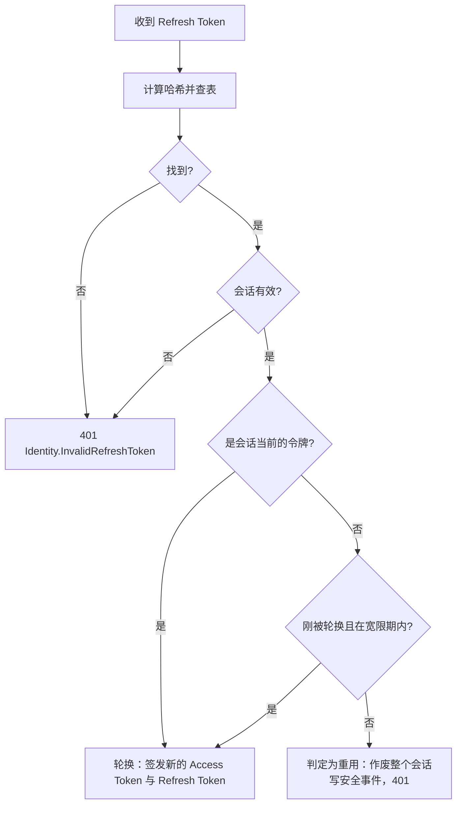
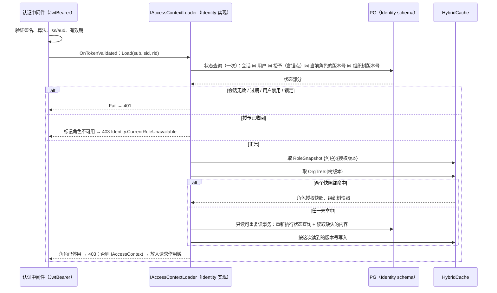
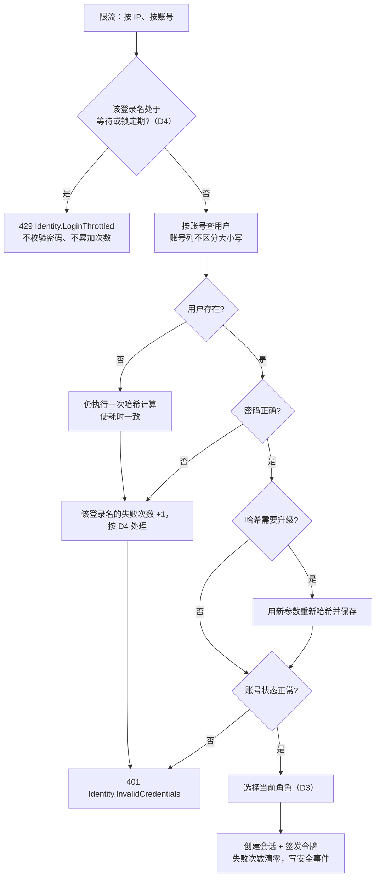

# 05-04 认证与会话

- 状态：已确认（2026-11-04）；之后的修订见文末“修订记录”
- 日期：2026-11-04
- 所在项目：Identity 平台模块（`Kmic.Identity.*`）；`BuildingBlocks.Application`（`IAccessContext`、`IAccessContextLoader` 抽象）；`BuildingBlocks.Presentation`（JWT 验证配置、Cookie / CSRF 约定）；`Kmic.Operator`（初始化命令）
- 依据：ADR-0001、ADR-0015、ADR-0016、ADR-0018、ADR-0022、ADR-0026、ADR-0027、ADR-0031；04 第 5.1、6 节；05-02 第 7 节

## 0. 范围

| 本文内容 | 相关但不在本文 |
|---|---|
| 账号、密码、锁定、验证码登录 | 角色、权限点、授予、组织单元的管理（05-05） |
| 令牌签发、验证、刷新、轮换、密钥轮换 | 端点约定与 ProblemDetails（05-06） |
| 会话表与会话失效 | — |
| 每个请求的访问上下文加载 | 权限点集合的内容、数据范围计算（05-05） |
| 当前角色切换、模拟身份 | 审计事件的写入（05-09） |
| 安全事件的产生点 | 安全事件通道的实现（05-09） |
| ADR-0001 遗留待决：锁定策略、验证码、模拟身份规则 | — |

---

## 1. 旧项目怎么做 → 新框架怎么做

| 问题 | 旧项目 | 新框架 | 章节 |
|---|---|---|---|
| 身份保持 | 用户 ID、角色等 DES 加密后放在多个 Cookie，固定密钥，无签名，密钥泄露即可伪造任意身份 | RS256 签名的短期 JWT，只含标识；其余信息每个请求从服务端加载 | 3、6 |
| 会话失效 | 没有服务端会话，无法强制下线 | 会话表；退出、改密码、禁用、强制下线立即生效 | 5 |
| 密码 | 明文比对（MD5 代码已注释） | ASP.NET Core Identity 的密码哈希（PBKDF2），旧哈希自动升级 | 2、7.1 |
| 短信验证码 | 明文放在 Cookie 里比对，客户端可篡改 | 服务端保存哈希，限时、限次、限频 | 7.3 |
| 接口鉴权 | 每个 ashx 自己读 Cookie 判断，漏写即未授权访问 | 认证中间件统一验证；端点默认要求登录，匿名必须显式标注 | 6 |
| 当前角色 | Cookie `role`，可被篡改 | 存在会话中，切换角色要校验授予并重新签发令牌 | 8 |
| 身份切换 | 直接改写 Cookie 中的用户和角色，没有审计 | 独立的模拟会话，权限、时长、范围受限，全程审计 | 9 |
| 默认账号 | — | 不预置；首个管理员由运维命令初始化 | 10 |

---

## 2. Identity 模块中与认证相关的部分

| 聚合 / 表 | 内容 | 本文 |
|---|---|---|
| `User` | 账号、显示名、手机、邮箱、密码哈希、状态、锁定、“须改密码”标记、上次使用的角色、所属组织单元 | 是 |
| `Session` + `RefreshToken` | 会话与刷新令牌链 | 是 |
| `VerificationCode` | 短信验证码 | 是 |
| `SecurityEvent` | 安全事件（独立通道写入） | 产生点 |
| `Role`、`RolePermission`、`UserRoleGrant`、`OrgUnit` | 角色、授予、组织单元树 | 05-05 |

**D1 如何使用 ASP.NET Core Identity**

ADR-0001 写的是“基于 ASP.NET Core Identity 管理用户、密码哈希、锁定和重置”。Identity 有两种用法：

| 选项 | 做法 | 优点 | 缺点 |
|---|---|---|---|
| A 完整使用（`UserManager` + `IdentityDbContext` + 自带表） | `User` 继承 `IdentityUser<Guid>`，使用 `AspNetUsers`、`AspNetRoles` 等表 | 锁定、重置令牌、安全戳全部现成 | `IdentityUser` 的属性全是公开 setter，违反 05-01 的实体规则（KM0104）且无法用强类型 ID；Identity 的角色模型（`AspNetRoles` / `AspNetUserRoles`）没有当前角色、数据范围、授权版本，与 ADR-0015 的模型重复且冲突；表名、约定与 05-03 不一致 |
| **B 只使用 Identity 的组件** | 自己的 `User` 聚合和表；使用 `IPasswordHasher<User>`（PBKDF2-HMAC-SHA512，支持“需要重新哈希”的升级）、`IPasswordValidator` 的思路、Data Protection | `User` 是普通聚合，遵守全部框架约定；角色只有一套模型（ADR-0015）；密码哈希仍是官方实现 | 锁定、重置流程要自己写（逻辑简单，本文第 7 节给出全部规则） |
| C 不用 Identity，引入第三方哈希库（如 Argon2id） | 自己的 `User` + 第三方哈希 | Argon2id 抗 GPU 破解更强 | 引入第三方安全库，需要自己评估其维护质量；PBKDF2 在当前参数下仍满足 OWASP 建议 |

- **决定（已确认，2026-11-04）**：B；ADR-0001 中“基于 Identity”的确切含义以此为准。
- **理由**：Identity 最有价值、最不该自己写的是密码哈希；它的用户和角色模型与本框架的 DDD 约定、授权模型都冲突，完整使用会产生两套角色体系。
- **取舍**：锁定、重置等流程由自己实现和测试；放弃 Identity 未来版本自带的新功能（如通行密钥）的“开箱即用”，需要时再单独接入。

---

## 3. 令牌

### 3.1 Access Token（JWT）

| 声明 | 含义 |
|---|---|
| `iss` / `aud` | 固定为本系统的签发者和受众，配置项 |
| `sub` | 用户 ID |
| `sid` | 会话 ID |
| `rid` | 当前角色 ID |
| `cty` | 客户端类型：`web` / `app` |
| `jti` | 令牌 ID |
| `iat` / `nbf` / `exp` | 签发、生效、过期时间（15 分钟） |

- **不放入**：权限、数据范围、姓名、组织、模拟信息（ADR-0001 第 8 条）——它们每个请求从服务端加载，变更立即生效。
- 令牌头带 `kid`；算法只接受 `RS256`（验证参数中显式限定，拒绝 `none` 和对称算法）。
- 使用 `Microsoft.IdentityModel.JsonWebTokens` 签发；验证使用 ASP.NET Core 的 JwtBearer 处理器，`MapInboundClaims = false`（保持声明原名），时钟偏差 30 秒。

### 3.2 签名密钥与轮换

```yaml
Auth:
  SigningKeys:
    - Kid: "2026-11"
      PrivateKeyPath: /run/secrets/jwt-2026-11.pem
      Status: Active          # 用于签发，同时用于验证
    - Kid: "2026-05"
      PublicKeyPath: /run/secrets/jwt-2026-05.pub.pem
      Status: ValidationOnly  # 只用于验证
```

轮换步骤（运维手册）：

1. 生成新密钥，以 `ValidationOnly` 加入配置并部署到全部实例；
2. 全部实例都能验证新密钥后，把新密钥改为 `Active`、旧密钥改为 `ValidationOnly`；
3. 等待至少一个 Access Token 有效期（15 分钟 + 30 秒偏差）后，移除旧密钥。

- 启动校验：必须恰好一个 `Active` 密钥，RSA 长度 ≥ 2048，否则拒绝启动。
- 私钥按 ADR-0016 的密钥管理存放，不进代码和镜像；生产存放方式见 09 D5。
- 暂不提供 JWKS 公开端点：当前只有本系统自己验证令牌。将来接入第三方或换用 OpenIddict 时再提供（ADR-0001 第 11 条）。

### 3.3 Refresh Token

- 不透明的随机值（32 字节，Base64Url），**数据库只存 SHA-256 哈希**。
- 每次刷新换新（轮换），旧令牌标记为已使用并记录接替者。
- 有效期：滑动续期，`min(现在 + 7 天 / 30 天, 会话绝对上限)`（ADR-0001 第 9 条）。

| 客户端 | 存放与传递 |
|---|---|
| Web | Cookie `__Host-kmic-rt`：`HttpOnly; Secure; SameSite=Strict; Path=/`；不在响应体中出现 |
| App | 响应体返回，App 存入系统安全存储；刷新时放在请求体中 |

### 3.4 重用检测与并发刷新



**D2 并发刷新的处理**

Web 端多个标签页共享同一个 Cookie，但各自在内存中保存 Access Token。两个标签页几乎同时刷新时，后到的请求带的是刚被轮换掉的旧令牌——如果严格按“旧令牌再次出现即重用”处理，用户会被无故踢下线。

| 选项 | 做法 | 优点 | 缺点 |
|---|---|---|---|
| A 严格检测 + 前端跨标签页加锁 | 前端用 Web Locks API 保证同一时刻只有一个标签页在刷新，其他标签页等待后读取新令牌 | 服务端语义最严格 | 完全依赖前端实现正确；App、网络重试等场景仍可能触发误判 |
| B 服务端宽限期 | 被轮换的令牌在 10 秒内再次出现，视为并发刷新，从会话当前的令牌继续轮换并签发新令牌 | 前端无需特殊处理 | 令牌被盗后，攻击者在这 10 秒内使用不会被判定为重用 |
| **C 两者结合** | 前端加锁避免绝大多数并发；服务端保留 10 秒宽限期兜底 | 正常使用不会误踢；宽限期之外的重用照样作废会话 | 两边都要实现 |

- **决定（已确认，2026-11-04）**：C。
- **理由**：“误踢正常用户”是确定会发生的体验问题，而 10 秒宽限期只是略微缩小了重用检测的覆盖范围；Refresh Token 本身在 Web 端是 HttpOnly Cookie，被窃取的难度已经很高。
- **取舍**：重用检测对“窃取后 10 秒内使用”无效。

### 3.5 Cookie 端点的 CSRF 防护

携带 Refresh Cookie 的端点（刷新、退出、切换角色）：

1. 校验 `Origin` 头属于配置的可信来源列表，缺失或不符即拒绝；
2. 要求自定义请求头 `X-Requested-With: kmic`（跨站请求带自定义头会触发 CORS 预检，而 CORS 只允许可信来源）；
3. Cookie 本身 `SameSite=Strict`。

三者叠加，满足 ADR-0001 第 3 条“校验可信来源（Origin）和 CSRF 请求头”。

---

## 4. 端点

| 端点 | 匿名 | 说明 |
|---|---|---|
| `POST /api/v1/identity/auth/login` | 是 | 账号密码登录 |
| `POST /api/v1/identity/auth/sms-code` | 是 | 发送登录验证码 |
| `POST /api/v1/identity/auth/login-by-sms` | 是 | 验证码登录 |
| `POST /api/v1/identity/auth/refresh` | 是（凭 Refresh Token） | 刷新 |
| `POST /api/v1/identity/auth/logout` | 否 | 退出，作废当前会话 |
| `POST /api/v1/identity/auth/switch-role` | 否 | 切换当前角色 |
| `POST /api/v1/identity/auth/change-password` | 否 | 修改密码 |
| `GET  /api/v1/identity/me` | 否 | 当前用户、当前角色、可用角色、权限点、授权版本、是否模拟身份、业务时区 `businessTimeZone`（IANA ID，前端统一按它显示时刻，05-13 D4） |
| `POST /api/v1/identity/impersonation` / `DELETE …` | 否 | 开始 / 结束模拟身份 |

令牌响应沿用 OAuth2 的字段名（ADR-0001 第 11 条）：

```json
{
  "access_token": "eyJ...",
  "token_type": "Bearer",
  "expires_in": 900,
  "refresh_token": "仅 App 返回"
}
```

- 这些端点同样通过中介者命令实现，享有日志、校验、审计；匿名端点的命令标注为 `[AllowAnonymous]`（05-02 第 3 节的授权声明之一，只允许 Identity 模块使用，由架构测试检查）。
- 限流见第 11 节。

---

## 5. 会话

### 5.1 会话表 `"Identity"."Session"`

| 列 | 类型 | 说明 |
|---|---|---|
| `Id` | `uuid` | 即 `sid` |
| `UserId` | `uuid` | |
| `ClientType` | `varchar(16)` | `Web` / `App` |
| `DeviceName` | `varchar(200)` | App 上报或由 User-Agent 解析 |
| `LoginIp` | `inet` | 登录时的客户端 IP（经可信代理解析，ADR-0022） |
| `CurrentRoleId` | `uuid` | 当前角色 |
| `ImpersonatorUserId` | `uuid null` | 模拟会话中的实际操作人（第 9 节） |
| `Status` | `varchar(16)` | `Active` / `Revoked` |
| `RevokedReason` | `varchar(32) null` | `Logout` / `PasswordChanged` / `UserDisabled` / `ForcedByAdmin` / `RefreshTokenReused` / `ImpersonationEnded` |
| `RevokedAt` | `timestamptz null` | |
| `LastRefreshedAt` | `timestamptz` | 只在刷新时更新，**不在每个请求更新**（避免每个请求都写库） |
| `RefreshExpiresAt` | `timestamptz` | 滑动过期 |
| `AbsoluteExpiresAt` | `timestamptz` | 绝对上限（Web 30 天 / App 90 天） |
| `ConcurrencyVersion` 及审计字段 | | 05-03 约定 |

`"Identity"."RefreshToken"`：`Id`、`SessionId`、`TokenHash bytea`（唯一索引）、`IssuedAt`、`ExpiresAt`、`UsedAt`、`ReplacedById`。会话过期或作废 30 天后由清理任务删除（05-08）。

### 5.2 会话失效的触发

| 事件 | 影响范围 |
|---|---|
| 退出 | 当前会话 |
| 修改密码 | 该用户**其他**全部会话；当前会话轮换令牌后继续 |
| 管理员重置密码 | 该用户全部会话 |
| 禁用账号 | 该用户全部会话 |
| 管理员强制下线 | 指定会话或该用户全部会话 |
| Refresh Token 重用 | 该会话 |
| 会话超过绝对上限 | 自然失效（加载时判断） |

- 作废只需改 `Status`：每个请求都会查会话状态（第 6 节），所以已签发的 Access Token 在下一个请求就失效，不需要等 15 分钟过期。
- 表中“该用户全部会话”包括该用户作为实际操作人（`ImpersonatorUserId`）发起的模拟会话（第 9 节）。

---

## 6. 每个请求的访问上下文加载

### 6.1 流程



- 加载器接口在 `BuildingBlocks.Application`，实现在 Identity 模块 Infrastructure；`BuildingBlocks.Presentation` 的 JWT 配置只依赖接口（ADR-0006：框架不认识 Identity 的表）。
- 状态查询用 EF 原生 SQL 写成一条带关联的查询（ADR-0026 第 2 条），覆盖索引，目标耗时 < 2 毫秒（`待确认`，压测验证）。
- 授权版本即 `Role.ConcurrencyVersion`，树版本即 `OrgTree.ConcurrencyVersion`（05-05 D7～D9）；两者都由 05-03 的并发版本拦截器保证“有变化必递增”。
- 当前角色不可用时返回 403 而不是 401：401 会让前端尝试刷新令牌，而刷新解决不了角色被收回的问题；前端收到 `Identity.CurrentRoleUnavailable` 后引导用户重新选择角色（ADR-0015 第 5 节）。此时只允许访问 `me` 和 `switch-role`。

**版本快照的一致读取**（R02-4）

要防止的问题：状态查询与“缓存未命中时的内容查询”如果是两条独立的语句，在 Read Committed 下各取一个快照。两条语句之间有角色修改提交时，新版本的内容就会以旧版本号写进缓存，本请求以及同一时段命中这个键的请求，会用到一个任何版本都没有授予过的组合。示例：角色 v5 = 默认范围“全部”、没有导出权限；v6 = 默认范围“本人”、有导出权限。状态查询读到 v5 的范围，内容查询读到 v6 的权限点，本请求就以“全部范围 + 导出”执行。因此：

| 项 | 做法 |
|---|---|
| 状态查询（每个请求） | 会话、用户、授予（含锚点）、当前角色的版本号、组织树版本号；**不**读取角色的状态、默认范围、范围覆盖 |
| 按版本缓存的内容 | 角色授权快照 `Identity:RoleSnapshot:{角色ID}:{版本}`：状态、是否受保护、权限点集合、默认范围等级、按范围对象覆盖，组成一个完整、不可变的快照（05-05 第 4.3 节）；组织树快照 `Identity:OrgTree:{树版本}`（05-05 D7） |
| 两个快照都命中 | 使用状态查询的结果 + 对应版本的快照：快照不可变，内容就是状态查询读到的那个版本 |
| 任一快照未命中 | 开启只读的可重复读事务（`REPEATABLE READ READ ONLY`），在同一个快照中**重新执行状态查询**并读取缺失的内容；本请求**全部使用这次的结果**（丢弃第一次读到的状态），按这次读到的版本号写入缓存 |
| 谁写缓存 | 只有加载器的未命中路径；授权管理命令提交后不预热、不写入，避免出现第二套构造快照的代码 |
| 读哪个实例 | 固定主实例（读池第一阶段指向主库，05-03 第 2.1 节）；以后引入只读实例时，访问上下文加载也不得改用只读实例：复制延迟会让已提交的撤权在部分请求中“尚未生效” |

- 05-02 D7“固定 Read Committed”约束的是命令事务；这里是加载器内部的只读快照，两者不冲突。PG 中只读的可重复读事务不会因并发写入而失败，不需要重试。
- 另一种做法是用一条语句同时读出状态与内容（单条语句本身就是一个快照）。不采用的理由：“必须写在同一条语句里”是隐含前提，以后有人拆分查询会无声地破坏它；显式的可重复读事务把前提写在代码里。未命中只在版本变化后发生，多几次往返无关紧要。
- 撤权在进行中请求上的生效边界、授权管理命令提交前的重查，见 05-05 第 4.6 节。

### 6.2 `IAccessContext`

```csharp
public interface IAccessContext
{
    UserId UserId { get; }
    SessionId SessionId { get; }
    RoleId RoleId { get; }
    long AuthorizationVersion { get; }
    IReadOnlySet<string> Permissions { get; }        // 权限点编码
    OrgUnitId? OrgUnitId { get; }
    DataScopeGrant DataScopeGrant { get; }            // 默认等级、按范围对象覆盖、授予锚点，结构见 05-05 第 5.3 节
    IOrgHierarchy OrgHierarchy { get; }               // 当前树版本的组织树快照，05-05 第 4.4 节
    UserId? ImpersonatorUserId { get; }
    bool ImpersonationAllowsWrite { get; }            // 非模拟会话恒为 true（9 节 D7）
    bool PasswordChangeRequired { get; }
}
```

- 响应头 `X-Authz-Version` 返回当前授权版本，前端发现变化后重新拉取 `me`（ADR-0015 第 5 节）。
- `PasswordChangeRequired = true` 时，授权行为（05-02 第 4.5 节）只放行标注了 `[AllowWhenPasswordChangeRequired]` 的用例（修改密码、`me`、退出），其他一律 403 `Common.PasswordChangeRequired`（定义在 05-02 第 8 节）。

---

## 7. 登录

### 7.1 账号密码登录



- **不区分“账号不存在”“密码错误”“已禁用”**，对外统一 `Identity.InvalidCredentials`，防止账号枚举；真实原因写入安全事件。等待与锁定状态返回 `Identity.LoginThrottled`，对存在与不存在的登录名一致（D4）。
- 旧系统明文密码的迁移属于数据迁移（不在框架范围），框架只保证：导入时调用同一个哈希器，导入后的账号带“须改密码”标记。

### 7.2 本节决策

**D3 登录时如何确定当前角色**

ADR-0001 第 7 条保留“登录时选择当前角色”。

| 选项 | 做法 | 优点 | 缺点 |
|---|---|---|---|
| A 两步登录 | 有多个角色时，登录先返回角色列表和一个 2 分钟有效的一次性票据，用户选择后才创建会话 | 与旧系统习惯一致；每次登录都明确知道自己以什么角色操作 | 多一次交互和一个“半登录”状态（票据），要额外防护 |
| **B 默认上次使用的角色，随时可切换** | 登录直接以 `User.LastRoleId` 创建会话（首次登录或该角色已失效时取第一个有效角色）；界面顶部显示当前角色，可随时切换 | 登录只有一步；没有“半登录”状态 | 用户可能没注意到当前是哪个角色——需要界面上明显显示 |

- **决定（已确认，2026-11-04）**：B。
- **理由**：切换角色本来就随时可用，登录时强制选择不增加安全性，只增加步骤和一个需要防护的中间状态。
- **取舍**：与旧系统的操作习惯不同；依赖界面清楚显示当前角色。

**D4 登录失败锁定策略（ADR-0001 待决）**

| 选项 | 做法 | 优点 | 缺点 |
|---|---|---|---|
| A 固定次数锁定 | 连续失败 5 次锁 15 分钟 | 简单 | 攻击者可以故意输错，把别人的账号锁住（拒绝服务） |
| B 只按 IP 限流，不锁账号 | | 不会被恶意锁号 | 分布式撞库（大量 IP、每个 IP 少量尝试）挡不住 |
| C 分级：人机验证 → 锁定 + IP 限流 | 账号连续失败 3 次后，下一次登录必须通过人机验证（D5）；连续失败 10 次锁定 15 分钟；同时按 IP 限流；成功登录清零；管理员可手动解锁 | 正常用户输错几次只是多一步验证；恶意锁号需要先通过人机验证，成本高；撞库同时受 IP 限流和人机验证限制 | 依赖人机验证能力（D5）；规则较多；登录页多一步交互 |
| **D 锁定 + IP 限流，登录不做人机验证** | 连续失败 10 次锁定 15 分钟；同时按 IP、按账号限流；成功登录清零；管理员可手动解锁；同一 IP 短时间内导致多个账号锁定时写高级别安全事件 | 登录页始终只有账号和密码，没有额外交互；登录不依赖外部人机验证服务 | 恶意锁号的成本低于 C：知道账号就能把它锁 15 分钟（靠 IP 限流、较高的失败阈值、较短的锁定时长和告警来缓解） |

- **决定（已确认，2026-11-04）**：D，登录不做人机验证（原建议为 C）；其中的锁定规则在审核时由“连续失败 10 次锁定 15 分钟”改为越错越慢的**递增等待 + 递增锁定**，见下表。所有次数与时长为配置项（`Identity:LoginThrottle:*`）。
- **理由**：本系统是企业内部系统，用户和账号范围有限，登录页的人机验证带来的摩擦大于它的收益；撞库由 IP 限流和锁定兜底。
- **取舍**：恶意锁号的门槛比 C 低。缓解措施见下文“防恶意锁号”。如果将来系统对公网开放、出现针对性的恶意锁号，可以在“连续失败 N 次”之后加入人机验证（即选项 C），接口 `IHumanVerification` 已经因短信发送而存在（D5），改动只在登录流程内。

| 连续失败次数 | 处理 |
|---|---|
| 第 1～2 次 | 不限制 |
| 第 3 次 | 30 秒后才能再试 |
| 第 4 次 | 1 分钟后才能再试 |
| 第 5 次 | 2 分钟后才能再试 |
| 第 6～9 次 | 每次 5 分钟后才能再试 |
| 第 10 次 | 锁定 30 分钟，到期自动解除 |
| 解除后继续失败 | 每再失败 5 次重新锁定，时长翻倍（1 小时、2 小时……最长 24 小时） |
| 清零 | 登录成功；24 小时内没有新的失败；管理员手动解锁；用户用短信验证码重置密码 |

- **服务端执行**：等待或锁定期间的登录请求不校验密码、不累加次数，直接返回 429 `Identity.LoginThrottled`，带 `retryAfterSeconds` 与 `Retry-After`；界面显示剩余时间。锁定时的提示为“登录尝试过多，请稍后再试或联系管理员解锁”。
- **不暴露账号是否存在**：计数按**规范化后的登录名**记录，不存在的登录名也同样计数、同样等待和锁定，提示完全一致；因此第 7.1 节流程中，限制检查放在“按账号查用户”之前。计数存于 `"Identity"."LoginThrottle"`：以登录名的 SHA-256 为键（不保存不存在账号的明文），列为连续失败次数、锁定级别、下次允许时间、锁定截止时间、最后失败时间；24 小时无失败的行由每日清理任务删除（05-08）。
- **管理员手动解锁**：Identity 提供“解锁登录”命令，清零该账号的计数；权限点标记为敏感，命令 `[Audited]`。
- **防恶意锁号**：同一 IP 短时间内使多个账号进入等待或锁定，按 IP 限流并写高级别安全事件；WAF 拦截成批的自动化请求（09 D4）；账号被锁定时，通过 Notifications 给本人发站内消息与邮件（若有）。

**D5 人机验证方式（ADR-0001 待决的“验证码方式”）**

| 选项 | 优点 | 缺点 |
|---|---|---|
| A 自建图形验证码 | 无外部依赖 | 识别率高的打码平台使其防护力很弱；需要图像库（常用的 ImageSharp 为分级商业许可，需评估） |
| **B 云厂商人机验证服务（滑块 / 无感验证）** | 防机器人能力强；用户体验好 | 外部依赖与费用；需要与部署平台一起选择厂商 |
| C 不做人机验证，只靠限流 | 最简单 | 短信接口容易被刷（短信轰炸、费用损失） |

- **决定（已确认，2026-11-04）**：B；框架只定义 `IHumanVerification` 接口（校验前端提交的验证凭据）。部署平台定为阿里云（09）后，生产实现采用**阿里云验证码 2.0**（R01 L1；SDK 版本见 `docs/implementation/S0-04-版本与许可.md`，开通与费用确认为实施待办 T-08）；开发与测试环境用“总是通过”的实现。**使用范围**：按 D4 的决定，账号密码登录不使用人机验证，目前只用于发送短信验证码（7.3）。
- **理由**：自建图形验证码的防护价值已经很低；短信发送接口必须有可靠的人机验证，否则会直接造成费用损失。
- **取舍**：引入一个外部服务依赖。

### 7.3 短信验证码登录（FR-AUTHN-07，P1）

| 规则 | 值（配置项） |
|---|---|
| 发送前 | 必须通过人机验证（D5） |
| 验证码 | 6 位数字，服务端保存哈希（`VerificationCode` 表），5 分钟有效 |
| 校验次数 | 同一验证码最多校验 5 次，超过即作废 |
| 发送频率 | 同一手机号 60 秒 1 次、每天 10 次；同一 IP 每小时 20 次 |
| 手机号不存在 | 同样返回“已发送”，不实际发送（防枚举） |
| 发送方式 | 通过 Notifications 模块的 Contracts（ADR-0020）；非生产环境进入捕获通道 |

### 7.4 密码策略

**D6 密码规则**

| 选项 | 做法 | 优点 | 缺点 |
|---|---|---|---|
| A 传统复杂度规则 | 至少 8 位，必须含大小写、数字、符号；90 天强制修改 | 符合部分企业的旧有制度 | NIST SP 800-63B 已明确不推荐：用户倾向于 `Abc@1234` 这类可预测的变形，定期强制修改导致密码更弱 |
| **B NIST SP 800-63B 风格** | 至少 10 位、最长 128 位；不强制字符组合；拒绝常见弱密码清单（随框架内置）和与账号、手机号相同的密码；不定期强制修改，只在怀疑泄露时要求修改 | 符合当前权威建议；用户更容易使用长密码短语 | 与部分企业制度或审计检查表的条目不一致，可能需要解释 |

- **决定（已确认，2026-11-04）**：B；最短长度为配置项。
- **理由**：长度和弱密码拦截才是真正有效的措施。
- **取舍**：如果公司制度或外部审计明确要求复杂度规则，需要改为 A（实现上只是校验器的差异）。

### 7.5 密码重置

| 方式 | 流程 |
|---|---|
| 管理员重置 | 生成一次性临时密码（只显示一次），用户全部会话作废，账号带“须改密码”标记 |
| 自助重置（P1） | 手机验证码验证身份后设置新密码，规则同 7.3；全部会话作废 |

---

## 8. 切换当前角色

1. 校验 Cookie 端点 CSRF（Web）；
2. 校验目标角色：存在授予、授予有效、角色未停用；
3. 更新会话的 `CurrentRoleId` 和用户的 `LastRoleId`；
4. 轮换 Refresh Token，签发新的 Access Token（`rid` 变化）；
5. 写安全事件。

- 切换不创建新会话（ADR-0001 第 7 条：同一会话内重新签发）。
- 旧 Access Token 中的 `rid` 与会话不一致时，加载器以**会话为准**并拒绝该令牌（401），迫使客户端使用新令牌——防止切换后旧令牌继续以旧角色操作。

---

## 9. 模拟身份（ADR-0001 待决、FR-AUTHN-08）

管理员以某个用户的身份查看系统，用于排查“为什么他看到的和我不一样”。

| 规则 | 内容 |
|---|---|
| 谁能模拟 | 拥有权限点 `Identity.User.Impersonate` 的角色 |
| 不能模拟谁 | 自己；被标为“受保护”的角色的持有人（如系统管理员角色），防止借模拟获得更高权限 |
| 怎么开始 | 指定目标用户、目标角色和原因（必填）；创建一个**独立的模拟会话**（`ImpersonatorUserId` = 管理员），管理员自己的会话保持不变；创建时按管理员当时是否拥有 `Identity.User.ImpersonateWrite` 确定会话的 `ImpersonationAllowsWrite`（D7），会话期间不变 |
| 令牌 | 模拟会话只签发 Access Token，**不签发 Refresh Token**；会话绝对上限 1 小时；到期前可用模拟令牌本身续期，不超过上限 |
| 前端 | 内存中同时保存管理员令牌和模拟令牌；`me` 返回 `impersonating = true` 和实际操作人，界面显著提示；结束时丢弃模拟令牌并作废模拟会话 |
| 审计 | 开始、结束写安全事件；模拟期间所有审计事件记录实际操作人（ADR-0018 第 3 条）；审计字段记录实际操作人（05-03 D4） |

**D7 模拟身份能否执行写操作**

| 选项 | 优点 | 缺点 |
|---|---|---|
| **A 默认只读；写操作需要额外的权限点 `Identity.User.ImpersonateWrite`** | 排查问题的主要需求（看到用户看到的）由只读满足；“代用户操作”变成一项需要单独授予、可审计的能力 | 需要代办时要额外授权 |
| B 与被模拟用户完全相同 | 与旧系统一致 | 管理员可以不留痕迹地“以用户名义”提交、审批，即使有审计，业务上也难以解释 |

- **决定（已确认，2026-11-04）**：A。实现：模拟会话的 `IAccessContext.ImpersonationAllowsWrite` 在会话创建时确定；授权行为对模拟会话中的**所有命令**先检查该值，为 `false` 时返回 403 `Common.ImpersonationReadOnly`（定义在 05-02 第 8 节）（05-02 第 4.5 节）。查询不受影响。
- 管理员的 `ImpersonateWrite` 在模拟期间被收回时，已开始的模拟会话保持原状态直到结束（最长 1 小时）；需要立即生效时，对该管理员执行“强制下线（全部会话）”即可同时作废其模拟会话（5.2）。
- **理由**：模拟身份是高风险能力，按最小权限原则拆成“看”和“做”两级。
- **取舍**：比旧系统多一层限制，代办场景需要事先授权。

---

## 10. 首个管理员初始化

`Kmic.Operator identity bootstrap --account <账号> --name <姓名>`：

- 只有在系统中**没有任何用户**时才能执行，否则拒绝；
- 密码从标准输入读取（不出现在命令行参数和 shell 历史中），按 D6 校验；
- 创建用户、内置的“系统管理员”角色（受保护，拥有全部权限点）和授予；
- 写安全事件；使用运维账号连接（ADR-0029）。

另有系统账号 `SystemUserId`（05-03 第 4 节）由迁移创建，状态为“不可登录”。

---

## 11. 限流与安全事件

| 端点 | 分区 | 默认限额（`待确认`，配置项） |
|---|---|---|
| 登录 | IP | 每分钟 10 次 |
| 登录 | 账号 | 每分钟 5 次 |
| 发送验证码 | 手机号 / IP | 见 7.3 |
| 刷新 | 会话 | 每分钟 10 次 |
| 其他认证端点 | 用户 | 跟随全局策略（ADR-0022） |

- 使用 .NET 内置限流（ADR-0022），按实例计数；多实例时总量为“实例数 × 限额”。

产生的安全事件（写入 Identity 的 `SecurityEvent`，独立通道，05-09）：

`LoginSucceeded`、`LoginFailed`（含真实原因）、`AccountLocked`、`AccountUnlocked`、`SmsCodeSent`、`RefreshTokenReused`、`SessionRevoked`、`RoleSwitched`、`PasswordChanged`、`PasswordReset`、`ImpersonationStarted`、`ImpersonationEnded`、`AuthorizationDenied`（来自 05-02 授权行为）、`BootstrapExecuted`。

---

## 12. 测试要点

| 对象 | 必测场景 |
|---|---|
| JWT | 篡改签名、`alg=none`、HS256 伪造、过期、`nbf` 未到、错误 `iss/aud`、未知 `kid` 全部 401；密钥轮换三个阶段新旧令牌的验证结果 |
| 访问上下文 | 会话作废后下一个请求即 401；用户禁用即 401；角色被收回返回 403 `CurrentRoleUnavailable`；权限变化后授权版本头变化；**两个快照都命中时每个请求只有一次状态查询**（用 EF 命令计数断言），未命中时为一个只读事务 |
| 版本快照 | 用测试钩子在“第一次状态查询”与“未命中读取”之间提交角色修改 → 本请求使用的版本号与快照内容一致，缓存中的键与内容一致；只有一个快照未命中时也重新执行状态查询；授权管理命令提交后不写缓存 |
| 刷新 | 正常轮换；宽限期内并发刷新都成功；宽限期外旧令牌 → 会话作废；未知令牌 401；滑动续期不超过绝对上限 |
| CSRF | 缺少 Origin、Origin 不在名单、缺少自定义头分别被拒 |
| 登录 | 账号不存在、密码错误、已禁用对外结果一致；不存在的账号也执行哈希（耗时近似）、同样计数与等待；第 3～9 次失败后的等待时间；第 10 次锁定且锁定期内正确密码也被拒（429）；到期自动解锁；管理员手动解锁；同一 IP 锁定多个账号产生高级别安全事件；成功清零；旧哈希自动升级 |
| 短信 | 频率、次数、有效期；不存在的手机号返回一致结果 |
| 角色切换 | 无授予的角色被拒；切换后旧令牌 401；`LastRoleId` 更新 |
| 模拟 | 不能模拟受保护角色持有人；模拟会话无 Refresh Token；只读模式下命令被拒；写权限下命令的审计记录实际操作人；1 小时上限 |
| 初始化 | 已有用户时拒绝；密码不从参数读取 |

---

## 13. 与其他文档的接口

| 本文提供 / 需要 | 对方 |
|---|---|
| `IAccessContext`、`IAccessContextLoader` | 05-02 授权行为、05-05 数据范围 |
| `[AllowAnonymous]`、`[AllowWhenPasswordChangeRequired]` 授权声明；模拟身份写操作检查 | 05-02 第 3、4.5 节 |
| 需要：角色、授予、权限点集合、组织单元的模型与授权版本 | 05-05 |
| 安全事件的产生点 | 05-09 安全事件通道 |
| 会话与刷新令牌清理 | 05-08 |
| 短信发送 | 05-11 Notifications |
| `X-Authz-Version` 响应头、令牌响应格式 | 05-06 |
| D1：“基于 Identity”的确切含义 | ADR-0001 |
| 版本快照的一致读取；撤权生效边界与授权管理命令重查 | 05-05 第 4.3、4.6 节；ADR-0026 |

---

## 14. 决策汇总

| 编号 | 事项 | 决定 |
|---|---|---|
| D1 | 如何使用 ASP.NET Core Identity | 只用密码哈希等组件，用户与角色用自己的模型 |
| D2 | 并发刷新的处理 | 前端跨标签页加锁 + 服务端 10 秒宽限期 |
| D3 | 登录时如何确定当前角色 | 默认上次使用的角色，随时可切换 |
| D4 | 登录失败锁定策略 | 递增等待 + 递增锁定（第 10 次起锁定 30 分钟，之后翻倍），加 IP 和账号限流，登录不做人机验证（原建议为 3 次后人机验证） |
| D5 | 人机验证方式 | 云厂商服务，框架只定义接口，生产实现为阿里云验证码 2.0；目前只用于短信发送 |
| D6 | 密码规则 | NIST 风格：至少 10 位、弱密码清单、不强制定期修改 |
| D7 | 模拟身份能否写操作 | 默认只读，写操作需额外权限点 |

| 待确认 | 处理方式 |
|---|---|
| 访问上下文查询耗时 < 2 毫秒 | 压测验证 |
| 各限流默认值 | 结合压测和运营数据调整 |

---

## 15. 修订记录

| 日期 | 内容 | 来源 |
|---|---|---|
| 2026-11-04 | D4：锁定规则由“10 次锁定 15 分钟”改为递增等待 + 递增锁定；等待与锁定返回 429 `Identity.LoginThrottled`；新增 `LoginThrottle` 表与“解锁登录”命令 | 用户审核 |
| 2026-11-04 | 第 6 节：读取组织树版本、`DataScopeGrant` 结构、授权版本即角色并发版本 | 05-05 确认 |
| 2026-11-04 | 第 4 节：`me` 返回业务时区 | 05-13 D4 |
| 2026-11-04 | D5：人机验证厂商定为阿里云验证码 2.0 | R01 L1 |
| 2026-11-05 | 第 6.1 节：状态查询只读版本号，角色内容改为按版本缓存的完整快照，未命中时在同一个只读快照中重新读取状态与内容；第 12 节相应测试。各项决定不变 | R02-4 |
| 2026-11-10 | 文档整合：以上补充说明并入正文（第 6.1、7.1 节流程图随之更新），决定不变；生产私钥存放方式指向 09 D5 | R01 L2（S0-08） |
