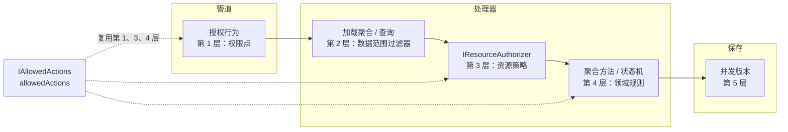
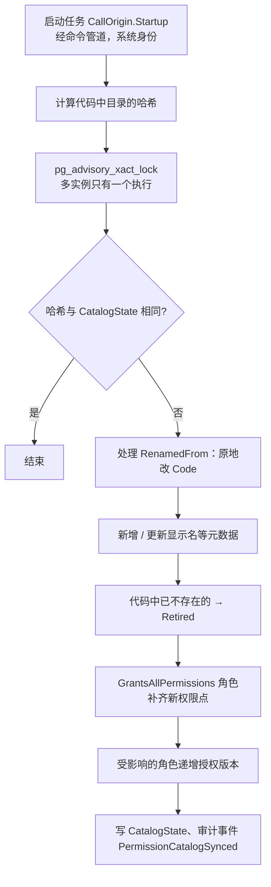
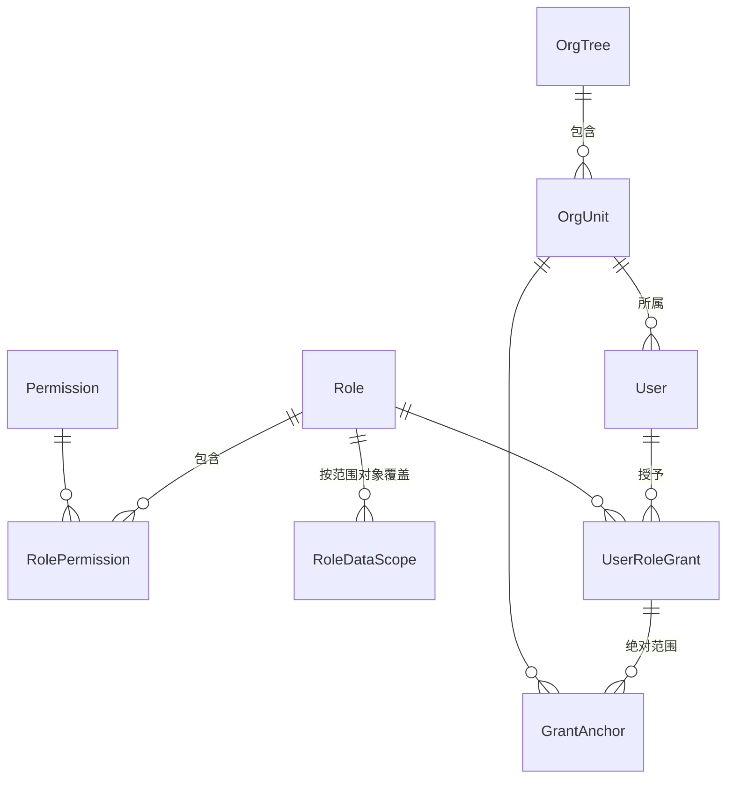

# 05-05 授权

- 状态：已确认（2026-11-04，全部按建议；原 D6 改为写法约定，原 D12 延后）；之后的修订见文末“修订记录”
- 日期：2026-11-04
- 所在项目：`BuildingBlocks.Application`（权限点与范围对象的声明特性、`IDataScope`、`IOrgHierarchy`、资源策略与 `allowedActions` 抽象）；`BuildingBlocks.Infrastructure`（数据范围 EF 过滤器、手写 SQL 条件生成）；Identity 平台模块（角色、授予、组织单元树、权限点目录、同步、诊断、候选人员查询）；`BuildingBlocks.Testing`（授权测试基座）
- 依据：ADR-0006、ADR-0009、ADR-0012、ADR-0015、ADR-0016、ADR-0017、ADR-0018、ADR-0026、ADR-0027、ADR-0031；04 第 6 节；05-01 第 7、10 节；05-02 第 3、4.5、7 节；05-03 第 2、5、7 节；05-04 第 6 节

## 0. 范围

| 本文内容 | 相关但不在本文 |
|---|---|
| 第 1 层：权限点的声明、同步、菜单与权限点的关系 | 管道授权行为的判断顺序（05-02 第 4.5 节，已确认） |
| 角色、权限、“用户-角色”授予、组织单元树的模型与授权版本 | 会话、当前角色切换、访问上下文的加载流程（05-04） |
| 第 2 层：范围对象、范围等级、计算、EF 过滤器、绕过、手写 SQL | 软删除过滤器（05-03 第 5 节） |
| 第 3 层：资源策略构件 | 第 4 层状态机（05-01 第 7 节）、第 5 层并发版本（05-03 第 6 节） |
| `allowedActions` 的计算 | 端点如何返回（05-06） |
| 候选人员查询、授权诊断 | 安全事件通道的实现（05-09） |
| 授权测试基座与矩阵测试写法 | 业务模块具体有哪些权限点、范围对象（随业务） |

### 0.1 本文决定的分类

判断标准：**如果现在不定，以后再定时，会不会改变已有数据的含义，或者要改所有模块的写法？** 会 → 现在定；不会 → 交给业务或延后（细化“框架范围判断标准”）。

| 类别 | 含义 | 本文中的内容 |
|---|---|---|
| 第一类：现在确定 | 框架机制，以后改代价高 | D1～D5、D7～D11 |
| 第二类：框架定写法，业务定用不用 | 框架只规定“如果要做，必须这样做”，保证各出口一致、可测试 | 归属接口与范围对象（5.1）、关系可见与资源可见性（5.8）、资源策略的具体规则（6）、动作目录的内容（7） |
| 第三类：延后 | 第一个业务需要时再设计；以后补的代价小 | 扩展维度及其组合方式（5.9）、单条数据的授权诊断（9）、授予有效期（4.1）、旧系统维度的对应（5.11） |

第二、三类中需要“到时候一起处理”的事项，统一登记在 00-README 的“延后事项”表中，写明触发条件。

---

## 1. 旧项目怎么做 → 新框架怎么做

| 问题 | 旧项目 | 新框架 | 章节 |
|---|---|---|---|
| 权限标识 | `Base_SysMenu` 中的数字 ID，代码里硬编码 `SetQX(10224)` | 代码中声明的权限点 `模块.资源.动作`，启动时同步到数据库 | 3 |
| 菜单与按钮 | 目录、页面、按钮混存一张表（`MenuType` 1/2/3） | 菜单属于前端路由；按钮由后端 `allowedActions` 决定 | 3.3、7 |
| 功能权限来源 | 当前角色权限 ∪ 用户个人授权（`Base_User_Class`） | 只来自当前角色，不支持给个人授权（ADR-0015） | 4 |
| 共享状态 | `BasePage.btnds` 是 `public static DataSet`，所有用户共享，有串数据风险 | 角色授权快照按“角色 + 授权版本”缓存，内容不可变；数据范围只在请求内计算 | 4.3、5.3 |
| 数据范围 | 约 170 处手写条件、7 种维度，以字符串拼进 SQL | 范围对象 + 范围等级，由 EF 命名过滤器统一套用，列表 / 详情 / 导出 / 选项一致 | 5 |
| 多值匹配 | `like '%' + userid + '%'`，`1041` 误匹配 `10415` | 结构化条件，参数化 `= ANY(@ids)`，禁止字符串匹配 | 5.4 |
| 上下级 | `ZhuyaoShangjiID` 1～3、`Base_User_Parent` 等多套上级链 | 组织单元树（Identity 模块）+“本组织及下级” | 4.4、5.11 |
| “全部”权限 | 拥有某个经理按钮权限就放开全部数据 | 范围等级“全部”是独立配置，与功能权限分开 | 5.2 |
| 负责人、审批人判断 | 逗号拼接的 `FzrIDs`、`ShenpiUserIDs` + `like` | 资源策略 + 关系可见性，关系存在业务数据的关联表中 | 5.8、6 |
| 前端按钮显示 | 页面按 `SetQX` 自行隐藏按钮，后台接口不一定再检查 | 后端用同一套检查计算 `allowedActions`，接口每次完整校验 | 7 |

---

## 2. 总览

### 2.1 五层在代码中的落点



### 2.2 组件清单

| 组件 | 所在项目 | 作用 | 章节 |
|---|---|---|---|
| `[PermissionGroup]`、`[Permission]` | BuildingBlocks.Application | 声明权限点 | 3.1 |
| `[DataScopeObject]` | BuildingBlocks.Application | 声明范围对象 | 5.1 |
| `IHasOwner`、`IHasOrgUnit` | BuildingBlocks.Domain | 聚合声明归属 | 5.1 |
| `IOrgHierarchy` | BuildingBlocks.Application（接口）/ Identity（实现） | 组织层级查询 | 4.4 |
| `IDataScope` | BuildingBlocks.Application（接口）/ BuildingBlocks.Infrastructure（实现） | 计算当前请求在某个范围对象上的有效范围 | 5.3 |
| `HasDataScope(...)` 模型扩展 | BuildingBlocks.Infrastructure | 注册命名过滤器 `DataScope` | 5.4 |
| `IDataScopeSql` | BuildingBlocks.Infrastructure | 手写 SQL 的范围条件 | 5.6 |
| `IResourcePolicy<,>`、`IResourceAuthorizer<,>` | BuildingBlocks.Application | 第 3 层 | 6 |
| `ResourceActionCatalog<,>`、`IAllowedActions<,>` | BuildingBlocks.Application | `allowedActions` | 7 |
| 权限点目录同步、角色 / 授予 / 组织单元树、诊断、候选人员 | Identity 模块 | 管理与查询 | 3.2、4、8、9 |
| `TestIdentity`、授权矩阵 | BuildingBlocks.Testing | 测试 | 12 |

---

## 3. 权限点（第 1 层）

### 3.1 声明

```csharp
// 模块 Application 项目
[PermissionGroup("Sample", "示例")]
public static class SamplePermissions
{
    [Permission("查看示例")]                       public const string View   = "Sample.Sample.View";
    [Permission("编辑示例")]                       public const string Edit   = "Sample.Sample.Edit";
    [Permission("提交示例")]                       public const string Submit = "Sample.Sample.Submit";
    [Permission("物理删除示例", Sensitive = true)] public const string Purge  = "Sample.Sample.Purge";
}

[RequirePermission(SamplePermissions.Submit)]
public sealed record SubmitSampleCommand(...) : ICommand<SubmitSampleResponse>;
```

启动时由模块注册（`IModule`，FR-MOD-03）扫描本模块程序集，构建**权限点目录**，并做以下检查（失败即拒绝启动，同时作为架构测试进入 CI）：

| 检查 | 规则 |
|---|---|
| 格式 | 三段，每段大驼峰：`^[A-Z][A-Za-z0-9]*(\.[A-Z][A-Za-z0-9]*){2}$` |
| 归属 | 第一段等于所在模块名（不能声明别的模块的权限点） |
| 唯一 | 全系统唯一；显示名在同一分组内唯一 |
| 引用 | 用例目录（05-02 第 3 节）中每个 `[RequirePermission]` 的值都存在于目录中 |
| 无死权限 | 目录中每个权限点至少被一个用例或一个资源动作（第 7 节）引用 |
| 敏感标记 | `Sensitive = true` 的权限点在角色管理界面单独提示；物理删除、模拟身份、导出全部数据类权限点必须标记（架构测试按命名提示） |

- 前端使用的权限点常量由权限点目录导出为 TypeScript 文件（构建时生成，05-06），前端不手写权限点字符串。
- 禁止按角色名称判断（ADR-0015）：分析器检查业务代码中不出现对 `RoleId` / 角色名的比较。

**D1 权限点的声明方式**

| 选项 | 做法 | 优点 | 缺点 |
|---|---|---|---|
| **A 常量 + 特性，启动时扫描** | 如上 | 常量可直接用于 `[RequirePermission]`（特性参数必须是常量）；声明与元数据在同一行；没有额外构件 | “无死权限”等规则靠启动检查而不是编译期 |
| B 定义提供器（类似 ABP 的 `PermissionDefinitionProvider`） | 每个模块写一个类，用构建器逐个 `Add(code, name)`；常量另外定义 | 可以写层级、条件等复杂结构 | 常量和元数据分两处写，容易不同步；本框架不需要层级权限 |
| C 源码生成 | 从 JSON / YAML 清单生成常量类 | 清单可给非开发人员看 | 多一个生成器和一种文件格式；改权限点要改两处（清单和使用处） |

- **决定（已确认，2026-11-04）**：A。
- **理由**：权限点只有“编码 + 显示名 + 分组 + 是否敏感”四项元数据，常量 + 特性已经足够，且编码只写一次。
- **取舍**：放弃层级权限（如“拥有父权限即拥有子权限”）；需要“全部查看”这类组合时，在角色上多勾几项。

### 3.2 同步到数据库

`"Identity"."Permission"`：

| 列 | 类型 | 说明 |
|---|---|---|
| `Id` | `uuid` | UUID v7；角色关联引用它，因此权限点改名不影响角色配置 |
| `Code` | `varchar(150)` | 唯一 |
| `Module` / `GroupName` / `DisplayName` | `varchar` | 来自声明 |
| `IsSensitive` | `boolean` | |
| `Status` | `varchar(16)` | `Active` / `Retired` |
| `RetiredAt` | `timestamptz null` | |

`"Identity"."CatalogState"`：单行，保存上次同步的目录哈希与时间。范围对象（第 5.1 节）同样随本流程同步到 `"Identity"."DataScopeObject"`。



- 同步在迁移之后、开始接收请求之前完成（05-08 角色启动顺序）。
- 改名：在新常量上写 `[Permission("…", RenamedFrom = "Sample.Sample.Approve")]`，同步时原地改 `Code`，角色配置保留。`RenamedFrom` 在下一个版本中可以删除（同步时找不到旧编码即忽略）。

**D2 代码中删除的权限点如何处理**

| 选项 | 做法 | 优点 | 缺点 |
|---|---|---|---|
| A 物理删除权限点及角色关联 | | 数据干净 | 版本回滚时，旧代码的权限点重新出现，但角色上的配置已经丢失，要人工重配 |
| **B 标记 `Retired`，保留角色关联但不生效** | 加载权限点集合时排除 `Retired`；同一编码重新出现时恢复为 `Active`，原配置自动生效 | 回滚安全；改名通过 `RenamedFrom` 处理 | 表中会积累已退役的记录（量很小）；需要定期清理退役超过一定时间（如 180 天）的记录 |

- **决定（已确认，2026-11-04）**：B。
- **理由**：部署回滚是正常运维动作，不应造成权限配置丢失；退役记录的存储成本可以忽略。
- **取舍**：多一个状态和一项清理任务（05-08）。

### 3.3 菜单

**D3 菜单由谁定义**

| 选项 | 做法 | 优点 | 缺点 |
|---|---|---|---|
| **A 前端路由声明所需权限点** | 菜单结构、名称、顺序写在前端路由元数据中，每个路由声明 `requires: [权限点]`；前端按 `me` 返回的权限点集合过滤 | 菜单与页面代码同一处、同一版本发布；后端没有“菜单”概念，权限模型只有一种东西 | 管理员不能在线调整菜单名称和顺序，要随前端发版 |
| B 后端菜单表，管理员可配置 | 类似旧系统 `Base_SysMenu`，但只存目录和页面 | 可在线调整 | 菜单表与前端路由要保持一致，页面改名、拆分时两边都要改；容易回到旧系统“菜单即权限”的混用 |
| C 后端代码声明菜单 | 模块在代码中声明菜单项，`me` 接口返回菜单树 | 后端统一 | 后端承担纯展示职责；前端改布局也要改后端 |

- **决定（已确认，2026-11-04）**：A。
- **理由**：菜单只决定“入口是否显示”，是体验问题而不是安全问题——真正的保护在接口上。把它放在前端，权限模型就只剩“权限点”一种概念。
- **取舍**：调整菜单要发前端版本。

---

## 4. 角色、授予与组织单元（Identity 模块）

### 4.1 模型



| 表 | 列 | 归属聚合 |
|---|---|---|
| `Role` | `Id`、`Name`（不区分大小写唯一）、`Description`、`Status`（`Active` / `Disabled`）、`IsProtected`、`GrantsAllPermissions`、`DefaultScopeLevel`、`ConcurrencyVersion` | `Role` 根 |
| `RolePermission` | `RoleId`、`PermissionId`（复合主键） | `Role` 子实体 |
| `RoleDataScope` | `RoleId`、`ScopeObject`、`Level`（复合主键 `RoleId + ScopeObject`） | `Role` 子实体 |
| `UserRoleGrant` | `Id`、`UserId`、`RoleId`（`UserId + RoleId` 唯一）、`GrantedAt`、`GrantedBy` | `User` 子实体 |
| `GrantAnchor` | `GrantId`、`OrgUnitId`（复合主键） | `User` 子实体 |
| `OrgTree` | `Id`（固定单行）、`ConcurrencyVersion` | `OrgTree` 根（D8） |
| `OrgUnit` | `Id`、`ParentId null`、`Name`、`Code null`、`Status`（`Active` / `Disabled`）、`SortOrder` | `OrgTree` 子实体 |

- `User.OrgUnitId`：用户所属组织单元（05-04 第 2 节），一个用户只属于一个组织单元。
- 收回授予 = 删除 `UserRoleGrant` 行；收回记录由审计事件保存（ADR-0018），表中不保留历史。
- 不设授予有效期（`延后`）：目前没有“临时授权”的需求，需要时在 `UserRoleGrant` 上加 `ExpiresAt`，访问上下文加载时一并判断即可，不影响其他结构。

### 4.2 授权版本

ADR-0026 要求“权限变化一定递增授权版本”，否则会读到旧的权限点缓存。

**D9 授权版本如何实现**

| 选项 | 做法 | 优点 | 缺点 |
|---|---|---|---|
| A 独立字段 `AuthorizationVersion` | `Role` 上单独一列，改权限、改范围配置、停用的方法里显式 `+1` | 只在授权相关变化时递增，语义精确 | 依赖每个方法都记得递增；新增一个会影响授权的方法却漏写递增，就会读到旧权限，测试不一定覆盖到 |
| **B 直接使用 `Role.ConcurrencyVersion`** | `RolePermission`、`RoleDataScope` 是 `Role` 的子实体，05-03 第 6 节的拦截器保证聚合内任何变化都递增根版本 | “变化必递增”由框架拦截器保证，不依赖业务代码；不需要额外字段 | 改角色名称、描述也会递增，导致该角色的权限点缓存失效一次、前端重新拉取一次 `me`（代价可以忽略） |

- **决定（已确认，2026-11-04）**：B。
- **理由**：ADR-0026 把“版本必递增”列为必须守住的不变量，B 把它从“约定”变成了“框架机制”。
- **取舍**：版本号会因非授权字段的修改而递增，`X-Authz-Version` 的变化不一定意味着权限真的变了。

- 同步任务（3.2）退役权限点、给 `GrantsAllPermissions` 角色补齐权限点时，都通过 `Role` 聚合的方法修改，版本自然递增。
- 用户的授予变化（增删授予、改绝对范围）不需要版本：它们属于访问上下文中每个请求都查库的“状态部分”（ADR-0026 第 2 条），下一个请求即生效。

### 4.3 角色授权快照的缓存

- 缓存的是完整的角色授权快照，键为 `Identity:RoleSnapshot:{角色ID}:{ConcurrencyVersion}`（ADR-0026 第 3 条）：

```csharp
// Identity.Infrastructure（内部类型，不对外暴露）
internal sealed record RoleAuthorizationSnapshot(
    RoleId RoleId,
    long Version,                                       // = Role.ConcurrencyVersion
    RoleStatus Status,
    bool IsProtected,                                   // D11
    ScopeLevel DefaultLevel,
    FrozenDictionary<string, ScopeLevel> Overrides,     // 按范围对象覆盖
    FrozenSet<string> Permissions);                     // Active 权限点编码
```

- 为什么缓存整个快照而不只是权限点集合（R02-4）：角色的状态、是否受保护、默认范围、范围覆盖、权限点都属于 `Role` 聚合，同一个 `ConcurrencyVersion` 下一起不变（D9）。放进同一个快照，请求看到的角色就一定是某个真实存在过的版本。只缓存权限点、其余字段每次查库的话，两部分来自两个数据库快照，可能拼出任何版本都没有授予过的组合（示例见 05-04 第 6.1 节）。
- 读取方式：任一快照未命中时，在同一个只读快照中重新执行状态查询并读取内容，本请求全部使用这次的结果；缓存只由加载器写入；固定读主实例。见 05-04 第 6.1 节。组织树快照（4.4 D7）采用同一读取方式。
- `IAccessContext` 中的 `Permissions` 以及 `DataScopeGrant` 的默认等级、覆盖取自快照，锚点取自状态查询（5.3）。
- `GrantsAllPermissions` 的角色同样以行的形式保存全部权限点（由同步任务补齐），加载逻辑不区分角色类型。

### 4.4 组织单元树

**D7 “本组织及下级”如何计算**

| 选项 | 做法 | 优点 | 缺点 |
|---|---|---|---|
| A 每次递归查询 | `WITH RECURSIVE` 从锚点向下展开 | 存储最简单 | 每个需要数据范围的请求多一次递归查询 |
| B 物化路径（`ltree` 或路径字符串） | 每个节点存 `/根/华东/上海/`，按前缀查询 | 子树查询快 | 移动节点要改写整棵子树的路径；业务表只存 `OrgUnitId`，过滤时仍要先把路径转成 ID 集合 |
| C 闭包表 | 保存所有“祖先-后代”对 | 查询快 | 写入复杂，移动节点成本高 |
| **D 整棵树按版本缓存，内存计算** | 存储只用 `ParentId`；整棵树以 `Identity:OrgTree:{树版本}` 缓存；访问上下文的状态查询读取树版本，加载时取对应版本的树快照，子树在内存中计算 | 每个请求没有额外查询；树的任何变化都换缓存键，立即生效；范围计算变成纯内存操作，可以同步执行（EF 过滤器参数求值无法 `await`） | 前提是树不大（`假设`：组织单元 ≤ 5000 个）；超过时需要换成 B，但 `IOrgHierarchy` 接口不变 |

- **决定（已确认，2026-11-04）**：D。
- **理由**：组织单元树是小而变化很少的数据，与权限点集合完全同构，沿用 ADR-0026 的“状态查库、内容按版本缓存”最一致；同时解决了“过滤器参数求值时不能异步查库”的实现问题（5.3）。
- **取舍**：依赖“树不大”的假设；树快照占用每个实例的少量内存。

```csharp
// BuildingBlocks.Application
public interface IOrgHierarchy
{
    long Version { get; }
    bool Exists(OrgUnitId id);
    IReadOnlySet<OrgUnitId> SelfAndDescendants(OrgUnitId id);  // 含已停用的下级：停用单元的历史数据仍要能被看到
    IReadOnlyList<OrgUnitId> Ancestors(OrgUnitId id);
}
```

**D8 组织单元树的聚合边界**

| 选项 | 做法 | 优点 | 缺点 |
|---|---|---|---|
| A 每个组织单元一个聚合 | | 编辑互不冲突 | 防环要加载祖先链，两个并发的“移动”各自合法、合起来成环，需要额外加锁；“树版本”要另外维护并保证递增 |
| **B 整棵树一个聚合（`OrgTree` 根 + `OrgUnit` 子实体）** | 所有修改经 `OrgTree` 的方法 | 防环、“停用单元下不能有启用的下级”等不变量在聚合内天然成立；并发修改由并发版本串行化；树版本 = `OrgTree.ConcurrencyVersion`，与 D9 同理由拦截器保证递增 | 每次编辑加载整棵树（几千行以内可以接受）；两个管理员同时编辑会有一个得到 409 |

- **决定（已确认，2026-11-04）**：B。
- **理由**：组织调整是低频的管理操作，用“整树一个聚合”换来不变量和版本递增的自动保证。
- **取舍**：编辑时的并发冲突更多；树变大时需要重新评估（与 D7 的假设一致）。

组织单元的规则（ADR-0031 影响）：

| 操作 | 规则 | 错误码 |
|---|---|---|
| 移动 | 不能移到自己或自己的下级之下 | `Identity.OrgUnitCycle` |
| 停用 | 有启用的下级、或有启用的用户归属时拒绝 | `Identity.OrgUnitInUse` |
| 分配用户 / 设为授予锚点 | 目标单元必须启用 | `Identity.OrgUnitDisabled` |
| 删除 | 不提供物理删除，只能停用（历史数据仍引用它） | — |

- 用户调整组织后，**他名下已有数据的所属组织不变**：`IHasOrgUnit` 的值在数据创建时确定，是业务事实（“这单是在华东时做的”）。是否需要“人员调动时移交数据”由业务模块决定，框架不自动改写。

### 4.5 防止越权授予

**D11 管理员能授予什么**

| 选项 | 做法 | 优点 | 缺点 |
|---|---|---|---|
| A 完全信任角色管理员 | 拥有 `Identity.Role.Manage` / `Identity.User.Grant` 即可授予任何角色、配置任何权限 | 简单 | 角色管理员可以给自己授予系统管理员角色，权限无上限 |
| B 只能授予不超过自己的权限 | 配置角色时只能勾选自己当前角色拥有的权限点；只能授予权限点集合是自己子集的角色 | 最严格 | 规则复杂，“子集”判断还要考虑数据范围；分级管理员场景少，收益有限 |
| **C 受保护角色单独保护，其余信任** | 带 `IsProtected` 的角色（如系统管理员），只有当前角色本身是受保护角色的人才能授予、收回、修改；其余角色由角色管理员管理；任何人不能修改自己的授予 | 堵住“自我提权到系统管理员”这条最主要的路径；规则只有两条 | 普通角色之间仍可能出现“管理员给别人配了比自己更大的权限”，靠审计发现 |

- **决定（已确认，2026-11-04）**：C。
- **理由**：与 05-04 D7 模拟身份“不能模拟受保护角色持有人”的思路一致；企业内部系统的主要风险是自我提权，C 用最少的规则覆盖它。
- **取舍**：普通角色之间的权限大小不做限制。
- 授权配置的变更命令全部标 `[Audited]`，并写安全事件 `AuthorizationConfigChanged`（第 10 节）。

### 4.6 撤权的生效边界

“撤权”指：收回授予、修改角色的权限点或范围、停用角色、禁用用户、作废会话，以及缩小范围的组织树调整。

| 场景 | 何时按新授权执行 | 说明 |
|---|---|---|
| 撤权提交后开始的请求 | 立即 | 每个请求查状态、按版本取快照（05-04 第 6 节）。以访问上下文的状态查询为准：读到撤权之后的数据，就按新授权执行 |
| 撤权提交时正在进行的 HTTP 请求 | 按请求开始时加载的授权执行完 | 上限为请求超时（05-06 第 8.3 节，默认 30 秒；上传端点 10 分钟，05-11）。请求中途不重新加载，同一请求内授权保持一致 |
| 后台作业 | 按 05-08 第 6.5 节 | 开始执行时加载，执行中不重新加载；超过 1 小时的作业每次续期时检查用户是否被禁用；需要立即停止时由管理员取消作业 |
| Identity 的授权管理命令 | **提交前在同一事务中重查操作者** | 见下文 |

授权管理命令为什么要例外：普通业务命令在这个窗口内的影响只是一次业务操作；授权管理命令的结果是新的授权，会一直存在，还能继续放大。示例：某人的管理权限刚被收回，他正在进行的命令给另一个人授予了管理员角色，等于撤权没有发生。

| 项 | 做法 |
|---|---|
| 范围 | Identity 模块中所有声明 `[RequirePermission]` 的命令（角色、授予与锚点、组织单元、用户管理、模拟身份）；自助命令（退出、改密码、切换角色）不在此列 |
| 写法 | 这些命令的处理器继承 Identity 内部的基类 `AuthorizationAdminCommandHandler<TCommand, TResponse>`：基类的 `Handle` 先执行重查，再调用子类的 `ExecuteAsync`。处理器在事务行为内部执行（05-02 第 4.1 节第 6 位），重查与业务修改在同一个事务中。不新增管道行为（05-02 第 4.1 节：模块不能增减行为） |
| 重查 | 按固定顺序对操作者的行加共享锁（`SELECT … FOR SHARE`）：会话 → 用户（模拟会话时含实际操作人）→ 当前角色的授予 → 当前角色。检查：会话有效且未过期；用户启用且未锁定；授予存在；角色的 `ConcurrencyVersion` 等于访问上下文的 `AuthorizationVersion` |
| 重查不通过 | 409 `Identity.AuthorizationChanged`（`retryable = true`）。命令内不判断具体变化了什么：前端重新获取 `me`，用户重试时下一个请求重新加载访问上下文，由加载器给出准确结果（401、403 `CurrentRoleUnavailable`，或按新授权执行）。失败时幂等记录已删除（05-02 第 5.3 节 D3），可以用原键重试 |

**为什么结果一定是某个串行顺序**：撤权的写入（删除授予、修改角色、修改用户、修改会话）都与共享锁冲突，所以只有两种可能。一是撤权先提交，重查读到撤权之后的数据，命令被拒绝；二是管理命令先拿到共享锁，撤权要等它提交后才能写入，结果等同于“管理命令在前、撤权在后”。不会出现“撤权已经提交，管理命令仍按撤权前的授权提交”。

| 需要注意 | 处理 |
|---|---|
| 角色改名也会让版本变化（D9 的已知行为），重查因此拒绝 | 接受：授权管理操作频率低，重试即可 |
| 两个管理员同时修改他们共同的当前角色：双方都先持共享锁、再要排他锁，形成死锁 | PG 检测到死锁后中止其中一个，按 05-02 返回 503 `Common.TransientConflict`（`retryable`）；只在这种低频场景出现 |
| 共享锁持有期间，操作者本人的刷新令牌、切换角色要等这个命令提交 | 命令很短，可以忽略 |

---

## 5. 数据范围（第 2 层）

### 5.1 归属接口与范围对象

```csharp
// BuildingBlocks.Domain
public interface IHasOwner   { UserId OwnerId { get; } }       // 所属人
public interface IHasOrgUnit { OrgUnitId OrgUnitId { get; } }  // 所属组织

// 模块 Application：声明范围对象（管理员在角色上按它配置范围）
[DataScopeObjectGroup("Sample")]
public static class SampleScopes
{
    [DataScopeObject("示例单据")] public const string Sample = "Sample.Sample";
}
```

- **范围对象**是“按同一规则控制可见性的一类数据”，通常一个聚合一个；几个聚合需要一致的可见性时（如商机与其报价）可以共用一个范围对象。
- 所属人、所属组织的业务含义由模块明确写在聚合注释中（ADR-0015：不假设所有资源都有所属人）；只有 `IHasOrgUnit` 没有 `IHasOwner` 的资源，“本人”等级看不到任何数据，角色管理界面对此提示。
- 不需要数据范围的数据（如产品目录）不声明范围对象，只受第 1 层控制。

### 5.2 范围等级与配置

| 等级 | 条件 | 说明 |
|---|---|---|
| `Self` 本人 | 所属人 = 我 | |
| `OrgUnit` 本组织 | 本人 ∪ 所属组织 ∈ 锚点 | 等级是累加的：高等级包含低等级 |
| `OrgUnitAndBelow` 本组织及下级 | 本人 ∪ 所属组织 ∈ 锚点及其全部下级 | |
| `All` 全部 | 不限制 | |

- **锚点**：默认是用户所属组织单元；授予上配置了绝对范围（`GrantAnchor`）时按 D5 处理。

**D4 范围配置的粒度**

| 选项 | 做法 | 优点 | 缺点 |
|---|---|---|---|
| A 每个角色一个等级 | 角色上只有一个“数据范围” | 最简单 | 同一个角色对不同数据需要不同可见性时（如“客户看本组织，报价只看本人”）只能拆角色，违背 ADR-0015 第 7 节防止角色膨胀 |
| **B 角色默认等级 + 按范围对象覆盖** | `Role.DefaultScopeLevel` 适用于所有范围对象；`RoleDataScope` 对个别范围对象覆盖 | 常见情况只配一个值；特殊数据单独配置 | 角色管理界面要展示“默认 + 覆盖”两层 |
| C 按权限点配置范围 | 每个权限点各自一个范围，如“查看：本组织，编辑：本人” | 表达力最强 | 配置量成倍增加；把“能看哪些”（第 2 层）和“能对哪条做什么”（第 3 层）混在一起，“只能编辑自己的”应由资源策略表达 |

- **决定（已确认，2026-11-04）**：B。
- **理由**：数据范围回答的是“可见集合”，按数据类别区分就够了；动作上的差异交给资源策略。
- **取舍**：无法表达“同一类数据，查看与编辑范围不同”——这类规则写在资源策略中。

**D5 绝对范围与相对范围如何组合**

ADR-0015：相对范围在角色上，绝对范围在授予上（“授予张三销售角色，范围：华东”）。

| 选项 | 做法 | 优点 | 缺点 |
|---|---|---|---|
| **A 绝对范围替换锚点** | 授予上配置的组织单元**代替**用户所属组织，作为相对等级的计算起点；`Self`、`All` 不受锚点影响 | 角色决定“看多深”，授予决定“从哪里看”，两者各管一件事；同一个“区域经理”角色可授予给不同区域的人 | 授予了锚点而角色等级是 `Self` 时锚点不起作用，管理界面要提示 |
| B 并集 | 相对范围结果 ∪ 授予组织单元（含下级） | 直观：“在原有基础上多看华东” | 授予会突破角色定义的深度：`Self` 角色加了锚点就能看整个区域，角色的含义被单个授予改变 |
| C 绝对范围直接作为最终结果 | 有绝对范围时忽略角色等级 | 简单 | 角色的范围配置在这些授予上失效，同一角色的含义不一致 |

示例（A）：

| 角色等级 | 授予锚点 | 用户所属组织 | 结果 |
|---|---|---|---|
| `OrgUnitAndBelow` | 无 | 上海 | 本人 ∪ 上海及下级 |
| `OrgUnitAndBelow` | 华东 | 总部 | 本人 ∪ 华东及下级 |
| `OrgUnit` | 华东、华南 | 总部 | 本人 ∪ {华东, 华南} |
| `Self` | 华东 | 总部 | 本人（界面提示锚点无效） |

- **决定（已确认，2026-11-04）**：A。
- **理由**：两个配置位置各自只回答一个问题，任何组合的结果都可以从“等级 × 锚点”直接推出来，诊断（第 9 节）也最好解释。
- **取舍**：想要“本人 + 额外某个区域”的人，需要授予一个 `OrgUnit` / `OrgUnitAndBelow` 等级的角色并指定锚点，而不是在 `Self` 角色上加锚点。

### 5.3 计算

```csharp
// BuildingBlocks.Application —— IAccessContext.DataScopeGrant 的结构（05-04 第 6.2 节引用）
public sealed record DataScopeGrant(
    ScopeLevel DefaultLevel,
    IReadOnlyDictionary<string, ScopeLevel> Overrides,       // 范围对象 → 等级
    IReadOnlyList<OrgUnitId> Anchors,                        // 授予锚点；为空则用用户所属组织
    IReadOnlyDictionary<string, IReadOnlyList<Guid>> Dimensions); // 扩展维度取值（5.9），目前为空

public sealed record EffectiveScope(
    bool All,
    UserId? Owner,
    IReadOnlyList<OrgUnitId> OrgUnits);                      // 已展开的组织单元集合

// 请求作用域
public interface IDataScope
{
    bool Unrestricted { get; }                 // 系统身份
    EffectiveScope For(string scopeObject);    // 请求内按范围对象缓存
}
```

```mermaid
flowchart TD
    A[For（范围对象）] --> B{请求内已计算?}
    B -- 是 --> R[返回]
    B -- 否 --> C{系统身份?}
    C -- 是 --> ALL[All]
    C -- 否 --> D[等级 = Overrides[范围对象] ?? DefaultLevel]
    D --> E{等级}
    E -- All --> ALL
    E -- Self --> S[Owner = 我，OrgUnits = 空]
    E -- OrgUnit --> O[Owner = 我，OrgUnits = 锚点]
    E -- OrgUnitAndBelow --> OB[Owner = 我，OrgUnits = ∪ IOrgHierarchy.SelfAndDescendants（锚点）]
    S & O & OB & ALL --> R
```

- 计算完全在内存中进行：授予、锚点来自访问上下文的状态查询；组织树快照由加载器按树版本从缓存取得（D7）。
- 请求内缓存，不跨请求（ADR-0026 第 5 条）。
- 05-04 第 6.1 节的状态查询读取 `OrgTree.ConcurrencyVersion`，加载器按该版本取树快照。

### 5.4 EF 命名过滤器

模块在实体配置中声明：

```csharp
internal sealed class SampleConfiguration : IEntityTypeConfiguration<Sample>
{
    public void Configure(EntityTypeBuilder<Sample> b)
    {
        b.HasDataScope(SampleScopes.Sample)                              // 必须实现 IHasOwner / IHasOrgUnit 之一
         .VisibleThroughRelation(s => s.Collaborators.Any(c => c.UserId == DataScopeParam.CurrentUser)) // 可选，业务决定，见 5.8
         .RestrictVisibility(s => !s.IsPrivate || s.OwnerId == DataScopeParam.CurrentUser);            // 可选，5.8
    }
}
```

框架为该实体注册命名过滤器 `DataScope`，逻辑为：

```text
不受限
OR ( 资源可见性(e)
     AND ( 全部
           OR e.OwnerId = 我
           OR e.OrgUnitId = ANY(@组织单元集合)
           OR 关系可见(e) ) )
```

生成的 SQL 形如：

```sql
WHERE (@unrestricted
   OR (@all OR s."OwnerId" = @me OR s."OrgUnitId" = ANY(@orgs)
       OR EXISTS (SELECT 1 FROM "Sample"."SampleCollaborator" c WHERE c."SampleId" = s."Id" AND c."UserId" = @me)))
  AND NOT s."IsDeleted"
```

- 过滤器表达式通过 `ModuleDbContext` 上的作用域成员读取 `IDataScope`，EF 在每次执行时把它求值为参数，**查询只编译一次，不拼接字符串**。原型 #2 已验证（`docs/framework/spikes/02-data-scope-filter.md`）：`IReadOnlyList<OrgUnitId>` 绑定为一个 `uuid[]` 参数（`= ANY`）；`IgnoreQueryFilters(["DataScope"])` 只去掉数据范围，软删除仍生效。关系可见的查询计划要求见该页第 3 节。
- **过滤器中的当前用户取自执行上下文**（原型 #2 D1）：注册过滤器时，`DataScopeParam.CurrentUser` 替换为 `ModuleDbContext` 上读取 `IExecutionContext.User.UserId` 的成员（05-02 第 7.1 节；系统身份为 `null`，模拟登录时是被模拟的用户）。`IDataScope` 保持第 5.3 节的定义，不增加当前用户：身份只有一个来源，避免两处取值不一致。
- 写入上下文与查询上下文都注册（05-03 第 2.1 节）；因此 `GetForUpdateAsync` 加载范围外的聚合同样得到 `NotFound`。
- 架构测试：
  - 实现 `IHasOwner` / `IHasOrgUnit` 的聚合根必须调用 `HasDataScope`，或显式 `HasNoDataScope("原因")`；
  - 有数据范围的聚合，其子实体不得在 `IXxxQueryDb` 中作为独立的 `IQueryable` 暴露——子实体没有过滤器，直接查询会绕过范围；只能经聚合根导航访问；
  - 业务表的 `OwnerId`、`OrgUnitId` 列必须有索引（模块模板生成）。
- 列表、详情、统计、导出、下拉选项都从同一个 `IQueryable` 出发，自然共用同一套范围（ADR-0015、FR-AUTHZ-09）。

### 5.5 绕过数据范围

- 只能使用框架扩展方法 `query.WithoutDataScope()`（内部为 `IgnoreQueryFilters(["DataScope"])`，软删除过滤器仍然生效）。
- 分析器禁止直接调用 `IgnoreQueryFilters()`（无参数，会关闭全部过滤器）和以字符串 `"DataScope"` 调用。
- 使用 `WithoutDataScope` 的处理器必须标 `[BypassesDataScope("原因")]`，由架构测试检查；用例目录据此生成“绕过数据范围的用例清单”，供安全审查。
- 典型合法场景：唯一性检查（“编号是否已存在”不能只在可见范围内判断）、候选人员计算、诊断。

### 5.6 手写 SQL

```csharp
// BuildingBlocks.Infrastructure
public interface IDataScopeSql
{
    // 返回可直接拼入 FromSql 的条件片段与参数，如：("(s.\"OwnerId\" = @p0 OR s.\"OrgUnitId\" = ANY(@p1))", [..])
    FormattableString Condition(string scopeObject, string ownerColumn, string orgUnitColumn);
}
```

- 手写 SQL 只能写在 Infrastructure（05-03 D1 禁止 Application 使用 `FromSql`）；凡查询带归属的表，必须使用 `IDataScopeSql`（FR-AUTHZ-10），由代码评审 + 架构测试（扫描使用 `FromSql` 且查询了声明范围对象的表的方法）提示。
- 关系可见、资源可见性无法自动生成到手写 SQL 中，手写 SQL 需要自行补全，并在测试中覆盖（12 节矩阵测试同样适用）。

### 5.7 各入口的范围

| 入口（05-02 第 7.2 节） | 范围 |
|---|---|
| HTTP | 当前用户 + 当前角色 |
| 模块间 Contracts 调用 | 沿用调用方 |
| 后台作业（如导出） | 提交人，执行时重新加载其访问上下文 |
| Inbox、定时任务、启动任务 | 系统身份：`Unrestricted = true` |

### 5.8 资源可见性与关系可见

两种附加条件，都写在同一个 `DataScope` 过滤器中：

| 条件 | 作用 | 例子 |
|---|---|---|
| 资源可见性 `RestrictVisibility` | **收窄**：即使范围是“全部”也不可见 | 私有消息只有收件人能看（ADR-0015 第 4 节） |
| 关系可见 `VisibleThroughRelation` | **扩大**：范围之外但与我有关系的数据可见 | 被指派的审批人、协作者 |

**框架写法约定（第二类，不是待决项；审核时由原 D6 改来）**

| 框架规定 | 业务模块决定 |
|---|---|
| 关系可见、资源可见性**只能**通过 `VisibleThroughRelation` / `RestrictVisibility` 写进同一个 `DataScope` 过滤器 | 哪些资源让审批人、协作者等关系人可见 |
| **禁止**在业务模块中把“范围内”和“与我有关”分两路查询再合并（否则分页、统计、导出会和列表不一致，违反 ADR-0015“共用同一授权基础”） | 哪些资源受限（如私有消息） |
| 关系数据必须在本模块的关联表中（ADR-0006），关联表要有 `(UserId, 资源ID)` 索引 | 关系的业务含义（负责人、被指派人、协作者……） |

- 关系授权仍是“业务数据中的关系”，不是独立的关系授权服务（ADR-0015 第 4 节）。
- `延后`：这两个声明方法在**第一个需要它们的业务模块**出现时与之一起实现、一起测试（登记在 00-README“延后事项”）。

### 5.9 扩展维度（FR-AUTHZ-04，P1）

按“未用到的不提前设计”，本期只保留扩展点的形态，不实现任何维度，组合方式也不现在决定（第三类，`延后`）：

```csharp
public interface IDataScopeDimension
{
    string Key { get; }                       // 如 "Industry"
    string OwnerModule { get; }               // 维度取值归属的业务模块
    // 管理界面通过它列出可选值（实现位于业务模块，Identity 经 DI 使用，依赖方向由接口倒置）
    Task<IReadOnlyList<DimensionValue>> ListValuesAsync(CancellationToken ct);
}
```

- 授予上保存维度取值（`GrantDimensionValue(GrantId, DimensionKey, ValueId)`，第一个维度出现时建表），实体通过 `HasDataScope(...).Dimension("Industry", e => e.IndustryId)` 参与过滤。

- **扩展维度与组织维度如何组合**（交集收窄 / 并集扩大 / 各维度自定）：`延后`。第一个维度出现之前，没有任何授予带维度取值，届时再定不会改变已有授予的含义。届时的倾向：交集（增加维度只会让范围变小，授权的默认方向应当保守）。
- 触发条件：任何业务提出“按行业（或其他非组织维度）限制可见数据”的需求（登记在 00-README“延后事项”）。

### 5.10 范围外访问的记录

数据范围外按 404 返回，审计记录真实原因（ADR-0015、ADR-0018 第 4 条）：

- 仓储 `GetForUpdateAsync` 与查询侧的 `FindByIdOrNotFoundAsync` 扩展在**加载不到**时，用 `WithoutDataScope()` 再查一次是否存在；存在则写安全事件 `AuthorizationDenied`（原因 `OutOfDataScope`，资源类型与 ID），对外仍返回 `NotFound`。
- 这次补充查询只发生在“找不到”的路径上，正常路径没有额外开销。
- 列表查询被过滤掉的行不记录（那是正常的可见性，不是越权尝试）。

### 5.11 旧系统数据范围维度的对应

本节中的 `待确认` 属于旧数据分析，`延后` 到数据迁移阶段与业务确认，不影响框架设计。

| 旧系统维度 | 新框架 | 说明 |
|---|---|---|
| 本人（`FzrIDs` 包含当前用户） | `Self` + 关系可见 | 主负责人 → `OwnerId`；其余负责人 → 关系可见（关联表） |
| 上级链（`ZhuyaoShangjiID` 1～3、`Base_User_Parent`） | `OrgUnitAndBelow` | `待确认`：旧系统的汇报线是否与组织层级一致；若存在“跨组织的直属上级”，需评估是否作为扩展维度 |
| 周报上级（`Base_User_Parent_Weekly`） | 业务模块的关系可见 | 只属于周报业务 |
| 大区 / 大区分组 | 组织单元 + 授予锚点 | 大区即组织单元；分组若只是组织的业务归类，则由业务模块定义（ADR-0031 第 3 条） |
| 行业（`Industry_ID`） | 扩展维度（5.9） | 第一个需要时实现 |
| 额外授权查看（`Base_UserSee`） | 授予锚点或关系可见 | `待确认`：旧数据是“看某个组织”还是“看某几个人” |
| 任务类型授权（`Rule_*.Quanxian`） | 资源策略 / 关系可见 | 属于具体业务 |
| “全部”（拥有经理按钮即放开） | 范围等级 `All` | 功能权限与范围分开配置 |

---

## 6. 资源策略（第 3 层）

```csharp
// BuildingBlocks.Application
public enum DenialReason { MissingPermission, OutOfDataScope, ResourceDenied, AssignmentMismatch }

public readonly record struct PolicyDecision(bool Allowed, DenialReason? Reason, Error? Error)
{
    public static PolicyDecision Allow { get; } = new(true, null, null);
    public static PolicyDecision Deny(DenialReason reason, Error error) => new(false, reason, error);
}

// 模块实现：纯函数，不访问数据库
public interface IResourcePolicy<in TResource, in TAction>
{
    PolicyDecision Evaluate(IAccessContext access, TResource resource, TAction action);
}

// 处理器使用：框架实现，负责取访问上下文、系统身份放行、拒绝时写安全事件
public interface IResourceAuthorizer<in TResource, in TAction>
{
    Result Check(TResource resource, TAction action);
}
```

示例：

```csharp
internal sealed class SamplePolicy : IResourcePolicy<Sample, SampleAction>
{
    public PolicyDecision Evaluate(IAccessContext access, Sample s, SampleAction action) => action switch
    {
        _ when action == SampleAction.Edit || action == SampleAction.Submit
            => s.OwnerId == access.UserId
                ? PolicyDecision.Allow
                : PolicyDecision.Deny(DenialReason.ResourceDenied, SampleErrors.NotOwner),
        _ when action == SampleAction.Approve
            => s.IsAssignedTo(access.UserId)
                ? PolicyDecision.Allow
                : PolicyDecision.Deny(DenialReason.AssignmentMismatch, SampleErrors.NotAssignee),
        _ => PolicyDecision.Allow,
    };
}
```

| 规则 | 说明 |
|---|---|
| 纯函数 | 不访问数据库、不调用外部服务；需要的关系数据在聚合内，或由处理器加载后作为资源的一部分传入。这样它能被 `allowedActions`、测试直接复用（ADR-0015：业务代码不直接查询指派表） |
| 每类资源一个 | 禁止“全局数据权限服务”（ADR-0015 第 4 节）；架构测试检查策略类只实现一个 `IResourcePolicy<,>` |
| 默认 | 动作没有特殊规则时返回 `Allow`，但必须在 `switch` 中显式写出——分析器不做强制，代码评审检查 |
| 系统身份 | `IResourceAuthorizer` 对系统身份直接放行（系统身份只能执行 `[AllowSystem]` / `[SystemOnly]` 用例，05-02 第 4.5 节） |
| 错误 | `Error` 来自模块错误目录，类型为 `Forbidden`（403）；`DenialReason` 写入安全事件 |
| 与领域规则的划分 | 按 ADR-0015 第 4 节的判断标准：“谁可以碰这条数据” → 策略；“业务上本来就不成立” → 聚合（422） |

- 将来换成关系授权服务时，只替换策略实现，处理器与 `allowedActions` 不变（ADR-0015 第 4 节）。

---

## 7. `allowedActions`

### 7.1 资源动作目录

每类资源在模块 Application 中声明一份动作目录，把一个前端可见的“动作”与第 1、3、4 层的检查绑定：

```csharp
internal sealed class SampleActions : ResourceActionCatalog<Sample, SampleAction>
{
    protected override void Define(IResourceActionBuilder<Sample, SampleAction> a)
    {
        a.Action(SampleAction.Edit,    SamplePermissions.Edit,    state: s => s.EnsureEditable());
        a.Action(SampleAction.Submit,  SamplePermissions.Submit,  state: StateMachine(SampleAction.Submit)); // 05-01 CanFire
        a.Action(SampleAction.Approve, SamplePermissions.Approve, state: StateMachine(SampleAction.Approve));
    }
}

// 查询处理器
var actions = allowedActions.For(sample);   // IAllowedActions<Sample> → ["edit", "submit"]
```

计算：对目录中每个动作，**权限点在当前角色中（第 1 层）∧ 资源策略允许（第 3 层）∧ 状态检查通过（第 4 层）** 时返回其 `Code`。第 2 层已由加载本身保证；第 5 层只在保存时有意义。

- 动作目录中的权限点必须与对应命令的 `[RequirePermission]` 相同：以常量引用保证同源；模块模板生成的**一致性测试**（第 12 节）逐一验证“`allowedActions` 包含某动作 ⇔ 执行对应命令不会因第 1、3、4 层被拒”。
- 前端只按 `allowedActions` 显示或禁用按钮（ADR-0015 第 6 节）；动作编码使用智能枚举的 `Code`（如 `edit`、`submit`）。
- 只读模拟会话（05-04 D7）中，所有写动作从结果中移除。

**D10 列表是否返回 `allowedActions`**

| 选项 | 做法 | 优点 | 缺点 |
|---|---|---|---|
| **A 只在详情返回** | 列表行上的操作按钮，前端在点击时请求详情或直接调用接口，由接口返回拒绝原因 | 列表查询保持纯投影，性能不受影响 | 列表上无法预先禁用不可用的按钮 |
| B 列表每行都返回 | | 体验最好 | 资源策略和状态检查需要聚合或完整的数据，列表要多加载字段并逐行计算，分页 50 行就要 50 次评估；策略要同时支持“聚合”和“投影”两种输入 |
| C 列表按参数选择是否返回 | `?include=allowedActions` | 灵活 | 同时具备 B 的复杂度 |

- **决定（已确认，2026-11-04）**：A。
- **理由**：`allowedActions` 的价值在于“与真实检查同源”，B 需要为列表另写一套基于投影的判断，等于制造第二套规则。
- **取舍**：列表行内操作的按钮状态不如详情页精确；列表上确实需要的少数动作（如“批量提交”），由专门的批量命令返回逐条结果。

---

## 8. 候选人员

ADR-0015：候选人员（如审批人候选列表）经过授权计算，提交时再次校验。

Identity 模块在 Contracts 中提供反向查询：

```csharp
public interface IAuthorizedUserQuery
{
    // 返回：拥有该权限点、且其数据范围覆盖目标资源的启用用户（按任一有效授予计算，不限当前角色）
    Task<IReadOnlyList<CandidateUser>> FindUsersAsync(
        string permission, string scopeObject, ScopeTarget target, CandidateFilter filter, CancellationToken ct);
}

public sealed record ScopeTarget(UserId? OwnerId, OrgUnitId? OrgUnitId);
public sealed record CandidateUser(UserId UserId, string DisplayName, RoleId ViaRole);
```

- 计算：遍历启用角色中含该权限点的授予，按 5.2 的等级与锚点判断是否覆盖 `ScopeTarget`。在 Identity 模块内完成，不跨 schema。
- 只覆盖第 1、2 层；关系（第 3 层）由业务模块在此基础上再筛选。
- 返回 `ViaRole`：候选人可能需要切换到该角色才能处理（05-04 第 8 节），前端据此提示。
- 提交时业务模块**再次调用**校验所选人员，不信任前端传回的候选结果。
- 调用方的身份：这是 Contracts 查询，沿用调用方身份执行；查询本身使用 `[BypassesDataScope]`（它要看到调用者范围之外的用户）。
- 声明方式：`[ContractQuery(ContractAccess.Reference)]`，作为启动校验中“`Reference` 只能返回 `ReferenceInfo`”的唯一白名单例外（05-07 第 4.3 节）。

---

## 9. 授权诊断（FR-AUTHZ-11，P2）

`GET /api/v1/identity/authorization/explain?userId=&roleId=&scopeObject=`，权限点 `Identity.Authorization.Explain`（敏感）：

```json
{
  "user": "张三", "role": "区域经理", "roleVersion": 42,
  "permissions": ["Sample.Sample.View", "..."],
  "dataScope": {
    "scopeObject": "Sample.Sample",
    "level": "OrgUnitAndBelow", "levelSource": "RoleDataScope 覆盖",
    "anchors": [{ "id": "…", "name": "华东", "source": "授予锚点" }],
    "expandedOrgUnitCount": 37,
    "relationVisibility": true, "restrictedVisibility": false
  }
}
```

- 回答“为什么他能 / 不能看到”：等级来自默认还是覆盖、锚点来自授予还是所属组织、展开后的组织单元。
- 具体某条数据的判断（“为什么看不到单据 X”）需要业务模块参与，`延后`：业务提出该需求时再设计。

---

## 10. 错误码与安全事件

| 错误码 | 类型 | HTTP | 场景 |
|---|---|---|---|
| `Common.MissingPermission` | Forbidden | 403 | 第 1 层（05-02 第 8 节已定义） |
| 模块的 `*.NotFound` | NotFound | 404 | 第 2 层，与“不存在”相同 |
| 模块的策略错误（如 `Sample.NotOwner`） | Forbidden | 403 | 第 3 层 |
| `Identity.CurrentRoleUnavailable` | Forbidden | 403 | 当前角色被停用或收回（05-04） |
| `Identity.OrgUnitCycle` / `OrgUnitInUse` / `OrgUnitDisabled` | Validation / Conflict | 422 / 409 | 组织单元维护（4.4） |
| `Identity.ProtectedRoleChangeDenied` | Forbidden | 403 | D11 |
| `Identity.CannotChangeOwnGrants` | Forbidden | 403 | D11 |
| `Identity.AuthorizationChanged` | Conflict | 409 | 授权管理命令提交前重查操作者不通过（4.6），`retryable = true` |

安全事件（05-04 第 11 节的清单之外，本文新增）：

| 事件 | 产生点 |
|---|---|
| `AuthorizationDenied`（原因：`MissingPermission` / `OutOfDataScope` / `ResourceDenied` / `AssignmentMismatch`） | 授权行为、5.10、`IResourceAuthorizer` |
| `AuthorizationConfigChanged`（角色权限、范围配置、授予、锚点、组织树、角色停用） | Identity 管理命令 |
| `PermissionCatalogSynced` | 同步任务（3.2） |

- 第 4、5 层的拒绝是业务结果，不写安全事件。

---

## 11. Identity 的管理端点与权限点

| 端点（`/api/v1/identity/…`） | 权限点 |
|---|---|
| `roles` 增删改查、停用 | `Identity.Role.Manage` |
| `roles/{id}/permissions`、`roles/{id}/data-scopes` | `Identity.Role.Manage` |
| `users/{id}/grants`（含锚点） | `Identity.User.Grant` |
| `org-units` 树维护、用户归属 | `Identity.OrgUnit.Manage` |
| `permissions`、`data-scope-objects`（只读目录） | `Identity.Role.Manage` |
| `authorization/explain` | `Identity.Authorization.Explain` |
| `GET me`（权限点、授权版本，05-04） | `[AllowAuthenticated]` |

- 角色、授予、组织单元的修改命令均为 `[Idempotent]`、`[Audited]`，携带 `ExpectedVersion`。

---

## 12. 测试

### 12.1 测试基座（FR-TEST-02）

```csharp
var actor = TestIdentity.User("销售甲")
    .InOrgUnit(Org.Shanghai)
    .WithRole(r => r.Permissions(SamplePermissions.View, SamplePermissions.Edit)
                    .Scope(ScopeLevel.OrgUnitAndBelow)
                    .Override(SampleScopes.Sample, ScopeLevel.Self))
    .WithAnchors(Org.EastChina);

await using var scope = app.As(actor);     // 构造 IAccessContext，经完整管道发送消息
```

- 测试基座直接构造访问上下文和组织树快照，不经过登录流程；同时提供 `TestOrgTree` 构建器。

### 12.2 授权矩阵（FR-TEST-03）

模块模板为每个范围对象生成矩阵测试：

| 维度 | 取值 |
|---|---|
| 范围等级 | `Self` / `OrgUnit` / `OrgUnitAndBelow` / `All` |
| 数据归属 | 本人 / 同组织他人 / 下级组织他人 / 其他区域 / 关系人（如有） |
| 出口 | 列表 / 详情 / 导出 / 下拉选项 / 统计 |
| 身份状态 | 正常 / 角色切换后 / 用户禁用 / 角色收回 |

断言：每个出口的可见集合完全一致，且符合等级定义。

### 12.3 必测场景

| 对象 | 必测场景 |
|---|---|
| 权限点目录 | 格式错误、模块前缀不符、重复、引用不存在、死权限 → 启动失败 |
| 同步 | 新增、元数据变化、退役后不生效、重新出现后恢复、`RenamedFrom` 保留角色配置、`GrantsAllPermissions` 补齐、受影响角色版本递增、两个实例并发启动只同步一次、哈希相同时跳过 |
| 授权版本 | 改权限、改范围、停用角色后版本递增；改名也递增（D9 的已知行为）；缓存键随版本变化 |
| 组织树 | 成环被拒；停用规则；树变化后下一个请求即按新树计算；并发编辑一个 409 |
| 数据范围计算 | 四个等级 × 有无锚点（D5 示例表全部覆盖）；覆盖优先于默认；系统身份不受限 |
| 过滤器 | 写入与查询上下文都生效；`WithoutDataScope` 不关闭软删除；直接 `IgnoreQueryFilters()` 被分析器拦截；子实体不能单独查询（架构测试）；**生成的 SQL 不含字符串拼接的 ID**（断言参数化） |
| 关系与可见性 | 范围外的关系人可见；“全部”范围看不到受限资源 |
| 范围外访问 | 对外 404；安全事件记录 `OutOfDataScope`；真正不存在时不记录 |
| 资源策略 | 系统身份放行；拒绝写安全事件且带原因；策略类只实现一个接口 |
| `allowedActions` | 一致性测试：每个动作与对应命令的执行结果一致；只读模拟会话不含写动作 |
| 越权授予 | 非受保护角色持有人不能授予 / 修改受保护角色；不能修改自己的授予 |
| 候选人员 | 按任一授予计算；角色停用的不返回；锚点生效 |
| 撤权生效边界 | 撤权提交后开始的请求立即按新授权执行；正在进行的请求按开始时的授权执行完 |
| 授权管理命令重查（按“允许的串行结果”断言） | 用测试屏障控制顺序：① 管理命令已取得共享锁 → 撤权等待 → 管理命令提交后撤权才完成，结果等于“命令在前”；② 撤权先提交 → 管理命令返回 409 `Identity.AuthorizationChanged`，没有任何修改。对收回授予、修改角色、禁用用户、作废会话四种撤权各跑一次；断言最终状态属于两种串行结果之一 |
| 死锁 | 两个管理员同时修改他们共同的当前角色 → 一个成功，另一个返回 503 `Common.TransientConflict` |
| 授权管理命令的范围 | Identity 中声明 `[RequirePermission]` 的命令，处理器都继承 `AuthorizationAdminCommandHandler`（架构测试，06 第 15.4 节） |
| 角色快照 | 见 05-04 第 12 节“版本快照” |

---

## 13. 与其他文档的接口

| 本文提供 / 需要 | 对方 |
|---|---|
| `DataScopeGrant`、`IOrgHierarchy` 的结构；状态查询读取 `OrgTree` 版本；角色快照与一致读取 | 05-04 第 6 节；ADR-0026 |
| 权限点目录、`[BypassesDataScope]` 进入用例目录 | 05-02 第 3 节 |
| `HasDataScope`、命名过滤器 `DataScope`、`WithoutDataScope` | 05-03 第 2、5 节 |
| `IAllowedActions` 使用 05-01 的 `CanFire` / `PermittedActions` | 05-01 第 7.4 节 |
| 权限点 TypeScript 常量导出、`allowedActions` 的响应格式、`X-Authz-Version` | 05-06 |
| 候选人员查询的 Contracts 约定 | 05-07 |
| 权限点目录同步的启动顺序、退役记录清理 | 05-08 |
| 安全事件 `AuthorizationDenied` 等的写入 | 05-09 |
| `Identity:RoleSnapshot:*`、`Identity:OrgTree:*` 缓存键；按时间点恢复后清空版本键缓存 | 05-10 第 3、12 节；09 第 11.2 节；00-README 延后事项“Redis 二级缓存” |
| 测试基座 `TestIdentity`、`TestOrgTree`、矩阵测试模板 | 07 模块模板 |
| 授权管理命令处理器基类的架构测试 | 06 第 15.4 节 |

---

## 14. 决策汇总

| 编号 | 事项 | 决定（均已确认，2026-11-04） |
|---|---|---|
| D1 | 权限点的声明方式 | 常量 + 特性，启动时扫描 |
| D2 | 代码中删除的权限点 | 标记退役，保留角色关联，重新出现时恢复 |
| D3 | 菜单由谁定义 | 前端路由声明所需权限点，后端无菜单表 |
| D4 | 范围配置的粒度 | 角色默认等级 + 按范围对象覆盖 |
| D5 | 绝对范围与相对范围的组合 | 授予锚点替换用户所属组织，作为计算起点 |
| D6 | 关系是否扩大可见范围 | 改为第二类写法约定：业务决定用不用；用时必须写进同一个过滤器，禁止两路合并（5.8） |
| D7 | “本组织及下级”的计算 | 整棵树按版本缓存，内存计算 |
| D8 | 组织单元树的聚合边界 | 整棵树一个聚合 |
| D9 | 授权版本的实现 | 直接使用 `Role.ConcurrencyVersion`，同时是整个角色快照的版本（4.3） |
| D10 | 列表是否返回 `allowedActions` | 只在详情返回 |
| D11 | 管理员能授予什么 | 受保护角色只能由受保护角色持有人管理；不能改自己的授予 |
| D12 | 扩展维度与组织维度的组合 | 延后到第一个维度出现时，届时倾向交集（5.9） |

| 待确认 / 假设 | 处理方式 |
|---|---|
| Mediator 源码生成器能否识别经基类（`AuthorizationAdminCommandHandler`，4.6）实现的处理器接口 | 阶段 3 实现 Identity 时验证；不支持时改为“处理器第一行调用重查 + 架构测试检查”，重查本身不变 |
| 组织单元 ≤ 5000 个（D7、D8 的前提） | 与业务确认组织规模 |
| 旧系统汇报线是否与组织层级一致；`Base_UserSee` 的实际含义 | 数据迁移分析时与业务确认（5.11） |

| 延后事项（已登记到 00-README） | 触发条件 |
|---|---|
| 关系可见、资源可见性的声明方法实现（5.8） | 第一个有审批人 / 协作者 / 私有数据的业务模块 |
| 扩展维度及其组合方式（5.9） | 业务提出按行业等非组织维度限制可见数据 |
| 单条数据的授权诊断（9） | 业务提出“为什么看不到某条单据”的排查需求 |
| 授予有效期（4.1） | 业务提出临时授权 / 代理授权 |
| 旧系统维度的对应（5.11） | 数据迁移分析阶段 |

---

## 15. 修订记录

| 日期 | 内容 | 来源 |
|---|---|---|
| 2026-11-04 | 第 8 节：候选人员查询声明为 `[ContractQuery(ContractAccess.Reference)]` | 05-07 确认 |
| 2026-11-05 | 第 4.3 节：缓存内容由权限点集合扩大为完整的角色授权快照，键改为 `Identity:RoleSnapshot:*`；新增第 4.6 节撤权的生效边界与授权管理命令重查；第 10 节新增 `Identity.AuthorizationChanged`；第 12.3 节相应测试。各项决定不变 | R02-4 |
| 2026-11-06 | 第 5.4 节：过滤器参数化与强类型 ID 数组参数验证成立，待确认关闭；过滤器中的当前用户取自 `IExecutionContext.User.UserId`，`IDataScope` 不变 | 原型 #2 D1 |
| 2026-11-10 | 文档整合：以上补充说明并入正文，决定不变。“基类实现的处理器接口”一项原型 #1 没有覆盖，仍为待确认，改到阶段 3 验证 | R01 L2（S0-08） |
