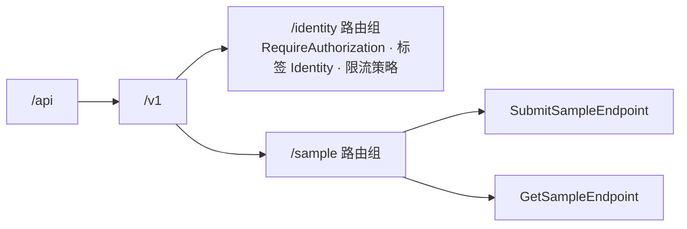

# 05-06 接口层

- 状态：已确认（2026-11-04，D1～D8 均按建议确定）；之后的修订见文末“修订记录”
- 日期：2026-11-04
- 所在项目：`Kmic.BuildingBlocks.Presentation`（`IEndpoint`、路由组、Result 转 HTTP、ProblemDetails、JSON 选项、分页排序模型、OpenAPI 转换器）；各模块 `<模块>.Presentation`（端点、请求模型）；宿主 `Kmic.Api`（中间件组装）
- 依据：ADR-0004、ADR-0008、ADR-0010、ADR-0014、ADR-0015、ADR-0022；03 第 4.5 节；04 第 5.1 节；05-01 第 2、4、6 节；05-02 第 3、5、8 节；05-04 第 3～6 节；05-05 第 3、7 节

## 0. 范围

| 本文内容 | 相关但不在本文 |
|---|---|
| 端点的写法、发现与注册、路由组 | 中介者管道（05-02） |
| 路由与 API 版本 | 认证端点的具体流程（05-04） |
| Result → HTTP 状态码、ProblemDetails 格式、框架层错误码 | 业务错误目录（各模块） |
| JSON 序列化约定与转换器 | EF 映射（05-03） |
| 分页、排序、筛选模型 | 导出作业（05-08）、文件上传下载（05-11） |
| OpenAPI 文档、前端类型与权限点常量的导出 | 前端请求封装本身（前端框架设计） |
| 通用请求 / 响应头约定 | 限流策略的数值、安全响应头（ADR-0022，05-12 健康检查） |

### 0.1 本文决定的分类

按 05-05 第 0.1 节的标准：

| 类别 | 本文中的内容 |
|---|---|
| 第一类：现在确定 | D1～D8：所有模块的端点写法、对外契约格式都依赖它们，以后改要改全部端点和前端 |
| 第二类：框架定写法，业务定用不用 | 游标分页（6.3）、超过 15 位有效数字的金额改字符串（5.1）、202 异步操作（4.4） |
| 第三类：延后 | 第二个 API 版本的实际运作（3.3，只定规则）；多语言提示（沿用 05-01 D3） |

对照 00-README“延后事项”表：无命中。

---

## 1. 旧项目怎么做 → 新框架怎么做

| 问题 | 旧项目 | 新框架 | 章节 |
|---|---|---|---|
| 接口组织 | 每个模块一个巨型 ashx，按 `Ctype` 参数分发几十个动作 | 一个接口一个端点类，启动时自动发现 | 2 |
| 路由 | `GetJson.ashx?Ctype=xxx` | `/api/v1/{模块}/{资源复数}`，动作作为子路径 | 3 |
| 返回格式 | layui 的 `{code, msg, count, data}`，永远 HTTP 200 | 成功直接返回数据；失败返回 ProblemDetails，状态码有语义 | 4 |
| 错误判断 | 前端按 `msg` 文字判断 | 按稳定的 `code` 判断 | 4.2 |
| 字段约定 | 接口字段靠口头约定，后端改字段前端无感知 | OpenAPI 文档生成 TypeScript 类型；CI 检查破坏性变更 | 7 |
| 序列化 | Newtonsoft.Json，日期格式不一，日期常存为字符串 | System.Text.Json，统一的时刻 / 日期 / 枚举 / ID 格式，未知字段拒绝 | 5 |
| 分页 | `PageSize=30` 写死，排序字段直接拼进 SQL | 统一分页模型，排序白名单 | 6 |
| 筛选 | 筛选条件以字符串拼接到 SQL | 每个列表强类型查询参数，转为 LINQ | 6.4 |
| 按钮权限 | 页面按数字按钮 ID 自行隐藏 | 详情返回 `allowedActions` | 8.2 |

---

## 2. 端点

### 2.1 写法

```csharp
// Sample.Presentation/Samples/SubmitSample.cs —— 一个文件：请求 + 端点（REPR，ADR-0014）
public sealed record SubmitSampleRequest(long ExpectedVersion, string? Reason);

internal sealed class SubmitSampleEndpoint : IEndpoint
{
    public void Map(IEndpointRouteBuilder group) =>
        group.MapPost("/samples/{id}/submit", HandleAsync)
             .Sends<SubmitSampleCommand>()            // 声明本端点发送的消息（2.3）
             .WithSummary("提交示例");

    private static async Task<IResult> HandleAsync(
        SampleId id, SubmitSampleRequest request, ICommandSender sender, CancellationToken ct)
    {
        var result = await sender.SendAsync(new SubmitSampleCommand(id, request.ExpectedVersion, request.Reason), ct);
        return result.ToOk();                          // Result → HTTP（第 4 节）
    }
}
```

```csharp
// BuildingBlocks.Presentation
public interface IEndpoint
{
    void Map(IEndpointRouteBuilder group);   // group 已是本模块的路由组
}
```

端点只做三件事（ADR-0014）：绑定请求 → 构造消息并发送 → 把 `Result` 转成 HTTP。架构测试检查：

| 规则 | 检查方式 |
|---|---|
| 端点只注入 `ICommandSender` / `IQuerySender`，不注入仓储、DbContext、Contracts | 架构测试（处理方法的参数类型） |
| 一个端点发送且只发送一个消息，并用 `.Sends<T>()` 声明 | 启动校验 |
| 端点中不写 `Results.Problem(...)`、`Results.StatusCode(...)` 等手工错误响应 | 分析器（BannedApi）；错误只能来自 `Result` |
| 端点类 `internal sealed`，以 `Endpoint` 结尾 | 架构测试 |

### 2.2 发现与注册

**D1 端点的发现方式**

| 选项 | 做法 | 优点 | 缺点 |
|---|---|---|---|
| **A 启动时按模块程序集扫描 `IEndpoint`** | 每个模块 Presentation 中的 `ModuleEndpoints` 子类扫描本程序集（07 D1），实例化并调用 `Map` | 新增端点不需要任何登记；与用例目录、权限点目录的扫描方式一致 | 使用反射，不兼容 Native AOT（本系统不使用 AOT）；启动多几毫秒 |
| B 源码生成器生成注册代码 | 编译时生成 `MapAllEndpoints()` | 无反射，兼容 AOT | 多维护一个生成器；收益只在 AOT 场景 |
| C 每个模块手写注册列表 | `group.Map<SubmitSampleEndpoint>()` 逐个登记 | 完全显式 | 漏登记就是“接口不存在”，只能靠测试发现；模块变大后列表很长 |

- **决定（已确认，2026-11-04）**：A。
- **理由**：本系统不以 AOT 发布，反射扫描的唯一代价是启动时的几毫秒；它与 05-02、05-05 已确定的“启动扫描 + 启动校验”是同一套机制。
- **取舍**：放弃 Native AOT 的可能性（若将来需要，换成 B 只改框架，不改端点）。

### 2.3 端点与消息的绑定

`.Sends<TMessage>()` 把端点与用例目录（05-02 第 3 节）关联起来，启动时据此校验并生成文档：

| 校验 / 用途 | 规则 |
|---|---|
| 匿名一致 | 消息声明 `[AllowAnonymous]` ⇔ 端点 `.AllowAnonymous()`，不一致启动失败；`AllowAnonymous` 只允许在 Identity 模块（05-02） |
| `SystemOnly` | 声明 `[SystemOnly]` 的消息不得被任何端点发送，启动失败 |
| `ContractQuery` | 声明 `[ContractQuery]` 的查询不得被任何端点发送，启动失败（05-07 第 4.3 节） |
| 幂等 | 消息标 `[Idempotent]` 时，OpenAPI 为该操作添加必填请求头 `Idempotency-Key` |
| 权限 | OpenAPI 操作扩展 `x-permission` 写入所需权限点（05-02 第 10 节） |
| 匿名端点清单 | 全部匿名端点输出到 OpenAPI 扩展 `x-anonymous-endpoints`，并有快照测试：清单变化必须在代码评审中可见（FR-API-08） |

### 2.4 请求与响应模型

**D2 请求、响应用独立模型还是复用应用层类型**

ADR-0004 规定 Presentation 放“请求 / 响应模型”。实际有三种做法：

| 选项 | 做法 | 优点 | 缺点 |
|---|---|---|---|
| A 请求、响应都在 Presentation 独立定义 | 端点把请求映射成命令，把应用层的响应 DTO 再映射成接口响应 | 接口契约与应用层完全解耦 | 查询响应通常有几十个字段，每个列表都要写一份几乎相同的类和映射，重复量很大；查询 DTO 本来就是“为调用方投影的读模型”（CQRS 读侧），再映射一次没有新增价值 |
| **B 请求独立定义；响应复用应用层的响应 DTO** | 请求模型在 Presentation；查询 / 命令的响应 DTO 在 Application，直接序列化输出 | 命令与 HTTP 解耦（路由参数、头部不进入命令的公开契约），写入侧有清晰的“接口模型”；读取侧没有重复映射 | 应用层响应 DTO 的变化就是接口变化——由 CI 中 oasdiff 的破坏性变更检查兜底（03 第 7 节） |
| C 命令 / 查询直接作为请求体 | 端点 `[FromBody] SubmitSampleCommand`，再补入路由参数 | 最少代码；校验错误路径与请求字段天然一致 | 路由上的 ID 在请求体中重复出现或需要特殊处理；内部字段（如系统填写的字段）会出现在 OpenAPI 中；命令的任何重构都直接改变接口 |

- **决定（已确认，2026-11-04）**：B；ADR-0004 已同步（响应模型可复用 Application 的响应 DTO）。
- **理由**：写入侧的命令是用例的内部契约，与 HTTP 隔开有价值；读取侧的 DTO 已经是为调用方设计的，重复一份只增加维护量。
- **取舍**：接口响应与应用层 DTO 绑定，修改查询 DTO 时要意识到这是接口变更。

配套规则：

| 规则 | 原因 / 检查 |
|---|---|
| 请求模型的字段名与命令中的对应属性**同名** | 校验在命令上执行（05-02 第 4.4 节），错误路径（如 `items[2].quantity`）必须能对上请求体中的字段；架构测试检查：命令的每个属性要么来自路由 / 请求头，要么在请求模型中同名存在 |
| 响应 DTO 中只能出现基础类型、强类型 ID、智能枚举、其他 DTO | 禁止出现领域实体、值对象（架构测试）；强类型 ID 与智能枚举按第 5 节序列化为字符串 |
| 请求模型不加任何校验特性 | 校验只在 FluentValidation 校验器中（05-02），HTTP 与非 HTTP 入口一致 |

---

## 3. 路由与版本

### 3.1 路由

**D3 路由是否带模块前缀**

ADR-0014 写的是 `/api/v{版本}/{资源复数}`；而 05-04（已确认）的认证端点使用了 `/api/v1/identity/auth/login`，带模块前缀。两者需要统一。

| 选项 | 格式 | 优点 | 缺点 |
|---|---|---|---|
| **A 带模块前缀** | `/api/v1/{模块}/{资源复数}`，如 `/api/v1/sales/quotations` | 资源名只需在模块内唯一；路径即可看出所属模块，日志、限流、反向代理可以按模块前缀处理；将来拆出某个模块时路由规则最简单 | 路径多一段；模块重命名会改变接口路径（模块名应视为稳定契约） |
| B 不带模块前缀 | `/api/v1/quotations` | 路径短 | 资源名需要全系统唯一，需要额外的唯一性检查；无法从路径判断模块 |

- **决定（已确认，2026-11-04）**：A；ADR-0014 已同步。
- **理由**：模块化单体的边界在接口上也应该可见；05-04 已经按 A 写成。
- **取舍**：路径稍长；模块名一经发布不宜修改。

| 规则 | 例 |
|---|---|
| 模块段：模块名小写，多个单词用连字符 | `identity`、`after-sales` |
| 资源段：复数，小写连字符 | `quotations`、`price-lists` |
| 资源 ID：强类型 ID 的字符串形式 | `/quotations/{id}`，绑定为 `QuotationId`（Vogen 生成 `IParsable`），格式错误 → 400 |
| 动作型操作：子路径，动词原形 | `POST /quotations/{id}/submit` |
| 子资源 | `GET /quotations/{id}/items` |
| 下拉选项 | `GET /quotations/options?q=` —— 与列表共用同一授权基础（ADR-0015） |
| HTTP 方法 | 查询 `GET`；创建 `POST /资源`；整体修改 `PUT /资源/{id}`；部分字段或动作 `POST /资源/{id}/动作`；删除 `DELETE /资源/{id}`；不使用 `PATCH`（JSON Patch / Merge Patch 的语义对强类型命令没有帮助） |

### 3.2 路由组



- 框架为每个模块建立路由组，统一设置：默认要求登录（`RequireAuthorization()`，只检查“已登录”，04 第 5.1 节第 8 步）、OpenAPI 标签、默认限流策略、端点过滤器（第 8.1 节）。
- 端点不单独声明权限：权限在消息上声明，由管道检查（05-02）。

### 3.3 API 版本

**D4 版本的实现方式与粒度**

| 选项 | 做法 | 优点 | 缺点 |
|---|---|---|---|
| A 引入 `Asp.Versioning.Http` | 官方社区库，支持路径 / 头 / 查询多种版本方式、版本协商、废弃报告 | 功能完整 | 本系统只用路径版本（ADR-0014），大部分能力用不上；多一个依赖 |
| **B 框架自建：版本即路由组；按端点升版本** | `/api/v1`、`/api/v2` 是两个路由组；只有发生破坏性变化的端点才在 v2 中出现新实现，其他端点继续只在 v1；旧端点标记 `.Deprecated(sunset: 日期)` 后，响应带 `Deprecation`（RFC 9745）和 `Sunset`（RFC 8594）头；OpenAPI 按版本出文档 | 实现只需几十行；没有新依赖；客户端可以逐个接口迁移 | 客户端同时调用 v1 和 v2 的接口，需要前端按接口维护版本（生成的类型中自然包含） |
| C 自建，按整套 API 升版本 | 出 v2 时复制全部端点 | 客户端只看一个版本号 | 一个接口的变化导致全部接口复制一份，维护量大 |

- **决定（已确认，2026-11-04）**：B。
- **理由**：ADR-0014 的版本规则（路径版本、破坏性变化才升版本、旧版本保留并提示）用路由组就能完整实现；按端点升版本把一次破坏性变化的影响限制在那一个接口上。
- **取舍**：没有版本协商等高级能力；需要时可以换成 A，端点写法不变。
- 第二个版本的实际运作（旧版本保留多久、如何通知 App 用户升级）`延后`到第一次出现破坏性变更时，与发布流程一起确定；规则先写在这里。

---

## 4. Result → HTTP

### 4.1 成功

| 端点调用 | 状态码 | 响应体 |
|---|---|---|
| `result.ToOk()`（`Result<T>`） | 200 | `T` |
| `result.ToNoContent()`（`Result`） | 204 | 无 |
| `result.ToCreated(id => $"/api/v1/sample/samples/{id}")` | 201，带 `Location` | `{ "id": "…", "version": 1 }` |
| `result.ToAccepted(jobId => …)` | 202，带 `Location` 指向作业 | `{ "jobId": "…" }`（后台作业，05-08） |

- 幂等重放时状态码与首次相同，加 `Idempotent-Replayed: true`（05-02 第 5 节）。
- 修改类命令的响应包含新的 `version`（05-02 第 6.4 节）。

### 4.2 失败：`ErrorType` 映射

| `ErrorType` | 状态码 | `retryable` |
|---|---|---|
| `Validation` | 400 | false |
| `Forbidden` | 403 | false |
| `NotFound` | 404 | false |
| `Conflict` | 409 | false；`Common.RequestInProgress` 为 true |
| `BusinessRule` | 422 | false |
| `Unavailable` | 503 | true |

不经过 `Result`、由中间件或框架产生的错误也统一输出 ProblemDetails：

| 来源 | 状态码 | `code` |
|---|---|---|
| 认证失败（JwtBearer 的 Challenge） | 401 | `Common.Unauthenticated`（05-04 中的具体原因如 `Identity.InvalidRefreshToken` 由对应端点返回） |
| 请求体无法解析、类型不符、未知字段（第 5 节） | 400 | `Common.MalformedRequest`，带 `errors[].path` |
| 路由参数格式错误（如 ID 不是 UUID） | 400 | `Common.MalformedRequest` |
| 请求体过大 | 413 | `Common.PayloadTooLarge` |
| 不支持的媒体类型 | 415 | `Common.UnsupportedMediaType` |
| 限流 | 429，带 `Retry-After` | `Common.TooManyRequests`，`retryable = true` |
| 重型接口并发已满（第 8.4 节） | 429，带 `Retry-After` | `Common.TooBusy` |
| 未处理异常 | 500 | `Common.InternalError`，不含异常信息与堆栈 |
| 路由不存在 | 404 | `Common.RouteNotFound` |
| 路由存在但方法不支持 | 405 | `Common.MethodNotAllowed` |
| 其他没有内容的状态码 | 原状态码 | 403 为 `Common.MissingPermission`；其余为 `Common.HttpError`（502、503、504 的 `retryable` 为 true） |

- 412 保留给 `If-Match` 类前置条件，本框架按 D6 不使用 `If-Match`，因此目前不会出现。
- 500 的 `retryable = false`：未知错误下无法判断是否已生效；标了 `[Idempotent]` 的命令，客户端可以用同一个幂等键安全重试（05-02 第 5 节），这一点由前端请求封装处理，而不是靠 `retryable`。

### 4.3 ProblemDetails 格式

```json
{
  "type": "urn:kmic:error:Sample.NotOwner",
  "title": "只有负责人可以操作",
  "status": 403,
  "detail": "单据 SP-2026-000123 的负责人不是当前用户",
  "instance": "/api/v1/sample/samples/0192f…/submit",
  "code": "Sample.NotOwner",
  "traceId": "4bf92f3577b34da6a3ce929d0e0e4736",
  "retryable": false
}
```

校验失败：

```json
{
  "type": "urn:kmic:error:Common.ValidationFailed",
  "title": "输入不合法",
  "status": 400,
  "code": "Common.ValidationFailed",
  "traceId": "…",
  "retryable": false,
  "errors": [
    { "path": "items[2].quantity", "code": "Range", "message": "数量必须大于 0" },
    { "path": "contactEmail",      "code": "Format", "message": "邮箱格式不正确" }
  ]
}
```

并发冲突额外带 `"currentVersion": 43`（05-01 D2 的 `ErrorMetadataKeys` 白名单）。

| 字段 | 来源 |
|---|---|
| `title` | `Error.Message`（错误目录中的固定文字；将来多语言按 `code` 查资源，05-01 D3） |
| `detail` | `Error.Detail`，没有则省略该字段 |
| `errors` | `Error.FieldErrors`；路径转为小驼峰并与 JSON 字段一致 |
| 扩展字段 | 只输出白名单：`code`、`traceId`、`retryable`、`errors`、`currentVersion` |

- 使用 ASP.NET Core 内置的 `IProblemDetailsService`，框架注册一个 `IProblemDetailsWriter` 补充扩展字段；中间件产生的错误（401、413、415、429、500、404）也走同一个服务，格式一致。
- `errors` 采用数组而不是 ASP.NET Core 默认的“路径 → 文字数组”字典：每条错误有自己的 `code`，前端可以按代码处理，同一字段多条错误顺序稳定。
- 生产环境不输出 `exception`、堆栈和内部异常信息；开发环境可开启 `exceptionDetails` 扩展（只在 Development）。

**D5 ProblemDetails 的 `type` 取值**

| 选项 | 例 | 优点 | 缺点 |
|---|---|---|---|
| A 可访问的文档地址 | `https://errors.kmic/sample/not-owner`（ADR-0014 的示例写法） | 符合 RFC 9457“最好可以访问”的建议 | 需要真的部署一个错误说明站点并维护内容，否则就是失效链接 |
| **B URN** | `urn:kmic:error:Sample.NotOwner` | 合法的 URI、每个错误码唯一；不需要部署任何东西；与 `code` 一一对应 | 不能点开查看说明 |
| C `about:blank` | RFC 默认值 | 最简单 | RFC 要求此时 `title` 使用 HTTP 状态短语（如 “Forbidden”），与我们用 `title` 承载中文提示冲突 |

- **决定（已确认，2026-11-04）**：B；ADR-0014 的示例已同步。
- **理由**：客户端的行为依据 `code`（ADR-0014），`type` 只需满足标准且不失效；B 在不部署任何东西的前提下满足这两点。
- **取舍**：没有可点击的错误说明页；将来需要时可以把 URN 换成 URL（客户端不依赖 `type`）。

### 4.4 实现位置

```csharp
// BuildingBlocks.Presentation
public static class ResultHttpExtensions
{
    public static IResult ToOk<T>(this Result<T> result);
    public static IResult ToNoContent(this Result result);
    public static IResult ToCreated<TId>(this Result<CreatedResponse<TId>> result, Func<TId, string> location);
    public static IResult ToAccepted(this Result<JobAccepted> result, Func<Guid, string> location);
    // 失败分支统一：Error → ProblemDetails（4.2、4.3）
}
```

- 202 异步操作（第二类）：框架提供写法，哪些操作做成异步由业务决定，通常是大批量导出与批处理（05-08）。

---

## 5. JSON 序列化

### 5.1 约定（ADR-0014 第 8 节的落实）

| 项 | 规则 | 实现 |
|---|---|---|
| 属性命名 | 小驼峰，**区分大小写**：大小写不对的字段按未知字段处理（D7） | `JsonNamingPolicy.CamelCase`；`PropertyNameCaseInsensitive = false` |
| 普通枚举 | 字符串，值为成员名（大驼峰） | `JsonStringEnumConverter`，不允许数字 |
| 智能枚举 | 字符串，值为 `Code` | 框架的 `EnumerationJsonConverterFactory`；无效编码 → 400，带字段路径（05-01 第 6 节） |
| 强类型 ID | 字符串（UUID 格式） | Vogen 生成的 STJ 转换器（05-01 第 4.2 节） |
| 时刻 `DateTimeOffset` | 输出 UTC：`2026-11-04T08:30:00Z`；输入**必须带时区偏移**，转换为 UTC | 框架转换器：不带偏移的输入（如 `2026-11-04T08:30:00`）→ 400，避免被当作服务器本地时间 |
| 日期 `DateOnly` | `2026-11-04` | 内置 |
| 时间 `TimeOnly` | `08:30:00` | 内置 |
| 金额等 `decimal` | 数字；超过 15 位有效数字的字段用 `[JsonNumberHandling(WriteAsString \| AllowReadingFromString)]` 改为字符串（第二类：由业务字段声明） | 内置 |
| 空值 | 输出 `null`，不省略字段 | `DefaultIgnoreCondition = Never` |
| 可空性与必填 | 不可空的属性或构造参数收到 `null` → 400；**缺失**只有构造参数和 `required` 属性才 → 400，其余属性缺失时保留初始值，表示可选并带默认值。必填字段必须标为 `required` 或作为构造参数（06 第 5.2 节） | `RespectNullableAnnotations = true`、`RespectRequiredConstructorParameters = true`（.NET 9 起提供） |
| 重复属性 | 同一对象中同名属性出现两次 → 400 | `AllowDuplicateProperties = false`（.NET 10） |
| 数字 | 不接受字符串形式的数字（除上面声明的金额字段） | `NumberHandling = Strict` |
| 最大深度 | 32 | `MaxDepth` |

- 全部选项集中在 `KmicJsonOptions`（在 `Kmic.BuildingBlocks.Application`：幂等记录和 Outbox 在 Infrastructure，引用不到接口层；接口层只负责用 `Configure` 写进 ASP.NET Core 的选项），HTTP、幂等记录（05-02 第 5.2 节）、Outbox（05-07）共用同一套，保证幂等摘要稳定。
- 读写已落库的数据（集成消息、幂等记录里的响应）用 `KmicJsonOptions.Stored`：与上表相同，只是允许未知字段，新版本删掉字段后还要能读旧数据（05-07 第 5.5 节）。
- **中文是否转义**：System.Text.Json 默认把非 ASCII 字符输出成 `\uXXXX`，ASP.NET Core 的默认值也是这样。

  | 选项 | 做法 | 优点 | 缺点 |
  |---|---|---|---|
  | **A 中文原样输出** | `Encoder = JavaScriptEncoder.Create(UnicodeRanges.All)`：仍转义 `<`、`>`、`&`、引号等 HTML 敏感字符，中文原样输出 | 响应小（一个汉字 3 字节，转义后是 6 个字符）；日志、抓包、数据库里直接可读 | 响应中出现非 ASCII 字符，依赖 `charset=utf-8`（ASP.NET Core 默认就带） |
  | B 保持默认转义 | 不设置 | 输出只有 ASCII | 几乎所有响应都带中文，体积大一倍左右，排查时要先解码 |

  决定（用户确认，2026-11-11）：A。理由：本系统的文字以中文为主，转义只带来体积和可读性的损失；HTML 敏感字符仍然转义，把 JSON 嵌进页面时的安全不受影响。取舍：输出不再是纯 ASCII。

选项的组装方式（原型 #9，`docs/framework/spikes/09-json-options.md`）：

- **以 .NET 10 的 `JsonSerializerOptions.Strict` 预设为基准**：`KmicJsonOptions.Create()` 从 `Strict` 复制，再加小驼峰、转换器与 `MaxDepth = 32`；`Strict` 已包含上表的禁止未知字段、禁止重复属性、检查可空注解与必填构造参数、数字严格。
- **接口层逐项覆盖 ASP.NET Core 的默认值**：接口层不能替换 ASP.NET Core 的选项实例，而它默认基于 `Web` 预设，数字可以用字符串传（`NumberHandling = AllowReadingFromString`）、属性名不区分大小写，比上表宽松。由 `KmicJsonOptions.Configure(target)` 逐项写入相同取值；测试逐项比较两者的全部公开设置，保证 HTTP、幂等记录、Outbox 的序列化结果一致。
- 属性名区分大小写不会给前端带来负担：前端用生成的类型，总是准确的小驼峰。
- 错误位置：上表的拒绝都带字段路径（如 `$.quantity`），映射为 400 时直接使用；缺少必填字段时位置只到对象（`$`），字段名只在消息文字中，框架不解析消息文字。
- 两个内置行为：不带时区偏移的时刻会被当作服务器本地时间接受，所以上表的框架转换器是必要的；普通枚举的读取不区分大小写且无法关闭，业务状态用智能枚举，由框架转换器严格匹配 `Code`。

**D6 并发版本如何随请求传递**

05-03 第 6.3 节的命令携带 `ExpectedVersion`；HTTP 层面有两种表达方式：

| 选项 | 做法 | 优点 | 缺点 |
|---|---|---|---|
| A `ETag` / `If-Match` | 详情响应带 `ETag: "42"`；修改请求带 `If-Match: "42"`；不符返回 412 | HTTP 标准的条件请求 | 版本在头里、数据在体里，前端要分别处理；非 HTTP 入口（后台作业、模块调用）仍然要在命令中带版本，两种表达并存；412 与已定义的 409 `Common.VersionConflict`（带 `currentVersion`）语义重复 |
| **B 请求体字段 `expectedVersion`** | 详情响应有 `version` 字段；修改请求体带 `expectedVersion`；不符返回 409 `Common.VersionConflict` + `currentVersion` | 与命令一一对应，所有入口一致；前端只处理 JSON | 不使用 HTTP 条件请求，HTTP 缓存与代理无法利用版本信息（本系统接口不做 HTTP 缓存，没有实际损失） |

- **决定（已确认，2026-11-04）**：B。
- **理由**：版本是命令的一部分（第 5 层授权，ADR-0015），而不是 HTTP 传输细节；B 让所有入口只有一种表达。
- **取舍**：不遵循 HTTP 条件请求的惯例。

**D7 请求中出现未知字段时**

| 选项 | 做法 | 优点 | 缺点 |
|---|---|---|---|
| **A 拒绝，返回 400** | `UnmappedMemberHandling = Disallow` | 前端字段拼错（`contactEmial`）立即暴露，而不是静默变成 `null` 后保存 | 新版前端调用旧版后端时，新增字段会被拒绝——需要部署顺序“先后端、后前端” |
| B 忽略（System.Text.Json 默认） | | 前后端版本错开时更宽容 | 拼写错误、字段改名后前端未同步等问题静默发生，表现为“保存后数据丢了” |

- **决定（已确认，2026-11-04）**：A。
- **理由**：旧系统最常见的问题之一就是“字段靠约定、改了无感知”；在有生成类型的前提下，未知字段几乎只可能是缺陷。
- **取舍**：部署必须先完成后端全部实例的更新，再发布前端；App 只会比后端旧、不会比后端新，不受影响。部署顺序写入运维手册（08）。

---

## 6. 分页、排序、筛选

### 6.1 页码分页

```csharp
// BuildingBlocks.Application
public sealed record PageRequest(int Page = 1, int PageSize = 20);         // pageSize 1～200
public sealed record PagedResult<T>(
    IReadOnlyList<T> Items, int Page, int PageSize, long TotalCount, bool TotalCountExact);

// 查询消息
public sealed record ListSamplesQuery(
    SampleListFilter Filter, PageRequest Page, SortRequest Sort) : IQuery<PagedResult<SampleListItem>>;
```

```json
{ "items": [ … ], "page": 2, "pageSize": 20, "totalCount": 135, "totalCountExact": true }
```

- `page` 从 1 开始；`pageSize` 默认 20，上限 200（ADR-0014，配置项）；超出范围 → 400。
- 页码超过末页返回空 `items`，不是 404。
- 查询处理器使用框架扩展 `query.ToPagedAsync(page, sort, sortMap, ct)`，它按 ADR-0015 规定的顺序执行：数据源（已带数据范围过滤器）→ 业务筛选 → 排序 → 计数 → 分页。

**总数的计数方式**（R01 M4）：

- 每个列表声明计数方式：`Exact`（默认，精确计数）或 `Capped`（上限计数，上限为配置项 `Kmic:Paging:CountCap`，默认 10,000）。`Capped` 的实现是“最多数到上限 + 1 行”；超过上限时 `totalCount = 上限`、`totalCountExact = false`，前端显示“10,000+”。
- `totalCountExact = false` 时，请求的页超出上限范围（`page × pageSize > 上限`）返回 400 `Common.PageOutOfRange`，提示缩小筛选范围或使用导出（05-08）。
- 哪些列表用 `Capped` 由各模块按数据量判断（第二类：框架定写法，业务定用不用）；计数代价随数据量增长的列表应当声明。

### 6.2 排序

```csharp
internal static class SampleSort
{
    public static readonly SortMap<SampleListItem> Map = SortMap<SampleListItem>
        .Field("number",    x => x.Number)
        .Field("createdAt", x => x.CreatedAt)
        .Field("amount",    x => x.Amount)
        .Default("-createdAt");
}
```

- 格式 `sort=-createdAt,number`（`-` 表示倒序，ADR-0014）；最多 3 个字段。
- 只接受 `SortMap` 中登记的字段，其他 → 400 `Common.ValidationFailed`（路径 `sort`）。
- 框架自动追加 `Id` 作为最后的排序键，保证分页结果稳定（避免同值记录在两页之间漂移）。
- 可排序字段在 OpenAPI 中列出（`sort` 参数的说明与 `x-sortable-fields` 扩展），前端生成的类型中可见。

### 6.3 游标分页（第二类）

| 项 | 规则 |
|---|---|
| 参数 | `after`（上一页返回的游标）、`limit`（1～200） |
| 响应 | `{ "items": [ … ], "nextCursor": "…" }`，最后一页 `nextCursor = null` |
| 排序 | 每个游标列表固定一种排序（不接受 `sort`），按键集分页（`WHERE (createdAt, id) < (@c, @id)`） |
| 游标 | 不透明字符串：排序键值 + `Id` 的 JSON，Base64Url 编码，并带 HMAC 签名防止篡改（签名失败 → 400） |
| 用途 | App 流式列表、数据同步接口（ADR-0014）；哪些列表用游标由业务决定 |

### 6.4 筛选

- 每个列表定义自己的强类型筛选模型，从查询字符串绑定（`[AsParameters]`），不提供 OData 等通用动态筛选（ADR-0014）。

| 约定 | 规则 | 例 |
|---|---|---|
| 关键字 | `q`：在列表声明的若干字段中模糊匹配 | `?q=华东` |
| 多值 | 重复参数名 | `?status=Draft&status=Submitted` |
| 时刻范围 | `xxxFrom`（含）、`xxxTo`（不含） | `?createdFrom=2026-11-01T00:00:00%2B08:00` |
| 日期范围 | `xxxFrom`、`xxxTo` 都含 | `?dueFrom=2026-11-01&dueTo=2026-11-30` |
| 布尔 | `true` / `false` | `?includeDeleted=true`（回收站，仍受数据范围约束，05-03 第 5 节） |

- 筛选模型同样有 FluentValidation 校验器（如范围上下限、`q` 的最大长度）。
- 导出复用同一个筛选模型和排序（05-08），保证“导出 = 当前列表的全部页”。

---

## 7. OpenAPI 与前端生成

### 7.1 文档生成

| 项 | 做法 |
|---|---|
| 生成 | .NET 内置 `Microsoft.AspNetCore.OpenApi`（OpenAPI 3.1）；每个 API 版本一份文档 |
| 界面 | Scalar，只在 Development / Testing 环境开放（ADR-0022） |
| 构建时生成 | `Microsoft.Extensions.ApiDescription.Server` 在构建时输出 `openapi.v1.json`，作为构建产物：前端生成类型、CI 的 oasdiff 破坏性变更检查都使用它，不需要运行服务 |
| 安全方案 | Bearer（JWT）；匿名端点去掉安全要求 |

框架注册的文档转换器：

| 转换器 | 作用 |
|---|---|
| 强类型 ID | 显示为 `type: string, format: uuid`（05-01 第 4.2 节） |
| 智能枚举 | 显示为 `type: string, enum: [全部 Code]`，前端得到字面量联合类型 |
| ProblemDetails | 为每个操作补充 400/401/403/404/409/422/429/500 的 `application/problem+json` 响应及扩展字段架构 |
| 用例目录 | `x-permission`、`Idempotency-Key` 头、`x-idempotent`（2.3） |
| 排序 | `x-sortable-fields`（6.2） |
| 版本废弃 | 标记 `deprecated: true` 与 `x-sunset`（3.3） |
| 文档级扩展 | 共六个：`x-anonymous-endpoints`（2.3）、`x-kmic-permissions`、`x-kmic-error-codes`、`x-kmic-dictionary-types`、`x-kmic-enums`、`x-kmic-upload-profiles`（7.2） |

**文档完整性**（R01 M2）：

- 前端看到的字段说明来自请求模型、响应 DTO、枚举的 XML 注释（Application 与 Presentation 项目开启 `GenerateDocumentationFile`，.NET 10 的 OpenAPI 读取 XML 注释）。
- CI 检查生成的 OpenAPI 文档，缺失即失败：每个操作有摘要；每个参数、请求与响应字段、枚举值都有说明；文档中出现的每个智能枚举都在 `x-kmic-enums` 中，且每个值都有显示名；架构名没有重复（7.2）。CS1591 的强制范围见 06 第 10.3 节。
- 文字要求：写给前端与测试看，先说“这是什么、怎么传、失败时会怎样”；格式要求、唯一性、整批失败、权限、上限等调用约定不能为了简短而删掉；写法见 06 附录 A。

### 7.2 权限点、错误码等目录的导出

05-05 第 3.1 节要求前端使用的权限点常量由后端导出。

**D8 权限点、错误码等目录如何交给前端**

| 选项 | 做法 | 优点 | 缺点 |
|---|---|---|---|
| **A 写入 OpenAPI 文档的扩展字段** | 文档级扩展 `x-kmic-permissions`（编码、显示名、分组）、`x-kmic-error-codes`（编码、类型、默认文字）；前端的生成脚本在生成类型的同时生成 `permissions.ts`、`error-codes.ts` | 前后端只有一个契约产物；版本天然一致；CI 中可以对比变化 | 文档体积增加几十 KB（只在开发 / 构建环境） |
| B 单独的导出命令 | `Kmic.Operator export catalogs` 输出 JSON | 文档保持纯粹 | 多一个产物和一个生成步骤，两者可能不同步 |

- **决定（已确认，2026-11-04）**：A。
- **理由**：前端需要的所有后端契约（类型、权限点、错误码）来自同一个构建产物，避免“类型更新了、权限点常量没更新”。
- **取舍**：OpenAPI 文档承载了标准之外的扩展内容。

前端生成工具：openapi-typescript + openapi-fetch（03 第 4.5 节，已确认）。

按 D8 的机制，除权限点与错误码外还导出三类目录：

| 扩展 | 内容 | 来源 | 前端生成文件 |
|---|---|---|---|
| `x-dictionary`（属性扩展）、`x-kmic-dictionary-types` | 标了 `[Dictionary("Sample.Industry")]` 的属性对应的字典类型；代码声明的全部字典类型 | 05-10 D4 | 字典类型常量，由通用组件翻译名称 |
| `x-kmic-enums` | 智能枚举的架构名 → `[{ code, name }]`，按声明顺序 | 文档中出现的全部智能枚举的 `Code`、`Name`（05-01 第 6 节）；F05 D5 | `generated/enum-labels.ts` |
| `x-kmic-upload-profiles` | 档案名 → 显示名、大小上限（字节）、允许的文件类型及其扩展名 | 全部 `[UploadProfile]` 声明（05-11 第 3.1 节）；F05 D5 | `generated/upload-profiles.ts` |

- 只导出前端显示与预检查需要的字段；上传档案的权限点不导出（上传授权在后端，页面是否显示上传入口按 `allowedActions`）。
- 前端用法见 F03 第 11.1、11.6 节。

**架构名全系统唯一**（阶段 0 S0-09）：

- 请求模型、响应 DTO、智能枚举在 OpenAPI 文档中的架构名就是类型名；前端生成的类型名与 `x-kmic-enums` 的键都用它。架构名全系统唯一，不自动加模块前缀或序号。
- 生成文档时发现两个类型的架构名相同，构建失败并列出冲突的类型（第 7.1 节文档完整性检查的一部分）。
- 命名：类名带资源名或用例名，如 `SampleListItem`、`SubmitSampleRequest`；不用 `ListItem`、`Request` 这类泛泛的名字。
- 未采用的备选：生成时自动加模块前缀。它让后端命名不受约束，但前端类型名冗长（如 `Sample_SampleListItem`）。

---

## 8. 通用约定

### 8.1 请求 / 响应头

| 头 | 方向 | 说明 | 来源 |
|---|---|---|---|
| `Authorization: Bearer …` | 请求 | Access Token | 05-04 |
| `Idempotency-Key` | 请求 | `[Idempotent]` 命令必填 | 05-02 |
| `X-Requested-With: kmic` | 请求 | 携带 Refresh Cookie 的端点必填（CSRF） | 05-04 第 3.5 节 |
| `Idempotent-Replayed: true` | 响应 | 幂等重放 | 05-02 |
| `X-Authz-Version` | 响应 | 当前角色的授权版本；所有已认证请求都返回 | 05-04、05-05 |
| `X-Trace-Id` | 响应 | 所有响应都返回，便于用户报障时提供；与 ProblemDetails 的 `traceId` 相同 | 05-12 |
| `Deprecation`、`Sunset` | 响应 | 废弃端点 | 3.3 |
| `Retry-After` | 响应 | 429、503 | 4.2 |

- 模块路由组上的框架端点过滤器负责：写 `X-Authz-Version`；访问上下文标记“当前角色不可用”时，只放行 `me` 与 `switch-role`，其余返回 403 `Identity.CurrentRoleUnavailable`（05-04 第 6.1 节）。
- `X-Trace-Id` 由中间件在最外层写入，401、404、500 也带。

### 8.2 详情响应的固定字段

需要修改或执行动作的资源，详情响应包含：

```json
{
  "id": "0192f…",
  "version": 42,
  "allowedActions": ["edit", "submit"],
  "…": "…"
}
```

- `version`：并发版本（D6）；`allowedActions`：由 `IAllowedActions` 计算（05-05 第 7 节），列表不返回（05-05 D10）。
- 框架提供 `IHasVersion`、`IHasAllowedActions` 接口，OpenAPI 转换器据此统一描述；字段名固定。

### 8.3 其他

| 项 | 约定 |
|---|---|
| 请求超时 | 内置请求超时中间件，默认 30 秒（配置项）；超过的操作应做成后台作业（202） |
| 内容类型 | 只接受 `application/json`（上传端点除外，05-11）；响应 `application/json` 或 `application/problem+json` |
| 字符串输入 | 框架不自动去除首尾空格（是否去除属于字段语义，由校验器或命令决定） |
| 文件下载 | `Content-Disposition` 使用 RFC 6266 的 `filename*`（UTF-8），细节见 05-11 |

### 8.4 重型接口的并发限制

- 按时间限流（ADR-0022）不限制同时执行的数量。框架另提供两个并发策略（ASP.NET Core 内置并发限流器）：`Heavy`——每个实例同时最多 N 个（配置项，默认 4）；`HeavyPerUser`——每个用户同时 1 个。超出立即返回 429 `Common.TooBusy`，带 `Retry-After`，不排队。
- 统计、大范围查询、同步预览等端点必须声明：`.RequireConcurrency(ConcurrencyPolicies.Heavy, ConcurrencyPolicies.HeavyPerUser)`；哪些端点属于重型由评审判断（06 第 14 节）。
- 并发许可覆盖整个请求处理过程，包括流式响应写完为止。

---

## 9. 测试要点

**框架自身**（`BuildingBlocks.Presentation.Tests`，`WebApplicationFactory` + Testcontainers）：

| 对象 | 必测场景 |
|---|---|
| 端点发现 | 模块内端点全部注册；未声明 `.Sends<T>()`、发送 `SystemOnly` 消息、匿名不一致 → 启动失败 |
| Result 转换 | 六种 `ErrorType` 的状态码与 `retryable`；201 带 `Location`；204 无响应体；重放带头 |
| ProblemDetails | 字段齐全且只含白名单扩展；`currentVersion` 只在并发冲突时出现；401/413/415/429/500/404 格式一致；生产环境无堆栈 |
| JSON | 强类型 ID、智能枚举、时刻、日期往返；无效枚举编码 400 带路径；不带时区偏移的时刻 400；未知字段 400；大小写不对的字段 400；重复属性 400；不可空字段为 `null` 400；缺少 `required` 字段 400；`null` 字段不省略；`KmicJsonOptions.Create()` 与写入 ASP.NET Core 的选项逐项相同 |
| 分页排序 | `pageSize` 越界 400；未登记的排序字段 400；同值记录分页稳定（追加 `Id`）；越过末页返回空列表 |
| 游标 | 篡改游标 400；翻页无重复无遗漏（并发插入时） |
| 头 | `X-Authz-Version`、`X-Trace-Id` 在各类响应中存在；当前角色不可用时只放行 `me`、`switch-role` |
| OpenAPI | 文档快照测试（转换器输出）；匿名端点清单快照；`x-permission` 与用例目录一致 |

**CI**：构建时生成 OpenAPI 文档 → oasdiff 与主分支对比，破坏性变更阻断合并（除非随版本升级）。

**业务模块**（模板生成）：每个端点至少一个 API 测试，验证路由、状态码与响应格式。

---

## 10. 与其他文档的接口

| 本文提供 / 需要 | 对方 |
|---|---|
| `.Sends<T>()` 与用例目录的关联、`x-permission` | 05-02 第 3 节 |
| `ErrorType` → 状态码映射（含 `Unavailable` → 503）、`ErrorMetadataKeys` 白名单 | 05-01 第 2 节 |
| `KmicJsonOptions`（幂等摘要、Outbox 共用） | 05-02 第 5 节、05-07 |
| `X-Authz-Version`、当前角色不可用的端点过滤器、匿名端点约定 | 05-04 |
| 权限点 / 错误码目录的导出、`allowedActions` 字段 | 05-05 |
| 202 + 作业资源；导出复用筛选与排序 | 05-08 |
| 上传、下载端点 | 05-11 |
| `X-Trace-Id`、`traceId` 与追踪的关系 | 05-12 |
| 部署顺序“先后端、后前端”（D7） | 08 实施计划、运维手册 |
| D2；D3～D7 | ADR-0004；ADR-0014 |

---

## 11. 决策汇总

| 编号 | 事项 | 决定（均已确认，2026-11-04） |
|---|---|---|
| D1 | 端点的发现方式 | 启动时按模块程序集扫描 `IEndpoint` |
| D2 | 请求、响应模型 | 请求在 Presentation 独立定义且字段与命令同名；响应复用应用层 DTO |
| D3 | 路由是否带模块前缀 | 带：`/api/v1/{模块}/{资源复数}` |
| D4 | API 版本的实现与粒度 | 自建，版本即路由组，按端点升版本，`Deprecation` / `Sunset` 头 |
| D5 | ProblemDetails 的 `type` | `urn:kmic:error:{code}` |
| D6 | 并发版本如何传递 | 请求体 `expectedVersion`，冲突 409 + `currentVersion`，不用 `If-Match` |
| D7 | 未知字段 | 拒绝（400），部署先后端后前端 |
| D8 | 权限点、错误码目录如何交给前端 | 写入 OpenAPI 文档扩展，前端一并生成 |

| 延后 | 处理方式 |
|---|---|
| 第二个 API 版本的保留期与 App 升级通知 | 延后到第一次破坏性变更 |

---

## 12. 修订记录

| 日期 | 内容 | 来源 |
|---|---|---|
| 2026-11-04 | 第 2.3 节：`[ContractQuery]` 查询不得被端点发送 | 05-07 确认 |
| 2026-11-04 | 第 2.2 节：端点由模块 Presentation 的 `ModuleEndpoints` 子类扫描（原写作 `IModule.MapEndpoints`） | 07 D1 |
| 2026-11-04 | 第 7.2 节：字典编码字段的 `x-dictionary` 与 `x-kmic-dictionary-types` | 05-10 D4 |
| 2026-11-04 | 第 6.1 节：`totalCountExact` 与上限计数；第 7.1 节：文档完整性检查；新增第 8.4 节重型接口的并发限制（`Common.TooBusy`） | R01 M4、M2、M5 |
| 2026-11-05 | 第 7.2 节：导出智能枚举显示名 `x-kmic-enums` 与上传档案 `x-kmic-upload-profiles`；文档级扩展共六个（`x-kmic-dictionary-types` 此前漏列） | 前端 F05 D5 |
| 2026-11-05 | 第 7.2 节：OpenAPI 架构名全系统唯一，重名即构建失败 | 阶段 0 S0-09 |
| 2026-11-06 | 第 5.1 节：以 `JsonSerializerOptions.Strict` 为基准并逐项覆盖 ASP.NET Core 默认值；属性名区分大小写；“缺失”只有构造参数和 `required` 属性才 400；待确认关闭 | 原型 #9 D1、D2 |
| 2026-11-10 | 文档整合：以上补充说明并入正文，决定不变（“重型接口的并发限制”原在第 8、9 节之间，编为第 8.4 节） | R01 L2（S0-08） |
| 2026-11-11 | 第 5.1 节：`KmicJsonOptions` 放在 Application（原写在接口层，幂等记录和 Outbox 引用不到，决定不变）；增加 `Stored`；中文是否转义列为待决 | S2-07 实现 |
| 2026-11-11 | 第 5.1 节：中文原样输出（`UnicodeRanges.All`），HTML 敏感字符仍转义 | 用户确认 |
| 2026-11-12 | 实现时补全（决定不变）：第 2.1 节 `Sends<T>()` 是 `RouteHandlerBuilder` 的扩展，`T` 为命令或查询；`ModuleEndpoints` 增加受保护的 `FindEndpointTypes()`（默认扫描子类所在程序集，框架测试要在同一程序集里准备多组端点时重写）。第 2.3 节启动校验挂在启动过滤器上（端点要等管道组装完才全部进入路由数据源，放后台服务取决于它与 Web 服务器谁先启动）；另增“同方法同路径的端点重复”一项（`{id}` 与 `{thingId}` 视为同一条路由）。第 4.1 节 `JobAccepted` 在 Application 的 `Jobs`（命令要返回它）；`CreatedResponse`、`VersionedResponse` 的版本号输出为 `version`，`AggregateId` 不输出。第 4.2 节增加 405 `Common.MethodNotAllowed` 与兜底的 `Common.HttpError`，状态码 403 没有内容时用 `Common.MissingPermission`。第 4.3 节：只注册一个 `IProblemDetailsWriter`，不看 `Accept`，因为这是纯 JSON 接口；`retryable` 优先取 `Error.Metadata` 中的声明，没有时 `Unavailable` 为 true；`Unavailable` 带 `Retry-After: 5`（没有更准确的信息时用一个短的固定值）；`instance` 只含路径不含查询串；请求体解析失败时 `errors` 为一项 `{ path, code: "Malformed", message }`，路径去掉 `$` 前缀（整个请求体有问题时为空字符串），异常消息是英文且可能带内部类型名，不输出也不解析。第 8.1 节：路由组过滤器把请求头 `Idempotency-Key` 交给 `RequestMetadata`（同名头出现两次按无效键处理），幂等重放时写 `Idempotent-Replayed: true`；`X-Trace-Id` 在响应开始时写入，因为异常处理会清掉已设置的响应头 | S2-12 实现 |
