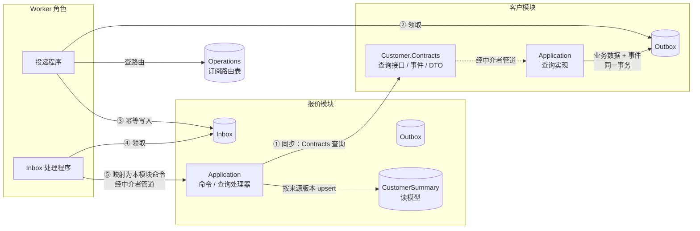
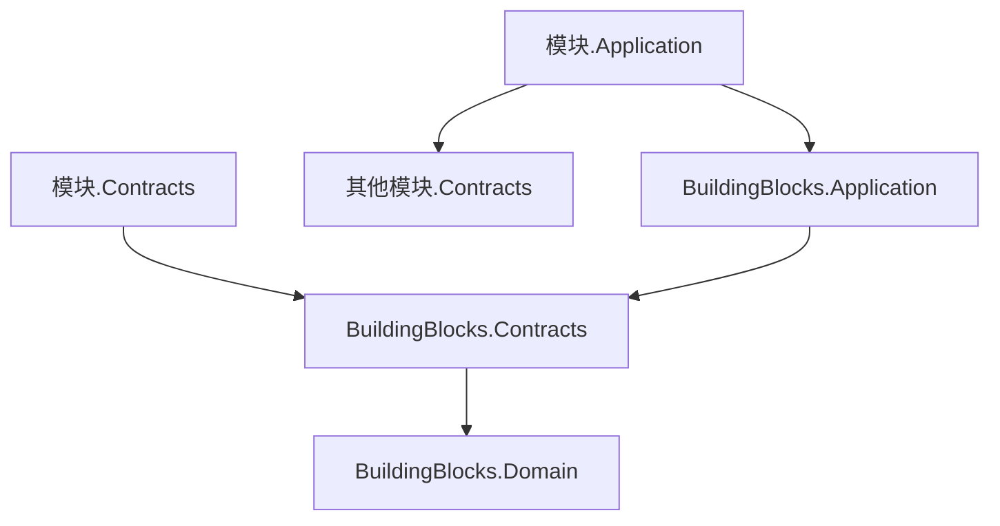
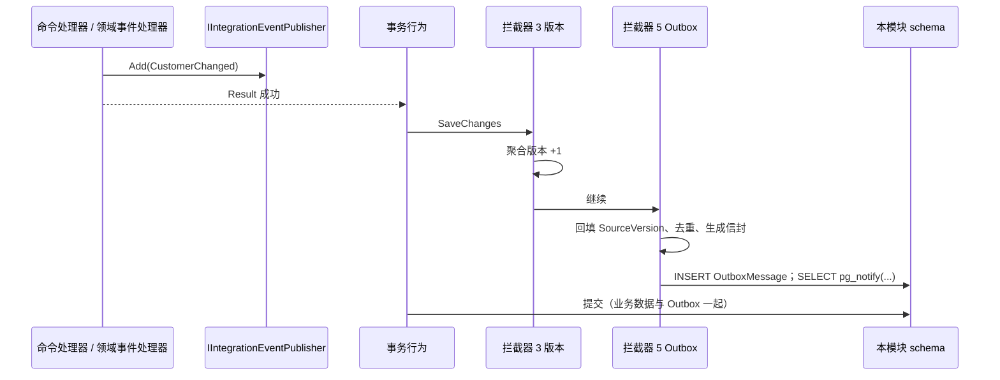
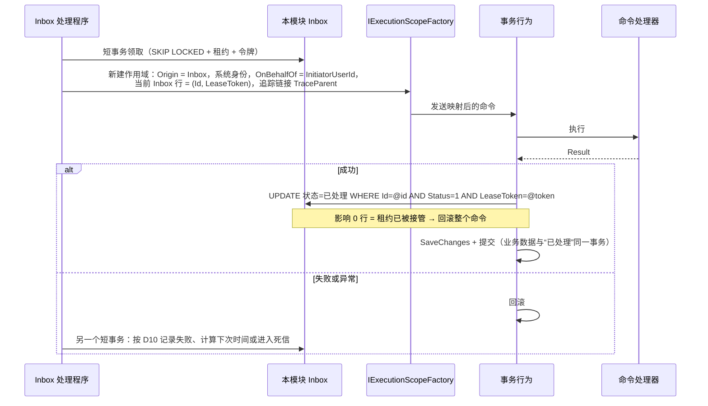

# 05-07 模块间通信

- 状态：已确认（2026-11-04，D1～D12 均按建议确定）；之后的修订见文末“修订记录”
- 日期：2026-11-04
- 所在项目：`Kmic.BuildingBlocks.Contracts`（新增，见 D1：消息标记接口、`ReferenceInfo`、快照源接口）；`Kmic.BuildingBlocks.Application`（`IIntegrationEventPublisher`、`[ContractQuery]`、订阅声明、`IReadModelWriter`）；`Kmic.BuildingBlocks.Infrastructure`（Outbox 写入拦截器、投递程序、Inbox 处理程序、表映射、读模型 upsert）；`Kmic.BuildingBlocks.Testing`（消息测试工具）；各模块 `<模块>.Contracts`
- 依据：ADR-0006、ADR-0007、ADR-0013、ADR-0016、ADR-0019、ADR-0020、ADR-0025、ADR-0027、ADR-0028；04 第 8、9 节；05-01 第 3.3、8 节；05-02 第 4、6、7 节；05-03 第 7.4、8 节；05-05 第 5.7、8 节；05-06 第 5 节

## 0. 范围

| 本文内容 | 相关但不在本文 |
|---|---|
| `Contracts` 项目放什么、不放什么、命名 | 各模块具体公开哪些接口和事件（随业务） |
| 同步调用：Contracts 查询的写法、实现方式、授权、批量 | 查询结果缓存（05-10） |
| 集成事件：定义、命名、载荷、信封、发布、契约演进 | 领域事件（05-01 第 8 节、05-02 第 6.2 节） |
| Outbox：表结构、写入、领取、投递到 Inbox（第一阶段） | Worker 角色启动、Quartz、优雅停机的通用部分（05-08） |
| Inbox：表结构、订阅声明、处理、重试、死信（第二阶段） | 通知、外部调用的具体通道（05-11） |
| 读模型：表约定、按版本同步、初始化与重建、删除 / 停用同步 | 报表模块的统计模型（随业务，遵循本文） |
| 消息的运维：人工重试、清理、监控指标 | 告警通道与仪表盘（05-12）；审计事件汇总（05-09） |

### 0.1 本文决定的分类

按 05-05 第 0.1 节的标准：

| 类别 | 本文中的内容 |
|---|---|
| 第一类：现在确定 | D1～D12：Contracts 写法、消息类型名、载荷形态、表结构、处理器写法、失败分类，事后改要改所有模块和已落库的消息 |
| 第二类：框架定写法，业务定用不用 | 有序订阅（第 7.5 节）；请求型消息（第 5.6 节）；接口组合 / 读模型 / 报表模块三选一（ADR-0013，由业务按场景选用） |
| 第三类：延后 | 替换为消息中间件（ADR-0007 第 5 条已定接口边界，不登记） |

对照 00-README“延后事项”表：无命中。本文登记一项延后事项：“业务事实类订阅的替代切换”（第 6.3 节）。

---

## 1. 旧项目怎么做 → 新框架怎么做

| 问题 | 旧项目 | 新框架 | 章节 |
|---|---|---|---|
| 跨模块读数据 | 任意页面直接关联任意表，三段式名称跨库访问（`Kelong_Shouhuo.dbo.xxx`） | 只能调用对方 `Contracts` 查询，或在本模块维护读模型 | 3、4、8 |
| 冗余名称同步 | 7 个数据库触发器刷新 `CreateName`、客户名等冗余字段；只处理单行，内部临时禁用全部触发器 | 源模块发布快照事件，订阅方按来源版本幂等更新读模型；可从源模块重建 | 5.2、8 |
| “做完 A 再做 B” | 同一个方法里改主表、写别的库、发邮件，跨库写入无事务 | 本模块事务内写 Outbox，提交后由后台投递；对方在自己的事务里处理 | 6、7 |
| 邮件 | 请求线程内同步发送，业务回滚后邮件已发出；失败只记日志 | 发送请求随业务事务写入 Outbox，回滚则不发；失败重试、死信、可人工重试 | 5.6、7.4 |
| 后台任务存储 | Hangfire 序列化方法调用，改类名或参数后已排队的任务失败 | 消息以**稳定类型名 + 版本号 + JSON**存储，与 CLR 类名无关 | 5.1、5.5 |
| 失败可见性 | 无统一的执行记录与告警 | 每条消息有状态、次数、最后错误；积压与死信有指标和告警 | 9 |
| 链路追踪 | 无追踪 ID，错误日志、操作日志、邮件串不起来 | 消息信封保存 `traceparent`、发起人、因果消息 ID | 5.3 |

---

## 2. 总览



| 方式 | 方向 | 一致性 | 能否让对方改数据 | 章节 |
|---|---|---|---|---|
| Contracts 查询 | 调用方 → 提供方 | 实时 | 不能 | 4 |
| 集成事件 | 发布方 → 任意订阅方（一对多） | 最终一致 | 订阅方在自己的事务中改自己的数据 | 5～7 |
| 请求型消息（D6） | 发送方 → 唯一接收方 | 最终一致 | 接收方在自己的事务中执行 | 5.6 |
| 读模型 | 订阅事件维护本地副本 | 最终一致（秒级） | — | 8 |

---

## 3. Contracts 项目约定

### 3.1 放什么、不放什么

| 放 | 不放 |
|---|---|
| 查询接口（同步调用的入口） | 实体、聚合、值对象、领域事件、智能枚举、强类型 ID |
| 集成事件、请求型消息 | 命令接口（不提供“让对方同步改数据”的入口，ADR-0006 第 4 条） |
| 接口与消息使用的 DTO（`sealed record`） | 仓储、DbContext、任何实现代码 |
| 对外的常量（如快照中状态字段的取值说明） | 其他模块 Contracts 中的类型 |

- ID 一律为 `Guid`（05-01 第 3.3 节），引用方在自己的 Domain 中用 `XxxRef` 承接。
- 智能枚举以其编码（`string`）出现在 DTO 中，与 05-06 的 JSON 约定一致；订阅方不依赖提供方的枚举类型。
- 时刻 `DateTimeOffset`（UTC）、日期 `DateOnly`、金额 `decimal`，与 05-03 第 3 节一致。
- **Contracts 之间不得相互引用**：避免形成“客户 Contracts 引用组织 Contracts”的依赖链，模块间关系只体现在 Application / Infrastructure 的引用上。
- 以上规则由架构测试检查（第 11 节）。

### 3.2 D1 Contracts 依赖的框架构件放在哪里

Contracts 需要少量框架类型：消息标记接口、`[IntegrationMessage]` 特性、`Result` / `Error`、`ReferenceInfo`。

| 选项 | 做法 | 优点 | 缺点 |
|---|---|---|---|
| **A 新增 `Kmic.BuildingBlocks.Contracts`** | 只含消息标记接口、特性、`ReferenceInfo`、快照源接口；引用 `BuildingBlocks.Domain` 仅为使用 `Result` / `Error` | Contracts 能接触的框架类型最少、最明确；消息相关概念不进入领域构件 | 多一个框架项目；Contracts 仍能“看到” `BuildingBlocks.Domain` 中的 `Entity` 等类型，需要架构测试禁止使用 |
| B 放进 `BuildingBlocks.Domain` | Contracts 引用 `BuildingBlocks.Domain` | 不新增项目 | 消息、跨模块查询这些应用层概念进入领域构件，违背 05-01 的分层 |
| C Contracts 不引用任何框架，靠命名约定识别事件 | 框架按类名后缀、命名空间扫描 | Contracts 零依赖 | 约定靠字符串，重命名即失效；`Result` 无法使用，接口签名只能用异常或可空值表达失败 |

- **决定（已确认，2026-11-04）**：A。模块 `Contracts` 只允许引用 `BuildingBlocks.Contracts`；架构测试禁止 Contracts 中的类型使用 `Entity`、`AggregateRoot`、`IDomainEvent`、强类型 ID 基类、智能枚举基类。
- **理由**：Contracts 是模块对外的“协议”，它能依赖的东西越少越稳定；单独项目让这个边界由编译器表达，而不是靠评审。
- **取舍**：框架项目从 4 个变为 5 个（另有 Testing），ADR-0021 已同步。



### 3.3 命名

| 类型 | 命名 | 例子 |
|---|---|---|
| 引用解析接口（D3 的 Reference 类） | `I{模块}References` | `ICustomerReferences` |
| 业务查询接口 | `I{模块}{用途}Queries` | `ICustomerSelectionQueries` |
| 快照源接口（8.3） | `I{聚合}SnapshotSource` | `ICustomerSnapshotSource` |
| 快照 DTO | `{聚合}Snapshot` | `CustomerSnapshot` |
| 集成事件 | `{聚合}{过去时动词}`；快照事件统一为 `{聚合}Changed` | `CustomerChanged`、`ContractApproved` |
| 请求型消息（D6） | `{动词}{名词}`，定义在接收方 | `SendNotification` |
| 消息类型名（D4） | `{模块}.{类名}` | `Customer.CustomerChanged` |

---

## 4. 同步调用：Contracts 查询

### 4.1 写法

```csharp
// Customer.Contracts —— 对外协议
public interface ICustomerReferences
{
    // 引用解析：只返回显示所需的最少字段；不存在的 ID 不出现在结果中
    Task<IReadOnlyDictionary<Guid, ReferenceInfo>> ResolveAsync(IReadOnlyCollection<Guid> ids, CancellationToken ct);
}

public interface ICustomerSelectionQueries
{
    // 业务查询：按调用方的数据范围判断“这个客户当前用户能否选用”
    Task<Result<SelectableCustomer>> GetSelectableAsync(Guid customerId, CancellationToken ct);
}

public sealed record SelectableCustomer(Guid Id, string Name, string IndustryCode, Guid OwnerId);

// BuildingBlocks.Contracts —— 框架提供的引用信息（D3）
public sealed record ReferenceInfo(Guid Id, string DisplayName, string? Code, ReferenceStatus Status);
public enum ReferenceStatus { Active, Disabled, Deleted }
```

```csharp
// Customer.Application —— 实现：薄适配器，发送本模块的查询（D2）
internal sealed class CustomerSelectionQueries(IContractQuerySender sender) : ICustomerSelectionQueries
{
    public Task<Result<SelectableCustomer>> GetSelectableAsync(Guid customerId, CancellationToken ct)
        => sender.SendAsync(new GetSelectableCustomerQuery(CustomerId.From(customerId)), ct);
}

[ContractQuery(ContractAccess.CallerScoped)]          // D3；代替 [RequirePermission] 等四种声明
public sealed record GetSelectableCustomerQuery(CustomerId Id) : IQuery<SelectableCustomer>;
```

- 提供方的 `IModule` 注册接口实现；调用方的 Application 构造函数注入接口即可。
- 调用方模块在 `IModule` 中声明依赖：`d.DependsOn(CustomerModuleInfo.Name)`（`IModule.DeclareDependencies`；模块之间只能引用 Contracts，按模块名声明，07 D1）。启动时检查“启用的模块，其依赖的模块也必须启用”（ADR-0021 第 2 节可按配置停用模块），否则拒绝启动。

### 4.2 D2 Contracts 接口如何实现

| 选项 | 做法 | 优点 | 缺点 |
|---|---|---|---|
| **A 薄适配器 + 经中介者管道** | 接口实现只把参数转为本模块的查询消息，经 `IContractQuerySender` 发送，走日志、异常转换、校验、授权行为（查询不经过幂等、事务） | 授权规则（D3）、日志、追踪由管道统一保证；查询本身可以单独测试；与“所有入口都经过管道”（ADR-0005）一致 | 多一个查询消息类；每次调用多一层管道开销（源码生成式中介者，开销为微秒级） |
| B 直接实现 | 接口实现直接使用 `IXxxQueryDb` 查询 | 少写一个类，调用最快 | 授权与数据范围要每个实现自己记得处理；没有统一日志；一个模块出现两种查询写法 |

- **决定（已确认，2026-11-04）**：A。
- **理由**：Contracts 查询是“另一个模块的用户在读我的数据”，正是最需要统一授权的地方；B 把是否套数据范围交给每个实现者的记忆，与 05-05 的设计目标冲突。
- **取舍**：每个对外查询多一个消息类型。
- `IContractQuerySender` 在发送期间把执行上下文的 `Origin` 临时切换为 `ModuleCall`（`AsyncLocal` 栈，返回后恢复），身份沿用调用方（05-02 第 7.2 节）。
- 提供方的查询在提供方自己的查询 DbContext 中执行，使用独立连接，看不到调用方事务中尚未提交的数据——这是预期行为（ADR-0006 第 4 条）。

### 4.3 D3 Contracts 查询的授权

问题：报价列表要显示客户名称，但当前用户可能没有 `Customer.Customer.View` 权限点，也可能客户不在他的客户数据范围内。05-02 第 7.2 节约定“沿用调用方身份”，本节定具体规则。

| 选项 | 做法 | 优点 | 缺点 |
|---|---|---|---|
| A 完全按调用方授权 | 检查调用方在提供方的权限点 + 数据范围 | 规则单一 | 没有客户权限的用户看报价时客户名称全部缺失；为了显示名称不得不给大量角色加客户权限，反而扩大授权 |
| B 一律不授权 | Contracts 查询不做任何检查 | 简单 | 任何模块都能借 Contracts 读出范围外的完整数据，数据范围形同虚设 |
| **C 两类查询，显式声明** | `Reference`：不检查权限点、不套数据范围，但结果固定为 `ReferenceInfo`（ID、显示名、编码、状态）；`CallerScoped`：不检查权限点（调用方用例已检查过自己的权限点），**套用调用方在提供方范围对象上的数据范围** | 显示名称不受限，数据内容受限；每个查询的授权语义在声明处可见 | 需要开发者区分两类；`Reference` 泄露的是“名称”这一最小信息 |

- **决定（已确认，2026-11-04）**：C。
- **理由**：“能看到引用对象的名字”和“能看到引用对象的内容”是两种权限。`Reference` 只用于解析**本模块已经保存的引用**（数据本身已在调用方的范围内），限定返回类型让它无法被扩展成数据通道。
- **取舍**：开发者要多理解一个概念；`Reference` 存在被用来探测“某 ID 对应什么名字”的可能，用下面的规则约束。

规则：

| 规则 | 检查方式 |
|---|---|
| 每个 Contracts 查询必须且只能声明 `[ContractQuery(Reference)]`、`[ContractQuery(CallerScoped)]`、`[ContractQuery(SystemOnly)]` 之一（第三种只允许系统身份调用，用于快照源与 `IUserContacts` 这类系统专用查询，见 8.3 与 05-11 D3）；它与 `[RequirePermission]`、`[AllowAuthenticated]`、`[AllowAnonymous]`、`[SystemOnly]` 互斥 | 启动校验（扩展 05-02 第 4.5 节规则 1） |
| `Reference` 查询的返回类型只能是 `ReferenceInfo` 或其集合 / 字典 | 启动校验 |
| `CallerScoped` 查询必须作用于提供方已声明的范围对象（`[DataScopeObject]`），由 05-05 的 `DataScope` 过滤器生效 | 启动校验 + 05-05 第 12 节矩阵测试 |
| Contracts 查询只能以 `ModuleCall` 来源执行；不能被端点 `.Sends<T>()` 绑定，HTTP 调用一律拒绝 | 启动校验（05-06 第 2.3 节）+ 授权行为 |
| **用户在请求中传入的引用 ID**（如新建报价时选择的客户）必须用 `CallerScoped` 查询校验“能否选用”；`Reference` 只用于显示 | 代码评审；模块模板示例 |
| 系统身份（Inbox、定时任务）调用时两类均不受限（`Unrestricted`，05-05 第 5.7 节） | 授权行为 |

- 05-05 第 8 节的候选人员查询 `IAuthorizedUserQuery` 属于第三种形态：它按权限点反查用户，本身就要看到调用方范围外的人。归入 `CallerScoped` 不合适，归入 `Reference` 返回类型又不符。处理：保留 05-05 的写法，声明为 `[ContractQuery(ContractAccess.Reference)]` 并允许其返回 `CandidateUser`——作为启动校验白名单中的例外，写在 Identity 模块中。白名单另有 Configuration 的 `IDictionaries`（字典候选值对所有登录用户可见，返回 `DictionarySnapshot`，05-10）与 Files 的 `GetDescriptor`（返回 `FileDescriptor`，只含文件元数据；调用方必须先完成业务对象授权，05-11）。

### 4.4 批量与上限

- 按 ID 查询必须批量（ADR-0013 第 1 条），参数为 `IReadOnlyCollection<Guid>`，结果为以 ID 为键的字典；不存在的 ID 不出现在结果中，调用方显示为“[已删除]”。
- 单次上限 1000 个 ID（配置项）。框架提供 `ContractBatch.Chunked(ids, size, fetch)` 辅助方法，适配器中超过上限时自动分批。
- 一个查询请求内对同一接口的多次调用不做合并；列表查询应先收集本页全部引用 ID 再调用一次。架构测试无法发现循环中调用，由代码评审与慢请求日志（05-12）发现。

### 4.5 调用约束

| 约束 | 说明 |
|---|---|
| 只读 | Contracts 中没有命令；需要对方改数据一律发消息（04 第 8.1 节） |
| 失败 | 提供方返回的 `Result` 失败原样交给调用方；调用方可直接返回（错误码保留来源模块前缀，如 `Customer.NotFound`），也可转换为本模块错误 |
| 命令中调用 | 允许（05-02 D5 允许命令处理器发送查询）；调用结果用于校验或计算，**提交时以本模块数据为准**，不假设对方数据在提交前不变 |
| 领域层 | Domain 不调用 Contracts；需要的外部数据由处理器查好后作为参数传入（ADR-0017） |
| 缓存 | `Reference` 查询使用框架的 `ReferenceCache`（按 ID 缓存）；拦截器 5 写入 `ISnapshotEvent` 时自动登记提交后失效该 ID；没有快照事件的聚合不得使用（05-10 D5） |

---

## 5. 集成事件

### 5.1 定义与 D4 消息类型名

```csharp
// BuildingBlocks.Contracts
public interface IIntegrationMessage;
public interface IIntegrationEvent : IIntegrationMessage;           // 一对多
public interface IIntegrationRequest : IIntegrationMessage;         // 一对一，D6
public interface ISnapshotEvent : IIntegrationEvent { Guid SourceId { get; } }

[AttributeUsage(AttributeTargets.Class)]
public sealed class IntegrationMessageAttribute(string name) : Attribute
{
    public string Name { get; } = name;
    public int Version { get; init; } = 1;
}

// Customer.Contracts
[IntegrationMessage("Customer.CustomerChanged")]
public sealed record CustomerChanged(CustomerSnapshot Customer) : ISnapshotEvent
{
    public Guid SourceId => Customer.Id;
}
```

Outbox / Inbox 中用什么标识消息类型：

| 选项 | 优点 | 缺点 |
|---|---|---|
| **A 显式稳定名称 + 版本号（`[IntegrationMessage("Customer.CustomerChanged", Version = 1)]`）** | 改类名、移命名空间不影响已落库的消息；名称可读，便于运维查询；以后接入消息中间件可直接作为主题名 | 每个消息多写一个特性 |
| B CLR 类型全名 | 不需要声明 | 正是旧系统 Hangfire 的问题：重命名、移动类后已排队的消息无法反序列化 |
| C 按约定从模块名 + 类名推导 | 不需要声明 | 改类名同样会改变类型名，只是不那么明显 |

- **决定（已确认，2026-11-04）**：A。名称必须以本模块名开头，全系统唯一（启动校验 + 架构测试）。唯一例外是框架消息：以 `Framework.` 开头、定义在 `BuildingBlocks.Contracts`，目前只有 `Framework.AuditRecorded`（05-09）。
- **取舍**：多一行声明；换来消息标识与代码结构脱钩。

### 5.2 D5 事件载荷放什么

| 选项 | 做法 | 优点 | 缺点 |
|---|---|---|---|
| A 只带 ID（瘦事件） | 订阅方收到后回调 Contracts 查询取数据 | 载荷最小；不存在“事件里的数据过时” | 处理时回调读到的是**最新**状态而非事件发生时的状态；每个订阅方都回调，提供方负载放大；提供方停用或出错时订阅方全部失败 |
| B 只带变化的字段（增量） | `CustomerRenamed(Id, NewName)` 等细粒度事件 | 语义精确 | 读模型要按顺序合并多种增量事件，乱序时无法正确合并；字段一多事件种类爆炸 |
| **C 两种事件各司其职** | **快照事件** `{聚合}Changed`：携带该聚合对外公开的完整快照 + 来源版本号，用于读模型同步；**业务事实事件**（如 `ContractApproved`）：携带订阅方处理所需的业务数据 | 读模型同步只需处理一种事件、按版本号取最新即可，天然抗乱序和重复（第 8.2 节）；快照 DTO 与重建接口共用（第 8.3 节）；业务事实事件表达“发生了什么” | 快照事件载荷较大；公开字段变化即发布，事件量多于增量方式 |

- **决定（已确认，2026-11-04）**：C。
  - 被其他模块引用、需要同步副本的聚合，发布 `{聚合}Changed` 快照事件：聚合的任何**公开字段**变化（含删除、停用）时发布一次，载荷为 `{聚合}Snapshot`。
  - 业务事实事件只在“有订阅方要据此做事”时定义，载荷包含处理所需的数据，**订阅方不应为了处理事件再回调发布方**。
- **理由**：读模型同步占跨模块事件的大多数，“取最新快照 + 比较版本”是最不容易出错的同步方式；同时保留表达业务事实的能力。
- **取舍**：存储和投递量较大；需要在 Contracts 中维护快照 DTO，作为对外公开字段的清单。

### 5.3 信封

事件本身只放业务数据，元数据放在信封中（Outbox 的列和 `Headers`）：

| 字段 | 来源 | 用途 |
|---|---|---|
| `MessageId` | UUID v7，写入 Outbox 时生成 | 去重键；外部调用的幂等键 |
| `MessageType`、`SchemaVersion` | `[IntegrationMessage]` | 路由与反序列化 |
| `SourceModule` | 发布方模块 | 运维 |
| `OccurredAt` | `TimeProvider`，命令内同一时刻 | 显示与排查 |
| `SourceId`、`SourceVersion` | 快照事件：聚合 ID 与**提交后**的聚合版本（5.4） | 读模型按版本比较 |
| `OrderingKey` | 快照事件等于 `SourceId`；业务事实事件在类型上用 `[OrderingKey(nameof(ContractId))]` 指定作为顺序键的属性（`Guid` 或 `string`，启动校验；只能用于事件） | 有序订阅（7.5） |
| `InitiatorUserId` | 原始请求的用户；事件处理中再发布时沿用 `OnBehalfOf` | 审计（05-02 第 7.1 节） |
| `ActualUserId` | 模拟身份时的实际操作人 | 审计 |
| `CausationId` | 若在 Inbox 处理中发布，为触发它的消息 ID | 追查事件链 |
| `TraceParent`、`TraceState` | 发布时的 W3C 追踪上下文 | 处理时以链接关联（ADR-0028 第 6 条） |
| `Purged` | 只能由 `IPurge` 的框架包装设置（05-03 第 5.1 节） | 快照事件表示源数据已物理删除，读模型据此置终态（8.4） |

- 序列化使用 `KmicJsonOptions`（05-06 第 5 节），与 HTTP 一致：强类型 ID 不会出现（Contracts 中只有 `Guid`），智能枚举为编码。
- 载荷不得包含密码、令牌、证件号等敏感字段；需要传递大块内容时传文件 ID（05-11）。载荷上限默认 256 KB（配置项，`待确认`），超过即抛异常（程序缺陷）。

### 5.4 发布

```csharp
// BuildingBlocks.Application
public interface IIntegrationEventPublisher
{
    void Add(IIntegrationEvent integrationEvent);
    void Send(IIntegrationRequest request);        // D6
}
```

| 要点 | 说明 |
|---|---|
| 调用位置 | 命令处理器、领域事件处理器（05-02 第 6.2 节）；不在命令内调用即抛异常（`InCommand` 守卫） |
| 暂存 | 作用域内的列表；命令失败回滚时清空 |
| 写入 | 保存拦截器 5（05-03 第 7.4 节）把列表写入本模块 Outbox，与业务数据同一事务 |
| 快照版本 | 拦截器 5 在拦截器 3（聚合版本递增）之后执行：对 `ISnapshotEvent`，在被跟踪的聚合中按 `SourceId` 找到聚合根，取递增后的版本写入 `SourceVersion`；找不到即抛异常（程序缺陷）。这与 05-02 第 6.4 节“版本号由框架回填”同一思路 |
| 同一事务内多次修改 | 同一聚合在一个命令中发布多个 `{聚合}Changed` 时，拦截器只保留最后一个（版本相同，载荷以最后为准） |
| 唤醒 | 写入后在同一事务中执行 `pg_notify`（D8），提交时才送达 |
| 批量操作 | `IAtomicUpdate`、`IPurge`（05-03 D5）不经过变更跟踪；需要发事件的批量操作由调用方显式 `Add`，`IPurge` 的框架包装要求传入快照事件（删除状态） |



### 5.5 契约演进

单体中所有模块同时部署，但 Outbox / Inbox 中可能还有旧格式的消息未处理；以后拆分服务时还会出现新旧版本并存。规则：

| 变化 | 做法 |
|---|---|
| 新增字段 | 兼容变化，版本号不变；新字段必须可空或有默认值（旧消息反序列化时缺失） |
| 删除字段、改类型、改含义 | 破坏性变化：新建 `Version = 2` 的消息类（如 `CustomerChangedV2`，类型名不变），发布方改发新版本；订阅方同时处理两个版本，直到旧版本消息在所有 Inbox 中处理完（运维查询 9.1 可看），再删除旧类 |
| 重命名消息 | 视为新消息 + 删除旧消息，按上一行处理 |

- 反序列化允许未知字段（与 05-06 D7 的“HTTP 拒绝未知字段”相反）：消息是已落库的数据，新代码删掉字段后仍要能读旧消息。框架为消息单独配置这一选项，其余选项与 `KmicJsonOptions` 相同。
- **事件契约快照测试**：每个消息类型生成 JSON Schema 快照（Verify），CI 中与主分支对比；破坏性变化而版本号未变 → 失败。这与 05-06 的 OpenAPI 检查对应。

### 5.6 D6 是否支持请求型消息

场景：报价模块需要“可靠地发一封邮件”。邮件由 Notifications 模块发送（ADR-0020）。消息定义在哪一方？

| 选项 | 做法 | 优点 | 缺点 |
|---|---|---|---|
| A 只有事件 | 报价模块发布 `QuotationSubmitted`，由 Notifications 订阅并决定发什么 | 只有一种消息 | Notifications 要了解所有业务模块的事件和收件人规则，依赖方向反了：平台模块依赖业务模块 |
| **B 支持请求型消息** | `SendNotification` 定义在 **Notifications.Contracts**，实现 `IIntegrationRequest`；报价模块 `publisher.Send(...)`，走同一套 Outbox / Inbox，接收方必须且只能是定义它的模块 | 依赖方向正确：业务模块依赖平台模块；可靠性与事件相同（回滚不发、重试、死信） | 多一个概念；需要防止它被当成“异步命令”滥用于业务模块之间 |
| C Notifications 提供同步 Contracts 命令 | 报价直接调用发送接口 | 写法最直接 | 违反 Contracts 只读的约定；业务回滚后邮件已发出，重回旧系统的问题 |

- **决定（已确认，2026-11-04）**：B，并限定：请求型消息**只能定义在平台模块**（Notifications、Files 等，ADR-0027）的 Contracts 中；业务模块之间协作一律用事件。
- **理由**：平台模块是“被所有业务使用的服务”，请求型消息正是“调用服务”的可靠异步形式；业务模块之间若允许请求型消息，就会变成用消息实现的同步调用链，耦合比事件更强。
- **取舍**：多一个概念；规则“只在平台模块定义”由启动校验保证。
- 启动校验：每个 `IIntegrationRequest` 恰好有一个订阅，且订阅方是定义它的模块。

---

## 6. Outbox 与投递（第一阶段）

### 6.1 表：`"{模块}"."OutboxMessage"`

| 列 | 类型 | 说明 |
|---|---|---|
| `Id` | `uuid` PK | `MessageId`，UUID v7 |
| `Seq` | `bigint` identity | 发布顺序，有序订阅用（UUID v7 在同一毫秒内不保证单调） |
| `MessageType` | `varchar(200)` | 稳定类型名 |
| `SchemaVersion` | `int` | |
| `Kind` | `smallint` | 0 事件 / 1 请求 |
| `Payload` | `jsonb` | |
| `Headers` | `jsonb` | 信封中除下列独立列以外的字段 |
| `SourceId` | `uuid` null | |
| `SourceVersion` | `bigint` null | |
| `OrderingKey` | `varchar(100)` null | |
| `SubjectIds` | `uuid[]` null | 请求型消息涉及的对象（见表后说明） |
| `OccurredAt` | `timestamptz` | |
| `Status` | `smallint` | 0 待投递 / 1 投递中 / 2 已投递 / 3 死信 |
| `Attempts` | `int` | |
| `NextAttemptAt` | `timestamptz` | |
| `LeaseToken` | `uuid` null | 领取令牌 |
| `LeaseUntil` | `timestamptz` null | 租约到期 |
| `LastError` | `varchar(4000)` null | |
| `DeliveredAt` | `timestamptz` null | |

- 索引：`(NextAttemptAt) WHERE Status IN (0, 1)`（部分索引，领取用）；`(Status, OccurredAt)`（监控与运维查询）。
- 由 `ApplyFrameworkTables()` 映射（05-03 第 8 节），不使用强类型 ID、不加审计字段。
- 租约和重试时间一律使用**数据库时钟**（`clock_timestamp()`），避免多实例之间的时钟偏差；`OccurredAt` 使用 `TimeProvider`。

- `SubjectIds`（Inbox 同名列从 Outbox 复制）表示“这条请求涉及哪些对象”。请求型消息用特性 `[MessageSubjects(nameof(AttachFiles.FileIds))]` 声明哪个属性是主体，发布时由框架填入；只有请求型消息可以声明（启动校验）。索引：`(SubjectIds) WHERE SubjectIds IS NOT NULL AND Status IN (0, 1, 3)`（GIN 部分索引，两张表相同）。用途：接收方在删除对象之前，探查是否还有涉及它的未完成请求（05-11 第 4.3 节）。

### 6.2 领取与投递

投递程序在 Worker 角色中运行（ADR-0025），每个模块一个循环：

```sql
-- 短事务：领取
WITH c AS (
    SELECT "Id" FROM "Sample"."OutboxMessage"
    WHERE ("Status" = 0 AND "NextAttemptAt" <= clock_timestamp())
       OR ("Status" = 1 AND "LeaseUntil" < clock_timestamp())
    ORDER BY "NextAttemptAt"
    LIMIT @batch
    FOR UPDATE SKIP LOCKED)
UPDATE "Sample"."OutboxMessage" o
SET "Status" = 1, "LeaseToken" = @token, "LeaseUntil" = clock_timestamp() + @lease, "Attempts" = o."Attempts" + 1
FROM c WHERE o."Id" = c."Id"
RETURNING o.*;
```

1. 按 `MessageType` 查订阅路由（D7），得到订阅清单 `(模块, 订阅名)`；
2. 对每个订阅方模块，在同一事务内先复核来源行（见下文“防止迟到的旧投递者”），再 `INSERT … ON CONFLICT ("MessageId", "Subscription") DO NOTHING` 写入其 Inbox，**每个订阅方模块单独提交**（遵守“一个事务只改一个模块”，也与以后拆服务后的形态一致）；
3. 全部写入成功后：`UPDATE … SET "Status" = 2, "DeliveredAt" = … WHERE "Id" = @id AND "LeaseToken" = @token`；影响 0 行说明租约已被他人接管，直接放弃（重复写入 Inbox 是幂等的）；
4. 任一写入失败：按退避计算 `NextAttemptAt`，状态回到 0（只作用于 `Status = 1` 且令牌匹配的行，与 7.3 同一规则）；超过最大次数进入死信（这一步只可能因数据库故障失败，正常情况下极少发生）。

- 没有订阅方的消息直接标记已投递。
- 投递程序是框架基础设施，写入其他模块的 Inbox 不算模块越界（ADR-0028 第 5 条）。

**防止迟到的旧投递者**（R02）

要防止的问题：如果只在第 3 步校验领取令牌，投递者 A 读出载荷后暂停 → 租约到期，B 接管并完成投递 → 按保留契约（9.2）来源行与 Inbox 去重凭证先后被删除 → A 恢复，用内存中的载荷再次写入 Inbox，唯一约束已不存在，消息被重复处理。

因此**任何写入 Inbox 的路径**（正常投递、运维补投）都在写入 Inbox 的同一事务内，先对来源 Outbox 行加共享锁并复核；复核不通过即回滚、不写入：

```sql
-- 与写入订阅方 Inbox 同一事务，锁持有到提交
SELECT 1 FROM "Customer"."OutboxMessage"
WHERE "Id" = @id AND "Status" = 1 AND "LeaseToken" = @token   -- 运维补投改为：行存在且载荷完整
FOR SHARE;
-- 0 行：已被接管、已投递或来源行已删除 → 回滚，放弃本次投递
INSERT INTO "Quotation"."InboxMessage" (…) VALUES (…)
ON CONFLICT ("MessageId", "Subscription") DO NOTHING;
```

- `FOR SHARE` 与接管领取（领取语句的 `FOR UPDATE SKIP LOCKED` 会跳过被锁的行）、标记已投递（`UPDATE`）、清理（`DELETE`）都冲突：复核通过后、Inbox 写入提交之前，来源行不可能被接管、标记或删除。“来源行仍在且属于本次执行”与“写入 Inbox”因此是一个原子步骤，而不是独立的先查后写。
- 推论（9.2 保留契约的前提）：来源行删除之后，任何路径都无法再为该消息写入 Inbox，此后删除对应的去重凭证是安全的。
- 这是投递程序对来源模块 Outbox 的加锁读取，与写入其他模块 Inbox 属于同一个框架基础设施例外（ADR-0028 第 5 条）。
- 原型 #16 已验证（`docs/framework/spikes/16-message-delivery.md`）：迟到的旧投递者被拒；复核锁住期间接管、标记、清理都要等待；对照组（不复核）重复执行。

### 6.3 D7 订阅路由从哪里来

问题：Worker 滚动更新时，新旧版本实例同时运行。新版本新增了一个订阅；如果旧实例按**自己代码里**的订阅清单投递，新订阅就收不到这期间的消息——而且不会报错。

| 选项 | 做法 | 优点 | 缺点 |
|---|---|---|---|
| A 按本实例代码中的订阅清单投递，部署时 Worker 先停旧再起新 | 不滚动更新 Worker | 实现最简单 | 正确性依赖部署方式，一次误操作就静默丢消息；停机期间后台处理中断 |
| B 只有最新版本的实例投递 | 实例登记构建号与心跳，投递程序只在“存活实例中构建号最大”时工作 | 不依赖部署方式 | 要维护心跳和选主逻辑；构建号必须单调 |
| **C 订阅路由表落库** | 表 `"Operations"."MessageRoute"`；实例启动时把自己声明的订阅登记进去（登记规则见下文“订阅状态与终结边界”）；投递程序每批领取后读取路由（小表，按版本号缓存） | 投递程序不需要认识消息类型，只按表复制，旧实例也能为新订阅写入 Inbox；路由可在运维界面查看；以后接入消息中间件时正好对应其订阅拓扑 | 多一张表和启动时的替换逻辑；投递程序读取 Operations schema（框架基础设施例外） |

- **决定（已确认，2026-11-04）**：C。
- **理由**：消息不丢不应依赖运维操作的正确性；C 把“谁订阅了什么”变成数据，新旧实例看到的是同一份。
- **取舍**：多一张框架表与启动步骤。
- 配套规则：
  - Inbox 处理程序只领取**本实例代码认识**的订阅（`"Subscription" = ANY(@mine)`）；新订阅的消息由新实例处理，旧实例不会误处理。
  - 新增订阅时，登记“该订阅需要初始化”，若订阅声明了重建方法则自动排队重建作业（8.3）。
  - 代码中不再声明的订阅不会被自动删除或放弃，按下文的状态与终结规则处理。

**订阅状态与终结边界**（R02）

路由表不按“实例构建号较新就整体替换、被删订阅的未处理行直接放弃”的方式维护。那样做有三个问题：滚动发布时，新实例一启动就放弃了旧实例本可以处理完的消息；回滚时，旧构建号较低、不能恢复路由，被删订阅在回滚期间的消息无声丢失；与第 5.5 节“旧版本消息处理完再删旧类”的原则不一致。规则如下：

| 规则 | 内容 |
|---|---|
| 订阅键稳定 | 订阅名是存进 Inbox 的稳定键，发布后不得修改；需要更易读的名称时另设显示名。CI 生成订阅清单快照（做法同第 5.5 节的事件契约快照），删除或修改订阅键而没有退役声明即失败 |
| 路由只增不自动删 | 实例启动时只**新增**本实例声明、而路由表中没有的订阅（同时登记初始化与重建）；启动从不删除、停用路由条目，不比较构建号 |
| 持久状态决定投递 | 路由条目状态：生效 / 待终结 / 已终结。生效与待终结照常投递；只有已终结停止投递 |
| 退役声明 | 代码中声明 `m.Retired("Quotation.SyncCustomerSummary", "原因")`：启动时把该订阅从生效改为待终结（不能反向）；处理器代码可以已删除，消息照常投递并积压，运维界面显示积压量 |
| 终结 | 运维操作（`Operations.Messages.Manage`，`[Audited]`），含义是**跨过回滚边界**。首期在受控维护窗口中执行：停止声明该订阅的 Worker（新版本全部上线后通常已没有，只需确认）；确认该订阅没有“处理中且租约有效”的行；在一个事务中把状态改为已终结，并对剩余未完成行逐批选择处置（填写原因放弃 / 转交替代订阅）。界面显示可补投起点（9.2），并提示终结后旧构建不能自动恢复该订阅 |
| 终结后的旧构建 | 实例声明的订阅中有已终结的订阅时，Worker 角色拒绝启动并说明原因；需要恢复时由运维显式重新激活，并核对兼容性、缺口区间与补投来源，不自动恢复 |
| 心跳 | 实例定期登记构建号与订阅清单，只用于诊断（显示“哪些构建仍声明该订阅”，帮助判断能否终结），不参与投递判断 |
| 待终结的积压 | 待终结订阅的积压是预期内的，不计入通用积压告警（9.3），在运维界面单独显示；超过补投窗口 R 仍未终结时提醒运维 |

- 状态条件：终结时的处置只作用于 `Status IN (0, 3)` 的行；处理完成要求 `Status = 1` 且令牌匹配（7.3），两者不会互相覆盖。
- 接受的限制：终结之后再回滚，若需要的消息已超出补投窗口、且该订阅没有重建方法，缺失的业务事实无法补回。因此终结只在回滚窗口过去之后执行。
- 替代订阅与旧订阅并存期间会各自处理同一消息：读模型同步因版本比较无害；业务事实类订阅的替代需要按序号切换点只投递一边，首次出现时再设计（已登记延后事项）。
- 表：`"Operations"."MessageRoute"`（`MessageType`、`Module`、`Subscription`、`RegisteredBuild`、`Status`、`DisplayName`、`RetiredReason`、`FinalizedAt`、`FinalizedBy`）；`"Operations"."MessagingInstance"`（实例 ID、构建号、订阅清单、心跳时间）。

### 6.4 D8 如何唤醒投递和处理程序

| 选项 | 做法 | 优点 | 缺点 |
|---|---|---|---|
| A 仅轮询 | 每秒轮询所有模块的 Outbox 和 Inbox | 实现简单；不需要专用连接 | 15 个模块 × 2 张表，每个 Worker 实例空闲时约 30 次查询 / 秒；或者拉长间隔、增加延迟 |
| **B `LISTEN / NOTIFY` + 兜底轮询** | 写入 Outbox 时在同一事务内 `pg_notify('kmic_outbox', '<模块>')`，投递程序写入 Inbox 后 `pg_notify('kmic_inbox', '<模块>')`；Worker 持有一个专用连接 `LISTEN`；兜底轮询 10 秒 | 延迟为毫秒级；空闲时几乎无查询；`NOTIFY` 在事务提交时才送达，不会唤醒后看不到数据 | 每个 Worker 多一个长连接；连接断开时要重连并立即补一次轮询；若以后使用事务模式的连接池代理（PgBouncer），`LISTEN` 不可用，需要直连 |

- **决定（已确认，2026-11-04）**：B。
- **监听循环的写法**（原型 #13 D1，2026-11-10 确认）：每个进程一个监听连接，在一个长期运行的**专用线程**上循环同步 `Wait(兜底间隔)`；收到通知或等待超时都唤醒相应的循环。原因：Windows 上 Npgsql 的 `WaitAsync` 不响应超时与取消，兜底轮询会失效，本机行为与生产（Linux）不一致；同步 `Wait(超时)` 在两个平台上一致。框架测试覆盖三种情况：没有通知时按兜底间隔照常轮询；连接断开后重连、重新 `LISTEN` 并立即补一次轮询；停机时关闭连接结束等待、线程退出。升级 Npgsql 时复查异步等待是否已修复（实施待办 T-21），修复后可改回异步写法。
- **理由**：两阶段投递本身多了一次落库延迟（ADR-0028 已接受），唤醒机制把它压到可以忽略；兜底轮询保证 `NOTIFY` 丢失（连接断开）时也不会卡住。
- **取舍**：多一个长连接与重连逻辑；部署上要求 Worker 能直连数据库。

---

## 7. Inbox 与处理（第二阶段）

### 7.1 表：`"{模块}"."InboxMessage"`

| 列 | 类型 | 说明 |
|---|---|---|
| `Id` | `uuid` PK | 本行 ID |
| `MessageId` | `uuid` | 来自 Outbox |
| `Subscription` | `varchar(200)` | 订阅名，唯一约束 `(MessageId, Subscription)` |
| `MessageType`、`SchemaVersion`、`Payload`、`Headers`、`SourceId`、`SourceVersion`、`OrderingKey`、`SubjectIds`、`OccurredAt`、`Seq` | | 从 Outbox 复制 |
| `SourceModule` | `varchar(100)` | 从信封复制；清理时据此判断来源 Outbox 行是否已删除（9.2） |
| `ReceivedAt` | `timestamptz` | 写入 Inbox 的时间 |
| `Status` | `smallint` | 0 待处理 / 1 处理中 / 2 已处理 / 3 死信 / 4 已放弃 |
| `Attempts`、`NextAttemptAt`、`LeaseToken`、`LeaseUntil`、`LastError` | | 同 Outbox |
| `ProcessedAt` | `timestamptz` null | |

- **一行 = 一条消息 × 一个订阅**：同一模块对同一事件有两个订阅时，两者各自重试、各自死信，互不影响。
- 索引：`(NextAttemptAt) WHERE Status IN (0, 1)`；`(Subscription, OrderingKey, Seq) WHERE Status IN (0, 1, 3) AND OrderingKey IS NOT NULL`（有序订阅用）。

### 7.2 D9 订阅如何声明、处理器怎么写

ADR-0028 要求处理“经中介者管道以系统身份执行”，且“处理结果与标记已处理同一事务”。

| 选项 | 做法 | 优点 | 缺点 |
|---|---|---|---|
| **A 订阅 = 事件到本模块命令的映射** | 在 `IModule` 中声明 `Subscribe<CustomerChanged, SyncCustomerSummaryCommand>("Quotation.SyncCustomerSummary", (e, env) => new SyncCustomerSummaryCommand(e.Customer, env.SourceVersion!.Value))`；Inbox 处理程序反序列化后构造命令并发送 | 处理逻辑就是一个普通命令：管道、事务、审计、授权全部复用，不需要新概念；可以直接发送命令做测试；重建（8.3）可复用同一命令 | 每个订阅多一个命令类；命令必须声明 `[SystemOnly]` |
| B `IIntegrationEventHandler<T>`，框架包装成内部命令执行 | 处理器实现接口，框架为每个处理器生成或包装一个命令 | 写法接近领域事件处理器 | 用例目录要为“包装命令”找归属模块；源码生成式中介者对开放泛型命令的支持需要额外验证（05-02 待确认项）；授权、审计的声明位置不直观 |

- **决定（已确认，2026-11-04）**：A。
- **理由**：“收到事件后在本模块做一件事”本质上就是一个系统身份执行的命令；复用命令意味着 05-02 已设计的全部机制自动生效。
- **取舍**：多写一个映射和命令类；订阅名需要显式写出（它存进 Inbox，必须稳定，理由同 D4）。

```csharp
// Quotation.Infrastructure/QuotationModule.cs
public void ConfigureMessaging(IMessagingBuilder m)
{
    m.Subscribe<CustomerChanged, SyncCustomerSummaryCommand>(
        "Quotation.SyncCustomerSummary",
        (e, env) => new SyncCustomerSummaryCommand(e.Customer, env.SourceVersion!.Value),
        o => o.RebuildWith<ICustomerSnapshotSource>());          // 8.3
}

// Quotation.Application
[SystemOnly]
public sealed record SyncCustomerSummaryCommand(CustomerSnapshot Customer, long SourceVersion) : ICommand;
```

启动校验：订阅名以本模块名开头且唯一；映射的命令属于本模块且声明 `[SystemOnly]` 或 `[AllowSystem]`；不能订阅本模块自己发布的事件（本模块内用领域事件），平台模块的请求型消息除外（接收方即定义方）。

### 7.3 处理流程



- “标记已处理”由事务行为在 `SaveChanges` 之前完成，与 05-02 第 6.1 节中“幂等完成标记”是同一个位置的同类步骤。
- 令牌校验保证：处理时间超过租约、另一实例重新领取并执行时，**只有一个能提交**。业务效果恰好一次（在本模块数据库范围内）。
- 并发：每个模块的处理程序默认并行度 4（配置项），每条消息一个独立作用域。
- 租约默认 2 分钟。处理器应在秒级完成；耗时工作（大批量重算、导出）应在处理器中创建后台作业（05-08）后立即返回。
- 处理器可以再发布事件，新事件的 `CausationId` 为当前消息 ID，`InitiatorUserId` 沿用。

**失败路径的状态条件**（R02）

- 成功时标记已处理：`UPDATE … SET "Status" = 2 WHERE "Id" = @id AND "Status" = 1 AND "LeaseToken" = @token`。
- 失败或异常时“另一个短事务记录失败”：同样只作用于 `Status = 1` 且令牌匹配的行。不带条件会出错：处理事务实际已提交、只是确认在返回前丢失（连接断开）时，记录失败会把“已处理”改回“待处理”，业务事实事件被处理两次。
- 影响 0 行时**重新读取该行再分类**，不做推断：已处理 → 结果已提交；处理中但令牌不同 → 已被接管；行不存在 → 已被清理；读取失败、无法判定 → 记 Warning，留给租约到期后的正常接管（已提交的行状态为已处理，不会被再次领取）。任何情况都不当作“未执行”去重新执行。
- 同一规则适用于 05-02 第 5.3 节的幂等记录与 05-08 的作业批次。

### 7.4 D10 处理失败如何分类

| 选项 | 做法 | 优点 | 缺点 |
|---|---|---|---|
| A 一律按退避重试，次数用尽进入死信 | 不区分原因 | 简单；最终一致场景下“暂时找不到”会自愈 | 确定性的业务失败（数据不合法）要白白重试约 1 小时才进入死信，告警延迟 |
| **B 按错误是否可重试分类** | 可重试：未处理异常、`ErrorType.Unavailable`、`Common.VersionConflict`、`Common.RequestInProgress` → 退避重试；其他 `Result` 失败（校验、未找到、业务冲突、禁止）→ **立即进入死信**；反序列化失败 → 立即死信 | 告警及时；死信里的都是需要人看的问题 | 处理器需要对“暂时还不满足”（依赖的其他数据尚未同步）显式返回可重试错误 |
| C 处理器自行声明重试策略 | 每个订阅配置 | 最灵活 | 规则分散，难以统一运维 |

- **决定（已确认，2026-11-04）**：B。框架提供 `CommonErrors.NotReadyYet`（`Unavailable` 类）供处理器表达“依赖数据尚未到达，稍后再试”。
- **理由**：与 05-06 中 `retryable` 的含义保持一致——同一个错误，HTTP 客户端看到的“是否值得重试”与后台的判断相同。
- **取舍**：处理器作者要区分“暂时不行”和“永远不行”。
- 退避：首次 5 秒，倍数 2，上限 30 分钟，±20% 随机抖动，最多 10 次（约 1.2 小时），均为配置项。
- 进入死信时写 Error 日志并计入死信指标（第 9 节）。

### 7.5 D11 顺序

ADR-0019：默认不保证全局顺序，需要时按聚合 ID 串行。

| 选项 | 做法 | 优点 | 缺点 |
|---|---|---|---|
| A 一律按 `OrderingKey` 串行 | 每个订阅中同一键只处理最早的未完成消息 | 处理器不用考虑乱序 | 一条消息进入死信会**阻塞**同键后续所有消息；领取查询复杂，吞吐下降 |
| **B 默认不保证；快照同步靠版本号；需要时订阅声明 `Ordered()`** | 读模型按 `SourceVersion` 丢弃旧快照（8.2），无需顺序；业务事实事件的订阅若确实依赖顺序，声明 `o => o.Ordered()`，领取时排除“同键存在更早的未完成或死信消息”的行 | 绝大多数订阅不付出顺序成本；需要顺序时有明确开关 | 两种语义并存；有序订阅的死信同样会阻塞同键（这正是有序的含义），需要运维及时处理 |
| C 不提供顺序 | 全靠处理器自己判断 | 最简单 | 真需要顺序时处理器只能自建状态机，容易出错 |

- **决定（已确认，2026-11-04）**：B。
- **理由**：快照事件 + 版本比较已经把最常见场景变成与顺序无关；有序订阅是少数场景的显式选择，成本只由用到的订阅承担。
- **取舍**：有序订阅的领取查询更复杂；被阻塞的键在运维界面单独显示（9.1）。

有序订阅领取条件（追加到领取 SQL）：

```sql
AND NOT EXISTS (
    SELECT 1 FROM "Sample"."InboxMessage" e
    WHERE e."Subscription" = i."Subscription" AND e."OrderingKey" = i."OrderingKey"
      AND e."Status" IN (0, 1, 3) AND e."Seq" < i."Seq")
```

- 发布顺序以发布方 Outbox 的 `Seq` 为准。`Seq` 按插入分配，不等于提交顺序；但同一 `OrderingKey`（默认为聚合 ID）的两次修改会因聚合版本冲突或行锁而串行，后提交者的 `Seq` 必然更大，因此同键内顺序可靠。`OrderingKey` 只在同一发布模块内有意义。

### 7.6 对外副作用

发邮件、调用第三方接口等不在数据库中的副作用，无法和“标记已处理”放在同一事务：

- 语义是**至少一次**：外部调用成功、提交前进程崩溃 → 重试时会再调用一次。
- 规则：调用外部系统时把 `MessageId` 作为幂等键传给对方（对方支持时）；Notifications 模块以 `MessageId` 去重（05-11）。
- 外部调用不在 Inbox 处理器的事务中执行：订阅命令写入“外部调用待办”，在事务外执行（05-11 D6）；超时、熔断见 ADR-0020。
- 超时视为可重试错误（D10），只适用于对方接受幂等键的调用；对方不接受幂等键时，结果未知不自动重试，按 05-11 第 9.3 节处理。

---

## 8. 读模型

### 8.1 表约定

```csharp
// BuildingBlocks.Application
public interface IReadModel
{
    Guid Id { get; }                                    // = 源数据 ID
    long SourceVersion { get; }                         // 始终是真实的来源版本，不兼做终态标记
    ReferenceStatus Status { get; }                     // Active / Disabled / Deleted
    bool IsTerminal { get; }                            // 源数据已物理删除：此后任何同步都不修改本行
    ReadModelTerminalReason? TerminalReason { get; }    // PurgeEvent / ConfirmedMissing（8.3）
    DateTimeOffset? TerminalAt { get; }
    Guid? RebuildRunId { get; }                         // 最近一次扫描到本行的重建轮次
    DateTimeOffset SyncedAt { get; }                    // 只用于显示与排查，不参与任何判断
}

// Quotation.Application/ReadModels/CustomerSummary.cs
public sealed class CustomerSummary : IReadModel { /* IReadModel 的成员 + 本模块需要的字段 */ }
```

| 项 | 约定 |
|---|---|
| 位置 | 实体类在订阅方的 Application（查询处理器通过 `IXxxQueryDb` 关联查询），映射在 Infrastructure |
| 表名 | `{来源聚合}{用途}`，如 `CustomerSummary`；在订阅方 schema 中 |
| 字段 | 只放本模块需要的字段，不照搬整个快照 |
| 不适用的规则 | 不是聚合：没有 `ConcurrencyVersion`、审计字段、软删除；05-03 第 10 节模型校验对 `IReadModel` 豁免这三条 |
| 写入 | 只能通过 `IReadModelWriter<T>`；其他写法由 BannedApiAnalyzers / 架构测试禁止 |
| 外键 | 读模型与本模块业务表之间不建外键（读模型可能晚于引用它的数据到达） |

### 8.2 按版本同步

```csharp
public interface IReadModelWriter<T> where T : class, IReadModel
{
    // 实时事件：本地行非终态且版本更低才写入；返回是否实际写入
    Task<bool> UpsertAsync(T row, CancellationToken ct);
    // 重建扫描：版本相同也覆盖，并标记轮次（8.3）
    Task<bool> UpsertFromScanAsync(T row, Guid runId, CancellationToken ct);
}
```

实时事件的写入：

```sql
INSERT INTO "Quotation"."CustomerSummary" ("Id", "SourceVersion", "Status", "SyncedAt", "Name", …)
VALUES (@id, @ver, @status, @now, @name, …)
ON CONFLICT ("Id") DO UPDATE SET
    "SourceVersion" = EXCLUDED."SourceVersion", "Status" = EXCLUDED."Status", "SyncedAt" = EXCLUDED."SyncedAt", "Name" = EXCLUDED."Name", …
WHERE NOT "CustomerSummary"."IsTerminal" AND "CustomerSummary"."SourceVersion" < EXCLUDED."SourceVersion";
```

| 写入 | 本地行 | 动作 |
|---|---|---|
| 实时事件 `UpsertAsync(row)` | 终态 | 不修改 |
| | 本地版本 < 事件版本 | 覆盖全部字段 |
| | 其他 | 不修改 |
| 物理删除快照（信封 `Purged = true`，8.4） | 非终态 | 置终态（`PurgeEvent`），`SourceVersion` 取该事件的版本 |
| 重建扫描 `UpsertFromScanAsync(row, runId)` | 终态 | 不修改；记“终态但源端返回”异常指标并告警，不能凭可能迟到的存在快照解除终态 |
| | 本地版本 ≤ 扫描版本（含相等） | 覆盖全部字段，并写 `RebuildRunId` |
| | 本地版本 > 扫描版本（期间已有更新的实时事件） | 只写 `RebuildRunId` |

- 重复投递、乱序到达、重建与实时事件交错，结果都相同：保留版本最高的快照；终态之后不再变化。
- 为什么重建扫描在版本相同时也覆盖：否则重建既修复不了内容错误，也回填不了读模型新增的列。
- 软删除、停用仍是普通快照：真实版本、非终态、可以恢复。
- 三种写入都是一条 `INSERT … ON CONFLICT DO UPDATE … WHERE NOT "IsTerminal"`，并发时后到的事务等待先到的提交后按最新行重新判断，因此迟到的存在快照不会复活终态；重建扫描“覆盖全部字段或只写轮次”用 `GREATEST` 与 `CASE` 在同一条语句中完成（原型 #17，`docs/framework/spikes/17-read-model-terminal.md` 第 2 节）。
- `Upsert` 在命令事务中执行（它在同步命令的处理器中被调用），与 Inbox 的“已处理”同一事务提交。
- 同步命令处理器的典型写法只有“快照 → 读模型行 → `Upsert`”三步，模块模板生成。

### 8.3 D12 读模型如何初始化与重建

新增读模型、读模型数据损坏、订阅方模块后启用时，需要从源模块补齐全部数据。

| 选项 | 做法 | 优点 | 缺点 |
|---|---|---|---|
| **A 拉取快照** | 源模块在 Contracts 中提供 `ISnapshotSource<TSnapshot>`（按 ID 键集分页，含已删除 / 停用的数据），订阅方的重建作业逐页拉取并按版本 upsert；最后向源端确认本轮未出现的行，确认不存在的才置终态 | 不依赖历史消息；快照 DTO 与事件载荷是同一个类型，同步逻辑只有一份；重建期间实时事件照常处理（版本比较保证不倒退） | 源模块要多实现一个分页接口；全量拉取有一次性负载 |
| B 重放事件 | Outbox 长期保留全部事件，重建时重新投递 | 源模块不用额外接口 | Outbox 不能清理，存储无限增长；早期事件可能是旧版本格式；没有发布过事件的历史数据（系统上线前的数据）无法重建 |

- **决定（已确认，2026-11-04）**：A。
- **理由**：ADR-0013 要求“读模型必须能重建”，A 让重建只依赖源模块的当前数据，与 Outbox 的保留期无关。
- **取舍**：每个对外提供快照的聚合要实现分页快照接口（模块模板生成）。

```csharp
// BuildingBlocks.Contracts
public interface ISnapshotSource<TSnapshot>
{
    Task<SnapshotPage<TSnapshot>> GetPageAsync(Guid? after, int size, CancellationToken ct);
    // 供重建收尾确认。含已删除 / 停用的数据；已物理删除的 ID 不出现在结果中
    Task<IReadOnlyDictionary<Guid, SnapshotItem<TSnapshot>>> GetByIdsAsync(IReadOnlyCollection<Guid> ids, CancellationToken ct);
}
public sealed record SnapshotPage<TSnapshot>(IReadOnlyList<SnapshotItem<TSnapshot>> Items, Guid? Next);
public sealed record SnapshotItem<TSnapshot>(TSnapshot Snapshot, long SourceVersion);

// Customer.Contracts
public interface ICustomerSnapshotSource : ISnapshotSource<CustomerSnapshot>;
```

- 触发方式：订阅首次登记时自动排队（6.3）；运维界面手动触发（权限点 `Operations.Messages.Manage`）。
- 快照查询返回完整快照，只允许系统身份调用：声明 `[ContractQuery(ContractAccess.SystemOnly)]`（4.3 的第三种声明）；启动校验要求 `ISnapshotSource` 的实现使用这一声明。这一声明也可用于其他只允许系统身份调用的查询（如 Identity 的 `IUserContacts`，Notifications 以系统身份查询收件人联系方式，05-11 D3），返回类型不限；非系统身份调用一律拒绝。

重建流程（后台作业，05-08；订阅照常处理，不暂停）：

1. 创建重建轮次，记入订阅方模块的 `ReadModelRebuildRun`（`RunId`、读模型、状态、扫描位置、开始与完成时间、条数）；唯一约束保证每个读模型同时只有一个运行中的轮次，不只依赖入队去重。重建作业持有租约与令牌（05-08）。
2. 键集分页拉取（每页 500），每条调用 `UpsertFromScanAsync(row, runId)`；**每页一个事务，事务内校验作业令牌并写入扫描位置**（05-08 第 6.4 节的检查点写法）。中断或被接管后，从扫描位置以同一个 `RunId` 继续；被接管的旧执行者提交时令牌校验失败，整页回滚。
3. 完整扫描结束后收尾（同样校验令牌）：候选 = 非终态且 `RebuildRunId` 不是本轮的行（源端已物理删除，或扫描越过其键之后才新建、只经实时事件写入）；按 ID 批量调用 `GetByIdsAsync`：返回的按重建写入处理；未返回的才置终态（`ConfirmedMissing`），用条件更新 `WHERE "Id" = @id AND "SourceVersion" = 选为候选时的版本 AND NOT "IsTerminal"`，影响 0 行即跳过（期间已被实时事件更新）。
   **保护阈值**：未返回的数量超过 `max(MaxMissingCount, 读模型总行数 × MaxMissingRatio)`（默认 100 与 1%，配置项）时，不置终态，本轮暂停为“待确认”并告警。原因：终态不能被普通重建解除，源端查询出错（如实现缺陷导致返回空结果）会造成大批无法自动恢复的误标；运维核实后确认收尾或放弃本轮（9.1）。
4. 记录完成。

收尾不按“同步时间早于重建开始时间”判断删除：版本未变的行（通常是绝大多数）不一定更新 `SyncedAt`，会被全部误标；两个时间还来自不同实例的时钟。

| 情形 | 结果 |
|---|---|
| 版本未变 | 覆盖（修复、回填）并标记，不会误删 |
| 扫描到达之前新增 | 扫描写入 |
| 扫描越过之后新增 | 实时事件写入；收尾时源端确认存在 |
| 物理删除 | 物理删除快照置终态；收尾时源端确认不存在，兜底置终态 |
| 先取得存在快照、后收到物理删除、存在快照迟到 | 终态不被修改，记异常，不复活 |
| 乱序事件 | 实时写入只接受更高版本；扫描写入不使版本倒退 |
| 中断、接管 | 同一轮次续跑；旧执行者提交失败；收尾只在完整扫描后执行 |
| 源端查询异常，大批候选未返回 | 超过保护阈值即暂停、不置终态，告警后由运维核实 |

首期修复范围（明确有限，不写成“完全可重建”）：

| 情况 | 普通重建 |
|---|---|
| 内容错误而版本正确；缺行；读模型新增列 | 修复 |
| 误标终态；本地 `SourceVersion` 被改高 | 不修复：归入受控恢复（运维对指定 ID 操作），首期不提供自动修复 |
| 源模块自身数据错误 | 不在范围 |

### 8.4 删除与停用

| 源数据变化 | 源模块 | 读模型 |
|---|---|---|
| 停用 | 发布 `{聚合}Changed`，快照 `Status = Disabled` | `Status = Disabled`，显示 `[已禁用]`，不可被新数据选用 |
| 软删除 | 发布 `{聚合}Changed`，快照 `Status = Deleted` | `Status = Deleted`，显示 `[已删除]` |
| 恢复 | 发布 `{聚合}Changed` | 恢复为 `Active` |
| 物理删除（`IPurge`） | 在**同一事务**中用 `FOR UPDATE` 锁住聚合、读出最后版本、物理删除，并发布版本为“最后版本 + 1”、信封 `Purged = true` 的快照事件（快照只含 ID 与 `Status = Deleted`）；由 `IPurge` 的框架包装统一完成，`Purged` 只能由该包装设置（05-03 第 5.1 节） | 置终态（`PurgeEvent`），此后任何事件与重建都不修改该行；事件未到时由重建收尾兜底（`ConfirmedMissing`，8.3 第 3 步） |

- 读模型行**不删除**：引用它的业务数据仍需显示原名称（ADR-0012 第 3 条）。
- “不可被新数据选用”在提交时由 `CallerScoped` 查询再次校验（4.3），不能只依赖读模型状态（读模型可能有秒级延迟）。
- “源端未返回”（`ConfirmedMissing`）与“收到确定版本的物理删除事实”（`PurgeEvent`）分别记录。

---

## 9. 运维

### 9.1 管理视图

Operations 模块提供管理端点（ADR-0027）：

| 功能 | 端点 | 权限点 |
|---|---|---|
| 各模块 Outbox / Inbox 积压、最老消息时长、死信数 | `GET /api/v1/operations/messages/summary` | `Operations.Messages.View` |
| 死信列表（按模块、订阅、类型筛选）、查看载荷 | `GET /api/v1/operations/messages/dead` | `Operations.Messages.View`（查看载荷记审计） |
| 被有序订阅阻塞的键 | `GET /api/v1/operations/messages/blocked` | `Operations.Messages.View` |
| 人工重试（单条 / 批量）：状态回到待处理，次数清零 | `POST …/retry` | `Operations.Messages.Manage`（敏感，`[Audited]`） |
| 放弃（必须填写原因；受放弃策略约束，见下） | `POST …/abandon` | 同上 |
| 订阅路由与重建作业 | `GET …/routes`、`POST …/rebuild` | 同上 |
| 补投：按消息类型与 `Seq` 区间向指定订阅补投；只补投载荷完整的 Outbox 行，经 6.2 的加锁复核写入，已处理过的消息由 Inbox 去重 | `POST …/redeliver` | 同上 |
| 订阅终结（6.3，维护窗口中执行） | `POST …/routes/{订阅}/finalize` | 同上 |
| 已终结订阅的重新激活（填写兼容性核对与补投来源） | `POST …/routes/{订阅}/reactivate` | 同上 |
| 实例与心跳（诊断） | `GET …/instances` | 同上 |
| 重建收尾确认：超过保护阈值而暂停的轮次，核实后确认置终态或放弃本轮 | `POST …/rebuild/{runId}/confirm`、`POST …/rebuild/{runId}/abandon` | 同上 |

- 实现：框架为每个模块注册一个 `IModuleMessageStore`（读写本模块的 Outbox / Inbox），Operations 的处理器遍历调用。这与投递程序一样是框架基础设施例外，不是 Operations 读取其他模块的业务数据。
- 放弃策略：接收方模块可以为自己的请求型消息注册 `IAbandonPolicy<TRequest>`，Operations 放弃之前调用它，拒绝时返回原因、不改状态。Files 为 `AttachFiles` 注册：引用的文件仍为 `Available` 或 `Detached` 时拒绝放弃，只能重试（05-11 第 3.3 节）。

### 9.2 清理

清理由 Quartz 每日任务执行（05-08），按批删除。Outbox 与 Inbox 不能各自按固定天数清理，那样会造成重复执行：一条消息写入 A 的 Inbox 并处理成功，写入 B 的 Inbox 一直失败、来源行进入死信；A 的已处理行先被清理，之后运维重试死信，消息再次写入 A 的 Inbox 并被执行。因此补投与去重共用一份**保留契约**（R02）：

| 数据 | 保留规则 | 用途 |
|---|---|---|
| Outbox 行（完整载荷） | 已投递后保留补投窗口 R（默认 7 天，配置项，期限 `待确认`，ADR-0019）；未投递、死信不自动删除 | 补投、排查 |
| Inbox 去重凭证（`MessageId` + 订阅） | 只有在**来源 Outbox 行已删除之后**才能删除（清理任务经 `IModuleMessageStore` 按 Inbox 的 `SourceModule` 列判断，框架基础设施例外） | 去重 |
| Inbox 已处理行的载荷 | 可以先于凭证清空；首期与凭证一起删除 | 排查 |
| Inbox 死信、已放弃 | 不自动删除；人工处理后，按去重凭证的规则删除 | 运维 |

- 前提是 6.2 的复核：来源行删除之后，任何路径都无法再为该消息写入 Inbox。
- **能否补投以载荷是否完整为准**，不以 Outbox 行是否存在为准。首期不允许提前清空 Outbox 载荷；容量保护（9.5）不会自动缩短补投窗口。运维若在紧急情况下手动缩短补投窗口，补投能力随之缩小，补投入口与订阅终结界面显示新的可补投起点。
- 补投窗口 R 是订阅回滚与运维补投共用的同一个期限，具体天数随 02 第 7 节保留期限一起确认（00-README 待决“各类记录保留期限”）。

### 9.3 指标

| 指标 | 维度 | 告警建议 |
|---|---|---|
| `kmic.outbox.pending` / `oldest_age_seconds` | 模块 | 最老消息 > 5 分钟（`待确认`） |
| `kmic.inbox.pending` / `oldest_age_seconds` | 模块、订阅 | 同上 |
| `kmic.inbox.dead` | 模块、订阅 | > 0 即告警 |
| `kmic.inbox.blocked_keys` | 模块、订阅 | > 0 即告警 |
| `kmic.messaging.handle.duration` | 订阅、结果 | P95 接近租约 |

| `kmic.inbox.retiring_pending` | 模块、订阅 | “待终结”订阅的积压；超过补投窗口 R 仍未终结时提醒（6.3） |

- 处于“待终结”状态的订阅不计入 `kmic.inbox.pending` / `oldest_age_seconds` 的告警，单独输出上表最后一项并在运维界面显示。
- 告警通道与去重见 05-12（FR-OBS-06）。

### 9.4 优雅停机

收到停止信号后，投递与处理程序停止领取；进行中的处理在 30 秒（配置项）内完成，否则取消——未提交的事务回滚，租约到期后由其他实例接管。通用部分见 05-08。

### 9.5 容量保护

数据库存储写满时 RDS 会锁定实例，整个系统不可写，后果比拒绝产生消息的写入更严重（R02 据此修订了 R01 第 4 节“Outbox 积压超额时拒绝写入：不采纳”与 09 第 11.1 节“不因积压拒绝业务写入”）。本节定位为**近似的容量预警与应急保护**，不宣称保证存储上界；真正的兜底是 RDS 存储自动扩容与云监控独立告警（09 第 11 节）。

| 项 | 规则 |
|---|---|
| 容量 C | 当前**已分配**的存储容量，不取自动扩容上限。存为系统设置 `Messaging.Admission.CapacityBytes`：部署执行机（持有 RDS 只读权限的 RAM 角色，09）每小时读取 RDS 已分配容量，经 `Kmic.Operator` 写入（Operator 账号按命令所需授予该设置的更新权限，ADR-0029 第 3 条），应用本身不依赖云厂商 SDK；采样任务每次直接读取、不经缓存；超过 1 天未更新即告警 |
| 已用 S | `pg_database_size`。关系物理大小（`pg_total_relation_size`）只用于趋势与膨胀诊断，不参与任何判断 |
| 未完成工作量 U | 各模块 Outbox、Inbox 中待处理、处理中、死信的行数与载荷字节 |
| 采样 | Api 与 Worker 角色都运行（Worker 停止时也要能判断），每 30 秒一次；样本有效期 3 个周期；判断结果写入共享状态，各实例缓存不超过 1 个周期 |
| 软线 | S ≥ C × r1 且 U ≥ U_min（队列确实是增长原因）：拒绝来自 HTTP 与后台作业的 Outbox 写入——拦截器 5 抛出，整个业务事务回滚，返回 503 `Common.MessagingSuspended`（`retryable`）。Inbox 处理中产生的消息、Identity 的认证与会话、Operations 的运维命令不受软线限制 |
| 硬线 | S ≥ C × r2：拒绝全部 Outbox 写入（含 Inbox 处理中产生的）；不产生消息的处理器继续排空，要产生消息的按可重试失败留在 Inbox |
| 恢复优先级 | ① 硬线条件仍成立时不自动恢复；② 硬线已解除且样本有效，U 连续两个周期不高于低水位，才解除软线熔断；③ 样本过期时维持当前状态并发出高级别告警，**过期样本不能解除已有熔断**；④ 不要求 S 回落：表膨胀使 S 长期高于软线时，只要 U 低于 U_min 就不会触发，膨胀由运维处理 |
| 硬线下的恢复路径 | 扩容后更新 C，或运维清理已确认可删除的数据。硬线下审计（经 Outbox）也被拒绝，恢复以基础设施操作为主 |
| 单个事务的 Outbox 上限 | 单个事务写入的 Outbox 字节设上限（默认 1 MB，配置项），超过即程序缺陷；与单条载荷上限（5.3）并列 |

- r1、r2、U_min、低水位为配置项，数值随 02 第 7 节容量目标确认（`待确认`）；r1、r2 必须高于 RDS 存储自动扩容的触发线（09 第 11 节），让扩容先起作用，熔断只是最后手段。
- 接受的残余风险：两次采样之间的增长没有强制上界；业务表、索引、WAL 的增长不在 U 中，由硬线与容量之间的余量及云监控覆盖。
- 指标：`kmic.messaging.admission.state`（正常 / 软线 / 硬线）、`kmic.messaging.admission.sample_age_seconds`、`kmic.messaging.admission.capacity_age_seconds`；样本过期、容量超过 1 天未更新都告警（05-12）。

---

## 10. 配置项汇总

| 配置 | 默认值 |
|---|---|
| `Messaging:Outbox:BatchSize` / `LeaseSeconds` | 100 / 30 |
| `Messaging:Inbox:BatchSize` / `LeaseSeconds` / `Parallelism` | 20 / 120 / 4 |
| `Messaging:Retry:BaseSeconds` / `Factor` / `MaxSeconds` / `MaxAttempts` / `Jitter` | 5 / 2 / 1800 / 10 / 0.2 |
| `Messaging:PollSeconds`（兜底轮询） | 10 |
| `Messaging:MaxPayloadBytes` | 262144（`待确认`） |
| `Messaging:ContractBatchSize` / `SnapshotPageSize` | 1000 / 500 |
| `Messaging:RedeliveryWindowDays`（补投窗口 R，Outbox 的保留按此项，9.2） | 7（`待确认`） |
| `Messaging:Admission:SampleSeconds` / `SampleValidPeriods`（9.5） | 30 / 3 |
| `Messaging:Admission:SoftRatio` / `HardRatio` / `MinUnfinishedBytes` / `LowWaterBytes`（9.5；容量 C 不是配置项） | `待确认` |
| `Messaging:MaxOutboxBytesPerTransaction`（9.5） | 1048576 |
| `Messaging:Rebuild:MaxMissingCount` / `MaxMissingRatio`（8.3 收尾保护阈值） | 100 / 0.01 |

---

## 11. 测试要点

**测试工具**（`BuildingBlocks.Testing`，满足 FR-TEST-04）：

- `MessagingHarness.DrainAsync()`：在测试进程内循环执行“投递 → 处理”，直到所有模块的 Outbox、Inbox 都没有待处理消息，便于在一个测试中断言跨模块的最终结果；
- `PublishedMessages`：断言某个命令发布了哪些消息（类型、载荷、信封）；
- 故障注入：指定订阅前 N 次抛异常、模拟租约过期。

**框架自身**（Testcontainers + 真实 PG）：

| 对象 | 必测场景 |
|---|---|
| 发布 | 命令失败时不写 Outbox；领域事件处理器中发布的事件写入；`SourceVersion` 为提交后版本；同一聚合多次 `Changed` 只保留最后一个；命令外调用 `Add` 抛异常；载荷超限抛异常 |
| 投递 | 多实例并发领取无重复；投递中崩溃 → 租约到期后重新投递，Inbox 不重复；租约过期后原实例标记已投递被拒；无订阅方直接标记已投递；`NOTIFY` 唤醒与断线后兜底轮询 |
| 投递：迟到的旧投递者（原型 #16） | 投递者 A 读出载荷后暂停，B 接管并完成投递，来源行与去重凭证按保留契约被清理，A 恢复后写入 → 被拒，业务只执行一次 |
| 投递：部分成功（原型 #16） | 部分订阅写入成功、部分失败进入死信；成功一方的已处理行在来源行删除前不被清理；运维重试死信后成功一方不重复执行 |
| 路由（D7） | 新实例登记新订阅后，旧实例投递的消息写入新订阅的 Inbox；旧实例不领取不认识的订阅 |
| 路由与终结 | 新旧构建同时运行，新构建声明退役 → 订阅仍投递并由旧构建处理；旧构建全部停止后回滚 → 积压被处理、零丢失；终结后声明该订阅的 Worker 拒绝启动；重新激活后按补投起点补投；CI 快照拦住无声明的删除或改键 |
| 补投 | 只补投载荷完整的行；已处理过的消息因去重不重复执行 |
| 处理 | 成功时业务数据与“已处理”同一事务；处理器失败回滚且不标记；租约被接管后原处理器提交被拒、业务回滚；系统身份与 `OnBehalfOf` 正确；追踪链接存在；`CausationId` 传递 |
| 处理：确认丢失（原型 #16） | 处理事务提交后、确认返回前断开连接 → 记录失败影响 0 行 → 重新读取为已处理，不改状态、不重新执行 |
| 失败分类（D10） | 异常与 `Unavailable` 重试、退避间隔在范围内；业务失败与反序列化失败立即死信；人工重试后可成功 |
| 顺序（D11） | 有序订阅同键严格按序；前一条死信时后续阻塞，人工处理后继续；无序订阅不受影响 |
| 演进 | 旧版本消息在新代码中可反序列化（新增可空字段）；契约快照测试能发现删除字段 |
| Contracts | `Reference` 返回类型限制、`CallerScoped` 套用调用方范围、HTTP 绑定 Contracts 查询启动失败、系统身份不受限；`Origin` 在调用期间为 `ModuleCall` 且返回后恢复；依赖的模块被停用时启动失败 |
| 读模型 | 乱序、重复、重建与实时交错后版本最高者胜；`IReadModel` 只能经 `IReadModelWriter` 写入 |
| 读模型：终态（原型 #17） | 先取得存在快照，后收到物理删除快照，存在快照迟到 → 不复活，记异常 |
| 读模型：重建（原型 #17） | 已有 1000 行版本未变，重建后 0 行被删；内容被篡改（版本不变）被修复；新增列被回填；扫描中途新建、物理删除、乱序事件后收尾结果正确；中断续跑；被接管的旧执行者提交失败；两轮重建不能同时运行；收尾时未返回数量超过保护阈值 → 暂停、不置终态 |
| 容量 | 软线、硬线的触发与拒绝范围；硬线未解除不恢复；过期样本不解除熔断；表膨胀而 U 低时不触发 |

标“原型”的场景已在 PG 18 上验证通过（`docs/framework/spikes/16-message-delivery.md`、`17-read-model-terminal.md`），阶段 2 作为正式测试保留；涉及保留期的测试缩短保留期即可。

**架构测试**：Contracts 不引用其他 Contracts、不包含领域类型；消息类型名与订阅名以本模块开头且唯一；请求型消息只定义在平台模块；订阅映射的命令为 `[SystemOnly]` / `[AllowSystem]`。

**业务模块**（模板生成）：每个订阅一个“发布方命令 → `DrainAsync` → 断言订阅方结果”的集成测试；每个读模型一个重建测试。

---

## 12. 与其他文档的接口

| 本文提供 / 需要 | 对方 |
|---|---|
| `IIntegrationEventPublisher`、拦截器 5 的行为 | 05-02 第 6.2 节、05-03 第 7.4 节 |
| `[ContractQuery]` 作为第五种授权声明；`IContractQuerySender` 切换 `ModuleCall` | 05-02 第 3、4.5、7.2 节 |
| 事务行为中的“标记 Inbox 已处理”步骤；失败路径的状态条件 | 05-02 第 5.3、6.1 节；05-08 |
| `IReadModel` 的模型校验豁免；Outbox / Inbox 表映射；`IPurge` 的版本与 `Purged` 信封标志 | 05-03 第 5.1、8、10 节 |
| `CallerScoped` 套用调用方范围；候选人员查询的声明方式 | 05-05 第 5.7、8 节 |
| Contracts 查询不能被端点绑定 | 05-06 第 2.3 节 |
| `KmicJsonOptions`（消息另开“允许未知字段”） | 05-06 第 5 节 |
| 需要：Worker 循环宿主、重建作业、清理任务、优雅停机 | 05-08 |
| 审计事件作为集成事件汇总到 Operations；查看死信载荷的审计 | 05-09 |
| `Reference` 查询的缓存 | 05-10 |
| `SendNotification` 请求型消息、`MessageId` 去重、外部调用；消息主体列 `SubjectIds`（6.1）、放弃策略（9.1）、第 7.6 节的适用范围 | 05-11 第 3.3、4.3、9.3 节 |
| 指标、告警、追踪链接；容量与样本年龄指标 | 05-12 |
| RDS 存储自动扩容与云监控告警、故障分级 | 09 第 11 节 |
| `BuildingBlocks.Contracts` 项目（D1） | ADR-0021 |
| 订阅路由表（D7）、请求型消息（D6）、失败分类（D10） | ADR-0007、ADR-0028 |
| 容量保护（9.5）对“不采纳”项的修订；原型 #16、#17 | R01 第 4 节；08 第 4 节 |

---

## 13. 决策汇总

| 编号 | 事项 | 决定（均已确认，2026-11-04） |
|---|---|---|
| D1 | Contracts 依赖的框架构件放在哪里 | 新增 `BuildingBlocks.Contracts` |
| D2 | Contracts 接口如何实现 | 薄适配器，经中介者管道发送本模块查询 |
| D3 | Contracts 查询的授权 | 显式声明：`Reference`（只返回 `ReferenceInfo`，不受限）/ `CallerScoped`（套调用方数据范围）；另有只供快照源使用的 `SystemOnly` |
| D4 | 消息类型标识 | 显式稳定名称 + 版本号 |
| D5 | 事件载荷 | 快照事件（读模型同步）+ 业务事实事件，不回调 |
| D6 | 是否支持请求型消息 | 支持，只能定义在平台模块 |
| D7 | 订阅路由来源 | 路由表落库，只增不自动删；持久状态决定投递；终结为维护窗口中的人工操作（6.3） |
| D8 | 唤醒方式 | `LISTEN / NOTIFY` + 10 秒兜底轮询 |
| D9 | 订阅处理器写法 | 事件映射为本模块 `[SystemOnly]` 命令 |
| D10 | 处理失败分类 | 按是否可重试分类：可重试退避，业务失败立即死信 |
| D11 | 顺序 | 默认不保证，快照靠版本号；订阅可声明 `Ordered()` |
| D12 | 读模型初始化与重建 | 从源模块拉取分页快照；重建写入相同版本也覆盖；收尾向源端确认后才置终态；终态与版本分开（8.2、8.3） |

| 待确认 | 处理方式 |
|---|---|
| 载荷上限、补投窗口、积压告警阈值、容量线等数值 | 随 02 第 7～8 节性能、保留期限与容量目标一起确认 |
| Npgsql 中 `LISTEN` 专用连接与连接池、Aspire 健康检查的配合 | `LISTEN / NOTIFY` 的行为已由原型 #13 在本机验证，阿里云 RDS 上的运行在部署阿里云测试环境前完成（实施待办 T-20）；监听循环的写法见第 6.4 节（原型 #13 D1）；健康检查的配合在阶段 2 实现时验证 |

---

## 14. 修订记录

| 日期 | 内容 | 来源 |
|---|---|---|
| 2026-11-04 | 第 5.1 节：框架消息 `Framework.AuditRecorded` 作为类型名前缀的例外 | 05-09 确认 |
| 2026-11-04 | 第 4.3 节：`Reference` 白名单增加 `IDictionaries`；第 4.5 节：`ReferenceCache` | 05-10 确认 |
| 2026-11-04 | 第 4.3、8.3 节：`[ContractQuery(SystemOnly)]` 放宽到其他系统专用查询；白名单增加 Files 的 `GetDescriptor` | 05-11 D3 |
| 2026-11-04 | 第 4.1 节：模块依赖按模块名声明（`IModule.DeclareDependencies`） | 07 D1 |
| 2026-11-05 | 第 5.3 节信封增加 `Purged`；第 6.2 节写入 Inbox 前加锁复核来源行；第 6.3 节路由只增不自动删、订阅状态与终结（D7 修订）；第 7.3 节失败路径的状态条件；第 8 节读模型终态、两种写入、重建流程与保护阈值（D12 修订）；第 9.1 节补投、终结等管理端点；第 9.2 节保留契约（原“已投递 Outbox、已处理 Inbox 各保留 7 天”作废，配置项 `Messaging:RetentionDays` 由 `Messaging:RedeliveryWindowDays` 代替）；新增第 9.5 节容量保护；第 10、11 节相应配置与测试 | R02 |
| 2026-11-05 | 第 6.1 节 `SubjectIds` 列；第 7.6 节外部调用改在事务外执行后的适用范围；第 9.1 节放弃策略 | R02 第 4 批（05-11 D6） |
| 2026-11-06 | 第 6.2、8.2、11 节：迟到投递者、确认丢失、读模型终态与重建的场景验证通过，相应待确认关闭；`IContractQuerySender` 切换执行上下文的方式验证成立，待确认关闭 | 原型 #16、#17、#1 |
| 2026-11-10 | 文档整合：以上补充说明并入正文（第 11 节作废的三项测试已删除），决定不变 | R01 L2（S0-08） |
| 2026-11-10 | 第 6.4 节：监听循环用专用线程上的同步 `Wait(超时)`，以及相应测试 | 原型 #13 D1 |
| 2026-11-11 | 实现时补全（决定不变）：第 5.4 节写入 Outbox 的位置在事务行为里、业务数据保存之后的同一事务中（版本号已加一，效果与 05-03 第 7.4 节的拦截器 5 相同）；消息目录在注册时校验名称前缀、名称加版本唯一、请求型消息只在平台模块、`[MessageSubjects]` 只用于请求型消息；`IIntegrationEventPublisher` 在 `Application.Events`；消息内容与信封用 `KmicJsonOptions.Stored`（05-06 第 5.1 节） | S2-07 实现 |
| 2026-11-11 | 第 5.3 节：业务事实事件的顺序键用 `[OrderingKey]` 特性声明（原文只写“可指定”，没有写法） | 用户确认 |
| 2026-11-11 | 实现时补全（决定不变）：订阅暂由 `AddKmicSubscriptions(模块, m => …)` 声明，等宿主的 `IModule` 就绪后改由 `ConfigureMessaging` 调用；订阅目录在第一次取用时校验（第 7.2 节的规则，另加“同一订阅名只能对应同一种消息的不同版本”“退役的订阅不能同时再订阅”）；路由表的建表语句放在框架（Operations 的迁移执行它，框架测试直接建表）；路由登记作为启动任务随 S2-08 接入；心跳表 `MessagingInstance` 只用于诊断，随管理端点一起做（阶段 3）；投递程序每批读取全部在投递的路由，表很小，暂不加版本缓存 | S2-07 实现 |
| 2026-11-11 | 实现时补全（决定不变）：第 8.2 节 `IReadModelWriter<T>` 增加 `PurgeAsync`，对应表中“物理删除快照”一行（本地还没有这一行时写入终态行，按原型 #17 的写法）；读模型的写入按 EF 模型生成语句；第 11 节测试工具为 `DrainAsync`（先登记本宿主的路由）与 `PublishedAsync<T>`；业务失败、读不出的消息、本实例不处理的版本都直接死信；后台循环由 `AddKmicMessagingWorker()` 注册 | S2-07 实现 |
