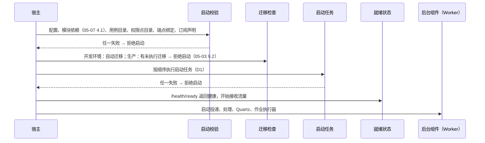
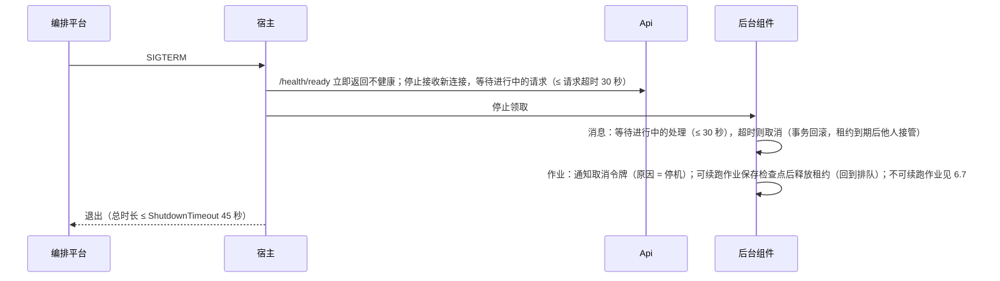
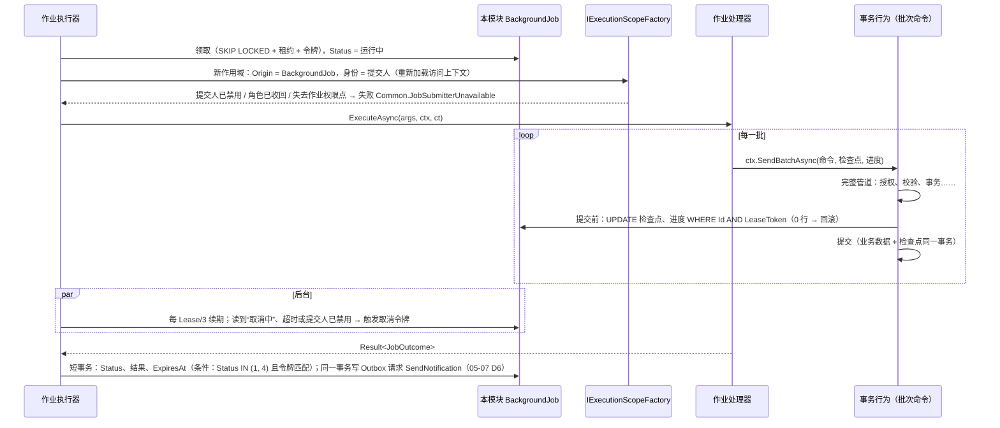

# 05-08 后台处理

- 状态：已确认（2026-11-04，D1～D8 均按建议确定）；之后的修订见文末“修订记录”
- 日期：2026-11-04
- 所在项目：`Kmic.BuildingBlocks.Application`（`IBackgroundJobs`、`IJobHandler<T>`、`IJobContext`、定时任务与启动任务的声明接口）；`Kmic.BuildingBlocks.Infrastructure`（角色装配、后台循环基类、Quartz 封装、作业执行器、清理任务、作业表映射）；`Kmic.BuildingBlocks.Presentation`（作业状态端点）；Operations 平台模块（定时任务配置、执行记录、管理端点）；宿主 `Kmic.Api`
- 依据：ADR-0005、ADR-0019、ADR-0020、ADR-0022、ADR-0025、ADR-0027、ADR-0028；03 第 7、8 节（Quartz.NET 4.x）；04 第 3、9 节；05-02 第 5、6、7 节；05-03 第 8 节；05-05 第 3.2 节；05-06 第 4.1、6 节；05-07 第 6～9 节

## 0. 范围

| 本文内容 | 相关但不在本文 |
|---|---|
| `Api` / `Worker` 角色的装配、启动顺序、启动任务 | 迁移执行（05-03 第 9 节） |
| 后台循环的通用构件：领取、租约续期、唤醒、并发、停机 | Outbox / Inbox 各自的领取规则与表结构（05-07） |
| 定时任务：声明、Quartz 集成、开关与时间配置、执行记录、错过触发 | 具体业务定时任务（随业务） |
| 后台作业：表结构、处理器写法、身份、进度、取消、中断恢复、结果 | 结果文件的存储与下载（05-11）；Excel 等文件格式（02 第 6 节按需能力） |
| 框架内置的清理任务清单 | 各表保留期限的数值（02 第 7～8 节，`待确认`） |
| 后台处理的管理端点与指标 | 告警通道与仪表盘（05-12） |

### 0.1 本文决定的分类

| 类别 | 本文中的内容 |
|---|---|
| 第一类：现在确定 | D1～D8：角色启动、作业表位置、作业处理器写法、定时任务配置等，所有模块的后台写法都依赖它们 |
| 第二类：框架定写法，业务定用不用 | 哪些操作做成后台作业（05-06 第 4.4 节已定）；作业是否声明可续跑（6.7）；导出的行数上限 |
| 第三类：延后 | 导出文件格式（Excel 等）的生成，按 02 第 6 节在第一个导出需求出现时选型，不登记（已在按需能力清单中） |

对照 00-README“延后事项”表：无命中。本文不新增延后事项。

---

## 1. 旧项目怎么做 → 新框架怎么做

| 问题 | 旧项目 | 新框架 | 章节 |
|---|---|---|---|
| 后台在哪里跑 | Hangfire 跑在 Web 进程内，`WorkerCount = CPU × 5`，与页面请求争抢资源 | 同一镜像按 `Roles` 分 `Api` / `Worker`；后台使用独立连接池 | 3、4.3 |
| 定时任务 | Hangfire 序列化方法调用；`EnableRecurringJobs` 一个总开关 | Quartz.NET 只负责触发，触发后发送模块命令；每个任务独立开关和时间，可在界面修改 | 5 |
| 执行记录 | 没有统一记录和告警 | 每次执行写记录（开始、结束、条数、结果、错误），失败计入指标 | 5.4 |
| 管理面板 | `/hangfire`，Basic 认证，账号密码写死在代码 | Operations 管理端点，复用登录和权限点 | 7 |
| 长任务 | 导出在请求线程内同步完成，大数据量时超时 | 后台作业：202 + 作业资源，进度、取消、完成通知、结果文件 | 6 |
| “顺便执行”的逻辑 | 首页加载时按日期执行一次性代码；部分超时检查靠 ashx 手动触发 | 一次性修正走迁移；周期性逻辑走定时任务；读请求不得改数据（FR-DATA-08） | 5 |
| 停机 | 无约定 | 优雅停机：停止领取、等待进行中处理、续跑型作业保存进度后释放 | 4.4 |

---

## 2. 总览

```mermaid
graph TD
    subgraph 宿主进程（同一镜像）
        ST[启动任务<br/>两个角色都执行]
        subgraph Api 角色
            EP[HTTP 端点]
        end
        subgraph Worker 角色
            OD[Outbox 投递]
            IP[Inbox 处理]
            QZ[Quartz 调度]
            JR[作业执行器]
            CL[清理任务<br/>（Quartz 触发）]
        end
    end
    M[中介者管道]
    EP --> M
    IP -->|系统身份| M
    QZ -->|系统身份| M
    JR -->|提交人身份| M
    EP -->|IBackgroundJobs.Enqueue<br/>写本模块作业表| DB[(各模块 schema)]
    JR -->|领取| DB
    QZ --- OPS[(Operations：Quartz 表<br/>任务配置与执行记录)]
```

| 组件 | 运行角色 | 触发 | 身份 | 事务 |
|---|---|---|---|---|
| 启动任务 | 两者 | 启动时一次 | 系统 | 每个任务自己的命令事务 |
| Outbox 投递、Inbox 处理 | Worker | `NOTIFY` + 兜底轮询（05-07） | 系统 | 05-07 |
| Quartz 定时任务 | Worker（调度）；Api 只能写入触发请求（5.2） | Cron | 系统 | 一个任务 = 一个命令 |
| 后台作业 | Worker | `NOTIFY` + 兜底轮询 | 提交人 | 作业处理器编排多次命令 / 查询，每次各自事务（D7） |

---

## 3. 角色与启动

### 3.1 按角色装配

`Roles` 配置（ADR-0025）在宿主启动时读取，框架的 `AddKmicHost(builder)` 按角色注册：

| 注册项 | Api | Worker |
|---|---|---|
| 模块服务（`IModule.AddServices`）、中介者、DbContext | ✓ | ✓ |
| 端点、认证、限流、OpenAPI | ✓ | — |
| 启动任务 | ✓ | ✓ |
| Outbox 投递、Inbox 处理、作业执行器 | — | ✓ |
| Quartz 调度器 | 以“只调度不执行”的待机模式注册（用于手动触发、修改时间） | 启动执行 |
| 健康检查 `/health/live`、`/health/ready` | ✓ | ✓（只跑 Worker 的实例也暴露，供编排平台判断存活；不接 HTTP 业务流量） |

- 两个角色共用同一套 `IModule` 注册（ADR-0025 第 3 条），后台组件全部是框架提供的 `BackgroundService`，模块不自行注册 `IHostedService`（架构测试检查模块程序集中没有 `IHostedService` 实现）。
- `Roles` 为空或含未知值 → 拒绝启动。

### 3.2 启动顺序



- 后台组件在启动任务**之后**才开始：例如 05-07 的订阅路由登记必须先于投递，05-05 的权限点同步必须先于请求。
- 启动任务失败时进程退出（非零退出码），由编排平台按重启策略处理；不会出现“半初始化后接收请求”。

### 3.3 启动任务

```csharp
// BuildingBlocks.Application
public interface IStartupTask
{
    string Name { get; }              // 稳定名称，如 "Identity.SyncPermissionCatalog"
    int Order { get; }                // 框架任务 < 0，模块任务 >= 0
    StartupTaskRun Run { get; }       // EveryStart（默认）
    ValueTask<Result> ExecuteAsync(CancellationToken ct);   // 内部发送 [SystemOnly] 命令
}
```

框架内置的启动任务（按顺序）：

| 顺序 | 任务 | 文档 |
|---|---|---|
| -300 | 订阅路由登记（只新增本实例声明而表中没有的订阅、处理退役声明，不删除、不比较构建号） | 05-07 第 6.3 节 |
| -200 | 权限点目录同步 | 05-05 第 3.2 节 |
| -100 | 定时任务定义同步到 Quartz（5.3） | 本文 |
| ≥ 0 | 模块的种子数据（默认字典项等，05-03 第 9.4 节） | 各模块 |

- 每个任务内部必须幂等，并用 `pg_advisory_xact_lock(hash(Name))` 保证多实例同时启动时只有一个真正执行，其余等待后发现“已是最新”直接结束（05-05 第 3.2 节已采用此写法）。
- 执行情况写 Information 日志（任务名、耗时、是否有变化），不写执行记录表（启动日志足够）。

**D1 启动任务在哪里执行**

| 选项 | 做法 | 优点 | 缺点 |
|---|---|---|---|
| **A 每个实例启动时都执行，靠咨询锁 + 内容哈希去重** | 两种角色都执行；第一个拿到锁的实例真正执行，其余实例发现哈希相同直接结束 | 不依赖部署编排；开发环境与生产行为一致；任何实例都能保证“开始服务前目录已同步” | 每次启动多几次轻量查询；滚动更新时新旧实例交替，覆盖式任务需要构建号判断，防止旧实例覆盖新数据 |
| B 只在 `Kmic.MigrationRunner` 中执行 | 迁移完成后由一次性程序同步 | 应用启动更快；运行账号不需要写目录表 | 开发环境不用 MigrationRunner（05-03 9.2），要另写一套；迁移程序需要加载全部模块的应用层程序集，失去“只做 DDL”的单纯性 |
| C 只在 Worker 角色执行 | Api 实例等待 Worker 完成 | 执行点单一 | Api 要感知 Worker 的进度；只跑 Api 的部署会卡住 |

- **决定（已确认，2026-11-04）**：A。权限点同步这类“覆盖式”任务统一遵守“构建号不低于记录值才写入”的规则，防止滚动更新时旧实例回写。订阅路由不属于覆盖式任务：它只增不自动删（05-07 第 6.3 节），新旧实例谁先登记结果都一样。
- **理由**：启动任务的结果是“本实例开始工作的前提”，由本实例自己保证最可靠。
- **取舍**：每次启动多一点开销；每个覆盖式任务都要带构建号判断。

---

## 4. 后台循环的通用构件

### 4.1 租约队列循环

Outbox 投递、Inbox 处理、作业执行器结构相同，框架提供一个基类，三者只提供“领取 SQL”和“处理一条”：

```csharp
// BuildingBlocks.Infrastructure（内部）
internal abstract class LeasedQueueWorker<TItem> : BackgroundService
{
    protected abstract string WakeChannel { get; }                         // 05-07 D8
    protected abstract Task<IReadOnlyList<TItem>> ClaimAsync(int max, Guid token, CancellationToken ct);
    protected abstract Task ProcessAsync(TItem item, Guid token, CancellationToken ct);
    protected virtual TimeSpan? LeaseRenewal => null;                       // 作业执行器启用续期
}
```

| 环节 | 做法 |
|---|---|
| 循环 | 有空闲并行槽位 → 领取（最多空闲槽位数）→ 每条在独立任务中处理；没有可领取的 → 等待 `NOTIFY` 或兜底轮询间隔 |
| 并行 | 按队列配置并行度（Inbox 每模块 4、作业执行器每实例 2，配置项）；`SemaphoreSlim` 控制 |
| 租约续期 | 长任务（作业）每 `Lease / 3` 续期一次：`UPDATE … SET LeaseUntil = … WHERE Id = @id AND LeaseToken = @token`；影响 0 行 = 已被他人接管 → 取消本地执行 |
| 数据库故障 | 领取本身失败（连接不可用）时按 1、2、4…最长 60 秒退避，记 Warning；恢复后立即领取一次 |
| 作用域 | 每条消息 / 作业通过 `IExecutionScopeFactory`（05-02 第 7.2 节）新建 DI 作用域并设置执行上下文 |
| 追踪 | 每条处理一个 Activity；有原始 `traceparent` 时以链接关联（ADR-0028 第 6 条） |
| 未处理异常 | 只影响当前一条（交给该队列的失败处理），循环本身不退出；循环外层异常记 Critical 并让宿主退出（不静默停摆） |

**结果写入的状态条件**（R02）：三种队列凡是“记录结果”的写入——完成、失败、回到排队、进度——一律带“状态仍为处理中（作业为运行中或取消中）且 `LeaseToken` 为本次令牌”的条件；影响 0 行时重新读取该行再分类（已完成 / 已被接管 / 已不存在 / 无法判定），不推断成功，也不重新执行（与 05-02 第 5.3 节、05-07 第 7.3 节同一规则）。

### 4.2 D2 后台处理是否使用独立连接池

`Roles = Api, Worker`（默认）时，后台积压的大量处理可能占满连接池，导致 HTTP 请求排队。

| 选项 | 做法 | 优点 | 缺点 |
|---|---|---|---|
| A 共用一个连接池 | 所有 DbContext 用同一个数据源 | 配置最简单 | 后台积压时 API 请求等待连接，正是 ADR-0025 想避免的“相互争抢” |
| **B 按来源使用两个数据源** | `Origin = Http` 用前台数据源；`Inbox`、`ScheduledJob`、`BackgroundJob`、`Startup` 用后台数据源。两者各有 `Maximum Pool Size`，`Application Name` 分别为 `kmic-api` / `kmic-worker` | 后台最多占用自己的上限，API 始终有连接可用；数据库侧可按 `application_name` 区分会话、定位慢查询 | 连接总数 = 两池之和，需要与 PG `max_connections` 一起规划；模块 DbContext 的连接要按执行上下文选择数据源 |
| C 只靠并行度限制 | 共用池，限制后台并行数 | 不增加配置 | 并行度与连接占用不是一一对应（作业内部还会打开查询连接），只能间接控制 |

- **决定（已确认，2026-11-04）**：B。`ModuleDbContext` 的配置在作用域创建时按 `IExecutionContext.Origin` 取对应的 `NpgsqlDataSource`（键控服务）；`ModuleCall` 沿用调用方的来源。默认上限：前台 50、后台 20（配置项，`待确认`）。
- **理由**：把 ADR-0025 的“负载隔离”落实到最容易争抢的资源上，而且只跑 Worker 的实例自然只用后台池。
- **取舍**：多一组连接配置，需要按实例数计算连接预算（运维手册列出公式：实例数 × (前台 + 后台 + 1 个 LISTEN 连接) ≤ `max_connections` − 预留）。
- **流式池**（原型 #15 D2）：Worker 另有一个流式池 `kmic-worker-stream`，只供导出的主查询使用（第 6.10 节、05-03 第 2.1 节）；上限 = 每个 Worker 实例同时运行的作业数。连接预算相应为：实例数 × (前台 + 后台 + 1 个 LISTEN 连接) + Worker 副本数 × 流式池上限 ≤ `max_connections` − 预留。
- **事务池与读池**（R01 H1）：前台、后台两个数据源各自再拆分为事务池与读池（共 4 个），避免命令持有事务连接时再借连接造成的自锁，详见 05-03 第 2.1 节；`Application Name` 相应为 `kmic-api-tx`、`kmic-api-read`、`kmic-worker-tx`、`kmic-worker-read`。各池上限为配置项（第 8 节），初始值按前台 50、后台 20 各按约 6 : 4 拆分，压测后调整（`待确认`）。

### 4.3 优雅停机



- `HostOptions.ShutdownTimeout` 默认 45 秒；容器的停止宽限期（如 `stop_grace_period`）必须大于它，建议 60 秒，写入部署模板（ADR-0022）。
- 作业的取消令牌区分“用户取消”和“停机”（`JobCancellationReason`），处理器据此决定是否保存检查点。

---

## 5. 定时任务

### 5.1 声明

定时任务 = Quartz 触发 + 一个本模块的 `[SystemOnly]` 命令（与 05-07 D9“订阅 = 事件映射为命令”同一思路）：

```csharp
// Sample.Infrastructure/SampleModule.cs
public void ConfigureScheduling(ISchedulingBuilder s)
{
    s.Schedule<SendRepairRemindersCommand>(
        "Sample.SendRepairReminders",                 // 稳定名称，本模块前缀，全局唯一
        cron: "0 0 7 * * ?",                          // 默认时间（业务时区，D5）
        run => new SendRepairRemindersCommand(run.ScheduledFireTime),
        o => o.OnMisfire(Misfire.FireOnceNow).DisplayName("维修提醒"));
}

// Sample.Application
[SystemOnly]
public sealed record SendRepairRemindersCommand(DateTimeOffset ScheduledFireTime) : ICommand<ScheduledJobOutcome>;

public sealed record ScheduledJobOutcome(int ItemsProcessed, string? Note = null);
```

| 规则 | 检查 |
|---|---|
| 名称以本模块名开头且唯一；命令属于本模块且为 `[SystemOnly]` | 启动校验 |
| 命令必须**可重复执行**：同一 `ScheduledFireTime` 执行两次结果相同（例如按“上次处理到的时间”或状态筛选，而不是“执行一次就处理一批”） | 代码评审；模板示例 |
| 一次执行是一个命令事务。处理量可能很大的任务，在命令中分批或创建系统身份的后台作业（6.3）后返回 | 代码评审；执行时长指标 |
| 默认不允许同一任务并发执行（Quartz `DisallowConcurrentExecution`） | 框架统一设置 |

### 5.2 Quartz 集成

| 项 | 做法 |
|---|---|
| 版本 | Quartz.NET 4.x 稳定版（03 第 8 节第 12 项，锁定时确认 PG 集群模式） |
| 存储 | `JobStoreTX` + PostgreSQL 委托，表在 `"Operations"` schema，表前缀 `qrtz_`；建表脚本放入 Operations 模块的迁移 |
| 集群 | `clustered = true`，实例 ID 自动生成；多实例同一触发只执行一次 |
| Quartz 作业类 | 框架只有**一个** Quartz `IJob` 实现 `CommandJob`：按 JobDataMap 中的任务名找到声明，构造命令，经 `IExecutionScopeFactory`（`Origin = ScheduledJob`，系统身份）发送 |
| Api 角色 | 注册调度器但不调用 `Start()`（待机模式），只用于手动触发和修改时间（写入共享的 Quartz 表，由 Worker 执行） |
| 模块隔离 | 模块不引用 Quartz（03 选型原则 5），只使用 `ISchedulingBuilder` |

### 5.3 D3 任务的开关与执行时间存在哪里

| 选项 | 做法 | 优点 | 缺点 |
|---|---|---|---|
| A 只在代码中 | 声明中的 Cron 即最终值 | 版本可追溯 | 改时间、临时停用都要发版；旧系统只有一个总开关的问题依旧 |
| B 只在配置文件（appsettings） | 每个任务一个配置节 | 改配置不改代码 | 仍需重新部署或重启；多实例配置可能不一致；界面无法修改 |
| **C 代码给默认值，数据库存覆盖值** | 表 `"Operations"."ScheduledJobSetting"(JobName, Enabled, Cron, UpdatedBy, UpdatedAt, ConcurrencyVersion)` 只存被修改过的项；启动任务（-100）与界面修改都把“默认值 ⊕ 覆盖值”同步到 Quartz 触发器 | 运维可在界面停用、改时间，即时生效于整个集群；未修改的任务跟随代码默认值变化；修改有审计 | 实际生效值要看两处（界面同时显示“默认 / 覆盖”）；需要同步逻辑 |

- **决定（已确认，2026-11-04）**：C。修改命令 `[RequirePermission(Operations.Jobs.Manage)]`、`[Audited]`；Cron 保存前校验合法性并显示接下来 5 次触发时间。
- **理由**：FR-JOB-02 要求独立开关，运维调整不应依赖发版；默认值留在代码里，保证新环境开箱可用。
- **取舍**：多一张表与同步步骤。
- 代码中删除的任务：同步时从 Quartz 中删除其触发器，覆盖记录保留（与 05-05 D2 权限点退役同理，回滚后配置仍在）。

### 5.4 执行记录

`"Operations"."ScheduledJobRun"`：

| 列 | 说明 |
|---|---|
| `Id` | UUID v7 |
| `JobName` | |
| `ScheduledFireTime`、`ActualFireTime` | 计划与实际触发时刻（UTC） |
| `Trigger` | `Schedule` / `Manual` / `Misfire` |
| `TriggeredBy` | 手动触发时的用户 |
| `StartedAt`、`FinishedAt`、`DurationMs` | |
| `Status` | `Running` / `Succeeded` / `Failed` / `Unknown`（提交结果未知）/ `Abandoned`（进程崩溃后由清理任务标记） |
| `ItemsProcessed`、`Note` | 来自 `ScheduledJobOutcome` |
| `ErrorCode`、`ErrorMessage` | `Result` 失败时的错误；异常时为异常类型与消息（不含堆栈，堆栈在日志） |
| `InstanceId`、`TraceId` | |

- 由 `CommandJob` 在命令前后各用一个独立短事务写入（不在命令事务中：命令回滚时失败记录仍要保留）。这与投递程序一样属于框架基础设施写入 Operations 表，不是模块越界。
- 失败（`Result` 失败或异常）记 Error 日志并计入 `kmic.scheduled_job.failures` 指标；连续失败告警见 05-12。
- 命令提交阶段发生无法判定结果的异常（05-02 第 6.1 节）时，执行记录标为 `Unknown`，不标为 `Failed`，并告警。定时任务命令按要求可重复执行（06 第 14 节评审清单），运维核实后可以手动补跑。

### 5.5 D4 执行中进程崩溃怎么办

| 选项 | 做法 | 优点 | 缺点 |
|---|---|---|---|
| **A 不自动恢复，等下次触发；运维可手动触发** | Quartz `RequestsRecovery = false`；崩溃的那次执行由清理任务标记 `Abandoned` | 行为简单可预测；命令事务未提交即无副作用 | 每日任务崩溃后要等一天，除非人工补跑 |
| B 自动恢复 | `RequestsRecovery = true`，集群中其他实例接管重跑 | 不需要人工 | 依赖“可重复执行”被每个任务正确实现；崩溃若由任务本身引起（内存耗尽），会在其他实例上反复崩溃 |

- **决定（已确认，2026-11-04）**：A，配合 `Abandoned` 记录告警和“立即执行”按钮。
- **理由**：一次执行是一个命令事务，崩溃 = 未提交 = 没有副作用，等下次或人工补跑都是安全的；自动恢复的收益不足以抵消“连锁崩溃”的风险。
- **取舍**：低频任务崩溃后需要人工补跑。
- 错过触发（实例全部停机期间应触发的）：按声明的 `Misfire` 策略：`FireOnceNow`（默认，补一次）或 `Skip`；不提供“全部补跑”。

### 5.6 D5 Cron 表达式按什么时区

| 选项 | 优点 | 缺点 |
|---|---|---|
| A UTC | 与存储一致 | 业务说“每天早上 7 点”要换算成 `23:00 前一天`，易错 |
| **B 业务时区（05-13 的 `BusinessTimeZone`，默认 `Asia/Shanghai`）** | 与业务口径一致，界面显示与配置所见即所得 | 依赖时区配置；如果将来业务时区有夏令时，需要考虑重复 / 跳过的时刻 |

- **决定（已确认，2026-11-04）**：B。所有触发器统一设置 `InTimeZone(BusinessTimeZone)`；传给命令的 `ScheduledFireTime` 仍是 UTC 时刻，命令内需要“业务日期”时用 05-13 的换算方法。
- **取舍**：`Asia/Shanghai` 无夏令时，当前没有歧义时刻问题；如果业务时区改为有夏令时的地区，需要复核。

### 5.7 框架内置的定时任务

| 任务 | 默认时间 | 内容 | 来源 |
|---|---|---|---|
| `Framework.PurgeIdempotency` | 每小时 | 删除各模块 `ExpiresAt` 已过的幂等记录 | 05-02 第 5.2 节 |
| `Framework.PurgeMessages` | 每日 03:00 | 按 05-07 第 9.2 节的保留契约清理：已投递的 Outbox 行按补投窗口删除；Inbox 的去重凭证只在来源 Outbox 行已删除之后才删除（不是两张表各自按天数删除） | 05-07 |
| `Framework.PurgeJobs` | 每日 03:10 | 删除过期的作业记录，并请求删除其结果文件（6.8） | 本文 |
| `Framework.PurgeScheduledJobRuns` | 每日 03:20 | 删除过期的执行记录；把 `Running` 超过 24 小时的标记为 `Abandoned` | 本文 |
| `Identity.PurgeSessions` | 每日 03:30 | 删除过期或作废 30 天以上的会话与刷新令牌 | 05-04 第 3 节 |
| `Identity.PurgeRetiredPermissions` | 每周 | 删除退役超过 180 天的权限点及其角色关联 | 05-05 D2 |

- 框架任务遍历各模块的框架表，通过各模块的框架存储接口执行（同 05-07 第 9.1 节的 `IModuleMessageStore` 写法），每次按 5000 行分批删除、批间让出，避免长事务与锁表。
- 保留期全部为配置项，数值 `待确认`（02 第 7～8 节）。

---

## 6. 后台作业

### 6.1 D6 作业表放在哪里

04 第 9 节和 ADR-0027 写的是“作业表在 Operations”。细化时发现一个问题：提交作业的命令（如“开始导入”）通常也要写本模块的数据，作业行若在 Operations，就是一个事务写两个模块（违反 ADR-0006 第 4 条），或者分两次写而失去原子性。

| 选项 | 做法 | 优点 | 缺点 |
|---|---|---|---|
| A 集中在 Operations，提交时同一事务跨 schema 写入 | 作为框架例外 | 作业集中，查询“我的任务”简单 | 破坏“一个事务一个模块”，以后拆服务时无法保持 |
| B 集中在 Operations，提交后另写 | 先提交业务，再写作业行（或经 Outbox 请求 Operations 创建） | 遵守边界 | 业务成功、作业丢失或延迟出现；202 返回时作业可能还不存在 |
| **C 模块内框架表 `"{模块}"."BackgroundJob"`，Operations 只做汇总视图** | 与幂等、Outbox 一样由 `ApplyFrameworkTables()` 映射；作业执行器按模块领取；Operations 通过各模块的 `IModuleJobStore` 汇总“我的任务”和管理列表 | 提交与业务数据同一事务；作业中每一批的提交与检查点也能同一事务（6.4）；拆服务时作业随模块迁走 | “我的任务”要遍历各模块查询（按 `SubmittedBy` 索引，模块数十几个，开销可接受）；ADR-0027 与 04 第 9 节的表述需要修订 |

- **决定（已确认，2026-11-04）**：C；ADR-0027 与 04 第 7.2、9、10.1 节已同步。
- **理由**：作业是模块业务流程的一部分，与 Outbox 同理应与业务数据同事务；C 还让 6.4 的“批次提交 + 检查点”原子化成为可能，这是可续跑作业正确性的基础。
- **取舍**：跨模块列表变成汇总查询；修订一处已确认的表述。

表结构：

| 列 | 类型 | 说明 |
|---|---|---|
| `Id` | `uuid` PK | 作业 ID，UUID v7 |
| `JobType` | `varchar(200)` | 稳定名称，如 `Sample.ImportSamples`（同 05-07 D4） |
| `SchemaVersion` | `int` | |
| `Args` | `jsonb` | 作业参数，消息序列化选项（允许未知字段，05-07 第 5.5 节） |
| `SubmittedBy`、`SubmittedRoleId`、`ActualUserId` | `uuid` null | 提交人、提交时的当前角色、模拟时的实际操作人；系统提交时为空 |
| `SubmittedAt` | `timestamptz` | |
| `Status` | `smallint` | 0 排队 / 1 运行中 / 2 成功 / 3 失败 / 4 取消中 / 5 已取消 |
| `ProgressDone`、`ProgressTotal` | `bigint`、`bigint` null | |
| `ProgressMessage` | `varchar(500)` null | |
| `Checkpoint` | `jsonb` null | 可续跑作业的进度点（6.7） |
| `ResultFileId` | `uuid` null | 结果文件（05-11） |
| `ResultSummary` | `jsonb` null | 如“成功 980 条，失败 20 条” |
| `ErrorCode`、`ErrorMessage` | | 失败原因（错误码与 05-06 一致） |
| `Attempts`、`LeaseToken`、`LeaseUntil` | | 领取与续期 |
| `StartedAt`、`FinishedAt` | | |
| `CancelRequestedAt`、`CancelRequestedBy` | | |
| `ExpiresAt` | `timestamptz` null | 完成后开始计算，到期由清理任务删除 |

- 索引：`(LeaseUntil) WHERE Status IN (0, 1, 4)`（领取）；`(SubmittedBy, SubmittedAt DESC)`（我的任务）。
- 领取：与 Inbox 相同的 `SKIP LOCKED` + 租约 + 令牌；条件为 `Status = 0`，或 `Status IN (1, 4) AND LeaseUntil < now`（执行者已失联）。

### 6.2 D7 作业处理器怎么写

后台作业与定时任务不同：一个导入作业要分很多批提交，一个导出作业只读不写，都无法放进单个命令事务。

| 选项 | 做法 | 优点 | 缺点 |
|---|---|---|---|
| A 作业 = 一个命令 | 执行器发送一个命令，整个作业一个事务 | 与定时任务、订阅写法一致 | 大导入变成长事务（锁、膨胀、超时）；导出是查询不是命令；无法报告进度或分批续跑 |
| **B 作业处理器编排查询与命令** | `IJobHandler<TJob>` 不在事务中；它通过 `ISender` 发送查询和命令，每个命令照常经过完整管道、各自一个事务；框架提供进度、检查点、取消 | 分批提交、进度、取消、续跑都自然；每批的授权、校验、审计与普通请求完全一致 | 处理器本身不是中介者消息，需要单独的执行器和授权约定（6.5） |

- **决定（已确认，2026-11-04）**：B。
- **理由**：长任务的本质是“很多次普通操作 + 进度管理”，让每次操作走普通管道，长任务就不需要任何特殊的业务规则通道。
- **取舍**：多一个“作业处理器”概念；处理器内的多次提交不是原子的（取消或失败时已完成的批次保留，这是长任务的固有语义，界面上需要明示）。

```csharp
// BuildingBlocks.Application
public interface IBackgroundJob;                                   // 作业参数标记

[AttributeUsage(AttributeTargets.Class)]
public sealed class BackgroundJobAttribute(string name) : Attribute
{
    public string Name { get; } = name;
    public int Version { get; init; } = 1;
    public string Permission { get; init; } = "";                  // 提交与执行时都检查（6.5）
    public bool SystemOnly { get; init; }                          // 只能由系统身份提交，不需要权限点
    public bool Resumable { get; init; }                           // D8
    public int MaxConcurrentPerUser { get; init; } = 3;            // 6.9
}

public interface IJobHandler<in TJob> where TJob : IBackgroundJob
{
    Task<Result<JobOutcome>> ExecuteAsync(TJob job, IJobContext ctx, CancellationToken ct);
}

public interface IJobContext
{
    Guid JobId { get; }
    T? GetCheckpoint<T>();
    ValueTask ReportProgressAsync(long done, long? total = null, string? message = null);
    // 发送一个命令，并让“命令的业务数据 + 新检查点 + 进度”在同一事务提交（6.4）
    ValueTask<Result<TResponse>> SendBatchAsync<TResponse>(ICommand<TResponse> command, object checkpoint, long done);
    JobCancellationReason? CancellationReason { get; }
}

public sealed record JobOutcome(Guid? ResultFileId = null, object? Summary = null);
```

```csharp
// Sample.Application —— 导入作业示例
[BackgroundJob("Sample.ImportSamples", Permission = SamplePermissions.Import, Resumable = true)]
public sealed record ImportSamples(Guid SourceFileId) : IBackgroundJob;

internal sealed class ImportSamplesHandler(IQuerySender queries, IFileReader files) : IJobHandler<ImportSamples>
{
    public async Task<Result<JobOutcome>> ExecuteAsync(ImportSamples job, IJobContext ctx, CancellationToken ct)
    {
        var from = ctx.GetCheckpoint<ImportCheckpoint>()?.NextRow ?? 0;
        await foreach (var batch in ReadBatches(job.SourceFileId, from, size: 200, ct))
        {
            ct.ThrowIfCancellationRequested();
            var r = await ctx.SendBatchAsync(new ImportSampleBatchCommand(batch.Rows), new ImportCheckpoint(batch.NextRow), batch.NextRow);
            if (r.IsFailure) return r.Error;
        }
        return new JobOutcome(Summary: …);
    }
}
```

- 启动校验：每个 `IBackgroundJob` 有且仅有一个处理器，在同一模块；名称以本模块开头、唯一；`Permission` 必须是已声明的权限点（系统专用作业可写 `SystemOnly = true` 代替）。
- 处理器不得注入 DbContext、仓储（架构测试），只能通过 `ISender` 和文件读写抽象工作——它是编排者，不是数据访问者。

### 6.3 提交

```csharp
// 提交作业的命令：普通命令，权限点与作业相同，标 [Idempotent]
[RequirePermission(SamplePermissions.Import), Idempotent]
public sealed record StartSampleImportCommand(Guid SourceFileId) : ICommand<Guid>;

public sealed class StartSampleImportCommandHandler(IBackgroundJobs jobs) : ICommandHandler<StartSampleImportCommand, Guid>
{
    public ValueTask<Result<Guid>> Handle(StartSampleImportCommand command, CancellationToken cancellationToken)
        => ValueTask.FromResult(jobs.Enqueue(new ImportSamples(command.SourceFileId)));   // 返回 Result<Guid>：超出并发限额时失败
}

// 端点
group.MapPost("/samples/imports", …).Sends<StartSampleImportCommand>();   // result.ToAccepted(id => $"/api/v1/sample/jobs/{id}")
```

- `IBackgroundJobs.Enqueue` 把作业行加入本模块 DbContext，随命令事务提交，提交时 `pg_notify('kmic_jobs', '<模块>')`；命令失败则作业不存在。
- 提交人、当前角色、实际操作人取自执行上下文；系统身份（定时任务、事件处理）中提交的作业以系统身份执行。
- 幂等由提交命令的 `[Idempotent]` 保证：重复点击返回同一个作业 ID。

- 可见性：命令处理器为 `public sealed`（05-02 第 2.2 节）；作业处理器 `IJobHandler<T>` 不经 Mediator 生成的代码，为 `internal sealed`。

### 6.4 执行流程



- `SendBatchAsync` 的检查点写入与 05-07 的“标记 Inbox 已处理”是事务行为中的同一类步骤：执行上下文携带“当前作业行 + 令牌 + 待写检查点”，事务行为在 `SaveChanges` 前更新作业行。只有作业表在本模块 schema（D6 = C）时才能这样做。
- 处理器也可以只用 `ReportProgress`（导出这类只读作业）：进度以节流方式（最多每秒一次）独立写入，不与业务事务绑定。
- 处理器返回失败 `Result` → `Status = 失败`，错误码与消息写入作业行；未处理异常 → 失败，`ErrorCode = Common.JobFailed`，详细信息只在日志中（按 traceId 查）。

**作业结果写入的状态条件**（R02）

- 完成写入（`Status`、结果、`ExpiresAt` 及同一事务中的 `SendNotification`）只作用于 `Status IN (1, 4) AND LeaseToken = 本次令牌` 的行；`ReportProgress` 的独立写入同样带令牌条件。不带条件会出错：租约被接管的旧执行者恢复后，可能把新执行者正在运行的作业改为失败，或重复发送完成通知。
- 影响 0 行时本地停止，不再写任何结果。已被接管和已是终态两种情况处理相同，所以不再重新读取作业行区分；其余情况留给租约到期后的正常处理。
- `SendBatchAsync` 提交结果未知时，执行器**不在进程内重试本批**：停止执行、停止续期，由领取流程按第 6.7 节处理（可续跑的从检查点续跑，其余标记 `Common.JobInterrupted`，提示最后一批的提交结果未知、已提交的批次保留）。不会重复的原因：未结束的批次事务持有作业行的锁，领取语句的 `SKIP LOCKED` 会跳过它，所以它结束之前作业不会被接管；续跑时读到的检查点就是它最终的结果。

### 6.5 身份与授权

| 环节 | 规则 |
|---|---|
| 提交 | 提交命令自身的 `[RequirePermission]`，与作业的 `Permission` 必须相同（启动校验） |
| 开始执行 | 重新加载提交人在**提交时角色**下的访问上下文（05-02 第 7.2 节，`IAccessContextLoader.LoadForJobAsync(用户, 角色)`，不需要会话）；用户已禁用、角色已收回、或该角色已不含作业权限点 → 失败 |
| 执行中 | 每个查询、命令照常授权与套用数据范围；导出因此只会包含提交人有权看到的数据 |
| 模拟身份 | 只读模拟会话不能提交作业（提交命令被拒，05-04 D7）；可写模拟时记录实际操作人 |
| 查看与取消 | 提交人本人；或具有 `Operations.Jobs.View` / `Operations.Jobs.Manage` 的管理员。其他人访问返回 404（不泄露存在性） |
| 授权版本变化 | 执行中不重新加载（一个作业内权限保持一致）；超过 1 小时（配置项）的作业每次续期时检查用户是否被禁用（`LoadForJobAsync` 返回空即视为禁用，不比较权限），禁用则取消，作业失败 `Common.JobSubmitterUnavailable` |

### 6.6 进度、状态查询与取消

框架在每个模块的路由组下注册作业端点（`BuildingBlocks.Presentation`）：

| 端点 | 说明 |
|---|---|
| `GET /api/v1/{模块}/jobs/{id}` | 状态、进度、结果摘要、结果文件下载地址（05-11）、错误 |
| `POST /api/v1/{模块}/jobs/{id}/cancel` | 请求取消：排队中 → 直接“已取消”；运行中 → “取消中”，执行器在下次续期时触发取消令牌 |
| `GET /api/v1/operations/my-jobs` | Operations 汇总当前用户在各模块的作业（D6） |

```json
{ "id": "0192f…", "type": "Sample.ImportSamples", "status": "running",
  "progress": { "done": 1200, "total": 5000, "message": "正在导入第 1200 行" },
  "submittedAt": "2026-11-04T02:00:00Z", "startedAt": "…", "finishedAt": null,
  "result": null, "error": null }
```

- 前端轮询间隔建议 2 秒，完成后停止；完成时另有站内通知（6.8），实时推送依赖 SignalR 的待决事项（ADR-0020）。
- **取消不是回滚**：已提交的批次保留，`ResultSummary` 说明已处理多少；需要“全有或全无”的操作不应设计成后台作业。

### 6.7 D8 作业中断（进程崩溃、停机）后怎么办

| 选项 | 做法 | 优点 | 缺点 |
|---|---|---|---|
| A 一律重新执行 | 租约过期后其他实例重新领取并从头执行 | 用户无感 | 不可重入的处理器（例如无检查点的导入）会重复处理 |
| B 一律标记失败 | 用户重新提交 | 安全 | 每次部署（停机）都会打断进行中的长作业，用户体验差 |
| **C 按作业声明：`Resumable = true` 的从检查点续跑，其余标记失败** | 续跑型作业的检查点与批次同事务提交（6.4），续跑不会重复；未声明的作业失败，错误码 `Common.JobInterrupted`，提示重新提交 | 默认安全；长作业可以通过正确实现检查点获得续跑能力 | 处理器作者要判断并正确实现检查点；只读导出若不声明续跑，被中断后需重新提交 |

- **决定（已确认，2026-11-04）**：C。续跑最多 3 次（配置项）；导出这类只读作业可声明 `Resumable = true` 且不使用检查点（从头重做也无副作用）。
- **理由**：是否可以重做只有处理器作者知道，框架不能替他假设；默认失败保证“不重复处理”，显式声明才换取续跑。
- **取舍**：未声明续跑的作业在部署时可能被中断；部署窗口可以通过“停止领取新作业后等待”缓解（4.3）。

### 6.8 完成通知与结果文件

- 完成（成功、失败、取消）时，执行器在更新作业行的同一事务中向 Outbox 写入 `SendNotification`（站内消息，提交人）——只有作业表在本模块时才能同事务（D6）。
- 结果文件通过文件抽象写入 Files 模块（05-11），作业行保存 `ResultFileId`；下载复用 Files 的授权（只有提交人和管理员）。
- 结果保留：完成后 7 天（配置项，`待确认`）；到期由 `Framework.PurgeJobs` 删除作业行，并发送请求让 Files 删除文件。

### 6.9 限额

| 限额 | 默认 | 超出时 |
|---|---|---|
| 每个用户、每种作业同时排队或运行的数量 | 3（`[BackgroundJob(MaxConcurrentPerUser)]`） | 提交失败 409 `Common.TooManyJobs` |
| 每个 Worker 实例同时运行的作业数 | 2（配置项） | 排队 |
| 单个作业的最长运行时间 | 2 小时（配置项），按数据库时钟从第一次开始算起，续跑不重新计时 | 取消，原因“超时”；作业失败 `Common.JobTimedOut`，可续跑的也不续跑（续跑后马上又超时） |

### 6.10 导出约定

导出是最常见的后台作业，框架只提供与格式无关的部分（格式生成属于 02 第 6 节按需能力）：

- 导出作业参数 = 列表查询的筛选与排序（05-06 第 6 节），保证“导出 = 当前列表的全部页”。
- 列表查询处理器把“构建 `IQueryable`”拆为可复用的方法，导出处理器用同一方法，经框架的导出入口在流式池上流式读取，不分页加载全部数据到内存；导出期间的字典等辅助查询照常走读池（第 4.2 节）。
- 行数上限默认 100,000（配置项）；超出时作业失败并提示缩小筛选范围。
- 导出操作写审计事件（ADR-0018，05-09），记录筛选条件与行数——对应旧系统的导出日志。

---

## 7. 管理与监控

### 7.1 管理端点（Operations 模块）

| 功能 | 权限点 |
|---|---|
| 定时任务列表：名称、默认 / 覆盖的开关与时间、下次触发、最近一次结果 | `Operations.Jobs.View` |
| 停用 / 启用、修改 Cron、恢复默认、立即执行 | `Operations.Jobs.Manage`（`[Audited]`） |
| 执行记录查询 | `Operations.Jobs.View` |
| 全部后台作业（按模块、类型、状态、提交人筛选）、取消 | `Operations.Jobs.View` / `Operations.Jobs.Manage` |
| 消息积压与死信 | 05-07 第 9.1 节 |

### 7.2 指标

| 指标 | 维度 | 告警建议 |
|---|---|---|
| `kmic.scheduled_job.duration` / `failures` | 任务 | 连续 2 次失败；出现 `Abandoned` |
| `kmic.scheduled_job.last_success_age_seconds` | 任务 | 超过 2 个周期未成功（发现“任务被停用后忘了恢复”或调度停摆） |
| `kmic.background_job.queued` / `oldest_queued_seconds` | 模块、类型 | 最老排队 > 10 分钟（`待确认`） |
| `kmic.background_job.duration` / `failures` | 类型、结果 | — |
| `kmic.db.pool.in_use` | 数据源（api / worker） | 前台池使用率 > 80% |

- 与 05-07 的积压指标一起，用于发现“没有实例在跑 Worker”（ADR-0025 第 5 条）。

---

## 8. 配置项汇总

| 配置 | 默认值 |
|---|---|
| `Roles` | `Api,Worker` |
| `Database:Api:TxMaxPoolSize` / `Database:Api:ReadMaxPoolSize` | 合计 50，按约 6 : 4 拆分（`待确认`） |
| `Database:Worker:TxMaxPoolSize` / `Database:Worker:ReadMaxPoolSize` | 合计 20，按约 6 : 4 拆分（`待确认`） |
| `Database:Worker:StreamMaxPoolSize` | 与 `Jobs:Parallelism` 相同（2） |
| `Host:ShutdownTimeoutSeconds` | 45 |
| `Jobs:Parallelism` / `LeaseSeconds` / `MaxRunMinutes` / `MaxResumeAttempts` | 2 / 120 / 120 / 3 |
| `Jobs:ResultRetentionDays` / `ExportMaxRows` | 7 / 100000（`待确认`） |
| `Scheduling:BusinessTimeZone` | 引用 05-13 的业务时区配置 |
| 清理任务的保留期 | 见 5.7，`待确认` |

---

## 9. 测试要点

**框架自身**（Testcontainers + 真实 PG）：

| 对象 | 必测场景 |
|---|---|
| 角色 | 只 Api：无后台组件、Quartz 待机；只 Worker：无端点；`Roles` 为空拒绝启动；模块注册 `IHostedService` 被架构测试拦截 |
| 启动顺序 | 启动任务失败 → 进程退出、就绪检查从未通过；后台组件在启动任务完成后才开始；两个实例同时启动只有一个执行同步 |
| 循环基类 | 并行度上限；领取失败退避后恢复；单条异常不影响循环；续期失败触发本地取消 |
| 连接池（D2） | 后台积压占满后台池时，HTTP 请求仍能获得连接；`application_name` 正确 |
| 停机 | 停机时不再领取；进行中的消息在超时内完成；续跑型作业保存检查点并回到排队；不可续跑作业标记 `JobInterrupted` |
| 定时任务 | 集群中同一触发只执行一次；执行记录写入且命令回滚时失败记录保留；覆盖值生效与恢复默认；代码删除任务后触发器移除、覆盖记录保留；`Misfire` 策略；业务时区触发时刻正确（`FakeTimeProvider` + Quartz 测试调度） |
| 作业 | 提交与业务同事务（命令失败无作业）；提交人被禁用后作业失败；导出只含提交人范围内的数据；`SendBatchAsync` 业务数据与检查点同事务；租约被接管后批次提交被拒；续跑从检查点继续且不重复；取消：排队中直接取消、运行中在批次边界停止；超限 409；完成通知写入 Outbox；他人查询返回 404 |
| 清理 | 分批删除；只删过期数据；`Running` 超时标记 `Abandoned`；`Framework.PurgeMessages` 不删除来源 Outbox 行仍存在的 Inbox 去重凭证 |
| 结果写入 | 租约被接管的旧执行者完成时写入被拒、不发送重复通知；进度写入带令牌条件 |
| 批次提交结果未知（原型 #16） | 批次提交时断开连接 → 执行器停止、不在进程内重试 → 旧事务持锁期间作业不被接管 → 续跑从最终检查点开始，本批不重复 |
| 定时任务：结果未知 | 提交结果未知时执行记录为 `Unknown` 并告警 |

**测试工具**（`BuildingBlocks.Testing`）：`JobHarness.RunToCompletion(jobId)` 在测试进程内同步执行作业；`SchedulerHarness.Fire("Sample.SendRepairReminders", at)` 直接触发定时任务命令。

**业务模块**（模板生成）：每个定时任务一个“触发 → 断言结果 → 再次触发结果不变（可重复执行）”的测试；每个后台作业一个完整执行测试，声明 `Resumable` 的再加一个“中途中断后续跑”测试。

---

## 10. 与其他文档的接口

| 本文提供 / 需要 | 对方 |
|---|---|
| `LeasedQueueWorker`、停机流程、后台连接池 | 05-07 投递与 Inbox 处理 |
| 事务行为中写作业检查点的步骤（与 Inbox 标记同类）；结果写入的状态条件、提交结果未知 | 05-02 第 5.3、6.1 节 |
| `Origin` → 数据源选择 | 05-02 第 7.2 节、05-03 第 2.1、8 节 |
| `BackgroundJob` 作为模块内框架表 | 05-03 第 8 节 |
| 清理任务：幂等记录、会话、退役权限点、消息（保留契约） | 05-02、05-04、05-05、05-07 第 9.2 节 |
| 启动任务顺序：路由登记、权限点同步 | 05-07 第 6.3 节、05-05 第 3.2 节 |
| 202 + 作业端点、导出复用列表查询 | 05-06 第 4.1、6 节 |
| 导出审计 | 05-09 |
| 结果文件、完成通知（`SendNotification`） | 05-11 |
| 指标、告警、`application_name` | 05-12 |
| 业务时区、`TimeProvider` | 05-13 |
| D6：Operations 职责为“作业汇总视图” | ADR-0027、04 第 7.2、9、10.1 节 |
| 停止宽限期 > `ShutdownTimeout` | ADR-0022、部署模板 |

---

## 11. 决策汇总

| 编号 | 事项 | 决定（均已确认，2026-11-04） |
|---|---|---|
| D1 | 启动任务在哪里执行 | 每个实例启动时执行，咨询锁 + 内容哈希去重，覆盖式任务带构建号判断 |
| D2 | 后台处理是否使用独立连接池 | 按来源分前台 / 后台，各自再分事务池与读池（共 4 个数据源），各自上限 |
| D3 | 定时任务开关与时间存在哪里 | 代码默认值 + 数据库覆盖值，界面可改，修改审计 |
| D4 | 定时任务执行中崩溃 | 不自动恢复，标记 `Abandoned` 并告警，可手动补跑；提交结果未知时标记 `Unknown`（5.4） |
| D5 | Cron 时区 | 业务时区 |
| D6 | 后台作业表位置 | 模块内框架表，Operations 只做汇总视图 |
| D7 | 作业处理器写法 | 处理器编排查询与命令，每批各自事务，`SendBatchAsync` 让批次与检查点同事务；批次提交结果未知时不在进程内重试（6.4） |
| D8 | 作业中断后 | 声明 `Resumable` 的从检查点续跑（最多 3 次），其余标记失败 |

| 待确认 | 处理方式 |
|---|---|
| Quartz.NET 4.x 的 PG 集群模式、待机调度器写入触发的行为 | 版本已锁定（`docs/implementation/S0-04-版本与许可.md`）；集群模式在阶段 2～3 实现定时任务时验证（实施待办 T-15） |
| 连接池上限、各保留期、告警阈值 | 随 02 第 7～8 节性能与保留期限一起确认 |
| 按执行上下文为 DbContext 选择数据源的实现方式（作用域内 Origin 已确定后再解析 DbContext） | 阶段 2 实现上下文基类时验证 |

---

## 12. 修订记录

| 日期 | 内容 | 来源 |
|---|---|---|
| 2026-11-04 | D2：前台、后台数据源各自再拆分为事务池与读池，配置项相应拆分 | R01 H1 |
| 2026-11-05 | 第 4.1、6.4 节结果写入的状态条件；第 5.4 节执行记录增加 `Unknown`；第 5.7 节 `Framework.PurgeMessages` 按保留契约清理；第 6.4 节批次提交结果未知时不在进程内重试；第 9 节相应测试。D4、D7 不变 | R02 |
| 2026-11-06 | 第 6.3 节：示例中的命令处理器改为 `public sealed` | 原型 #1 D1 |
| 2026-11-10 | 文档整合：以上补充说明并入正文，决定不变。修正：第 3.2、3.3 节与 D1 仍写“订阅路由替换（按构建号）”，与 05-07 第 6.3 节随 R02 修订后的“只增不自动删、不比较构建号”不一致，改为“订阅路由登记”；第 8 节连接池配置项按 D2 的四个池列出 | R01 L2（S0-08） |
| 2026-11-10 | D2：Worker 的流式池与连接预算；第 6.10 节：导出主查询经框架入口在流式池上执行；第 8 节配置项 | 原型 #15 D2 |
| 2026-11-11 | 示例中处理器的参数名改为 `command` / `query` / `cancellationToken`：Mediator 接口规定了参数名，写成 `cmd`、`q`、`ct` 会触发 CA1725 编译不过（决定不变，06 第 4.2 节已补充这条例外） | 注释与风格复查 |
| 2026-11-11 | 实现时补全（决定不变）：第 3.3 节启动任务由 `AddKmicStartupTasks()` 注册，在宿主启动阶段执行，失败时宿主启动失败；`StartupTaskRun` 目前只有“每次启动”一种，接口暂不带这个属性；名称以 `Framework.` 开头的顺序必须小于 0，其余从 0 开始 | S2-08 实现 |
| 2026-11-11 | 实现时补全（决定不变）：第 6.3 节提交改为 `EnqueueAsync`（要查同时运行的数量，需要访问数据库）；第 6.5 节“提交命令的权限点与作业相同”无法在启动时静态核对（不知道哪个命令提交哪个作业），改为提交时按作业的权限点再检查一次；作业只能由所在模块的命令提交（只有这个模块的写入上下文会被保存），违反时抛异常 | S2-08 实现 |
| 2026-11-11 | 实现时补全（决定不变）：第 6.4 节续期读取作业状态发现取消；结果写入影响 0 行时不再重新读取作业行；第 6.5 节加载接口为 `IAccessContextLoader.LoadForJobAsync`，长作业的提交人检查只看人还在不在；第 6.9 节超时按数据库时钟计算，超时的作业直接失败（`Common.JobTimedOut`），不按 6.7 续跑 | S2-08 实现 |
| 2026-11-11 | 实现时补全（决定不变）：第 5.1 节模块声明经 `AddKmicScheduling(模块, s => s.Schedule(...))` 登记（`IModule.ConfigureScheduling` 随宿主 S2-14 接上），校验名称前缀、命令属于本模块且为 `[SystemOnly]`、Cron 能解析、名称不重复；第 5.2 节 Quartz 4.x 的依赖注入、宿主集成、System.Text.Json 序列化已并入 Quartz 包，只引用这一个包；连接取后台事务池，作业数据按字符串存；Quartz 表用 Quartz 自带的 PostgreSQL 建表语句（全部 IF NOT EXISTS），Operations 的迁移原样写入；`AddKmicScheduler()` 两种角色都调用（调度器待机），`AddKmicSchedulerWorker()` 只在 Worker 调用；调度器用容器里的 `TimeProvider`；第 5.3 节同步是启动任务 `Framework.SyncSchedules`（-100），用会话级咨询锁排队，逐项比较后只改有差异的，不另存内容哈希；作业上记录最后同步它的构建，版本号更低的实例不覆盖、不删除（读不出版本号的不比较）；停用 = 去掉触发器、保留作业，仍可手动执行；覆盖的 Cron 写错时用默认值并记警告；第 5.4 节 `Status`、`Trigger` 存为 smallint，实际触发比计划晚超过 1 分钟（调度器的错过阈值）记为 `Misfire`，本实例没有声明的任务被触发时跳过并记警告、不写记录；第 9 节测试工具为 `SchedulerHarness.FireAsync(名称, 计划时刻)`。实施待办 T-15 已在本机 PG 18 上验证 | S2-08 实现 |
| 2026-11-11 | 实现时补全（决定不变）：第 5.7 节框架自带的清理任务不是命令（要遍历所有模块的框架表、每批一个短事务，不属于某个模块），作为“框架任务”和模块的定时任务一样调度、写执行记录、可停用改时间，名称以 `Framework.` 开头；`Framework.PurgeMessages` 先删过了补投窗口的已投递 Outbox 行，再删来源行已不存在的 Inbox 已处理行（来源模块不在本实例的不删）；`Framework.PurgeJobs` 暂不删带结果文件的作业记录，等 Files 模块能删文件后再一起删；`Framework.PurgeScheduledJobRuns` 的执行记录保留期暂定 30 天。保留期都是 `Kmic:Purge` 下的配置项，具体天数仍 `待确认`。为清理加了两个部分索引：Inbox 的 `ReceivedAt`（只含已处理）、BackgroundJob 的 `ExpiresAt`（只含已结束） | S2-08 实现 |
| 2026-11-11 | 实现时补全（决定不变）：第 3.1 节后台部分由 `AddKmicBackgroundProcessing(角色)` 注册（`AddKmicHost` 随宿主 S2-14 调用它），角色配置为 `Kmic:Roles`，为空或有不认识的值时拒绝启动；只做 Api 的实例不建流式池；第 4.3 节停机总时长 45 秒由宿主设到 `HostOptions.ShutdownTimeout`（S2-14）；第 6.10 节导出入口为 `IExportReader<TQueryDb>.ReadAsync(构建查询, 逐行写出)`，在流式池上单独建查询上下文（不带查询重试），只能在后台作业里用，超过行数上限（`Kmic:Jobs:ExportMaxRows`，默认 100000）返回 `Common.ExportTooLarge`；导出的审计事件随审计实现（S2-09）补上 | S2-08 实现 |
| 2026-11-12 | 实现时补全（决定不变）：第 6 节的作业除模块声明的以外，还有框架自己的作业 `BuildingBlocks.RebuildReadModel`（读模型重建，05-07 第 8.3 节）：作业参数在 Application，处理器在 Infrastructure，作业目录里它没有“同模块处理器”的要求，作业行写在订阅方模块自己的作业表里，由启动任务排队，不经过 `IBackgroundJobs.Enqueue`；框架作业的批次不走命令管道，由框架在同一个事务里写入并保存检查点（被接管、提交结果未知的处理与命令批次一致） | S2-08 第六部分 |
