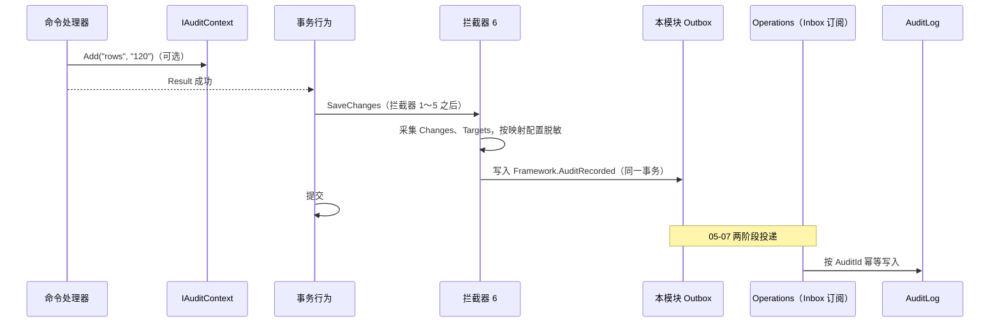

# 05-09 审计与业务历史

- 状态：已确认（2026-11-04，D1～D7 均按建议确定；D8 经讨论改为“现在不分区，登记延后”）
- 日期：2026-11-04
- 所在项目：`Kmic.BuildingBlocks.Contracts`（框架消息 `Framework.AuditRecorded`）；`Kmic.BuildingBlocks.Application`（`[Audited]`、`[NotAudited]`、`[AuditedRead]`、`IAuditContext`、`ISecurityEventWriter`、`IStateHistoryQuery`）；`Kmic.BuildingBlocks.Infrastructure`（拦截器 4 业务历史、拦截器 6 审计事件、变更采集与脱敏、安全事件批量写入器、历史表映射约定）；Operations 平台模块（审计汇总与查询）；Identity 平台模块（安全事件表与查询）
- 依据：ADR-0011、ADR-0012、ADR-0015、ADR-0016、ADR-0018、ADR-0027、ADR-0029；04 第 7.2 节；05-01 第 7 节；05-02 第 3、4.5、6.1 节；05-03 第 4、7.4、8 节；05-04 第 11 节；05-05 第 10 节；05-07 第 5、6 节；05-08 第 6 节

## 0. 范围

| 本文内容 | 相关但不在本文 |
|---|---|
| 审计事件：哪些操作审计、内容、字段级变更、脱敏、写入时机、汇总与查询 | 审计字段 `Created*` / `Updated*`（05-03 第 4 节） |
| 业务历史：表结构、写入、查询、显示 | 状态机本身（05-01 第 7 节） |
| 安全事件：写入通道、表结构、查询 | 安全事件的产生点（05-04 第 11 节、05-05 第 10 节） |
| 审计类数据的防篡改、分区与保留 | 保留期限的数值（ADR-0018 第 5 条，`待确认`）；归档介质 |
| — | 应用日志与追踪（05-12）；日志脱敏规则的实现（05-12，与本文共用敏感字段标记） |

### 0.1 本文决定的分类

| 类别 | 本文中的内容 |
|---|---|
| 第一类：现在确定 | D1～D8：审计范围、存储位置、表结构与权限，事后改要改所有命令和已落库数据 |
| 第二类：框架定写法，业务定用不用 | 命令附加审计信息（`IAuditContext`）；敏感查询的读审计（D5）；字段脱敏级别 |
| 第三类：延后 | `AuditLog`、`SecurityEvent` 按月分区（D8，已登记延后事项）；审计数据归档到冷存储（随保留期限一起定） |

对照 00-README“延后事项”表：无命中。本文新增一项：审计表分区（D8）。

---

## 1. 旧项目怎么做 → 新框架怎么做

| 问题 | 旧项目 | 新框架 | 章节 |
|---|---|---|---|
| 操作日志 | 分散在三个库的多张 `*_Log` 表，结构各异，靠手写 | 命令声明 `[Audited]`，框架统一采集，汇总到一张审计表 | 3、4 |
| 字段级变更 | 没有统一机制 | 从变更跟踪器自动采集修改前后的值，敏感字段脱敏 | 3.3 |
| “单据为什么变成这个状态” | 与操作日志混在一起，或没有 | 状态机流转自动写业务历史，与业务同事务，永久保留 | 5 |
| 登录与越权记录 | 登录日志 `J_LoginLog`；越权无记录 | 安全事件独立通道，不随业务回滚 | 6 |
| 导出日志 | `isSaveToExcelLog`，导出文件留存在 `userfiles` | 导出作业审计：筛选条件与行数；文件按保留期清理 | 3.6 |
| 姓名冗余 | 日志同时存 ID 和姓名 | 只存 ID；显示时经 Identity 的引用查询解析（05-07 D3） | 5.3 |
| 串联 | 无追踪 ID，日志、操作记录、邮件串不起来 | 每条审计、历史、安全事件都带 `TraceId` | 3.2 |
| 防篡改 | 应用账号可任意修改日志表 | 运行账号对审计类表只有 `INSERT` / `SELECT` | 7.1 |

---

## 2. 三类记录总览

```mermaid
graph LR
    subgraph 业务模块事务
        CMD[命令] --> SC[SaveChanges]
        SC --> I4[拦截器 4<br/>业务历史]
        SC --> I6[拦截器 6<br/>审计事件]
        I4 --> HT[(模块：{聚合}StateHistory)]
        I6 --> OB[(模块：Outbox)]
    end
    OB -- Framework.AuditRecorded --> OPS[(Operations：AuditLog)]
    AUTH[授权行为 / 认证 / 资源策略] -- 内存队列 + 批量写入<br/>独立连接 --> SE[(Identity：SecurityEvent)]
```

| 类型 | 回答 | 写入 | 存放 | 谁看 |
|---|---|---|---|---|
| 业务历史 | 这张单据为什么、何时、被谁改成了这个状态 | 拦截器 4，同事务 | 本模块 `{聚合}StateHistory` | 业务用户（单据详情的“流转记录”） |
| 审计事件 | 谁在什么时候执行了什么操作、改了哪些字段 | 拦截器 6 写 Outbox，同事务；Operations 汇总 | Operations `AuditLog`（D3） | 审计人员 |
| 安全事件 | 谁登录失败、被拒绝访问、改了授权配置 | 独立通道，不随业务回滚 | Identity `SecurityEvent` | 安全管理员 |

---

## 3. 审计事件

### 3.1 D1 哪些命令要审计

| 选项 | 做法 | 优点 | 缺点 |
|---|---|---|---|
| A 只审计标了 `[Audited]` 的命令 | 未标记即不审计 | 存储最少 | 漏标没有任何提示，事后发现“这个操作没有记录”时已无法补救 |
| B 全部命令默认审计 | 可用 `[NotAudited]` 豁免 | 不会漏 | 高频的无关紧要命令（保存偏好、标记已读）也产生大量记录 |
| **C 必须显式二选一，并有强制规则** | 每个命令必须声明 `[Audited]` 或 `[NotAudited("原因")]`，没有声明即启动失败；以下情况必须是 `[Audited]` | 每个命令都经过一次“要不要审计”的判断，且判断在代码中可见；关键操作不可能漏 | 每个命令多一个特性 |

- **决定（已确认，2026-11-04）**：C。
- 必须 `[Audited]`（启动校验）：
  - 需要敏感权限点（`Sensitive = true`，05-05 第 3.1 节）的命令；
  - 使用 `IPurge` 的命令（05-03 第 5.1 节已要求）；
  - Identity 的授权配置、账号管理命令；Operations 的配置修改、人工重试、放弃；
  - 声明了 `[Idempotent]` 的创建、提交、审批类命令（它们是业务上“有后果”的操作）。
- `[NotAudited]` 必须写原因，汇总到用例目录文档中供审查。
- **理由**：审计的价值在于完整；“默认不审计”在出事时才发现缺口，“默认全审计”又会被噪声淹没，显式声明是两者之间唯一可审查的办法。
- **取舍**：每个命令多一个声明；`[NotAudited]` 清单需要在评审时看一眼。

### 3.2 内容

```csharp
// BuildingBlocks.Contracts —— 框架消息，唯一订阅方是 Operations
[IntegrationMessage("Framework.AuditRecorded")]
public sealed record AuditRecorded(
    Guid AuditId, DateTimeOffset OccurredAt, string Module, string Action, string Origin,
    Guid? ActorUserId, Guid? ActualUserId, Guid? RoleId, Guid? SessionId, Guid? OnBehalfOfUserId,
    string? ClientIp, string TraceId,
    IReadOnlyList<AuditTarget> Targets, IReadOnlyList<EntityChange> Changes,
    IReadOnlyDictionary<string, string> Details) : IIntegrationEvent;

public sealed record AuditTarget(string ResourceType, Guid ResourceId);
public sealed record EntityChange(string Entity, Guid EntityId, ChangeKind Kind, IReadOnlyList<FieldChange> Fields);
public sealed record FieldChange(string Field, string? Old, string? New, bool Masked);
public enum ChangeKind { Added, Modified, Deleted, SoftDeleted, Restored }
```

| 字段 | 来源 |
|---|---|
| `Action` | 默认 `{模块}.{命令名去掉 Command 后缀}`；可用 `[Audited(Action = "...")]` 固定（命令改名后保持连续） |
| `ActorUserId`、`ActualUserId`、`RoleId`、`SessionId`、`OnBehalfOfUserId`、`Origin` | 执行上下文（05-02 第 7 节）；模拟身份时 `ActorUserId` 为被模拟人，`ActualUserId` 为实际操作人 |
| `ClientIp` | HTTP 来源时取自转发头处理后的地址（ADR-0022）；其他来源为空 |
| `Targets` | 自动：本事务中被修改的聚合根（类型 + ID）；命令可通过 `IAuditContext.AddTarget` 补充 |
| `Changes` | 拦截器 6 从变更跟踪器采集（3.3） |
| `Details` | 命令通过 `IAuditContext.Add(key, value)` 添加，如导出的筛选条件、批量操作的条数；**不自动记录命令参数**（可能含敏感数据） |

- 框架消息名以 `Framework.` 开头，是 05-07 D4“以本模块名开头”规则的唯一例外；定义在 `BuildingBlocks.Contracts`，因为框架不能引用 Operations 模块（ADR-0008）。

### 3.3 D2 字段级变更记录哪些字段

| 选项 | 做法 | 优点 | 缺点 |
|---|---|---|---|
| A 只记录显式标注的字段 | `[AuditField]` 白名单 | 记录精炼 | 新增字段默认不审计，与 D1 同样的“漏标”问题 |
| **B 记录全部被修改的映射属性，按配置排除或脱敏** | 拦截器 6 在拦截器 1～5 之后遍历变更跟踪器：新增记录全部字段，修改只记录值变化的字段，删除只记录类型与 ID；在 EF 映射中用 `.AuditMasked(...)`、`.AuditHidden()`、`.ExcludeFromAudit()` 调整 | 默认完整；敏感字段的处理集中在映射配置里，与日志脱敏共用一套标记 | 记录量较大；开发者要记得标注敏感字段（用命名规则兜底） |
| C 记录整个聚合修改前后的快照 | 序列化前后两份 | 实现简单 | 体积大，看不出改了什么，敏感字段难以逐个处理 |

- **决定（已确认，2026-11-04）**：B。
- **理由**：审计默认应完整，例外（敏感、无意义的技术字段）是少数，适合用排除的方式表达。
- **取舍**：存储量大于白名单方式；需要维护敏感字段标注。

脱敏级别：

| 级别 | 写法 | 记录内容 | 用于 |
|---|---|---|---|
| 完整（默认） | — | 原值、新值 | 一般字段 |
| 部分遮盖 | `.AuditMasked(Mask.Phone)` / `Mask.Email` / `Mask.IdNumber` | `138****1234` | 手机号、邮箱、证件号 |
| 隐藏 | `.AuditHidden()` | 只记录“已修改” | 密码哈希、令牌哈希、密钥 |
| 排除 | `.ExcludeFromAudit()` | 不记录 | 审计字段、并发版本、缓存类派生字段 |

- 审计字段（`Created*`、`Updated*`）与 `ConcurrencyVersion` 由框架默认排除。
- 数据分类与日志共用（2026-11-04 随 05-12 D2 补充）：遮盖级别对应 05-12 的数据分类——`Secret` → 隐藏（只记“已修改”），`Personal` → 部分遮盖，`Internal` → 完整；`.AuditMasked(...)` / `.AuditHidden()` 可直接写为 `.Classified(KmicData.Personal)` 等，同一字段在审计与日志中的处理一致。
- 命名兜底：属性名含 `Password`、`Token`、`Secret`、`Hash` 而未标注 `AuditHidden` → 启动校验失败；含 `Phone`、`Mobile`、`Email`、`IdNumber`、`IdCard` 而未标注任何脱敏 → 架构测试警告。
- 值格式：按 `KmicJsonOptions` 转为字符串（智能枚举为编码、时刻为 ISO 8601）；单个值超过 1000 字符时截断并附 `…(sha256:前 8 位)`；值对象按成员展开（`Address.City`）；集合值对象（`jsonb`）只记录前后整体值，超长同样截断。
- 子实体按自己的 `EntityChange` 记录（如 `SampleLine` 新增、修改、删除），`Entity` 为类名，便于还原“聚合内改了哪一行”。
- 读模型（`IReadModel`）的写入不产生字段变更记录（它是副本，源头的变更已在源模块审计）。

### 3.4 写入时机：拦截器 6

1. `SaveChanges` 时，若当前命令为 `[Audited]`，拦截器 6 在其他拦截器之后采集 `Changes`、`Targets`，合并 `IAuditContext` 的内容；
2. 生成 `AuditRecorded`，经与 05-07 拦截器 5 相同的方式写入本模块 Outbox——与业务数据**同一事务**；
3. 同一命令中多次 `SaveChanges` 不会发生（05-03 保存守卫只允许事务行为保存一次），因此一个命令产生一条审计事件；
4. 若命令成功但没有任何数据变更（如“发送提醒”），仍写一条无 `Changes` 的审计事件。

### 3.5 D3 审计事件存放在哪里

04 第 7.2 节与 ADR-0027 写的是“审计事件写在各模块 schema 中（同事务），同时作为集成事件发布，由 Operations 汇总”。细化后发现模块表与 Outbox 承担的是同一件事：

| 选项 | 做法 | 优点 | 缺点 |
|---|---|---|---|
| A 模块表长期保存 + 发布事件，Operations 再存一份（原设计） | 两处都长期保存 | 模块内可直接查询自己的审计 | 同一数据两份长期存储；两处保留期、清理、防篡改都要做两遍；Operations 那份才是查询入口，模块那份几乎无人使用 |
| **B 审计事件直接作为 Outbox 消息写出，Operations 是唯一长期存储** | 模块不建审计表；拦截器 6 写 Outbox（同事务），Operations 订阅后写入 `AuditLog` | 仍是“与业务同事务、不会丢”（Outbox 保证）；只有一份长期数据，分区、保留、防篡改集中处理；拆服务后天然成为审计服务 | 审计查询是最终一致的（秒级）；Operations 处理失败时审计进入死信，需要处理（死信告警已有） |
| C 只存模块表，查询时由 Operations 遍历各模块 | 不汇总 | 无副本 | 跨模块按人、按时间查询要查十几个 schema 再合并排序，分页困难 |

- **决定（已确认，2026-11-04）**：B；已同步修订 04 第 7.2 节与 05-03 第 8 节的框架表清单，并给 ADR-0027、ADR-0018 加补充说明。
- **理由**：ADR-0018 要求的是“与业务同一事务提交”，Outbox 已经满足；模块审计表是多余的一份。
- **取舍**：审计查询有秒级延迟；业务页面上的“流转记录”应使用业务历史（同事务、实时），而不是审计日志。

### 3.6 失败操作、后台作业与读操作

**D4 失败的命令是否审计**

| 选项 | 优点 | 缺点 |
|---|---|---|
| **A 只审计成功的命令（同事务，失败即无记录）** | 审计 = 实际发生的变更，语义清楚；不需要第二条写入通道 | “尝试执行但因业务规则失败”不进审计（应用日志中有，按追踪 ID 可查） |
| B 失败也审计 | 记录所有尝试 | 失败时业务事务已回滚，必须走独立通道（同安全事件），审计里出现大量校验失败的噪声 |

- **决定（已确认，2026-11-04）**：A。越权尝试已由安全事件记录（第 6 节），这是失败中真正有审计价值的部分。
- **取舍**：普通业务失败只在应用日志中可查，保留期随日志。

**后台作业**：`[BackgroundJob(Audited = true)]` 的作业在完成时（05-08 第 6.4 节最后一个短事务）写一条审计事件，`Action` 为作业类型名，`Details` 含参数摘要（导出的筛选条件）、结果摘要（行数）、状态。作业中每批发送的命令按各自的 `[Audited]` 声明另行审计。导出作业必须 `Audited = true`（启动校验：作业权限点为敏感或名称含 `Export`）。

**D5 是否审计读操作**

| 选项 | 优点 | 缺点 |
|---|---|---|
| A 不审计读操作 | 简单；05-02 规定 `[Audited]` 只用于命令 | “谁查看了死信载荷 / 授权诊断 / 他人的薪资类敏感数据”无从追溯 |
| **B 提供 `[AuditedRead]`，只用于敏感查询** | 查询成功后用一个独立短事务把 `AuditRecorded` 写入本模块 Outbox（查询无事务，无法同事务）；`Changes` 为空，`Details` 记录查询条件摘要 | 敏感读取可追溯；范围受控 | 写入与查询不在同一事务：查询返回后写入失败会漏记（记 Error 日志）；每次查询多一次写入 |

- **决定（已确认，2026-11-04）**：B。需要敏感权限点的查询、返回 `FileDownload` 的文件下载查询（2026-11-04 随 05-11 补充）必须 `[AuditedRead]`（启动校验）；05-07 第 9.1 节“查看死信载荷”、05-05 第 9 节授权诊断即适用。
- **取舍**：读审计是“尽力而为”而非同事务保证；限定在敏感查询，避免列表查询产生海量记录。

### 3.7 Operations 汇总表

`"Operations"."AuditLog"`（普通表，分区延后，D8）：

| 列 | 类型 | 说明 |
|---|---|---|
| `Id` | `uuid` PK | `AuditId` |
| `OccurredAt` | `timestamptz` | |
| `Module`、`Action`、`Origin` | `varchar` | |
| `ActorUserId`、`ActualUserId`、`RoleId`、`SessionId`、`OnBehalfOfUserId` | `uuid` null | |
| `ClientIp` | `inet` null | |
| `TraceId` | `varchar(32)` | |
| `Targets` | `jsonb` | |
| `Changes` | `jsonb` | |
| `Details` | `jsonb` | |
| `ReceivedAt` | `timestamptz` | 写入汇总表的时间 |

- 索引：`(ActorUserId, OccurredAt DESC)`、`(Action, OccurredAt DESC)`、`Targets` 上的 GIN（`jsonb_path_ops`，按资源查询）。
- Operations 的同步订阅按 `AuditId` 幂等写入（`ON CONFLICT DO NOTHING`），不使用读模型的版本比较（审计是追加，不是快照）。

### 3.8 查询

| 端点（Operations） | 权限点 |
|---|---|
| `GET /api/v1/operations/audit`：按时间范围（必填，最长 93 天）、操作人、实际操作人、模块、动作、资源类型 + ID 筛选，游标分页（05-06 第 6.3 节） | `Operations.Audit.View`（敏感，查询本身 `[AuditedRead]`） |
| `GET /api/v1/operations/audit/{id}`：含字段级变更 | 同上 |
| 导出审计记录（后台作业） | `Operations.Audit.Export`（敏感，作业审计） |

- 审计查询不套数据范围：审计人员需要看全部；权限点本身是敏感权限点，只授予审计角色。
- 操作人、资源名称显示时经引用查询解析（05-07 D3 `Reference`）；源数据已删除时显示 ID 与“[已删除]”。
- 业务页面不展示审计日志，展示业务历史（第 5 节）。

---

## 4. 审计事件的处理流程



---

## 5. 业务历史

### 5.1 表：`"{模块}"."{聚合}StateHistory"`

由约定根据“聚合根使用了状态机”自动生成映射（05-03 第 8 节），模块模板生成迁移：

| 列 | 类型 | 说明 |
|---|---|---|
| `Id` | `uuid` PK | UUID v7 |
| `AggregateId` | `uuid` | |
| `StateName` | `varchar(100)` | 状态属性名，一个聚合有多个状态字段时区分 |
| `FromCode` | `varchar(100)` null | 初始化时为空 |
| `ToCode` | `varchar(100)` | |
| `ActionCode` | `varchar(100)` | |
| `Reason` | `varchar(2000)` null | 业务原因 / 审批意见 |
| `Revision` | `int` null | 聚合实现 `IHasRevision` 时填写 |
| `ActorUserId`、`ActualUserId`、`RoleId`、`OnBehalfOfUserId` | `uuid` null | 系统身份时 `ActorUserId` 为空，`OnBehalfOfUserId` 为引发它的原始操作人 |
| `OccurredAt` | `timestamptz` | `TimeProvider`，与本命令其他时间一致 |
| `TraceId` | `varchar(32)` | 可以据此在 Operations 中找到同一请求的审计事件 |

- 索引：`(AggregateId, OccurredAt)`。
- 不设外键：聚合被物理删除后历史仍保留（ADR-0012 第 3 条的精神）。
- 状态与动作只存编码；显示名由前端按 OpenAPI 导出的枚举元数据（05-06 第 7.2 节）或查询时转换。

### 5.2 写入：拦截器 4

- `SaveChanges` 时，拦截器 4 遍历被跟踪的聚合根，取出 `StateTransitions`（05-01 第 7.5 节），补上执行上下文中的身份、`TimeProvider` 的时间、追踪 ID，插入对应的历史表，然后清除记录。
- 位于拦截器 3（版本递增）之后、拦截器 5（Outbox）之前（05-03 第 7.4 节），与业务数据同事务。
- 业务历史不受 `[Audited]` / `[NotAudited]` 影响：只要状态发生流转就写。

### 5.3 查询与显示

```csharp
// BuildingBlocks.Application
public interface IStateHistoryQuery
{
    Task<IReadOnlyList<StateHistoryItem>> For<TAggregate>(Guid aggregateId, CancellationToken ct);
}

public sealed record StateHistoryItem(
    string StateName, string? FromCode, string ToCode, string ActionCode, string? Reason, int? Revision,
    ReferenceInfo? Actor, ReferenceInfo? ActualUser, ReferenceInfo? Role, ReferenceInfo? OnBehalfOf, DateTimeOffset OccurredAt);
```

- 模块的查询处理器先按正常方式加载资源（数据范围、资源策略生效，看不到资源即 404），再调用 `IStateHistoryQuery`；历史本身不再单独授权——能看资源就能看它的流转记录。
- 人员、角色的显示名在查询时批量通过 Identity 的 `Reference` 查询解析（05-07 D3），不在历史表中冗余姓名；已删除或停用的人员按 ADR-0012 显示标记。
- 端点约定：`GET /api/v1/{模块}/{资源复数}/{id}/history`，与资源详情同一权限点。

---

## 6. 安全事件

### 6.1 产生点

05-04 第 11 节与 05-05 第 10 节已列出：`LoginSucceeded`、`LoginFailed`、`AccountLocked`、`AccountUnlocked`、`SmsCodeSent`、`RefreshTokenReused`、`SessionRevoked`、`RoleSwitched`、`PasswordChanged`、`PasswordReset`、`ImpersonationStarted`、`ImpersonationEnded`、`AuthorizationDenied`、`AuthorizationConfigChanged`、`PermissionCatalogSynced`、`BootstrapExecuted`。

```csharp
// BuildingBlocks.Application
public interface ISecurityEventWriter
{
    void Write(SecurityEvent e);          // 不等待、不抛异常
}

public sealed record SecurityEvent(
    string Type, SecuritySeverity Severity, string? Reason,
    Guid? UserId = null, string? AttemptedAccount = null, string? ResourceType = null, Guid? ResourceId = null,
    IReadOnlyDictionary<string, string>? Details = null);
public enum SecuritySeverity { Info, Warning, High }
```

- 身份、会话、IP、UserAgent、追踪 ID、时间由写入器从执行上下文补全，产生点不需要传。
- `AttemptedAccount`：登录失败时用户输入的账号（截断 100 字符），用于识别撞库。

### 6.2 D6 安全事件如何写入

ADR-0018 要求“独立通道，不随业务回滚丢失”。

| 选项 | 做法 | 优点 | 缺点 |
|---|---|---|---|
| A 同步独立事务 | 产生时立即用独立连接插入一行 | 进程崩溃也不丢；实现直接 | 每次拒绝、每次登录失败多一次数据库往返和一个连接；撞库或越权扫描时，攻击流量被放大为数据库写入压力 |
| **B 内存有界队列 + 后台批量写入** | `Write` 只入队（容量 10,000）；后台每秒或每满 200 条批量插入（独立连接，后台数据源）；停机时先清空队列再退出 | 请求路径上没有额外往返；攻击时写入被合并成批，数据库压力可控 | 进程崩溃时最多丢失约 1 秒的事件；队列满时丢弃新事件 |
| C 写入应用日志，由日志平台检索 | 不落库 | 零数据库开销 | 安全事件的查询、保留、防篡改依赖尚未选定的观测平台（ADR-0016 待决） |

- **决定（已确认，2026-11-04）**：B。队列满时丢弃并计数（`kmic.security_event.dropped`，> 0 即告警），同时每条丢弃的事件以 Warning 写入应用日志，日志中仍可追溯。
- **理由**：安全事件最集中出现的时刻恰好是系统受攻击的时刻，此时最不应该让每个拒绝都同步写库；1 秒窗口的丢失风险远小于被放大的写入压力。
- **取舍**：极端情况下（崩溃、队列满）有少量丢失，由应用日志兜底。
- 账号锁定计数不依赖安全事件（05-04 使用 `User` 表上的计数），丢失不影响锁定逻辑。

### 6.3 表：`"Identity"."SecurityEvent"`

| 列 | 类型 |
|---|---|
| `Id` uuid PK、`OccurredAt` timestamptz | |
| `Type` varchar(100)、`Severity` smallint、`Reason` varchar(200) null | |
| `UserId`、`ActualUserId`、`RoleId`、`SessionId` uuid null；`AttemptedAccount` varchar(100) null | |
| `ClientIp` inet null、`UserAgent` varchar(500) null | |
| `ResourceType` varchar(200) null、`ResourceId` uuid null | |
| `Details` jsonb null、`TraceId` varchar(32) | |

- 索引：`(UserId, OccurredAt DESC)`、`(ClientIp, OccurredAt DESC)`、`(Type, OccurredAt DESC)`。
- 写入器是框架基础设施，从任何模块的请求中写入 Identity 的表，属于与投递程序同类的例外（05-02 第 4.5 节已定写安全事件，这里定实现）。
- 查询：`GET /api/v1/identity/security-events`，权限点 `Identity.SecurityEvents.View`（敏感，`[AuditedRead]`）；时间范围必填。
- 高级别事件（如同一 IP 短时间锁定多个账号，05-04 第 7 节）的告警由 05-12 基于 `kmic.security_event.count{type,severity}` 指标配置。

---

## 7. 防篡改、分区与保留

### 7.1 D7 审计类表的数据库权限

| 选项 | 做法 | 优点 | 缺点 |
|---|---|---|---|
| A 与其他表相同（运行账号有 DML 全部权限） | 不特殊处理 | 简单；清理任务可直接删除 | 应用被攻破或代码缺陷时，审计记录可被修改或删除，审计失去证明力 |
| **B 运行账号只有 `INSERT`、`SELECT`；过期数据由迁移账号删除** | 迁移中对 `AuditLog`、`SecurityEvent`、所有 `*StateHistory` 执行 `REVOKE UPDATE, DELETE`；保留期到期的数据由 MigrationRunner 的维护命令分批删除（D8 分区后改为摘除分区） | 应用层无法改写历史，数据库层面强制“只追加” | 清理不能放在应用的定时任务中；每个历史表的迁移都要带撤销语句（框架迁移约定统一生成） |
| C 在 B 基础上加哈希链 | 每行保存前一行的哈希 | 能检测数据库管理员级别的篡改 | 并发写入要串行化取前一行哈希，写入成本高；本系统的威胁模型中，DBA 级篡改由数据库审计与备份应对 |

- **决定（已确认，2026-11-04）**：B。框架迁移约定：凡标记为“只追加”的框架表（`AuditLog`、`SecurityEvent`、`{聚合}StateHistory`），`InitializeModuleSchema` 之后的建表迁移自动附加 `REVOKE`（05-03 第 9.3 节的扩展）。
- **理由**：审计记录的意义在于“事后不可抵赖”，这一点应由数据库权限保证，而不是靠应用代码自觉。
- **取舍**：保留期清理变成运维动作（MigrationRunner 维护命令，可由 CI/CD 或运维定期执行）；ADR-0018 第 5 条“不随普通清理任务删除”正好与此一致。

### 7.2 D8 是否分区

| 选项 | 做法 | 优点 | 缺点 |
|---|---|---|---|
| A 现在就按月分区 | `AuditLog`、`SecurityEvent` 按月范围分区，预建 24 个月 + `DEFAULT` 兜底，由 MigrationRunner 维护 | 过期数据整月摘除；超大表的查询与维护更轻 | 主键必须含时间 `(Id, OccurredAt)`；运行账号不能 DDL，要定期补建分区并监控兜底分区；分区表的迁移要手写 SQL——为一个可能几年后才需要的能力提前付出成本 |
| **B 现在不分区，登记为延后事项** | 普通表；查询必须带时间范围，索引以“人 / 动作 / 资源 + 时间”组织；过期数据由 MigrationRunner 维护命令分批删除 | 结构简单，没有分区运维；以后可把现有表补检查约束后作为一个历史分区挂入新的分区表（挂接无需全表扫描），业务代码不变 | 数据量很大时分批删除比摘除分区慢，产生更多需要回收的垃圾数据 |

数据量估算（每条约 2 KB，含字段变更）：

| 情况 | 每年行数 | 每年体积（含索引） |
|---|---|---|
| 100 人 × 每天 20 次操作 | 约 73 万 | 约 1.5 GB |
| 300 人 × 每天 50 次 | 约 550 万 | 约 11 GB |
| 1,000 人 × 每天 100 次 | 约 3,600 万 | 约 70 GB |

- **决定（已确认，2026-11-04，经讨论由 A 改为 B）**：B。触发条件登记在 00-README“延后事项”表：单表超过约 50 GB 或约 1 亿行；或保留期限确定后每月需删除数百万行以上；或带时间范围、有索引的查询仍明显变慢。若保留期限定为永久，分区的主要收益（整月删除）不存在，更无必要。
- **理由**：按框架范围标准（事后补成本高才提前做），分区事后补的成本低，而现在做的成本是确定的。
- **取舍**：到达触发条件前，清理依靠分批删除。
- 现在就要遵守、以便以后平滑分区的约束：审计与安全事件的查询必须带时间范围（3.8、6.3 已要求）；不建立指向这两张表的外键。
- 这里说的是 PostgreSQL 声明式分区（逻辑上仍是一张表）；应用层按月分表（代码路由到不同表）不采用。

### 7.3 保留

| 数据 | 保留 | 删除方式 |
|---|---|---|
| `AuditLog` | `待确认`（ADR-0018 第 5 条） | MigrationRunner 维护命令按时间分批删除（每批 5000 行，可先导出归档） |
| `SecurityEvent` | `待确认` | 同上 |
| `{聚合}StateHistory` | 与业务数据相同（不单独清理） | 业务数据物理删除时也不删除 |
| Outbox 中的 `AuditRecorded` | 按 05-07 的消息保留期 | 普通清理任务 |

---

## 8. 配置项汇总

| 配置 | 默认值 |
|---|---|
| `Audit:MaxValueLength` | 1000 |
| `Audit:QueryMaxDays` | 93 |
| `SecurityEvents:QueueCapacity` / `BatchSize` / `FlushSeconds` | 10000 / 200 / 1 |
| 各保留期 | `待确认` |

---

## 9. 测试要点

**框架自身**（Testcontainers + 真实 PG）：

| 对象 | 必测场景 |
|---|---|
| 声明 | 命令未声明 `[Audited]` / `[NotAudited]` 启动失败；敏感权限点、`IPurge`、`[Idempotent]` 命令标 `[NotAudited]` 启动失败；`[NotAudited]` 无原因启动失败；敏感查询未标 `[AuditedRead]` 启动失败 |
| 变更采集 | 新增记录全部字段；修改只记录变化字段；子实体增删改分别记录；值对象展开；软删除记为 `SoftDeleted`、恢复为 `Restored`；审计字段与版本被排除；超长值截断带哈希 |
| 脱敏 | 三种遮盖格式；`AuditHidden` 只记“已修改”；命名含 `Password` 未标注时启动失败 |
| 同事务 | 命令失败时无审计消息；成功时审计消息与业务数据同时可见于 Outbox；无变更的成功命令仍有一条 |
| 汇总 | `DrainAsync` 后 `AuditLog` 中可查；重复投递不产生重复行；身份字段（含模拟、系统身份 + `OnBehalfOf`）正确 |
| 读审计 | 敏感查询成功后产生记录；查询失败不产生 |
| 业务历史 | 每次流转一行；`Start` 产生首行；多状态字段区分；系统身份写 `OnBehalfOfUserId`；回滚后无历史；查询时显示名解析与“[已删除]” |
| 安全事件 | 业务回滚后安全事件仍落库；批量写入；队列满时丢弃并计数；停机时清空队列 |
| 权限 | 运行账号对三类表执行 `UPDATE` / `DELETE` 被数据库拒绝 |
| 维护命令 | MigrationRunner 按保留期分批删除，只删到期数据 |

**业务模块**（模板生成）：每个 `[Audited]` 命令的集成测试断言产生了审计消息且目标资源正确；每个状态机聚合断言流转后历史表有对应记录。

---

## 10. 与其他文档的接口

| 本文提供 / 需要 | 对方 |
|---|---|
| `[Audited]` 改为必须与 `[NotAudited]` 二选一；新增 `[AuditedRead]`（可用于查询） | 05-02 第 3 节（已补充） |
| 拦截器 4、6 的内容；模块框架表中去掉“审计事件”；只追加表的 `REVOKE` 迁移约定 | 05-03 第 7.4、8、9.3 节（已修订） |
| `StateTransition` 的消费方式 | 05-01 第 7.5 节 |
| 安全事件写入实现 | 05-04 第 11 节、05-05 第 10 节 |
| `Framework.AuditRecorded` 作为框架消息、Operations 订阅 | 05-07 第 5.1 节（D4 命名规则的例外，已补充） |
| 作业审计（`Audited = true`） | 05-08 第 6.2、6.10 节 |
| `Reference` 查询解析显示名 | 05-07 D3 |
| 敏感字段标记与日志脱敏共用；安全事件与审计相关指标告警 | 05-12 |
| D3：审计存储改为 Operations 唯一长期存储 | 04 第 7.2 节、ADR-0027、ADR-0018（已修订 / 补充） |
| D7：只追加表的过期数据由 MigrationRunner 删除 | ADR-0029（已补充说明）、08 实施计划 |

---

## 11. 决策汇总

| 编号 | 事项 | 决定（均已确认，2026-11-04） |
|---|---|---|
| D1 | 哪些命令要审计 | 每个命令必须声明 `[Audited]` 或 `[NotAudited("原因")]`；敏感、物理删除、授权配置、幂等类命令强制审计 |
| D2 | 字段级变更范围 | 记录全部变更字段，在 EF 映射中配置遮盖 / 隐藏 / 排除，命名规则兜底 |
| D3 | 审计事件存放 | 直接写 Outbox，Operations `AuditLog` 为唯一长期存储（已修订 04 第 7.2 节；ADR-0027、ADR-0018 已补充说明） |
| D4 | 失败命令是否审计 | 只审计成功的命令；越权尝试由安全事件记录 |
| D5 | 是否审计读操作 | 提供 `[AuditedRead]`，敏感查询强制使用 |
| D6 | 安全事件写入方式 | 内存有界队列 + 后台批量写入，丢弃计数告警 |
| D7 | 审计类表的数据库权限 | 运行账号只有 `INSERT` / `SELECT`，过期数据由 MigrationRunner 分批删除 |
| D8 | 是否分区 | 现在不分区，登记延后事项（触发条件见 7.2） |

| 待确认 | 处理方式 |
|---|---|
| 审计事件、安全事件的保留期限与归档要求 | 随 02 第 7～8 节保留期限一起确认 |
| EF Core 10 变更跟踪器对复杂类型（值对象、`jsonb` 集合）原值的获取方式 | 已验证（2026-11-06，原型 #3）：普通属性与复杂类型成员用各自条目的 `OriginalValue`，复杂类型集合用 `entry.OriginalValues[集合的元数据]` 取整体原值；取法与注意事项见 `docs/framework/spikes/03-complex-types.md` 第 2 节 |
| `Targets` 上 `jsonb_path_ops` GIN 索引的写入开销 | 实施前验证 |
