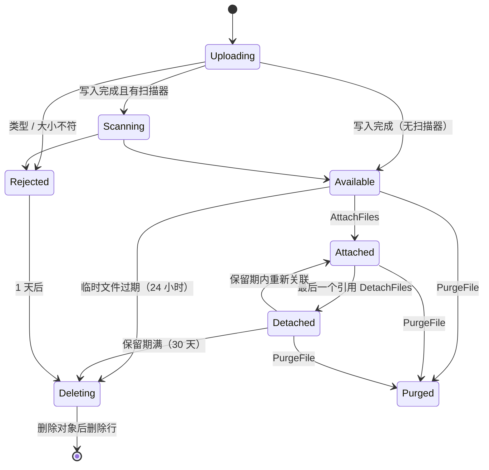
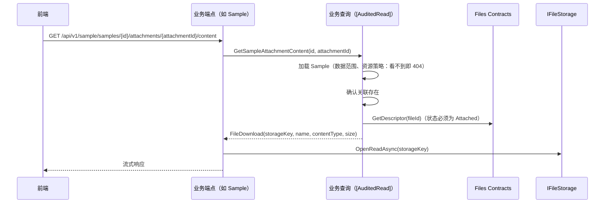
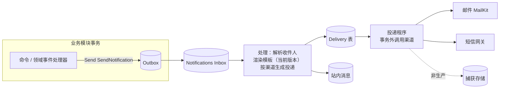

# 05-11 文件与通知

- 状态：已确认（2026-11-04，D1～D6 均按建议确定；D1 经讨论补充了“为什么不直接传内容或地址”）；之后的修订见文末“修订记录”
- 日期：2026-11-04
- 所在项目：`Kmic.BuildingBlocks.Infrastructure`（`IFileStorage` 本地与 S3 兼容实现、上传流处理、类型识别、下载结果、外部 HTTP 客户端约定、事务内外部调用守卫）；`Kmic.BuildingBlocks.Application`（上传档案、通知模板声明）；Files 平台模块（文件元数据、生命周期、引用登记、配额、清理）；Notifications 平台模块（模板与版本、通知与投递、渠道、站内消息、捕获存储）
- 依据：ADR-0006、ADR-0016、ADR-0018、ADR-0020、ADR-0022、ADR-0027；03 第 4.4、4.9 节；05-04 第 7.3 节；05-05 第 5.8 节；05-06 第 8.3 节；05-07 D3、D6、第 7.6 节；05-08 第 4.1、6.8 节；05-09 D5、D7；05-10 D1

## 0. 范围

| 本文内容 | 相关但不在本文 |
|---|---|
| 文件：存储抽象、上传、校验、元数据与生命周期、与业务的关联、下载、清理 | 图片处理、文档预览、Excel / PDF 生成（02 第 6 节按需能力） |
| 通知：发送请求、模板、渲染、投递、渠道（邮件、短信、站内消息）、去重、捕获 | 具体通知内容（随业务） |
| 外部 HTTP 调用的统一约定 | 具体外部系统的对接（随业务） |
| — | 病毒扫描、站内消息实时推送（ADR-0020 待决，本文只留扩展点）；生产对象存储的开通与配置（09 D2：阿里云 OSS） |

### 0.1 本文决定的分类

| 类别 | 本文中的内容 |
|---|---|
| 第一类：现在确定 | D1～D6：文件与业务的关联方式、生成文件的登记、收件人取得、模板来源与渲染时机、事务内外部调用守卫 |
| 第二类：框架定写法，业务定用不用 | 上传档案（每类附件的大小与类型）、预签名下载、每日上传配额（P2）、通知优先级 |
| 第三类：延后 | 无新增（病毒扫描、SignalR 仍是 ADR-0020 的待决项，在 00-README 待决表中） |

对照 00-README“延后事项”表：
- “关系可见、资源可见性的声明方法”——触发条件含“私有数据”。站内消息是私有数据，但它**不声明为数据范围对象**：查询只按 `RecipientUserId = 当前用户` 显式过滤，没有“范围是全部的人也看得到”的问题，不需要 `RestrictVisibility`。因此本文**不触发**该项，表中保留。
- 其余无命中。本文不新增延后事项。

---

## 1. 旧项目怎么做 → 新框架怎么做

| 问题 | 旧项目 | 新框架 | 章节 |
|---|---|---|---|
| 文件存放 | 站点目录 `Web/userfiles/...`，相对 URL 直接存在业务字段 | 对象存储（开发用本地磁盘），存储键由文件 ID 生成，业务只存文件 ID | 2、3 |
| 上传组件 | 7 套，校验不一 | 一个上传端点 + 按用途声明的上传档案 | 3 |
| 类型校验 | 扩展名黑名单 | 扩展名白名单 + 文件头识别，两者必须一致 | 3.3 |
| 下载 | IIS 静态路径，**无鉴权** | 经业务端点：先校验业务对象的资源策略，再转发文件流；每次下载审计 | 5 |
| 删除 | 直接删文件或不删 | 解除关联 → 保留期 → 无引用后清理；对象与元数据补偿一致 | 4.3、6 |
| 邮件发送 | 请求线程内同步发送，回滚后已发出；4 组发件账号 | 发送请求随业务事务写入 Outbox；独立投递、重试；按场景选发件账号 | 7、8 |
| 模板 | 代码拼接（`SendEmail.cs` 6300 行），部分在两个库的模板表 | 模板由代码声明（含默认内容），数据库保存版本，沙箱化 Liquid（Fluid），可预览 | 7.3、7.4 |
| 测试环境 | 主题加 `EmailTest` 前缀，靠开关 | 非生产强制捕获通道，配置了真实通道即启动失败 | 8.4 |
| 站内消息 | `Base_MessageInfo` 等三张表 | 一张站内消息表，只有收件人本人可读 | 8.3 |
| 外部调用 | `HttpHelper`（921 行通用类），无统一超时重试 | 类型化客户端 + 官方韧性库；事务内调用被运行时拦截 | 9 |

---

## 2. 文件存储抽象

```csharp
// BuildingBlocks.Infrastructure
public interface IFileStorage
{
    Task<StoredObject> WriteAsync(string key, Stream content, string contentType, CancellationToken ct);   // 流式；大文件内部分段上传
    Task<Stream> OpenReadAsync(string key, CancellationToken ct);
    Task DeleteAsync(string key, CancellationToken ct);
    Task<Uri> GetDownloadUrlAsync(string key, TimeSpan validFor, string downloadName, CancellationToken ct); // 预签名，S3 实现才支持
    IAsyncEnumerable<string> ListAsync(string prefix, CancellationToken ct);                   // 对账用
}

public sealed record StoredObject(string Key, string? VersionId);   // 开启版本控制时带对象版本 ID，本地存储为 null
```

| 实现 | 环境 | 说明 |
|---|---|---|
| `LocalFileStorage` | 开发、测试 | 根目录来自配置，**不在站点目录内**；`GetDownloadUrl` 不支持（抛异常，调用方退回转发） |
| `S3FileStorage` | 生产 | AWSSDK.S3（03 第 4.9 节），按 03 的配置约束关闭与兼容存储不兼容的完整性校验；生产为阿里云 OSS（09 D2），开发与 CI 需要 S3 行为时用 MinIO |

- 存储键：`{环境}/{yyyy}/{MM}/{fileId}`，**与原始文件名无关**（防路径穿越、防覆盖、防通过文件名猜测）。
- 只有 Files 模块与框架基础设施可以使用 `IFileStorage`；业务模块通过 Files 的 Contracts 与框架的上传、下载构件工作（架构测试）。
- 对象存储的桶设为私有，不开放匿名访问。

**对象版本与恢复协调**（R02-13）

- `WriteAsync` 返回 `StoredObject`：开启版本控制时（生产 OSS、测试用 MinIO）带对象版本 ID，Files 保存到 `StoredFile.ObjectVersionId`（4.1）；本地存储为 `null`。
- 正常读写不带版本 ID：存储键由文件 ID 生成、从不覆盖，当前版本就是记录的版本。版本 ID 只用于恢复与对账。
- `DeleteAsync` 在开启版本控制的桶中只产生**删除标记**，旧版本保留到生命周期规则到期（09 第 4 节）；应用的 RAM 角色没有删除指定版本的权限。立即彻底删除见第 6 节。
- 原因：数据库按时间点恢复后，恢复点之后被清理的文件在数据库中又“存在”了；只要对象的旧版本还在，就能按记录的版本 ID 还原（09 第 11.2 节）。

---

## 3. 上传

### 3.1 上传档案

每类附件声明一个上传档案，决定大小、类型与权限：

```csharp
// Sample.Application
[UploadProfile("Sample.ContractScan", "合同扫描件",
    MaxBytes = 20 * 1024 * 1024,
    AllowedTypes = [FileType.Pdf, FileType.Jpeg, FileType.Png],
    Permission = SamplePermissions.Edit)]
public static class SampleUploadProfiles;
```

- 档案名以本模块名开头、唯一；`Permission` 为上传所需权限点（上传本身就要求有编辑该类业务对象的能力，避免任何登录用户都能往存储里塞文件）。
- `FileType` 是框架维护的白名单（PDF、JPEG、PNG、GIF、WEBP、DOCX、XLSX、PPTX、TXT、CSV、ZIP 等），每种带扩展名与文件头签名；业务不能自定义签名。

### 3.2 上传端点

`POST /api/v1/files?profile=Sample.ContractScan`，`multipart/form-data`，一次一个文件：

| 环节 | 做法 |
|---|---|
| 鉴权 | 已登录 + 档案的权限点（经中介者管道的 `UploadFile` 命令完成授权，文件流不进入消息） |
| 大小 | 端点级 `MaxRequestBodySize` = 所有档案中的最大值；流读取过程中按档案上限截断，超过即 413 `Files.TooLarge` |
| 超时 | 上传端点不受 05-06 第 8.3 节 30 秒请求超时约束，单独 10 分钟（配置项） |
| 并发 | 限流策略 `upload`：每用户同时 3 个（ADR-0022 限流） |
| 流式 | `MultipartReader` 逐段读取，边读边计算 SHA-256、边写入存储；不整体读入内存，不落本地临时文件（S3 分段上传） |
| 类型 | 读取前 4 KB 识别文件头，必须同时满足：扩展名在档案的白名单内、文件头与扩展名对应同一 `FileType`；否则 415 `Files.TypeNotAllowed`，并删除已写入的对象 |
| 文件名 | 只作显示：去掉路径部分与控制字符，长度上限 200，保存为 `OriginalName` |
| 事务 | 写存储期间不持有数据库事务（ADR-0020）；先插入 `Uploading` 行（短事务），写完再更新为 `Available` 或 `Rejected`（短事务） |
| 配额（P2） | 按用户每日累计字节数，超出 429 `Files.DailyQuotaExceeded`；删除不返还（ADR-0020） |
| 扫描 | `IFileScanner` 扩展点：有实现时状态先为 `Scanning`，由后台扫描后改为 `Available` 或 `Rejected`；默认实现直接通过（病毒扫描待决） |

响应：`201 { "fileId": "…", "name": "合同.pdf", "size": 123456, "type": "pdf", "expiresAt": "…" }`。此时文件是**临时文件**，24 小时内未被业务关联即清理。

### 3.3 D1 上传的文件如何与业务对象关联

| 选项 | 做法 | 优点 | 缺点 |
|---|---|---|---|
| A 文件随业务请求一起提交 | 业务端点直接接收 `multipart`，在命令中写存储和关联 | 一步完成 | 大文件进入业务命令：长请求、长事务风险；每个业务端点都要处理流；与 05-06“只接受 JSON”冲突 |
| **B 先上传到 Files 得到临时文件 ID，业务命令引用 ID，并通过请求型消息让 Files 登记引用** | 业务命令：①经框架入口校验文件存在、可用、属于当前用户上传；②在**本模块**的关联表中写关联（与业务同事务，ADR-0027）；③向 Files 发送 `AttachFiles`（05-07 D6）。Files 收到后把文件改为“已关联”并登记引用。三步由 `IFileAttachments.AttachAsync` 按下文的互斥协议完成 | 业务端点保持 JSON；关联与业务同事务；业务回滚则不发消息，文件保持临时状态到期清理，不会留下孤儿引用；Files 知道每个文件被谁引用，清理有依据 | 两步交互；“已关联”是最终一致的（秒级），期间文件仍是临时状态，靠下文的互斥协议保证不被清理 |
| C 浏览器用预签名地址直传对象存储 | 后端只发签名 | 不经过应用服务器 | 文件头识别、大小限制要在上传完成后再补做；本地存储不支持；首期没有超大文件需求 |

- **决定（已确认，2026-11-04）**：B。C 作为超大文件的第二类能力保留扩展点，第一个需求出现时再加。
- 讨论补充（为什么不直接传文件内容或文件地址）：
  - 直接传内容：每个带附件的业务接口都要处理文件流与校验；base64 体积增加约三分之一且整体进内存；点“保存”时才开始上传，保存失败要重新上传。
  - 直接存地址：正是旧系统的问题——知道地址即可下载；客户端传来的地址无法信任（可指向他人文件或服务器其他路径）；更换存储要改全部历史数据。
  - 临时文件 ID 相当于“上传回执”：前端选完文件即上传（可显示进度），保存单据时凭回执由后端确认“是本人刚上传、合规、未过期”。业务表保存文件名、大小、类型快照，列表与详情不查 Files；只有保存时校验与下载时按主键各查一次。
- **理由**：文件与业务对象的关系属于业务（在业务模块中、同事务），文件的生命周期属于 Files（需要知道是否还有引用），请求型消息正好把两者连起来而不跨模块写入。
- **取舍**：关联是两步；Files 中的引用登记是业务关联的一份“最终一致的副本”，只用于生命周期判断。

业务模块中的关联表（模块模板生成）：

| 列 | 说明 |
|---|---|
| `Id` | |
| `{聚合}Id` | 所属业务对象 |
| `FileId` | Files 的文件 ID（`Guid`，05-01 第 3.3 节的跨模块引用） |
| `Category` | 附件类别（编码，模块内定义） |
| `FileName`、`Size`、`FileType` | 关联时从 Files 取得的快照，列表显示不必再查 Files |
| `SortOrder`、`AttachedBy`、`AttachedAt` | |

- 关联表是聚合的子实体，增删附件会递增聚合版本（05-03 第 6 节），自然纳入并发控制与审计。
- 解除关联：删除关联行，同事务 `Send(new DetachFiles(...))`；Files 减少引用，引用为零的文件进入“已解除关联”，保留 30 天（配置项）后清理，期间可恢复。

**关联与清理的互斥协议**（R02-3；原型 #18 已验证，`docs/framework/spikes/18-file-attach-lock.md`）

“临时文件的过期时间远大于关联所需的间隔”不能保证不误删，时间余量不是保证：业务事务可能在提交阶段停留任意长的时间（例如等待同步复制确认；`transaction_timeout` 不约束提交何时可见），期间文件跨过到期时刻，清理把它改为 `Deleting` 并删除对象；业务提交后，关联指向一个已删除的文件。因此关联与清理按文件 ID 的数据库锁互斥，不用时钟做判断：

| 步骤 | 业务命令（本模块的事务内） | 清理（Files 的事务内） |
|---|---|---|
| 1 | 按文件 ID 排序，对每个文件取**事务级共享咨询锁**（`pg_advisory_xact_lock_shared`），锁随本事务提交或回滚释放 | 对候选文件逐个尝试取**事务级排他咨询锁**（`pg_try_advisory_xact_lock`），取不到就跳过，下次再处理 |
| 2 | 取锁之后经 Files Contracts 检查可关联性：读主实例的新快照，不经任何缓存。条件：状态为 `Available`（本人上传）或可重新关联的 `Detached`；**不检查到期时间**，已过期但尚未进入 `Deleting` 的文件仍可关联 | 取锁之后探查这些文件是否还有**未完成的关联消息**（第 4.3 节），有则跳过 |
| 3 | 写本模块的关联行，`Send(AttachFiles)`，提交 | 对剩下的文件做带条件的更新：`Status IN ('Available', 'Detached')` 才改为 `Deleting`，提交 |

为什么成立：
- 清理把文件改为 `Deleting` 的整个过程持有排他锁；业务从“检查”到“提交完成”的整个过程持有共享锁，两段不会重叠。
- 业务先拿到锁：清理取不到锁，跳过。业务提交后关联消息已经存在，清理下次取到锁时会探查到它。
- 清理先拿到锁：业务要等清理提交后才能取得共享锁，读到的是 `Deleting`，关联被拒绝。
- PG 先让提交对其他会话可见，再释放事务级锁；业务停在提交阶段（包括等待同步复制）时，锁仍然持有。原型 #18 验证的就是这一点。

| 规则 | 内容 |
|---|---|
| 唯一入口 | 关联与重新关联只能经框架的 `IFileAttachments.AttachAsync(owner, fileIds)`：它按顺序完成取锁、检查、发送 `AttachFiles`，并返回写关联行所需的文件快照。业务代码直接 `Send(new AttachFiles(...))` 由分析器拦截。所有入口（上传的附件、重新关联、把生成文件关联到业务对象）都走这一个协议 |
| 锁键 | 由文件 ID 派生的 64 位值（`SHA-256("Kmic.Files:" + 文件 ID)` 的前 8 字节）。咨询锁的键空间是整个数据库共用的，哈希碰撞只会造成多余的等待或一次跳过，不影响正确性 |
| 等待上限 | 共享锁最多等 5 秒（`lock_timeout`，配置项），超时返回 503 `Common.TransientConflict`（`retryable`）。清理的事务很短，正常情况下等待在毫秒级 |
| 单个命令的文件数 | 最多 50 个（配置项），超过返回 400 `Files.TooManyFiles`，以限制单个事务持有的锁数量 |
| 关联消息不能放弃 | 引用 `Available` 或 `Detached` 文件的 `AttachFiles` 不能人工放弃，只能重试（05-07 第 9.1 节）：放弃等于让一个已经提交的关联失去保护。业务事务已在锁内检查过可关联性，`AttachFiles` 的处理不应出现业务失败；重试仍失败按程序缺陷处理 |

---

## 4. Files 模块

### 4.1 表

`"Files"."StoredFile"`：

| 列 | 说明 |
|---|---|
| `Id` | 文件 ID（UUID v7） |
| `StorageKey` | 存储键 |
| `OriginalName` | 显示用文件名 |
| `FileType`、`ContentType` | 识别出的类型（不信任客户端提供的 `Content-Type`） |
| `Size`、`Sha256` | |
| `ObjectVersionId` | `varchar(200) null`，对象版本 ID（第 2 节） |
| `Profile` | 上传档案名；生成文件为 `Generated:{来源}` |
| `UploadedBy`、`UploadedAt` | 系统生成的文件 `UploadedBy` 为空 |
| `Status` | `Uploading` / `Scanning` / `Available`（临时） / `Attached` / `Detached` / `Rejected` / `Deleting` / `Purged`（彻底删除后的终态，行保留；`PurgedAt`、`PurgedBy`、`PurgeReason`、`HistoryPurgedAt`、`HistoryPurgeNote`、`RejectReason` 列，删除队列的租约列，见 Files 设计 3.2、3.4） |
| `ExpiresAt` | 临时、已解除关联、作业结果文件**成为清理候选的时间**，不是关联的截止时间（第 3.3 节）；`Attached` 时为空 |
| `ConcurrencyVersion` | |

`"Files"."FileReference"`：`(FileId, OwnerModule, OwnerType, OwnerId)` 唯一——引用登记，只由 `AttachFiles` / `DetachFiles` 维护；它是 `StoredFile` 聚合的子实体（Files 设计 D-F1，每个文件的引用数防御性上限 100）。

`"Files"."UploadQuota"`（P2）：`(UserId, Date)` → `Bytes`。

### 4.2 状态流转



- 使用 05-01 的状态机，流转写入业务历史（`StoredFileStateHistory`），可追溯“文件何时、因何被删除”。

### 4.3 清理与对账（05-08 定时任务）

| 任务 | 默认时间 | 内容 |
|---|---|---|
| `Files.PurgeExpired` | 每小时 | 把到期的 `Available`（临时）/ `Detached` / `Rejected` 标记为 `Deleting`。`Available`、`Detached` 按第 3.3 节的协议执行：每次一个短事务，最多处理 1000 个候选（配置项），剩下的下次处理；候选按到期时间筛选，但决定删不删的是“锁 + 探查 + 状态条件”。`Rejected` 文件不可关联，不需要这个协议 |
| `Files.ReconcileStorage` | 每周日 04:00 | 列出存储中超过 2 天的对象，与 `StoredFile` 比对。① 存储有、库中无的对象（上传中崩溃、生成文件未登记）：先探查未完成的 `RegisterGeneratedFile`（声明文件 ID 为主体），有则跳过，没有才删除——“超过 2 天”同样只是时间余量，不能单独作为依据。② 库中有、存储无：按 `ObjectVersionId` 核对。记录的版本仍在、只是被删除标记覆盖 → 记 Error，列入“待还原”清单，**不标记 `Rejected`**（这是按时间点恢复之后的正常现象，由运维按 09 第 11.2 节还原）；记录的版本也不存在 → 记 Error 并标记 `Rejected` |
| `Files.ResetStaleUploads` | 每小时 | `Uploading` 超过 1 小时的视为中断，转 `Deleting` |

- 删除对象、删除行在事务外执行：定时任务命令只做标记，`Deleting` 行由 Files 的 `LeasedQueueWorker` 逐个“先删对象、再删行”（与通知投递相同的结构，不在事务中做对象存储 I/O）；删对象失败则保留行，下次重试。
- 顺序“先删对象再删行”：中途失败最多留下一个可重试的 `Deleting` 行，不会出现“库中有行、对象已没”的可见错误。
- **探查未完成的关联消息**：`AttachFiles` 声明 `FileIds` 为消息主体，框架把它写入 Outbox / Inbox 的 `SubjectIds` 列（05-07 第 6.1 节）。探查按投递方向的先后：先查各模块 Outbox 中未完成（待投递、投递中、死信）的 `AttachFiles`，再查 Files Inbox 中未完成（待处理、处理中、死信）的。消息只会沿“Outbox → Inbox → 已处理（文件已是 `Attached`）”单向前进，按这个顺序查，后一次查询的快照不早于前一次，消息不会从两次查询之间漏过；已经处理完的，由第 3.3 节第 3 步的状态条件排除。

### 4.4 D2 模块生成的文件如何登记

导出作业的结果文件、系统生成的 PDF 等，由业务模块的后台作业产生（05-08 第 6.8 节），而 Files 的 Contracts 是只读的（05-07 第 4.5 节）。

| 选项 | 做法 | 优点 | 缺点 |
|---|---|---|---|
| A Files Contracts 开放同步写入接口 | 作业调用 `IFileWriter.Create(...)`，Files 同步写元数据 | 写法直接 | 破坏“Contracts 只读、不能让其他模块同步改数据”（ADR-0006、05-07）；作业事务与 Files 写入不一致 |
| **B 作业自己写对象，再用请求型消息登记** | 框架的 `IGeneratedFiles.WriteAsync(stream, name, type, retention)`：先生成文件 ID（UUID v7），用同样的键规则写入存储，然后 `Send(new RegisterGeneratedFile(...))`，与作业完成（05-08 第 6.4 节最后的短事务）同一事务写入 Outbox；Files 收到后插入 `Available` 行（带到期时间） | 不跨模块写；登记与作业完成同事务——作业失败则消息不发，留下的对象由对账任务清理 | 作业完成到文件可下载之间有秒级间隔；下载时若尚未登记返回 409 `Files.NotReady`（`retryable = true`），前端稍后重试 |

- **决定（已确认，2026-11-04）**：B。
- **理由**：与 D1 一致——跨模块的“登记”一律走请求型消息；对象写入与元数据登记之间的缝隙由对账任务兜底，这条兜底在上传流程中本来就需要。
- **取舍**：生成文件有秒级“准备中”。

---

## 5. 下载

### 5.1 流程



- 下载权限**完全继承业务对象**（ADR-0020）：Files 没有自己的下载端点，不存在“知道文件 ID 就能下载”。
- 返回 `FileDownload` 的查询必须声明 `[AuditedRead]`（启动校验，05-09 D5 的扩展）：每次下载都有审计记录（ADR-0020）。
- 框架提供 `FileResults.Stream(FileDownload)`：支持 `Range`（断点续传）、`ETag`（= `Sha256`）。
- `GetDescriptor` 声明为 `[ContractQuery(Reference)]` 的白名单例外（返回 `FileDescriptor`，只含文件元数据，不含内容）：调用方必须先完成业务对象的授权，由代码评审与模板写法保证。

### 5.2 响应头

| 头 | 值 |
|---|---|
| `Content-Disposition` | 默认 `attachment; filename="<ASCII 回退名>"; filename*=UTF-8''<百分号编码的原名>`（RFC 6266）；只有 PDF 与图片在请求 `?inline=true` 时用 `inline` |
| `Content-Type` | 识别出的类型，不用上传时客户端声明的值 |
| `X-Content-Type-Options` | `nosniff` |
| `Content-Security-Policy` | `inline` 时为 `sandbox; default-src 'none'; img-src 'self'; style-src 'unsafe-inline'`，防止上传的文件在本站点下执行脚本 |
| `Cache-Control` | `private, no-store` |

### 5.3 大文件与作业结果

- 超过 100 MB（配置项）的文件可改用预签名链接：查询返回 `FileDownload` 时由框架判断，端点返回 `302` 到有效期 5 分钟的签名地址；签名地址中强制 `response-content-disposition=attachment`。本地存储不支持，退回转发。
- 作业结果文件：`GET /api/v1/{模块}/jobs/{id}/result`，授权按 05-08 第 6.5 节（提交人或管理员），同样审计。

---

## 6. 关联数据的删除

| 情形 | 处理 |
|---|---|
| 业务对象软删除 | 关联保留（可恢复）；文件保持 `Attached` |
| 业务对象物理删除（`IPurge`） | 同事务删除关联行并 `Send(DetachFiles)`；文件进入保留期 |
| 单个附件被移除 | 同上，只针对该文件 |
| 用户要求“彻底删除某文件”（如误传敏感文件） | Files 管理端点 `POST /api/v1/files/{id}/purge`，权限点 `Files.File.Purge`（敏感、`[Audited]`）：应用写删除标记，元数据转为终态 `Purged` 并保留记录（原因与操作人）；引用方显示“[文件已删除]”。彻底删除全部历史版本由运维执行，见下 |

- **彻底删除历史版本由运维执行**：应用的 RAM 角色没有删除指定版本的权限（09 第 4 节），操作经阿里云操作审计留痕，并在本系统登记执行记录。在运维彻底删除之前，内容只存在于非当前版本中，应用不再提供任何读取路径。

---

## 7. 通知：发送请求与模板

### 7.1 总体流程



### 7.2 发送请求

```csharp
// Notifications.Contracts —— 请求型消息（05-07 D6）
[IntegrationMessage("Notifications.SendNotification")]
public sealed record SendNotification(
    string TemplateKey,                              // 如 "Sample.Approved"
    IReadOnlyList<Recipient> To,
    IReadOnlyDictionary<string, object?> Model,      // 模板数据，按模板声明的结构校验
    string DedupKey,                                 // 业务去重键，如 "Sample.Approved:{sampleId}:{revision}"
    IReadOnlyList<Guid>? AttachmentFileIds = null,
    NotificationPriority Priority = NotificationPriority.Normal) : IIntegrationRequest;

public sealed record Recipient(Guid? UserId, string? Email = null, string? Phone = null, RecipientRole Role = RecipientRole.To);
```

- 收件人优先用 `UserId`（D3 由 Notifications 解析联系方式）；直接地址只用于系统外的对象（如客户联系人邮箱），由业务模块从自己的数据中取得。
- `DedupKey`：同一模板、同一收件人、同一去重键只发送一次（唯一约束），重复请求直接忽略并记 Information（FR-NOTIFY-04）。`MessageId` 去重由 Inbox 保证（05-07），`DedupKey` 防的是业务层重复触发（如重复审批事件）。
- 附件只能引用文件 ID；Notifications 投递时读取文件，单封邮件附件总量上限 20 MB（配置项）。
- 优先级：`High` 用于验证码等即时类（05-04 第 7.3 节），投递程序优先领取。
- **含密模板**（Identity 设计 D-F）：模板声明 `CarriesSecret = true`（只用于一次性短时凭据，如短信验证码），含密模板只能用单独的请求型消息 `SendSecretNotification` 发送（它在契约上声明含密，有效期 300 秒，05-07 第 5.3 节的例外；没有附件与优先级字段），普通模板只能用 `SendNotification`，处理时两边互查。Notifications 处理含密模板时，`Delivery.Body` 在投递成功（或确认不再重试）后清空，只留下模板版本与状态；含密模板的渲染结果不写日志，捕获通道（非生产）照常保存，方便测试人员取验证码。含密模板不能带附件，`DedupKey` 要包含验证码 ID（同一手机号的两次验证码不能被去重成一条）。

### 7.3 D3 收件人的联系方式从哪里来

`UserId` → 邮箱、手机号，数据在 Identity。

| 选项 | 做法 | 优点 | 缺点 |
|---|---|---|---|
| A Notifications 维护用户联系方式读模型 | 订阅 Identity 的 `UserChanged` 快照事件 | 发送时不依赖 Identity | 手机号、邮箱这类个人信息被复制到另一个模块、并经过事件载荷与 Outbox / Inbox（05-07 第 5.3 节要求载荷不放敏感字段）；副本要随用户删除同步清除 |
| **B 发送时经 Identity Contracts 查询** | Identity 提供 `IUserContacts.GetAsync(userIds)`，声明 `[ContractQuery(SystemOnly)]`：只允许系统身份调用（Notifications 的 Inbox 处理以系统身份执行） | 个人信息只存一处；总是最新（用户刚改的邮箱立即生效） | 发送时 Identity 必须可用（同一进程，实际不构成问题）；需要把 `SystemOnly` 的用途从“只用于快照源”（05-07 第 8.3 节）放宽为“只允许系统身份调用的查询” |

- **决定（已确认，2026-11-04）**：B；05-07 第 4.3、8.3 节的启动校验相应为：`[ContractQuery(SystemOnly)]` 可用于快照源与 `IUserContacts` 这类系统专用查询，返回类型不限，但调用方必须是系统身份。
- **理由**：联系方式是敏感个人信息，按“最少副本”原则只存一处；Notifications 本就以系统身份处理，B 不增加新的信任边界。
- **取舍**：放宽一条已确认的启动校验规则。
- 已禁用的用户、没有邮箱 / 手机号的用户：对应渠道的投递直接标为 `Skipped` 并记录原因，不算失败。

### 7.4 D4 模板从哪里来

| 选项 | 做法 | 优点 | 缺点 |
|---|---|---|---|
| A 只在数据库中维护 | 管理员新建模板，业务代码按键引用 | 灵活 | 新环境没有模板就发不出通知；代码引用的键可能不存在；模板能用哪些变量没有约定 |
| **B 代码声明模板（键、渠道、变量结构、示例数据、默认内容），数据库保存修改后的版本** | 模块中声明；启动时登记到 Notifications（同权限点同步机制，内容哈希、退役）；管理员在界面修改并发布新版本，未修改时使用代码默认内容 | 新环境开箱可发；变量结构在代码中，模板编辑器可以提示与校验；示例数据用于预览；代码中删除的模板标记退役 | 新增一种通知要发版（修改文案不用） |

- **决定（已确认，2026-11-04）**：B。
- **理由**：与系统设置（05-10 第 6 节）、字典（05-10 D3）同一原则：结构由代码定义、内容由管理员维护。
- **取舍**：新增通知类型需要发版。

```csharp
// Sample.Application
[NotificationTemplate("Sample.Approved", "示例审批通过", Channels = Channel.Email | Channel.InApp, SenderProfile = "Default")]
public sealed record SampleApprovedModel(string Number, string ApproverName, string Link)
{
    public static SampleApprovedModel Example => new("S-2026-0001", "张三", "/sample/samples/…");
    public const string DefaultSubject = "示例 {{ Number }} 已审批通过";
    public const string DefaultBody = "<p>{{ ApproverName }} 已审批通过示例 {{ Number }}。</p><p><a href=\"{{ Link }}\">查看</a></p>";
}
```

- 发送方用 `SendNotification.For(new SampleApprovedModel(...), to, dedupKey)` 构造，`Model` 由框架序列化，保证与声明一致。
- 模板版本表：`"Notifications"."TemplateVersion"(TemplateKey, Version, Channel, Subject, Body, PublishedBy, PublishedAt, Status)`；发布即生成新版本，不修改旧版本；预览用示例数据渲染。
- 模板引擎：Fluid（03 第 4.4 节），只能访问模型中的数据；禁用 `include` 文件系统访问；单次渲染限时 1 秒、输出上限 1 MB；HTML 默认转义。
- 发件账号（FR-NOTIFY-02）：模板声明 `SenderProfile`，对应部署配置 `Notifications:Email:Senders:{名称}`（地址、显示名、SMTP 账号；密码为密钥），沿用旧系统“按场景选发件账号”的思路。

### 7.5 D5 什么时候渲染

| 选项 | 优点 | 缺点 |
|---|---|---|
| **A 处理发送请求时渲染，保存渲染结果到投递记录** | 记录的就是实际发出的内容（主题、正文、模板版本），可审查、可重发同样内容；投递重试不会因为期间模板被修改而内容变化 | 每条投递保存一份正文（存储稍大） |
| B 投递时渲染 | 存储小 | 重试之间若模板改版，同一通知的不同收件人可能收到不同内容；“发出了什么”只能事后推断 |

- **决定（已确认，2026-11-04）**：A。投递记录保留期 `待确认`（与审计保留期一起定）。
- **取舍**：存储稍大。

---

## 8. 投递与渠道

### 8.1 表

| 表 | 主要列 |
|---|---|
| `Notification` | `Id`、`TemplateKey`、`TemplateVersion`、`DedupKey`、`SourceMessageId`、`SourceModule`、`CreatedAt`、`InitiatorUserId` |
| `Delivery` | `Id`、`NotificationId`、`Channel`、`RecipientUserId`、`AddressMasked`（脱敏显示）；用户收件人不存地址、发送时按 `UserId` 经 `IUserContacts` 取最新值，系统外的直接地址才保存 `Address`（明文，靠保留期清理，Notifications 设计 D-N2）；另有 `RecipientKey`、`Role`、`SkipReason`、`AttachmentFileIds`、`TemplateVersion`、`CodeHash`、`Subject`、`Body`、`Priority`、`Status`（`Pending` / `Sending` / `Sent` / `Failed` / `Skipped` / `Captured`）、`Attempts`、`NextAttemptAt`、`LeaseToken`、`LeaseUntil`、`ProviderMessageId`、`LastError`、`SentAt` |

- 唯一约束：`(TemplateKey, RecipientUserId 或 Address, DedupKey, Channel)`。

### 8.2 投递程序

- 基于 05-08 的 `LeasedQueueWorker`，按 `Priority DESC, NextAttemptAt` 领取，**在数据库事务之外**调用渠道（ADR-0020）。
- 语义是至少一次（05-07 第 7.6 节）：`Sending` 状态下进程崩溃，租约到期后会重发。邮件头带 `Message-ID: <{DeliveryId}@kmic>`，短信网关支持时传 `DeliveryId` 作为外部流水号，尽量让对方去重。
- 失败分类：网络错误、超时、服务端 4xx 中的限流 → 退避重试（最多 5 次）；收件地址无效等永久错误 → `Failed`，不重试。
- 失败的投递在管理界面可查看与重试（权限点 `Notifications.Delivery.Manage`），发送记录可按收件人、模板、时间查询（`Notifications.Delivery.View`）。`Delivery` 是模块内框架表，状态靠带条件的 SQL 更新，不经聚合（Notifications 设计 D-N1）。

### 8.3 渠道

| 渠道 | 实现 | 说明 |
|---|---|---|
| 邮件 | `MailKitEmailSender` | 每个发件账号一个连接配置；正文 HTML + 自动生成的纯文本备选；附件流式读取 |
| 短信 | `ISmsGateway` 抽象 | 生产实现为**阿里云短信服务**（R01 L1）；签名与模板需在阿里云控制台审核通过，模板编码、签名为部署配置；按厂商规则把渲染结果映射为模板参数。开通与费用确认为实施待办 T-08 |
| 站内消息 | 写入 `"Notifications"."SiteMessage"` | 在处理发送请求时直接写入（同一事务，无外部调用），不进入投递队列 |

站内消息（FR-NOTIFY-06）：

| 列 | 说明 |
|---|---|
| `Id`、`RecipientUserId`、`NotificationId` | |
| `Title`、`Body`（纯文本或受限 Markdown，前端渲染时转义）、`Link`（前端路由，只允许站内相对路径） | |
| `Category`、`CreatedAt`、`ReadAt` | |

- 端点：`GET /api/v1/notifications/site-messages`（只返回本人的）、`GET …/unread-count`、`POST …/{id}/read`、`POST …/read-all`；全部 `[AllowAuthenticated]`，查询条件固定包含 `RecipientUserId = 当前用户`，访问他人的消息返回 404。
- 前端每 30 秒轮询未读数（SignalR 待决）。
- 模拟身份时：可以查看被模拟人的消息列表，但“标为已读”在只读模拟中被拒（05-04 D7）。

### 8.4 非生产捕获（FR-NOTIFY-05）

- 非生产环境注册 `CaptureEmailSender`、`CaptureSmsSender`：完整内容（收件人、抄送、密送、主题、正文、附件名与大小、所用发件账号）写入 `"Notifications"."CapturedMessage"`，投递状态为 `Captured`。
- 启动保护：`Environment != Production` 时若配置了任何真实渠道（SMTP 主机、短信密钥），启动失败（ADR-0020）。
- 捕获内容在管理界面按收件人、时间查看，测试人员据此验证通知（权限点 `Notifications.Captured.View`）。
- 生产环境不注册捕获通道；`Production` 环境下捕获通道存在即启动失败（防止配置错误导致生产通知全部被吞）。

---

## 9. 外部 HTTP 调用

### 9.1 类型化客户端

```csharp
// Sample.Infrastructure
services.AddKmicHttpClient<IPartnerClient, PartnerClient>("Partner", o =>
{
    o.TotalTimeout = TimeSpan.FromSeconds(30);
    o.AttemptTimeout = TimeSpan.FromSeconds(10);
    o.RetryReads = true;            // 写操作默认不重试（ADR-0020）
});
```

| 约定 | 说明 |
|---|---|
| 位置 | 每个外部系统一个类型化客户端，放 Infrastructure；接口在 Application |
| 地址与凭据 | `Modules:{模块}:Clients:{名称}`，凭据为 `[Secret]`（05-10 第 2.2 节） |
| 韧性 | Microsoft.Extensions.Http.Resilience 标准管道：总超时、单次超时、重试（只对 GET / HEAD / 声明幂等的请求）、熔断、并发隔离 |
| 写操作重试 | 只有对方支持幂等键时才开启，框架自动带 `Idempotency-Key`：外部调用待办中为待办 ID，作业中为 `{JobId}:{批次}`（第 9.3 节） |
| 日志 | 记录方法、主机、路径（去掉查询串中的敏感参数）、状态码、耗时；请求体与响应体默认不记录，开启时截断 4 KB 并脱敏；`Authorization`、`Cookie` 头永不记录（FR-EXT-03） |
| 追踪 | 传播 `traceparent`（对内部系统）；对第三方是否传播按客户端配置 |

### 9.2 D6 如何保证事务内不调用外部系统

ADR-0020：禁止在数据库事务内调用外部系统。

| 选项 | 做法 | 优点 | 缺点 |
|---|---|---|---|
| A 代码评审 | 规范写明 | 无成本 | 命令处理器里顺手调一个接口很容易漏看；漏掉的后果正是旧系统“回滚了但外部已生效” |
| **B 运行时守卫** | 框架为所有类型化客户端加一个 `DelegatingHandler`：执行上下文显示当前处于命令事务中（`InCommand` 且事务已开启）时抛 `InvalidOperationException`；外部调用只能出现在 Inbox 处理（事务开始之前的订阅处理应改为请求型消息或作业）、后台作业的批次之间、查询中 | 违规在第一次运行（测试）时就暴露；不依赖评审者的注意力 | Inbox 处理器本身在命令事务中执行（05-07 D9），因此“收到事件后调外部接口”不能写在订阅命令里，要改为：订阅命令只记录待办，由作业或专门的投递程序在事务外调用（与通知投递相同的结构） |

- **决定（已确认，2026-11-04）**：B。框架提供 `ExternalCallQueue` 模板：订阅命令写入本模块的“外部调用待办”表（同事务），一个 `LeasedQueueWorker` 在事务外执行并记录结果——通知投递就是它的一个实例。
- **理由**：这条规则的违反代价高、发现难，运行时守卫是唯一可靠的办法。
- **取舍**：调用外部系统的写法多一层“待办表 + 执行器”，由模板生成。
- 查询中允许外部调用（只读，如实时汇率），但必须有缓存或降级策略，避免外部故障拖垮页面（代码评审）。

### 9.3 外部系统的幂等与结果核对

外部调用结果未知（超时、连接中断）时能不能安全重试，取决于对方的能力，不取决于我们。

| 框架负责 | 每个集成负责（随业务） |
|---|---|
| 外部调用待办（`ExternalCallQueue`）的状态、租约与结果写入的状态条件（05-08 第 4.1 节） | 逐个核实对方的幂等能力并写进该集成的说明：是否接受幂等键、键保留多久、能否按键或流水号查询结果 |
| 幂等键：外部调用待办取待办 ID，待办由订阅命令按触发它的 `MessageId` 确定性派生（一条消息产生多个调用时加序号）；作业中为 `{JobId}:{批次}`。同一项重试时键不变 | 对方不支持时列为已知风险，并提供人工核对手段（对方的查询界面、对账文件等） |
| 结果未知时按下表处理 | — |

| 对方的能力 | 结果未知时 |
|---|---|
| 接受幂等键，且保留期覆盖我们的重试期 | 用同一个键重试 |
| 不接受幂等键，但能按我们的流水号查询结果 | 先查询，查到结果再记录；查不到或查询也失败时进入“结果未知” |
| 都不支持 | 不自动重试：待办标记为 `Unknown` 并告警，进入人工核对（与 05-02 第 6.1 节同一原则：不推断成功，也不重新执行） |

- 05-07 第 7.6 节“超时视为可重试错误”只适用于上表第一行；外部调用按 D6 在外部调用待办中执行。
- 通知投递（邮件、短信）维持“至少一次”：重复的代价是收件人多收到一条通知，邮件以稳定的 `Message-ID` 帮助收件端去重；这一点作为已知风险写在 Notifications 的说明中。

---

## 10. 配置项汇总

| 配置 | 默认值 |
|---|---|
| `Files:Storage:Provider` / `LocalRoot` / `S3:*` | `Local`（开发）/ — / 生产为 OSS 的 S3 兼容端点（09 D2） |
| `Files:TempExpiryHours` / `DetachedRetentionDays` / `RejectedRetentionDays` | 24 / 30 / 1 |
| `Files:UploadTimeoutMinutes` / `MaxConcurrentUploadsPerUser` | 10 / 3 |
| `Files:PresignThresholdMb` / `PresignValidMinutes` | 100 / 5 |
| `Files:DailyQuotaMb`（P2） | `待确认` |
| `Notifications:Email:Senders:*` | 按发件账号 |
| `Notifications:Delivery:Parallelism` / `MaxAttempts` | 4 / 5 |
| `Notifications:MaxAttachmentMb` | 20 |
| `Notifications:Template:RenderTimeoutMs` / `MaxOutputKb` | 1000 / 1024 |
| 投递记录、捕获记录保留期 | `待确认` |
| `Files:MaxFilesPerCommand` / `AttachLockTimeoutSeconds` / `PurgeBatchSize` | 50 / 5 / 1000 |

---

## 11. 测试要点

| 对象 | 必测场景 |
|---|---|
| 存储 | 本地与 S3（MinIO 容器）实现通过同一套契约测试：写、读、删、列出、分段上传大文件、预签名 |
| 上传 | 超过档案大小 413 且对象被删除；扩展名与文件头不一致 415；改扩展名的可执行文件被拒；文件名含路径与控制字符被清理；无档案权限 403；内存占用与文件大小无关（大文件流式） |
| 关联（D1） | 业务命令引用他人上传的、过期的、被拒的文件失败；业务回滚后文件仍为临时并按期清理；`DrainAsync` 后文件为 `Attached`；解除最后一个引用后进入保留期，期内可重新关联 |
| 生成文件（D2） | 作业成功后可下载；作业失败时对象被对账任务清理；登记前下载返回 409 `retryable` |
| 清理与对账 | 先删对象后删行；删对象失败保留行重试；存储中的孤儿对象被删除 |
| 下载 | 业务对象不可见时 404；关联不存在 404；`Content-Disposition` 中文名正确（含 ASCII 回退）；`inline` 只对白名单类型；每次下载有审计记录；`Range` 续传 |
| 通知请求 | 业务回滚不发；`DedupKey` 重复只发一次；模型与模板声明不符时进入死信（业务失败，05-07 D10） |
| 收件人（D3） | 系统身份可查联系方式，用户身份调用被拒；禁用用户、无邮箱时 `Skipped` |
| 模板（D4、D5） | 代码默认模板开箱可用；发布新版本后新通知使用新版本，旧投递内容不变；渲染超时与输出超限失败；模板无法访问模型外的数据；预览 |
| 投递 | 优先级高的先发；临时错误重试、永久错误不重试；崩溃后至少一次；邮件 `Message-ID` 稳定 |
| 捕获 | 非生产配置真实 SMTP 启动失败；生产存在捕获通道启动失败；捕获内容完整 |
| 站内消息 | 只能看到自己的；他人消息 404；只读模拟不能标已读 |
| 外部调用（D6） | 命令事务中调用类型化客户端抛异常；Inbox 处理器中直接调用被拦截；作业批次之间可调用；写请求带幂等键；日志不含 `Authorization` |
| 关联与清理（原型 #18） | 业务提交停在同步复制等待并跨过到期时刻 → 清理取不到锁而跳过；业务提交后清理探查到未完成的 `AttachFiles` 而跳过；清理先取得锁 → 业务读到 `Deleting` 被拒；已过期但未进入 `Deleting` 的文件可以关联 |
| 探查 | 关联消息分别处于 Outbox 待投递、投递中、死信，以及 Files Inbox 待处理、处理中、死信时，文件都不被删除；用测试屏障让投递恰好发生在两次探查之间，仍不漏查 |
| 唯一入口 | 直接 `Send(new AttachFiles(...))` 被分析器拦截；超过 50 个文件返回 `Files.TooManyFiles`；共享锁等待超时返回 `Common.TransientConflict` |
| 放弃 | 引用 `Available` / `Detached` 文件的 `AttachFiles` 死信不能放弃 |
| 生成文件对账 | `RegisterGeneratedFile` 未处理时，对账不删除对应对象 |
| 版本与恢复 | 删除只产生删除标记，记录的版本仍可读取；对账把“被删除标记覆盖”的文件列入待还原，不标记 `Rejected`；应用角色删除指定版本被拒（OSS 部分随原型 #14） |
| 取消后底层 I/O 未停 | 上传中客户端断开或超时：行进入 `Rejected` / `Deleting`；取消后迟到写成的对象由清理或对账删除；未完成的分段上传被中止（生命周期规则兜底，09 第 4 节） |
| 外部调用结果未知（9.3） | 对方不支持幂等键时，超时后待办为 `Unknown` 并告警、不自动重试；支持时用同一个键重试 |

---

## 12. 与其他文档的接口

| 本文提供 / 需要 | 对方 |
|---|---|
| `GetDescriptor` 在 `Reference` 返回类型白名单中；`SystemOnly` 可用于系统专用查询（D3） | 05-07 第 4.3、8.3 节 |
| `AttachFiles`、`DetachFiles`、`RegisterGeneratedFile`、`SendNotification` 请求型消息；消息主体列 `SubjectIds`、`AttachFiles` 的放弃限制、第 7.6 节的适用范围 | 05-07 D6、第 6.1、7.6、9.1 节 |
| 下载查询必须 `[AuditedRead]` | 05-09 D5 |
| `StoredFileStateHistory`、`SystemSettingChange` 等只追加表 | 05-09 D7 |
| 上传端点的超时、内容类型例外 | 05-06 第 8.3 节 |
| `upload` 限流策略 | ADR-0022 |
| 投递程序、`ExternalCallQueue` 基于 `LeasedQueueWorker`；Files 清理与对账任务 | 05-08 |
| 作业结果文件 `IGeneratedFiles` | 05-08 第 6.8 节 |
| 短信验证码经 `SendNotification`（`High` 优先级） | 05-04 第 7.3 节 |
| 发件账号与客户端凭据为 `[Secret]` | 05-10 第 2.2 节 |
| 投递、上传、外部调用的指标与告警 | 05-12 |
| D6：事务内外部调用守卫 | ADR-0020 |
| OSS 版本控制、生命周期、RAM 权限、存储容量、恢复步骤 | 09 第 4、11、11.1、11.2 节 |
| 原型 #14（OSS）、#18（关联与清理互斥） | 08 第 4 节 |

---

## 13. 决策汇总

| 编号 | 事项 | 决定（均已确认，2026-11-04） |
|---|---|---|
| D1 | 上传文件如何与业务对象关联 | 先上传得到临时文件 ID；业务命令校验后在本模块写关联，并用 `AttachFiles` 请求型消息让 Files 登记引用；关联与清理按文件 ID 的锁互斥，不依赖时间余量（3.3） |
| D2 | 模块生成的文件如何登记 | 作业预生成 ID 写对象，用 `RegisterGeneratedFile` 与作业完成同事务登记；孤儿对象由对账清理，删除前探查未完成的登记消息（4.3） |
| D3 | 收件人联系方式从哪里来 | 发送时经 Identity `IUserContacts`（`[ContractQuery(SystemOnly)]`）查询，不复制个人信息 |
| D4 | 模板从哪里来 | 代码声明模板（键、渠道、变量、示例、默认内容），数据库保存发布的版本 |
| D5 | 什么时候渲染 | 处理发送请求时渲染并保存到投递记录 |
| D6 | 如何保证事务内不调用外部系统 | 类型化客户端上的运行时守卫；外部写调用经“待办表 + 执行器” |

| 待确认 / 待决 | 处理方式 |
|---|---|
| 病毒扫描、SignalR | ADR-0020 待决项（00-README 待决表） |
| 投递地址的加密存储方式 | 已关闭（Notifications 设计 D-N2：用户收件人不存地址，直接地址明文 + 保留期清理） |
| 投递、捕获记录与每日配额数值 | 随 02 第 7～8 节一起确认 |
| Fluid 的渲染超时、输出上限的实现方式 | 实施前原型验证 |
| OSS 上的版本控制、删除标记与 RAM 权限行为 | 原型 #14（非阻断，需 OSS） |

---

## 14. 修订记录

| 日期 | 内容 | 来源 |
|---|---|---|
| 2026-11-04 | 第 8.3 节：短信渠道的生产实现采用阿里云短信服务 | R01 L1 |
| 2026-11-04 | 生产对象存储定为阿里云 OSS | 09 D2 |
| 2026-11-12 | 按 Files、Notifications 模块设计修订（决定不变；用户 2026-11-12 授权“默认采用推荐方案”后落实）：第 4.1、4.2、6 节增加终态 `Purged`、`FileReference` 作为 `StoredFile` 的子实体、权限点改为单数 `Files.File.Purge`（另有 `Files.File.View`、`Files.File.Manage`）、对账的待还原清单落为 `StorageIssue`、上传分 `StartUpload` / `CompleteUpload` / `RejectUpload` 三个命令且上传权限由 `UploadProfile` 资源策略执行（Files 设计 D-F1～D-F3）；第 8.1 节投递地址按 D-N2 存储，`Delivery` 是模块内框架表（D-N1），权限点改为单数 `Notifications.Delivery.*`；第 13 节“投递地址加密存储方式”待确认关闭 | Files 设计、Notifications 设计 |
| 2026-11-12 | 第 7.2 节增加含密模板：短信验证码按“一次性短时凭据”例外进入载荷，投递成功后清空 `Body`，不带附件，`DedupKey` 含验证码 ID（决定不变）。用户授权“默认采用推荐方案”后落实 | Identity 设计 D-F |
| 2026-11-05 | 第 2 节 `WriteAsync` 返回对象版本、删除只产生删除标记；第 3.3 节关联与清理按文件 ID 的锁互斥（唯一入口 `IFileAttachments`）；第 4.1 节 `ObjectVersionId`、`ExpiresAt` 的含义；第 4.3 节清理按协议执行、探查未完成的消息、对账按版本核对；第 6 节彻底删除由运维执行；新增第 9.3 节外部系统的幂等与结果核对；第 10、11 节相应配置与测试。D1、D2 不变 | R02-3、R02-13 |
| 2026-11-05 | 修正：第 9.1 节幂等键“在 Inbox 处理中为 `MessageId`”与 D6 不一致（D6 之后外部调用不出现在 Inbox 处理中），改为外部调用待办的待办 ID | 审核前自查 |
| 2026-11-06 | 第 3.3 节的互斥协议由设计候选转为实施依据；“引用探查”退路不再需要 | 原型 #18 |
| 2026-11-10 | 文档整合：以上补充说明并入正文，决定不变；阿里云短信与验证码的开通、费用转为实施待办 T-08 | R01 L2（S0-08） |
| 2026-11-12 | 实现时补全（决定不变）：`IFileStorage` 及 `LocalFileStorage`、`S3FileStorage`（`StoredObject`、`FileStorageKeys`：键为 `{环境}/{yyyy}/{MM}/{文件ID}`，环境名不能含“/”和“.”）。本地存储的键只允许相对路径（不能含 `..`、反斜杠、冒号），先写临时文件再改名，写失败不留半个文件；S3 存储的完整性校验设为“必要时才做”（兼容存储不支持新版 SDK 默认附带的校验头），写入统一按分段上传（默认每段 8 MB，小文件一次写完）、出错或取消时中止未完成的分段，下载地址按服务地址的协议生成（MinIO 是 http），文件名用 `filename*=UTF-8` 写法。契约测试本地与 S3（MinIO 容器，镜像默认 `kmic/minio:RELEASE.2025-10-15T17-29-55Z`，用 `KMIC_TEST_MINIO_IMAGE` 换；该镜像默认非 root 用户写不了数据目录，测试容器以 root 运行）共用一套。外部调用：`AddKmicHttpClient<T, TImpl>`（韧性管道的总超时与单次超时、读请求重试、写请求不重试），命令里调用抛异常的守卫是最外层的处理器，用 `ExecutionScope.CurrentlyInCommand` 判断（处理器不在请求的作用域里）。**未做**：文件与通知的 Files、Notifications 两个模块本身（阶段 3）、关联与清理的互斥协议 `IFileAttachments`（要经 Files 的 Contracts 查文件，随 Files 模块）、`ExternalCallQueue` 与 `LeasedQueueWorker` 模板、幂等键头的自动携带、日志脱敏（S2-11）、开启版本控制的桶的版本号验证（随原型 #14，MinIO 单盘不支持版本控制）| S2-10 实现 |
| 2026-11-13 | 第 3.1、3.2、3.3 节实现时补全（决定不变）：①`FileType` 是一组字符串常量（编码），不是枚举——`[UploadProfile]` 的参数要是编译期常量，响应里的类型也不用枚举；每种类型的扩展名、内容类型、文件头检查在 `FileTypes` 里（框架维护，业务不能自定义），识别规则是“扩展名对应的类型 + 文件头符合这种类型”，加上了旧版 Office（doc、xls、ppt，复合文档头）；OOXML 三种都是 ZIP，扩展名决定是哪一种，文件头里已经出现别种 Office 目录名（word/、xl/、ppt/）就判扩展名是改的；文本类没有签名，只要开头没有空字节和别的控制字符（高位字节不限，GBK、UTF-8 都过）。②`UploadProfileCatalog` 在宿主启动时校验（名称以模块名开头且唯一、至少一种允许的类型且都认识、大小在 1 字节到 2 GB 之间、权限点非空），档案的权限点计入“权限点必须被用到”的核对。③`FileUploadProcessor`：先读 4 KB 文件头识别类型（不符、空文件在写入之前就拒绝，存储里不留对象），再用只读流边读边算 SHA-256、数字节、超过档案上限就中断，经 `IFileStorage` 流式写入；超限时存储自己清理写了一半的内容（本地删临时文件，S3 中止分段上传），不再对不存在的键发删除，避免版本控制的桶里留下没有意义的删除标记。④关联与清理的互斥用 `ITransactionLocks`：业务命令按文件 ID 取事务级共享咨询锁，等待上限用 `lock_timeout`（取完恢复原值），超时返回 503 `Common.TransientConflict`；锁键由 `LockKeys` 派生（`SHA-256("Kmic." + 范围 + ":" + ID)` 前 8 字节），清理一方用同样的规则取排他锁，写死了一个值的测试防止两边规则悄悄不一致 | S3-04 批 C |
| 2026-11-13 | 第 5.1、5.3 节实现时补全（决定不变）：①`GetDescriptor` 改为 `IFileDownloads.GetAsync(fileId)` 返回 `Result<FileDownload>`，`FileDownload`（存储键、下载名、内容类型、大小、SHA-256、文件类型）在框架 Contracts；只有已关联的文件可下载，状态判断（已彻底删除 410、还没登记完 409 可重试、其余 404）集中在 Files，业务不重复；②框架的下载响应读取内容用 `IFileContentReader`（Application 的窄接口），框架 Presentation 不引用 Infrastructure；③`FileResults.Stream`：ETag 是 SHA-256，`Content-Disposition` 同时带 ASCII 回退名与 UTF-8 编码的原名，只有 PDF 与图片在 `?inline=true` 时用 inline 并加沙箱式 CSP；Range 在存储给出的流可随机读取时支持（本地存储），S3 的范围读取与超过 100 MB 的预签名链接未实现，登记为延后事项；④对象在存储里读不到返回 409 `Common.FileContentMissing`（原写 `Files.NotReady`、`retryable = false`），因为框架的下载响应不能引用 Files 的错误目录；⑤返回 `FileDownload` 的查询必须 `[AuditedRead]` 已做成启动校验，模块之间的契约查询除外 | 实施（S3-04） |
| 2026-11-13 | 第 4.3 节实现时补全（决定不变）：①探查未完成的关联请求做成框架的 `IUnfinishedMessageProbe`（在命令的事务连接上，先查各模块发件箱、再查收件箱里待处理、处理中、死信的同类型消息，按 `SubjectIds`），清理用排他锁用 `ITransactionLocks.TryAcquireExclusiveAsync`（取不到的跳过）；②彻底删除也走这个互斥协议；③删除队列由 `ILeasedWork` 实现，已彻底删除的文件用 `ObjectDeletedAt` 标记对象是否已删 | 实施（S3-04） |
| 2026-11-13 | 第 7.4 节实现时补全（决定不变）：模板声明目录做成框架的 `NotificationTemplateCatalog`（Application，在 `AddKmicApplication` 里从各模块的 Application 程序集读取，启动时核对键、渠道、含密模板不发邮件、短信模型要实现 `ISmsTemplateModel`），默认内容通过泛型读取 `INotificationModel<T>` 的静态成员；渲染器 Fluid 的验证结论：Fluid 只有步数上限没有挂钟时限，用时与输出大小的上限在输出写入器里检查；HTML 渲染要用不转义中文的编码器 | 实施（S3-05） |
