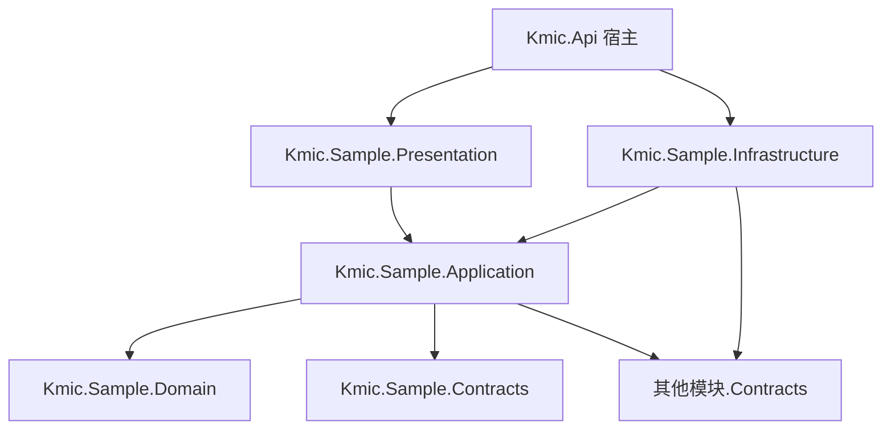

# 07 业务模块标准写法

- 状态：已确认（2026-11-04，D1～D3 均按建议确定）；之后的修订见文末“修订记录”
- 日期：2026-11-04
- 适用范围：每个业务模块与平台模块的项目结构、注册方式、文件组织、各构件的标准写法、测试写法、模块设计文档格式
- 依据：ADR-0003、ADR-0004、ADR-0006、ADR-0021；05 系列全部；06 编码规范

## 0. 范围

| 本文内容 | 不在本文 |
|---|---|
| 一个模块由哪些项目组成、怎么注册到宿主 | 各构件的设计与规则（05 系列）；本文只给写法并注明出处 |
| 每个项目的目录结构、一个用例由哪些文件组成 | 通用编码规则（06） |
| 各构件的标准示例：聚合、仓储、映射、命令、查询、授权、端点、跨模块通信、后台处理 | 任何具体业务模块的划分与设计 |
| 新增用例、新增模块的步骤；`dotnet new` 模块模板的内容 | 宿主、BuildingBlocks 本身的实现 |
| 模块测试的写法；业务模块设计文档的格式 | 实施顺序（08） |

### 0.1 本文决定的分类

| 类别 | 本文中的内容 |
|---|---|
| 第一类：现在确定 | D1～D3：模块注册类的位置、Application 的文件粒度、模块模板与参考模块的形态 |
| 第二类：框架定写法，业务定用不用 | 第 4 节中标为“按需”的构件（Contracts 查询、事件、订阅、定时任务、后台作业、编号、附件、通知）——模块需要时按本文写，不需要就不写 |
| 第三类：延后 | 无 |

对照 00-README“延后事项”表：本文是写法模板，`Sample` 不是业务模块，**不触发**任何延后事项。表中“关系可见”“授予有效期”等事项在第一个真实业务模块设计时，按第 8 节模块设计文档模板的“延后事项对照”一节处理。

### 0.2 框架负责 / 业务负责

| 框架负责（本文） | 业务负责（各模块设计时决定） |
|---|---|
| 项目结构、注册方式、目录与文件组织 | 有哪些模块、各模块的边界 |
| 每种构件“怎么写” | 模块有哪些聚合、用例、权限点、范围对象、事件 |
| 模块设计文档的格式与必填项 | 设计文档的内容 |

文中的 `Sample` 模块、`Sample` 聚合（单据：标题、明细、草稿 → 已提交 → 已通过 / 已驳回）及其全部用例都是**示例**，只用于演示写法，不代表任何业务规则。

---

## 1. 旧项目怎么做 → 新框架怎么做

| 问题 | 旧项目 | 新框架 | 章节 |
|---|---|---|---|
| 一个功能的代码在哪 | 页面 `.aspx.cs` + ashx 中的 `switch(Ctype)` 分支 + BLL + 手写 SQL，分散且无固定位置 | 一个用例一个文件夹：命令（含声明）、校验器、处理器；端点一个文件 | 3 |
| 巨型文件 | ashx 单文件 3000～1.4 万行 | 一个类型一个文件；一个端点一个文件 | 3、D2 |
| 公共逻辑 | `BasePage` 基类取用户、判登录、判权限 | 管道统一处理，处理器只写业务编排 | 4.3 |
| 新增功能的步骤 | 无约定，按个人习惯 | 新增用例、新增模块各有固定步骤清单 | 5、6 |
| 新模块的起点 | 复制已有页面改 | `dotnet new` 生成骨架 + 可运行的参考模块 | D3 |
| 设计文档 | 无 | 每个模块一份设计文档，格式固定，含延后事项对照 | 8 |

---

## 2. 模块的组成与注册

### 2.1 项目

每个模块 5 个项目（ADR-0004），另有测试项目：



| 项 | 约定 |
|---|---|
| 模块名 | 单个英文名词，大驼峰（`Sample`、`Identity`）；即 schema 名、权限点 / 错误码 / 消息名前缀、路由前缀（小写）。模块名是稳定契约，发布后不改 |
| 目录 | `src/Modules/Sample/Kmic.Sample.{层}/`；测试 `tests/Modules/Sample/` |
| 模块名常量 | `Kmic.Sample.Contracts` 中的 `SampleModuleInfo.Name`；模块内各层通过引用链都能看到（Application → Contracts），其他模块通过 Contracts 引用 |
| 模块编号 | 两位数字，登记在模块登记表（2.4），用于日志 `EventId` 分段（06 D6）：编号 `NN` 的模块使用 `NN000`～`NN999` |

### 2.2 D1 模块注册类放在哪里

ADR-0021 规定每个模块提供一个 `IModule`，负责注册服务、端点、权限点、定时任务和迁移；05-06 D1 写的是“`IModule.MapEndpoints` 扫描本模块 Presentation 程序集”。05-07、05-08 的示例把 `IModule` 放在 Infrastructure。但 **Infrastructure 不引用 Presentation**（ADR-0004），放在 Infrastructure 的注册类拿不到端点所在的程序集；而 Presentation 只能引用 Application，也拿不到 DbContext。需要定下注册类的位置。

| 选项 | 做法 | 优点 | 缺点 |
|---|---|---|---|
| **A 两个注册类** | Infrastructure 中 `SampleModule : IModule`（服务、数据、消息、调度）；Presentation 中 `SampleEndpoints : ModuleEndpoints`（端点）；宿主 `AddModule<SampleModule, SampleEndpoints>()` | 不改变 ADR-0004 的引用规则；Worker 角色天然只用第一个类（05-08：Worker 不映射端点）；两个类在编译期由宿主配对 | 每个模块两个注册类；需要启动校验两者的模块名一致 |
| B 每个模块增加第 6 个项目 `Kmic.Sample.Module` | 组合根项目引用 Infrastructure 与 Presentation，`IModule` 放在这里 | 一个注册类 | 违背 ADR-0004 的“5 个项目”，15 个模块多 15 个项目；这个项目能同时看到所有层，成为新的“什么都能引用”的位置 |
| C 宿主按程序集名称约定加载 Presentation | `IModule` 在 Infrastructure，按字符串 `Kmic.Sample.Presentation` 找端点程序集 | 一个注册类，不加项目 | 依赖字符串约定，改名后要到运行时才发现；隐式 |

- **决定（已确认，2026-11-04）**：A。
- **理由**：A 是唯一既不改引用规则、又完全显式的做法；“两个注册类”恰好对应“服务端组装”与“HTTP 暴露”两件事，与 Api / Worker 两种角色的分工一致。
- **取舍**：每个模块多一个很小的类（通常只有一行）。相应地，05-06 D1 中端点扫描由 `ModuleEndpoints` 承担，ADR-0021 第 2 节的注册写法为 `AddModule<QuotationModule, QuotationEndpoints>()`；05-07 的模块依赖按模块名声明（见下），因为模块之间只能引用 Contracts，拿不到对方的 `CustomerModule` 类型。

### 2.3 注册类的形态

```csharp
// BuildingBlocks.Infrastructure
public interface IModule
{
    string Name { get; }                                   // = XxxModuleInfo.Name
    Assembly ApplicationAssembly { get; }                  // 框架从这里扫描用例、权限点、范围对象、编号规则、作业、上传档案、通知模板、设置
    void AddServices(IServiceCollection services);         // DbContext、仓储、Contracts 实现、类型化客户端、Options
    void DeclareDependencies(IModuleDependencies d) { }    // d.DependsOn(CustomerModuleInfo.Name)
    void ConfigureMessaging(IMessagingBuilder m) { }       // 订阅（05-07 第 7.2 节）
    void ConfigureScheduling(ISchedulingBuilder s) { }     // 定时任务（05-08 第 5 节）
}

// BuildingBlocks.Presentation
public abstract class ModuleEndpoints
{
    public abstract string Module { get; }                 // = XxxModuleInfo.Name
    // 扫描本类所在程序集的 IEndpoint，映射到 /api/v{n}/{module 小写}（05-06 D1、D3）
    public virtual void ConfigureGroup(RouteGroupBuilder group) { }   // 模块级的路由组设置（极少使用）
}
```

```csharp
// Kmic.Sample.Contracts/SampleModuleInfo.cs
public static class SampleModuleInfo
{
    public const string Name = "Sample";
}

// Kmic.Sample.Infrastructure/SampleModule.cs
public sealed class SampleModule : IModule
{
    public string Name => SampleModuleInfo.Name;
    public Assembly ApplicationAssembly => typeof(ISampleQueryDb).Assembly;

    public void AddServices(IServiceCollection services)
    {
        services.AddModuleDbContexts<SampleDbContext, SampleQueryDbContext, ISampleQueryDb>();
        services.AddScoped<ISampleRepository, SampleRepository>();
        services.AddKmicOptions<SampleImportOptions>(SampleImportOptions.Section);
    }

    public void ConfigureScheduling(ISchedulingBuilder s) =>
        s.Schedule<CloseExpiredSamplesCommand>("Sample.CloseExpiredSamples", cron: "0 0 2 * * ?",
            run => new CloseExpiredSamplesCommand(run.ScheduledFireTime));
}

// Kmic.Sample.Presentation/SampleEndpoints.cs
public sealed class SampleEndpoints : ModuleEndpoints
{
    public override string Module => SampleModuleInfo.Name;
}

// Kmic.Api/Program.cs
builder.AddKmicHost()
       .AddModule<IdentityModule, IdentityEndpoints>()
       .AddModule<SampleModule, SampleEndpoints>();
```

| 启动校验 | 规则 |
|---|---|
| 配对 | `IModule.Name` 与 `ModuleEndpoints.Module` 相同；同一模块名只注册一次 |
| 归属 | `ApplicationAssembly` 的程序集名为 `Kmic.{Name}.Application`；端点程序集为 `Kmic.{Name}.Presentation` |
| 依赖 | `DependsOn` 的模块已注册且已启用（05-07 第 4.1 节） |
| 停用 | 配置 `Modules:{模块}:Enabled = false` 时该模块不注册服务、端点、订阅、调度；依赖它的模块已启用 → 拒绝启动 |

- 处理器、校验器、端点、EF 配置一律自动发现（ADR-0021 第 2 节），`AddServices` 中只写自动发现做不到的注册。

### 2.4 模块登记表

`KMIC.Platform/docs/modules/README.md` 维护全部模块的登记表：

| 模块 | schema | 编号 | 类型 | 依赖 | 负责人 | 设计文档 |
|---|---|---|---|---|---|---|
| Identity | `Identity` | 10 | 平台 | — | | `modules/identity/` |
| Sample | `Sample` | 99 | 参考（D3） | Identity | | 本文 |

- 编号 10～19 留给平台模块，20～89 给业务模块，99 为参考模块。架构测试检查：模块名、编号唯一；`[LoggerMessage]` 的 `EventId` 落在本模块的编号段内。

---

## 3. 目录结构

### 3.1 各项目

```text
src/Modules/Sample/
├─ Kmic.Sample.Domain/
│  ├─ AssemblyInfo.cs                 Vogen 默认配置（模板生成，05-01 第 4.1 节）
│  ├─ Samples/                        一个聚合一个文件夹
│  │  ├─ Sample.cs                    聚合根（含状态机声明）
│  │  ├─ SampleItem.cs                子实体
│  │  ├─ SampleId.cs  SampleItemId.cs
│  │  ├─ SampleStatus.cs  SampleAction.cs
│  │  ├─ Events/SampleSubmitted.cs …  领域事件
│  │  └─ ISampleRepository.cs
│  ├─ Shared/                         多个聚合共用的值对象、领域服务、计算策略
│  └─ Errors/SampleErrors.cs          错误目录：唯一的文件夹，按聚合分文件（05-01 第 2.4 节）
│
├─ Kmic.Sample.Application/
│  ├─ ISampleQueryDb.cs               查询接口（05-03 D1）
│  ├─ SamplePermissions.cs            权限点（05-05 第 3 节）
│  ├─ SampleScopes.cs                 范围对象（05-05 第 5.1 节）
│  ├─ SampleNumberRules.cs            编号规则（按需，05-13）
│  ├─ Samples/                        按聚合分组
│  │  ├─ SamplePolicy.cs              资源策略
│  │  ├─ SampleActions.cs             资源动作目录
│  │  ├─ Create/                      一个用例一个文件夹
│  │  │  ├─ CreateSampleCommand.cs
│  │  │  ├─ CreateSampleCommandValidator.cs
│  │  │  └─ CreateSampleCommandHandler.cs
│  │  ├─ Submit/ …
│  │  ├─ GetDetail/
│  │  │  ├─ GetSampleDetailQuery.cs
│  │  │  ├─ SampleDetailResponse.cs
│  │  │  └─ GetSampleDetailQueryHandler.cs
│  │  ├─ List/
│  │  │  ├─ ListSamplesQuery.cs  SampleListItem.cs  SampleSort.cs
│  │  │  └─ ListSamplesQueryHandler.cs
│  │  ├─ CloseExpired/ …              定时任务的命令也是用例
│  │  ├─ EventHandlers/               领域事件处理器
│  │  └─ Shared/                      本聚合多个用例共用的 DTO
│  └─ Contracts/                      本模块 Contracts 接口的实现（薄适配器，05-07 D2）
│
├─ Kmic.Sample.Infrastructure/
│  ├─ SampleModule.cs
│  ├─ Persistence/
│  │  ├─ SampleDbContext.cs  SampleQueryDbContext.cs
│  │  ├─ Configurations/SampleConfiguration.cs …
│  │  ├─ Repositories/SampleRepository.cs
│  │  └─ Migrations/
│  ├─ Clients/                        外部系统的类型化客户端（按需）
│  └─ Options/SampleImportOptions.cs
│
├─ Kmic.Sample.Presentation/
│  ├─ SampleEndpoints.cs
│  └─ Samples/                        按资源分组，一个端点一个文件（请求模型 + 端点，05-06）
│     ├─ CreateSample.cs  SubmitSample.cs  GetSample.cs  ListSamples.cs
│
└─ Kmic.Sample.Contracts/
   ├─ SampleModuleInfo.cs
   ├─ ISampleReferences.cs …          对外查询接口（按需）
   ├─ Events/                         集成事件（按需）
   └─ Snapshots/                      快照 DTO（按需）

tests/Modules/Sample/
├─ Kmic.Sample.Domain.Tests/        Samples/SampleTests.cs、Builders/SampleBuilder.cs
└─ Kmic.Sample.IntegrationTests/    按用例：Samples/SubmitSampleCommandTests.cs …
tests/Kmic.Api.Tests/Sample/        端点与授权矩阵（ADR-0021：API 测试集中在一个项目，按模块分目录）
```

| 规则 | 说明 |
|---|---|
| 命名空间 = 目录 | `Kmic.Sample.Application.Samples.Submit`（06 第 3.2 节） |
| 订阅、定时任务的命令 | 也是用例，放在**所修改对象**的用例文件夹中；注册（订阅名、Cron）集中在 `SampleModule` |
| 跨聚合的用例 | 放在“主要修改对象”的聚合文件夹中；一个命令仍然只修改一个聚合（ADR-0003） |
| 共用 DTO | 同一聚合内共用放 `Samples/Shared/`；不跨聚合共用响应 DTO（各自演进） |
| 不允许的目录 | `Helpers/`、`Utils/`、`Common/`、`Services/` 这类按“技术杂项”命名的目录（评审）；确有共用逻辑时，按它在领域中的含义命名 |

### 3.2 D2 一个用例的文件粒度

06 第 3.2 节规定“一个文件一个顶层类型”，并把“一个用例的命令、校验器、处理器是否同文件”留给本文。

| 选项 | 做法 | 优点 | 缺点 |
|---|---|---|---|
| **A 一个类型一个文件，一个用例一个文件夹** | 如 3.1：`Submit/` 下三个文件 | 与 06 的通用规则一致，没有例外；文件名即类型名，按名称跳转、搜索、评审差异都最直接；05-02 第 2.2 节已按此写 | 小用例也是三四个文件 |
| B 一个用例一个文件 | `SubmitSample.cs` 中放命令、校验器、处理器、响应 | 一个用例一屏看完（“垂直切片”常见写法） | 文件名与类型名不一致；用例变大后文件很长，又回到“大文件”；与 06 规则冲突需要开例外 |

- **决定（已确认，2026-11-04）**：A。例外只有两种，都是“只服务于一个类型的附属类型”：
  - Presentation 中请求模型与端点同一文件（05-06 已定）；
  - 只被一个命令 / 查询使用的内嵌 DTO（如 4.3 的 `CreateSampleItem`）与该消息同一文件。被第二个消息使用时即移到 `Shared/`。
  - 06 第 3.2 节“一个文件一个顶层类型”的例外由本条给出，KM 规则不检查这一项，由评审把关。
- **理由**：用例文件夹已经把相关文件放在一起，B 的“看得全”优势很小；A 让每个类型都有固定、可预测的位置。
- **取舍**：文件数量多一些，模块模板与 IDE 模板负责生成。

---

## 4. 标准写法

各小节只给写法和要点，规则的来源写在小节标题后。

### 4.1 聚合（05-01）

```csharp
// Kmic.Sample.Domain/Samples/Sample.cs
public sealed class Sample : AggregateRoot<SampleId>, IHasOwner, IHasOrgUnit, ISoftDeletable
{
    private static readonly StateMachine<Sample, SampleStatus, SampleAction> _machine = /* 05-01 第 7.2 节 */;

    private readonly List<SampleItem> _items = [];

    public string Number { get; private set; } = null!;
    public string Title { get; private set; } = null!;
    public SampleStatus Status { get; private set; } = null!;
    public UserId OwnerId { get; private set; }            // 所属人：创建人（示例中的业务含义，写在注释里，05-05 第 5.1 节）
    public OrgUnitId OrgUnitId { get; private set; }       // 所属组织：创建时创建人的组织
    public DateOnly? DueDate { get; private set; }
    public IReadOnlyList<SampleItem> Items => _items;

    private Sample() { }                                   // EF
    private Sample(SampleId id) : base(id) { }

    public static Result<Sample> Create(string number, string title, UserId owner, OrgUnitId orgUnit, DateOnly? dueDate)
    {
        if (string.IsNullOrWhiteSpace(title)) return SampleErrors.TitleRequired;

        var sample = new Sample(SampleId.New())
        {
            Number = number, Title = title.Trim(), OwnerId = owner, OrgUnitId = orgUnit, DueDate = dueDate,
        };
        _machine.Start(sample, reason: null);
        sample.Raise(new SampleCreated(sample.Id));
        return sample;
    }

    public Result Submit(DateTimeOffset now, string? reason)
    {
        var fired = _machine.Fire(this, SampleAction.Submit, reason);
        if (fired.IsFailure) return fired;

        Raise(new SampleSubmitted(Id, now));
        return Result.Success();
    }
}
```

| 要点 | 出处 |
|---|---|
| 工厂方法创建，构造函数私有；属性 `private set`；集合只读公开 | 05-01 第 3.2 节，KM0103～KM0105 |
| 不取时间、不取当前用户：`now`、操作人、业务日期都由处理器传入 | 05-01 第 9 节，05-13 D3 |
| 状态只经状态机改；需要通知时显式 `Raise` | 05-01 第 7、8 节 |
| 跨模块引用用 `XxxRef` 强类型 ID，不持有其他聚合 | 05-01 第 3.3 节 |
| 业务失败返回错误目录中的 `Error` | 05-01 第 2 节 |

### 4.2 持久化（05-03、05-05 第 5.4 节）

```csharp
// Kmic.Sample.Infrastructure/Persistence/Configurations/SampleConfiguration.cs
internal sealed class SampleConfiguration : IEntityTypeConfiguration<Sample>
{
    public void Configure(EntityTypeBuilder<Sample> b)
    {
        b.ToTable(t => t.HasComment("示例单据；Sample 模块；一行代表一张示例单据；编号全局唯一；草稿可删除，提交后只能作废"));
        b.Property(x => x.Number).HasMaxLength(32).IsCaseInsensitive()
         .HasComment("单据编号；创建时分配，全局唯一且不可修改；示例：SP-202611-0001");
        b.HasIndex(x => x.Number).IsUnique().MapsToError(SampleErrors.NumberDuplicated);
        b.Property(x => x.Title).HasMaxLength(200).HasComment("标题；保存前去除首尾空格");
        b.HasMany(x => x.Items).WithOne().HasForeignKey("SampleId");
        b.Navigation(x => x.Items).HasField("_items");

        b.HasDataScope(SampleScopes.Sample);
    }
}

// Kmic.Sample.Infrastructure/Persistence/Repositories/SampleRepository.cs
internal sealed class SampleRepository(SampleDbContext db)
    : EfRepository<SampleDbContext, Sample, SampleId>(db), ISampleRepository
{
    protected override IQueryable<Sample> Aggregate(IQueryable<Sample> set) => set.Include(x => x.Items);
}

// Kmic.Sample.Application/ISampleQueryDb.cs
public interface ISampleQueryDb
{
    IQueryable<Sample> Samples { get; }                // 只暴露聚合根（子实体不得单独暴露，05-05 第 5.4 节）
}
```

| 要点 | 出处 |
|---|---|
| 两个 DbContext：写入（跟踪）与查询（不跟踪），由 `AddModuleDbContexts` 注册 | 05-03 第 2 节 |
| 审计字段、软删除、版本、schema、强类型 ID、枚举 CHECK 由约定处理，配置中不写 | 05-03 第 3～6 节 |
| 字符串列声明长度；`decimal` 声明精度；需要时声明不区分大小写 | 05-03 第 3.5～3.7 节 |
| 唯一约束映射错误码 | 05-03 第 7.3 节 |
| 数据范围在配置中声明 | 05-05 第 5.4 节 |
| 敏感字段在配置中标注数据分类 | 05-09 第 3.3 节、05-12 D2 |
| 表、列、人工索引写中文数据库注释（`HasComment`），缺失时启动失败 | 05-03 第 3.9 节（R01 M1） |
| 迁移：`dotnet ef migrations add <名称> -p Kmic.Sample.Infrastructure -c SampleDbContext`；初始迁移由新建模块的脚本生成（第 6.1 节），含 `InitializeModuleSchema` | 05-03 第 9 节 |

### 4.3 命令（05-02）

**创建**（取号放在最后，05-13 D1）：

```csharp
// Create/CreateSampleCommand.cs
[RequirePermission(SamplePermissions.Create), Idempotent, Audited]
public sealed record CreateSampleCommand(string Title, DateOnly? DueDate, IReadOnlyList<CreateSampleItem> Items)
    : ICommand<CreatedResponse<SampleId>>;

public sealed record CreateSampleItem(string Name, decimal Quantity);    // 只服务于本命令的内嵌 DTO，同文件（D2）

// Create/CreateSampleCommandValidator.cs
internal sealed class CreateSampleCommandValidator : AbstractValidator<CreateSampleCommand>
{
    public CreateSampleCommandValidator()
    {
        RuleFor(x => x.Title).NotEmpty().MaximumLength(200);
        RuleFor(x => x.Items).NotEmpty();
        RuleForEach(x => x.Items).ChildRules(i => i.RuleFor(x => x.Quantity).GreaterThan(0));
    }
}

// Create/CreateSampleCommandHandler.cs
public sealed class CreateSampleCommandHandler(
    ISampleRepository repository,
    IExecutionContext context,
    INumberGenerator numbers) : ICommandHandler<CreateSampleCommand, CreatedResponse<SampleId>>
{
    public async ValueTask<Result<CreatedResponse<SampleId>>> Handle(CreateSampleCommand command, CancellationToken cancellationToken)
    {
        var access = context.Access!;                                    // [RequirePermission] 保证是用户身份
        if (access.OrgUnitId is not { } orgUnit) return SampleErrors.OwnerHasNoOrgUnit;

        var number = await numbers.NextAsync(SampleNumberRules.Sample, ct: cancellationToken);   // 最后一个异步步骤
        var created = Sample.Create(number, command.Title, access.UserId, orgUnit, command.DueDate);
        if (created.IsFailure) return created.Error;

        foreach (var item in command.Items)
        {
            var added = created.Value.AddItem(item.Name, item.Quantity);
            if (added.IsFailure) return added.Error;
        }

        repository.Add(created.Value);
        return new CreatedResponse<SampleId>(created.Value.Id);          // 版本由框架回填（05-02 第 6.4 节）
    }
}
```

**修改**（加载 → 资源授权 → 业务方法；05-02 第 2.2 节示例为标准写法）：

```csharp
var sample = await repository.GetForUpdateAsync(command.SampleId, command.ExpectedVersion, cancellationToken);   // 第 2、5 层
if (sample.IsFailure) return sample.Error;

var allowed = authorizer.Check(sample.Value, SampleAction.Submit);                       // 第 3 层
if (allowed.IsFailure) return allowed.Error;

var submitted = sample.Value.Submit(time.GetUtcNow(), command.Reason);                      // 第 4 层
if (submitted.IsFailure) return submitted.Error;
```

| 要点 | 出处 |
|---|---|
| 每个命令：授权声明五选一、`[Audited]` / `[NotAudited]` 二选一；创建、提交、审批类 `[Idempotent]` | 05-02 第 3 节 |
| 修改类命令带 `ExpectedVersion` | 05-06 D6、05-03 第 6 节 |
| 处理器只编排：不 `SaveChanges`、不开事务、不写 Outbox；一个命令只改一个聚合 | 05-02 第 2.2、6 节 |
| 一个命令只取一次当前时间 | 05-13 第 3.1 节 |
| 校验器只查形状，不注入数据访问 | 05-02 第 4.4 节 |
| 用户传入的其他模块 ID 用 `CallerScoped` 查询校验 | 05-07 第 4 节 |

### 4.4 查询（05-03 D1、05-06 第 6 节、05-05 第 7 节）

**详情**（含 `allowedActions`）：

```csharp
[RequirePermission(SamplePermissions.View)]
public sealed record GetSampleDetailQuery(SampleId SampleId) : IQuery<SampleDetailResponse>;

public sealed class GetSampleDetailQueryHandler(ISampleQueryDb db, IAllowedActions<Sample> allowedActions)
    : IQueryHandler<GetSampleDetailQuery, SampleDetailResponse>
{
    public async ValueTask<Result<SampleDetailResponse>> Handle(GetSampleDetailQuery query, CancellationToken cancellationToken)
    {
        var sample = await db.Samples.Include(x => x.Items)
            .FindByIdOrNotFoundAsync(query.SampleId, SampleErrors.NotFound, cancellationToken);     // 范围外同样 NotFound（05-05 第 5.10 节）
        if (sample.IsFailure) return sample.Error;

        return SampleDetailResponse.From(sample.Value, allowedActions.For(sample.Value));   // 手写映射（03 第 4.8 节）
    }
}
```

**列表**（投影 + 筛选 + 排序 + 分页）：

```csharp
[RequirePermission(SamplePermissions.View)]
public sealed record ListSamplesQuery(
    string? Q, IReadOnlyList<string>? Status, DateOnly? CreatedFrom, DateOnly? CreatedTo,
    int Page = 1, int PageSize = 20, string? Sort = null) : IQuery<PagedResult<SampleListItem>>;

public sealed class ListSamplesQueryHandler(ISampleQueryDb db, IBusinessCalendar calendar)
    : IQueryHandler<ListSamplesQuery, PagedResult<SampleListItem>>
{
    public async ValueTask<Result<PagedResult<SampleListItem>>> Handle(ListSamplesQuery query, CancellationToken cancellationToken)
    {
        var samples = db.Samples.AsQueryable();

        if (!string.IsNullOrWhiteSpace(query.Q))
            samples = samples.Where(x => KmicFunctions.ContainsText(x.Number, query.Q) ||
                                     KmicFunctions.ContainsText(x.Title, query.Q));       // 06 第 11.2 节
        if (query.Status is { Count: > 0 })
            samples = samples.Where(x => query.Status.Contains(x.Status.Code));
        if (query.CreatedFrom is { } from)
            samples = samples.Where(x => EF.Property<DateTimeOffset>(x, "CreatedAt") >= calendar.StartOf(from));
        if (query.CreatedTo is { } to)
            samples = samples.Where(x => EF.Property<DateTimeOffset>(x, "CreatedAt") < calendar.StartOf(to.AddDays(1)));   // 半开区间（05-13 第 3.4 节）

        return await samples
            .Select(x => new SampleListItem(x.Id, x.Number, x.Title, x.Status.Code, EF.Property<DateTimeOffset>(x, "CreatedAt")))
            .ToPagedAsync(query.Page, query.PageSize, query.Sort, SampleSort.Map, cancellationToken);
    }
}
```

| 要点 | 出处 |
|---|---|
| 从 `ISampleQueryDb` 出发（已带数据范围与软删除过滤器）；列表、详情、导出、下拉共用同一个起点 | 05-05 第 5.4 节 |
| 列表投影到 DTO，不加载聚合；详情需要 `allowedActions` 时才加载聚合 | 05-05 D10 |
| 筛选模型的字段名与查询参数一致；日期筛选参数为 `DateOnly` | 05-06 第 6.4 节、05-13 第 3.4 节 |
| 引用其他模块的显示名：先收集本页 ID，再一次 `ResolveAsync` | 05-07 第 4 节 |
| 导出复用同一个查询的筛选与排序 | 05-08 第 6.8 节 |
| 数据量可能很大的列表声明上限计数（`CountMode.Capped`），响应带 `totalCountExact` | 05-06 第 6.1 节（R01 M4） |

> `ListSamplesQuery` 的参数形态、`PagedResult<T>`、`FindByIdOrNotFoundAsync` 的签名以 05-06 第 6 节与框架实现为准；此处只示意调用顺序。

> 可见性：第 4.3、4.4 节示例中的命令、查询处理器是 `public sealed`，原因与守护方式见 05-02 第 2.2 节；校验器、端点、EF 配置等为 `internal sealed`。

### 4.5 授权声明（05-05）

```csharp
// SamplePermissions.cs
[PermissionGroup("Sample", "示例")]
public static class SamplePermissions
{
    [Permission("查看示例")] public const string View   = "Sample.Sample.View";
    [Permission("新建示例")] public const string Create = "Sample.Sample.Create";
    [Permission("提交示例")] public const string Submit = "Sample.Sample.Submit";
}

// SampleScopes.cs
[DataScopeObjectGroup("Sample")]
public static class SampleScopes
{
    [DataScopeObject("示例单据")] public const string Sample = "Sample.Sample";
}

// Samples/SamplePolicy.cs —— 纯函数；无特殊规则的动作显式 Allow
internal sealed class SamplePolicy : IResourcePolicy<Sample, SampleAction>
{
    public PolicyDecision Evaluate(IAccessContext access, Sample s, SampleAction action) => action switch
    {
        _ when action == SampleAction.Submit
            => s.OwnerId == access.UserId
                ? PolicyDecision.Allow
                : PolicyDecision.Deny(DenialReason.ResourceDenied, SampleErrors.NotOwner),
        _ => PolicyDecision.Allow,
    };
}

// Samples/SampleActions.cs —— 动作目录：权限点与命令的 [RequirePermission] 同源
internal sealed class SampleActions : ResourceActionCatalog<Sample, SampleAction>
{
    protected override void Define(IResourceActionBuilder<Sample, SampleAction> a) =>
        a.Action(SampleAction.Submit, SamplePermissions.Submit, state: StateMachine(SampleAction.Submit));
}
```

### 4.6 端点（05-06）

```csharp
// Kmic.Sample.Presentation/Samples/SubmitSample.cs
public sealed record SubmitSampleRequest(long ExpectedVersion, string? Reason);

internal sealed class SubmitSampleEndpoint : IEndpoint
{
    public void Map(IEndpointRouteBuilder group) =>
        group.MapPost("/samples/{id}/submit", HandleAsync)
             .Sends<SubmitSampleCommand>()
             .WithSummary("提交示例");

    private static async Task<IResult> HandleAsync(
        SampleId id, SubmitSampleRequest request, ICommandSender sender, CancellationToken ct)
    {
        var result = await sender.SendAsync(new SubmitSampleCommand(id, request.ExpectedVersion, request.Reason), ct);
        return result.ToOk();
    }
}
```

| 动作 | 方法与路径（模块前缀由 `SampleEndpoints` 加上：`/api/v1/sample`） | 结果转换 |
|---|---|---|
| 新建 | `POST /samples` | `ToCreated(id => $"/api/v1/sample/samples/{id}")` |
| 详情 | `GET /samples/{id}` | `ToOk()` |
| 列表 | `GET /samples`（查询参数 `[AsParameters]`） | `ToOk()` |
| 修改 | `PUT /samples/{id}` | `ToOk()`（返回新版本） |
| 动作 | `POST /samples/{id}/submit` | `ToOk()` |
| 删除 | `DELETE /samples/{id}?expectedVersion=…` | `ToNoContent()` |
| 后台作业 | `POST /samples/imports` | `ToAccepted(…)` |

- 统计、大范围查询等重型端点声明并发策略：`.RequireConcurrency(ConcurrencyPolicies.Heavy, ConcurrencyPolicies.HeavyPerUser)`（05-06 第 8.3 节，R01 M5）。
- 端点的 `.WithSummary(...)`、请求模型与响应 DTO 的 XML 注释就是前端看到的接口文档，缺少时 CI 失败（05-06 第 7.1 节，R01 M2）。

### 4.7 跨模块（按需，05-07）

| 需要 | 写法 | 出处 |
|---|---|---|
| 让其他模块查本模块数据 | Contracts 中定义 `ISampleReferences` / `ISampleXxxQueries`；Application 的 `Contracts/` 文件夹中写薄适配器，发送带 `[ContractQuery(...)]` 的查询；在 `AddServices` 中注册 | 05-07 第 4.1 节 |
| 查其他模块数据 | 在 `DeclareDependencies` 中 `d.DependsOn(CustomerModuleInfo.Name)`；处理器注入对方的 Contracts 接口 | 05-07 第 4.1 节 |
| 通知其他模块“发生了什么” | Contracts 中定义 `[IntegrationMessage("Sample.SampleApproved")]` 事件；在**领域事件处理器**或命令处理器中 `publisher.Add(...)` | 05-07 第 5 节 |
| 被其他模块引用、需要同步副本 | 发布 `SampleChanged` 快照事件，实现 `ISampleSnapshotSource` | 05-07 第 5.2、8.3 节 |
| 收到其他模块的事件后做事 | 本模块定义 `[SystemOnly]` 命令；在 `ConfigureMessaging` 中 `Subscribe<事件, 命令>("Sample.Xxx", 映射)` | 05-07 第 7.2 节 |
| 请平台模块做事（发通知、登记文件引用） | `publisher.Send(new SendNotification(...))` | 05-07 D6、05-11 |

```csharp
// Samples/EventHandlers/PublishSampleApproved.cs —— 领域事件 → 集成事件
internal sealed class PublishSampleApproved(IIntegrationEventPublisher publisher)
    : IDomainEventHandler<SampleApproved>
{
    public ValueTask<Result> HandleAsync(SampleApproved e, CancellationToken ct)
    {
        publisher.Add(new Contracts.Events.SampleApproved(e.SampleId.Value, e.Number, e.ApprovedAt));
        return ValueTask.FromResult(Result.Success());
    }
}
```

- 领域事件与集成事件同名、以命名空间区分（05-07 第 3.3 节）；集成事件的载荷只用 `Guid` 与基础类型（Contracts 不含强类型 ID）。
- 需要加载本模块其他数据时，领域事件处理器可以注入本模块仓储（05-02 第 6.2 节）。

### 4.8 后台处理（按需，05-08）

| 需要 | 写法 | 出处 |
|---|---|---|
| 定时执行 | `[SystemOnly]` 命令（可重复执行）+ `ConfigureScheduling` 中 `Schedule<命令>(名称, Cron, 映射)` | 05-08 第 5 节 |
| 用户发起的长任务（导入、导出、批量） | `[BackgroundJob]` 作业参数 + `IJobHandler<T>`（编排者，只发命令和查询）+ 一个提交作业的 `[Idempotent]` 命令 + 返回 202 的端点 | 05-08 第 6 节 |
| 启动时执行 | 一般不需要；确需时实现 `IStartupTask` | 05-08 第 3.3 节 |

### 4.9 其他按需构件

| 需要 | 写法 | 出处 |
|---|---|---|
| 部署配置 | Infrastructure `Options/` 中的 `sealed class`，`AddKmicOptions<T>` | 05-10 第 2 节 |
| 管理员可改的系统设置、用户偏好 | Application 中声明设置 / `[Preference]` | 05-10 第 6、7 节 |
| 字典取值校验 | 注入 `IDictionaries`，`EnsureSelectableAsync` | 05-10 D3 |
| 业务编号 | `SampleNumberRules` 中 `[NumberRule]` 常量；处理器最后一步 `NextAsync` | 05-13 第 2 节 |
| 附件 | `[UploadProfile]` 声明；命令引用临时文件 ID，经 `IFileAttachments.AttachAsync(owner, fileIds)` 关联（直接发送 `AttachFiles` 由分析器拦截） | 05-11 第 3 节 |
| 通知 | `[NotificationTemplate]` 模型；`publisher.Send(SendNotification.For(...))` | 05-11 第 7、8 节 |
| 外部系统 | Application 中定义接口，Infrastructure `Clients/` 中 `AddKmicHttpClient` | 05-11 第 9 节 |
| 日志 | 每个类旁边的 `{类名}Log` 静态 partial 类，`[LoggerMessage]`，`EventId` 在本模块编号段 | 06 D6 |
| 缓存 | 只在确有需要时，按 05-10 第 4.1 节分类说明 | 05-10 第 4 节 |

---

## 5. 新增一个用例的步骤

以“给 `Sample` 增加‘驳回’动作”为例（示例）：

| 步骤 | 位置 | 内容 |
|---|---|---|
| 1 | Domain | 聚合方法 `Reject(now, reason)`；状态机增加流转；需要通知时 `Raise`；错误目录增加错误 |
| 2 | Domain 测试 | 新方法的成功、失败、非法流转 |
| 3 | Application | `SamplePermissions` 增加权限点；`SampleActions` 增加动作；`SamplePolicy` 中写明规则或显式 `Allow` |
| 4 | Application | `Samples/Reject/`：命令（声明）、校验器（如需要）、处理器 |
| 5 | Presentation | `Samples/RejectSample.cs`：请求模型 + 端点 |
| 6 | 集成测试 | 处理器：成功、业务失败、版本冲突、幂等重放 |
| 7 | API 测试 | 授权：无权限点 403、范围外 404、资源策略拒绝 403；`allowedActions` 一致性测试自动覆盖新动作 |
| 8 | 文档 | 模块设计文档的“用例”“权限点”两张表；新术语登记术语表（06 D3） |
| 9 | 检查 | 本地 `dotnet build`（分析器）、`dotnet test`；OpenAPI 与契约快照的变化在合并请求中可见 |

需要表结构变化时，在步骤 1 之后增加迁移（`dotnet ef migrations add`），破坏性变化按 06 第 11.3 节分步。

---

## 6. 新增一个模块

### 6.1 D3 模块模板与参考模块的形态

ADR-0004 已定用 `dotnet new` 模板生成 5 个项目和标准目录。还需要决定：模板生成什么内容，以及“完整写法”的样板放在哪里。

| 选项 | 做法 | 优点 | 缺点 |
|---|---|---|---|
| A 模板生成完整示例代码 | 新模块生成后就带一个完整的示例聚合和全部用例，开发者改名或删除 | 新模块马上能运行 | 每个新模块都要删一遍示例代码，漏删就留在生产代码中；模板中的示例不参与编译和测试，框架改动后会悄悄过时 |
| B 模板只生成空骨架，写法只在本文中 | 模板生成项目、引用、注册类、空的权限点 / 错误目录 | 生成物干净 | 文档中的示例代码同样不经编译，会与框架实现逐渐脱节 |
| **C 空骨架模板 + 仓库中常驻一个可运行的参考模块 `Sample`** | 模板同 B；`src/Modules/Sample` 是一个真实、完整、随 CI 编译和测试的模块，覆盖本文第 4 节全部构件；只在开发与测试环境注册，生产不注册 | 写法样板始终能编译、测试通过，框架改动若破坏写法会在 CI 中立刻暴露；同时是框架的端到端集成测试；新模块不带任何多余代码 | 需要维护一个不上生产的模块；需要一条规则保证它不会被生产环境注册 |

- **决定（已确认，2026-11-04）**：C。
  - 模板：`kmic-module`，生成 5 个项目、测试项目、`CustomerModuleInfo`、`CustomerModule`、`CustomerEndpoints`、两个 DbContext、`ICustomerQueryDb`、空的 `CustomerPermissions` / `CustomerScopes` / `CustomerErrors`、解决方案过滤文件 `Customer.slnf`。模板经下文的脚本调用，不直接运行 `dotnet new`。
  - 参考模块：`Sample` 编号 99；宿主中以 `AddModule<SampleModule, SampleEndpoints>(onlyIn: KmicEnvironments.NonProduction)` 注册，生产环境启动校验发现 `Sample` 被注册即拒绝启动。
  - 本文第 4 节的示例在实施后改为引用 `Sample` 模块中的真实文件，文档只保留要点，避免两份代码。
- **理由**：“标准写法”的价值在于始终正确；只有参与编译和测试的样板才能长期保持正确。
- **取舍**：多维护一个模块；它也承担了框架端到端测试的作用，这部分维护本来就要做。

新建模块的方式（原型 #11，`docs/framework/spikes/11-module-template.md`）：

- **用脚本新建模块**：`dotnet run scripts/new-module.cs -- <模块名> <编号>`。脚本依次：对照模块登记表校验名称与编号 → `dotnet new kmic-module` → `dotnet sln Kmic.slnx add`（显式指定解决方案）→ 构建 → 生成初始迁移 → `check.cs --fix` → 格式检查 → 运行模块测试，任一步失败即停止。模板本身不做“加入解决方案”：模板引擎的这个功能只认 `.sln`，并且会向上层目录查找，原型中误改了上层目录的解决方案。
- **初始迁移由脚本调用 EF 工具生成**，不是模板中的静态文件：脚本运行 `dotnet ef migrations add InitializeModuleSchema`，迁移内容总是与当时的模型一致，框架表结构变化后不需要同步修改模板。EF 工具作为仓库本地工具锁定版本（根目录 `dotnet-tools.json`，与 EF Core 同为 10.0.14），脚本自动执行 `dotnet tool restore`。
- 迁移文件按生成代码处理，编码由 `check.cs --fix` 规整（06 第 3.2 节）。

### 6.2 步骤

| 步骤 | 内容 |
|---|---|
| 1 | 写模块设计文档 `docs/modules/<模块>/README.md`（第 8 节格式），评审通过 |
| 2 | 模块登记表（2.4）登记模块名、schema、编号、依赖、负责人 |
| 3 | `dotnet run scripts/new-module.cs -- <模块> <编号>`（6.1） |
| 4 | 宿主 `Program.cs` 中 `AddModule<XxxModule, XxxEndpoints>()`；测试宿主同步注册 |
| 5 | `CODEOWNERS` 增加模块目录的负责人 |
| 6 | 按设计文档逐个用例实现（第 5 节） |
| 7 | 迁移脚本随 CI 生成，人工审查（05-03 第 9.2 节） |

### 6.3 模块划分检查表

“一个事务只改一个模块”（ADR-0006）不变，模块之间只有最终一致（事件、请求型消息）。因此，**必须在同一次提交中成立的规则（强不变量）决定模块边界**：它涉及的数据必须归同一个模块。发现一条强不变量跨了两个模块时，合并模块或调整数据归属，不在框架中增加跨模块事务。

| 框架负责 | 业务负责（每个模块设计时） |
|---|---|
| 强制“一个事务只改一个模块”（事务行为、架构测试）；跨模块通信机制（05-07）；少数横切场景的专门互斥协议（如附件，05-11 第 3.3 节） | 模块划分；列出强不变量并判断归属；逐项填写下表 |

| # | 检查项 | 不通过时 |
|---|---|---|
| 1 | 列出本模块的强不变量（**示例**：明细金额合计等于单据总额；同一时段同一资源不能被重复占用），每一条涉及的数据是否都归本模块所有 | 把数据移到本模块，或与另一个模块合并 |
| 2 | 每个命令是否只修改本模块的数据；需要其他模块改数据的地方，业务上能否接受最终一致（秒级延迟，失败后重试或人工处理） | 不能接受 → 它其实是第 1 项的强不变量 |
| 3 | 跨模块的“先检查、后写入”：命令用 Contracts 查询的结果做判断，查询之后、提交之前对方数据改变，后果能否接受 | 不能接受 → 调整数据归属；横切场景由框架提供专门协议，业务模块不自行加跨模块锁 |
| 4 | 本模块订阅的事件处理失败、进入死信时，业务上是否有可见的待处理状态和人工处理入口 | 补充状态与处理入口 |
| 5 | 需要的其他模块数据，用 Contracts 查询（实时）还是读模型（本地副本、最终一致），理由是否写明 | 按 05-07 第 4、8 节补充 |
| 6 | 模块之间的依赖是否单向、无环（`DependsOn`，05-07 第 4.1 节） | 调整职责，或改用事件反转依赖 |
| 7 | 拆成两个模块的理由（团队分工、变更频率、数据量、权限边界）是否大于因此失去的事务一致性 | 不拆 |

- 检查结论写进模块设计文档第 0 节（第 8 节），评审时逐项确认。

---

## 7. 测试写法

测试规则见 06 第 12 节，这里给出模块中三类测试的标准形态。

### 7.1 领域测试

```csharp
// tests/Modules/Sample/Kmic.Sample.Domain.Tests/Samples/SampleTests.cs
public sealed class SampleTests
{
    private static readonly DateTimeOffset _now = new(2026, 11, 4, 2, 0, 0, TimeSpan.Zero);

    [Fact]
    public void Submit_WhenDraftWithItems_ChangesStatusAndRaisesSubmitted()
    {
        var sample = SampleBuilder.Draft().WithItems(1).Build();

        var result = sample.Submit(_now, reason: null);

        result.ShouldBeSuccess();
        sample.Status.ShouldBe(SampleStatus.Submitted);
        sample.DomainEvents.ShouldContain(e => e is SampleSubmitted);
    }

    [Fact]
    public void Submit_WhenNoItems_FailsWithNoItems()
    {
        var sample = SampleBuilder.Draft().Build();

        sample.Submit(_now, reason: null).ShouldBeFailure(SampleErrors.NoItems);
    }
}
```

### 7.2 集成测试（处理器 + 真实数据库）

```csharp
// tests/Modules/Sample/Kmic.Sample.IntegrationTests/Samples/SubmitSampleCommandTests.cs
public sealed class SubmitSampleCommandTests(ModuleTestHost host) : ModuleTestBase(host)   // 每个测试类一个克隆库（06 D8）
{
    [Fact]
    public async Task Submit_WithStaleVersion_ReturnsVersionConflict()
    {
        var owner = TestIdentity.User("owner").WithRole(r => r.Permissions(SamplePermissions.Submit));
        var sample = await Seed(SampleBuilder.Draft().WithItems(1).OwnedBy(owner));

        await using var scope = App.As(owner);
        var result = await scope.SendAsync(new SubmitSampleCommand(sample.Id, ExpectedVersion: sample.Version - 1, Reason: null));

        result.ShouldBeFailure(CommonErrors.VersionConflict);
    }
}
```

### 7.3 模板为每个模块生成的测试

| 测试 | 内容 | 出处 |
|---|---|---|
| 启动 | 模块注册、用例目录、权限点目录、EF 模型校验全部通过 | 05-02、05-05、05-03 |
| 唯一约束映射 | 模块的每个唯一索引都登记了错误码 | 05-02 第 4.3 节 |
| `allowedActions` 一致性 | 动作目录中每个动作 ⇔ 对应命令不因第 1、3、4 层被拒 | 05-05 第 7.1 节 |
| 授权矩阵 | 每个范围对象：范围等级 × 数据归属 × 出口（列表 / 详情 / 导出 / 下拉 / 统计） | 05-05 第 12.2 节 |
| 消息契约快照 | 本模块 Contracts 中每个消息的 JSON Schema | 05-07 第 5.5 节 |
| 迁移 | 模型与最新迁移一致（无未生成的变更） | 05-03 第 9 节 |

---

## 8. 业务模块设计文档模板

每个业务模块在实现前写一份设计文档 `KMIC.Platform/docs/modules/<模块小写>/README.md`，评审通过后才开始编码。格式：

| 节 | 内容 | 必填 |
|---|---|---|
| 0 概述 | 模块职责、边界（做什么、不做什么）、模块名 / schema / 编号；第 6.3 节模块划分检查表的逐项结论（含本模块的强不变量清单） | ✓ |
| 1 旧系统对照 | 旧系统中对应的页面、表、规则；哪些保留、哪些改变、哪些不做 | ✓ |
| 2 术语 | 本模块新增的术语（同时登记 `docs/glossary.md`） | ✓ |
| 3 聚合 | 每个聚合：字段、不变量、状态机（Mermaid 状态图）、所属人 / 所属组织的业务含义 | ✓ |
| 4 用例 | 命令与查询清单：名称、权限点、幂等、审计、资源策略规则；修改金额、额度、库存这类数值的操作，写明对应的业务单据（05-02 第 5.4 节） | ✓ |
| 4A 前端 | 页面清单（路由名、页面类型、菜单归属、权限点、新建与编辑的打开方式及理由）、列表、表单、动作、旧系统页面对照，格式见前端 F05 第 17 节。编号用 4A，是为了不改动其后各节的编号 | ✓ |
| 5 授权 | 权限点、范围对象、资源策略、敏感权限点 | ✓ |
| 6 跨模块 | 依赖的模块与 Contracts；对外提供的 Contracts；发布与订阅的事件 | 按需 |
| 7 后台处理 | 定时任务、后台作业 | 按需 |
| 8 其他构件 | 编号规则、附件、通知模板、设置、字典 | 按需 |
| 9 数据迁移 | 旧数据如何导入、编号如何衔接 | ✓ |
| 10 延后事项对照 | 逐条对照 00-README“延后事项”表：命中的在本模块一并设计，并从表中删除；新产生的延后事项登记进去 | ✓ |
| 11 框架负责 / 业务负责 | 本模块用到的框架能力与本模块自己的规则分界 | ✓ |
| 12 待决 | 需要业务负责人拍板的事项，附选项与建议 | ✓ |

---

## 9. 与其他文档的接口

| 本文提供 / 需要 | 对方 |
|---|---|
| `IModule` + `ModuleEndpoints` 两个注册类、`AddModule<TModule, TEndpoints>()` | 05-06 D1、ADR-0021 |
| `DependsOn(模块名)`，不用 `DependsOn<TModule>()` | 05-07 第 4.1 节 |
| `XxxModuleInfo.Name` 放在 Contracts | 05-07 第 3 节 |
| 模块编号与 `EventId` 分段 | 06 D6 |
| 参考模块 `Sample`、`dotnet new kmic-module` 模板 | 08 实施计划（框架阶段的交付物） |
| 模块登记表 `docs/modules/README.md`、模块设计文档模板 | 各业务模块设计 |
| 测试基座 `TestIdentity`、`ModuleTestBase`、`SampleBuilder` 写法 | `Kmic.BuildingBlocks.Testing`（06 D8、05-05 第 12 节） |

本文编写过程中顺带修正了 05 系列示例中的不一致（不改变任何决定）：

| 文档 | 修正 |
|---|---|
| 05-02 第 2.2 节 | 处理器示例改用 05-05 定义的 `IResourceAuthorizer<Sample, SampleAction>` 与 `SampleAction.Submit` |
| 05-07、05-08、05-10 | 示例中的命令 / 查询补上 `Command` / `Query` 后缀（05-02 命名规则）；`ICommand<Result<T>>` 改为 `ICommand<T>`、`IQuery<Result<T>>` 改为 `IQuery<T>`（05-02 第 2.1 节的接口定义）；`new CustomerId(...)` 改为 `CustomerId.From(...)`（Vogen 禁止 `new`）；`SendBatch` 改为 `SendBatchAsync` |
| 06 | 集成事件命名改为与 05-07 第 3.3 节一致（无后缀）；配置节、注册方法名与 05-10 一致；测试基础设施项目名统一为 `Kmic.BuildingBlocks.Testing` |

---

## 10. 决策汇总

| 编号 | 事项 | 决定（均已确认，2026-11-04） |
|---|---|---|
| D1 | 模块注册类放在哪里 | 两个注册类：Infrastructure 的 `IModule` + Presentation 的 `ModuleEndpoints`，宿主 `AddModule<TModule, TEndpoints>()` 配对 |
| D2 | 一个用例的文件粒度 | 一个类型一个文件、一个用例一个文件夹；例外只有“请求模型 + 端点”和“只服务于一个消息的内嵌 DTO” |
| D3 | 模块模板与参考模块 | 空骨架模板（经 `scripts/new-module.cs` 调用，初始迁移由脚本生成）+ 仓库中常驻、随 CI 编译测试、生产不注册的参考模块 `Sample` |

| 待确认 | 处理方式 |
|---|---|
| 第 4 节示例中框架 API 的确切签名（`FindByIdOrNotFoundAsync`、`ToPagedAsync`、`AddModuleDbContexts`、`EfRepository.Aggregate`） | 实现框架时确定；参考模块落地后本文改为引用真实文件（D3） |

---

## 11. 修订记录

| 日期 | 内容 | 来源 |
|---|---|---|
| 2026-11-05 | 新增第 6.3 节模块划分检查表；第 8 节设计文档第 0 节附检查结论、第 4 节写明数值操作对应的业务单据 | R02-14 |
| 2026-11-05 | 修正：第 4.9 节“附件”一行的 `publisher.Send(AttachFiles…)` 与 05-11 第 3.3 节不一致，改为经 `IFileAttachments.AttachAsync` 关联 | R02 第 4 批 |
| 2026-11-05 | 第 8 节设计文档模板增加“4A 前端” | 前端 F05 |
| 2026-11-06 | 第 4.3、4.4 节示例中的命令、查询处理器改为 `public sealed` | 原型 #1 D1 |
| 2026-11-06 | 第 6.1、6.2 节：新建模块用 `scripts/new-module.cs`；初始迁移由脚本调用 EF 工具生成（D3 中“模板生成初始迁移”相应修订）；模板生成能力的待确认关闭 | 原型 #11 D1～D3 |
| 2026-11-10 | 文档整合：以上补充说明并入正文，决定不变 | R01 L2（S0-08） |
| 2026-11-11 | 示例中处理器的参数名改为 `command` / `query` / `cancellationToken`：Mediator 接口规定了参数名，写成 `cmd`、`q`、`ct` 会触发 CA1725 编译不过（决定不变，06 第 4.2 节已补充这条例外） | 注释与风格复查 |
| 2026-11-12 | 第 2.3 节实现时补全（决定不变）：`IModule` 在 `Kmic.BuildingBlocks.Infrastructure.Modules`，`DeclareDependencies`、`ConfigureMessaging`、`ConfigureScheduling` 是默认实现的接口成员；宿主组装放在新项目 `Kmic.BuildingBlocks.Hosting`（引用 Infrastructure 与 Presentation，不属于任何一层，只有宿主和宿主测试引用它）。注册写法改为 `builder.AddKmicHost(host => host.AddModule<IdentityModule, IdentityEndpoints>().AddModule<SampleModule, SampleEndpoints>(onlyIn: KmicEnvironments.NonProduction))`——原写作 `builder.AddKmicHost().AddModule<…>()` 的链式调用，但框架服务（用例目录、权限点目录等）要拿到全部模块的程序集才能一次构建，链式写法没有收尾的时机，所以改成一个回调里登记完。`onlyIn: NonProduction` 的模块在生产环境不注册（原“生产环境启动校验发现 Sample 被注册即拒绝启动”：同一个 Program 在各环境运行，注册了就拒绝等于生产无法启动，所以改为跳过；漏写 `onlyIn` 而在生产环境注册 `Sample` 时才拒绝启动）。启动校验一次报全：配对、重复、Application 与 Presentation 程序集名、`Kmic:Roles`、依赖、配置里关闭的模块被依赖、数据库连接串、Api 角色必须有 `IAccessContextLoader`。`Modules:{模块}:Enabled = false` 时该模块不注册，被依赖则拒绝启动 | S2-14 实现 |
| 2026-11-12 | 参考模块 Sample 实现时补全（决定不变）：①聚合名不能和模块名相同——命名空间 `Kmic.Sample` 会遮住同名的类型 `Sample`，模块里其他命名空间的代码无法用 using 引用它，所以参考模块的聚合叫 `Specimen`（标本）；业务模块的聚合名与模块名相同时同样会遇到，划分模块时避开（第 6.3 节检查表）。②路径参数的说明写在处理方法的参数上：`[Description("标本 ID")] SpecimenId id`（.NET 10 读取它；处理方法上的 XML 注释 `param` 读不到），文档完整性检查要求每个参数有说明。③初始迁移用宿主 `Kmic.Api` 做 `--startup-project`（类库不能做启动项目，宿主引用了 EF 设计时工具）：`dotnet ef migrations add InitializeModuleSchema --project src/Modules/<模块>/Kmic.<模块>.Infrastructure --startup-project src/Hosts/Kmic.Api --context <模块>DbContext --output-dir Persistence/Migrations`，生成后在 `Up` 开头补 `migrationBuilder.InitializeModuleSchema("<模块>");` 与它的 using（模块的 schema 授权给运行账号），新建模块的脚本（S2-16）自动完成。④迁移程序与测试模板库不认识每个模块的 DbContext 类型：`ModuleMigrator.MigrateAllAsync` 按模块注册服务时登记的 `ModuleWriteContext` 逐个迁移；Operations、Identity 两个模块建好之前，测试用 `FrameworkSchema.CreateAsync` 建它们的框架表并授权。⑤`AddMediator` 在宿主里调用，管道行为的顺序与 05-02 第 4.1 节一致 | S2-17 实现 |
