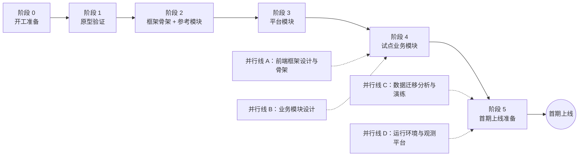

# 08 实施计划

- 状态：已确认（2026-11-04，D1～D4 均按建议确定）；之后的修订见文末“修订记录”
- 日期：2026-11-04
- 适用范围：从“框架设计文档已确认”到“首期上线”的框架侧路线：阶段划分、各阶段的交付物与退出标准、待决事项的拍板时点、原型验证清单、上线前置条件
- 依据：00-README 的待决事项与延后事项表；02 的需求优先级（P0 / P1 / P2）；03 第 7、8 节；04 第 7.2 节；05 系列、06、07 中的全部“待确认”

## 0. 范围

| 本文内容 | 不在本文 |
|---|---|
| 框架与平台模块的实施阶段、顺序、交付物、退出标准 | 具体业务模块的排期（随业务模块设计） |
| 待决事项的拍板时点（哪个阶段之前必须定） | 待决事项本身的选型论证（届时各自补 ADR） |
| 原型验证清单与失败时的备选方案 | 旧数据迁移、新旧系统并行过渡的具体方案（02 第 1.2 节：单独处理，本文只安排它的分析时点） |
| 上线前置条件 | 运维手册、部署脚本（`docs/ops/` 随阶段编写） |
| | 日历工期：团队规模与投入未定（`待确认`），本文只给顺序与退出标准，不给日期 |

### 0.1 本文决定的分类

| 类别 | 本文中的内容 |
|---|---|
| 第一类：现在确定 | D1～D4：实施方式、框架代码的交付形态、前端框架设计的启动时点、试点模块的选择标准 |
| 第二类：框架定写法，业务定用不用 | 试点模块具体选哪个（框架给标准，业务选定） |
| 第三类：延后 | 无新增 |

对照 00-README“延后事项”表：

| 事项 | 本文的处理 |
|---|---|
| 旧系统数据范围维度的对应（触发条件：数据迁移分析阶段） | 本文把“数据迁移分析”安排为并行线 C（第 2.3 节），该事项在那条线中处理；表中条目保留，直到分析完成 |
| 其余事项 | 触发条件均为业务需求，不由本文触发 |

### 0.2 框架负责 / 业务负责

| 框架负责（本文） | 业务负责 |
|---|---|
| 框架、平台模块、参考模块、模块模板的实施顺序与验收标准 | 业务模块的划分、顺序、排期 |
| 试点模块的选择标准 | 选定哪个模块作为试点 |
| 上线前置条件中的技术项 | 性能、容量、保留期限等目标值（`待确认` 项多数需要业务与运维给出） |

---

## 1. 旧项目怎么做 → 新框架怎么做

| 问题 | 旧项目 | 新框架 | 章节 |
|---|---|---|---|
| 设计与编码的关系 | 无设计文档，直接在页面中开发 | 先框架文档（已完成）→ 原型验证 → 框架骨架 → 每个业务模块先写设计文档（07 第 8 节）再编码 | 2 |
| 质量门禁 | 无 CI；测试为自定义脚本 | 第一行代码之前 CI 就绪（FR-OPS-03 为 P0），门禁不通过不能合并 | 2.2 阶段 0 |
| 表结构 | 手工 SQL 脚本 | EF 迁移 + 生产迁移审查（05-03 第 9.2 节） | 2.2 |
| 上线依据 | 无明确标准 | 上线前置条件清单（第 5 节），观测平台是其中一项硬条件 | 5 |
| 部署 | `待确认`（旧系统部署方式未盘点） | Docker 镜像 + 先迁移后启动 + 先后端后前端（ADR-0022、05-06 D7） | 5 |

---

## 2. 路线

### 2.1 总览

- 主线串行：每个阶段的退出标准达成后才进入下一阶段；阶段内的工作可以并行。
- 阶段 4 之后，其余业务模块按业务排期陆续开发，与阶段 5 重叠；“首期上线”包含哪些业务模块由业务决定。
- 02 的优先级在路线中的位置：**P0 在阶段 2、3 完成（第一个业务模块开发前必须具备）；P1 在阶段 5 之前完成（首期上线前必须具备）；P2 按需。**

### 2.2 主线各阶段

**阶段 0 开工准备**

| 项 | 内容 |
|---|---|
| 目标 | 具备“写第一行代码”的全部前提 |
| 工作 | 按 ADR-0032 的顺序：Gitea 升级并启用 HTTPS → 启用 Actions、注册 `build` / `release` 两类执行机（CI/CD 平台、镜像仓库、镜像扫描工具已于 2026-11-04 定）；新建仓库 `KMIC.Platform`（整个文件夹迁出，见第 6 节）；锁定依赖版本并复核 03 第 7 节中“中 / 未核实”的许可与版本；搭建 CI 空流水线（格式 → 编译 → 测试 → OpenAPI 检查 → 依赖漏洞 → 镜像扫描）；`CODEOWNERS`、分支保护（06 D10）；把各文档的“补充说明”整合进正文、文末保留修订记录（R01 L2）；修订 `CLAUDE.md`：取消“只写文档”，加入实施阶段的 AI 开发规则——完成的定义、测试必须真实运行、未运行的测试如实说明、用户可见文字自然直接（R01 L3） |
| 交付物 | 空仓库 + 通过的空流水线；`Directory.Build.props`、`Directory.Packages.props`、`.editorconfig`、`.gitattributes`、`BannedSymbols.txt` 初版；术语表 `docs/glossary.md` 与模块登记表 `docs/modules/README.md` 初版 |
| 退出标准 | 一个空的合并请求能跑完整条流水线；任一门禁失败能阻断合并 |

- 过渡安排（阶段 0 问题 7，`docs/implementation/S0-开工准备.md`）：Gitea 推迟到上线前，过渡期代码在个人 GitHub 私有仓库，CI 暂时搁置，以本机运行 `scripts/check.cs` 代替；上表两条退出标准推迟到迁入 Gitea 时验证（第 5 节第 11 条）。阶段 2 的开始条件不变：第 4 节标为“阻断”的原型全部有结论。

**阶段 1 原型验证**

| 项 | 内容 |
|---|---|
| 目标 | 在大量编写框架代码之前，验证 05～07 中依赖“新版本库行为”的关键假设 |
| 工作 | 第 4 节原型清单逐项验证；每项输出结论：成立 / 不成立（启用文档中已写的备选方案）/ 需要修订设计（回到对应文档修订并重新确认） |
| 交付物 | `docs/framework/spikes/` 下每项一页结论；必要的文档修订 |
| 退出标准 | 第 4 节中标为“阻断”的原型全部有结论；需要修订的设计已经确认 |
| 原型代码 | 一次性代码，不合入主干；结论成立的写法在阶段 2 中按规范重写 |

**阶段 2 框架骨架 + 参考模块**

| 项 | 内容 |
|---|---|
| 目标 | 全部 BuildingBlocks 能力可用，并由参考模块 `Sample`（07 D3）端到端证明 |
| 工作 | BuildingBlocks 六个项目（Domain、Application、Infrastructure、Presentation、Contracts、Analyzers）+ `Kmic.BuildingBlocks.Testing`；宿主（Api / Worker 角色）、`MigrationRunner`、`Operator`、Aspire 编排；架构测试覆盖 06 第 15 节规则总表；`dotnet new kmic-module` 模板；参考模块 `Sample` 覆盖 07 第 4 节全部构件 |
| 依赖 | Identity 的访问上下文、Operations 的审计订阅在阶段 3 才有完整实现：阶段 2 中用框架内的测试替身（`TestIdentity`、审计捕获）代替，接口按 05 系列定稿 |
| 交付物 | 可运行的框架 + `Sample`；07 第 4 节的示例改为引用 `Sample` 中的真实文件 |
| 退出标准 | 02 中框架类（MOD、DOM、APP、DATA、API、MSG、OBS、CFG、TEST、OPS）的 P0 条目全部实现且有测试；`Sample` 的单元、集成、API、授权矩阵、契约快照测试全部通过；06 规则总表中每条规则都有对应的分析器测试或架构测试 |

**阶段 3 平台模块**

| 项 | 内容 |
|---|---|
| 目标 | 平台模块达到“业务模块可以依赖”的程度 |
| 顺序 | ① Identity（认证、会话、角色、权限点同步、数据范围、组织树、安全事件；05-04、05-05）→ ② Operations（审计长期存储、作业与死信汇总视图、Quartz；05-08、05-09）→ ③ Configuration、Files、Notifications（05-10、05-11），三者可并行 |
| 范围 | Identity、Operations 全部 P0 + P1；Configuration、Files、Notifications 先完成 P0 与试点模块用到的 P1 部分，其余 P1 在阶段 5 前补齐 |
| 同步进行 | 第一个非开发环境（测试环境）上线：需要第 3 节中标为“阶段 3”的待决事项（密钥存储、反向代理、对象存储）已拍板 |
| 退出标准 | 测试环境中可以：首个管理员经 `Operator` 初始化 → 登录 → 配置角色与数据范围 → 用 `Sample` 走完新建、提交、审批、附件、通知、审计查询全流程；访问上下文加载耗时达到 05-04 第 6.1 节目标（压测验证） |

**阶段 4 试点业务模块**

| 项 | 内容 |
|---|---|
| 目标 | 用第一个真实业务模块验证框架与模板，修正发现的问题 |
| 前提 | 试点模块（D4）的设计文档（07 第 8 节）已评审通过，其中“延后事项对照”一节已处理 |
| 工作 | 按 07 第 5、6 节实现；每发现一处框架缺口或模板不顺手，记录并在框架中修正（而不是在业务模块中绕过） |
| 退出标准 | 试点模块在测试环境完整可用；框架缺口清单清零或已排入阶段 5；06、07 根据实际经验完成一轮修订 |

**阶段 5 首期上线准备**

| 项 | 内容 |
|---|---|
| 目标 | 满足第 5 节全部上线前置条件 |
| 工作 | 剩余 P1；生产环境与观测平台（并行线 D）；性能压测（目标值见第 3 节）；安全验收；数据迁移演练（并行线 C）；运维手册；配置数值定稿（第 3.2 节） |
| 退出标准 | 第 5 节清单全部满足，经负责人签字确认 |

### 2.3 并行线

| 线 | 内容 | 起点 | 必须完成于 |
|---|---|---|---|
| A 前端框架设计与骨架 | Vue 3 前端的框架设计文档（同样“旧项目怎么做 → 新框架怎么做”）与骨架：OpenAPI 类型生成、请求层、登录与令牌刷新、`allowedActions` 驱动按钮、业务时区显示（05-13 D4）、错误与校验展示、权限点常量 | 见 D3 | 阶段 4 开始前 |
| B 业务模块设计 | 模块划分（04 不含业务划分）、试点模块选定（D4）与设计文档 | 阶段 1 起 | 试点模块：阶段 4 开始前；其余按排期 |
| C 数据迁移分析与演练 | 旧库盘点 → 新旧映射 → 迁移脚本 → 演练；处理延后事项“旧系统数据范围维度的对应”；编号衔接（05-13 `numbers ensure-at-least`） | 阶段 3 起（需要 Identity 的数据模型已定） | 演练：阶段 5 |
| D 运行环境与观测平台 | 测试环境（阶段 3）、生产环境、观测平台与告警规则（05-12）、备份恢复 | 阶段 2 起 | 阶段 5 |

---

## 3. 待决事项与配置数值的拍板时点

### 3.1 待决事项（00-README“待决事项”表）

| 事项 | 必须在此之前拍板 | 原因 |
|---|---|---|
| 实施方式 | 已定（D1：新建） | — |
| CI/CD 平台与镜像仓库 | 已定（ADR-0032） | — |
| 镜像扫描工具（Trivy / Grype） | 已定（ADR-0032：Grype + Syft） | — |
| 生产观测平台 | 已定（09 D6：自建 Grafana 栈 + 云监控独立告警） | — |
| 生产密钥存储方式 | 已定（09 D5：KMS 凭据管家，部署时以文件注入） | — |
| 反向代理（Nginx / Traefik） | 已定（09 D3：ALB 终止 TLS，Nginx 只服务前端静态文件） | — |
| 生产对象存储（自建 MinIO / 云服务） | 已定（09 D2：阿里云 OSS） | — |
| 是否以 OWASP ASVS 第 2 级为安全验收基线 | 阶段 3 结束 | 阶段 5 安全验收需要提前准备检查项 |
| 病毒扫描 | 阶段 5 | Files 已预留扩展点（FR-FILE-06） |
| 站内消息实时推送（SignalR） | 不设时点 | 首期轮询（ADR-0020）；业务提出时再定 |
| 性能、容量、可用性目标值 | 阶段 3 结束 | 阶段 5 压测的依据；需要旧系统用户量、数据量统计 |
| 备份恢复目标（RPO / RTO） | 阶段 5 | 运维范围 |

### 3.2 配置数值（各文档中标为 `待确认` 的数值）

这些数值都是配置项，代码中有默认值，**不阻塞开发**，但上线前必须定稿：

| 类别 | 内容 | 来源 | 由谁给出 |
|---|---|---|---|
| 保留期限 | 审计、安全事件、业务历史、幂等、Outbox / Inbox、后台作业结果、通知投递与捕获记录 | 02 第 7 节、05-07、05-08、05-09、05-11 | 业务 + 合规 + 运维 |
| 告警阈值 | Outbox 积压、作业排队、死信、错误率等 | 05-07、05-08、05-12 | 运维 |
| 容量参数 | 连接池上限、缓存时长、限流额度、消息载荷上限、导出行数上限、上传配额 | 05-04、05-07、05-08、05-10、05-11 | 开发 + 运维，按压测结果 |
| 业务精度 | `Precisions.Amount` 等金额、单价、数量、比率精度 | 05-03 第 3.5 节 | 业务（随第一个用到的业务模块） |

---

## 4. 原型验证清单（阶段 1）

“阻断”= 不成立会改变 05 系列的设计，必须在阶段 2 之前有结论；“非阻断”= 文档中已有备选方案，可在阶段 2 中边做边验证。各项的结论页在 `docs/framework/spikes/`，进度见 `docs/implementation/00-README.md` 第 2 节。

| # | 验证内容 | 来源 | 级别 | 不成立时 |
|---|---|---|---|---|
| 1 | Mediator 3.0.x：带泛型约束的开放泛型管道行为；跨多个模块程序集生成分发代码；`IContractQuerySender` 中切换执行上下文 | 05-02 第 4 节、05-07 第 4 节 | 阻断 | 修订 05-02 管道注册方式；最坏情况重新评估中介者选型（ADR-0005） |
| 2 | EF Core 10 命名查询过滤器：上下文成员方法调用的参数化；Npgsql 强类型 ID 数组参数 `= ANY` | 05-05 第 5.4 节 | 阻断 | 数据范围过滤器改写法（如改为显式 `IQueryable` 扩展 + 架构测试保证调用） |
| 3 | Npgsql 10：可选复杂类型、复杂类型集合映射 `jsonb`；变更跟踪器对复杂类型原值的获取（审计） | 05-03 第 3.4 节、05-09 | 阻断 | 退回单值转换器或 JSON 值转换器（05-03 已写） |
| 4 | Vogen 8：在 Infrastructure 中生成 EF 转换器 | 05-01 第 4.2 节 | 非阻断 | 按 `IStronglyTypedId` 扫描、泛型转换器统一注册（05-01 已写） |
| 5 | PG 18 非确定性排序规则下的 `LIKE`；`ContainsText` 的翻译（`COLLATE "C"` + `ILIKE`） | ADR-0030、06 第 11.2 节 | 非阻断 | 调整翻译方式，调用方写法不变 |
| 6 | 自定义 EF 函数翻译 `AT TIME ZONE`（`ToBusinessDate`） | 05-13 第 3.5 节 | 非阻断 | 报表按业务日期存储统计维度（05-13 已写） |
| 7 | `.MirrorTo(...)` 迁移过渡映射 | 06 第 11.3 节 | 非阻断 | 迁移期间处理器显式写两列 |
| 8 | 分析器 KM0401（状态属性只能由状态机改写）的实现难度 | 05-01 第 7.3 节 | 非阻断 | 架构测试 + 评审 |
| 9 | .NET 10 System.Text.Json：重复属性、可空注解相关选项的名称与默认值 | 05-06 第 5 节 | 非阻断 | 按实际名称配置 |
| 10 | 测试基础设施：PG 模板库克隆（活动连接限制）、xUnit v3 程序集级夹具 | 06 D8 | 非阻断 | 退回每个测试类重新执行迁移（慢但可用） |
| 11 | `dotnet new` 多项目模板 + 解决方案过滤文件 | 07 D3 | 非阻断 | 模板只生成项目，`.slnf` 由脚本生成 |
| 12 | 访问上下文一次查询加载 < 2 毫秒 | 05-04 第 6.1 节 | 非阻断（阶段 3 压测复核） | 调整索引或缓存粒度（ADR-0026 已留余地） |
| 13 | RDS PostgreSQL 18 上：ICU 非确定性排序规则、`pg_trgm`、`uuidv7()`、`LISTEN / NOTIFY`（直连主地址） | 09 D1、ADR-0030 | 阻断 | ICU 不可用改用规范化影子列（ADR-0030 备选 C）；`LISTEN` 不可用退回定时轮询 |
| 14 | OSS 上 `IFileStorage` 全部操作（上传、分段上传、读取、删除、列举、预签名）；ECS RAM 角色临时凭据的凭据提供程序；版本控制下：写入返回版本 ID、删除只产生删除标记、应用角色删除指定版本被拒、按版本还原 | 09 D2、05-11 第 2 节 | 非阻断 | 不支持的操作改写实现；凭据提供程序不可行时用按环境最小授权的 AccessKey，存于 KMS 凭据管家 |
| 15 | 连接池不自锁：同时执行的命令数达到事务池上限、且都有嵌套读取时仍能完成（R01 H1） | 05-03 第 2.1 节 | 阻断 | 调整池划分，或改用命令准入上限（R01 H1 选项 B） |
| 16 | 消息与结果写入：迟到的旧投递者被拒（来源行 `FOR SHARE` 复核）；部分投递 + 清理 + 重试不重复执行；Inbox 处理、HTTP 幂等命令、作业批次在提交后确认丢失时都不重复执行。缩短保留期测试 | 05-07 第 6.2、7.3、9.2 节 | 阻断 | 修订投递与清理的加锁方式（如改为按 `MessageId` 的事务级锁） |
| 17 | 读模型：先取得存在快照、后收到物理删除、存在快照迟到，数据不复活 | 05-07 第 8.2、8.3 节 | 阻断 | 修订终态判断方式 |
| 18 | 附件：按文件 ID 的事务级锁互斥；业务提交卡在同步复制等待并跨过到期时刻时，清理仍不误删；对比时间方案。独占临时实例、只让目标业务会话等待同步复制、到期条件在数据库侧构造 | R02-3；05-11 第 3.3、4.3 节 | 阻断 | 回到 R02 重新比较互斥方案（预占、引用探查等） |

---

## 5. 上线前置条件

首期上线前必须全部满足，任何一项不满足即不上线。

| # | 条件 | 依据 |
|---|---|---|
| 1 | **生产观测平台就绪**（09 D6，含云监控独立告警通道）：日志、指标、追踪均已接入并可查询；05-12 的告警规则已配置并演练过（含告警送达） | ADR-0016、05-12；旧系统错误靠应用自发邮件，新系统把告警交给平台，平台不在则无人知道故障 |
| 2 | 02 中全部 P1 需求完成并有测试 | 02 第 2 节 |
| 3 | 性能压测达到第 3.1 节确定的目标值 | NFR-PERF |
| 4 | 安全验收通过（基线按第 3.1 节决定）；依赖与镜像扫描无高危漏洞 | NFR-SEC、ADR-0022 |
| 5 | 生产密钥存储就绪（KMS 凭据管家，09 D5）；无任何密钥出现在镜像、配置文件或仓库中（Gitleaks 扫描通过，ADR-0032） | ADR-0016 |
| 6 | 备份已配置，且按 09 第 11.2 节做过一次恢复演练并达到 RPO / RTO | 02 第 7 节、09 第 11 节 |
| 7 | 数据迁移完整演练至少一次：数据量、耗时、核对结果有记录 | 并行线 C |
| 8 | 第 3.2 节配置数值全部定稿并写入运维手册 | — |
| 9 | 运维手册：部署顺序（先迁移后启动、先后端后前端，05-06 D7）、`MigrationRunner` 与 `Operator` 用法、配置清单（05-10 第 2.1 节生成）、主机 NTP 同步（05-13 第 3.1 节）、告警处理 | — |
| 10 | 生产环境启动校验通过：参考模块 `Sample` 未注册（07 D3）、生产关闭 OpenAPI 文档入口（FR-API-06） | 07、05-06 |
| 11 | 代码与 CI 已迁到公司 Gitea，分支保护已开启；阶段 0 的两条退出标准（空合并请求跑通流水线、任一门禁失败能阻断合并）在此时验证 | ADR-0032；阶段 0 问题 7；实施待办 T-01、T-03 |

---

## 6. 新仓库与记忆迁移

`KMIC.Platform/` 在阶段 0 成为独立仓库（项目约定：将来单独成为一个仓库）：

| 项 | 做法 |
|---|---|
| 文档 | `KMIC.Platform/` 整个目录迁入新仓库根目录，保留目录结构 |
| `CLAUDE.md` | 项目自己的 `CLAUDE.md` 已在本文件夹根目录（2026-11-04 起），随文件夹一起迁出；旧仓库根目录的 `CLAUDE.md` 只是指向它，不迁移。进入阶段 0 时修订其中“当前阶段”一节（取消“不得创建代码文件”） |
| 旧仓库 | 本文件夹之外的内容不随迁移；迁出后旧系统源码不可读，旧系统事实以 `docs/legacy/` 为准——迁出前确认需要的旧系统信息都已写入文档 |
| AI 辅助工具的项目记忆 | 按工作目录路径存储，新仓库不会自动带上；长期有效的工作约定已写入项目 `CLAUDE.md`，其余记忆需要时人工复制 |

---

## 7. 决策

### 7.1 D1 实施方式

- **决定（已确认，2026-11-04）**：新建项目，按本套 ADR 的结构从零实现。
- **理由**：项目结构、模块隔离、中介者、主键与签名算法等都是贯穿全部代码的结构性约定，在新建项目中一次到位成本最低，架构测试从第一天就能生效。
- **取舍**：首期框架工作量按新建估算。

### 7.2 D2 框架代码的交付形态

| 选项 | 做法 | 优点 | 缺点 |
|---|---|---|---|
| **A 同一仓库，项目引用** | BuildingBlocks 与模块在同一解决方案中，直接引用项目 | 框架与模块同时修改、同一个合并请求、同一次 CI；参考模块即时验证框架改动；没有版本管理成本 | 框架的改动直接影响全部模块（由 CI 全量测试兜底） |
| B 框架打包为内部 NuGet 包 | 框架单独仓库或单独发布，模块按版本引用 | 框架变更节奏独立 | 模块化单体只有一个消费者，版本化只带来成本：每次框架修正都要发版、升级；参考模块与框架分离后验证滞后 |

- **决定（已确认，2026-11-04）**：A。
- **理由**：框架只服务于这一个系统；“框架缺口在框架中修正”（阶段 4）要求修改成本尽量低。
- **取舍**：框架没有独立的版本号；需要时（如出现第二个系统复用）再拆。

### 7.3 D3 前端框架设计何时开始

| 选项 | 做法 | 优点 | 缺点 |
|---|---|---|---|
| A 后端框架骨架完成后（阶段 2 结束）开始 | 串行 | 有真实的 OpenAPI 可以对接 | 前端在阶段 4 开始时才刚有骨架，试点模块的前端无法同步开发；前端发现的契约问题回到后端时，后端已定型 |
| **B 阶段 1 起并行** | 接口契约（05-06）、授权展示（05-05 第 7 节）、时间显示（05-13 D4）已定，前端框架设计可以立即开始；阶段 2 起用 `Sample` 的 OpenAPI 联调 | 试点模块前后端同时开发；前端对契约的意见能在阶段 2 中以最低成本修正 | 前端设计初期没有真实接口，需要以 05-06 为准 |

- **决定（已确认，2026-11-04）**：B。前端采用最新的 Vue 技术栈，具体选型在前端框架设计文档中论证。
- **理由**：后端契约已经定稿，前端没有理由等待；契约问题越早发现越便宜。
- **取舍**：前端设计初期依赖文档而不是接口；需要专门的前端设计人力与本线同时投入。

### 7.4 D4 试点业务模块的选择标准

框架给标准，业务选定具体模块。

| 选项 | 选择 | 优点 | 缺点 |
|---|---|---|---|
| A 最简单的模块 | 字段少、无流程的维护类模块 | 风险最低、最快完成 | 覆盖不到状态机、数据范围、跨模块、后台处理，框架缺口留到后面的关键模块才暴露 |
| **B 有代表性的中等模块** | 满足下表大部分条件，但不是业务最核心、最复杂的模块 | 覆盖框架主要能力，缺口在可控范围内暴露 | 工作量与风险中等 |
| C 最核心的模块 | 如报价这类业务主干 | 一次验证最难的场景 | 框架问题与业务复杂度叠加，难以区分问题来源；延期影响最大 |

- **决定（已确认，2026-11-04）**：B，按以下条件评估候选模块（满足越多越合适）：

| 条件 | 验证的框架能力 |
|---|---|
| 有带状态流转的单据 | 状态机、业务历史、`allowedActions` |
| 按所属人 / 组织控制可见范围 | 数据范围、授权矩阵 |
| 引用其他模块的数据（至少引用 Identity 的用户或组织） | Contracts 查询、引用解析 |
| 有附件或通知 | Files、Notifications |
| 有业务编号 | 编号服务 |
| 有一个定时任务或导入导出 | 后台处理 |
| 旧系统中有对应功能，可以对照验收 | 数据迁移分析的试点 |

- **理由**：试点的目的是暴露框架问题，覆盖面比速度重要，但不应同时承担业务最高风险。
- **取舍**：试点不会是交付价值最高的模块。

---

## 8. 风险

| 风险 | 影响 | 应对 |
|---|---|---|
| 新版本库（Mediator 3、EF Core 10、Npgsql 10、PG 18）的行为与文档假设不符 | 设计返工 | 阶段 1 原型验证，阻断项先行 |
| 团队对 DDD / CQRS / 模块化单体不熟悉 | 写法偏离、评审压力大 | 参考模块 + 模板 + 分析器与架构测试把规则变成工具；试点模块中集中辅导 |
| 文档与代码脱节 | 文档失去指导作用 | 07 D3：示例改为引用参考模块的真实文件；规则以 06 规则总表与测试为准 |
| 平台模块范围膨胀 | 业务模块迟迟不能开始 | 阶段 3 只做 P0 与试点所需的 P1，其余在阶段 5 前补齐 |
| 数据范围过滤器的性能 | 列表、统计变慢 | 阶段 3 压测；05-05 已要求归属列建索引 |
| 旧数据质量（字符串日期、魔法数字、多值逗号拼接） | 迁移延期 | 并行线 C 从阶段 3 开始，先盘点再映射 |
| 待决事项拍板延误 | 阻塞对应阶段 | 第 3.1 节为每项标出截止时点 |

---

## 9. 与其他文档的接口

| 本文提供 / 需要 | 对方 |
|---|---|
| 待决事项的截止时点 | 00-README“待决事项”表（确认后在表中增加“截止时点”列） |
| 原型结论、可能的设计修订 | 05 系列、06、07 |
| “观测平台为上线前置条件” | ADR-0016、05-12（第 5 节第 1 条） |
| 前端框架设计（并行线 A） | 前端设计文档（另起） |
| 数据迁移方案（并行线 C） | 数据迁移文档（另起）；延后事项“旧系统数据范围维度的对应” |
| 运维手册（并行线 D） | `docs/ops/` |

---

## 10. 决策汇总

| 编号 | 事项 | 决定（均已确认，2026-11-04） |
|---|---|---|
| D1 | 实施方式 | 新建（项目名 `KMIC.Platform`，代码命名空间 `Kmic`） |
| D2 | 框架代码的交付形态 | 与模块同一仓库，项目引用 |
| D3 | 前端框架设计何时开始 | 阶段 1 起并行 |
| D4 | 试点业务模块的选择标准 | 有代表性的中等模块，按第 7.4 节条件评估，业务选定 |

| 待确认 | 处理方式 |
|---|---|
| 团队规模与投入（决定日历工期） | 负责人提供后，在本文补充各阶段的计划日期 |
| 旧系统的部署方式 | 并行线 D 盘点，写入运维文档的“旧项目怎么做”部分 |

---

## 11. 修订记录

| 日期 | 内容 | 来源 |
|---|---|---|
| 2026-11-04 | 第 4 节增加原型 #15（连接池不自锁） | R01 H1 |
| 2026-11-05 | 第 4 节增加原型 #16～#18；#14 增加版本控制相关内容 | R02 |
| 2026-11-06 | 第 5 节增加第 11 条（迁到 Gitea 并开启分支保护）；阶段 0 的过渡安排 | 阶段 0 问题 7 |
| 2026-11-10 | 文档整合：以上补充说明并入正文，决定不变 | R01 L2（S0-08） |
