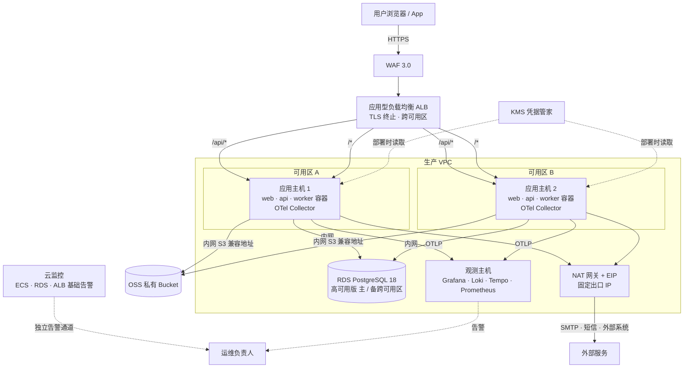

# 09 运行环境架构（阿里云）

- 状态：已确认（2026-11-04，D1～D8 均按建议确定）；2026-11-05 随 R02 第 3 批补充第 11.2 节（恢复后重启全部实例，已确认）；随 R02 第 4 批补充第 4、11、11.1、11.2、12 节（已确认，2026-11-05）
- 日期：2026-11-04
- 解决的待决事项：生产密钥存储方式（ADR-0016）、生产观测平台（ADR-0016）、反向代理选型（ADR-0022）、生产对象存储（ADR-0020）；并首次明确生产 PostgreSQL 的承载方式与备份方案框架
- 依据：ADR-0016、ADR-0020、ADR-0022、ADR-0025、ADR-0029、ADR-0032；03 第 2 节（PG 18）、第 4.9 节（AWSSDK.S3）；05-07 / 05-10（`LISTEN/NOTIFY`）、05-08（连接池）、05-12（观测）；08 第 3、5 节

## 0. 范围

| 本文内容 | 不在本文 |
|---|---|
| 测试 / 生产环境在阿里云上的拓扑：网络、入口、应用主机、数据库、对象存储、密钥、观测、备份 | CI/CD 与镜像仓库（ADR-0032 已定） |
| 上述各项的选型与框架代码需要遵守的约束 | 具体规格数值（随性能 / 容量目标值定，08 第 3.1 节）、部署脚本与运维手册（`docs/ops/`） |
| 对已确认设计的核对：哪些依赖在 RDS / OSS 上需要实测 | 业务数据迁移（08 并行线 C） |

### 0.1 已确认的前提（2026-11-04）

| 项 | 内容 |
|---|---|
| 云平台 | 阿里云 ECS（测试、生产） |
| 取向 | **数据类托管**（数据库、对象存储），其余自建；必要的服务可以购买，不以省钱为首要目标 |
| 已在用 | RDS、OSS（计划用于新系统）、云安全中心（TDS）、云防火墙 |
| 域名 | 有已备案的公司域名，可开子域名 |
| 规模 | 同时在线用户数`待确认`；拓扑按可水平扩展设计，规格先按小规模定，压测后调整 |

### 0.2 本文决定的分类

| 类别 | 内容 |
|---|---|
| 第一类：现在确定 | D1～D8 |
| 第二类 | 无 |
| 第三类：延后 | Redis 二级缓存（阿里云 Tair）：按测量结果引入，已登记到 00-README“延后事项”表（触发条件见第 9 节；引入只改配置、不改代码，ADR-0016） |

对照 00-README“延后事项”表：无命中；新增一项（Redis 二级缓存）。

---

## 1. 旧项目怎么做 → 新框架怎么做

| 方面 | 旧项目 | 新框架 | 章节 |
|---|---|---|---|
| 应用主机 | Windows + IIS，bat 脚本复制文件部署（ADR-0022 背景） | Linux ECS + Docker，按镜像摘要部署，跨可用区两台起 | D7 |
| 入口 | 应用直接暴露；`debug="true"`、请求校验关闭 | 负载均衡终止 TLS + WAF；应用主机无公网 IP | D3、D4 |
| 数据库 | SQL Server，4 个库互相跨库访问；备份方式`待确认` | RDS PostgreSQL 18 高可用版，每模块一个 schema；自动备份 + 时间点恢复 | D1、第 8 节 |
| 文件 | 站点目录 `userfiles` 下，随站点迁移 | OSS 私有 Bucket，经 S3 兼容接口访问 | D2 |
| 配置与密钥 | `Web.config` 明文，运行时写回 | 密钥在 KMS 凭据管家，部署时以文件注入容器 | D5 |
| 监控与告警 | 应用自己发错误邮件 | OpenTelemetry → 自建 Grafana 栈，告警由平台发出；云监控做独立的基础告警 | D6 |
| 代码托管 | Gitea 明文 HTTP，与旧库同一公网 IP | Gitea 改 HTTPS（ADR-0032 D0），放入工具环境 | D8 |

---

## 2. 总体拓扑（生产）

- 测试环境结构相同、规格更小，可以单可用区、单台应用主机（D7、D8）。
- 应用主机、数据库、观测主机都**没有公网 IP**；入站只经 ALB，出站只经 NAT 网关。
- 云安全中心（TDS）客户端安装在全部 ECS；云防火墙的互联网边界只放行 ALB（及 NAT 出口）。

---

## 3. D1 生产 PostgreSQL 的承载方式

| 选项 | 做法 | 优点 | 缺点 |
|---|---|---|---|
| **A RDS PostgreSQL 18 高可用版** | 主备跨可用区，云盘；应用直连主地址 | 备份、时间点恢复、主备切换、小版本补丁由云厂商负责；PG 18 已上线（2025-12），03 的版本选择不用退回；与“数据类托管”取向一致 | 按年付费；部分扩展与参数受限（需实测，见下） |
| B ECS 上 Docker 自建 PG 18 | 自管主备、备份 | 费用低；完全可控 | 高可用、备份、恢复演练全部自己做——正是 08 上线前置条件第 6 条最难满足的部分 |
| C PolarDB PostgreSQL 版 | 计算存储分离 | 弹性、只读节点扩展方便 | 费用更高；本系统目前没有需要它的负载；兼容性需要另行验证 |

- **决定（已确认，2026-11-04）**：A。
- **理由**：数据库是唯一不能丢、恢复最难的部分，交给托管服务换来的确定性最大。
- **取舍**：费用；以及下表中依赖 RDS 行为的项要在阶段 1 实测。

**05 系列依赖、需要在 RDS 上实测的项**（加入 08 第 4 节原型清单）：

| 依赖 | 来源 | 实测方法 | 不成立时 |
|---|---|---|---|
| ICU 非确定性排序规则（`und-u-ks-level2`） | ADR-0030、05-03 第 3.7 节 | 在 RDS PG 18 上 `CREATE COLLATION … provider = icu, deterministic = false` 并验证唯一索引 | 改用规范化影子列（ADR-0030 备选方案 C） |
| `pg_trgm` 扩展 | 06 第 11.2 节延后事项 | 查 `pg_available_extensions` | 延后事项本身是按需的；不可用时该列表改用前缀匹配 |
| `uuidv7()`、`LISTEN / NOTIFY`、`SKIP LOCKED` | 03、05-07、05-10、05-13 | 原型中执行 | `LISTEN` 不可用时退回定时轮询（05-07、05-10 均有兜底轮询） |
| 连接方式 | 05-07、05-10 的 `LISTEN` 需要**会话级**连接 | 直连主地址，**不使用**事务级连接池代理（RDS 数据库代理的事务级连接池会破坏 `LISTEN` 与会话状态） | — |

补充说明（2026-11-06）：上表各项的检查已写成原型 #13 的测试（`docs/framework/spikes/13-rds-compatibility.md`，另含 `SKIP LOCKED` 与事务级咨询锁），本机 PG 18 对照全部通过；设置环境变量指向 RDS 即可运行，**尚待在 RDS 上执行**。

| 约束 | 内容 |
|---|---|
| 账号 | 迁移账号（建表、授权）与运行账号分开（ADR-0029）；RDS 高权限账号只用于初始化，日常不用 |
| 连接数 | 实例连接上限 ≥ 应用主机数 × 4 个连接池上限之和（前台事务池、前台读池、后台事务池、后台读池，05-03 第 2.1 节补充说明）+ 监听连接 + 迁移与运维余量；规格随压测确定 |
| 网络 | 只开放生产 VPC 内应用主机所在安全组；白名单不含 `0.0.0.0/0` |
| 参数 | `timezone = UTC`；开启 `pg_stat_statements`（05-12 第 3.3 节） |

---

## 4. D2 生产对象存储

| 选项 | 做法 | 优点 | 缺点 |
|---|---|---|---|
| **A 阿里云 OSS** | 每个环境一个私有 Bucket，经 OSS 的 S3 兼容地址（内网 `https://s3.oss-{region}-internal.aliyuncs.com`）访问 | 公司已计划使用；持久性与容量由云厂商保证；与 03 选定的 AWSSDK.S3 兼容（官方提供 AWS SDK 接入说明）；内网访问不计公网流量 | OSS 并不支持全部 S3 操作，用到的操作需实测；SDK 新版默认的校验和行为需关闭（03 第 4.9 节已定配置项） |
| B 自建 MinIO | ECS 上部署 | 完全 S3 兼容 | 持久性、扩容、备份全部自己负责；与“数据类托管”取向相反 |

- **决定（已确认，2026-11-04）**：A。开发与 CI 环境继续使用 MinIO 容器（ADR-0020），代码不变。

| 约束 | 内容 |
|---|---|
| 访问控制 | Bucket 私有、禁止匿名访问；只允许本环境的 RAM 角色读写 |
| 凭据 | 优先 **ECS 实例 RAM 角色**取临时凭据，不使用长期 AccessKey（`IFileStorage` 的 S3 实现提供凭据提供程序：从 ECS 元数据服务获取 STS 临时凭据并自动刷新；`待确认` 原型） |
| 加密与保护 | 服务端加密（OSS 托管密钥）；开启版本控制，防误删与覆盖 |
| 下载 | 05-11 已定：经 API 鉴权下载；超大文件用短时效预签名链接，链接域名用 OSS 的外网地址或绑定的自定义域名 |
| 需实测 | `IFileStorage` 用到的全部操作（上传、分段上传、读取、删除、列举、预签名）在 OSS 上通过（加入 08 原型清单） |

**补充说明（2026-11-05，随 R02 第 4 批确认）：版本控制、生命周期与权限（R02-13）**

目标：数据库按时间点恢复后，恢复点之后被清理的文件能按记录的版本 ID 还原（05-11 第 2 节补充说明）；应用自身无法让文件不可恢复。

| 项 | 内容 |
|---|---|
| 非当前版本保留 | 生命周期规则：非当前版本 N 天后删除，**N ≥ 数据库可按时间点恢复的窗口（RDS 日志备份保留天数）+ 恢复执行时间**（默认取 3 天）；具体天数随 00-README 待决“备份恢复目标与保留期限”确定 |
| 未完成的分段上传 | 生命周期规则：1 天后中止并清除碎片。列举对象看不到这些碎片，05-11 的对账覆盖不到 |
| 删除标记 | 生命周期规则：清除已经没有任何历史版本的删除标记 |
| 应用的 RAM 角色 | 允许：上传（含分段）、读取、删除（不带版本 ID，只产生删除标记）、列举、预签名。**不允许**：删除指定版本，修改版本控制、生命周期、Bucket 策略。具体动作名在阶段 0 按阿里云 RAM 文档核实，并在原型 #14 中验证“删除指定版本被拒” |
| 运维的 RAM 角色 | 彻底删除（删除指定版本）与还原（删除删除标记，或把指定版本复制为当前版本）；经堡垒机或云助手使用；开启阿里云操作审计留痕，本系统同时登记执行记录（05-11 第 6 节补充说明） |
| 演练 | 恢复演练（08 第 5 节第 6 条）包含附件还原：恢复点之后被清理的文件能按记录的版本 ID 还原并下载 |

---

## 5. D3 入口：负载均衡与反向代理

ADR-0022 待决“反向代理选型（Nginx 或 Traefik）”。在阿里云上，入口的主要职责（TLS、跨可用区分发、健康检查）可以由托管负载均衡承担，问题变为“负载均衡之后还需要什么”。

| 选项 | 做法 | 优点 | 缺点 |
|---|---|---|---|
| **A ALB + 静态前端用 Nginx 容器** | ALB 终止 TLS，按路径转发：`/api/*` → api 容器，其余 → web 容器（Nginx 只负责前端静态文件与 SPA 回退）；前端与 API 同域（ADR-0022） | TLS、证书、跨可用区、健康检查都是托管能力；Nginx 只做最简单的事，配置几乎不变；可直接挂 WAF | ALB 按量计费；路由规则在云控制台 / 基础设施代码中维护 |
| B ECS 公网 IP + Nginx 做全部入口 | Nginx 终止 TLS 并反代 API | 少一个云服务 | 应用主机暴露公网；多台主机需要再加一层负载均衡；证书自己续期 |
| C ALB + Traefik | Traefik 按容器标签自动发现路由 | 动态路由 | Docker Compose 的固定拓扑用不到动态发现；多一个组件 |

- **决定（已确认，2026-11-04）**：A。ADR-0022 的“反向代理”由 ALB 承担；Nginx 只作静态文件服务器，不承担反向代理。
- **理由**：入口是安全边界，交给托管服务最稳；应用主机不暴露公网，与云防火墙、TDS 的防护面一致。
- **取舍**：ALB 费用；不选 Traefik。

| 约束（框架代码与配置） | 内容 |
|---|---|
| 转发头 | 应用只信任来自 ALB 的转发头：`ForwardedHeadersOptions.KnownNetworks` 设为本 VPC 中 ALB 所在网段（ADR-0022 第 4 节） |
| 健康检查 | ALB 健康检查使用 `/health/ready`；`/health/*` 不经 ALB 对公网开放（ADR-0022 补充说明），健康检查从内网访问 |
| 停机 | ALB 后端摘除等待时间 < 应用 `ShutdownTimeout`（45 秒），容器停止宽限期 60 秒（ADR-0022） |
| 证书 | 阿里云 SSL 证书服务签发，挂在 ALB；Gitea 的 HTTPS 采用同样方式（ADR-0032 D0） |
| 上传 | ALB 请求体上限与超时需覆盖上传端点（05-11：单独 10 分钟超时） |

---

## 6. D4 Web 应用防火墙

| 选项 | 优点 | 缺点 |
|---|---|---|
| **A 购买 WAF 3.0，接入 ALB** | OWASP 常见攻击规则、CC 防护、恶意爬虫识别；为登录与短信接口提供应用限流之外的第二道防线（05-04 D4、D5） | 费用；规则需要初期调优，避免误拦 |
| B 不购买，依靠应用内限流 + 云防火墙 | 无额外费用 | 应用限流按实例计数（ADR-0022）；攻击流量先到达应用才被拒绝 |

- **决定（已确认，2026-11-04）**：A。
- **理由**：系统面向公网的销售人员使用，登录、短信验证码是最常被刷的接口；WAF 在流量进入应用前拦截，成本可控。
- **取舍**：费用与初期规则调优；WAF 先以“观察模式”运行一到两周再切换为拦截。

---

## 7. D5 生产密钥存储

ADR-0016 待决“Docker Secrets 还是独立密钥服务”。需要保护的：数据库运行账号与迁移账号密码、JWT 签名私钥（05-04，RS256 + `kid` 轮换）、SMTP 与短信凭据、外部系统凭据、HMAC 游标签名密钥（05-06）等。

| 选项 | 做法 | 优点 | 缺点 |
|---|---|---|---|
| **A KMS 凭据管家 + ECS 实例 RAM 角色，部署时注入文件** | 密钥存于 KMS 凭据管家；`release` 执行机部署时以 RAM 角色读取，写入应用主机的内存文件系统（tmpfs），以只读文件挂入容器；应用按“每个文件一个配置项”读取 | 密钥集中管理、有访问审计与版本；主机磁盘与镜像中都没有密钥；应用只认文件，不绑定云厂商 SDK；轮换 = 更新凭据 + 重新部署 | 部署流程多一步；需要设计 RAM 权限（每个环境只能读自己的凭据） |
| B Docker Compose 的 secrets（主机上的文件） | 密钥文件放在主机磁盘，由运维手工维护 | 最简单 | 密钥落盘、无访问审计、手工分发容易出错；轮换靠人 |
| C 自建 HashiCorp Vault | 独立部署 | 功能最强（动态凭据等） | 要维护一套高可用的 Vault 本身；对本系统过重 |

- **决定（已确认，2026-11-04）**：A。
- **理由**：同时满足“密钥不进仓库与镜像”（FR-CFG-02）和“可审计、可轮换”；应用侧的约定（读文件）与平台解耦，以后换平台只改部署步骤。
- **取舍**：部署流程与 RAM 权限设计多一些工作。

| 约束（框架代码） | 内容 |
|---|---|
| 读取方式 | 宿主使用 `AddKeyPerFile("/run/secrets")` 配置提供程序；密钥配置项与 Options 中标 `[Secret]` 的项（05-10 第 2.2 节）一一对应 |
| JWT 私钥轮换 | 新旧私钥同时存在于凭据管家，按 05-04 的 `kid` 轮换流程分阶段切换 |
| 开发环境 | 继续使用 User Secrets（ADR-0016） |
| 禁止 | 环境变量中直接放密钥值（会出现在 `docker inspect` 与进程信息中）；仓库中的部署文件只引用凭据名称 |

---

## 8. D6 生产观测平台

ADR-0016 倾向“自建 Grafana 一套（Loki / Tempo / Prometheus），由 OpenTelemetry Collector 统一接入”；05-12 已定应用全量输出、Collector 尾部采样、告警由平台发出；08 把观测平台定为上线前置条件。

| 选项 | 做法 | 优点 | 缺点 |
|---|---|---|---|
| **A 自建 Grafana 栈 + 云监控做独立基础告警** | 一台观测主机（生产 VPC 内）：Grafana、Loki（日志）、Tempo（追踪）、Prometheus（指标）；每台应用主机运行 OTel Collector 负责采样与转发；阿里云云监控对 ECS、RDS、ALB 配置基础告警，作为与观测主机无关的独立通道 | 与 ADR-0016 的倾向、“其余自建”取向一致；OpenTelemetry 标准接入，平台可替换；数据在自己的 VPC 内；云监控兜住“观测主机自身故障时无人知道”的问题 | 观测主机要自己维护（存储容量、升级）；Grafana、Loki、Tempo 为 AGPLv3 许可（内部使用、不修改分发不受影响） |
| B 阿里云 SLS + ARMS（托管） | OTLP 直接上报到阿里云 | 免运维；容量弹性 | 按量计费，日志量大时费用增长快；查询方式绑定厂商；与“其余自建”取向不同 |
| C 混合：日志进 SLS，指标与追踪自建 | — | 日志免运维 | 两套系统，日志与追踪的关联跳转变复杂 |

- **决定（已确认，2026-11-04）**：A。
- **理由**：OpenTelemetry 让应用对平台无感知，自建的主要代价是维护一台主机；“告警必须可靠”这一点由云监控的独立通道补齐，不依赖自建平台本身的可用性。
- **取舍**：观测主机的维护工作；如果实际运维能力不足，切换到 B 只改 Collector 的导出配置。

| 约束 | 内容 |
|---|---|
| 告警通道 | Grafana Alerting 与云监控都发送到同一组负责人；具体渠道（邮件、钉钉、企业微信）`待确认`（运维提供） |
| 保留期 | 日志、追踪、指标的保留天数随 08 第 3.2 节配置数值定；观测数据不做备份（可丢失），但存储盘用快照防误操作 |
| 访问 | Grafana 只能经内网或堡垒机访问；登录接入公司账号体系`待确认` |
| 测试环境 | 测试环境的 Collector 也上报到同一平台，以 `deployment.environment` 区分，不另建一套 |

---

## 9. D7 生产应用拓扑

| 选项 | 做法 | 优点 | 缺点 |
|---|---|---|---|
| **A 两台 ECS 跨可用区，每台运行 web、api、worker 容器** | Api 与 Worker 角色（ADR-0025）分容器运行，同一镜像；Quartz 集群模式与 Outbox / 作业的 `SKIP LOCKED` 领取天然支持多实例 | 任一主机或可用区故障，服务继续；滚动更新时始终有一台在线（NFR-AVAIL）；框架本来就按多实例设计 | 两台主机的费用 |
| B 单台 ECS | — | 最省 | 主机故障或更新即中断；多实例相关的框架能力（缓存失效广播、租约、集群调度）在生产中得不到验证 |
| C 三台及以上 / 容器服务 ACK | — | 弹性更好 | 规模未知前属于过度设计；Kubernetes 迁移路径已由 ADR-0022 保留 |

- **决定（已确认，2026-11-04）**：A。主机规格先按小规模定（`待确认`，压测后调整）；需要时先纵向升级规格，再横向加主机。
- **理由**：生产单点会让 08 上线前置条件与 NFR-AVAIL 无法满足；两台是满足高可用的最小数量。
- **取舍**：费用约为单台的两倍。

| 约束 | 内容 |
|---|---|
| 部署 | 逐台滚动：迁移容器先执行（ADR-0022）→ 从 ALB 摘除主机 1 → 更新 → 健康后加回 → 主机 2 同样处理 |
| Redis | 首期不部署：会话、跨实例缓存失效、调度、消息领取、锁都在 PostgreSQL 中，Redis 只承担 HybridCache 二级缓存这一性能角色；HybridCache 使用本地缓存，跨实例失效走 PG `NOTIFY`（05-10）。触发以下任一条件时购买阿里云 Redis（Tair）并只改配置（ADR-0016）：应用主机 ≥ 3 台；数据库负载中可缓存的重复读取占比明显；部署后缓存预热造成数据库压力尖峰；需要全局精确限流 |
| 时钟 | ECS 默认使用阿里云 NTP，满足 05-13 第 3.1 节要求 |
| 运维访问 | 主机无公网 IP；运维通过云助手会话管理或堡垒机登录，不开放 22 端口到公网 |

---

## 10. D8 环境与网络隔离

| 选项 | 做法 | 优点 | 缺点 |
|---|---|---|---|
| **A 同一阿里云账号，按环境分 VPC：生产 VPC、非生产 VPC** | 非生产 VPC 放测试环境、Gitea、CI 执行机（ADR-0032）；生产 VPC 只放生产资源；`release` 执行机经 VPC 对等连接、仅对生产应用主机的部署端口放行 | 网络层面隔离生产；资源按 VPC 与资源组授权；管理简单 | 账号级的权限泄露会同时影响两个环境（以 RAM 最小授权与多因素认证缓解） |
| B 同一个 VPC，用交换机与安全组区分 | — | 最简单 | 隔离只靠安全组规则，配置失误即打通 |
| C 资源目录多账号（生产单独一个阿里云账号） | — | 隔离最彻底 | 账号、计费、权限管理复杂度明显上升；以当前规模收益有限 |

- **决定（已确认，2026-11-04）**：A；以后若审计或合规要求账号级隔离，再迁到 C。
- **理由**：生产与非生产在网络层隔离是底线，A 以最小的管理成本达到它。
- **取舍**：不做账号级隔离。

| 约束 | 内容 |
|---|---|
| 数据 | 测试环境不得使用生产数据的原样副本；需要时先脱敏 |
| 通知 | 非生产环境强制使用捕获通道（FR-NOTIFY-05，已定） |
| 凭据 | 测试与生产的数据库账号、OSS Bucket、KMS 凭据、RAM 角色完全分开 |

---

## 11. 备份与恢复（框架）

RPO / RTO 的目标值随 08 第 3.1 节在阶段 5 前定；这里先定机制，保证目标值确定后有手段达到。

| 对象 | 机制 | 说明 |
|---|---|---|
| 数据库 | RDS 自动备份 + 日志备份（支持按时间点恢复）；建议开启跨地域备份 | 保留天数随 RPO 与合规要求定；**每次大版本升级与上线前做一次恢复演练**（08 第 5 节第 6 条） |
| 对象存储 | OSS 版本控制 + 生命周期规则清理旧版本；可选跨区域复制 | 业务对象的物理删除由 05-11 的生命周期驱动 |
| 密钥 | KMS 凭据管家自带版本；JWT 私钥保留上一版本直到所有令牌过期 | — |
| 配置与部署 | 部署文件在 Git 仓库中；镜像在 Gitea 镜像仓库（按摘要可重建任意版本，ADR-0032 D5） | — |
| 代码托管 | Gitea 数据目录与数据库定期备份（`gitea dump` 或云盘快照），副本存到 OSS | 当前的 Gitea 备份方式`待确认`；它是新系统的“源头”，丢失代价最高 |
| 观测数据 | 不备份 | 云盘快照只防误操作 |

**补充说明（2026-11-05，随 R02 第 4 批确认）：数据库存储容量（R02-12）**

05-07 第 9.5 节的容量保护只是近似的预警与应急手段，真正的兜底在基础设施：

| 项 | 内容 |
|---|---|
| RDS 存储自动扩容 | 开启；触发线（剩余空间比例）与扩容上限按规格确定。05-07 第 9.5 节的软线 r1、硬线 r2 必须高于触发线对应的使用率，让扩容先起作用，熔断只是最后手段 |
| 云监控独立告警 | RDS 存储使用率告警，阈值低于自动扩容触发线，经云监控通道发送（D6），不依赖应用与观测主机 |
| 容量 C 的同步 | `release` 执行机每小时以只读的 RAM 权限调用 RDS 接口读取**已分配**容量，经部署通道在生产主机上运行 `Kmic.Operator` 写入系统设置 `Messaging.Admission.CapacityBytes`；应用不依赖云厂商 SDK。超过 1 天未更新即告警（05-07 第 9.5 节） |

---

### 11.1 故障分级与降级行为（2026-11-04，随 R01 M6 确认）

| 故障 | 仍然允许 | 必须拒绝 / 禁止 | 恢复依据 |
|---|---|---|---|
| 数据库主库不可用（含 RDS 主备切换期间） | 前端显示“系统维护中” | 一切读写；不得用缓存的会话或权限代替校验（会话每次请求查库，失败即 503） | 主备切换完成后自动恢复；`/health/ready` 不健康期间 ALB 摘除该主机 |
| 会话或权限数据无法验证 | 公开的健康状态 | 任何需要登录的读写一律拒绝（不放行，不退回“全部角色”的权限） | 恢复后下一次请求重新加载访问上下文 |
| 对象存储不可用 | 不涉及文件的业务照常 | 上传、下载、生成文件：返回 503 或作业重试；不得把文件标记为已就绪 | 恢复后作业重试；按 05-11 核对文件引用 |
| 邮件 / 短信不可用 | 业务提交不受影响（经 Outbox 异步发送） | 不在事务中等待；界面不得显示“已发送” | Outbox 重试与死信，人工重投 |
| 外部系统不可用 | 本地业务照常，相关状态显示“待同步 / 结果未知” | 不得假定对方已成功；写操作不自动无限重试 | 按幂等键查询对方结果后核对（05-11） |
| 观测平台不可用 | 业务完全不受影响，日志仍输出到标准输出 | 不得因遥测阻塞请求 | Collector 有界缓冲；云监控独立告警兜底（D6） |
| Outbox / Inbox 积压、Worker 故障 | 前台业务照常，相关状态显示“处理中” | 不静默丢弃消息；不因积压拒绝业务写入（R01 评估不采纳） | 告警后人工处理，租约过期自动接管 |
| 单台应用主机故障 | 另一台继续服务 | — | ALB 健康检查摘除，恢复后加回 |
| Redis 故障（启用后） | 退回本地缓存与数据库 | — | 自动恢复 |

- 其中“无法验证就拒绝”“不在事务中等待外部服务”“不显示虚假的成功状态”是框架代码必须实现的行为，测试要点见各 05 文档。

补充说明（2026-11-05，随 R02 第 4 批确认）：上表两行修订如下。

| 故障 | 修订 |
|---|---|
| Outbox / Inbox 积压、Worker 故障 | “不因积压拒绝业务写入（R01 评估不采纳）”改为按 05-07 第 9.5 节：数据库已用空间达到软线且积压确实是原因时，拒绝来自 HTTP 与后台作业的、会产生消息的写入（503 `Common.MessagingSuspended`，`retryable`）；达到硬线时拒绝全部 Outbox 写入。理由：存储写满时 RDS 会锁定实例、整个系统不可写，比拒绝一部分写入严重得多 |
| 外部系统不可用 | “按幂等键查询对方结果后核对”按 05-11 第 9.3 节细化：对方接受幂等键时用同一个键重试；只能查询时先查询；都不支持时标记结果未知、人工核对 |

### 11.2 按时间点恢复的要点（2026-11-04，随 R01 M6 确认）

按时间点恢复有一个特有的问题：**恢复点之后已经发生的外部副作用**（邮件已发出、外部系统已收到请求、消息已投递），在恢复后的数据库里“没有发生过”，对应的 Outbox 记录会重新变成待投递，恢复后一旦放开就会重复发送。

| 步骤 | 操作 | 留下的记录 |
|---|---|---|
| 1 | 确认故障，记录最后一个确定正常的时间；ALB 切到维护页，停止全部 Worker（投递、Inbox、定时任务、作业） | 事故编号、开始时间、影响范围 |
| 2 | RDS 按时间点恢复到**新实例**；核对备份链与恢复点 | 恢复点、实例标识 |
| 3 | 在隔离网络中启动应用，**关闭全部对外通道**（邮件、短信、外部系统调用） | 关闭对外通道的证据 |
| 4 | 核对恢复点之后的副作用：对比 Outbox 投递记录与通道侧记录（邮件发送日志、短信回执、外部系统按幂等键查询），已发生的标记为已投递，不再重发；无法确定的列入人工核对清单 | 已发生 / 未发生 / 待核对清单 |
| 5 | 核对附件：数据库引用的文件在 OSS 中存在（版本控制可找回） | 缺失与多余清单 |
| 6 | 验证主流程：登录 → 当前角色 → 权限 → 核心读取 → 测试写入 | 用例与 traceId |
| 7 | 负责人批准后切换为新的主库，逐步打开 Worker 与对外通道 | 切换记录 |
| 8 | 计算实际 RPO / RTO，记录差距与改进项 | 演练报告 |

补充说明（2026-11-05，随 R02 第 3 批确认）：第 7 步切换时，**全部应用实例必须重新启动**，不能只改连接串后继续运行。原因：授权快照、组织树等按版本号缓存（ADR-0026），版本号在恢复后的数据库中回到了恢复点，旧实例内存中“恢复点之后的版本”会与恢复后新产生的同号版本冲突，读到错误的权限；配置类缓存同样收不到被回滚修改的失效通知。启用 Redis 二级缓存后，还要在切换前清空 Redis。其余与对象存储、RPO / RTO 相关的修订随 R02 第 4 批。

补充说明（2026-11-05，随 R02 第 4 批确认）：第 5 步“核对附件”改为按 `StoredFile.ObjectVersionId` 逐个核对，并在第 7 步之前完成：

| 核对结果 | 处理 |
|---|---|
| 当前版本就是记录的版本 | 无需处理 |
| 记录的版本还在，但被删除标记覆盖（恢复点之后被清理） | 运维按记录的版本还原（删除该删除标记，或把该版本复制为当前版本） |
| 记录的版本已不存在 | 列入缺失清单，按事故处理；说明非当前版本的保留期短于实际需要（第 4 节补充说明），列为改进项 |
| 存储中有、数据库中没有的对象（恢复点之后上传的） | 不需要立即处理，由对账任务按 05-11 第 4.3 节清理（只产生删除标记，保留期内仍可人工找回） |

## 12. 对其他文档的影响

| 文档 | 影响 |
|---|---|
| 00-README 待决事项 | 生产密钥存储、生产观测平台、反向代理、生产对象存储四项由本文解决（已移除）；新增运行环境相关的待确认项 |
| ADR-0016、ADR-0020、ADR-0022 | 已加补充说明 |
| 03 第 2 节 | PG 18 在 RDS 上已可用，“退回 17”的预案不再需要（已补充说明） |
| 05-10 第 2.2 节 | `[Secret]` 配置项的生产来源：`/run/secrets` 文件（已补充说明） |
| 08 第 4 节原型清单 | 增加：RDS 上的 ICU 排序规则、`pg_trgm`、`LISTEN/NOTIFY`；OSS 上的 `IFileStorage` 全部操作；ECS RAM 角色临时凭据的凭据提供程序 |
| 08 第 5 节上线前置条件 | 第 1 条“观测平台就绪”包括云监控独立告警通道；第 5 条“密钥存储就绪”指 KMS 凭据管家 |
| 随 R02 第 4 批（2026-11-05，已确认） | 05-11 第 2、6 节（对象版本、彻底删除由运维执行）；05-07 第 9.5 节（容量 C 的来源、扩容触发线）；08 #14（版本控制下的删除与权限验证） |

## 13. 决策汇总

| 编号 | 事项 | 决定（均已确认，2026-11-04） |
|---|---|---|
| D1 | 生产 PostgreSQL | RDS PostgreSQL 18 高可用版，直连主地址，不用事务级连接池代理 |
| D2 | 生产对象存储 | 阿里云 OSS，私有 Bucket，内网 S3 兼容地址，ECS RAM 角色临时凭据；开发与 CI 仍用 MinIO |
| D3 | 入口 | ALB 终止 TLS、按路径转发；Nginx 只服务前端静态文件；不选 Traefik |
| D4 | Web 应用防火墙 | 购买 WAF 3.0 接入 ALB，先观察后拦截 |
| D5 | 生产密钥存储 | KMS 凭据管家 + ECS RAM 角色，部署时写入 tmpfs、以文件挂入容器 |
| D6 | 生产观测平台 | 自建 Grafana 栈（Loki / Tempo / Prometheus）+ OTel Collector；云监控做独立基础告警 |
| D7 | 生产应用拓扑 | 两台 ECS 跨可用区，web / api / worker 分容器；首期不上 Redis |
| D8 | 环境与网络隔离 | 同账号，生产 VPC 与非生产 VPC 分开 |

| 待确认 | 处理方式 |
|---|---|
| 同时在线用户数、数据量（决定主机与 RDS 规格） | 从旧系统统计（用户表行数、日活）后与业务确认；08 第 3.1 节截止阶段 3 结束 |
| RDS 上 ICU 非确定性排序规则、`pg_trgm`、`LISTEN/NOTIFY` | 阶段 1 原型验证 |
| OSS 对 `IFileStorage` 全部操作的兼容性；ECS RAM 角色凭据提供程序 | 阶段 1 原型验证 |
| 告警渠道（邮件 / 钉钉 / 企业微信）、Grafana 登录方式 | 运维提供 |
| 现有 Gitea 的备份方式 | 阶段 0 盘点 |

## 参考资料

- 阿里云 RDS PostgreSQL：[支持 PostgreSQL 18 的发布消息](https://www.alibabacloud.com/en/news/product/rds-for-postgresql-supports-postgresql-18-mik?_p_lc=1)、[AliPG 内核小版本发布记录（PostgreSQL 14～18）](https://help.aliyun.com/zh/rds/apsaradb-rds-for-postgresql/release-notes-for-alipg)、[大版本生命周期说明](https://help.aliyun.com/zh/rds/apsaradb-rds-for-postgresql/lifecycles-of-major-engine-versions)、[支持的扩展列表](https://help.aliyun.com/en/rds/apsaradb-rds-for-postgresql/extensions-supported-by-apsaradb-rds-for-postgresql)
- 阿里云 OSS：[使用 AWS SDK 访问 OSS](https://help.aliyun.com/zh/oss/developer-reference/use-aws-sdks-to-access-oss)
