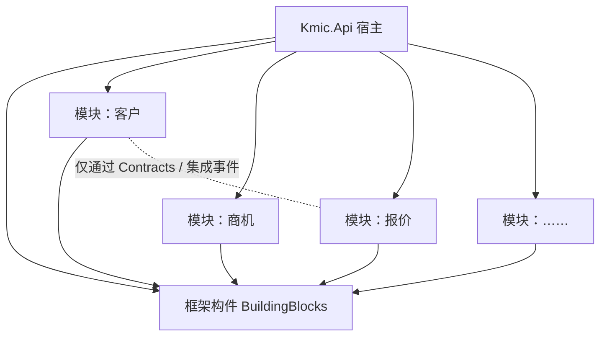

# ADR-0002 整体架构采用模块化单体

- 状态：已确认
- 日期：2026-11-03

## 背景

旧系统是 WebForms 单体，业务之间没有边界：页面直接读写任意表、工具层反向依赖业务层、巨型 ashx 混杂多个业务。新系统有十几个业务域，团队规模有限，部署目标是 Linux + Docker。

## 备选方案

| 方案 | 优点 | 缺点 |
|---|---|---|
| 普通单体 | 最简单 | 缺少边界，会重演旧系统的耦合 |
| **模块化单体** | 一个程序、一次部署；模块之间有硬边界；可以按模块逐个拆成服务 | 需要规则和自动化检查守住边界；跨模块数据需要专门设计 |
| 微服务 | 独立部署、独立扩容，适合多团队并行 | 分布式事务、服务调用失败、部署运维的复杂度成倍增加，与团队规模不匹配 |

## 决策

采用**模块化单体**：

- 一个宿主程序 `Kmic.Api`，打包为一个 Docker 镜像部署；
- 业务按领域拆成独立模块，模块内部结构见 ADR-0003、ADR-0004；
- 模块边界和通信方式见 ADR-0006、ADR-0007；
- 边界由编译期依赖和架构测试强制，见 ADR-0008。

## 影响

- 部署和运维与单体一样简单。
- 模块的独立性决定了以后能否平滑拆成微服务。拆分步骤：换宿主、迁 schema、进程内调用换成远程调用、事件改走消息中间件。
- 框架必须提供模块注册、模块间通信和边界检查能力。
