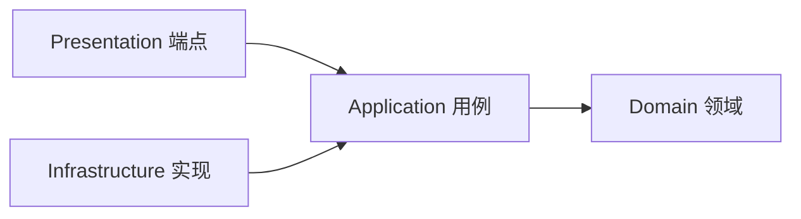

# ADR-0003 模块内部采用整洁架构 + DDD + CQRS

- 状态：已确认
- 日期：2026-11-03

## 背景

旧系统按技术分层（Web / BLL / DAL / Model），但 BLL 基本是透传，业务规则散落在页面、ashx 和 SQL 中，状态判断（如 `IsShenhe`）到处重复。新系统要求业务规则集中、可测试、不被技术细节污染。

## 备选方案

| 方案 | 优点 | 缺点 |
|---|---|---|
| 传统分层（Controller / Service / Repository） | 熟悉 | 改一个功能跨多个目录；Service 臃肿；容易层层透传 |
| 纯垂直切片 | 按功能组织，改动集中 | 缺少统一的领域模型，复杂规则容易分散 |
| **整洁架构 + DDD 战术设计 + CQRS，应用层按用例组织** | 业务核心独立于框架；规则集中在领域对象中；读写各自优化 | 样板代码和项目数量更多，团队需要掌握 DDD 概念 |

## 决策

每个模块内部采用：

1. **整洁架构**：依赖只能由外向内。领域层不依赖任何框架，应用层只依赖领域层和抽象接口。
2. **DDD 战术设计**：聚合根、实体、值对象、领域事件、领域服务。业务不变量（如“已审批的单据不能修改”）由聚合自身保证。
3. **CQRS**：
   - 命令（修改数据）通过聚合执行，经过完整的业务规则校验；
   - 查询（读取数据）不经过聚合，直接按需投影为返回模型，可以使用 EF 无跟踪查询或 SQL。
   - 读写使用同一个数据库，不引入独立的读库。
4. **按用例组织**：应用层按功能建文件夹，命令或查询、校验器、处理器放在一起。

## 影响

- 简单的维护类功能也要遵循同样的结构，以换取全系统写法一致。
- 需要在编码规范和模块模板中给出聚合、值对象、领域事件的写法约定。
- 查询侧允许直接读本模块的数据库，但不允许读其他模块的数据（见 ADR-0006）。
