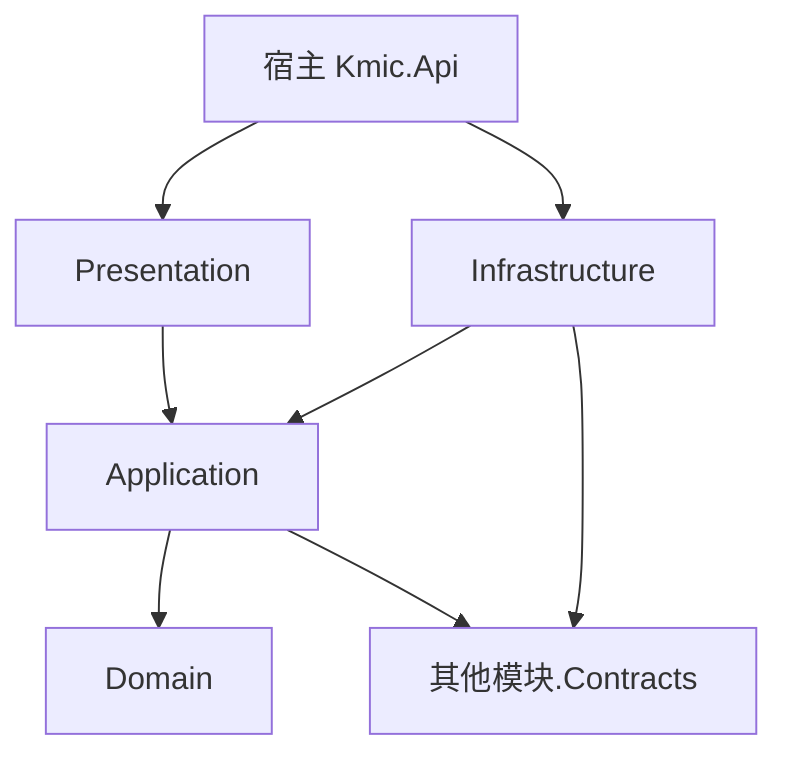

# ADR-0004 每个模块拆分为 5 个项目

- 状态：已确认；之后的修订见文末“修订记录”
- 日期：2026-11-03

## 背景

整洁架构的依赖规则可以靠架构测试约束，也可以靠项目引用在编译期约束。新系统要求“规则由结构保证，而不是靠测试或自觉”。

## 备选方案

| 方案 | 约束方式 | 优点 | 缺点 |
|---|---|---|---|
| 每个模块 1 个项目 | 文件夹 + `internal` + 架构测试 | 项目最少 | 违规能编译通过，只能事后由测试发现 |
| 每个模块 4 个项目（端点放在 Infrastructure） | 编译期为主 | 项目较少 | 端点能直接访问 DbContext，绕过用例仍可编译 |
| **每个模块 5 个项目** | 编译期 | 端点只能调用用例；接口技术与持久化技术独立演进；与主流参考实现一致 | 15 个模块约 75 个项目 |

## 决策

每个模块拆为 5 个项目：

| 项目 | 内容 | 允许引用 |
|---|---|---|
| `<模块>.Domain` | 聚合、实体、值对象、领域事件、领域服务、业务规则 | 框架的领域基础构件 |
| `<模块>.Application` | 命令 / 查询及处理器、校验器、应用层接口、响应 DTO | 本模块 Domain、其他模块 Contracts、框架应用层构件；`Microsoft.EntityFrameworkCore`（不含 Npgsql 提供程序，只供查询处理器使用，见下） |
| `<模块>.Infrastructure` | EF 映射与 DbContext、仓储实现、外部服务、Outbox / Inbox | 本模块 Application、Domain，框架基础设施构件 |
| `<模块>.Presentation` | Minimal API 端点、请求模型 | **只能引用本模块 Application**，以及框架 Web 构件 |
| `<模块>.Contracts` | 对其他模块公开的接口、集成事件、共享数据模型 | 不引用本模块其他项目 |

- Presentation 不引用 Infrastructure，端点无法绕过用例直接访问数据。
- 宿主只在启动时引用 Presentation 和 Infrastructure，用于组装。
- **查询侧访问数据**（05-03 D1）：CQRS 读侧需要“直接、按需投影”（ADR-0012 第 6 条），因此 Application 可以引用 EF Core，但只用于查询处理器。查询处理器通过本模块 Application 中定义的 `IXxxQueryDb` 接口（只暴露 `IQueryable<T>`）访问数据，实现为 Infrastructure 中的查询 DbContext。Application 中的写入类 API（`DbContext`、`SaveChanges`、`ExecuteUpdate`、`ExecuteDelete`、`FromSql` 等）由 BannedApiAnalyzers 禁止，命令侧仍只能通过仓储写入。取舍：Application 不再是零第三方依赖，“不能写数据”由禁用 API 保证，而不是由项目引用保证。
- **请求与响应模型**（05-06 D2）：请求模型在 Presentation 独立定义，字段名与对应命令同名；响应直接复用 Application 中查询 / 命令的响应 DTO，不在 Presentation 中重复定义和映射。响应 DTO 的变化即接口变化，由 CI 的 OpenAPI 破坏性变更检查（oasdiff）兜底。

## 影响

项目数量较多，通过以下方式消化：

- `dotnet new` 模块模板，一条命令生成 5 个项目和标准目录；
- `Directory.Build.props` 统一目标框架、分析器、代码规范；`Directory.Packages.props` 统一包版本；
- 按模块提供解决方案过滤文件（`.slnf`），开发时只加载所需项目。

## 修订记录

| 日期 | 内容 | 来源 |
|---|---|---|
| 2026-11-04 | Application 可引用 EF Core，只供查询处理器；写入 API 由禁用清单拦截 | 05-03 D1 |
| 2026-11-04 | 请求模型在 Presentation 定义，响应复用 Application 的 DTO | 05-06 D2 |
| 2026-11-10 | 文档整合：以上补充说明并入正文，决定不变 | R01 L2（S0-08） |
