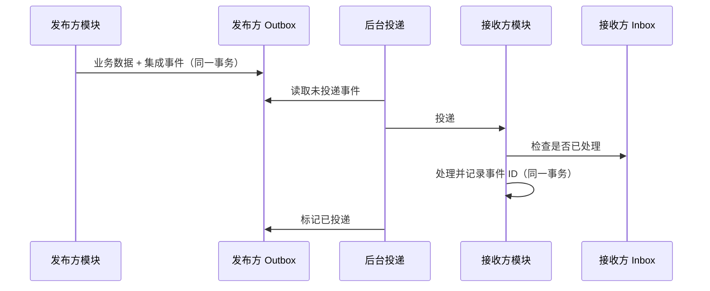

# ADR-0007 模块间异步通信采用进程内事件总线 + Outbox / Inbox

- 状态：已确认；之后的修订见文末“修订记录”
- 日期：2026-11-03

## 背景

在完全隔离的边界下（ADR-0006），跨模块的副作用要通过集成事件传递，例如“合同审核通过后生成排产任务”“状态变化后发送邮件”。旧系统在请求中同步完成这些动作，出现过业务回滚、邮件却已发出的问题。

## 备选方案

| 方案 | 优点 | 缺点 |
|---|---|---|
| 进程内直接发布事件（不落库） | 最简单 | 进程崩溃或事务回滚时事件丢失或误发 |
| **进程内事件总线 + Outbox / Inbox** | 事件与业务数据同一事务落库，可靠；不需要额外中间件 | 需要后台投递和去重机制 |
| 直接引入消息中间件（RabbitMQ 等） | 天然支持分布式 | 单体阶段增加运维负担，收益有限 |

## 决策

1. **领域事件**：模块内部使用，在同一事务中由中介者分发处理。
2. **集成事件**：模块之间使用，定义在发布方的 `Contracts` 中。
   - 消息类型以显式稳定名称 + 版本号标识（`[IntegrationMessage("Customer.CustomerChanged", Version = 1)]`），不使用 CLR 类型名（05-07 D4）。
   - 载荷：被引用的聚合发布 `{聚合}Changed` 快照事件（完整对外快照 + 提交后的来源版本），用于读模型同步；业务事实事件携带处理所需数据，订阅方不回调发布方（05-07 D5）。
3. **Outbox**：发布方把集成事件写入本模块 schema 的 Outbox 表，与业务数据同一事务提交；后台任务读取并投递。
4. **Inbox**：接收方记录已处理的事件 ID，重复投递时直接跳过，保证每个事件只处理一次。投递采用两阶段（Outbox → 各订阅方 Inbox），见 ADR-0028。
5. **传输层抽象**：事件总线定义为接口，当前实现为进程内投递；以后拆分服务时替换为消息中间件，Outbox / Inbox 机制保持不变。
6. **请求型消息**（`IIntegrationRequest`）：一对一，只能定义在平台模块的 Contracts 中，如 `SendNotification`；业务模块之间协作只用事件（05-07 D6）。

## 影响

- 跨模块操作是最终一致，前端需要接受“稍后可见”的结果，或由发起方返回处理中状态。
- 邮件、短信等通知也通过 Outbox 发送，业务回滚时不会误发。
- 需要提供失败重试、死信记录和监控。

## 修订记录

| 日期 | 内容 | 来源 |
|---|---|---|
| 2026-11-04 | 第 2 条：消息类型的稳定名称与版本、快照事件与业务事实事件的载荷；新增第 6 条请求型消息 | 05-07 D4～D6 |
| 2026-11-10 | 文档整合：以上补充说明并入正文，决定不变 | R01 L2（S0-08） |
