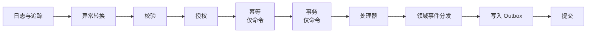

# ADR-0011 领域层与应用层基础约定

- 状态：已确认
- 日期：2026-11-03

## 背景

旧系统中：
- 业务状态以魔法数字（如 `IsShenhe = -1/0/1/2`）散落在代码和 SQL 中；
- 审计字段由各处手写赋值；
- 时间直接取 `DateTime.Now`；
- 权限只在页面入口检查，后台逻辑没有保护；
- 重复提交只靠前端防连点。

新框架要求这些规则由框架结构保证，而不是依赖开发人员自觉。

## 决策

### 领域层

1. **实体与聚合根**
   - `Entity<TId>`：按 ID 判断相等，属性对外只读。
   - `AggregateRoot<TId>`：继承 Entity，收集领域事件，带版本号用于乐观并发。
   - 通过工厂方法创建，不提供公开无参构造函数（ORM 所需的构造函数设为私有）。
   - 状态只能通过业务方法改变。
2. **审计字段**（创建人、创建时间、修改人、修改时间）作为 **EF 影子属性**，不出现在领域模型中，由拦截器自动写入。
   - 查询侧可以照常读取这些字段。
   - 业务规则依赖的时间（如过期时间），必须在实体中定义为显式的业务字段。
3. **值对象**使用**受约束的 record**：
   - `sealed record`，不使用位置参数写法；
   - 属性只读、不加 `init`，防止 `with` 表达式绕过校验；
   - 构造函数私有，只能通过返回 `Result` 的工厂方法创建；
   - 以上规则由分析器或架构测试强制。
4. **状态与流转**
   - 有行为的状态使用**智能枚举**（类），不使用数字或普通枚举；
   - 有状态流转的聚合使用框架提供的**状态机构件**，集中声明合法的转换，非法流转返回错误；
   - 没有行为的简单分类允许使用普通枚举。
5. **领域事件**
   - 在事务提交前、同一事务内同步分发；
   - 处理器只能修改本模块的数据，不得执行无法回滚的外部动作；
   - 对外的副作用（跨模块通知、邮件、外部调用）由处理器写入 Outbox（见 ADR-0007）。
6. 领域层**不依赖** `ICurrentUser` 和运行环境；需要操作人时由应用层作为参数传入。

### 应用层

7. **当前时间**：统一使用 .NET 内置 `TimeProvider`，禁止直接使用 `DateTime.Now` / `DateTime.UtcNow`，由分析器检查。
8. **当前用户**：`ICurrentUser` 提供用户 ID、当前角色、是否模拟身份、实际操作人。
   - 实现位于基础设施层，从已校验的令牌和会话缓存中读取；
   - 后台任务、事件处理使用框架提供的系统用户身份。
9. **授权声明在命令 / 查询上**，由管道统一检查，HTTP、后台任务、事件处理、模块间调用都经过同一检查；端点层只确认已登录。需要以系统身份执行的用例必须显式标注。
10. **幂等**：需要幂等的命令（创建、提交、审批、支付类）必须标记，请求须通过 `Idempotency-Key` 请求头携带幂等键。
    - 幂等记录包含：用户、当前角色、操作名、幂等键、请求摘要、状态、结果引用、创建时间、过期时间。
    - 同键同请求且已成功：返回首次结果（重放前仍重新鉴权，不向已失权的主体返回历史结果）。
    - 同键同请求且正在处理：返回稳定的“处理中”结果。
    - 同键但请求摘要不同：返回 409（`IdempotencyKeyReused`）。
    - **结果未知**：客户端超时或断线后，必须使用原幂等键重试或查询结果，不得换新键重新执行。
    - 幂等记录过期后定期清理。
11. **事务内再次校验**：管道中的前置检查（授权、数据范围等）不能代替事务内的检查。处理器在事务内重新读取并校验状态、版本、指派关系和共享额度，防止“检查之后、保存之前”被他人修改。
12. **管道行为固定顺序**：

   - **先校验后授权**：参数不合法的请求直接拒绝，不去查询权限数据。取舍：参数校验规则可能被无权限的调用者探知，可以接受。
   - 校验、授权、幂等都在事务之外，失败或重复的请求不占用数据库事务。

13. 规则与策略的分类（授权策略、业务策略、计算策略、版本化规则集）见 ADR-0017；审计事件与业务历史见 ADR-0018。

## 影响

- 框架需要提供以下基础构件：`Entity`、`AggregateRoot`、智能枚举、状态机、领域事件基础、`ICurrentUser`、各管道行为、幂等存储、相关分析器与架构测试。
- 编码规范和模块模板中要给出各构件的标准写法。
