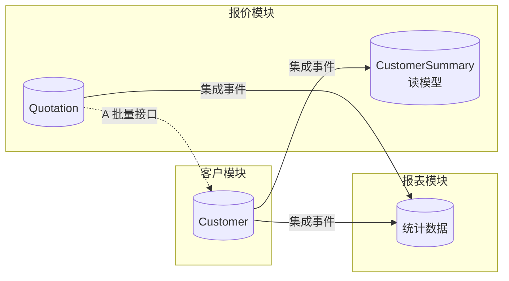

# ADR-0013 跨模块数据获取模式

- 状态：已确认
- 日期：2026-11-03

## 背景

模块完全隔离（ADR-0006）后，一个模块不能直接关联其他模块的表，但列表、详情、统计经常需要其他模块的数据，例如显示名称、按对方字段筛选或排序、跨模块统计。

旧系统靠跨表关联和数据库触发器同步冗余字段，存在触发器只处理单行、跨库耦合等问题。

## 备选方案

| 模式 | 做法 | 实时性 | 能否按对方字段筛选排序 | 开发量 |
|---|---|---|---|---|
| A 接口组合 | 查本模块数据后，批量调用对方 Contracts 补齐 | 实时 | 不能 | 小 |
| B 本地读模型 | 订阅对方集成事件，在本模块维护所需字段的副本 | 最终一致（秒级） | 能 | 中 |
| C 报表模块 | 独立模块订阅多个模块的事件，构建统计数据 | 最终一致 | 能 | 大 |

## 决策

三种模式都提供，按场景选用：

| 场景 | 模式 |
|---|---|
| 详情页补充少量关联信息 | A 接口组合 |
| 列表需要显示、筛选、排序其他模块的字段 | B 本地读模型 |
| 跨模块统计、看板、报表 | C 报表模块 |
| 要求绝对实时的场景 | A 接口组合 |

框架统一提供：

1. **批量查询契约约定**：Contracts 中按 ID 查询的接口必须支持批量，避免逐条调用（N+1）。
2. **读模型同步构件**：基于 Inbox 的“收到事件 → 幂等更新副本”的标准写法；提供初始化和重建能力，可以从源模块批量拉取，重新生成读模型。
3. **删除与停用同步**：源数据删除或停用时发布事件，副本同步标记，配合 ADR-0012 的 `[已删除]` / `[已禁用]` 显示规则。
4. **报表模块模板**：报表模块同样遵守隔离规则，数据全部来自事件。

## 影响

- 读模型是最终一致的，界面上可能有秒级延迟。
- 同一份数据会有多个副本，必须保证可以重建。
- 冗余字段同步由事件实现，不再使用数据库触发器。
