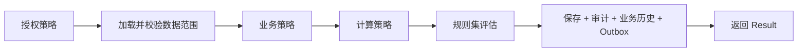

# ADR-0017 规则与策略分类

- 状态：已确认
- 日期：2026-11-03

## 背景

旧系统中，权限判断、状态判断、金额计算、规则触发和通知混在页面代码和巨型 ashx 中。同一个金额在前端、页面、导出里各算一遍，规则调整后历史单据无法解释“当时为什么这么判断”。

## 决策

### 1. 三类策略

| 类型 | 回答的问题 | 例子 | 所在位置 |
|---|---|---|---|
| 授权策略 | 当前身份能不能对这个资源做这件事 | 是否被指派人（见 ADR-0015 第 3 层） | Application |
| 业务策略 | 这个业务对象现在能不能做这件事 | 草稿才能提交；已确认不能再编辑 | Domain（聚合方法、状态机） |
| 计算策略 | 结果怎么算 | 报价总额、税额、可发货量 | Domain 或 Application，**唯一权威** |

- **计算策略是唯一权威**：同一个计算只能有一份实现。前端、导出、报表只展示或预估，最终以后端计算结果为准。
- FluentValidation 只负责输入的形状和基本取值，不代替业务策略。
- 功能开关只决定功能是否开放，不授予权限。

### 2. 版本化规则集

- 会随时间变化、并且需要事后解释的业务规则（例如特殊价格、交期、规格、评审触发条件）使用**带版本的规则集**。
- 业务对象记录它使用的规则集版本，任何时候都能解释“当时依据哪一版规则做出的判断”。
- **规则签名**：需要“先预览、再确认”的操作，预览时返回当时的规则签名，确认时带回；如果期间规则已变化，返回 409（`RulesChanged`），要求重新预览。
- 规则集不用于界面偏好。

### 3. 处理器只负责编排

处理器按固定顺序编排，不成为新的“万能服务”：

一个服务或处理器如果同时判断权限、校验状态、计算金额、生成下游任务、发送通知和写日志，即视为职责失控，需要拆分。

## 影响

- 框架需要提供：策略基础构件、规则集的版本存储与评估构件、规则签名支持。
- 具体规则内容随业务模块确定，框架只提供机制。
