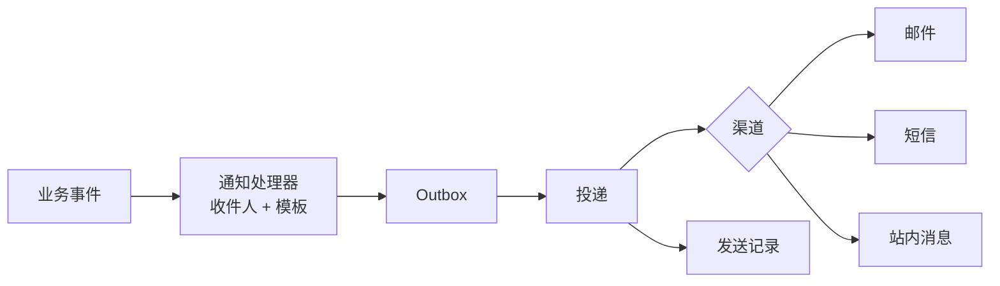

# ADR-0020 外部调用、通知与文件存储

- 状态：已确认（含待决项；2026-11-05 随 R02 第 4 批加补充说明，已确认）
- 日期：2026-11-03

## 背景

旧系统的问题：
- 邮件在请求线程内同步发送，业务回滚后邮件已经发出；
- 测试环境靠开关和标题前缀区分，存在误发风险；
- 附件存放在站点目录，路径直接存在业务字段中，知道路径即可下载；
- 上传组件有多套；
- 外部调用没有统一的超时和重试策略。

## 决策

### 1. 外部 HTTP 调用

- 每个外部系统一个类型化客户端，放在 Infrastructure；地址和凭据来自配置与密钥。
- 使用官方韧性库 Microsoft.Extensions.Http.Resilience：总超时、单次超时、重试、熔断、并发隔离。
- 重试规则：
  - 读操作和天然幂等的操作可以自动重试；
  - 写操作只有在对方支持幂等键时才自动重试，并携带我们生成的外部操作 ID；
  - 不支持幂等的写操作不盲目重试，结果未知时先查询核对。
- 禁止在数据库事务内调用外部系统，需要调用的一律通过 Outbox 异步执行。
- 请求和响应日志脱敏并截断。

### 2. 通知

- 所有通知经 Outbox 发送，不在请求中同步发送。
- 邮件使用 MailKit。
- 模板存数据库并带版本，提供预览；每条发出的通知记录所用模板版本。
- 模板引擎使用沙箱化的 Liquid 类引擎（Fluid 或 Scriban，在技术选型时确定），不使用 Razor，防止模板执行任意代码。
- 每条通知带业务去重键，已发送的不重复发送。
- **非生产环境强制使用捕获通道**：
  - 邮件和短信的完整内容（收件人、抄送、密送、主题、正文、附件信息）写入捕获存储，不对外发送；
  - 非生产环境如果配置了真实发送通道，应用启动失败。
- 站内消息按收件人存储，带已读状态，默认只有收件人本人可读。
- **待决**：站内消息实时推送（SignalR），首期使用前端轮询。

### 3. 文件存储

**统一附件模型**
- 附件元数据归 Files 平台模块，附件关联（关联的业务对象和附件类别）记录在各业务模块自己的 schema 中（修订：见 ADR-0027）。
- 下载权限继承所属业务对象的资源策略。
- 生命周期：上传中 → 校验中 → 可用 → 已解除关联 → 到期物理清理。删除时先解除关联，确认无引用并超过保留期后，才删除文件。

**存储**
- 框架定义 `IFileStorage` 抽象；开发环境使用本地磁盘，生产环境使用 S3 兼容的对象存储。
- 文件与数据库不做分布式事务，通过状态和补偿清理保证一致。
- **待决**：生产使用自建 MinIO 还是云对象存储。

**上传**
- 流式处理，不整体读入内存；限制大小、并发和耗时。
- 按文件头内容识别真实类型，扩展名使用白名单。
- 按用户统计每日上传量（配额）。删除附件不返还当日用量。
- 上传、扫描、外部调用不持有长数据库事务。
- **待决**：病毒扫描（如 ClamAV），框架先预留扩展点。

**下载**
- 默认经 API 转发，每次下载都鉴权并审计。
- 超大文件可以配置为短时效的预签名链接。

## 影响

框架需要提供：
- 类型化客户端约定与韧性配置；
- 通知渠道抽象、模板管理与预览、捕获通道与启动保护；
- 附件模型、`IFileStorage` 的本地实现和 S3 兼容实现、上传校验、配额、清理任务。

## 补充说明（2026-11-04，随 05-11 确认）

- 上传：先上传到 Files 得到临时文件 ID（24 小时未关联即清理）；业务命令校验后在本模块写关联，并用请求型消息 `AttachFiles` / `DetachFiles` 让 Files 登记引用。业务数据不保存文件地址（05-11 D1）。
- 系统生成的文件（作业结果等）：预生成 ID 写入存储，用 `RegisterGeneratedFile` 与作业完成同事务登记；存储中的孤儿对象由每周对账任务清理（05-11 D2）。
- 下载经业务端点：先校验业务对象的资源策略，再转发文件流；下载查询必须 `[AuditedRead]`（05-11 第 5 节）。
- 通知：收件人联系方式在发送时经 Identity 的系统专用查询取得，不复制个人信息；模板由代码声明并带默认内容，数据库保存发布的版本；处理发送请求时渲染并保存到投递记录（05-11 D3～D5）。
- 事务内外部调用由运行时守卫拦截（类型化客户端上的处理器）；需要在事件处理后调用外部系统的，写入“外部调用待办”，由后台在事务外执行（05-11 D6）。

## 补充说明（2026-11-04，随 09 确认）

- 生产对象存储已定：阿里云 OSS，每个环境一个私有 Bucket，经内网 S3 兼容地址访问；优先用 ECS 实例 RAM 角色取临时凭据；开启服务端加密与版本控制。开发与 CI 继续使用 MinIO 容器（09 D2）。

## 补充说明（2026-11-05，随 R02 第 4 批确认）

- “确认无引用并超过保留期后才删除文件”的实现改为按文件 ID 的数据库锁互斥，不依赖时间余量：业务关联时持共享锁检查可关联性，清理持排他锁并探查未完成的关联消息后才改为删除中（05-11 第 3.3、4.3 节补充说明；**设计候选**，原型 08 #18 通过前不作为实施依据）。
- 对象存储开启版本控制后，应用的删除只产生删除标记；非当前版本的保留期不短于数据库按时间点恢复的窗口加恢复执行时间；彻底删除由运维执行（05-11 第 2、6 节，09 第 4 节补充说明）。
- 决策中“不支持幂等的写操作……结果未知时先查询核对”细化为按对方能力分三种处理：接受幂等键则用同一个键重试；只能查询则先查询；都不支持则标记结果未知、人工核对，不自动重试（05-11 第 9.3 节）。
