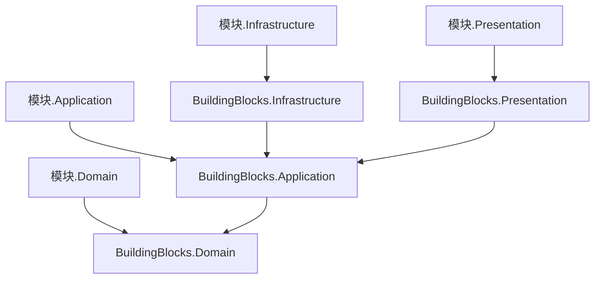

# ADR-0021 工程结构与质量门禁

- 状态：已确认
- 日期：2026-11-03

## 背景

旧系统：
- 工具层反向依赖业务层；
- 测试是 PowerShell 调 `csc.exe` 的自定义脚本，覆盖很少；
- 没有格式和分析器约束；
- 源码文件编码混用。

新系统要求从第一行代码开始，结构和质量由工具强制。

## 决策

### 1. 解决方案结构

```
src/
├─ BuildingBlocks/
│  ├─ Kmic.BuildingBlocks.Domain           Entity、AggregateRoot、智能枚举、状态机、领域事件、Result
│  ├─ Kmic.BuildingBlocks.Application      管道行为、ICurrentUser、授权与数据范围抽象、分页模型
│  ├─ Kmic.BuildingBlocks.Infrastructure   EF 拦截器、Outbox/Inbox、缓存、文件、通知、Quartz
│  └─ Kmic.BuildingBlocks.Presentation     IEndpoint、Result 转 HTTP、ProblemDetails、OpenAPI 约定
├─ Modules/<模块名>/                       每个模块 5 个项目（ADR-0004）
├─ Hosts/
│  ├─ Kmic.Api                           唯一的应用宿主，按配置以 Api / Worker 角色运行（ADR-0025）
│  ├─ Kmic.MigrationRunner               一次性执行各模块数据库迁移
│  └─ Kmic.Operator                      运维命令：初始化首个管理员、受控授权
└─ Aspire/
   ├─ Kmic.AppHost                       本地开发编排
   └─ Kmic.ServiceDefaults               OpenTelemetry、健康检查等默认配置
tests/
├─ 各模块的 Domain 单元测试、集成测试
├─ Kmic.Api.Tests                        API 测试
└─ Kmic.ArchitectureTests                架构测试
```



- 框架构件按层拆分。模块某一层只能引用框架的同层或更内层构件，由编译器保证。

### 2. 模块注册

- 每个模块提供一个 `IModule` 实现，负责注册服务、端点、权限点、定时任务和迁移。
- 宿主中显式逐个注册模块，例如 `AddModule<QuotationModule>()`，可以按配置启用或停用某个模块。
- 模块内部的端点、校验器、处理器自动发现。

### 3. 测试体系

| 层次 | 内容 | 方式 |
|---|---|---|
| 领域单元测试 | 聚合、值对象、状态机、计算策略 | 纯内存；作为主力，覆盖全部业务规则 |
| 集成测试 | 处理器 + 数据库 | Testcontainers 启动真实 PostgreSQL；每个命令和查询至少一个 |
| API 测试 | 端点、认证、五层授权、错误格式 | `WebApplicationFactory` + 真实 PostgreSQL；重点覆盖授权矩阵 |
| 架构测试 | 依赖规则、命名、禁用写法 | 落地 ADR-0008 全部规则 |
| 契约测试 | OpenAPI 破坏性变更 | CI 中对比 OpenAPI 文档 |

- 测试框架使用 xUnit v3。
- 不使用 EF 内存数据库或 SQLite 代替 PostgreSQL，因为它们不支持我们依赖的 PG 特性（部分唯一索引、`SKIP LOCKED`、`timestamptz` 等）。
- 不规定覆盖率百分比，按规则要求：每个命令和查询有集成测试；每个受保护资源有授权矩阵测试；并发、幂等、Outbox 多实例、租约过期有专门测试。

### 4. 质量门禁

| 手段 | 做法 |
|---|---|
| 构建配置 | `Directory.Build.props`：.NET 10、可空引用类型、警告视为错误、分析级别为推荐 |
| 包版本 | `Directory.Packages.props` 集中管理 |
| 格式 | `.editorconfig`，CI 执行 `dotnet format --verify-no-changes`；源码统一 UTF-8 |
| 禁用 API | BannedApiAnalyzers 禁止 `DateTime.Now` / `UtcNow`、`Guid.NewGuid()`、直接创建 `HttpClient` 等 |
| 自定义分析器 | 值对象不得有公开构造函数和 `init` 属性；领域层不得用异常表达业务失败等 |
| 依赖漏洞 | CI 检查有漏洞的依赖包，高危漏洞阻断合并 |

- 从第一行代码开始保持零警告。

## 影响

- 集成测试和 API 测试依赖 Docker，开发机和 CI 都需要 Docker 环境。
- 自定义分析器随框架一起开发和维护。

## 补充说明（2026-11-04，随 05-07 确认）

- 新增框架项目 `Kmic.BuildingBlocks.Contracts`：消息标记接口（`IIntegrationEvent`、`IIntegrationRequest`、`ISnapshotEvent`）、`[IntegrationMessage]`、`ReferenceInfo`、`ISnapshotSource<T>`；引用 `BuildingBlocks.Domain` 仅为使用 `Result` / `Error`；`BuildingBlocks.Application` 引用它。
- 模块 `Contracts` 只允许引用 `BuildingBlocks.Contracts`；Contracts 之间不得相互引用；架构测试禁止 Contracts 中使用 `Entity`、`AggregateRoot`、`IDomainEvent`、强类型 ID 与智能枚举基类。
- 模块在 `IModule` 中声明依赖（`DependsOn(模块名)`，见 07 第 2.3 节）与订阅（`ConfigureMessaging`）；启用的模块所依赖的模块必须启用，否则拒绝启动。详见 05-07 D1、第 4.1、7.2 节。

## 补充说明（2026-11-04，随 06 确认）

- 新增框架项目：
  - `Kmic.BuildingBlocks.Analyzers`（`netstandard2.0`）：自定义分析器 `KMxxxx`，编号段按层划分（06 第 2.2 节），由 `Directory.Build.props` 以分析器方式引用到全部项目。
  - `tests/Kmic.BuildingBlocks.Testing`（05-05、05-07、05-08 所称的 `BuildingBlocks.Testing`）：测试基础设施——程序集级夹具管理 PG 容器与模板库，每个测试类从模板库克隆一个数据库（06 D8）；测试数据构建器基类、`Result` 断言扩展、有超时的轮询辅助方法。
- 规则豁免只允许带 `Justification` 的 `[SuppressMessage]`，禁止 `#pragma warning disable`；规则级别只在根 `.editorconfig` 调整；质量门禁相关文件列入 `CODEOWNERS`（06 D1）。
- 格式只用 `dotnet format`（06 D2）；源码 UTF-8 无 BOM、LF 换行，由 `.gitattributes` 固定。
- CI 增加：cspell 拼写检查（06 D3）、合并请求标题的 Conventional Commits 格式检查（06 D10）。
- 版本控制采用主干开发 + 短分支 + 压缩合并（06 D10）。

## 补充说明（2026-11-04，随 07 确认）

- 第 2 节“模块注册”细化：每个模块两个注册类——Infrastructure 中的 `IModule`（服务、数据、依赖、订阅、调度；`ApplicationAssembly` 供框架扫描用例与各类声明）与 Presentation 中的 `ModuleEndpoints`（端点）；宿主 `AddModule<SampleModule, SampleEndpoints>()` 配对，启动校验两者模块名一致。原因：Infrastructure 不引用 Presentation（ADR-0004），单个 `IModule` 拿不到端点程序集。详见 07 D1、第 2.3 节。
- 模块名常量 `XxxModuleInfo.Name` 放在模块 Contracts；模块编号登记在 `docs/modules/README.md`，用于日志 `EventId` 分段。
- 新模块由 `dotnet new kmic-module` 生成空骨架；仓库常驻参考模块 `Sample`（随 CI 编译测试，生产环境注册即拒绝启动）。详见 07 D3。
- 应用层一个类型一个文件、一个用例一个文件夹（07 D2）。
