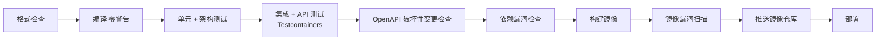

# ADR-0022 部署与入站安全基线

- 状态：已确认（含待决项）
- 日期：2026-11-03

## 背景

旧系统：
- 通过 bat 脚本复制文件到 IIS 部署；
- `compilation debug="true"`、请求校验关闭；
- 没有限流和健康检查；
- 文件与站点目录耦合。

新系统部署在 Linux + Docker。

## 决策

### 1. 容器镜像

- 生产镜像使用 .NET 的 **chiseled-extra** 镜像：体积小、没有 shell、默认非 root 运行，同时包含时区数据和 ICU（ADR-0012 需要识别 `Asia/Shanghai` 时区并支持中文文化格式）。
- 使用多阶段 Dockerfile 构建。
- 应用支持优雅停机：收到停止信号后不再领取新的 Outbox 消息和任务，等进行中的处理完成后退出。
- 健康检查分为：
  - 存活检查 `/health/live`：只检查进程是否正常；
  - 就绪检查 `/health/ready`：检查数据库等依赖是否可用。

### 2. 部署编排

- 首期使用 Docker Compose。
- 应用遵循“配置来自环境、进程无本地状态、日志输出到标准输出”的原则，以后迁移到 Kubernetes 不需要改代码。
- 部署顺序：先运行 `Kmic.MigrationRunner` 容器执行迁移，成功后再启动或滚动更新 API 容器。

### 3. CI/CD 流水线

- **待决**：CI/CD 平台和镜像仓库，取决于公司现有设施。

### 4. 入站安全

| 事项 | 做法 |
|---|---|
| HTTPS | 在反向代理处终止 TLS；应用只信任已登记代理地址传来的转发头 |
| 限流 | .NET 内置限流：未登录接口（登录、发送验证码）按 IP；登录后按用户；导出等高消耗接口单独策略；超限返回 429 |
| 请求大小 | 全局限制请求体大小，上传接口单独放宽 |
| CORS | 前端与 API 同域部署，默认不开放跨域；以后按白名单开放 |
| 安全响应头 | HSTS、`X-Content-Type-Options`、`X-Frame-Options` 等统一配置 |
| 接口文档 | 生产环境关闭 OpenAPI 文档与界面 |

- 内置限流按实例计数，多实例时总量为“实例数 × 限额”。需要精确的全局限流时，再在反向代理层或用 Redis 实现。
- **待决**：反向代理选型（Nginx 或 Traefik）。

## 影响

- 镜像中没有 shell，排查问题依赖日志、追踪和指标。
- 部署流程包含迁移容器与应用容器两个步骤。

## 补充说明（2026-11-04，随 05-08 确认）

- 优雅停机细化见 05-08 第 4.3 节：就绪检查先变为不健康，停止领取消息与作业，可续跑作业保存检查点后释放。
- `HostOptions.ShutdownTimeout` 默认 45 秒；容器停止宽限期（Compose 的 `stop_grace_period`）必须大于它，部署模板设为 60 秒。

## 补充说明（2026-11-04，随 05-12 确认）

- 就绪检查 `/health/ready` 只检查数据库可连接、启动任务完成、未在停机；其他依赖（Redis、对象存储、SMTP、短信、监听连接、Quartz）进入 `/health/dependencies`，只在内网或凭权限点访问（05-12 D4）。
- 反向代理不对公网暴露 `/health/*`；存活与就绪端点匿名，只返回状态不返回细节。

## 补充说明（2026-11-04，随 ADR-0032 确认）

- 第 3 节待决的 CI/CD 平台与镜像仓库已定：Gitea Actions（自建执行机，分 `build` / `release` 两类）、Gitea 自带容器镜像仓库；镜像扫描用 Grype + Syft；镜像以提交 SHA 打不可变标签，部署按摘要引用。流水线按触发方式与执行机的拆分见 ADR-0032 第 8 节。
- 前置事项：Gitea 改为 HTTPS（ADR-0032 第 2 节）。第 4 节“反向代理选型”仍待决（截止阶段 3）；Gitea 的 TLS 终止若先于该选型落地，选型确定后统一。

## 补充说明（2026-11-04，随 09 确认）

- 第 4 节待决的“反向代理选型”已定：由阿里云应用型负载均衡 ALB 终止 TLS 并按路径转发（`/api/*` → api 容器，其余 → web 容器）；Nginx 只作前端静态文件服务器，不承担反向代理；不选 Traefik。ALB 前接 WAF 3.0（09 D3、D4）。
- “应用只信任已登记代理地址传来的转发头”落实为：`KnownNetworks` 设为本 VPC 中 ALB 所在网段。
- 生产拓扑：两台 ECS 跨可用区，web / api / worker 分容器运行，逐台滚动更新；应用主机无公网 IP，出站经 NAT 网关（09 D7、第 2 节）。

## 补充说明（2026-11-04，随 R01 M5 确认）

- 第 4 节“限流”之外增加并发限制：重型端点声明 `Heavy`（每实例同时上限）与 `HeavyPerUser`（每用户同时 1 个），超出返回 429 `Common.TooBusy` 并带 `Retry-After`（05-06 第 8.3 节补充说明）。
