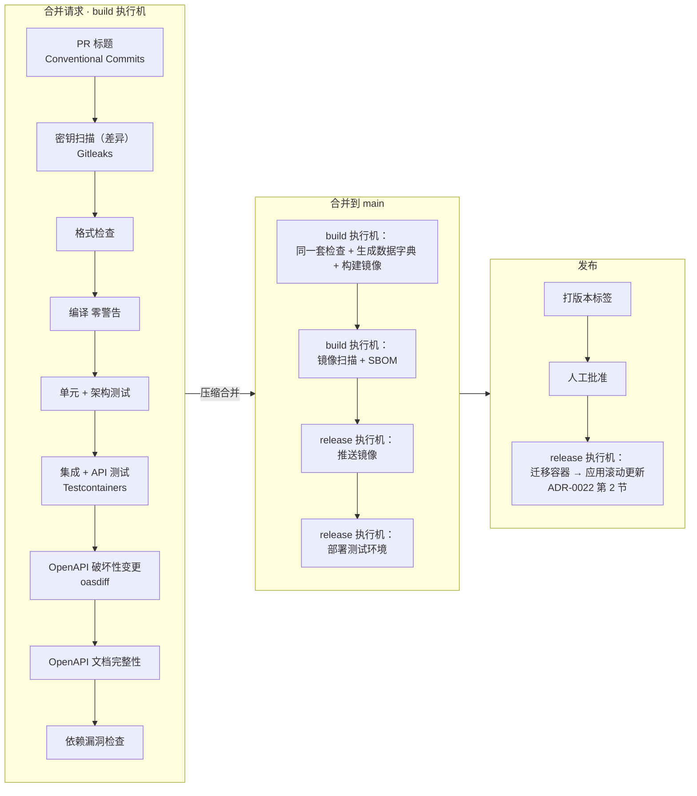

# ADR-0032 CI/CD 平台、镜像仓库与镜像扫描

- 状态：已确认（2026-11-04，D0 前置事项与 D1～D5 均按建议确定）；之后的修订见文末“修订记录”
- 日期：2026-11-04
- 解决的待决事项：00-README“待决事项”中的“CI/CD 平台与镜像仓库”（ADR-0022 第 3 节）、“镜像扫描工具”（03 第 4.10 节）；截止时点均为阶段 0（08 第 3.1 节）
- 依据：ADR-0021（质量门禁）、ADR-0022（部署与流水线）、03 第 4.10 节（CI 供应链加固规则）、06 D1 / D10（`CODEOWNERS`、主干开发、提交格式）、08 第 2.2 节阶段 0、FR-OPS-03（CI 为 P0）

## 0. 范围

| 本文内容 | 不在本文 |
|---|---|
| 代码托管上的 CI/CD 平台、执行机、镜像仓库、镜像扫描工具、镜像标识规则 | 生产观测平台、密钥存储、反向代理、对象存储（各自截止时点在阶段 2～3，08 第 3.1 节） |
| 流水线各步骤落在哪里、凭据如何隔离、分支保护如何配置 | 流水线文件的具体写法（阶段 0 实施时编写，放在新仓库 `.gitea/workflows/`） |
| Gitea 启用 HTTPS（前置事项） | 生产部署的编排细节（ADR-0022 第 2 节、`docs/ops/`） |

### 0.1 已核实的环境（2026-11-04）

| 项 | 事实 | 来源 |
|---|---|---|
| 代码托管 | 自建 Gitea **1.27.1**，组织 `Krohne`；本团队有管理员权限 | 服务器 `/api/v1/version` 返回值；用户确认 |
| 访问方式 | 公网 IP + **明文 HTTP**（`http://47.102.147.170:3050`）；用户同意阶段 0 改为 HTTPS | 旧仓库 `git remote`；用户确认 |
| 部署环境 | 测试、生产均为**阿里云 ECS** | 用户确认 |
| Gitea 能力 | 自带 Gitea Actions（兼容 GitHub Actions 工作流语法；1.27 起直接解析可复用工作流、支持组织级 / 实例级共享工作流、`GITHUB_STEP_SUMMARY`、`continue-on-error`）；自带兼容 OCI 的容器镜像仓库（Packages）；分支保护支持必需状态检查与“必须经代码负责人批准” | Gitea 官方发布说明与文档（见文末参考资料） |
| 版本 | 1.27.1 之后的 1.27.3 是一批安全修复（涉及 Actions、API、包仓库） | Gitea 官方发布说明 |

---

## 1. 背景：旧项目怎么做 → 新框架怎么做

| 问题 | 旧项目 | 新框架 |
|---|---|---|
| 构建与部署 | bat 脚本复制文件到 IIS（ADR-0022 背景） | 流水线构建镜像，按摘要部署到阿里云 ECS 上的 Docker |
| 质量门禁 | 无 CI；合并请求只靠人工 | 每个合并请求自动跑完 ADR-0022 的门禁，失败即阻断合并（FR-OPS-03） |
| 代码托管访问 | 明文 HTTP，账号密码与令牌明文传输 | HTTPS（D0） |
| 合并方式 | `development` 合并到 `main`，提交信息无格式 | 主干开发 + 压缩合并 + Conventional Commits（06 D10），由分支保护强制 |
| 工具信任 | 无约定 | 03 第 4.10 节的 4 条 CI 供应链加固规则，由本文落到具体配置 |

03 第 4.10 节的加固规则（本文各项决策都必须满足）：

1. 第三方 CI 动作按**提交 SHA** 固定；工具二进制与容器镜像按**摘要（digest）**固定。
2. 扫描、测试等作业**不持有**镜像推送与部署凭据；推送和部署在独立作业中，扫描通过后才执行。
3. CI 凭据使用短时效令牌，按作业最小授权。
4. 升级 CI 工具版本走与代码相同的评审流程。

---

## 2. D0 前置事项：Gitea 启用 HTTPS

这不是选型，是阶段 0 的第一步，其余各项都依赖它：

| 不改的后果 | 说明 |
|---|---|
| 凭据明文传输 | 账号密码、个人访问令牌、Actions 执行机注册令牌、镜像推送凭据都会在公网上明文传输 |
| 镜像仓库不可用 | Docker 默认拒绝向非 HTTPS 的镜像仓库推送和拉取；绕开只能在每台机器上配置“不安全仓库”，等于关闭传输加密 |
| 与 ADR-0022 不一致 | ADR-0022 要求入站一律 HTTPS |

做法：

| 步骤 | 内容 |
|---|---|
| 1 | 为 Gitea 申请域名（如 `git.<公司域名>`），在阿里云完成解析 |
| 2 | 在 Gitea 前加 TLS 终止：阿里云负载均衡挂证书，或 Gitea 所在主机上的反向代理（与 ADR-0022 待决的反向代理选型一致即可）；也可用 Gitea 内置的 ACME 自动证书 |
| 3 | HTTP 301 跳转到 HTTPS，`ROOT_URL` 改为 HTTPS 地址；安全组只放行 443（以及 SSH，如使用） |
| 4 | **轮换**所有曾经在明文 HTTP 下使用过的个人访问令牌与密码 |
| 5 | 升级 Gitea 到 **28.3.0**（现网 1.27.1），之后启用 Actions。1.27.3 之后版本号直接改为 28.0.0，属于跨大版本升级：先完整备份、在测试实例上按官方发布说明演练，再升级生产。1.27.1 到 28.3.0 之间官方只列出两项不兼容变更（28.0.0：Git 网络操作改经内部代理；Actions 新增 `RUN_RETENTION_DAYS`），都容易处理；28.0 新增“代码负责人审核未完成时阻止合并”，正是第 9 节需要的设置。操作见 `docs/implementation/S0-Gitea准备.md` |

---

## 3. D1 CI/CD 平台

| 选项 | 做法 | 优点 | 缺点 |
|---|---|---|---|
| **A Gitea Actions + 自建 act_runner** | 使用现有 Gitea 的 Actions，执行机自建 | 与代码托管共用账号、权限、分支保护；状态检查原生显示在合并请求上；工作流语法与 GitHub Actions 兼容，资料多；不增加服务 | act_runner 的生态与稳定性不如 GitHub 托管执行机；部分第三方 Actions 需要验证兼容性 |
| B Jenkins | 独立部署 Jenkins | 插件最多、最灵活 | 多一套需要维护、打补丁的服务和账号体系；插件本身是常见的供应链与漏洞来源；与 Gitea 的集成靠插件 |
| C Woodpecker / Drone | 独立的轻量 CI，对接 Gitea | 轻量、容器原生 | 多一套服务；生态小于 Actions |
| D 阿里云云效流水线 | 托管 CI | 不用维护执行机；与阿里云部署打通 | 代码与凭据要交给第三方平台；与自建 Gitea 的集成、合并请求状态回写需要额外配置；成本与账号体系另算 |

- **决定（已确认，2026-11-04）**：A。
- **理由**：门禁要“在合并请求上直接阻断”，A 与分支保护是同一个系统，配置最少、最不容易出现“检查通过但没拦住合并”的缝隙；兼容 GitHub Actions 语法，团队以后迁移平台的成本也最低。
- **取舍**：执行机自己维护；第三方 Actions 只用少数必要的几个，并按 SHA 固定（规则 1）后逐个验证在 act_runner 上可用。

---

## 4. D2 执行机的部署与隔离

| 选项 | 做法 | 优点 | 缺点 |
|---|---|---|---|
| **A 独立 ECS，按信任级别分两类执行机** | `build` 执行机：构建、测试、扫描，**不持有**任何推送与部署凭据；`release` 执行机：推送镜像、部署，只接受来自受保护分支的作业 | 直接落实加固规则 2、3：即使某个测试依赖或扫描工具被投毒，也拿不到推送与部署凭据；执行机被攻破不会波及 Gitea 本身 | 多一到两台 ECS；需要维护两类执行机标签 |
| B 执行机与 Gitea 同机 | 在 Gitea 服务器上运行 act_runner | 不增加机器 | 作业与代码托管同处一机：作业中的恶意代码可以直接接触 Gitea 的数据与配置；资源互相争抢 |
| C 单一执行机 | 所有作业在同一类执行机上 | 简单 | 测试作业与推送 / 部署凭据同处一处，违背规则 2 |

- **决定（已确认，2026-11-04）**：A。
- 执行机软件：act_runner 已更名为 **Gitea Runner**（`gitea.com/gitea/runner`，5.4.0，MIT，S0-04）；本文中的 act_runner 均指它。

| 项 | `build` 执行机 | `release` 执行机 |
|---|---|---|
| 运行的作业 | 格式、编译、单元 / 架构测试、集成 / API 测试、OpenAPI 检查、依赖漏洞检查、构建镜像、镜像扫描 | 推送镜像、部署测试环境 / 生产环境 |
| 触发 | 合并请求、`main` 推送 | 只有 `main`（受保护分支）与发布标签；生产部署需要人工批准 |
| 持有的凭据 | 无推送、无部署凭据；只有拉取基础镜像所需的只读访问 | 推送镜像的令牌、部署主机的部署凭据（短时效、按环境分开） |
| Docker | 集成测试使用 Testcontainers 启动 PostgreSQL（ADR-0021），作业容器需要 Docker：执行机用官方 `-dind` 镜像以 `--privileged` 运行（作业用镜像内自带的 Docker，拿不到宿主机的 Docker 权限），**只允许在这类专用主机上开启**；标签必须带 `:docker://<作业镜像>`，否则作业在执行机本身上运行（host 模式）。不得把宿主机的 `docker.sock` 挂给任何执行机 | 不需要 privileged；运行方式在编写流水线时确定 |
| 网络 | 出站只放行包源、镜像源、漏洞库镜像；不能访问生产网络 | 可以访问镜像仓库与部署主机 |
| 规格（初定） | 4 核 16 GB 起（Testcontainers + 并行测试）；`待确认`，阶段 0 按实际耗时调整 | 2 核 4 GB |

- **理由**：加固规则 2 的本质是“会执行不可信代码的地方，不放有价值的凭据”；分开机器是最直接、最容易审查的落实方式。
- **取舍**：多一台小规格 ECS；作业要标注运行在哪类执行机上（流水线评审时检查）。

---

## 5. D3 镜像仓库

| 选项 | 做法 | 优点 | 缺点 |
|---|---|---|---|
| **A Gitea 自带容器镜像仓库（Packages）** | 镜像推送到 `git.<域名>/krohne/<镜像名>` | 凭据、权限与代码同一套体系；不增加服务、无额外费用；可用 Gitea 的包清理规则管理保留期 | 没有内置漏洞扫描（扫描放在 CI，本来也要求“先扫描后推送”）；镜像仓库的可用性随 Gitea（Gitea 停机时无法部署新版本，已运行的容器不受影响） |
| B 阿里云容器镜像服务 ACR 企业版 | 托管镜像仓库 | 有服务等级保障；同地域 VPC 内拉取快；自带漏洞扫描、镜像签名、保留策略 | 按年付费；账号体系与 Gitea 分开，CI 要多管理一套凭据 |
| C 阿里云 ACR 个人版 | 免费托管 | 免费、VPC 内拉取 | 面向个人开发者，没有服务等级保障，**不适合生产** |
| D 自建 Harbor | 独立部署 | 功能完整（扫描、签名、复制、保留） | 多一套需要维护的服务，对单一系统偏重 |

- **决定（已确认，2026-11-04）**：A。
- **理由**：本项目是单一系统，镜像数量少；A 让“代码、合并请求、镜像”在同一个权限体系内，凭据最少，最符合规则 3。
- **取舍**：没有独立的服务等级保障与仓库自带扫描。出现以下任一情况时改用 B（迁移只需改推送地址与部署配置）：镜像拉取成为部署瓶颈；需要跨地域复制；公司要求镜像签名与仓库侧扫描。

---

## 6. D4 镜像扫描工具

依赖包漏洞已由 `dotnet list package --vulnerable` 检查（03 第 4.10 节），镜像扫描要覆盖的是**基础镜像中的系统组件**（chiseled-extra 镜像，ADR-0022）。

| 选项 | 优点 | 缺点 |
|---|---|---|
| **A Grype（Anchore），配合 Syft 生成 SBOM** | 专注漏洞扫描，正好覆盖需要的范围；Syft 生成的 SBOM（软件物料清单）可随镜像归档，为将来的合规要求留底；目前没有类似 Trivy 的供应链事件 | 功能面比 Trivy 窄（不含 IaC、密钥扫描） |
| B Trivy | 功能最全（镜像、依赖、IaC、密钥）、社区最大 | 2026 年 3 月发布流程被攻破（CVE-2026-33634），恶意 v0.69.4 与被篡改的 Actions 标签已撤下，已知安全版本为 v0.69.3 及更早；事件之后的官方新版本`待确认` |
| C 阿里云 ACR 企业版自带扫描 | 不引入工具 | 依赖 D3 选 B；扫描发生在推送之后，与“先扫描后推送”的顺序相反 |

- **决定（已确认，2026-11-04）**：A。版本：Grype 0.121.1、Syft 1.56.0，均为 Apache-2.0（S0-04）。
- **理由**：需要的能力只是“镜像漏洞扫描”，A 刚好覆盖且多了 SBOM；在两者能力都满足需要时，选择供应链风险记录更干净的一个。
- **取舍**：放弃 Trivy 的 IaC 扫描（目前不需要）。仓库的**密钥扫描**是 05-10 第 2.2 节已定的要求，Grype 不提供，由独立步骤负责，见第 6.1 节。

无论选哪个工具，都执行：

| 规则 | 做法 |
|---|---|
| 固定版本 | 工具镜像按摘要引用；升级走合并请求评审（规则 1、4） |
| 漏洞库 | 漏洞数据库在执行机侧缓存，按天更新；更新失败时用缓存继续扫描，并在作业摘要中提示库的日期 |
| 阻断标准 | 有“已修复版本”的**严重 / 高危**漏洞阻断推送；没有修复版本的记入作业摘要、不阻断，由每周的基础镜像更新处理；确需豁免的写入仓库中的豁免清单（注明原因与到期日），走合并请求评审 |
| SBOM | 每个推送的镜像生成 SBOM，作为构建产物保存，与镜像摘要对应 |

### 6.1 仓库的密钥扫描

05-10 第 2.2 节已定“CI 用密钥扫描检查仓库”，Grype 不提供这项能力。

| 选项 | 优点 | 缺点 |
|---|---|---|
| **A Gitleaks** | 专用于 Git 仓库的密钥扫描，可扫描合并请求的差异与完整历史；MIT 许可；规则可加项目白名单 | 多一个工具（同样按摘要固定版本，规则 1） |
| B Trivy 的密钥扫描 | — | 与 D4 选择 Grype 的理由相冲突 |

- **决定（已确认，2026-11-04）**：A。合并请求流水线在 P1 之后增加“密钥扫描（差异）”，`main` 每周对完整历史扫描一次；命中即阻断合并。版本 Gitleaks 8.30.1（MIT，S0-04）；已并入 `scripts/check.cs`（Gitleaks 官方镜像，扫描全部提交历史），本地与 CI 相同。

---

## 7. D5 镜像标识与发布

| 选项 | 做法 | 优点 | 缺点 |
|---|---|---|---|
| **A 提交 SHA 作为不可变标签，部署按摘要** | 每次构建打 `sha-<提交短 SHA>` 标签；发布时另打版本标签（如 `2026.11.0`）；部署配置记录镜像**摘要** | 任一运行中的容器都能追溯到提交与流水线；回滚 = 改回上一个摘要；与规则 1 一致 | 部署配置需要写摘要而不是好记的标签 |
| B 只用 `latest` 或分支标签 | 每次覆盖 | 简单 | 无法确定线上跑的是哪个版本；回滚靠“重新构建旧代码”，结果不一定相同 |

- **决定（已确认，2026-11-04）**：A。版本号规则（日期型还是语义化）随 08 第 2.2 节“发布与标签规则”在阶段 0 定；本文只要求标签不可覆盖、部署按摘要。
- **理由**：可追溯与可回滚是无 shell 镜像（ADR-0022）下排查问题的前提。
- **取舍**：部署配置可读性略差，由部署说明中列出“摘要 ↔ 版本 ↔ 提交”的对照表弥补。

---

## 8. 流水线落在哪里

ADR-0022 第 3 节的流水线顺序不变，按触发方式与执行机拆分：

- 合并请求上的必需状态检查 = P1～P7 全部通过（含密钥扫描与 OpenAPI 文档完整性）。
- OpenAPI 文档完整性：操作摘要、参数、字段、枚举值缺少说明即失败（05-06 第 7.1 节，R01 M2）。
- `main` 流水线从 EF 模型生成按模块分文件的数据字典，作为构建产物保存（05-03 第 3.9 节，R01 M1）。
- `main` 上重新执行检查：压缩合并后的提交与合并请求中的最后一次提交不一定相同，以 `main` 上的结果为准再构建镜像。
- 生产部署只能从版本标签触发，并需要人工批准（Gitea Actions 中以受保护的部署作业 + 审批实现，具体机制阶段 0 验证，`待确认`）。

## 9. Gitea 分支保护配置（落实 06 D10）

| 设置（`main`） | 值 |
|---|---|
| 直接推送、强制推送 | 禁止 |
| 必需状态检查 | 第 8 节 P1～P7 |
| 审批 | 至少 1 人；新的提交推送后已有的批准失效 |
| 代码负责人审批 | 开启：`CODEOWNERS` 中的文件（06 D1 所列：根 `.editorconfig`、`Directory.*.props`、`BannedSymbols*.txt`、架构测试与分析器项目、`.gitea/workflows/`）必须经框架负责人批准 |
| 单人阶段 | 上面“审批”“代码负责人审批”两项在只有一位开发者时暂不开启（平台不允许批准自己的合并请求），第二位开发者加入后开启（06 D10、实施待办 T-04） |
| 合并方式 | 只允许压缩合并；合并请求标题即提交信息 |
| 合并前分支须是最新 | 开启 |

- `.gitea/workflows/` 加入 `CODEOWNERS`：工作流文件决定了执行什么、持有什么凭据，修改须框架负责人审核（规则 4）。
- Gitea 的 `CODEOWNERS` 规则使用 Go 正则表达式，与 GitHub 的通配写法不同，编写时注意（参考资料）。

## 10. 凭据

| 凭据 | 放在哪里 | 谁能用 |
|---|---|---|
| 镜像推送令牌 | 仓库的 Actions 密钥，限定只在 `release` 作业中引用 | `release` 执行机 |
| 测试 / 生产环境部署凭据 | 按环境分开的 Actions 密钥；生产凭据只在需要人工批准的作业中可用 | `release` 执行机 |
| 执行机注册令牌 | 只在注册时使用，注册后作废 | 管理员 |
| 拉取镜像的只读凭据 | 部署主机上 | 部署主机 |

- 令牌按最小权限创建（只授予对应仓库 / 包的读或写）；定期轮换，周期随生产密钥存储（09 D5）的轮换规定一起定。
- 工作流日志中不得打印密钥；Actions 会遮盖已登记的密钥，但派生值（如拼接后的连接串）不会被遮盖，评审工作流时检查。

## 11. 过渡安排（阶段 0 问题 4、7）

- 代码在 Gitea 就绪前放在个人 GitHub 私有仓库，作为过渡与备份；正式仓库仍是公司 Gitea，**迁移推迟到首期上线准备之前**（实施待办 T-01）。
- 过渡期 CI 暂时搁置：工作流 `.github/workflows/ci.yml` 只调用 `scripts/check.cs`，保留但只能手动运行；日常以本机 `check.cs` 为准，阶段 2 验收前手动在 Linux 上运行一次（实施待办 T-18）。迁移后同一个工作流文件由 Gitea Actions 执行。
- 过渡期不能设置分支保护，“门禁失败阻断合并”以“推送前本地运行 `check.cs`”代替，迁移后补上（实施待办 T-03）。

---

## 影响

- 阶段 0 的工作顺序：Gitea 升级并启用 HTTPS（D0）→ 启用 Actions、注册两类执行机（D1、D2）→ 空流水线跑通 P1～P7 → 配置分支保护 → `main` 流水线跑通构建、扫描、推送到 Gitea 镜像仓库（D3～D5）。
- 新增两台 ECS（`build`、`release` 执行机）；Gitea 主机需要额外磁盘存放镜像，并配置包清理规则（保留期随 08 第 3.2 节的数值一起定）。
- 08 第 5 节上线前置条件第 4 条“依赖与镜像扫描无高危漏洞”，以 D4 的阻断标准为准。

## 待确认

| 事项 | 处理方式 |
|---|---|
| DinD 作业容器中 Testcontainers 的连接方式与清理容器（Ryuk）的行为 | 迁到 Gitea 时验证；不可行时改为在 `build` 执行机上挂载独立的 Docker 守护进程 |
| Gitea Actions 中“生产部署人工批准”的实现方式 | 迁到 Gitea 时验证；不支持时改为“只能由指定人员手动触发的部署工作流” |
| `build` 执行机规格 | 迁到 Gitea 时按实际流水线耗时调整 |

## 与其他文档的接口

| 本文提供 / 需要 | 对方 |
|---|---|
| CI/CD 平台、镜像仓库、镜像扫描工具的决定 | 00-README 待决事项表、03 第 4.10 节、ADR-0022 第 3 节 |
| 阶段 0 工作顺序 | 08 第 2.2、3.1 节（已补充） |
| 分支保护、`CODEOWNERS` 范围 | 06 D1、D10 |
| 部署主机的拉取凭据、凭据轮换周期 | 生产密钥存储（09 D5） |
| 包清理保留期 | 08 第 3.2 节配置数值 |

## 参考资料

- Gitea 发布说明：[1.27.0](https://blog.gitea.com/release-of-1.27.0/)、[1.27.1](https://blog.gitea.com/release-of-1.27.1/)、[1.27.3](https://blog.gitea.com/release-of-1.27.3/)；[Linuxiac：Gitea 1.27 的 Actions 改进](https://linuxiac.com/gitea-1-27-released-with-actions-improvements-and-45-cve-fixes/)
- Gitea [代码负责人（CODEOWNERS）文档](https://docs.gitea.com/next/usage/repository/code-owners/)；[分支保护配置项（Terraform 提供程序文档）](https://gitea.com/gitea/terraform-provider-gitea/src/branch/main/docs/resources/repository_branch_protection.md)
- act_runner：[配置示例（privileged 选项）](https://gitea.psi.ch/gitea/act_runner/src/commit/d4bebccc127db1dd27b835d56ad5caa4c66f641c/internal/pkg/config/config.example.yaml)、[Docker-in-Docker 讨论 #84](https://gitea.com/gitea/act_runner/issues/84)、[vegardit 的 act_runner 镜像说明](https://gh.nn.ci/vegardit/docker-gitea-act-runner)
- Trivy 供应链事件：[Aqua 官方通告](https://www.aquasec.com/blog/trivy-supply-chain-attack-what-you-need-to-know/)、[Docker 说明](https://www.docker.com/blog/trivy-supply-chain-compromise-what-docker-hub-users-should-know/)、[StepSecurity 分析](https://www.stepsecurity.io/blog/trivy-compromised-a-second-time---malicious-v0-69-4-release)、[CrowdStrike 分析](https://www.crowdstrike.com/en-us/blog/from-scanner-to-stealer-inside-the-trivy-action-supply-chain-compromise/)
- Grype：[Anchore 开源站点](https://oss.anchore.com/tags/grype/)、[Alpine 软件包](https://pkgs.alpinelinux.org/package/v3.24/community/s390x/grype)

## 修订记录

| 日期 | 内容 | 来源 |
|---|---|---|
| 2026-11-04 | 新增第 6.1 节仓库密钥扫描（Gitleaks）；更正第 6 节取舍中“密钥扫描目前不需要”的误写 | 09 编写时发现 |
| 2026-11-04 | 第 8 节增加 OpenAPI 文档完整性检查、`main` 生成数据字典 | R01 M1、M2 |
| 2026-11-05 | 工具版本与许可核实；act_runner 更名为 Gitea Runner；Gitea 升级目标改为 28.3.0；`build` 执行机的 DinD 运行方式；单人阶段暂不开启审批 | S0-04、S0-03a |
| 2026-11-06 | 新增第 11 节过渡安排（GitHub 过渡、CI 暂时搁置、迁移推迟到上线前） | 阶段 0 问题 7 |
| 2026-11-10 | 文档整合：以上补充说明并入正文，决定不变 | R01 L2（S0-08） |
