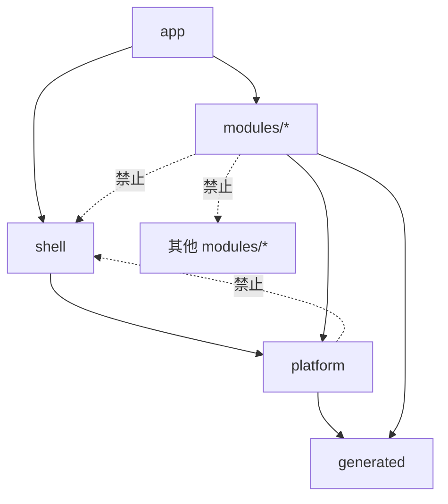
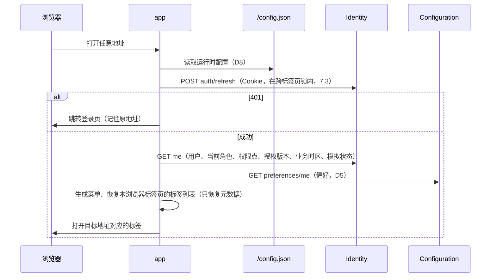
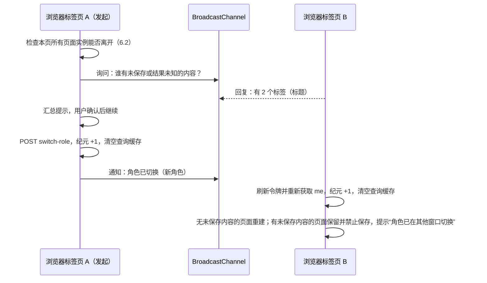
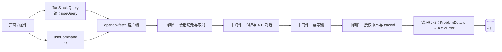
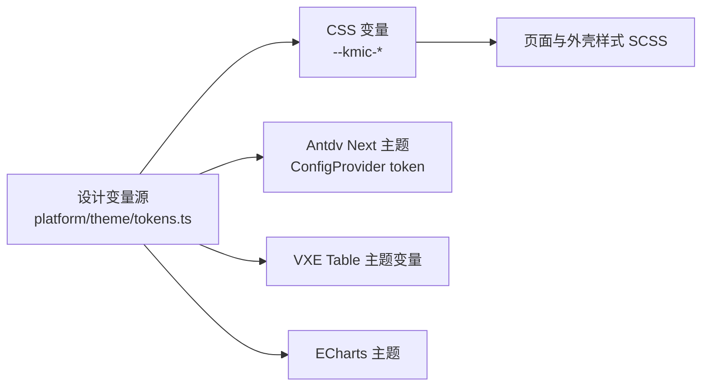

# F03 前端架构

- 状态：已确认（2026-11-05，D1～D11 全部按建议；D10 经讨论仍为 B，多语言登记为延后事项）；之后的修订见文末“修订记录”
- 日期：2026-11-04
- 范围：前端框架的结构与机制——工程组织、启动、路由与菜单、外壳与多标签工作区、页面实例、请求层与认证、错误处理、列表与表格、表单、常用组件的显示口径、主题、文字、构建与部署、前端可观测性、安全。不涉及任何具体业务页面
- 依据：F01（需求编号 FE-*）、F02（选型，已确认）；后端契约 05-04、05-05、05-06、05-08、05-10、05-11、05-12、05-13；ADR-0011、ADR-0015、ADR-0016、ADR-0022、ADR-0032；09 D3；R01“列表通用筛选协议”移交项；参考实现 vue-table（查询协议、偏好与视图分层）
- 版本核实：2026-11-04（npm / GitHub 接口），阶段 0 锁定版本时以官方发布页为准

## 0. 范围

| 本文内容 | 相关但不在本文 |
|---|---|
| 目录分层与依赖规则、启动顺序、路由目录、外壳与工作区、页面实例 | 外壳的视觉细节（尺寸、动效）——F03 之后的“外壳详细设计” |
| 请求层：类型化客户端、令牌、幂等、版本、取消、作业；TanStack Query 的用法边界 | 每个组件的属性清单——各详细设计与 F05 |
| 错误分类与界面表现 | 命名、注释、组件写法规范——F04 |
| 业务表格的边界、列表查询状态、筛选协议与命名视图的决定 | 业务表格的详细设计——F03 之后的“业务表格详细设计” |
| 表单状态、校验与服务端错误回填 | 具体页面的标准写法——F05 |
| 主题、文字、构建配置、版本检测、前端错误上报 | 观测平台本身（05-12、09） |

### 0.1 本文决定的分类

| 类别 | 本文中的内容 |
|---|---|
| 第一类：现在确定 | D1 工程组织、D2 多标签页面保持方式、D5 前端偏好的存储、D6 表单方案、D7 小数运算、D8 运行时配置、D9 前端错误上报、D10 界面文字、D11 断点；页面实例、请求层、错误分类等机制（无选项争议的直接写为设计） |
| 第二类：框架定写法，业务定用不用 | 列表 `Capped` 计数的显示（9.2）、后台作业形式的导出（7.9）、字段级即时预览计算（11.4）、预签名下载（11.6） |
| 第三类：延后 | D3 列表通用筛选协议、D4 命名视图（本文建议登记进延后事项表，见第 19 节） |

### 0.2 对照延后事项表

- 后端 `../framework/00-README.md` 延后事项表：逐项对照，无命中（“第二个 API 版本”只影响生成类型中的路径，前端无需预先处理；“数据库存储的功能开关”对前端是同一个 `GET /configuration/features` 接口，无变化）。
- 前端延后事项表：此前为空。本文新增两项（D3、D4），已登记（2026-11-05）。

### 0.3 框架负责 / 业务负责

| 框架负责 | 业务负责 |
|---|---|
| 外壳、工作区、页面实例、路由目录的结构与校验 | 本模块的路由条目（路径、标题、菜单归属、权限点） |
| 请求层：令牌、幂等键、版本、取消、错误转换、结果未知 | 调用哪个接口、何时调用 |
| 业务表格、表单、选择器、日期、金额、上传等组件 | 列定义、字段、布局、每个字段的业务含义 |
| 错误码的通用处理（第 8 节表格） | 本模块错误码的特殊提示（少数需要时） |
| 按 `allowedActions` 显示按钮的写法 | 页面上有哪些按钮、按钮对应哪个动作编码 |
| 金额、时间的显示与输入口径 | 精度、舍入方式等数值规则（来自后端约定，ADR-0012） |

本文出现的业务名词（报价、客户等）**均为示例**，只用来说明写法，不代表任何业务规则。

---

## 1. 旧项目怎么做 → 新前端怎么做

| 问题（F01 第 1.3 节） | 旧项目 | 新前端 | 章节 |
|---|---|---|---|
| 页面之间隐式耦合 | iframe 多标签 + `parent.layui` / `window.parent` 互相调用 | 单页应用；页面之间不直接调用，只通过路由导航与查询缓存失效通信 | 5、6、7.7 |
| 标签状态无隔离 | 每个 iframe 自成一体，关闭不提示 | 每个标签一个页面实例：独立的请求、未保存状态、滚动；关闭、切换角色、退出都经未保存保护 | 6 |
| 库版本混用、无构建 | 7 个 jQuery 版本，直接引用 | pnpm 锁文件、Vite 构建、内容哈希；目录分层由检查工具守护 | 2、14 |
| 前端承担业务规则 | 金额、锁定、状态判断写在脚本中 | 按钮只依据 `allowedActions`；金额只做与后端同口径的即时预览，保存以后端结果为准 | 4.4、11.4 |
| 无错误码 | 按 `msg` 文字判断 | 按 ProblemDetails 的 `code` 统一分类处理 | 8 |
| 权限只在入口 | 按钮数字 ID 硬编码 | 路由声明权限点（生成的常量），按钮依据 `allowedActions` | 4 |
| 重复提交 | 前端防连点 | 请求层自动携带幂等键，结果未知时用原键重试 | 7.5 |

---

## 2. 工程组织

### 2.1 目录分层

前端位于 `KMIC.Platform/web/`（08 D2）。代码按“谁依赖谁”分为五层：

```text
web/
├─ src/
│  ├─ app/            # 应用装配：启动、路由实例、根组件、全局样式入口
│  ├─ shell/          # 外壳：布局、侧栏、顶栏、标签栏、工作区、页面实例注册表、登录与会话界面
│  ├─ platform/       # 前端框架：请求层、会话、权限、页面实例接口、业务表格、表单、组件适配层、主题、格式化、工具
│  │  ├─ api/         #   类型化客户端、中间件、错误转换、幂等、作业
│  │  ├─ session/     #   令牌、会话纪元、跨浏览器标签页协调
│  │  ├─ authz/       #   权限点判断、allowedActions 辅助
│  │  ├─ page/        #   页面实例接口（usePage）、未保存保护
│  │  ├─ ui/          #   组件适配层（K 前缀组件）
│  │  ├─ table/       #   业务表格
│  │  ├─ form/        #   表单
│  │  ├─ format/      #   时间、金额、数字、字典翻译
│  │  └─ theme/       #   设计变量、组件库与 VXE 主题映射
│  ├─ modules/        # 业务模块，与后端模块一一对应
│  │  └─ sample/      #   参考模块（与后端 07 D3 的 Sample 对应）
│  │     ├─ routes.ts #     本模块路由条目
│  │     ├─ pages/    #     页面组件
│  │     ├─ components/
│  │     └─ api.ts    #     本模块的查询键与请求函数
│  └─ generated/      # 生成代码，禁止手改：openapi 类型、permissions.ts、error-codes.ts、dictionary-types.ts
├─ tests/e2e/         # Playwright
└─ public/
```

依赖规则（只允许箭头方向）：



| 规则 | 原因 |
|---|---|
| 业务模块之间不得互相导入 | 与后端模块边界一致（ADR-0006）；跨模块只通过路由跳转（带参数）或调用对方模块公开的接口（经生成类型） |
| 业务模块不得导入 `shell` | 页面只通过 `platform/page` 的接口与工作区交互，外壳可以替换 |
| 业务模块不得直接导入 `antdv-next` 的交互组件和 `vxe-table` | 经 `platform/ui`、`platform/table` 使用（F02 D4 适配层）；纯展示组件（按钮、标签、卡片、描述列表、栅格、间距等）可直接使用，名单在 F04 中列出 |
| `generated/` 只由生成脚本写入 | CI 中重新生成并比对，有差异即失败 |

**D1 工程组织：单应用目录分层，还是拆成工作区多包**

| 选项 | 做法 | 优点 | 缺点 |
|---|---|---|---|
| **A 单应用 + 目录分层 + 检查工具守护边界** | 一个 `package.json`；目录如上；`eslint-plugin-boundaries`（7.4.1，2026-11-02 发布）定义层与允许的依赖，违反即 CI 失败 | 构建、类型检查、测试配置只有一份；编辑器中即时提示越界；与后端“一个模块化单体”的形态一致 | 边界靠检查规则而不是包声明；规则要随目录调整维护 |
| B pnpm 工作区多包 | `@kmic/platform`、`@kmic/module-sample` 等独立包，按 `package.json` 依赖声明控制可见性 | 边界由包依赖天然保证；与 Vben 的组织方式类似 | 每个包一套 `tsconfig` 与项目引用，`vue-tsc` 按包运行；300 多个页面分散在十几个包中，跨包重构与路由装配更繁琐；收益（独立发版）本系统不需要 |

- **决定（已确认，2026-11-05）**：A。
- **理由**：后端拆项目是为了让编译器阻止越层引用；前端的同等保障由 ESLint 边界规则在编辑器与 CI 中提供，且 ESLint 已是选定工具（F02 D10）。多包的额外价值是独立版本与发布，而前端是一个整体随版本部署（ADR-0032）。
- **取舍**：边界保障来自检查规则而不是包管理器；需要为 `.vue` 文件配置好解析（阶段 1 原型验证）。

---

## 3. 启动与会话恢复



| 规则 | 说明 |
|---|---|
| 访问令牌只在内存 | 刷新页面后经 Refresh Cookie 重新取得（05-04 第 3.3 节）；不写入任何浏览器存储 |
| 启动并行 | `me` 与偏好并行；字典按需加载（11.1），不阻塞启动 |
| `me` 失败 | 403 `Identity.CurrentRoleUnavailable` → 角色选择页；403 `Common.PasswordChangeRequired` → 修改密码页；其他失败 → 启动错误页（显示 `traceId` 与重试） |
| 登录后回到原地址 | 原地址只接受站内相对路径，防止开放重定向 |

### 3.1 会话纪元

前端把“用户 + 当前角色 + 模拟会话”合称**会话纪元**（`sessionEpoch`，每次变化加一）。它是下面多处机制的共同依据：

| 用途 | 规则 |
|---|---|
| 查询缓存 | 查询键以纪元开头；纪元变化时清空查询缓存（7.7） |
| 迟到响应 | 请求发出时记录纪元，响应返回时纪元已变 → 丢弃结果（FE-SHELL-04） |
| 写操作 | 页面实例记录创建时的纪元；纪元已变的页面发起写请求 → 本地拒绝（`Client.SessionChanged`），不发送 |
| 页面实例 | 纪元变化后，没有未保存内容的页面重建；有未保存内容的页面保留内容、禁止写入（7.4） |

---

## 4. 路由目录、菜单与权限

### 4.1 路由目录

每个模块在 `routes.ts` 中声明本模块的路由条目；`app` 汇总为一份**类型化路由目录**，菜单、面包屑、标签标题、权限判断、命令面板都由它生成（FE-AUTH-01）。不用文件路由（F02 D8）。

```ts
// modules/sample/routes.ts（示例）
export const sampleRoutes = defineModuleRoutes('sample', [
  {
    name: 'sample.list',
    path: '/sample/samples',
    title: '示例列表',
    icon: 'table',
    menu: { group: 'sales', order: 10 },
    requires: [Permissions.Sample.View],          // 生成的常量（FE-AUTH-02）
    tab: { mode: 'singleton' },
    component: () => import('./pages/SampleListPage.vue'),
  },
  {
    name: 'sample.detail',
    path: '/sample/samples/:id',
    title: '示例详情',                            // 页面加载后可改为单号（6.3）
    requires: [Permissions.Sample.View],
    tab: { mode: 'byParams', params: ['id'] },
    parent: 'sample.list',                       // 面包屑与“返回”
    component: () => import('./pages/SampleDetailPage.vue'),
  },
]);
```

| 字段 | 规则 |
|---|---|
| `name` | `模块.页面`，全局唯一；类型化导航 `navigate('sample.detail', { id })` 只接受目录中的名字与参数 |
| `menu.group` | 菜单分组（一级目录）在 `app/menu-groups.ts` 中统一声明，模块只引用；没有 `menu` 的路由不出现在菜单中 |
| `requires` | 进入页面所需权限点，多个为“全部满足”；不允许空数组以外的写法表示“登录即可” |
| `tab.mode` | `singleton`：全局一个（列表页）；`byParams`：按指定参数区分（详情页，同一单据只开一个标签）；`multiple`：每次打开都新建（新建单据页） |
| `parent` | 面包屑与返回目标；必须指向目录中存在的路由 |

启动校验（开发与测试环境、以及单元测试）：名字重复、路径冲突、`parent` 不存在、`menu.group` 未声明、`requires` 中出现生成常量之外的值 → 报错。

### 4.2 菜单

- 菜单 = 路由目录中带 `menu` 的条目，按 `me.permissions` 过滤（05-05 D3）；分组中没有可见条目时整组隐藏。
- 调整菜单名称和顺序需要发前端版本（05-05 D3 的已知取舍）。

### 4.3 路由守卫

| 情况 | 表现 |
|---|---|
| 未登录 | 跳转登录页 |
| 缺少 `requires` 中的权限点 | 在标签内显示“无权访问”页，标签保留（FE-AUTH-05）；不跳转、不空白 |
| 路由不存在 | 标签内显示“页面不存在” |
| 页面组件加载失败 | 标签内显示加载失败与“重试”；疑似新版本发布时提供“重新加载应用”（14.4） |

前端权限只决定界面显示，后端每次请求完整校验（ADR-0015）。

### 4.4 按钮与 `allowedActions`

```vue
<!-- 详情页（示例） -->
<KActionButton :actions="detail.allowedActions" action="submit" @click="submit">提交</KActionButton>
```

| 规则 | 说明 |
|---|---|
| 详情页按钮只依据 `allowedActions` | 不在前端组合“权限点 + 状态”推导（FE-AUTH-03）；动作编码来自生成的智能枚举字面量类型 |
| 不在 `allowedActions` 中 | 默认隐藏；页面可声明为“显示但禁用”（用于需要让用户知道存在该操作的场景） |
| 列表行操作 | 列表不返回 `allowedActions`（05-05 D10）：行操作按权限点决定是否显示，点击后由接口判断，拒绝时按第 8 节提示 |
| 新建等不针对资源的按钮 | 按权限点显示（`useCan(Permissions.Sample.Create)`） |
| 只读模拟 | 后端已从 `allowedActions` 移除写动作；不针对资源的写按钮由 `useCan` 统一禁用 |

### 4.5 授权版本变化

响应头 `X-Authz-Version` 与本地记录不同（FE-AUTH-04）→ 后台重新获取 `me` → 重新生成菜单；当前打开的标签若已无权限，该标签显示“无权访问”，但其中未保存的内容保留到用户关闭为止（只是不能再保存）。纪元不变（用户与角色没变），查询缓存不清空。

---

## 5. 外壳与工作区

### 5.1 布局

```text
┌───────────────────────────────────────────────────────────────┐
│ 顶栏：折叠按钮 · 面包屑 ·······  搜索 · 作业 · 消息 · 角色 · 头像 │
├────────┬──────────────────────────────────────────────────────┤
│        │ 标签栏：[列表] [详情 SP-001 ●] [新建示例]  ⋯           │
│ 侧栏   ├──────────────────────────────────────────────────────┤
│ 菜单   │ 内容区（每个标签一个页面实例）                         │
│        │                                                      │
└────────┴──────────────────────────────────────────────────────┘
```

| 区域 | 内容与规则 |
|---|---|
| 顶栏 | 面包屑（来自路由目录）；命令面板（FE-SHELL-08，P2）；作业入口（7.9）；站内消息未读数（11.7）；**当前角色**常驻显示并可切换（FE-SHELL-04）；模拟身份时整条顶栏换为警示色并显示实际操作人与“结束模拟”（FE-SHELL-05） |
| 侧栏 | 菜单；折叠为图标；宽度与折叠状态是偏好 |
| 标签栏 | 打开、激活、关闭、关闭其他 / 右侧 / 全部、固定、拖动排序、刷新本标签；未保存的标签显示圆点 |
| 内容区 | 只渲染当前标签；页面保持方式见 D2 |

外壳的视觉参照 Vben Admin（F02 D6），尺寸、动效、可访问性细节在“外壳详细设计”中给出。

**布局模式与外壳细节**（F06）：上图为默认的“垂直”布局；另提供“双列菜单”“混合垂直（顶部一级 + 侧栏子级）”两种，用户在设置面板中切换（F06 D1）；窄屏时三种布局一律按 D11 处理。顶栏另有深浅色切换与设置按钮；侧栏、顶栏、标签栏的尺寸、状态、动效、右键菜单、拖动排序、页面切换与加载提示、切回标签的状态保留、设置面板，以 F06 为准。

### 5.2 工作区

工作区是外壳中的一个控制器（不是 Pinia store），是**标签的唯一可写来源**：

| 职责 | 规则 |
|---|---|
| 打开 | 菜单点击、地址栏、浏览器前进 / 后退、`navigate()` 统一走一个入口：按 `tab.mode` 计算标签键 → 已有则激活，否则新建 → 路由导航成功后才提交 |
| 关闭 | 先问页面实例“能否离开”（6.2），再销毁实例、移除标签 |
| 数量上限 | 默认 15 个（偏好可调 10～30）；达到上限时打开新标签，提示关闭最久未用且无未保存内容的标签，而不是静默关闭 |
| 恢复 | 标签元数据（路由名、参数、标题、固定）保存在 `sessionStorage`，刷新浏览器后恢复标签列表；页面内容不恢复，激活时重新加载 |
| 地址同步 | 地址栏总是当前标签的地址；复制地址给别人可以直接打开同一页面（列表的查询条件不进地址，见 9.3） |

Pinia 只放会话、偏好、标签元数据的只读视图等真正全局的状态（F02 D8）；页面的临时状态、弹层、DOM 引用都不进 Pinia。

### 5.3 D11 断点与查询区布局

F01 第 3 节已定“桌面端响应式、不设最小宽度、断点在 F03 定”。

| 选项 | 做法 | 优点 | 缺点 |
|---|---|---|---|
| **A 外壳按窗口宽度断点；查询区按容器宽度自动排列** | 外壳：≥ 1280 侧栏展开、1024～1279 侧栏自动收为图标、< 1024 侧栏变为抽屉；查询区用 CSS 容器查询，每个条件项最小 280px，按可用宽度自动 1～4 列 | 查询区随“内容区实际宽度”变化（侧栏展开与否都正确）；页面不需要写断点 | 依赖容器查询（Chrome / Edge 均已支持，符合 F01 浏览器范围） |
| B 全部按窗口宽度断点（组件库栅格） | 查询区用栅格 `xs/sm/md/lg/xl` 声明列数 | 组件库自带 | 侧栏展开 / 收起时内容区宽度变化，但窗口宽度不变，列数不跟随；每个页面都要写栅格参数 |

- **决定（已确认，2026-11-05）**：A；断点数值（1280、1024、280px）作为设计变量，原型中再按实际屏幕微调。
- **理由**：真正决定查询区能放几列的是内容区宽度，而不是窗口宽度。
- **取舍**：查询区布局不使用组件库栅格，由框架的 `KQueryForm` 提供。

宽表格保留横向滚动，表格自身不随断点改变列（F01 第 3 节）。

### 5.4 角色切换、退出与多个浏览器标签页

刷新令牌所在的会话是**整个浏览器共享的**（同一个 Cookie），因此在一个浏览器标签页切换角色或退出，其他浏览器标签页必然受影响。框架用 `BroadcastChannel('kmic-session')` 协调：



| 情况 | 处理 |
|---|---|
| 其他浏览器标签页没有及时回复（休眠等） | 询问等待 500ms，超时视为没有；对方醒来后按“角色已切换”处理，内容仍保留、只是不能保存 |
| 没有收到通知但令牌刷新后角色变了 | 刷新响应后读取 `me` 比对角色，按同样流程处理（广播丢失时的兜底） |
| 退出 | 同样询问；确认后通知其他浏览器标签页回到登录页（未保存内容随之丢失，已提示过） |
| 模拟身份 | 模拟令牌只存在于发起模拟的那个浏览器标签页的内存中（05-04 第 9 节，不签发刷新令牌），其他浏览器标签页不受影响 |

---

## 6. 页面实例

### 6.1 职责

每个标签对应一个**页面实例**，由外壳为当前会话创建的注册表管理（不是模块级单例，不进 Pinia）。页面组件通过 `usePage()` 取得它：

```ts
// 页面组件中（示例）
const page = usePage();
page.setTitle(`示例 ${detail.number}`);                  // 标签标题
page.trackDirty(() => form.state.isDirty);               // 未保存
const { submit, state } = useCommand(api.submitSample);  // 写操作状态自动登记到页面实例（7.5）
```

| 页面实例管理 | 页面组件自己管理 |
|---|---|
| 身份（标签键）、创建时的会话纪元 | 类型化的查询条件、表单模型、表格选择等业务状态 |
| 未保存（dirty）、保存中、**结果未知** 的汇总 | 何时变为未保存（由表单报告） |
| 读请求的取消（`AbortController`），实例销毁时全部取消 | 发起哪些请求 |
| 滚动位置的保存与恢复 | — |
| 本页打开的弹窗、抽屉（随实例关闭） | 弹窗内容 |
| “能否离开”的判断与提示 | — |

页面实例不保存无类型的“草稿对象”，也不持有业务数据。

### 6.2 能否离开

关闭标签、切换角色、退出、重新加载应用、刷新浏览器（`beforeunload`）时检查：

| 页面状态 | 处理 |
|---|---|
| 无变化 | 直接离开 |
| 未保存 | 确认“放弃修改？” |
| 保存中 | 不允许离开，提示等待 |
| 结果未知（7.5） | 不允许直接离开：提供“重试确认”（用原幂等键）或“放弃并离开”（明确提示可能已保存） |

批量操作（关闭全部、切换角色）先收集所有实例的状态，一次性提示；用户确认后再次校验（确认期间状态可能变化），只放行确认时看到的那一组。

### 6.3 D2 多标签的页面保持方式

切换标签后再回来，页面的查询条件、分页、表格滚动、编辑中的内容必须原样保留（FE-SHELL-02）。

| 选项 | 做法 | 优点 | 缺点 |
|---|---|---|---|
| A 所有打开的标签都保持挂载，用 `v-show` 隐藏 | 外壳为每个标签保留一个页面宿主 | 语义最简单：组件从不失活，滚动位置天然保留 | 隐藏标签的 DOM 全部保留：15 个标签中若有多个宽表格，DOM 节点与内存占用大；隐藏的表格尺寸为 0，显示时需要重新计算布局；隐藏页面的侦听与定时器照常运行 |
| **B `KeepAlive` 按标签键缓存组件实例** | 每个标签用一个以标签键命名的包装组件渲染页面，`KeepAlive` 的 `include` = 当前打开的标签键，`max` = 标签上限；关闭标签即移出 `include` 并卸载 | Vue 官方机制；失活页面的 DOM 从文档中移除，浏览器不再为它布局；`onActivated` / `onDeactivated` 是标准钩子，失活时可暂停轮询 | 滚动位置需要页面实例自行保存与恢复；同一组件多实例需要“按标签键命名的包装组件”这一技巧（`KeepAlive` 按组件名匹配） |
| C 不保持组件，切换时从页面实例中的状态快照重建 | 失活即卸载，状态序列化保存 | 内存最小 | 每个页面都要写“保存 / 恢复状态”，表格选择、展开、编辑中的单元格等难以完整恢复，极易遗漏 |

- **决定（已确认，2026-11-05）**：B。
- **理由**：后台系统同时打开多个宽表格是常态（F01：175 个页面用固定列），A 的 DOM 常驻代价随标签数线性增长；B 是 Vue 的标准做法，失活页面不参与布局，且提供标准的激活钩子（如激活时刷新已失效的数据，7.7）。C 把保持状态的责任交给每个页面，不可靠。
- **取舍**：滚动恢复与“包装组件命名”由框架实现一次；业务页面中需要在失活时暂停的逻辑（轮询、全局事件）要写在 `onDeactivated` 中（F04 规则）。

---

## 7. 请求层

### 7.1 分层



| 层 | 规则 |
|---|---|
| 类型 | `openapi-typescript` 从 `openapi.v1.json` 生成；请求经 `openapi-fetch`，路径、参数、请求体、响应都有类型（FE-API-01） |
| 模块的请求函数 | 每个模块在 `api.ts` 中定义查询键与请求函数，页面不直接拼路径 |
| 同源 | 前端与 API 同域（09 D3：ALB 按路径转发），不需要跨域配置 |
| 超时 | 读请求 35 秒、写请求 35 秒（略大于后端 30 秒请求超时，05-06 第 8.3 节）；上传、下载不设总超时，按无进展超时 |
| 运行时校验 | 接口响应不做 Zod 校验（类型由契约保证，CI 有破坏性变更检查）；只有导入文件、`sessionStorage` 等**不可信来源**的数据用 Zod 校验（F02） |

### 7.2 统一错误对象

所有失败都转换为一个类型 `KmicError`，页面只处理这一种：

| 字段 | 来源 |
|---|---|
| `kind` | `problem`（服务端 ProblemDetails）/ `network`（断网、连接重置）/ `timeout` / `aborted`（主动取消，不提示）/ `client`（本地拒绝，如 `Client.SessionChanged`） |
| `status`、`code`、`title`、`detail`、`errors`、`retryable`、`currentVersion`、`traceId` | ProblemDetails（05-06 第 4.3 节）；`code` 的类型来自生成的 `error-codes.ts` |
| `retryAfter` | `Retry-After` 头（429、503） |
| `outcome` | 写请求专用：`failed`（确定没有生效）/ `unknown`（无法确定，7.5） |

### 7.3 令牌与刷新（FE-API-02）

| 规则 | 说明 |
|---|---|
| 访问令牌 | 只在内存；每个浏览器标签页各自持有 |
| 401 处理 | 一次请求遇到 401 → 进入刷新（同一浏览器标签页内的并发 401 共享同一次刷新）→ 成功后重放原请求一次；仍 401 或刷新失败 → 会话过期处理 |
| 跨浏览器标签页加锁 | 刷新在 `navigator.locks.request('kmic-refresh')` 内执行（05-04 D2）：Cookie 是共享的，前一个标签页轮换后，后一个标签页拿到锁时使用的已是新 Cookie，不会触发重用检测；服务端 10 秒宽限期兜底 |
| 刷新请求 | 带 `X-Requested-With: kmic`（05-04 第 3.5 节）；不带访问令牌 |
| 主动续期 | 不做定时续期；访问令牌过期后由第一个 401 触发（减少空闲时的请求，与“空闲超时”语义一致） |
| 会话过期 | 弹出登录对话框而不是跳转：重新登录**同一用户**后，所有标签与未保存内容保留，结果未知的请求可以继续确认；登录的是**另一用户** → 纪元变化，按 5.4 处理 |
| 写请求遇到 401 | 刷新成功后重放时**使用同一个幂等键**（7.5），避免重复执行 |

### 7.4 会话纪元与迟到响应（FE-API-06、FE-SHELL-04）

- 每个请求记录发出时的纪元与所属页面实例；响应返回时纪元已变或实例已销毁 → 丢弃，不写入缓存、不提示。
- 读请求带 `AbortSignal`：重新查询、切换筛选、关闭标签时取消旧请求；TanStack Query 的 `signal` 直接传给 `openapi-fetch`。
- 写请求**不因页面关闭而取消**（取消不等于没生效）；页面关闭前已被 6.2 的“保存中不允许离开”拦住。

### 7.5 写操作：`useCommand`、幂等与结果未知（FE-API-04、FE-API-05）

```ts
// 示例
const save = useCommand(api.updateSample, {
  invalidates: [sampleKeys.detail(id), sampleKeys.lists()],  // 成功后失效（7.7）
});
await save.run({ id, body: { ...form.values, expectedVersion: detail.version } });
```

| 规则 | 说明 |
|---|---|
| 幂等键 | 操作在 OpenAPI 中标了 `x-idempotent` 的，`useCommand` 在用户**发起一次提交意图**时生成 UUID，存入页面实例，直到得到确定结果才丢弃 |
| 冻结载荷 | 带幂等键的请求体在首次发送时冻结；用原键重试只能发送同一载荷（否则服务端返回 409 `Common.IdempotencyKeyReused`） |
| 状态 | `idle` → `saving` → `succeeded` / `failed` / `unknown`；状态登记到页面实例（6.2） |
| 结果未知 | 超时、断网、连接重置、500 → `unknown`：保留表单内容，提示“结果未确认”，提供“重试确认”（原键原载荷；已生效时服务端重放首次结果，带 `Idempotent-Replayed`） |
| 未标幂等的写操作遇到结果未知 | 不自动重试；提示用户刷新后确认结果 |
| 409 `Common.RequestInProgress` | 同键请求仍在处理：按退避（1、2、4 秒，最多 5 次）自动重试，界面保持“保存中” |
| 409 `Common.VersionConflict` | 保留用户输入；对话框显示“数据已被他人修改（当前版本 n）”，提供“重新加载（放弃我的修改）”与“在新标签打开最新数据对照”；**不提供覆盖**——覆盖等于绕过并发控制 |
| 修改成功 | 响应中的新 `version` 写回页面，后续修改用新版本 |
| 防连点 | 保存中按钮自动禁用；但真正的保障是幂等键 |

**结果未知的持久保存**（R02-8）

幂等记录只保留 24 小时，只解决传输层重试；前端对结果未知的操作要把幂等键保存到核对完成为止（05-02 第 5.4 节）。只存在页面实例中的话，浏览器刷新或标签页崩溃后就丢了，因此：

| 规则 | 说明 |
|---|---|
| 待核对清单 | 带幂等键的写操作进入 `unknown` 后，除页面实例外，还登记到**当前浏览器标签页的 `sessionStorage`**：操作名、幂等键、冻结载荷、发起时间、所属路由与参数、用户 ID 与角色 ID |
| 恢复 | 刷新浏览器或标签页崩溃恢复后，外壳提示“有 n 项操作结果未确认”；用户逐项选择“重试确认”（原键原载荷）或“打开页面核对” |
| 保留多久 | 到得到确定结果为止，最长 24 小时（服务端幂等记录的保留期，05-02 第 5.2 节）。超过后不能再用原键确认（服务端会当作新请求执行），只保留“打开页面核对”，由业务记录判断（05-02 第 5.4 节） |
| 身份 | 只有用户与角色都与登记时一致才能重试确认（服务端幂等记录按用户 + 角色隔离）；换成另一个用户时清除清单 |
| 为什么用 `sessionStorage` | 只属于该浏览器标签页、关闭即清除；冻结载荷可能含业务数据，不放进长期保留、各标签页共享的 `localStorage`。读取时按不可信来源用 Zod 校验（7.1） |
| 未标幂等的写操作 | 不登记（没有可以安全重试的键），仍提示刷新后确认 |

与结果未知、写入受限相关的错误码（第 8 节表格引用此处）：

| 错误 | `outcome` | 表现 |
|---|---|---|
| 503 `Common.ResultUnknown`，`retryable = true`（幂等命令） | `unknown` | 同“结果未知”：同键同载荷重试确认 |
| 503 `Common.ResultUnknown`，`retryable = false`（非幂等命令） | `unknown` | 不提供重试；提示刷新后确认结果 |
| 503 `Common.MessagingSuspended` | `failed` | 按 7.6 显示“系统繁忙，请稍后再试”；确定没有生效，保留输入 |
| 409 `Identity.AuthorizationChanged` | `failed` | 重新获取 `me`；提示“你的权限刚刚发生变化，请确认后重试”；保留输入 |
| 400 `Files.TooManyFiles` | `failed` | 附件控件默认限制一次最多 50 个文件（与后端 `Files:MaxFilesPerCommand` 一致），正常不会出现；出现时按第 8 节“400 其他”处理并上报 |

### 7.6 限流与繁忙（FE-API-07）

429（`Common.TooManyRequests`、`Common.TooBusy`、`Identity.LoginThrottled`）与 503：按 `Retry-After` 显示可重试的时间（倒计时）；读请求在倒计时结束后可由用户一键重试，查询不自动重试 429。

### 7.7 TanStack Query 的用法边界

| 项 | 约定 |
|---|---|
| 用于 | 读取：列表、详情、字典、`me`、偏好、引用选项 |
| 不用于 | 写入（由 `useCommand` 负责幂等、版本、结果未知，不使用 `useMutation` 的重试机制） |
| 查询键 | `[纪元, 模块, 资源, 类别, 参数]`，由模块 `api.ts` 中的键工厂生成，页面不手写 |
| 默认 | `staleTime`：列表、详情 0（每次进入或激活视为可能过期）；字典 10 分钟；`me` 由授权版本驱动；`retry`：只对 `retryable = true` 的错误重试，最多 2 次；`refetchOnWindowFocus`：关闭（后台系统在窗口切换时刷新会打断阅读） |
| 列表翻页 | `placeholderData: keepPreviousData`，翻页时保留旧数据避免闪烁 |
| 写入后 | `useCommand` 成功后按声明的键前缀失效：当前标签立即重新获取；其他标签中的相关查询在**该标签被激活时**重新获取（`onActivated`，与 D2 配合） |
| 纪元变化 | `queryClient.clear()` |
| 页面之间的通信 | 只通过查询失效，不通过事件总线或互相调用（取代旧系统的 `parent` 调用） |

### 7.8 文件上传与下载

见 11.6。

### 7.9 后台作业（FE-API-08）

| 环节 | 规则 |
|---|---|
| 发起 | 202 + `jobId`（05-06 第 4.1 节），请求层返回作业句柄 |
| 跟踪 | `useJob(jobId)`：每 2 秒轮询 `GET /{模块}/jobs/{id}`（05-08 第 6.6 节），完成即停；只在可见的浏览器标签页轮询 |
| 作业入口 | 顶栏“作业”列出本次会话发起的作业（进度、取消、下载结果），关闭发起页面不影响跟踪；完成后另有站内通知（05-08 第 6.8 节） |
| 结果下载 | 409 `Files.NotReady`（`retryable`）时稍后自动重试（05-11 D2） |

---

## 8. 错误处理

按 `kind` → `status` → `code` 的顺序分类，框架统一表现；页面只在需要特殊提示时按 `code` 覆盖。

| 错误 | 默认表现 |
|---|---|
| 400 `Common.ValidationFailed` | 表单：按 `errors[].path` 回填到字段（10.3）；找不到对应字段的错误汇总显示在表单顶部 |
| 400 其他（`Common.MalformedRequest` 等） | 视为程序缺陷：提示“请求有误”+ `traceId`，并上报（15） |
| 401 | 刷新令牌（7.3）；失败则会话过期对话框 |
| 403 `Identity.CurrentRoleUnavailable` | 角色选择对话框（05-04 第 6.1 节） |
| 403 `Common.PasswordChangeRequired` | 修改密码页 |
| 403 `Common.ImpersonationReadOnly` | 提示“只读模拟不能执行此操作” |
| 403 其他 | 提示 `title`（如“只有负责人可以操作”） |
| 404（详情加载） | 标签内显示“数据不存在或无权查看”（后端对范围外数据也返回 404，前端不区分） |
| 404（操作） | 提示 `title`，并失效相关查询 |
| 409 版本冲突 / 处理中 | 7.5 |
| 409 `Identity.AuthorizationChanged`；503 `Common.ResultUnknown`、`Common.MessagingSuspended`；400 `Files.TooManyFiles` | 7.5 末尾的错误码表 |
| 409 其他 | 提示 `title` + `detail` |
| 422 `BusinessRule` | 提示 `title` + `detail`，不清空输入 |
| 429 / 503 | 7.6；数据库不可用期间（09 第 11.1 节）显示“系统维护中”横幅 |
| 500 | 提示“系统出错”+ `traceId`（可复制）；写请求按结果未知处理（7.5） |
| 网络 / 超时 | 读：可重试的错误提示；写：结果未知 |
| `aborted` | 不提示 |

| 规则 | 说明 |
|---|---|
| 不按文字判断 | 只按 `code` 分支（F01 问题 4） |
| 提示文字 | 使用 ProblemDetails 的 `title` / `detail`（后端错误目录的固定文字）；前端只为 `Client.*` 本地错误提供文字 |
| `traceId` | 所有错误提示都能展开看到并复制，供报障（05-12） |
| 提示方式 | 操作结果用轻提示；需要用户决定的（版本冲突、结果未知）用对话框；页面加载失败显示在页面内 |
| 未处理异常 | 全局 `app.config.errorHandler` 与 `unhandledrejection`：上报（15），显示通用错误，不白屏 |

---

## 9. 列表与业务表格

### 9.1 业务表格的边界

业务表格 `KTable` 基于 VXE Table 4，在本项目中重建，vue-table 作参考（F02 D5、第 5.1 节）。本文只定边界，组件细节在“业务表格详细设计”中给出。

| `KTable` 负责 | 页面负责 |
|---|---|
| 列定义（稳定列 ID、标题、宽度、固定、对齐、格式化类型：日期 / 时刻 / 金额 / 字典 / 枚举） | 写列定义、选择格式化类型 |
| 分页、排序（只允许 OpenAPI `x-sortable-fields` 中的字段）、`totalCountExact` 显示 | 提供数据源函数（调用模块 `api.ts`） |
| 固定列、虚拟滚动、合计行的展示、行内编辑的单元格机制 | 合计值（来自接口）、行内编辑的校验规则 |
| 列设置（显示、顺序、宽度、固定）与个人偏好保存（D5） | — |
| 行选择与批量操作栏 | 批量操作调用哪个命令 |
| 导出入口：调用页面提供的导出命令（202 作业，7.9） | 导出命令 |

**`KTable` 首版边界**（F07）：首版是只读列表（F07 D1）：上表中的“合计行的展示”“行内编辑的单元格机制”延后（前端延后事项“合计行”“可编辑模式”）；“导出入口”不内置为表格按钮，由页面放在表格顶部栏（F07 D5）。列设置首版只含显示、顺序、宽度、固定；`Ui.Table` 的合并规则（只存改动、`fixed: null`、新增列的位置）见 F07 第 11 节。

### 9.2 列表标准布局

查询条件（`KQueryForm`，草稿 / 已提交分离：点“查询”才生效）→ 操作区 → 表格 → 分页（FE-UI-02）。

- `totalCountExact = false` 时总数显示“10,000+”，跳页范围限制在上限内；越界返回的 400 `Common.PageOutOfRange` 提示缩小条件或导出（05-06 第 6.1 节）。
- 合计行的数据由接口提供（后端按完整筛选范围计算），前端不对当前页求和冒充总计。

### 9.3 查询状态

| 状态 | 存放 | 规则 |
|---|---|---|
| 已提交的查询条件、页码、排序 | 页面组件（随 `KeepAlive` 保留） | 直接对应强类型筛选模型的参数名（05-06 第 6.4 节），类型来自生成的查询参数类型 |
| 查询条件是否写入地址栏 | 不写入 | 标签切换已能保留；地址只承载“打开哪个页面 / 哪条数据”。需要“分享当前筛选”时，等命名视图（D4）一起考虑 |
| 时刻范围 | 用户选择“11-01 至 11-30”→ 发送 `createdFrom=2026-11-01T00:00:00+08:00`、`createdTo=2026-12-01T00:00:00+08:00`（不含，05-06 第 6.4 节），按业务时区换算（11.3） | — |

### 9.4 D3 列表通用筛选协议（R01 移交）

R01 移交：vue-table 对接的是一套通用查询协议（筛选表达式树、列筛选、AND / OR 条件组）；05-06 定的是“每个列表一个强类型筛选模型，不提供通用动态筛选”。

| 选项 | 做法 | 优点 | 缺点 |
|---|---|---|---|
| **A 首期只用强类型筛选；通用筛选协议登记为延后事项** | 列表的筛选条件由页面的查询区提供，参数与后端筛选模型一一对应；R01 列出的后端约束作为延后事项的“已定约束” | 每个可筛选字段都经过后端显式设计（索引、数据范围、校验）；查询区的写法统一；首期工作量集中在必需能力上 | 用户不能在表格上自由组合“任意列 + 任意操作符 + AND / OR”；需要时再补 |
| B 首期就提供通用筛选协议，作为强类型筛选的补充 | 每个列表声明允许的字段与操作符；前端表格提供列头筛选与条件组 | 用户自助查询能力强；vue-table 的组合筛选可迁入 | 后端每个列表多一份声明、表达式翻译与复杂度限制；任意组合的条件难以都有索引，慢查询风险由用户行为决定；旧系统没有这种用法（F01：查询都是固定条件表单），需求未被证实 |
| C 只用通用协议 | 取消强类型筛选 | 一种写法 | 违反 05-06 已确认的决定；失去每个筛选字段的显式设计 |

- **决定（已确认，2026-11-05）**：A。
- **理由**：按框架范围标准判断：以后再加通用协议是**纯增量**——后端为某个列表增加一个可选的 `filter` 参数与字段声明，前端表格增加筛选界面，不改变已有数据含义，也不改已有列表的写法，因此不必现在实现。旧系统 307 个列表都是固定条件查询，通用组合筛选的需求尚未出现。
- **取舍**：首期没有表格内的自由组合筛选。
- **已登记延后事项**（前端 00-README）：触发条件“业务提出用户自定义组合条件、列头筛选的需求”；已定约束：R01 第 4 节四条（字段与操作符白名单、未知即拒绝；表达式树限深度与节点数、参数化、从已带数据范围的查询出发；区分 null / 空串 / 0 / false，相对日期按业务时区；作为强类型筛选的补充）+ 前端由 `KTable` 提供，页面不自行拼表达式。

### 9.5 D4 命名视图

命名视图 = 用户为某个列表保存的一组“查询条件 + 排序 + 列设置 + 页大小”，可切换、可设为默认（vue-table 已实现）。

| 选项 | 做法 | 优点 | 缺点 |
|---|---|---|---|
| **A 首期不做；现在只定“表格状态的保存格式”，命名视图登记为延后事项** | 首期只保存列设置与页大小（D5）；保存格式现在就按“以后能扩展为视图”设计 | 首期范围集中；以后加视图时不需要迁移已保存的偏好 | 用户首期不能保存常用查询 |
| B 首期就做个人命名视图 | 视图存为偏好（D5 的偏好族） | 常用查询一键切换 | 视图保存了查询参数值：后端筛选模型的参数改名或删除后，已保存的视图会失效，需要视图的版本与兼容处理；需求未被证实 |
| C 再加上管理员共享视图 | 系统层 / 角色层视图 | 管理员可为角色预设视图 | 在 B 的基础上再加管理界面与授权 |

- **决定（已确认，2026-11-05）**：A。
- **理由**：同 D3，命名视图是增量能力；首期最重要的是保证“现在保存的东西以后不用迁移”，这一点由下面的保存格式规则做到。
- **取舍**：首期没有命名视图。
- **现在就定的保存格式**（D5 的值）：`{ schemaVersion, columns: { 列ID: { visible, order, width, fixed } }, pageSize }`；列按稳定列 ID 保存（不保存 VXE 内部对象，吸收 vue-table 的做法）；读取时用 Zod 校验，未知列丢弃、缺失列按代码默认补齐，**格式不合法时回退默认值而不报错**；以后增加视图时在同一偏好族下新增键，不改这一格式。
- **已登记延后事项**（前端 00-README）：触发条件“业务提出保存常用查询的需求”；已定约束：保存的查询参数名即 OpenAPI 参数名；视图中的参数在后端改名时须随版本兼容处理；视图不授予任何权限，数据范围照常由后端限定。

### 9.6 D5 表格等前端偏好存在哪里

05-10 第 7 节的偏好要求**每个偏好键在后端代码中声明**（`[Preference("Sample.List.PageSize")]`）。如果每个表格的列设置都按此声明，300 多个列表就要在后端声明 300 多个偏好类型，且后端并不理解其内容。

| 选项 | 做法 | 优点 | 缺点 |
|---|---|---|---|
| A 每个表格在后端声明一个偏好 | 按 05-10 现有写法 | 不改后端文档 | 后端为纯前端的展示状态写大量声明；前端加一个列就可能牵动后端 |
| **B 后端提供“前端偏好族”** | 05-10 增加一种声明：偏好族 `Ui.Table`、`Ui.Shell`，键为 `Ui.Table.{表格键}`；后端只校验键的格式（`模块.页面.表格`，长度上限）与值的大小（如 16 KB）、是合法 JSON，不理解内容；层级沿用四层（内置 → 系统 → 角色 → 用户 + 角色） | 前端自主管理展示偏好；仍走统一的偏好存储、四层覆盖与重置；管理员可以为角色设置默认列 | 后端对值的内容不做语义校验，由前端用 Zod 容错读取（9.5） |
| C 只存浏览器本地 | `localStorage` | 不需要后端 | 换电脑、换浏览器即丢失；不能按角色设置默认；与 F01 FE-SHELL-07“按 05-10 偏好四层保存”不符 |

- **决定（已确认，2026-11-05）**：B；已给 05-10 第 7 节加补充说明（偏好族的声明方式、键格式、大小上限、`[NotAudited]` 照旧）。
- **理由**：列宽、列顺序是纯展示状态，属于前端；但存储、分层、重置是通用能力，应复用 05-10 的偏好，而不是另造。
- **取舍**：后端对前端偏好的内容“只存不懂”，内容的正确性由前端保证。

前端的偏好：外壳（主题、侧栏、标签上限、表格密度）→ `Ui.Shell`；每个表格 → `Ui.Table.{表格键}`。写入采用防抖（拖动列宽结束 1 秒后保存），失败时界面保持新值并提示“设置未保存”，不回滚用户的操作。

---

## 10. 表单

### 10.1 要求

FE-UI-04：类型化的表单模型；客户端校验（即时反馈）；服务端字段错误回填（`items[2].quantity` 这种路径）；数组字段（明细行）；未保存状态报告给页面实例；保存中与结果未知状态（7.5）。

### 10.2 D6 表单状态与校验

| 选项 | 做法 | 维护状态（2026-11-04 核实） | 优点 | 缺点 |
|---|---|---|---|---|
| A 组件库 `Form` 自带的校验 | Antdv Next 的 `Form` + `rules` | 随组件库 | 不增加依赖 | 校验规则绑在组件库上，换组件库要重写所有规则；类型推断弱；服务端错误回填、数组字段要自行处理 |
| **B TanStack Form + Zod** | `@tanstack/vue-form` 管理表单状态（值、已修改、校验、数组字段），校验用 Zod（Standard Schema）；框架的 `KForm` / `KFormItem` 把字段状态接到 Antdv Next 的表单布局与错误显示 | 1.33.5（2026-08）；仓库当日有提交；v2 处于 alpha | 与已选的 TanStack Query 同一家，风格一致；与组件库无关，适配层只负责显示；类型推断完整；字段名用 `items[2].quantity` 这种路径，与服务端 `errors[].path` 同形 | 多一个依赖；v2 发布后需要升级（适配层隔离了影响面） |
| C VeeValidate + Zod | 曾是 Vue 生态最常用的表单库 | 最后正式版 4.15.1（2025-06），v5 自 2025-08 停在 beta，仓库最近提交 2026-03 | 社区资料多 | 维护明显放缓，不符合 03 的选型原则 |
| D 自建 | 用 `reactive` + Zod 自己管理 | — | 完全可控 | 已修改、数组字段、异步校验、竞态都要自己写——正是 B 已解决的问题 |

- **决定（已确认，2026-11-05）**：B。
- **理由**：表单状态与校验是 300 多个页面共用的机制，选维护活跃、与组件库无关、类型完整的库；Zod 已是前端校验不可信数据的选型（F02），表单复用同一种规则写法。
- **取舍**：多一个依赖，且要跟进 v2 升级；业务页面只通过 `KForm` 使用它，升级只改适配层。

### 10.3 校验分工

| 校验 | 在哪里 | 规则 |
|---|---|---|
| 必填、长度、格式、范围等简单约束 | 前端 Zod（即时提示）+ 后端 FluentValidation（权威） | 前端规则是体验，后端规则是保证；两者不一致时以后端为准 |
| 依赖数据库或业务状态的规则（唯一、额度、状态） | 只在后端 | 前端不复制 |
| 服务端字段错误 | `KForm` 把 `errors[].path` 回填到同路径字段；字段被用户修改后该条服务端错误清除 | 路径规则见 05-06 第 2.4 节（请求字段与命令同名） |

### 10.4 未保存保护

`KForm` 自动把“已修改”报告给页面实例（6.2）；保存成功后以服务端返回的数据重置基准值，未保存标记清除。

---

## 11. 常用组件与显示口径

### 11.1 字典（FE-UI-05）

- 接口只返回编码，前端翻译（05-10 D4）：`useDictionary(type)` 经 `GET /configuration/dictionaries?types=` 获取（带 `ETag`），按纪元缓存 10 分钟。
- `KDictSelect`：停用项不可选，但已保存的停用值照常显示并标注“已停用”；`KDictText` / 表格的字典列：显示名称，未知编码原样显示。
- 字典类型常量来自生成的 `dictionary-types.ts`（`x-kmic-dictionary-types`），不手写字符串。

**智能枚举的显示名**（F05）

- 智能枚举（状态等）不是字典：值固定在后端代码中，显示名随版本发布，不经运行时接口。
- `KEnumSelect`、`KEnumText`、表格的枚举列：显示名取自生成的 `enum-labels.ts`（05-06 第 7.2 节的 `x-kmic-enums`）；按后端声明顺序列出选项；未知编码原样显示。
- 页面以枚举的架构名指定枚举（`enum="SampleStatus"`，示例），类型检查只接受已生成的键（F05 第 13 节）。

### 11.2 引用选择与组织树

- `KRefSelect`：远程搜索 `GET /{模块}/{资源}/options?q=`（05-06 第 3.1 节），只列出可选用的对象；编辑时已选值不在搜索结果中，按 ID 回显（接口返回的名称快照）。
- `KOrgTreeSelect`：组织单元树（05-05 第 4.4 节）。

### 11.3 日期与时刻（FE-UI-06）

| 类型 | 显示与输入 |
|---|---|
| 时刻（接口为 UTC，05-06） | 按 `me.businessTimeZone` 显示（05-13 D4）；用户浏览器时区与业务时区不同时，在时间旁标注时区（如“UTC+8”）；输入按业务时区解释，发送时带偏移 |
| 日期（`DateOnly`） | 始终是 `YYYY-MM-DD` 字符串，不转成 JavaScript `Date`（避免时区漂移） |
| 范围 | 时刻范围的结束按“不含”发送（9.3）；日期范围两端都含 |
| 工具 | Day.js + 时区插件（F02），全部经 `platform/format` 调用，页面不直接调用 Day.js |

### 11.4 D7 金额与小数运算（FE-UI-07）

金额、数量、单价在 JSON 中是数字（超过 15 位有效数字的字段是字符串，05-06 第 5.1 节）。显示与输入不需要运算；但行内编辑的明细需要即时预览（如“数量 × 单价”），JavaScript 浮点数会出现 `0.1 + 0.2 = 0.30000000000000004`。

| 选项 | 做法 | 优点 | 缺点 |
|---|---|---|---|
| A 浮点运算后四舍五入 | `Math.round(x * 100) / 100` | 无依赖 | 中间结果有误差，舍入时可能差一分；与后端 `decimal` 的结果不一定一致 |
| **B big.js** | 十进制任意精度，提供加减乘除与指定舍入方式 | API 小、不易误用；体积约 6 KB；足以覆盖预览所需的四则运算与舍入 | 最近版本 7.0.1（2025-04），更新不频繁（库已稳定） |
| C decimal.js | 同类，功能更全（三角、指数等） | 功能多 | 体积较大，多出的功能用不上 |

- **决定（已确认，2026-11-05）**：B；框架提供 `platform/format/decimal` 封装（运算、按后端约定的精度与舍入方式取整、格式化），页面不直接使用 big.js。
- **理由**：预览结果必须与后端 `decimal` 计算一致，否则用户看到的金额与保存后的金额不同；只需要四则运算与舍入，选最小的正确方案。
- **取舍**：多一个小依赖。

| 规则 | 说明 |
|---|---|
| 预览只是预览 | 保存后以后端返回的金额为准，覆盖前端预览值（F01 第 2.6 节） |
| 精度与舍入 | 来自后端约定（ADR-0012：精度、舍入方式和顺序由框架统一定义，具体数值随业务确认）；前端集中在一处配置，不在页面写死 |
| 显示 | `KMoney` / 表格金额列：千分位、固定小数位；输入控件不允许输入超出精度的位数 |

### 11.5 弹窗与抽屉

- 命令式打开、带类型的返回值：`const result = await page.openDialog(SelectCustomerDialog, props)`（示例）；弹窗属于发起它的页面实例，切换标签时随页面隐藏，关闭标签时一并关闭。
- 关闭后焦点回到触发元素（FE-QA-04）；弹窗内的表单同样有未保存保护。

### 11.6 上传与下载（FE-UI-08）

| 环节 | 规则 |
|---|---|
| 上传 | `KUpload(profile)`：按上传档案（05-11 第 3.1 节）在前端预先检查类型与大小；选择即上传到临时文件端点，显示进度（用 `XMLHttpRequest` 取得上传进度，经同一套令牌与错误转换）；得到的临时文件 ID（上传回执）写入表单模型，保存单据时一起提交 |
| 下载 | 经业务端点（05-11 第 5 节）：请求层带令牌获取文件流，读取 `Content-Disposition` 的 `filename*` 作为文件名后由浏览器保存；业务声明了预签名下载的（第二类）改为跳转短期地址 |
| 失败 | 上传失败可单个重试；下载 404 / 403 按第 8 节 |

**上传档案的来源**（F05）：`KUpload(profile)` 的档案取自生成的 `upload-profiles.ts`（05-06 第 7.2 节的 `x-kmic-upload-profiles`），档案名只能是已生成的键；文件选择框的可选类型与预先检查都按其中的大小上限与扩展名。前端预检查只为提示，最终以后端的 413 / 415 为准。

### 11.7 站内消息（FE-UI-09）

每 30 秒轮询未读数（05-11）。多个浏览器标签页时只由一个“主标签页”轮询（`navigator.locks` 选出），结果经 `BroadcastChannel` 分享；页面不可见时暂停。

### 11.8 图表（FE-UI-10）

ECharts + vue-echarts（F02），按需引入图表类型；`KChart` 统一主题（跟随设计变量与深浅色）与空数据、加载、错误状态。

---

## 12. 主题与设计变量（FE-QA-03）



| 规则 | 说明 |
|---|---|
| 一处定义 | 颜色、字号、间距、圆角、阴影、层级、动效时长在 `tokens.ts` 定义一次，生成四处映射（F02 D9） |
| 浅色 / 深色 | 只切换变量值；跟随系统或手动选择（偏好 `Ui.Shell`） |
| 密度 | 默认 / 紧凑两档，同时作用于组件库与表格 |
| 减少动画 | `prefers-reduced-motion` 时关闭非必要动效 |
| 页面样式 | 只能使用 `--kmic-*` 变量，禁止写死颜色值（F04 的检查规则） |

**初值与档位**（F06）：设计变量的初值取自 Vben Admin 的配色与尺寸（F06 第 2.1、9.1 节）；动效时长整理为快 150ms / 中 200ms / 慢 250～300ms / 主题切换 450ms 几档变量，组件不写死时长，“减少动画”时统一置 0（进度条、加载动画仍显示但不做动画，F06 第 6.5、9.3 节）；字号增加三档（13 / 14 / 16px），密度两档默认“紧凑”（F06 D2）；主题色只提供“白字在主色上对比度 ≥ 4.5:1”的预设，不开放自定义（F06 D3）。

---

## 13. D10 界面文字与多语言（FE-QA-08）

后端对多语言是“预留”：错误按 `code` 可翻译、后端文字集中在 `Texts` 类，目前只有中文（ADR-0016 第 4 条、05-10 第 9 节）。

| 选项 | 做法 | 优点 | 缺点 |
|---|---|---|---|
| A 现在就引入 vue-i18n，所有文字用键 | 模板中写 `t('sample.list.title')` | 以后启用多语言只需补译文 | 300 多个页面的每个标签、提示都要起键名，模板可读性明显下降；目前没有多语言需求 |
| **B 框架文字集中，业务页面直接写中文** | 外壳、通用组件、`Client.*` 错误的文字集中在 `platform/texts`（结构上可直接替换为 vue-i18n 资源）；组件库语言包设为中文；业务页面模板中直接写中文 | 业务页面最易读、最易审；框架部分以后可以低成本替换 | 若将来要求多语言，业务页面需要批量抽取文字（可借助抽取工具，但仍是一次可观的改造） |
| C 业务页面文字也集中到各模块的 `texts.ts` | 与后端 `Texts` 类对应 | 以后替换容易 | 模板中到处是 `texts.xxx`，可读性接近 A，却没有 A 的完整功能 |

- **决定（已确认，2026-11-05）**：B。讨论中曾暂定 A，用户最终选 B：首期不支持多语言，以后需要时再改。
- **理由**：多语言没有现实需求；A 的代价是每个页面写、改、审时都多一步，且持续存在；B 的代价只在真要多语言时付一次，而借助 `no-raw-text` 检查找出全部裸文字、再批量抽取，是可完整执行的机械工作。错误提示（最难翻译的部分）已由后端按 `code` 保证可翻译。
- **取舍**：以后启用多语言时，业务页面需要一次批量改造。为降低这次改造的成本：多语言登记为前端延后事项，启用方案见 13.1；F04 规定业务文字一句话完整写出不拼接、不埋在计算逻辑里，日期、数字、金额只经框架组件格式化。

### 13.1 以后启用多语言时的写法（延后事项，现在不实施）

以下为讨论 D10 时形成的方案，登记在前端延后事项表中，触发时以此为起点（版本届时重新核实）。

| 项 | 规则 |
|---|---|
| 库 | `vue-i18n` 11（2026-11 核实：最新 11.4.x），只用 Composition API（`legacy: false`）。消息在构建时由 `@intlify/unplugin-vue-i18n` 预编译，运行时使用不含消息编译器的版本，满足 CSP 不允许 `eval`（第 16 节） |
| 资源位置 | 框架：`platform/locales/zh-CN.ts`；每个模块：`modules/{模块}/locales/zh-CN.ts`，以模块名为顶层键；`app` 汇总。以后增加语言时在同一目录加 `en-US.ts` 等 |
| 源语言与类型 | `zh-CN` 是唯一的源语言与类型来源：消息键的类型由它推导，`t()` 使用不存在的键即类型检查失败；其他语言文件必须满足同一类型，缺键即类型检查失败 |
| 键命名 | `{模块}.{页面或对象}.{含义}`，各段小驼峰（如示例 `sample.list.title`）；跨模块通用的文字（保存、取消、确认删除等）放 `common.*`；键表达含义而不是位置（不用 `button1`） |
| 模板中禁止裸文字 | `@intlify/eslint-plugin-vue-i18n`：`no-raw-text` 在 `platform`、`modules` 中为错误；`no-missing-keys`、`no-unused-keys` 在 CI 中运行。标点、单位符号等不需翻译的字符列入允许清单 |
| 句子完整 | 一句话一个键，变化部分用命名参数（`{count}`、`{name}`），不拼接字符串；数量变化用 vue-i18n 的复数写法 |
| 路由目录、校验、提示 | 路由 `title`、菜单分组名、Zod 校验消息、确认框与通知文字都写键，由框架组件翻译；动态标题（如单号）用参数 |
| 后端返回的文字 | 请求带 `Accept-Language`（当前语言）；错误的 `title` / `detail`、字典与设置的显示名由后端按语言返回（05-10 第 9 节的预留，后端启用前恒为中文）；前端不翻译后端文字，只为 `Client.*` 本地错误提供键 |
| 格式 | 日期、数字、金额一律经框架组件与 `platform/format` 按当前语言格式化（`Intl`、dayjs 语言包）；Antdv Next 的 `ConfigProvider`、VXE Table 的语言随当前语言切换 |
| 当前语言 | 首期只有 `zh-CN`，不显示语言切换，回退语言为 `zh-CN`；增加第二种语言时再加切换，并保存在 `Ui.Shell` 偏好中 |
| 可读性补偿 | 推荐编辑器插件（i18n Ally 一类）在键旁显示中文；代码评审时以资源文件中的中文为准 |
| 测试 | 组件测试加载真实的 `zh-CN` 资源，断言按中文文字查找元素；增加语言后 CI 加“缺译文”检查 |

---

## 14. 构建、配置与部署

### 14.1 构建产物

| 项 | 规则 |
|---|---|
| 产物 | Vite 构建：入口 `index.html` + 带内容哈希的 JS / CSS / 字体；`version.json`（提交 SHA、构建时间） |
| 镜像 | Nginx 容器只服务静态文件与 SPA 回退（09 D3）；镜像按摘要部署（ADR-0032） |
| 缓存 | `index.html`、`version.json`、`config.json`：`no-cache`；带哈希的资源：`max-age=31536000, immutable`（FE-QA-07） |
| 代码分割 | 每个页面组件按需加载；VXE Table、ECharts 单独分块 |
| 部署顺序 | 先后端、后前端（05-06 D7） |

### 14.2 D8 环境差异如何进入前端

| 选项 | 做法 | 优点 | 缺点 |
|---|---|---|---|
| A 构建时环境变量 | 每个环境单独构建（`.env.production` 等） | Vite 原生支持 | 测试环境验证过的镜像不是生产运行的镜像，违背 ADR-0032“同一摘要从测试晋级到生产” |
| **B 运行时配置文件** | 容器启动时由环境变量生成 `/config.json`（环境名、是否启用错误上报、上报采样率等非机密项），应用启动时第一步读取（第 3 节） | 一次构建、多环境部署，与后端镜像做法一致 | 启动多一个请求（几百字节，可与入口 HTML 并行） |
| C 后端匿名接口返回配置 | `GET /api/.../client-config` | 配置集中在后端 | 匿名端点只允许 Identity 模块（05-02）；前端启动依赖后端可用 |

- **决定（已确认，2026-11-05）**：B。
- **理由**：前后端都应满足“同一个镜像从测试晋级到生产”（ADR-0032 D5）。
- **取舍**：启动多一次小请求；配置中**不得**放任何机密（前端配置对用户可见）。

### 14.3 新版本检测

- 每 5 分钟（只在主标签页，11.7 同样的选主方式）及窗口重新可见时读取 `version.json`；与当前版本不同 → 顶栏显示“有新版本，保存工作后刷新”，不自动刷新。

### 14.4 旧页面加载代码块失败（FE-SHELL-06）

发布后，未刷新的旧页面再按需加载页面组件时，旧的分块文件已不存在：

1. 标签内显示加载失败与“重试”；
2. 若 `version.json` 显示已有新版本，提供“重新加载应用”：先按 6.2 检查全部页面实例（保存中、结果未知时拒绝，未保存时确认），通过后才重新加载；
3. 不自动刷新，不解析浏览器的错误文字来判断原因。

已知取舍：镜像只含当前版本的资源，因此发布后旧页面必然经历一次“重新加载”；若以后需要平滑过渡，可把静态资源放到 OSS 并保留上一版本（不改应用代码）。

---

## 15. D9 前端错误上报（FE-QA-05）

| 选项 | 做法 | 优点 | 缺点 |
|---|---|---|---|
| **A 后端提供接收端点** | `POST /api/v1/operations/client-errors`（需登录、按用户限流、批量）；前端上报错误类型、消息、堆栈（生产为压缩后的位置）、路由名、版本、关联的 `traceId`；后端按 05-12 的脱敏规则写结构化日志，进入同一观测平台 | 复用已有的认证、限流、脱敏、日志管道；不新增公开入口 | 登录前的错误无法上报（登录页简单，先在内存中暂存，登录后补报，否则丢弃）；没有页面性能指标 |
| B Grafana Faro 前端 SDK → Alloy 采集端 | 自建 Grafana 栈的前端方案 | 同时得到页面性能指标与前端追踪 | 需要对公网开放一个匿名采集入口，并在采集端另配脱敏与限流；多一套管道 |
| C 不上报 | — | — | 不满足 FE-QA-05 |

- **决定（已确认，2026-11-05）**：A；已给 05-12 加补充说明（端点、限流、字段白名单、日志分类）。
- **理由**：错误上报的价值是“与后端 `traceId` 关联、进入同一个平台”；A 用现有管道做到这一点，不增加攻击面。
- **取舍**：首期没有前端性能指标；以后需要时再评估 B。

| 规则 | 说明 |
|---|---|
| 不含个人信息 | 不上报请求体、表单值、地址中的查询参数；只上报路由名 |
| 源码映射 | 构建生成 source map，**不随镜像发布**，保存为 CI 制品，排查时在本地还原堆栈 |
| 去重与限量 | 同一错误 1 分钟内只报一次；每个浏览器标签页每分钟最多 10 条 |

---

## 16. 安全（FE-QA-06）

| 项 | 规则 |
|---|---|
| CSP | Nginx 为 `index.html` 设置：`default-src 'self'`；`script-src 'self'`（不允许内联脚本与 `eval`）；`style-src 'self' 'unsafe-inline'`（组件库运行时样式需要，`待确认`：Antdv Next 的 CSS 变量模式能否去掉）；`connect-src 'self'`；`frame-ancestors 'none'`；`object-src 'none'` |
| `v-html` | 禁止（ESLint 规则）；站内消息的受限 Markdown（05-11）由框架组件渲染并转义，不经 `v-html` |
| 令牌 | 只在内存；不进日志、不进错误上报；`BroadcastChannel` 中不传令牌 |
| 跳转 | 登录后回跳、站内消息链接只接受站内相对路径（05-11） |
| 依赖 | CI 运行 `pnpm audit`（高危阻断）与许可检查；锁文件必须提交 |
| 下载文件名 | 由响应头解析，不拼接到路径中 |

---

## 17. 测试要点

| 对象 | 必测场景 |
|---|---|
| 路由目录 | 校验规则（重复、`parent`、权限常量）；菜单按权限过滤；无权限路由显示无权页 |
| 工作区 | `tab.mode` 三种行为；上限提示；刷新恢复元数据；关闭时的未保存 / 保存中 / 结果未知三种拦截；批量关闭的二次校验 |
| `KeepAlive` | 切换标签后查询条件、分页、滚动、编辑内容保留；关闭后组件卸载、请求取消 |
| 令牌 | 并发 401 只刷新一次；两个浏览器标签页同时刷新不被判为重用（Playwright 双页面）；会话过期后同一用户重新登录内容保留 |
| 纪元 | 切换角色后迟到响应被丢弃；其他浏览器标签页收到通知；有未保存内容的页面禁止保存 |
| 写操作 | 幂等键在重试中不变；超时 → 结果未知 → 原键重试得到重放结果；`RequestInProgress` 退避；版本冲突保留输入 |
| 错误 | 第 8 节每一行的表现；`traceId` 可复制 |
| 表单 | 服务端 `items[2].quantity` 回填到正确字段；修改后清除；未保存标记 |
| 显示口径 | 业务时区显示与输入、浏览器时区不同时的标注；日期不漂移；金额预览与后端一致（用后端测试用例的同一组数据） |
| 偏好 | 损坏或旧格式的表格偏好回退默认；未知列丢弃 |
| 可访问性 | Playwright + axe-core 覆盖外壳与参考模块页面；键盘完成主要操作；弹窗焦点恢复 |
| 权限矩阵 | 参考模块 `Sample`：不同角色的菜单、按钮、无权页（与后端 05-05 第 12.2 节的矩阵同一份数据） |
| 待核对清单（R02） | 结果未知后刷新浏览器，清单恢复且能用原键原载荷确认、得到重放结果；超过 24 小时只能打开页面核对；换用户后清单被清除；`sessionStorage` 中被篡改的条目被 Zod 拒绝；`ResultUnknown`、`MessagingSuspended`、`AuthorizationChanged` 的表现 |

---

## 18. 与其他文档的接口

| 本文提供 / 需要 | 对方 |
|---|---|
| 令牌、刷新加锁、角色切换、模拟、`me` 字段 | 05-04 |
| 路由权限点、菜单、`allowedActions`、`X-Authz-Version` | 05-05、ADR-0015 |
| 生成类型、ProblemDetails、分页排序筛选、幂等头、版本字段、权限点 / 错误码 / 字典类型的导出；随 F05 补充：智能枚举显示名、上传档案的导出（2026-11-05） | 05-06 |
| 202 作业与轮询 | 05-08 |
| 字典翻译、偏好（D5 前端偏好族，已补充）、功能开关接口 | 05-10 |
| 上传档案、临时文件回执、下载、站内消息轮询 | 05-11 |
| `traceId`、D9 前端错误接收端点（已补充） | 05-12 |
| 业务时区显示与输入 | 05-13 D4 |
| 后端文字与字典名的多语言（预留） | 05-10 第 9 节（无需修订；启用时前端按第 13.1 节发送 `Accept-Language`） |
| 一次构建多环境、按摘要部署 | ADR-0032、09 D3 |
| 未知字段拒绝 → 先后端后前端 | 05-06 D7 |
| 随 R02（2026-11-05）：结果未知的待核对清单；`Common.ResultUnknown`、`Common.MessagingSuspended`、`Identity.AuthorizationChanged`、`Files.TooManyFiles` 的表现 | 05-02 第 5.4、6.1、8 节；05-05 第 4.6 节；05-07 第 9.5 节；05-11 第 3.3 节 |

确认后已完成的修订（2026-11-05，当时以补充说明的形式，2026-11-10 已并入各文档正文）：

| 文档 | 内容 |
|---|---|
| 05-10 第 7 节 | D5：前端偏好族 `Ui.*`（键格式、值大小上限、只校验格式） |
| 05-12 | D9：`POST /api/v1/operations/client-errors`（需登录、限流、字段白名单、脱敏、日志分类） |
| 后端 00-README 待决表 | 无变化 |
| 前端 00-README | 进度；延后事项表登记 D3、D4；待决表移除“列表是否支持通用筛选协议” |
| 前端 00-README 依赖说明（F02 第 11 节） | 新增 `@tanstack/vue-form`、`big.js`、`eslint-plugin-boundaries` |

修正记录：本文未发现已确认文档之间的不一致。

---

## 19. 决策汇总

| 编号 | 事项 | 决定（已确认，2026-11-05） |
|---|---|---|
| D1 | 工程组织 | 单应用 + 目录分层，`eslint-plugin-boundaries` 守护层间依赖 |
| D2 | 多标签的页面保持方式 | `KeepAlive` 按标签键缓存 + 页面实例（滚动由框架恢复） |
| D3 | 列表通用筛选协议（R01 移交） | 首期只用强类型筛选；通用协议登记延后事项，约束沿用 R01 |
| D4 | 命名视图 | 首期不做，登记延后事项；现在定好表格偏好的保存格式 |
| D5 | 表格等前端偏好的存储 | 05-10 增加“前端偏好族”`Ui.*`，后端只校验格式与大小 |
| D6 | 表单状态与校验 | TanStack Form + Zod，经 `KForm` 适配到组件库 |
| D7 | 小数运算 | big.js，经 `platform/format/decimal` 封装，精度与舍入与后端一致 |
| D8 | 环境差异 | 运行时 `/config.json`，一次构建多环境 |
| D9 | 前端错误上报 | 后端接收端点，走现有日志与脱敏管道 |
| D10 | 界面文字与多语言 | 框架文字集中，业务页面直接写中文；多语言登记延后事项，启用时按第 13.1 节 |
| D11 | 断点与查询区布局 | 外壳按窗口宽度（1280 / 1024）；查询区按容器宽度自动排列 |

| 待确认 | 处理方式 |
|---|---|
| `eslint-plugin-boundaries` 对 `.vue` 文件的解析 | 前端原型 FP2：可行，但需要 TypeScript 解析器，否则 `@/` 别名的越界导入静默漏报；待决 D4（`docs/frontend/spikes/FP-toolchain.md`） |
| TanStack Form v2 发布时间 | 关注发布（v1 的服务端错误回填与数组字段已由前端原型 FP3 验证） |
| Antdv Next 能否在 CSS 变量模式下去掉 `style-src 'unsafe-inline'` | 前端原型 FP4：当前版本不能；待决 D2 |

（“`KeepAlive` 下 VXE 虚拟滚动表格激活后的布局刷新”已由前端原型 FP5 验证：VXE 4.23 自行处理，框架不需要额外处理；“新依赖的版本与许可”已于阶段 0 完成，S0-04。）

## 20. 修订记录

| 日期 | 内容 | 来源 |
|---|---|---|
| 2026-11-05 | 第 7.5 节结果未知的待核对清单与相关错误码；第 8 节引用；第 17、18 节相应测试与接口 | R02-8 |
| 2026-11-05 | 第 11.1 节智能枚举的显示名；第 11.6 节上传档案的来源 | F05 |
| 2026-11-05 | 第 5.1 节布局模式与外壳细节；第 12 节设计变量的初值与档位 | F06 |
| 2026-11-05 | 第 9.1 节 `KTable` 首版边界 | F07 |
| 2026-11-10 | 文档整合：以上补充说明并入正文，决定不变 | R01 L2（S0-08） |
| 2026-11-10 | 第 19 节待确认表：FP3、FP5 两项关闭，FP2、FP4 两项转为待决 | 前端原型 FP2～FP5 |

## 参考资料

- TanStack Form：[Vue 文档](https://tanstack.com/form/latest/docs/framework/vue)、[v1 发布公告](https://old.tanstack.com/blog/announcing-tanstack-form-v1)、[InfoQ：TanStack Form v1](https://www.infoq.com/news/2025/05/tanstack-form-v1-released)
- 维护状态核实（2026-11-04，GitHub / npm 接口）：`TanStack/form` 2026-11-03 有提交、`@tanstack/vue-form` 最新 1.33.5；`logaretm/vee-validate` 最近提交 2026-03、最近正式版 4.15.1（2025-06）；`eslint-plugin-boundaries` 7.4.1（2026-11-02）；`big.js` 7.0.1；`decimal.js` 10.6.0
- vue-table：`docs/02-架构与规范/09-查询与后台对接.md`、`10-偏好与视图持久化.md`
