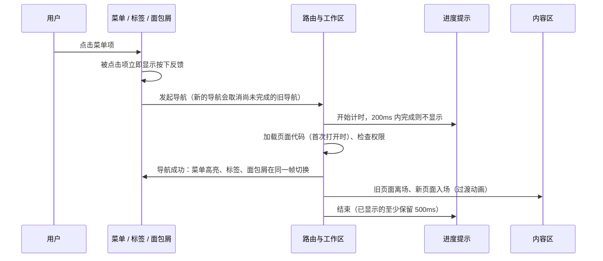

# F06 外壳与通用交互

- 状态：已确认（2026-11-05，D1～D7 全部按建议）
- 日期：2026-11-05
- 适用范围：`web/src/shell/`（布局、侧栏菜单、顶栏、标签栏、页面切换与加载、设置面板）与 `web/src/platform/theme/`（主题、颜色、动效变量）；所有页面共用的悬浮、焦点、键盘交互
- 依据：F01（FE-SHELL-01～08、FE-QA-03、FE-QA-04）；F02 D6 及其 2026-11-05 复议（参照 Vben 自建）；F03 第 4～6 节、第 12 节、D2、D5、D11；F04 第 5.6、8 节；05-10 第 7 节（偏好四层、`Ui.Shell`）
- 参照基准：Vben Admin（演示站 www.vben.pro，版本 5.8.0，2026-11-05 实际操作；GitHub main 分支源码，提交 `26706d6`，2026-11-05）

## 0. 范围

| 本文内容 | 不在本文 |
|---|---|
| 外壳的布局、尺寸、各区域的状态与动效 | 页面实例、请求层、权限等机制（F03） |
| 菜单、标签、页面切换、加载提示、状态保留的交互细节 | 业务表格、表单、弹窗组件的详细设计（各自一份） |
| 设置面板的结构与设置项、即时预览与保存 | 任何业务页面、首页工作台的内容（业务） |
| 主题颜色、动效时长与曲线、悬浮与焦点反馈 | 登录页的品牌视觉素材（Logo、插画由用户提供） |

### 0.1 本文决定的分类

| 类别 | 本文中的内容 |
|---|---|
| 第一类：现在确定 | D1 布局模式、D2 设置面板的设置项、D3 主题色、D4 快速切换时的过渡衔接、D5 加载提示、D6 图标、D7 相对 Vben 的改进清单；各区域尺寸、状态、动效（无选项争议的直接写为设计） |
| 第二类：框架定写法，业务定用不用 | 菜单项徽标（3.5） |
| 第三类：延后 | 页面水印、锁屏（新登记到前端延后事项表，第 12.2 节） |

### 0.2 对照延后事项表

- 前端延后事项：“列表通用筛选协议”“命名视图”不涉及外壳，**不触发**；“界面多语言”：本文不提供语言切换（第 12.2 节），**不触发**，外壳文字照常遵守 F04 第 9 节。
- 后端延后事项：均不涉及外壳，**不触发**。
- 新增延后事项：页面水印、锁屏（第 12.2 节），已登记到前端 00-README。

### 0.3 框架负责 / 业务负责

| 框架负责（本文） | 业务负责（以后定义） |
|---|---|
| 布局、侧栏、顶栏、标签栏的结构、尺寸、状态与动效 | 菜单的分组与条目（来自各模块路由条目，F03 第 4 节） |
| 页面切换、加载提示、切回标签后的状态保留机制 | 页面内容、页面自身的加载骨架细节 |
| 设置面板与外壳偏好 `Ui.Shell` 的内容 | 管理员为哪些角色设置什么默认外观 |
| 主题颜色、动效、悬浮与焦点规范 | 公司品牌色、Logo、登录页插画（素材） |

### 0.4 参照方法与改进原则

- 每一项先写 **Vben 怎么做**（源码数值，或演示站实际操作的结果），再写**本项目怎么做**；相同的不再重复说明理由。
- 与 Vben 不同的地方只在**解决了明确的问题**时采用，全部列在第 12 节，并说明解决了什么。
- 尺寸、颜色、时长的初值取自 Vben 源码，全部做成设计变量（F03 第 12 节）；原型阶段与 Vben 演示站做同样的操作并排对照，必要时只调变量值。
- 实际操作的方式：用无界面 Chrome 与临时资料目录打开演示站，只放行 vben.pro 的请求（Vben 运行时从 `api.iconify.design`、`unpkg.com` 加载的图标与图片因此未显示，不影响交互与布局的观察）。

---

## 1. 旧项目怎么做 → 新外壳怎么做

| 方面 | 旧项目（F01） | 新外壳 | 章节 |
|---|---|---|---|
| 外壳 | layuiadmin 风格：左侧菜单 + iframe 多标签 | 参照 Vben 的布局与交互自建；标签内是页面实例（F03 第 6 节），不用 iframe | 2～5 |
| 标签间状态 | iframe 各自独立，靠 `parent` 互相调用；关闭不提示未保存 | 页面实例 + `KeepAlive`，切回原样保留；关闭时检查能否离开（F03 第 6.2 节） | 5、7 |
| 页面切换 | iframe 加载，无过渡 | 过渡动画、延迟显示的加载提示、快速切换不叠加 | 6 |
| 外观设置 | 无 | 右侧设置面板，即时预览，保存到个人偏好（跨电脑生效） | 8 |

---

## 2. 布局

### 2.1 区域与尺寸

```text
┌──────────┬──────────────────────────────────────────────────────────┐
│ Logo 名称 │ ☰ 面包屑 ······ 搜索 · 作业 · 消息 · 深浅色 · 设置 · 角色 · 头像 │  顶栏 50
│          ├──────────────────────────────────────────────────────────┤
│ 侧栏菜单  │ [分析 📌][列表][详情 ●][新建 ×] ········· ▦ ⟳ ⛶          │  标签栏 38
│ 224      ├──────────────────────────────────────────────────────────┤
│ (折叠 60) │ 内容区（每个标签一个页面实例，背景为浅灰底色）              │
│          │                                                          │
│ « 📌      │                                                          │
└──────────┴──────────────────────────────────────────────────────────┘
```

| 区域 | Vben（源码默认值） | 本项目 |
|---|---|---|
| 顶栏高度 | 50px | 照做 |
| 标签栏高度 | 38px | 照做 |
| 侧栏宽度 | 224px；折叠 60px；可拖动 60～320px | 照做；拖动范围相同，拖到最小即为折叠 |
| 双列菜单的第一列 | 80px | 照做（D1 选用双列时） |
| 底色 | 内容区为浅灰底（`background-deep`），顶栏、侧栏、卡片为白色，之间以 1px 边框分隔 | 照做（颜色值见第 9.1 节） |
| 侧栏底部 | 左下“折叠”按钮、右下“固定 / 悬停展开”按钮 | 照做 |

### 2.2 D1 提供哪些布局模式

Vben 提供 7 种：垂直（侧栏菜单）、双列菜单、水平（顶部菜单）、侧边导航（顶栏通栏 + 侧栏）、混合垂直（顶部一级 + 侧栏子级）、混合双列、内容全屏。

| 选项 | 做法 | 优点 | 缺点 |
|---|---|---|---|
| A 7 种全部提供 | 与 Vben 相同 | 完全一致 | 每种布局都是一套不同的外壳结构，要分别实现断点、折叠、拖动并做截图测试；“水平”放不下三级、300 多个入口的菜单；“内容全屏”没有菜单，已由标签栏的“最大化”覆盖 |
| **B 3 种：垂直（默认）、双列菜单、混合垂直** | 只提供适合多级、大量菜单的三种 | 三种都能承载三级菜单：垂直最通用；双列适合模块多、常在模块间切换的用户；混合垂直把一级模块放到顶部，侧栏只显示当前模块 | 用户可选的布局少于 Vben |
| C 只提供垂直 | 固定一种 | 实现与测试最少 | 失去 Vben 设置面板中最有特点的一项 |

- **决定（已确认，2026-11-05）**：B；默认“垂直”。
- **理由**：保留布局切换的体验，又只承担适合本系统菜单规模的三种外壳结构；“侧边导航”与“垂直”只差顶栏是否通栏，“混合双列”是双列的变体，收益小于维护成本。
- **取舍**：放弃水平、侧边导航、混合双列、内容全屏四种布局。

### 2.3 窄屏

F03 D11 已定：窗口 ≥ 1280px 侧栏展开；1024～1279px 侧栏自动收为图标；< 1024px 侧栏变为从左侧滑出的抽屉。三种布局模式在窄屏时一律按此处理（混合垂直的顶部一级菜单在 < 1024px 时并入抽屉）。抽屉滑出动画沿用 Vben：300ms、`cubic-bezier(0.22, 1, 0.36, 1)`。

### 2.4 侧栏开合与内容区

本项目页面以宽表格为主（F01：175 个页面用固定列）。如果内容区宽度在侧栏动画的 300ms 内逐帧变化，业务表格会逐帧重算列宽，造成卡顿。

| 规则 | 说明 |
|---|---|
| 内容区宽度只变一次 | 收起时，内容区立即扩展到目标宽度，侧栏在其上方以 `transform` / `clip-path` 收起；展开时，内容区立即收窄，侧栏滑入让出的空间 |
| 表格只重算一次 | 业务表格监听容器尺寸（`ResizeObserver`，防抖），宽度稳定后重算一次列宽 |
| 悬停展开 | 折叠且开启“悬停展开”时，鼠标进入侧栏后侧栏临时展开并**浮在内容区上方**，内容区宽度不变；离开即收回 |

---

## 3. 侧栏菜单

### 3.1 状态

| 状态 | Vben（源码） | 本项目 |
|---|---|---|
| 默认 | 文字为前景色；菜单项高 38px，圆角风格左右各留 8px、圆角 8px；每级缩进 16px | 照做 |
| 悬浮 | 背景变为 `accent`；图标放大到 1.2 倍（250ms）；背景与文字颜色过渡 150ms | 照做 |
| 选中 | 文字为主色，背景为主色 15% 透明度 | 照做 |
| 选中项的上级 | 上级标题文字为主色，背景透明 | 照做 |
| 禁用 | 透明度 25%，不可点击 | 照做 |
| 键盘焦点 | 样式中去掉了焦点轮廓（`outline: none`） | **改**：键盘操作时显示 2px 主色焦点环（`:focus-visible`），鼠标点击不显示（第 12 节 #4） |

### 3.2 展开与收起

| 规则 | Vben | 本项目 |
|---|---|---|
| 手风琴 | 默认开启：同级只展开一个 | 照做（设置面板可关） |
| 展开动画 | 高度过渡 200ms `ease-in-out`；箭头旋转 250ms | 照做 |
| 打开页面时 | 菜单自动展开到当前页面所在的分组并高亮 | 照做；另外当前项不在可视范围内时平滑滚动到可视位置（经标签、面包屑、搜索打开页面时也同步） |

### 3.3 折叠后

| 规则 | Vben（源码） | 本项目 |
|---|---|---|
| 宽度 | 60px，只显示图标 | 照做；可选“折叠后显示菜单名”（图标下方小字，Vben 同名设置） |
| 悬停弹出子菜单 | 鼠标停留 300ms 后在右侧 10px 处弹出子菜单；离开 300ms 后收起；在弹出层内移动时 100ms | 照做（300ms 的停留可避免鼠标划过时连续弹出） |
| 没有子级的菜单项 | — | 悬停显示菜单名提示 |

### 3.4 拖动宽度

| 规则 | Vben | 本项目 |
|---|---|---|
| 拖动条 | 侧栏右边缘 2px，悬停变为主色，光标为左右调整 | 照做 |
| 范围 | 60～320px | 照做 |
| 恢复默认 | — | **新增**：双击拖动条恢复 224px（第 12 节 #3） |
| 保存 | 浏览器本地 | 存个人偏好 `Ui.Shell`（第 8.3 节） |

### 3.5 菜单数据与徽标（第二类）

- 菜单由路由目录生成并按权限过滤（F03 第 4 节）；本文不改变这一机制。
- 菜单项可以显示圆点或数字徽标（Vben 支持）。框架提供写法：路由条目声明徽标来源（一个返回数字或布尔值的函数，读取已有的查询缓存，不为徽标单独发请求）；哪个菜单显示什么徽标由业务决定。

---

## 4. 顶栏

### 4.1 内容与顺序

| 位置 | 内容 | 与 Vben 的关系 |
|---|---|---|
| 左 | 折叠按钮 ☰；面包屑 | 照做 |
| 右 | 搜索（`Ctrl K`）；后台作业；站内消息；深浅色切换；设置（齿轮）；当前角色；头像 | 搜索、消息、深浅色、设置、头像照做；作业、角色是本系统新增（F03 第 5.1 节） |
| 头像下拉 | 个人信息、修改密码、退出 | Vben 把“退出”放在顶栏，本项目放进下拉，避免误点 |
| 不提供 | 语言切换、时区切换、浏览器全屏、刷新、锁屏 | 理由见第 12.2 节 |
| 模拟身份时 | 整条顶栏换为警示色，显示实际操作人与“结束模拟” | F03 第 5.1 节 |

顶栏的图标按钮：悬浮时显示圆形 `accent` 背景（150ms），并显示文字提示。

### 4.2 面包屑

Vben：显示上级路径，带图标；有子级的上级可以下拉，列出其下的页面并直接跳转。本项目照做；下拉中只列出有权限的页面。

### 4.3 搜索（命令面板，FE-SHELL-08，P2）

Vben：顶栏搜索框与 `Ctrl K` 打开对话框，按名称搜索菜单，键盘上下选择、回车打开，记录最近访问。本项目照做，只列出有权限的入口。中文菜单可考虑拼音首字母匹配，实现该功能时再选依赖。

### 4.4 深浅色切换

Vben：点击后以点击位置为圆心、圆形扩散切换主题（浏览器的视图过渡接口，450ms `ease-in`），系统设置“减少动画”时直接切换。本项目照做（Chrome / Edge 均支持，符合 F01 的浏览器范围）。

---

## 5. 标签栏

### 5.1 样式

Vben 提供 4 种样式：**谷歌**（默认，标签像浏览器标签，选中标签底部两角有向外的圆弧与内容区相连）、卡片、朴素、轻快。本项目 4 种都提供（D2），默认“谷歌”。它们只是同一个组件的不同样式，不改变结构，维护成本低。

### 5.2 状态

| 状态 | Vben（谷歌样式，源码） | 本项目 |
|---|---|---|
| 当前 | 背景为主色 15%（深色主题为 `accent`），文字为主色，底部两角圆弧；相邻分隔线隐藏 | 照做 |
| 悬浮 | 背景变为 `accent` 圆角块（左右各缩进 2px、底部留出 2px）；该标签两侧的分隔线隐藏；图标做一次收缩回弹（300ms）；过渡 150ms | 照做 |
| 固定 | 关闭按钮换为图钉，点击图钉取消固定；固定标签排在最前 | 照做 |
| 未保存 | — | 标题后显示圆点（F03 第 5.1 节） |
| 保存中 | — | 圆点换为小型加载动画 |
| 结果未知 | — | 显示警示图标，悬停说明“保存结果未确认”（F03 第 7.5 节） |
| 标题过长 | — | 截断，悬停显示全称 |

### 5.3 操作

| 操作 | Vben | 本项目 |
|---|---|---|
| 点击 | 切换 | 照做 |
| 关闭按钮 | 每个可关闭的标签都显示 ×，固定标签显示图钉 | 照做；关闭前检查能否离开（F03 第 6.2 节） |
| 鼠标中键 | 可关闭，默认关闭此功能 | **默认开启**（与浏览器习惯一致，第 12 节 #2） |
| 鼠标滚轮 | 在标签栏上滚动时横向滚动（滚动量 × 3） | 照做 |
| 标签过多 | 两侧出现滚动按钮，平滑滚动；当前标签自动平滑滚动到可见位置 | 照做 |
| 关闭当前标签后激活哪个 | 回到上一个访问的标签（访问历史） | 照做 |
| 新增、关闭的动画 | 从左侧淡入滑入（15px，250ms `cubic-bezier(0.25, 0.8, 0.5, 1)`），关闭时反向 | 照做 |
| 右侧按钮 | 更多操作 ▦、刷新当前标签 ⟳、最大化 ⛶（隐藏侧栏与顶栏） | 照做 |
| 数量上限 | 默认不限 | 按 F03 第 5.2 节：默认 15，可调 10～30，到上限时提示关闭最久未用的标签 |

### 5.4 右键菜单

菜单项与 Vben 相同：关闭、固定 / 取消固定、最大化、重新加载、在新浏览器标签页打开、关闭左侧、关闭右侧、关闭其他、关闭全部。

**与 Vben 的不同**：实际操作发现，在 Vben 中对**非当前**标签点右键时，“关闭左侧 / 右侧 / 其他”和“重新加载”都不可用（源码中这些项只对当前标签计算）。本项目按**被右键的那个标签**计算（与浏览器一致），省去先切过去再操作的一步，也避免为此多加载一次页面（第 12 节 #1）。

所有关闭类操作都经过能否离开的检查；批量关闭时一次性汇总提示（F03 第 6.2 节）。

### 5.5 拖动排序

| 规则 | Vben（源码与实际操作） | 本项目 |
|---|---|---|
| 实现 | SortableJS；拖动时其他标签以 300ms 动画让位；光标为抓取状态 | 照做（第 13.2 节依赖） |
| 分组 | 固定标签只能在固定标签之间移动，普通标签同理 | 照做 |
| 触屏 | 按住 400ms 后才开始拖动，避免与滚动冲突 | 照做 |
| 保存 | 标签顺序随标签元数据保存 | 存 `sessionStorage`（F03 第 5.2 节） |

### 5.6 键盘

标签栏按 ARIA 标签列表实现：左右方向键在标签间移动焦点，回车激活，`Delete` 关闭（同样经过能否离开的检查）。

---

## 6. 页面切换与加载

### 6.1 一次切换的过程



| 规则 | 说明 |
|---|---|
| 三处同步 | 菜单高亮、标签、面包屑只在导航成功后一起切换（F03 第 5.2 节），不会出现菜单已变、页面未变的中间状态 |
| 只有最后一次导航生效 | 连续点击多个菜单时，未完成的旧导航被取消，只有最后一次提交 |
| 即时反馈 | 点击的瞬间菜单项显示按下状态，用户不会觉得“没点上” |

### 6.2 D5 加载提示

Vben 有两种提示：

- **顶部进度条**：用 nprogress，每个页面**首次**访问时立即显示。
- **内容区加载动画**：导航超过 200ms 才显示，一旦显示至少保留 500ms，避免一闪而过。

| 选项 | 做法 | 优点 | 缺点 |
|---|---|---|---|
| A 与 Vben 相同 | nprogress 首次访问即显示 + 内容区加载动画 | 一致 | 进度条立即显示，页面很快就加载完时会闪一下；nprogress 最近版本是 0.2.0（多年未更新），样式是全局写死的颜色，要另外覆盖 |
| **B 自实现顶部进度条，与内容区加载动画用同一套时间规则** | 进度条与加载动画都是导航超过 200ms 才显示、显示后至少 500ms；进度条颜色来自主题变量 | 快的切换什么都不闪；时间规则只有一套；不依赖停更的库 | 进度条约几十行代码要自己写 |
| C 不要进度条 | 只用内容区加载动画 | 最简单 | 失去顶部进度条的反馈（用户认可的 Vben 细节之一） |

- **决定（已确认，2026-11-05）**：B；进度条可在设置面板关闭（与 Vben 相同）。
- **理由**：保留 Vben 的两种提示，同时把 Vben 自己已经用在加载动画上的“延迟显示、最少显示”规则也用到进度条上，解决快速切换时的闪烁。
- **取舍**：自写一个小组件。
- 页面内的数据加载（列表、详情）由页面框架组件显示骨架屏，使用同样的 200ms / 500ms 规则（业务表格、列表页组件的详细设计中实现）。

### 6.3 页面过渡

| 规则 | Vben（源码） | 本项目 |
|---|---|---|
| 默认效果 | “淡入滑动”：新页面从左侧 30px 处淡入，旧页面向右 30px 淡出，透明度与位移同时 300ms | 照做 |
| 可选效果 | 淡入淡出、淡入滑动、向上淡入、向下淡入；可关闭 | 照做（设置面板） |
| 旧页面 | 离场时绝对定位、浮在上方，不占位置，避免新旧页面上下叠放造成跳动；过渡期间隐藏横向滚动条 | 照做 |
| 切回已打开的标签 | 同样播放过渡 | 照做；滚动位置在新页面入场**之前**恢复，入场时就在原来的位置，不会先出现在顶部再跳下去（第 7 节） |

### 6.4 D4 快速连续切换时的过渡衔接

实际操作：在 Vben 中连续快速点击三个菜单项，内容区最多同时存在**三层页面**（两层仍在淡出，一层在淡入），约 0.9 秒后才停稳。因为离场页面浮在上方不占位，所以不会跳动，但几层半透明页面会叠在一起。

| 选项 | 做法 | 优点 | 缺点 |
|---|---|---|---|
| A 与 Vben 相同 | 每次切换都完整播放，离场动画可以叠加 | 一致 | 快速切换时多层页面重叠，停稳时间随点击次数增加 |
| **B 一出一进** | 新的切换开始时，上一次尚未结束的离场动画立即结束；同一时刻最多一个离场、一个入场 | 单次切换的效果与 Vben 完全相同；快速切换时画面干净，停稳时间固定为一次过渡的时长 | 需要用过渡的脚本钩子管理离场元素（框架实现一次） |
| C 先出后进 | 旧页面完全离场后新页面再入场 | 实现简单 | 每次切换的总时长翻倍，中间有一段空白，切换显得慢 |

- **决定（已确认，2026-11-05）**：B。
- **理由**：正常速度切换时与 Vben 完全一样；只在 Vben 会叠加的场景下改进，解决“快速切换时画面重叠”的问题。
- **取舍**：框架多一段管理离场动画的代码。

### 6.5 减少动画

Vben 只在移动端侧栏、深浅色切换等几处判断了系统的“减少动画”设置，页面过渡与标签动画没有判断。本项目统一处理（FE-QA-03，第 12 节 #5）：

| 动效 | 系统设置“减少动画”时 |
|---|---|
| 页面过渡、菜单展开、标签增删、拖动让位、侧栏开合、深浅色切换 | 时长为 0，直接切换 |
| 进度条、加载动画 | 仍然显示（它们传达状态），但不做动画 |

做法：所有动效时长都来自设计变量（第 9.3 节），在“减少动画”时统一置 0，组件中不写死时长。

---

## 7. 切回标签后的状态保留

F01 FE-SHELL-02、F03 D2 已定用 `KeepAlive` 按标签键保留页面组件。本节给出“保留什么、怎么恢复”。

| 内容 | 是否保留 | 做法 |
|---|---|---|
| 查询条件、分页、排序 | ✓ | 页面组件状态随 `KeepAlive` 保留 |
| 表格的横向与纵向滚动位置 | ✓ | 业务表格在失活时记录、激活时恢复（虚拟滚动需要显式恢复） |
| 列宽、选中行、展开行 | ✓ | 同上；列宽另存为表格偏好（F03 第 9.5 节） |
| 表单中编辑到一半的内容 | ✓ | 页面组件状态保留；未保存圆点照常显示 |
| 页面的滚动位置 | ✓ | 页面实例在失活时记录，在新页面入场**之前**恢复（第 6.3 节） |
| 本页打开的弹窗、抽屉 | ✓ | 随页面隐藏、随页面恢复（F03 第 11.5 节） |
| 键盘焦点 | ✓ | **新增**：恢复到离开前聚焦的元素（第 12 节 #8） |
| 数据是否最新 | — | 激活时，已过期的查询在后台刷新，刷新不清空界面状态、不改变滚动位置（F03 第 7.7 节） |

不保留的情况（均为 F03 已定）：刷新浏览器后只恢复标签列表，页面内容重新加载（离开前会提示未保存内容）；切换角色后页面重建；关闭标签后即释放。

---

## 8. 设置面板

### 8.1 结构

| 部分 | Vben（实际操作与源码） | 本项目 |
|---|---|---|
| 形式 | 从右侧滑出的抽屉，宽约 384px；不遮暗页面，改动即时生效、边改边看 | 照做 |
| 打开方式 | 顶栏齿轮按钮（偏好中有“偏好设置快捷键”开关，但源码中未找到对应的按键绑定，实际按 `Alt + ,` 也未打开） | 顶栏齿轮按钮 |
| 抽屉顶部 | 标题“偏好设置”、重置、固定导航、关闭 | 标题、恢复默认、关闭；导航页签始终固定在顶部，不需要单独的开关 |
| 页签 | 外观、布局、快捷键、通用、拓展 | 外观、布局、通用（快捷键说明并入“通用”；“拓展”是 Vben 的演示内容） |
| 抽屉底部 | “复制偏好设置”（给开发者把配置复制进代码）、“清空缓存并退出” | 普通用户无按钮；有 `Configuration.Preferences.Manage` 权限的管理员显示“设为角色默认”“设为系统默认”（05-10 偏好四层） |

### 8.2 D2 设置项

| 选项 | 做法 | 优点 | 缺点 |
|---|---|---|---|
| A 全部照搬 | Vben 面板中的全部项目 | 完全一致 | 含有开发者工具（复制配置）、本系统不需要的功能（语言、时区、锁屏）和与本系统冲突的项（顶栏自动隐藏会藏起角色与消息） |
| **B 抽屉与交互照搬，设置项按用途筛选** | 见下表 | 保留 Vben 的布局与即时预览体验；每一项都对本系统有意义 | 项目少于 Vben |
| C 只留少数几项 | 深浅色、紧凑程度 | 最简单 | 失去用户认可的设置面板体验 |

- **决定（已确认，2026-11-05）**：B，按下表。
- **理由**：用户认可的是面板的布局与即时预览，B 完整保留；去掉的项目都有具体原因。
- **取舍**：设置项少于 Vben。

| 页签 | 设置项 | Vben | 建议 | 理由 / 说明 |
|---|---|---|---|---|
| 外观 | 主题：浅色、深色、跟随系统 | 有（默认深色） | 照做；系统默认浅色 | 业务系统多数用户习惯浅色 |
| 外观 | 深色侧栏、深色侧栏子栏、深色顶栏 | 有 | 照做 | 常见的企业系统外观 |
| 外观 | 主题色 | 14 种预设 + 自定义 | 见 D3 | — |
| 外观 | 圆角 | 有（5 档） | 照做 | 只影响外观 |
| 外观 | 字号 | 有 | 照做，三档：13 / 14（默认）/ 16px | 年长用户可调大 |
| 外观 | 紧凑程度 | 无（Vben 无此项） | **新增**：默认 / 紧凑两档，默认“紧凑” | F03 第 12 节已定两档；业务系统每天看大量表格，紧凑档一屏可看更多行 |
| 外观 | 色弱模式 | 有 | 照做 | 无障碍 |
| 外观 | 灰色模式 | 有 | 不提供 | 全站置灰（哀悼日）应由公司统一设置而不是个人；需要时再加一个系统设置即可，不影响其他部分 |
| 布局 | 布局模式 | 7 种 | 3 种（D1） | — |
| 布局 | 内容宽度：流式 / 定宽 | 有 | 不提供，固定流式 | 宽表格为主，定宽浪费屏幕 |
| 布局 | 侧栏：折叠、折叠后显示菜单名、悬停展开、可拖动 | 有 | 照做 | — |
| 布局 | 顶栏：固定、静止、自动隐藏、滚动隐藏 | 有 | 不提供，固定 | 顶栏上有当前角色、消息、作业，必须始终可见 |
| 布局 | 菜单：手风琴；圆角 / 平直风格 | 有 | 手风琴照做；风格固定为圆角（Vben 默认） | — |
| 布局 | 面包屑：显示、显示图标；只有一级时隐藏、显示首页、样式 | 有 | 照做“显示”“显示图标”；其余固定 | — |
| 布局 | 标签栏：显示、样式、显示图标、最大数量 | 有 | 照做；样式 4 种；数量 10～30（F03） | — |
| 布局 | 标签栏：拖动、滚轮、持久化、刷新 / 最大化 / 更多按钮、中键关闭 | 有 | 固定开启，不作为设置项 | 都是标签栏应有的基本操作，不需要用户关掉 |
| 布局 | 顶栏小部件的显示与隐藏 | 有 | 不提供 | 顶栏内容固定（第 4.1 节） |
| 布局 | 页脚、版权 | 有 | 不提供 | 内部系统不需要 |
| 通用 | 页面切换动画：开关、效果（4 种）；进度条；加载动画 | 有 | 照做 | — |
| 通用 | 动态标题（浏览器标题跟随页面）、检查更新 | 有 | 固定开启，不作为设置项 | 检查更新见 F03 第 14.3 节 |
| 通用 | 快捷键：开关、各快捷键 | 有（搜索 `Ctrl K`、锁屏 `Alt L`、退出 `Alt Q`） | 只保留搜索 `Ctrl K`，在面板中列出说明 | 锁屏不做；退出用快捷键容易误触 |
| 通用 | 水印 | 有 | 不提供（延后事项） | 第 12.2 节 |

### 8.3 即时预览与保存

| 规则 | 说明 |
|---|---|
| 即时生效 | 每项改动立即修改设计变量或外壳状态，不刷新页面（与 Vben 相同） |
| 保存位置 | 个人偏好 `Ui.Shell`（F03 D5、05-10 第 7 节）；Vben 只存在当前浏览器，本项目换电脑、换浏览器仍然有效 |
| 保存时机 | 停止操作 1 秒后保存；失败时界面保持新值并提示“设置未保存”（与表格偏好相同，F03 第 9.5 节） |
| 首帧外观 | **新增**：同时在本机缓存一份（按用户区分），应用启动时先用缓存画出外观，再与服务器的值核对。解决“偏好存在服务器上、启动时先闪一下默认主题”的问题（第 12 节 #6） |
| 登录页 | 未登录时用本机上次使用的深浅色；没有则跟随系统 |
| 恢复默认 | 删除个人层，回到角色默认或系统默认（05-10：重置只删当前层） |
| 格式 | `Ui.Shell` 的值带格式版本号；读取时按版本容错，未知字段忽略、缺失字段取默认（F03 第 9.5 节同样的规则） |

---

## 9. 主题、颜色与动效变量

### 9.1 颜色

照搬 Vben 的配色，作为设计变量的初值（F03 第 12 节：一处定义，生成 CSS 变量、组件库主题、表格与图表主题）。主要的值（HSL）：

| 变量 | 浅色 | 深色 | 用途 |
|---|---|---|---|
| 背景 | `0 0% 100%` | `222.34 10.43% 12.27%` | 顶栏、侧栏、卡片 |
| 底色 | `216 20.11% 95.47%` | `220 13.06% 9%` | 内容区底色 |
| 前景 | `210 6% 21%` | `0 0% 95%` | 正文 |
| 主色 | `212 100% 45%` | 同左 | 选中、按钮、链接（D3） |
| 悬浮底 | `240 5% 96%` | `216 5% 19%` | 菜单、标签、图标按钮的悬浮背景 |
| 边框 | `240 5.9% 90%` | `240 3.7% 22%` | 区域分隔 |

完整变量在实现时从 Vben 源码移植到 `platform/theme/tokens.ts`，并映射到 Antdv Next 的主题变量，使外壳与组件库颜色一致。

### 9.2 D3 主题色

Vben 提供 14 种预设（默认蓝、紫罗兰、樱花粉、柠檬黄、天蓝、浅绿、锌色灰、深绿、深蓝、橙黄、玫瑰红、中性色、石板灰、中灰）和自定义颜色。

| 选项 | 做法 | 优点 | 缺点 |
|---|---|---|---|
| A 与 Vben 相同 | 14 种预设 + 任意自定义 | 一致 | 按钮、选中项是“主色底 + 白字”：柠檬黄等浅色与任意自定义颜色会让白字看不清 |
| **B 只提供通过对比度检查的预设，不开放自定义** | 从 Vben 的预设中保留“白字在主色上对比度 ≥ 4.5:1”的颜色（实现时逐个计算，不达标的可微调明度后保留） | 用户仍可选颜色；任何选择下文字都清楚 | 可选颜色少于 Vben |
| C 固定一种 | 只用公司标准色 | 品牌统一 | 失去个性化 |

- **决定（已确认，2026-11-05）**：B；默认主色为 Vben 默认蓝 `hsl(212 100% 45%)`。若公司有标准色，替换为默认值（`待确认`）。
- **理由**：保留选颜色的体验，同时保证所有组合下文字可读（FE-QA-04）。
- **取舍**：没有自定义颜色。

### 9.3 动效变量

把 Vben 中分散写死的时长整理为几档变量，组件只引用变量：

| 变量 | 值 | Vben 中对应的用法 |
|---|---|---|
| 快 | 150ms | 菜单、标签的颜色与背景过渡，图标按钮悬浮 |
| 中 | 200ms | 子菜单展开收起 |
| 慢 | 250～300ms | 页面过渡、标签增删、拖动让位、侧栏开合、图标放大 |
| 主题切换 | 450ms | 深浅色圆形扩散 |
| 曲线 | 标准 `ease-in-out`；侧栏与抽屉 `cubic-bezier(0.22, 1, 0.36, 1)`；标签增删 `cubic-bezier(0.25, 0.8, 0.5, 1)` | 同左 |

只对 `transform`、`opacity`、`clip-path` 做动画，不对宽高逐帧动画（子菜单展开的高度过渡除外，内容量小）。系统设置“减少动画”时全部为 0（第 6.5 节）。

---

## 10. 悬浮、焦点与键盘

| 元素 | 悬浮 | 键盘焦点 |
|---|---|---|
| 菜单项 | `accent` 背景 + 图标放大 1.2 倍 | 2px 主色焦点环 |
| 标签 | `accent` 圆角背景、两侧分隔线隐藏、图标收缩回弹 | 焦点环；方向键移动 |
| 顶栏图标按钮 | 圆形 `accent` 背景 + 文字提示 | 焦点环 |
| 侧栏拖动条 | 变为主色 | 不可聚焦（宽度也可在设置面板调整） |
| 设置面板的选项卡片 | 边框变为主色 | 焦点环 |

| 快捷键 | 作用 |
|---|---|
| `Ctrl K` | 打开搜索 |
| `Esc` | 关闭当前浮层（弹出菜单、对话框、抽屉） |

规则：焦点环只在键盘操作时出现（`:focus-visible`），鼠标点击不出现；浮层关闭后焦点回到触发它的元素（FE-QA-04）。

---

## 11. D6 图标

Vben 的外壳图标用 Lucide（`@lucide/vue`，打包在代码中），业务页面的其他图标在运行时从 Iconify 的在线服务加载；Logo 与默认头像也是外部图片。F02 写的是“图标用组件库自带图标集”。

| 选项 | 做法 | 优点 | 缺点 |
|---|---|---|---|
| A 组件库自带图标（F02 原写法） | Antdv Next 的图标 | 只有一套图标 | 与 Vben 的外观不同：Vben 的菜单、标签、顶栏都是 Lucide 的线条风格 |
| **B Lucide，按需打包** | `@lucide/vue`（ISC 许可）；框架在 `platform/ui` 维护一份图标登记表，路由条目与页面只能使用登记过的图标名（有类型检查） | 与 Vben 外观一致；按需打包、不依赖外部服务；登记表让图标名有类型、不会写错 | 组件库内部（下拉箭头、关闭按钮等）仍是 Antdv 图标，两套图标都是线条风格，视觉差异小（Vben 的 Antdv 版本也是这样） |
| C Iconify 全部图标集，构建时打包 | 可用任意图标集 | 选择最多 | 图标风格不统一；依赖构建插件 |

- **决定（已确认，2026-11-05）**：B；Logo、默认头像等图片放在本项目的静态资源中。运行时不访问任何外部图标或图片服务。
- **理由**：图标风格是 Vben 视觉的重要部分；同时本系统不能依赖外部服务（内网可用、安全策略）。
- **取舍**：组件库内部与外壳是两套图标。已给 F02 第 0 节“图标用组件库自带图标集”加补充说明。

---

## 12. 与 Vben 的差异

### 12.1 D7 改进清单（逐条可单独否决）

| # | 改进 | Vben（实际操作或源码） | 解决的问题 |
|---|---|---|---|
| 1 | 标签右键菜单按被右键的标签计算 | 只对当前标签可用（第 5.4 节） | 不用先切过去再操作，也不会为此多加载一次页面 |
| 2 | 中键关闭标签默认开启 | 默认关闭 | 与浏览器习惯一致 |
| 3 | 双击侧栏拖动条恢复默认宽度 | 无 | 拖乱后一键恢复 |
| 4 | 键盘焦点可见 | 菜单去掉了焦点轮廓 | 键盘用户能看到焦点在哪（FE-QA-04） |
| 5 | 全局遵守“减少动画” | 只有个别动效遵守 | 对动效敏感的用户（FE-QA-03） |
| 6 | 外观偏好存服务器 + 本机首帧缓存 | 只存当前浏览器 | 换电脑设置仍在；启动时不闪默认主题 |
| 7 | 侧栏开合时内容区宽度只变一次 | — | 宽表格不逐帧重算，开合不卡（第 2.4 节） |
| 8 | 切回标签时恢复键盘焦点 | — | 键盘用户切回后可直接继续操作 |
| 9 | 快速切换一出一进 | 最多三层叠加（D4） | 快速切换时画面干净 |
| 10 | 进度条延迟显示、自实现 | 首次访问立即显示（D5） | 快速切换不闪 |
| 11 | 主题色只保留对比度达标的预设 | 含浅色与任意自定义（D3） | 所有组合下文字可读 |

- **决定（已确认，2026-11-05）**：全部采用。
- **理由**：每一条都解决一个具体问题，且不改变 Vben 的外观与正常速度下的交互感受。
- **取舍**：#6、#7、#9、#10 是框架多写的代码，各自规模小。

### 12.2 不采用的 Vben 功能

| 功能 | 不采用的理由 | 以后需要时 |
|---|---|---|
| 语言切换 | 首期不做多语言（F03 D10） | 按前端延后事项“界面多语言” |
| 时区切换 | 时间统一按业务时区显示（05-13 D4） | — |
| 浏览器全屏（顶栏按钮） | 按 F11 即可；内容区最大化由标签栏提供 | — |
| 顶栏刷新按钮 | 与标签栏的“刷新当前标签”重复 | — |
| 锁屏 | 只在前端锁屏挡不住人：登录状态仍有效，打开新标签即可绕过 | **登记延后事项**：触发条件为安全要求“离开座位须锁定”；已定约束：必须由服务端会话记录锁定状态，解锁需验证密码，锁定期间令牌不可用于业务接口 |
| 页面水印 | 不是框架必需，以后加入不影响其他部分 | **登记延后事项**：触发条件为业务或安全提出防截图外泄；已定约束：由外壳统一绘制，内容只含姓名与工号等非敏感标识，属于威慑手段而不是安全控制 |
| 复制偏好设置、清空缓存并退出 | 前者是开发者工具；后者由“恢复默认”和头像菜单的“退出”替代 | — |
| 内容定宽、顶栏自动隐藏、小部件显隐、页脚与版权、灰色模式 | 见第 8.2 节 | — |
| 运行时加载外部图标与图片 | 不依赖外部服务（D6） | — |

---

## 13. 实现

### 13.1 代码位置

| 内容 | 位置 |
|---|---|
| 布局、侧栏、菜单、顶栏、标签栏、设置面板、进度条 | `web/src/shell/`（F03 第 2.1 节） |
| 设计变量、组件库与表格的主题映射、动效变量 | `web/src/platform/theme/` |
| 图标登记表 | `web/src/platform/ui/icons.ts` |

### 13.2 依赖

| 依赖 | 用途 | 许可 | 说明 |
|---|---|---|---|
| `sortablejs`（经 `@vueuse/integrations` 的 `useSortable`） | 标签拖动排序 | MIT | Vben 同款；`@vueuse/core` 已在 F02 依赖中 |
| `@lucide/vue` | 图标（D6） | ISC | Vben 同款 |

不引入：`nprogress`（D5）、`@iconify/vue` 在线图标（D6）、Tailwind CSS 与 shadcn（F02 D9）。版本与许可在阶段 0 锁定时核实（`待确认`）。

### 13.3 从 Vben 移植

Vben 为 MIT 许可（F02 D6 复议）。以下部分移植其做法与数值，按本项目规范重写（SCSS + 设计变量，不用 Tailwind；F04），文件头注明来源与许可：

| 内容 | Vben 源文件（`packages/` 下） |
|---|---|
| 谷歌样式标签的形状、悬浮与选中样式 | `@core/ui-kit/tabs-ui/src/components/tabs-chrome/tabs.vue` |
| 标签栏滚动（滚轮、溢出按钮、当前标签滚动到可见） | `@core/ui-kit/tabs-ui/src/use-tabs-view-scroll.ts` |
| 拖动排序的分组规则 | `@core/ui-kit/tabs-ui/src/use-tabs-drag.ts` |
| 菜单尺寸、颜色变量、子菜单弹出时机、展开动画 | `@core/ui-kit/menu-ui/src/components/menu.vue`、`sub-menu.vue`、`collapse-transition.vue` |
| 侧栏拖动、悬停展开 | `@core/ui-kit/layout-ui/src/components/layout-sidebar.vue` |
| 页面过渡样式 | `@core/base/design/src/css/transition.css` |
| 延迟显示、最少显示的加载提示 | `effects/layouts/src/basic/content/use-content-spinner.ts` |
| 深浅色圆形扩散 | `effects/layouts/src/widgets/theme-toggle/theme-button.vue` |
| 颜色变量 | `@core/base/design/src/design-tokens/` |

### 13.4 验收方式

外壳是视觉与交互为主的部分，除功能测试外，原型阶段用以下方式验收：

| 方式 | 内容 |
|---|---|
| 并排对照 | 在 Vben 演示站与本项目做同样的操作（菜单展开、折叠悬停、标签悬浮与拖动、快速切换、设置面板各项），录屏对比；由用户确认手感 |
| 截图回归 | Playwright 截图：3 种布局 × 浅色 / 深色 × 4 种标签样式 × 默认 / 紧凑 的外壳截图，变化需人工确认 |
| 交互测试 | 第 14 节 |

---

## 14. 测试要点

| 范围 | 要点 |
|---|---|
| 菜单 | 当前页面所在分组自动展开并滚动到可见；手风琴；折叠后悬停 300ms 弹出、离开 300ms 收起；键盘操作焦点可见 |
| 侧栏 | 拖动范围 60～320px；双击恢复 224px；开合期间内容区宽度只变化一次（表格重算次数 = 1）；悬停展开时内容区宽度不变 |
| 标签 | 右键菜单按被右键的标签计算；中键关闭；固定标签不能拖入普通标签区；关闭当前标签回到上一个访问的标签；未保存 / 保存中 / 结果未知的显示；关闭类操作经过能否离开的检查 |
| 切换 | 三处同步；连续快速点击 5 次，内容区同时存在的页面层数 ≤ 2，且最终显示最后一次点击的页面；200ms 内完成的切换不出现进度条与加载动画；显示后至少 500ms |
| 状态保留 | 切回后查询条件、分页、表格滚动（含虚拟滚动）、表单内容、页面滚动、焦点恢复；入场时滚动位置已恢复（不出现先顶部后跳动） |
| 设置面板 | 每项即时生效；停止操作 1 秒后保存一次；保存失败提示；换浏览器登录后设置仍在；启动首帧使用本机缓存，不闪默认主题；恢复默认回到角色 / 系统默认；无管理权限时不显示“设为默认”按钮 |
| 减少动画 | 系统设置“减少动画”时，所有过渡时长为 0，进度条仍显示 |
| 无障碍 | axe 检查外壳无严重问题；主题色预设的对比度 ≥ 4.5:1 |
| 外部请求 | 运行时没有任何对外部域名的请求（Playwright 拦截检查） |

---

## 15. 与其他文档的接口

| 本文提供 / 需要 | 对方 |
|---|---|
| 布局模式（D1）补充到外壳布局 | F03 第 5.1 节（已补充） |
| 设计变量的初值、动效变量、减少动画的统一规则 | F03 第 12 节（已补充） |
| `Ui.Shell` 的内容（设置项清单、格式版本、首帧缓存） | F03 D5、05-10 第 7 节（只是前端内容，后端不需要修订） |
| 新依赖 `sortablejs`、`@lucide/vue`；图标改用 Lucide | F02 第 0 节、第 11 节（已补充） |
| 延后事项：页面水印、锁屏 | 前端 00-README 延后事项表（已登记） |
| 标签状态（未保存、保存中、结果未知）、能否离开 | F03 第 5～7 节（已定，本文只定外观） |
| 业务表格的滚动恢复与尺寸防抖、页面骨架屏的 200ms / 500ms 规则 | 业务表格、列表页组件的详细设计 |
| 外壳原型的并排对照与截图回归 | 08 实施计划的前端阶段 |

确认后已完成的修订（2026-11-05，当时以补充说明的形式，2026-11-10 已并入各文档正文）：

| 文档 | 内容 |
|---|---|
| F03 第 5.1 节 | 布局模式三种（D1）、外壳细节以 F06 为准 |
| F03 第 12 节 | 设计变量初值取自 Vben、动效变量分档、“减少动画”统一置 0、主题色预设须通过对比度检查（D3） |
| F02 第 0 节 | 图标改为 Lucide 按需打包（D6） |
| F02 第 11 节 | 新增依赖 `sortablejs`、`@vueuse/integrations`、`@lucide/vue` |
| 前端 00-README | 进度；延后事项登记“页面水印”“锁屏” |

修正记录：本文未发现已确认文档之间的不一致。

---

## 16. 决策汇总

| 编号 | 事项 | 决定（已确认，2026-11-05） | 章节 |
|---|---|---|---|
| D1 | 布局模式 | 3 种：垂直（默认）、双列菜单、混合垂直 | 2.2 |
| D2 | 设置面板的设置项 | 抽屉与即时预览照搬 Vben；设置项按第 8.2 节清单筛选；管理员可设角色 / 系统默认；默认紧凑档 | 8.2 |
| D3 | 主题色 | 保留对比度达标的预设，不开放自定义；默认 Vben 蓝（公司标准色待确认） | 9.2 |
| D4 | 快速切换的过渡衔接 | 一出一进 | 6.4 |
| D5 | 加载提示 | 自实现进度条，与加载动画同用“超过 200ms 才显示、至少显示 500ms” | 6.2 |
| D6 | 图标 | Lucide 按需打包，图标登记表；不访问外部图标服务 | 11 |
| D7 | 相对 Vben 的改进 | 第 12.1 节 11 条全部采用 | 12.1 |

| 待确认 | 处理方式 |
|---|---|
| 公司标准色、Logo、登录页插画 | 用户提供后替换默认值 |
| 依赖版本与许可（`sortablejs`、`@lucide/vue`） | 阶段 0 锁定版本时核实 |
| 各项尺寸与时长的最终值 | 原型阶段与 Vben 并排对照后，只调设计变量 |

## 参考资料

- Vben Admin 演示站：https://www.vben.pro/ （5.8.0，2026-11-05 实际操作）
- Vben Admin 源码：https://github.com/vbenjs/vue-vben-admin （main 分支，提交 `26706d6`，2026-11-05；MIT 许可）
