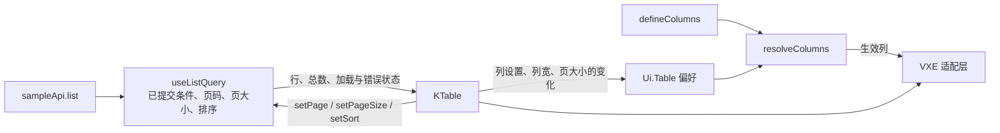

# F07 业务表格（首版）

- 状态：已确认（2026-11-05，D1～D7；D4 原建议“始终显示”被否定，改为“批量模式”后确认）
- 日期：2026-11-05
- 适用范围：`web/src/platform/table/` 的业务表格 `KTable`：列定义、格式类型、排序与分页、行操作、行选择与批量操作栏、表格工具与列设置、加载 / 空 / 错误状态、表格偏好的保存；**只读列表**。可编辑模式（明细行、行内编辑）不在本文（第 17.2 节）
- 依据：F01（307 个表格页、175 个固定列、43 个行内编辑、18 个合计行）；F02 D5 及第 5.1 节；F03 第 9 节（边界、D3、D4、D5）；F04 第 5.5、5.6、7.5、8、9 节；F05 第 5、9、11、12 节；F06（密度、加载提示、状态保留、设计变量）；05-05 D10；05-06 第 6 节
- 参考：报价管理演示 3.1.0（`vue-table/reference/legacy-v3.1/quotation-manager-v3.1`，2026-11-05 在无界面 Chrome 中实际运行，未发出任何网络请求）；vue-table 主项目的配置模型（`src/types.ts`）

## 0. 范围

| 本文内容 | 不在本文 |
|---|---|
| `KTable` 的结构、公开接口、列定义与格式类型 | 查询区 `KQueryForm`（含“收起查询区”“已用条件标签”，第 17.1 节） |
| 排序、分页、行操作、行选择、表格工具、列设置的交互与样式 | 可编辑模式（明细行、行内编辑）、合计行（第 17.2 节，延后） |
| 加载、空、错误状态；表格偏好 `Ui.Table` 的内容与合并规则 | 具体业务列表的列与操作（业务） |
| 实现的分层、代码质量要求、性能预算与测试 | 导出、导入（F05 第 12 节，走后台作业） |

### 0.1 本文决定的分类

| 类别 | 本文中的内容 |
|---|---|
| 第一类：现在确定 | D1 首版范围、D2 行高、D3 跨页选择、D4 选择列何时显示、D5 操作区的位置、D6 列设置的生效方式、D7 行操作的定义方式；列定义、格式类型、尺寸、交互、偏好合并规则（无选项争议的直接写为设计） |
| 第二类：框架定写法，业务定用不用 | 双行单元格、表头说明、序号列、行双击打开、单元格自定义插槽 |
| 第三类：延后 | 合计行、可编辑模式、多列排序、按条件批量、区域选择与复制、角色默认列（第 17.2 节，新登记） |

### 0.2 对照延后事项表

- 前端“列表通用筛选协议”：首版没有列头筛选，**不触发**；表头的筛选入口届时由 `KTable` 提供（第 17.2 节注明）。
- 前端“命名视图”：首版不做；本文的偏好格式遵守 F03 D4 的约定（按列 ID 保存、增量、可扩展），**不触发**。
- 前端“界面多语言”：表格内的固定文字（“共 N 条”“已选 N 条”等）遵守 F04 第 9 节，**不触发**。
- 后端延后事项：均不涉及，**不触发**。

### 0.3 框架负责 / 业务负责

| 框架负责（本文） | 业务负责（各模块设计时决定） |
|---|---|
| 表格的结构、尺寸、交互、状态、偏好保存 | 每个列表有哪些列、默认宽度与固定、哪些可排序 |
| 格式类型（日期、金额、枚举等）的显示规则 | 每列选用哪种格式类型；枚举每个值的色调 |
| 行操作的显示规则（行内数量、更多菜单、危险确认） | 有哪些行操作、各需要什么权限点、点击后做什么 |
| 行选择与批量操作栏 | 有哪些批量操作、调用哪个批量命令 |

本文的列、操作都用参考模块 `Sample` 作**示例**（单号、标题、客户、金额、状态、创建时间），与 07、F05 一致，不代表任何业务规则。

### 0.4 参考方法

- 每项先写**参考项目怎么做**（实际运行观察到的界面与交互，或其源码中的做法），再写**本项目怎么做**；相同的不再重复理由。
- 参考项目是**离线演示**：数据在浏览器本地、前端分页与排序、设置存在本机、按钮配置不涉及权限。本系统是后端分页、权限由后端判断、偏好存服务器，凡因此产生的差异都单独说明。
- 参考项目的代码多处一行写多条语句、函数集中在少数大文件中（与 F02 第 5.1 节对 vue-table 的评估一致），**只吸收设计与数值，不移植代码**。

---

## 1. 旧系统、参考项目与本项目

| 方面 | 旧系统（F01） | 参考项目 3.1 | 本项目 |
|---|---|---|---|
| 表格 | layui `table.render`，参数手工拼接 | 原生 JavaScript 自绘表格 | VXE Table 4，经 `KTable` 封装（F02 D5） |
| 分页与排序 | 后端 | 前端（先筛选、再排序、后分页） | 后端（05-06 第 6 节），表格只发出参数 |
| 列与操作的设置 | 无 | 极其丰富：列名、逐列字体颜色、映射、模板、操作按钮编排、工具栏编排 | 只提供显示、顺序、宽度、固定（D1），其余由代码统一 |
| 设置保存 | 无 | 本机浏览器 | 个人偏好 `Ui.Table`，跨电脑生效，可按角色设默认（F03 D5） |
| 操作按钮 | 按钮权限以数字 ID 硬编码 | 用户可配置位置，但“不代表权限” | 代码定义，只按权限点显示，点击后由接口判断（D7） |

---

## 2. D1 首版范围

参考项目的能力很多。逐项分为三类：

| 能力 | 参考项目 | 本项目 | 理由 |
|---|---|---|---|
| 列定义、格式化（金额、日期、状态标签、链接、双行） | 有 | **首版** | 每个列表都要用 |
| 后端分页（含“10,000+”）、单列三态排序 | 前端实现 | **首版** | 每个列表都要用 |
| 固定列、横向滚动、弹性列、列宽拖动 | 有 | **首版** | 旧系统 175 个页面用固定列 |
| 行操作（行内 + 更多菜单 + 危险确认） | 有，用户可编排 | **首版**，代码定义（D7） | 每个列表都要用 |
| 行选择与批量操作栏 | 有 | **首版** | F05 第 11 节已定写法 |
| 加载、空、错误状态 | 有空状态 | **首版** | 每个列表都要用 |
| 列设置：显示 / 隐藏、顺序、左右固定、恢复默认 | 快捷面板 | **首版** | 最常见的个性化需求；偏好格式 F03 已定 |
| 合计行 | 底部“筛选合计”文字 | **延后** | 列表响应目前没有合计字段，需要先扩展后端契约（第 17.2 节） |
| 可编辑模式（明细行、行内编辑） | 无 | **延后，单独一份设计** | 工作量大；最迟在试点模块之前（第 17.2 节） |
| 多列组合排序 | 排序规则面板 | **延后** | 首版的排序状态已按数组设计，以后加界面不改接口 |
| 表头列菜单、列头筛选 | 有 | **延后** | 随“列表通用筛选协议”一起做 |
| 单元格区域选择与复制、按条件全选 | 有 | **延后** | 需求未出现；按条件批量需要后端作业 |
| 列重命名、逐列字体 / 颜色 / 对齐、表格外观、值映射、数字规则、显示模板、试算、操作按钮编排、工具栏编排、分组汇总、记录对比、条件标记、设置历史、设置备份、前端导出 | 有 | **不做** | 理由见第 17.1 节 |

| 选项 | 首版包含 | 优点 | 缺点 |
|---|---|---|---|
| A 按 F02 D5 原定范围 | 上表“首版” + 合计行 + 可编辑模式 + 导出入口 | 一次到位 | 合计行要先改后端契约；可编辑模式是另一类组件，工作量与上表“首版”相当，推迟整个表格的交付 |
| **B 只读列表 + 列设置（上表“首版”）** | 上表“首版”各项 | 300 多个列表页的共同需要一次做好；每项都有明确的完成标准；可编辑模式单独设计，不拖累只读表格 | 第一个需要合计行或明细行的模块要等对应的设计与实现 |
| C 最小 | 去掉列设置 | 更快 | 列宽、隐藏列是最常见的需求，偏好格式已经定好，去掉反而要在以后补一次界面与测试 |

- **决定（已确认，2026-11-05）**：B。
- **理由**：首版做“每个列表都要用”的部分，并把它做扎实；合计行、可编辑模式各有前置条件，放进延后事项写明触发条件与约束，不会遗漏。
- **取舍**：首版没有合计行与可编辑模式。已给 F02 第 5.1 节、F03 第 9.1 节加补充说明（首期范围调整）。

---

## 3. 组件结构与公开接口

### 3.1 目录与分层

```text
web/src/platform/table/
├─ index.ts                     # 公开出口：KTable、defineColumns、defineRowActions 及类型
├─ KTable.vue                   # 装配：顶部栏、表格主体、底部分页、状态
├─ columns/
│  ├─ define-columns.ts         # 列定义的类型与 defineColumns
│  ├─ column-formats.ts         # 格式类型 → 显示规则（经 platform/format）
│  ├─ resolve-columns.ts        # 代码定义 + 偏好 → 生效列（纯函数）
│  └─ column-width.ts           # 默认宽度、弹性列、操作列宽度计算（纯函数）
├─ actions/
│  ├─ define-row-actions.ts     # 行操作定义与分组（纯函数）
│  └─ KRowActions.vue           # 行内按钮与“更多”菜单
├─ selection/
│  ├─ use-table-selection.ts    # 跨页选择、上限、查询变化时清空
│  └─ KSelectionBar.vue         # 选择栏
├─ settings/
│  └─ KColumnSettings.vue       # 列设置面板
├─ preferences/
│  ├─ table-preference.ts       # Ui.Table 值的 Zod 结构、解析、合并（纯函数）
│  └─ use-table-preference.ts   # 读取、防抖保存、失败提示
├─ states/                      # KTableEmpty.vue、KTableError.vue、加载条
└─ internal/vxe/                # 唯一允许导入 vxe-table 的目录
   ├─ VxeTableAdapter.vue       # 生效列 → VXE 列；VXE 事件 → KTable 事件
   └─ vxe-theme.ts              # 设计变量 → VXE 的样式变量
```

| 规则 | 说明 | 检查 |
|---|---|---|
| VXE 只在一处 | 只有 `internal/vxe/` 可以导入 `vxe-table`；公开类型中不出现任何 VXE 类型。升级或更换 VXE 只改这一层 | `no-restricted-imports` + 目录边界规则（F03 D1） |
| 纯逻辑与组件分离 | 列解析、偏好合并、宽度计算、操作分组、选择上限都是不依赖 Vue 与 DOM 的纯函数，在 Node 中单元测试 | 结构测试：这些文件不得导入 `vue` |
| 页面只用公开出口 | 业务模块只能从 `@/platform/table` 导入 | 目录边界规则 |

### 3.2 页面写法（示例）

```vue
<!-- modules/sample/pages/SampleListPage.vue（示例；确切签名以实现为准） -->
<script setup lang="ts">
import { Button } from 'antdv-next';
import { KListPage } from '@/platform/ui';
import { KTable, defineColumns, defineRowActions } from '@/platform/table';
import { useCommand, useListQuery } from '@/platform/api';
import { useCan } from '@/platform/authz';
import { navigate } from '@/platform/page';
import { Permissions } from '@/generated/permissions';
import { sampleApi } from '../api';
import SampleQueryForm from '../components/SampleQueryForm.vue';

const list = useListQuery(sampleApi.list, { defaults: { q: '', status: [] } });
const removeCommand = useCommand(sampleApi.remove, { invalidates: [sampleApi.list.all] });

// 行类型与可排序字段都从 sampleApi.list 推断：写错字段名、对不可排序的列写 sortable 都是类型错误
const columns = defineColumns(sampleApi.list, [
  { id: 'number', title: '单号', fixed: 'left', hideable: false,
    link: (row) => ['sample.detail', { id: row.id }] },
  { id: 'title', title: '标题 / 客户', minWidth: 220, secondary: (row) => row.customerName },
  { id: 'amount', title: '金额', format: 'money', sortable: true },
  { id: 'status', title: '状态',
    format: { enum: 'SampleStatus', tones: { Draft: 'default', Submitted: 'info', Approved: 'success', Rejected: 'danger' } } },
  { id: 'createdAt', title: '创建时间', format: 'dateTime', sortable: true },
]);

const rowActions = defineRowActions(sampleApi.list, [
  { id: 'view', label: '查看', onClick: (row) => navigate('sample.detail', { id: row.id }) },
  { id: 'edit', label: '修改', permission: Permissions.Sample.Edit,
    onClick: (row) => navigate('sample.edit', { id: row.id }) },
  { id: 'delete', label: '删除', permission: Permissions.Sample.Delete, danger: true,
    confirm: (row) => ({ title: `删除 ${row.number}？`, content: '删除后不能恢复。' }),
    onClick: (row) => removeCommand.submit({ path: { id: row.id } }) },
]);

const canCreate = useCan(Permissions.Sample.Create);
</script>

<template>
  <KListPage>
    <template #query><SampleQueryForm :list="list" /></template>
    <KTable table-key="sample.list.samples" :list="list" :columns="columns" :row-actions="rowActions">
      <template #toolbar>
        <Button v-if="canCreate" type="primary" @click="navigate('sample.create')">新建</Button>
      </template>
    </KTable>
  </KListPage>
</template>
```

### 3.3 `KTable` 的属性、插槽与事件

行类型 `KTableRow`：必须有字符串 `id`（强类型 ID 序列化后为字符串，05-01 第 4.2 节）；有批量操作的列表，行中还要有 `version`（F05 第 11 节）。

| 属性 | 类型 | 说明 |
|---|---|---|
| `table-key` | `string` | 必填。`模块.页面.表格`，用于偏好键 `Ui.Table.{table-key}`（F03 D5） |
| `list` | `ListQueryState<TRow, TSort>` | 必填。`useListQuery` 的返回值：数据、加载状态、页码、页大小、排序，以及改变它们的方法（第 3.4 节） |
| `columns` | `ColumnDefinitions<TRow, TSort>` | 必填。`defineColumns` 的返回值（第 4 节） |
| `row-actions` | `RowActionDefinitions<TRow>` | 可选。有则右侧固定显示操作列（第 7 节） |
| `row-label` | `(row) => string` | 可选。行的标识文字，用于无障碍名称、确认框、已选列表；默认取带 `link` 的那一列的文字 |
| `row-link` | `(row) => RouteTarget` | 可选。双击行时打开（F05 第 5 节）；未提供则双击无动作 |
| `selection` | `{ max?: number }` | 可选。提供 `#batch` 插槽时，表格工具中出现“批量操作”按钮（D4）；`max` 默认 100（第 8 节） |
| `show-index` | `boolean` | 可选。显示序号列（按全局位置编号：第 2 页第一行为 21） |
| `empty-text` | `{ noData: string; noResult?: string }` | 可选。空状态的文字（第 10 节），默认“暂无数据”“没有找到符合条件的记录” |

| 插槽 | 内容 |
|---|---|
| `toolbar` | 表格顶部栏左侧的页面操作（新建、导出等，D5） |
| `batch` | 批量模式中替换 `toolbar`，参数为 `{ rows, clear }`（第 8 节） |
| `cell-{列 ID}` | 某列的自定义单元格，参数为 `{ row, value }`（第 4.4 节） |
| `empty-action` | 空状态下的操作（如“新建”），只在“无数据”时显示 |

不提供事件：分页、排序的变化直接调用 `list` 的方法；行操作、批量操作的结果由各自的命令处理。

### 3.4 数据流



`KTable` 只依赖下面这个接口，不依赖 TanStack Query 的细节：

| `ListQueryState` 成员 | 说明 |
|---|---|
| `rows`、`total`、`totalExact` | 当前页数据与总数（`totalCountExact`，05-06 第 6.1 节） |
| `page`、`pageSize`、`sort` | `sort` 是数组 `{ field, order }[]`，最多 3 项（05-06 第 6.2 节）；首版界面只设置一项（第 6.1 节） |
| `isInitialLoading`、`isFetching`、`error` | 首次加载、后续加载、最近一次失败 |
| `setPage(n)`、`setPageSize(n)`、`setSort(items)`、`refetch()`、`reset()` | 改变排序或页大小时回到第 1 页；`reset()` 清空查询条件（空状态的“清除条件”） |
| `queryKey` | 已提交条件的标识，变化时清空跨页选择（第 8 节） |

---

## 4. 列定义

### 4.1 字段

| 字段 | 说明 | 默认 |
|---|---|---|
| `id` | 稳定的列 ID，偏好按它保存；页面内唯一。未写 `value` 时也是取值字段，必须是行类型的字段名（类型检查） | 必填 |
| `value` | `(row) => 值`，计算列使用；与 `id` 是字段名二选一 | — |
| `title` | 表头文字 | 必填 |
| `description` | 表头说明：标题后显示问号图标，悬停显示（参考项目“表头说明”） | — |
| `format` | 格式类型（第 4.2 节） | `'text'` |
| `width` | 固定宽度（像素） | 按格式类型的默认宽度（第 4.2 节） |
| `minWidth` | 写了 `minWidth` 而没写 `width` 的列是**弹性列**，分得表格的剩余宽度（第 5.4 节） | — |
| `fixed` | `'left'` / `'right'` | 不固定 |
| `align` | `'left'` / `'center'` / `'right'` | 按格式类型（数字、金额靠右，其余靠左） |
| `sortable` | 是否可点击表头排序；排序字段名为 `id`，必须在该接口的 `x-sortable-fields` 中（类型检查） | `false` |
| `link` | `(row) => [路由名, 参数]`，单元格显示为链接（类型化导航，F03 第 4.1 节） | — |
| `secondary` | `(row) => 文字 \| { text, tone }`：单元格第二行的次要文字或提示（第 4.3 节） | — |
| `emptyText` | 值为空（`null`、`undefined`、空字符串）时显示的文字；`0` 不算空 | `—` |
| `hideable` | 能否在列设置中隐藏；主标识列（如单号）设为 `false` | `true` |
| `resizable` | 能否拖动列宽 | `true` |

`defineColumns(接口, 列)` 从查询接口推断行类型与可排序字段的字面量类型（生成脚本按操作产出可排序字段，05-06 第 6.2 节）。开发环境下还会检查：列 ID 重复、同一列同时写了 `width` 与 `minWidth`（弹性列不能有固定宽度），违反时在控制台给出中文说明（这些情况类型系统表达不了）。

### 4.2 格式类型

格式只经框架的 `platform/format`（F04 第 9 节）。页面不在单元格里自己格式化日期、金额。

| 格式 | 显示 | 对齐 | 默认宽度 |
|---|---|---|---|
| `'text'` | 原文，单行，超出省略，悬停显示完整内容 | 左 | 160 |
| `'number'` 或 `{ number: { digits } }` | 千分位；固定小数位 | 右 | 120 |
| `'money'` | 千分位；小数位来自框架统一的金额精度（F03 D7）；等宽数字 | 右 | 140 |
| `'date'` | `YYYY-MM-DD`（不转换时区，F03 第 11.3 节） | 左 | 120 |
| `'dateTime'` | 按业务时区显示到分钟；浏览器时区不同时在旁标注时区（F03 第 11.3 节） | 左 | 170 |
| `{ enum: 枚举名, tones? }` | 显示名来自 `enum-labels.ts`（F05 D5）；有 `tones` 时显示为状态标签（圆点 + 浅色底），色调只能是 `default` / `info` / `success` / `warning` / `danger` | 左 | 110 |
| `{ dict: 字典类型 }` | 字典名称（F03 第 11.1 节）；停用项照常显示并标注 | 左 | 120 |
| `'boolean'` | “是” / “否” | 左 | 80 |

- 状态标签的样式来自参考项目：圆点 + 文字 + 同色调的浅色底（如“草稿”灰、“评审中”蓝、“已转合同”绿）。色调映射到设计变量，不写颜色值（F04）。
- 增加新的格式类型属于框架改动：在本节登记，并同时提供单元测试与截图测试。

### 4.3 双行单元格

参考项目的“项目名称 / 客户”列：第一行是主文字，第二行是较小的次要文字；“有效期至”列：第二行是“已过期”提示。这种写法信息密度高、扫读方便，予以吸收。

| 规则 | 说明 |
|---|---|
| 写法 | `secondary: (row) => row.customerName`；需要提示色时返回 `{ text: '已过期', tone: 'warning' }` |
| 样式 | 第二行字号小一档（12px）、次要文字色；有色调时用对应色调的文字色 |
| 高度 | 表格中只要有一列使用双行，整表都用双行行高（D2：同一表格行高一致） |
| 提示来自哪里 | 只能根据接口返回的字段决定（如接口返回 `isExpired`），不在前端按日期自行推导业务状态（F04 第 7.5 节） |

### 4.4 自定义单元格

格式类型与双行表达不了时，用插槽 `#cell-{列 ID}`。规则：

- 内容不能超出行高（超出部分被裁剪），不能在单元格里放输入控件（那是可编辑模式）。
- 插槽中的日期、金额仍要经 `platform/format`。
- 同一种自定义写法在两个以上模块出现时，考虑升级为格式类型（第 4.2 节）。

---

## 5. 布局、尺寸与样式

### 5.1 尺寸

参考项目的默认值（实测）：表头高 44px、字号 14px、字重 600；双行的行高约 60～62px；单元格内边距上下 9px、左右 14px；正文色 `#334155`，表头底色 `#F8FAFC`，行分隔线 `#EDF0F5`。本项目按 F06 的两档密度（默认档为“紧凑”，F06 D2）：

| 项 | 紧凑（默认） | 默认 |
|---|---|---|
| 表头高度 | 40px | 44px |
| 单行的行高 | 40px | 48px |
| 双行的行高 | 52px | 60px |
| 单元格左右内边距 | 12px | 14px |
| 正文 / 表头字号 | 随外观字号（F06：13 / 14 / 16px，默认 14px） | 同左 |
| 次要文字字号 | 12px | 12px |

行高由设计变量计算（文字行高 + 上下内边距），用户调大字号时行高随之增大，不需要另配。

### 5.2 D2 行高：固定还是按内容撑开

参考项目的行高按内容撑开：长文字、较大字号会让某些行变高。

| 选项 | 做法 | 优点 | 缺点 |
|---|---|---|---|
| A 按内容撑开（参考项目） | 文字多的行自动变高 | 长文字完整可见 | 同一页行高参差不齐，扫读困难；VXE 的虚拟滚动与左右固定列都要求行高一致，否则固定列与主体错位、滚动跳动 |
| **B 固定行高：整表统一为单行或双行，超出省略，悬停显示完整内容** | 行高只由密度、字号、是否双行决定 | 整齐、可扫读；虚拟滚动与固定列稳定；行数与高度可预测（每页 20 行的高度固定） | 长文字需要悬停或进入详情才能看全 |

- **决定（已确认，2026-11-05）**：B。
- **理由**：列表的作用是扫读与定位，完整内容在详情页；行高一致是固定列与虚拟滚动正确工作的前提。
- **取舍**：列表中不能直接看到超长文字的全文。

### 5.3 颜色

全部引用 F06 第 9.1 节的设计变量，不写颜色值：

| 部位 | 变量 |
|---|---|
| 表头底色 | 悬浮底（`accent`） |
| 表头文字 | 前景色，字重 600 |
| 行分隔线、表格外框 | 边框色 |
| 行悬浮 | 主色 4% |
| 选中行 | 主色 8%（参考项目选中行为浅蓝底） |
| 次要文字 | 次要文字色 |
| 链接 | 主色；悬浮时加下划线 |
| 固定列边界 | 横向滚动后在固定列边缘显示阴影；未滚动时不显示（比参考项目的常驻竖线更干净） |

### 5.4 宽度

| 规则 | 参考项目 | 本项目 |
|---|---|---|
| 剩余宽度 | 指定一列“弹性列”吸收容器的剩余宽度，其他列保持设定宽度 | 照做：写了 `minWidth` 而没写 `width` 的列是弹性列；有多个时按 `grow`（默认 1）分配；都没有时最后一个不固定的列吸收 |
| 拖动列宽 | 拖动时只移动一条参考线，松开才改变宽度；`Esc` 或窗口失焦取消；双击恢复；范围为最小宽度～640px | 照做。最小宽度为 `minWidth`，未写时 60px；拖动后的宽度存入偏好；双击删除该列的偏好宽度，回到代码默认 |
| 窄屏时的固定列 | 窄屏解除冻结 | 照做：固定列总宽超过表格可见宽度的 60% 时，本次显示暂不固定（偏好不变），并在列设置中提示原因 |
| 操作列宽度 | 按实际渲染宽度把放不下的按钮收进“更多” | 改为**按行内按钮文字实测计算一次**（用当前字体与字号测量），列宽正好放下行内按钮与“更多”；字号或密度变化时重新计算。行内按钮的数量由代码决定（第 7.2 节），不随宽度变化 |
| 表格容器宽度变化 | — | 侧栏开合、窗口缩放时只在宽度稳定后重算一次列宽（F06 第 2.4 节） |

### 5.5 表头

| 规则 | 参考项目 | 本项目 |
|---|---|---|
| 排序图标 | 可排序列的标题后有淡色的上下箭头 | 照做 |
| 图标位置 | 为排序、筛选、更多图标预留位置，悬停时出现图标也不挤动列名 | 照做（首版只有排序图标与说明图标） |
| 排序中 | 标题变为主色，箭头只剩当前方向 | 照做 |
| 列宽拖动区 | 悬停在表头右边缘时出现主色竖线 | 照做 |
| 不可排序的列 | 无图标，点击无反应 | 照做 |

---

## 6. 排序与分页

### 6.1 排序

| 规则 | 说明 |
|---|---|
| 交互 | 点击表头三态切换：升序 → 降序 → 取消（参考项目相同）；点击另一列时替换为该列 |
| 远程 | 排序由后端执行（`sort=-createdAt`），改变排序回到第 1 页 |
| 默认排序 | 未选择排序时按后端的默认排序（如 `-createdAt`），表头不显示为排序中，避免让人以为自己设置过 |
| 状态是数组 | `sort` 是 `{ field, order }[]`，与后端“最多 3 个字段”一致；首版界面只产生一项。以后加多列排序时只加界面，不改 `ListQueryState`、偏好与接口（第 17.2 节） |
| 是否保存 | 排序不存入偏好（排序是查询的一部分，与命名视图一起考虑，F03 D4） |

### 6.2 分页

参考项目的底部：左侧“共 6 条 · 第 1–6 条”，右侧每页条数、页码、前往与跳转。本项目照做，用组件库的分页组件：

| 规则 | 说明 |
|---|---|
| 左侧 | `共 135 条 · 第 21–40 条`；`totalCountExact = false` 时为 `共 10,000+ 条`（F03 第 9.2 节） |
| 每页条数 | 10 / 20 / 50 / 100 / 200（后端上限 200，05-06 第 6.1 节）；默认取页面的设置，用户改变后存入偏好 |
| 跳页 | “前往第 N 页”；总数不精确时只允许跳到上限范围内 |
| 页码越界 | 收到 400 `Common.PageOutOfRange` 时提示缩小条件或使用导出（F03 第 9.2 节） |
| 翻页与排序时 | **保留上一页的数据**，在表格顶部显示细加载条，数据到达后整体替换；不清空表格，不出现空白闪烁与高度跳动（加载条遵守 F06 D5 的“超过 200ms 才显示”） |
| 翻页后 | 表格滚动回顶部 |

---

## 7. 行操作

### 7.1 定义

| 字段 | 说明 |
|---|---|
| `id` | 稳定 ID |
| `label` | 按钮文字 |
| `icon` | 可选，图标登记表中的名字（F06 D6）；只在“更多”菜单中显示 |
| `permission` | 可选。没有该权限点时不显示（F03 第 4.4 节） |
| `inline` | 是否放在行内。写了 `inline: true` 的操作放在行内，最多 3 个；所有操作都没写时，按顺序取前 2 个非危险操作放在行内。危险操作不能放在行内 |
| `danger` | 危险操作：红色文字，固定放在“更多”菜单的最后，前面加分隔线 |
| `confirm` | `(row) => { title, content }`；点击后先确认 |
| `onClick` | `(row) => void \| Promise<void>`；返回 Promise 时按钮显示加载中，防止重复点击 |

### 7.2 D7 行操作由谁定义、按什么显示

参考项目允许用户配置每个按钮的位置、名称、形式，并注明“按钮配置不是权限系统”；vue-table 的操作定义支持按行的 `visible(row)` / `disabled(row)`。

| 选项 | 做法 | 优点 | 缺点 |
|---|---|---|---|
| A 用户可编排（参考项目） | 设置中调整位置、名称、形式 | 个性化 | 同一个操作在不同人的界面上名称、位置不同，培训与支持困难；设置项多 |
| B 代码定义 + 按行条件显示 / 禁用（vue-table） | `visible: (row) => row.status === 'Draft'` | 按钮状态精确 | 前端按状态推导按钮是否可用，违反 F04 第 7.5 节与 05-05 D10（列表不返回 `allowedActions`，避免第二套规则） |
| **C 代码定义，只按权限点显示；点击后由接口判断** | 定义中只有 `permission`，**接口有意不提供按行的显示 / 禁用条件** | 与已确认的授权设计一致：规则只在后端一处；所有人看到相同的界面 | 列表上某些按钮点击后才会被告知“当前状态不允许”（按 F03 第 8 节提示，如“只有草稿可以删除”） |

- **决定（已确认，2026-11-05）**：C。
- **理由**：05-05 D10 已定列表不返回 `allowedActions`；让定义接口本身不提供按行条件，比靠评审禁止更可靠。需要按状态精确控制的操作，放在详情页（`allowedActions`）。
- **取舍**：列表行操作的按钮状态不如详情页精确（05-05 D10 已接受）。

### 7.3 显示与交互

| 规则 | 参考项目 | 本项目 |
|---|---|---|
| 行内按钮 | “查看”“修改”文字按钮 + “更多 ▾” | 照做；行内最多 3 个，文字按钮，主色；“更多”为次要色带下拉箭头 |
| 更多菜单 | 图标 + 文字；“导出本条”有二级菜单；“删除”在最后，红色，前有分隔线 | 照做（组件库下拉菜单）；二级菜单首版不提供，需要时再加 |
| 菜单位置 | 挂在表格外面，不被滚动区域裁切；表格滚动时关闭 | 照做 |
| 键盘 | 方向键、`Home` / `End`、`Esc`；关闭后焦点回到触发按钮 | 照做 |
| 无障碍名称 | 按钮名称带行标识，如“修改 Q20260914-0001” | 照做：`修改 SP-001`（`row-label`） |
| 全部隐藏时 | 不显示没有内容的“更多” | 照做；一行的所有操作都没有权限时，整列不显示 |
| 危险确认 | 删除需要确认 | 照做：确认框标题带行标识（“删除 SP-001？”），确认按钮为危险样式，默认焦点在“取消” |
| 执行中 | — | 该行的这个按钮显示加载中并禁用；其他行不受影响 |
| 被拒绝时 | — | 按 F03 第 8 节显示接口返回的原因；成功后由命令的查询失效刷新列表 |

---

## 8. 行选择与批量操作

### 8.1 D3 能否跨页选择

| 选项 | 做法 | 优点 | 缺点 |
|---|---|---|---|
| A 只能选当前页 | 翻页即清空 | 简单，所选总在眼前 | 处理分布在两页的记录要分两次 |
| **B 同一查询内跨页保留；可查看已选；有上限** | 翻页、改页大小时保留；**已提交的查询条件改变时清空**并提示；选择栏可展开“已选列表”逐条移除；超过上限（默认 100）时不能再选并提示 | 能处理跨页记录；看不见的已选记录可以随时查看，避免误操作；上限与批量命令的处理能力一致（F05 第 11 节：数量很大时改为后台作业） | 实现多一个已选列表 |
| C 再加“全选全部符合条件的 N 条” | 参考项目“选择全部 6 条” | 一次处理整个结果 | 不能用“按 ID 的批量命令”实现：需要后端按查询条件取数的后台作业（延后，第 17.2 节） |

- **决定（已确认，2026-11-05）**：B。
- **理由**：跨页选择是常见需要；“看得见已选内容”和“条件变了就清空”消除了跨页选择的主要风险。
- **取舍**：首版不能一次选中整个查询结果。

### 8.2 D4 选择列何时显示

审核时原建议“页面有批量操作时始终显示”被否定（2026-11-05，用户：常驻的复选框列不好看）。重新比较：

| 选项 | 做法 | 优点 | 缺点 |
|---|---|---|---|
| A 页面有批量操作时始终显示（原建议，已否定） | 提供 `#batch` 插槽即显示选择列 | 少一次点击 | 每行左侧常驻一列空复选框，表格不清爽 |
| **B 点“批量操作”进入批量模式（参考项目）** | 表格工具中的“批量操作”按钮切换模式；进入后出现选择列与批量栏，退出后恢复原样 | 平时表格与没有批量操作的列表一样干净；“现在要批量处理”是明确的模式，不会误选；与参考项目的观感一致 | 每次批量处理多一次点击；进入、退出时表格左侧多出 / 少掉一列 |
| C 鼠标悬停在行上时显示复选框，有选中后全部显示 | 平时隐藏 | 不用点按钮 | 要么预留一列空白（与 A 同样不好看），要么悬停时表格左右晃动；触屏没有悬停；键盘用户看不到 |

- **决定（已确认，2026-11-05）**：B。
- **理由**：保持表格平时的整洁，同时让批量处理成为一个明确、看得见的模式；C 的问题比 A 更多。
- **取舍**：批量处理前多点一次“批量操作”。

批量模式的规则：

| 规则 | 说明 |
|---|---|
| 入口 | 页面提供 `#batch` 插槽时，表格工具最左侧出现“批量操作”图标按钮（第 9.2 节）；处于批量模式时为激活样式（参考项目相同） |
| 进入 | 左侧出现选择列（固定在最左）；顶部栏左侧立即换为批量栏（第 8.3 节），此时显示“已选 0 条”、批量按钮为禁用状态。选择列的宽度从弹性列中扣除，其他列宽度不变 |
| 退出 | 再次点击“批量操作”，或批量栏中的“退出批量”；退出时清空选择（选择不是数据，不需要确认） |
| 批量命令之后 | 留在批量模式；成功的行取消选中，失败的行保持选中（F05 第 11 节） |
| 查询条件变化 | 清空选择（D3），留在批量模式 |
| 保持 | 模式随页面实例保持（切换标签再回来仍在批量模式）；不存入偏好，重新打开页面时不在批量模式 |

### 8.3 选择栏

参考项目：进入批量模式后先出现复选框列，顶部标题行不变；有选中行时，标题行替换为“已选 2 条 · 选择全部 6 条 | 导出所选 删除 取消选择”，选中行为浅蓝底，表头复选框为半选状态。本项目照做（不含“选择全部”，D3），并在**进入批量模式时就显示批量栏**：未选中时也能看到有哪些批量操作，“退出批量”始终可见：

```text
┌──────────────────────────────────────────────────────────────────────┐
│ 已选 3 条（其中 1 条在其他页）▾   [批量提交] [批量删除]   退出批量  ☑ ⟳ ▥ │
└──────────────────────────────────────────────────────────────────────┘
```

| 规则 | 说明 |
|---|---|
| 位置 | 批量模式中替换顶部栏左侧的 `toolbar` 内容；右侧的表格工具不变 |
| 未选中时 | 显示“已选 0 条”，批量按钮禁用 |
| 清空与退出 | “已选 N 条 ▾”的展开列表中有“清空已选”（留在批量模式）；“退出批量”清空并退出 |
| 已选列表 | 点击“已选 3 条 ▾”展开，列出各行的 `row-label`，可逐条移除 |
| 表头复选框 | 选中 / 取消当前页的全部行；部分选中时为半选 |
| 批量按钮 | 来自 `#batch` 插槽，参数 `{ rows, clear }`；按权限点显示（F05 第 11 节） |
| 提交与结果 | 发送 ID 与各自的 `version`，结果由 `KBatchResult` 显示逐条收据；成功的取消选中，失败的保持选中（F05 第 11 节） |
| 键盘 | 复选框可用 `Space` 切换；无障碍名称为“选择 SP-001” |

---

## 9. 顶部栏、表格工具与列设置

### 9.1 D5 页面操作区放在哪里

F05 第 5 节写的是“查询区 → 操作区 → 表格 → 分页”，操作区单独一行。参考项目把列表标题、视图、记录数与表格工具放在表格卡片的顶部一行，页面主要操作放在页面右上角。

| 选项 | 做法 | 优点 | 缺点 |
|---|---|---|---|
| A 操作区单独一行（F05 现写法） | 表格上方一行放“新建”等按钮，表格工具另放 | 结构直观 | 多占一行高度；页面按钮与表格工具分在两处 |
| **B 合并为表格卡片的顶部栏** | 左侧：页面操作（`#toolbar`），批量模式中换为批量栏（D4）；右侧：表格工具 | 少一行，表格多显示一两行；“对这个列表做什么”集中在一处；与参考项目的观感一致 | 页面按钮多时需要收进“更多”（组件库下拉按钮） |

- **决定（已确认，2026-11-05）**：B。已给 F05 第 5 节加补充说明（示例改为第 3.2 节的写法）。
- **理由**：列表页的纵向空间最宝贵；参考项目验证了这种布局清晰。
- **取舍**：页面操作按钮超过 4 个时要收进“更多”。

### 9.2 表格工具

参考项目的表格工具有 8 个（批量操作、显示 / 隐藏查询区域、刷新、行高、排序规则、列设置、表格设置、数据工具）。本项目首版最多三个：

| 工具 | 说明 |
|---|---|
| 批量操作 ☑ | 只在页面提供 `#batch` 插槽时出现；切换批量模式（D4） |
| 刷新 ⟳ | 用已提交的条件重新查询（`refetch`），保留滚动位置与选择 |
| 列设置 ▥ | 打开列设置面板（第 9.3 节） |

图标按钮 32px，悬停显示文字提示；面板打开时按钮为激活样式（主色浅底，参考项目相同）。其余工具不提供的理由见第 17.1 节；“显示 / 隐藏查询区域”属于查询区，交给 `KQueryForm` 的设计。

### 9.3 列设置面板

参考项目的列设置快捷面板：顶部“全部”复选框（三态）；每列一行，依次为复选框、拖动手柄、列名、左固定与右固定图标（二者互斥，再次点击取消固定）；不能隐藏的列复选框为禁用的勾选状态；底部“更多设置”“恢复默认”“取消”“确认”。本项目吸收其布局：

```text
┌ 列设置 ─────────────────────── 恢复默认 ┐
│ ☑ 全部                                  │
│ ─ 左侧固定 ─                             │
│ ⋮⋮ ☑ 单号（不能隐藏）              ◧ ◨  │
│ ─ 不固定 ─                               │
│ ⋮⋮ ☑ 标题 / 客户                    ◧ ◨  │
│ ⋮⋮ ☐ 客户编码                        ◧ ◨  │
│ ⋮⋮ ☑ 金额                            ◧ ◨  │
│ ─ 右侧固定 ─（无）                       │
└──────────────────────────────────────────┘
```

| 规则 | 说明 |
|---|---|
| 形式 | 从“列设置”按钮弹出的浮层，宽约 280px；列多时内部滚动 |
| 分组 | 按左侧固定 / 不固定 / 右侧固定三组显示，与表格的实际顺序一致；拖动只能在组内（与 F06 固定标签的规则一致），换组用固定图标 |
| 固定图标 | 左固定、右固定互斥；再次点击取消；当前已固定的图标常亮，其余悬停时出现（参考项目相同） |
| 不能隐藏的列 | 复选框为禁用的勾选状态，悬停说明“此列不能隐藏” |
| 选择列、序号列、操作列 | 不出现在列表中（位置固定：选择列、序号列在最左，操作列在最右） |
| 键盘 | 每行可聚焦；`Space` 切换显示；`Alt + ↑ / ↓` 在组内移动（拖动的键盘替代） |
| 恢复默认 | 删除本表的个人偏好层，回到角色默认或代码默认（05-10：重置只删当前层） |
| 不提供 | 参考项目的“更多设置”（完整设置抽屉）：其中的项目本文都不做（第 17.1 节） |

### 9.4 D6 列设置何时生效

| 选项 | 做法 | 优点 | 缺点 |
|---|---|---|---|
| A 草稿 + 确认（参考项目） | 面板中的修改要点“确认”才作用到表格；“取消”放弃 | 改错可以整体放弃 | 要看效果必须先确认；多一次点击 |
| **B 即时生效** | 每个修改立即作用到表格，1 秒后保存；面板没有“确认 / 取消” | 边改边看（与 F06 设置面板一致）；操作最少 | 改错时要逐项改回，或“恢复默认” |

- **决定（已确认，2026-11-05）**：B。
- **理由**：列设置的每一步都是可见、可逆的小改动，即时生效让用户直接看到结果；与外壳设置面板的体验一致。
- **取舍**：没有“取消本次全部修改”。

---

## 10. 加载、空与错误

| 状态 | 参考项目 | 本项目 |
|---|---|---|
| 首次加载 | — | 表头照常显示，表体为骨架行（行数 = 页大小，最多 10 行，高度与真实行一致，不跳动）；遵守 F06 D5：200ms 内完成不显示，显示后至少 500ms；系统“减少动画”时骨架不闪动 |
| 后续加载（翻页、排序、刷新） | — | 保留旧数据 + 表格顶部细加载条（第 6.2 节） |
| 无数据（没有任何查询条件） | — | 图标 + “暂无数据”（`empty-text.noData`）+ `#empty-action`（如“新建”） |
| 无结果（有查询条件） | 图标 + “没有找到符合条件的报价” + “调整查询条件后再试试。” + “清除条件” | 照做：“没有找到符合条件的记录” + 提示 + “清除条件”（调用 `list.reset()`）；不显示 `#empty-action` |
| 首次加载失败 | — | 表体显示错误图标、接口返回的原因（F03 第 8 节）与“重试” |
| 已有数据时刷新失败 | — | 保留旧数据，表格顶部显示一行提示“刷新失败：原因。当前显示的是之前的数据。重试” |

---

## 11. 偏好保存（`Ui.Table`）

F03 D4 已定格式：`{ schemaVersion, columns: { 列ID: { visible, order, width, fixed } }, pageSize }`。本文补充合并规则：

| 规则 | 说明 |
|---|---|
| 只存改动 | 每个字段都是可选的“覆盖值”：没有写的字段跟随代码默认。所以代码修改默认宽度或默认显示时，没有改过的用户自动得到新默认（吸收 vue-table“用户配置按列 ID 增量保存”的做法） |
| 区分“取消固定”与“未设置” | `fixed: null` 表示用户取消了代码默认的固定；没有 `fixed` 字段表示跟随代码 |
| 顺序 | 用户调整过顺序时，保存当时全部列的 `order`；之后代码新增的列没有 `order`，排在代码定义中它前面那一列之后 |
| 失效的列 | 偏好中有、代码中已删除的列 ID 丢弃；不报错 |
| 读取 | 用 Zod 容错解析（F03 第 9.5 节）：格式不合法时整体回退到代码默认，不阻断表格，开发环境在控制台说明原因 |
| 保存时机 | 列设置、拖动列宽、改变页大小后 1 秒防抖保存；失败时界面保持新值并提示“设置未保存”（F03 D5） |
| 不保存 | 排序、查询条件、选择、滚动位置（属于查询或会话，见第 6.1 节、F06 第 7 节） |

合并过程是纯函数 `resolveColumns(代码定义, 偏好)` → 生效列，上表各情况都有单元测试（第 16 节）。数据列不按权限隐藏：没有权限看的数据由后端不返回，而不是前端隐藏列。

---

## 12. 与外壳的配合

| 场景 | 规则 |
|---|---|
| 切回标签（F06 第 7 节） | 恢复横向、纵向滚动位置（虚拟滚动需要显式恢复）、选择、列宽；表格在新页面入场前完成恢复 |
| 标签失活 | 暂停表格的尺寸监听（F04 第 5.6 节）；激活后若容器宽度变化，重算一次 |
| 侧栏开合、窗口缩放 | 宽度稳定后只重算一次（F06 第 2.4 节） |
| 改变密度、字号、主题 | 立即生效；操作列宽度重新计算（第 5.4 节） |
| 减少动画 | 骨架不闪动、加载条不做动画（F06 第 6.5 节） |

---

## 13. 无障碍

| 规则 | 说明 |
|---|---|
| 排序 | 可排序的表头可用键盘聚焦与触发；带 `aria-sort` |
| 名称带行标识 | 选择框“选择 SP-001”、行操作“修改 SP-001”（参考项目的做法） |
| 菜单与面板 | 键盘可操作，关闭后焦点回到触发它的按钮（F06 第 10 节） |
| 状态标签 | 色调之外一定有文字，不只靠颜色区分 |
| 文字可选中 | 单元格文字可以直接选中复制，不因行双击、拖动而禁止选中 |
| 检查 | axe 检查表格、列设置面板、选择栏无严重问题 |

---

## 14. 性能

| 项 | 预算（原型阶段在开发机 Chrome 上实测确认） |
|---|---|
| 20 行 × 12 列的首次渲染（数据到达后） | ≤ 50ms |
| 200 行 × 12 列（超过 100 行自动启用纵向虚拟滚动） | 渲染 ≤ 100ms；滚动保持 60 帧 |
| 拖动列宽 | 拖动过程中只移动参考线，不重排表格 |
| 列设置中切换一列的显示 | ≤ 1 帧（16ms）内更新表格 |
| 切回标签 | 滚动位置在一帧内恢复 |

做法：行数据用 `shallowRef`，列定义冻结（F04 第 5.5 节）；格式化结果在单元格渲染时计算，不为每个单元格创建组件实例；行操作菜单只在打开时渲染。

---

## 15. 实现质量要求

`KTable` 将被 300 多个列表页使用，质量要求高于普通页面：

| 要求 | 说明 | 检查 |
|---|---|---|
| 沿用 F04 全部规则 | 格式、命名、组件写法、类型、样式、文字 | F04 第 14 节规则总表 |
| 公开接口有完整类型与说明 | 泛型组件 `generic="TRow extends KTableRow"`；所有导出项写中文说明（06 附录 A 的写法）；不出现 `any`；公开类型不引用 VXE | 类型检查 + 评审 |
| 文件规模 | 组件文件约 200 行以内、组合式函数约 150 行以内，超过即按职责拆分（比页面的 300 行更严：基础组件要能被逐块读懂和测试） | 评审 |
| 纯逻辑可单测 | 第 3.1 节的纯函数文件不导入 `vue`；分支全部有单元测试 | 结构测试 + 覆盖率报告 |
| 属性不膨胀 | 新增属性前先确认插槽、格式类型或列定义字段能否解决；每个属性都要在本文第 3.3 节登记并说明用途 | 评审 |
| 开发期提示 | 第 4.1 节的运行期检查只在开发环境执行，生产环境不付出代价 | 构建产物检查 |
| 无障碍与性能 | 第 13、14 节 | axe、性能测试 |
| 不移植参考项目代码 | 第 0.4 节；VXE 的用法以官方文档为准 | 评审 |

---

## 16. 测试要点

| 层次 | 内容 | 环境（F04 D6） |
|---|---|---|
| 纯函数 | `resolveColumns`：代码默认、偏好覆盖、`fixed: null`、新增列的位置、删除列的丢弃、非法偏好回退；默认宽度与弹性列分配；操作列宽度计算；行操作分组（行内数量、危险项排最后、全部无权限时不显示操作列）；选择上限 | Node |
| 组件 | 点击表头三态排序并回到第 1 页；翻页保留旧数据与加载条；批量模式的进入与退出（退出清空选择、查询变化清空但留在模式中、切换标签后仍在模式中）；跨页选择、上限提示、已选列表移除与清空；行操作的权限过滤、危险确认、执行中禁用；列设置的显示、组内拖动、固定互斥、恢复默认、1 秒防抖保存与失败提示；空状态两种、错误状态两种；`totalCountExact = false` 的显示与跳页限制 | 浏览器模式 + MSW |
| 端到端 | 参考模块 `Sample` 列表：查询 → 排序 → 翻页 → 打开详情 → 返回后状态保留；列设置换浏览器后仍在 | Playwright + 真实后端 |
| 截图 | 紧凑 / 默认 × 浅色 / 深色 × 单行 / 双行；固定列滚动后的阴影；选择栏；空与错误状态 | Playwright 截图回归 |
| 无障碍 | 第 13 节 | axe |

---

## 17. 不采用与延后

### 17.1 不采用的参考项目功能

| 功能 | 理由 |
|---|---|
| 列重命名；逐列的字体、字号、颜色、字重、对齐；表格外观（统一字体、边框样式、斑马纹） | 外观由设计变量与全局设置统一负责（F06）；各人改列名会让沟通、培训、截图说明对不上；任意颜色无法保证对比度 |
| 值映射、数字格式规则、列显示模板、格式试算 | 显示规则由代码中的格式类型决定（第 4.2 节，F04 第 9 节）；让用户在界面上定义显示规则，相当于在界面上写业务规则 |
| 操作按钮编排、工具栏编排 | D7；工具栏只有两个工具 |
| 前端分组汇总、记录对比、条件标记 | 本系统是后端分页，前端只有当前页数据，在前端统计或标记会误导；需要的提示由接口字段 + 双行提示表达（第 4.3 节），统计做成后端报表 |
| 每个表格单独切换行高（紧凑 / 默认 / 宽松） | 用全局的紧凑程度（F06 D2），避免同一个人的不同表格密度不一 |
| 完整的表格设置抽屉与预览 | 其中的项目本文都不做；列设置面板已覆盖显示、顺序、宽度、固定 |
| 设置历史、设置 JSON 备份与恢复 | 偏好存服务器，可恢复默认（05-10） |
| 前端生成 XLSX / CSV、模板下载 | 导出走后台作业（05-08、F05 第 12 节）；页面在顶部栏放导出按钮 |
| 富文本备注 | 超出表格范围 |

### 17.2 延后（已登记到前端 00-README 延后事项表）

| 事项 | 触发条件 | 已定约束 |
|---|---|---|
| 合计行 | 第一个需要合计的列表 | 合计由后端按**完整的筛选范围**计算，列表响应增加可选的合计对象（需要修订 05-06 第 6.1 节）；前端按列 ID 显示在表格底部的合计行，不对当前页求和冒充总计（F03 第 9.2 节） |
| 可编辑模式（明细行、行内编辑） | 第一个有明细行或行内编辑的业务模块，**最迟在试点模块（阶段 4）之前**；单独一份设计 | F05 第 9 节：数据是表单值中的数组，服务端错误路径回填单元格，新增行临时键；与只读表格共用列定义与格式类型 |
| 多列组合排序 | 业务提出按多列组合排序 | 排序状态已是数组（第 6.1 节）；后端最多 3 列（05-06 第 6.2 节）；界面为按住 `Shift` 点击表头追加次级排序，表头显示优先级数字 |
| 按条件批量（“全选全部符合条件的记录”） | 业务提出对整个查询结果做批量操作 | 不能用按 ID 的批量命令实现：改为后台作业，以已提交的查询条件为参数，在后端重新按数据范围与条件取数（05-08、F05 第 12 节）；执行前显示将处理的数量并确认 |
| 单元格区域选择与复制 | 业务提出像电子表格一样框选复制 | 与行选择相互独立；复制显示文字；只作用于当前页已加载的数据 |
| 管理员为角色设置默认列 | 业务提出按角色统一列配置 | 写入 `Ui.Table` 的角色层，需要 `Configuration.Preferences.Manage`（05-10 第 7 节）；入口放在列设置面板，只对有权限的人显示 |

表头列菜单与列头筛选随已登记的“列表通用筛选协议”一起做，不另行登记。

---

## 18. 与其他文档的接口

| 本文提供 / 需要 | 对方 |
|---|---|
| 首期范围调整为只读列表 + 列设置；合计行、可编辑模式延后 | F02 第 5.1 节、F03 第 9.1 节（已补充） |
| 操作区与表格工具合并为表格顶部栏；列表页示例改为第 3.2 节的写法（`defineColumns(接口, 列)`、`#toolbar` 在 `KTable` 内） | F05 第 5 节（已补充） |
| `ListQueryState` 接口（第 3.4 节），`sort` 为数组 | F05 第 5 节的 `useListQuery`（实现时按此接口） |
| 可排序字段的生成（按操作产出字面量类型） | 05-06 第 6.2 节、F03 第 2 节的生成脚本（实现时补充） |
| `Ui.Table` 的合并规则（只存改动、`fixed: null`、顺序算法） | F03 D4、D5（细化，不改格式） |
| 加载提示、状态保留、密度、颜色 | F06 D2、D5，第 2.4、7、9 节 |
| 延后事项六项 | 前端 00-README（已登记） |
| `KBatchResult` 的显示 | F05 第 11 节 |

确认后已完成的修订（2026-11-05，以“补充说明（日期，随 F07 确认）”的形式）：

| 文档 | 内容 |
|---|---|
| F02 第 5.1 节 | D1：首期范围调整为只读列表 + 列设置；合计行、可编辑模式等延后 |
| F03 第 9.1 节 | D1：`KTable` 首版边界 |
| F05 第 5 节 | D5：操作区并入表格顶部栏；示例写法以 F07 第 3.2 节为准 |
| F05 第 9 节 | 明细行所用的可编辑模式延后，单独设计 |
| 前端 00-README | 进度；延后事项登记六项 |

修正记录：本文未发现已确认文档之间的不一致。

---

## 19. 决策汇总

| 编号 | 事项 | 决定 / 建议 | 章节 |
|---|---|---|---|
| D1 | 首版范围 | 决定（已确认，2026-11-05）：只读列表 + 列设置；合计行、可编辑模式等延后 | 2 |
| D2 | 行高 | 决定（已确认，2026-11-05）：固定行高（整表单行或双行），超出省略、悬停显示 | 5.2 |
| D3 | 跨页选择 | 决定（已确认，2026-11-05）：同一查询内跨页保留、可查看已选、上限默认 100；条件变化清空 | 8.1 |
| D4 | 选择列何时显示 | 决定（已确认，2026-11-05）：点“批量操作”进入批量模式（参考项目）；原建议“始终显示”已否定 | 8.2 |
| D5 | 页面操作区的位置 | 决定（已确认，2026-11-05）：与表格工具合并为表格卡片的顶部栏 | 9.1 |
| D6 | 列设置何时生效 | 决定（已确认，2026-11-05）：即时生效，1 秒后保存 | 9.4 |
| D7 | 行操作的定义方式 | 决定（已确认，2026-11-05）：代码定义，只按权限点显示，接口不提供按行条件 | 7.2 |

| 待确认 | 处理方式 |
|---|---|
| VXE Table 版本与许可边界（本机 vue-table 中的 `vxe-table` 4.21.10、`vxe-pc-ui` 4.18.14 均为 MIT）；悬停提示、加载等功能是否需要 `vxe-pc-ui` | 阶段 0 锁定版本时核实 |
| 选择上限默认 100 | 与第一个批量命令的处理能力一起确认（配置数值） |
| 尺寸、颜色的最终值 | 原型阶段截图对比后只调设计变量 |
