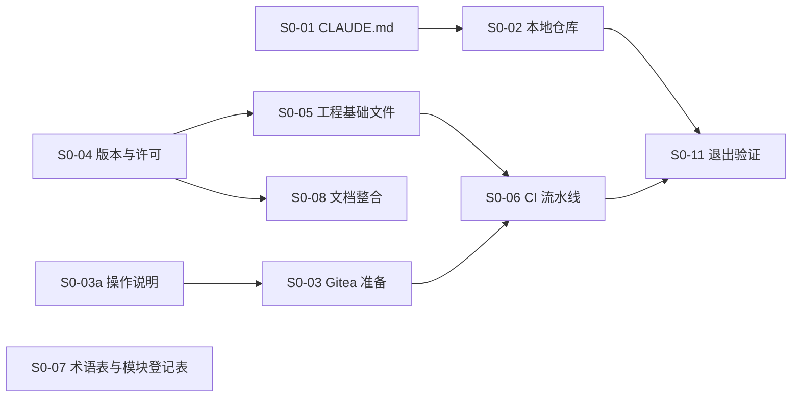

# 阶段 0：开工准备

- 状态：进行中（2026-11-05 起）
- 依据：08 第 2.2 节（阶段 0）、第 6 节（新仓库）；R01 L2（文档整合）、L3（开发规则）；ADR-0032（CI/CD 平台、镜像仓库与镜像扫描）；06 D1、D10（工程配置、版本控制）；03 第 7～8 节（版本与许可）
- 目标：具备“写第一行代码”的全部前提（08）

## 1. 退出标准（08 第 2.2 节）

| # | 标准 | 状态 |
|---|---|---|
| 1 | 一个空的合并请求能跑完整条流水线 | 未开始 |
| 2 | 任一门禁失败能阻断合并 | 未开始 |

## 2. 任务清单

“负责”一列：**开发**指在本仓库中完成的工作（由 AI 助手执行、用户审核）；**运维**指需要 Gitea 服务器管理员权限的操作；**用户**指需要用户拍板的事项。

| 编号 | 任务 | 负责 | 依赖 | 状态 | 交付物 / 说明 |
|---|---|---|---|---|---|
| S0-01 | 修订 `CLAUDE.md`：进入实施阶段，加入开发规则（R01 L3） | 开发 | — | 完成（2026-11-05） | `CLAUDE.md`“当前阶段”“实施阶段的开发规则” |
| S0-02 | 建立本地 Git 仓库：在 `KMIC.Platform/` 初始化独立仓库，提交现有文档；旧仓库忽略此文件夹 | 开发 + 用户 | 第 3 节问题 1 | 完成（2026-11-05） | 原地初始化，分支 `main`；首个提交 `d787d04`（70 个文件，统一为 LF）；新增 `.gitattributes`、`.gitignore`；旧仓库 `.gitignore` 改为忽略 `/KMIC.Platform` |
| S0-03 | Gitea 准备：升级并启用 HTTPS → 启用 Actions → 注册 `build` / `release` 两类执行机 → 新建远程仓库 `KMIC.Platform` → 分支保护（06 D10） | 运维 | 第 3 节问题 4 | 未开始 | 操作说明由开发编写（S0-03a），运维执行 |
| S0-03a | Gitea 准备的操作说明 | 开发 | — | 完成（2026-11-05） | `docs/implementation/S0-Gitea准备.md`：升级目标 28.3.0（已核对 1.27.1～28.3.0 的不兼容变更）、备份与演练、HTTPS 与凭据轮换、执行机、仓库与分支保护、记录表；`release` 执行机的注册方式待 S0-06 补充 |
| S0-04 | 锁定依赖版本并复核许可：03 第 7～8 节中“中 / 未核实”的项；ADR-0032 的 Grype、Syft、Gitleaks、act_runner；VXE Table 的 MIT 边界（F07）；阿里云验证码与短信的接入方式与费用（R01 L1） | 开发 | — | 完成（2026-11-05） | `docs/implementation/S0-04-版本与许可.md`；已关闭 03、06、F02、F07、ADR-0032、R01 中的待确认项，后端待决表删除此项。需要知道的变化：Pinia 用 4.x、Gitea 升级目标为 28.3.0（跨大版本）、act_runner 更名为 Gitea Runner；阿里云费用由用户方确认 |
| S0-05 | 工程基础文件：`global.json`、`Directory.Build.props`、`Directory.Packages.props`、`.editorconfig`、`.gitattributes`、`BannedSymbols.txt`、`CODEOWNERS`、cspell 与 Gitleaks 配置、空的解决方案 | 开发 | S0-04 | 完成（2026-11-05） | 见第 4 节 |
| S0-06 | CI 流水线：格式 → 编译 → 测试 → OpenAPI 检查 → 依赖漏洞 → 密钥扫描 → 镜像扫描（ADR-0032） | 开发；验证需运维 | S0-03、S0-05 | 部分完成 | **本地检查脚本** `scripts/check.cs` 已完成（2026-11-05）：`dotnet run scripts/check.cs` 依次检查编码与换行、格式、编译、测试、依赖漏洞、拼写，本地与 CI 共用；**流水线文件** `.gitea/workflows/` 按用户意见等 Gitea 与执行机就绪后再写（写早了无法验证），届时只调用该脚本并补充密钥扫描、OpenAPI 检查、镜像扫描 |
| S0-07 | 术语表、模块登记表初版 | 开发 | — | 完成（2026-11-05） | `docs/glossary.md`（41 个框架概念）；`docs/modules/README.md`（5 个平台模块编号 10～14，参考模块 99） |
| S0-08 | 文档整合（R01 L2）：补充说明并入正文，文末保留修订记录；00-README 进度表区分“已确认 / 已实现 / 已验收” | 开发 | S0-04（版本结果先写入 03） | 未开始 | 全部设计文档；整理期间不新增设计内容 |
| S0-09 | 待决：OpenAPI 架构名的唯一性（后端 00-README 待决表，截止阶段 0） | 用户 | — | 完成（2026-11-05） | 类名全系统唯一、重名即构建失败（05-06 第 7.2 节补充说明）；已从待决表删除 |
| S0-10 | 本机开发环境：容器运行时、pnpm | 用户 | — | 进行中 | 已选 Docker Desktop（2026-11-05），由用户安装；安装前确认公司是否符合 Docker 的免费使用条件，否则需订阅。pnpm 由 Node 自带的 corepack 启用。阶段 1 开始前完成 |
| S0-11 | 退出验证：按第 1 节逐项验证并记录 | 开发 + 运维 | S0-02～S0-06 | 未开始 | 本文第 1 节状态 |

建议顺序：S0-02 → S0-04 → S0-05 → S0-07 → S0-03a → S0-06 → S0-08（最后整合，把阶段 0 中对文档的修订一并并入）→ S0-11。S0-03 由运维与开发工作并行。

## 3. 待用户决定的事项

### 问题 1：本地仓库放在哪里（S0-02）

| 选项 | 做法 | 优点 | 缺点 |
|---|---|---|---|
| **A 留在原处，原地初始化** | 在 `C:\开发项目\kelong.web\KMIC.Platform` 中初始化独立的 Git 仓库；旧仓库的 `.gitignore` 忽略 `/KMIC.Platform` | 不搬动文件；旧系统源码照常可读；AI 助手的项目记忆不需要迁移 | 本机上新仓库嵌在旧仓库的文件夹里（远程仓库与其他开发者的克隆不受影响） |
| B 移到独立文件夹 | 移到 `C:\开发项目\KMIC.Platform` 后初始化 | 本机目录结构清楚 | 以后要从新位置启动 AI 助手，项目记忆要手工复制（08 第 6 节） |

- **建议**：A。远程仓库建好后，其他开发者直接克隆，与本机的放置位置无关；旧系统还要继续参考一段时间。
- 附带发现：旧仓库已暂存的 `.gitignore` 修改忽略的是改名前的 `/Kelong.Platform`，改名后的 `KMIC.Platform/` 仍显示为未跟踪。选 A 时一并改为 `/KMIC.Platform`。

### 问题 2：OpenAPI 架构名的唯一性（S0-09）

| 选项 | 做法 | 优点 | 缺点 |
|---|---|---|---|
| **A 类名全系统唯一，重名即生成失败** | 请求、响应类名带资源名（如 `SampleListItem`）；生成文档时发现重名即构建失败 | 前端类型名清楚；问题在构建时暴露 | 后端不能用泛泛的类名（如 `ListItem`） |
| B 架构名自动加模块前缀 | 生成时统一加前缀 | 后端命名无约束 | 前端类型名冗长（如 `Sample_SampleListItem`） |

- **建议**：A。

### 问题 3：本机容器运行时（S0-10）

本机已有 .NET SDK 10.0.403、Node.js 24、WSL2；没有容器运行时。本地数据库、集成测试与 Aspire 编排都需要容器。

| 选项 | 说明 |
|---|---|
| Docker Desktop | 与 Aspire、测试容器配合最省事；公司规模超过 Docker 免费条件时需要付费订阅（以 Docker 官网条款为准） |
| Podman Desktop | 开源免费；Aspire 支持（需设置容器运行时为 Podman）；个别工具需要额外配置 |

- **建议**：符合 Docker 免费条件或已有订阅时用 Docker Desktop，否则用 Podman Desktop。

### 问题 4：远程仓库放在哪里（用户 2026-11-05 提出用个人 GitHub 私有仓库 `gw-hhh/KMIC.Platform`）

ADR-0032 已定：代码仓库、CI（Gitea Actions）与镜像仓库都用公司自建的 Gitea（部署在阿里云）。

| 选项 | 做法 | 优点 | 缺点 |
|---|---|---|---|
| A 按 ADR-0032 | Gitea 准备好之前只在本地提交，之后推送到公司 Gitea | 不改已确认的决定；代码一直在公司的服务器上 | Gitea 准备好之前没有远程备份 |
| B 改用 GitHub 私有仓库为正式仓库 | 修订 ADR-0032：GitHub Actions、GitHub 的镜像仓库 | 现在就能用；GitHub 功能成熟 | 公司源码长期放在个人账号下（归属、交接、公司制度）；个人免费版的私有仓库不能设置分支保护（需付费方案，以 GitHub 官网为准），阶段 0 的退出标准“门禁失败能阻断合并”做不到；部署在阿里云，国内服务器访问 GitHub 与其镜像仓库常不稳定；私有仓库的 Actions 免费分钟数有限 |
| C GitHub 作过渡与备份，正式仓库仍是公司 Gitea | 现在推送到 GitHub 私有仓库；Gitea 准备好后推送完整历史到 Gitea，以 Gitea 为准；工作流放在 `.gitea/workflows/`，GitHub 不会执行 | 现在就有远程备份；不改 ADR-0032；以后迁移只是换远程地址 | 过渡期间公司源码在个人账号下；过渡期没有门禁（与 A 相同） |

- **建议**：公司制度允许把源码放在个人 GitHub 私有仓库时选 C；不确定时选 A，先向公司确认。不建议 B。
- **决定（已确认，2026-11-05）**：C。用户确认过渡期间放在个人 GitHub 私有仓库 `gw-hhh/KMIC.Platform` 没有问题；正式仓库仍按 ADR-0032 为公司 Gitea，S0-03 完成后推送完整历史到 Gitea 并以 Gitea 为准，届时 GitHub 仓库停止使用或只作只读备份。

### 问题 5：单人阶段的合并审核（S0-05 写 `CODEOWNERS` 时提出）

代码平台不允许批准自己发起的合并请求；目前只有一位开发者，若强制“至少 1 人审核”，合并请求将无法合入。

| 选项 | 做法 | 优点 | 缺点 |
|---|---|---|---|
| **A 单人阶段只强制 CI，审核要求等第二位开发者加入后开启** | 分支保护强制 CI 通过、禁止直接推送与强制推送；`CODEOWNERS` 照常维护 | 自动检查照常拦截；不影响合入 | 单人阶段平台不强制人工审核 |
| B 现在就强制审核 | — | — | 自己的合并请求无法合入 |
| C 另建账号给自己审核 | — | 能合入 | 审核形同虚设 |

- **决定（已确认，2026-11-05）**：A。已给 06 D10 加补充说明；开启审核要求登记在 `docs/implementation/00-README.md` 待办表。`CODEOWNERS` 暂用 GitHub 账号 `@gw-hhh`，迁到 Gitea 时换为 Gitea 账号（同一待办表）。

### 问题 6：阶段 1 原型是否等待 Gitea 与 CI

08 规定主线串行：阶段 0 的退出标准（空合并请求在 CI 上跑通）达成后才进入阶段 1；这依赖公司 Gitea 的升级（S0-03）。

| 选项 | 做法 | 优点 | 缺点 |
|---|---|---|---|
| A 严格按 08 | CI 跑通后才开始阶段 1 | 与已定计划一致 | 开始写代码的时间取决于 Gitea 升级 |
| **B 本地可做的阶段 0 工作完成、Docker 装好后，即开始阶段 1 原型** | 原型与 S0-06 的验证、S0-11 并行；阶段 2 的正式代码仍必须等 CI 跑通 | 不被 Gitea 卡住 | 原型代码合入前没有 CI；但 08 已规定原型是一次性代码、不合入主干，影响很小 |

- **建议**：B。
- **决定（已确认，2026-11-05）**：B。

## 4. S0-05 交付与验证

### 4.1 交付的文件

| 文件 | 内容 |
|---|---|
| `global.json` | SDK 10.0.403（只接受 10.0.4xx 补丁）；`Aspire.AppHost.Sdk` 13.6.4 |
| `nuget.config` | 只有 nuget.org，包来源映射 |
| `Directory.Build.props` | 06 第 3.1 节全部设置；依赖锁定文件（CI 中锁定模式）；还原时漏洞检查（含传递依赖）；CS1591 只在 BuildingBlocks 与 Contracts 中报错；测试项目（名称以 `Tests` 结尾）追加测试禁用清单 |
| `Directory.Build.targets` | 03 第 5 节“明确不引入的库”：直接引用即还原失败（KMIC0001） |
| `Directory.Packages.props` | S0-04 锁定的全部版本；Meziantou 与 BannedApiAnalyzers 作为全局分析器；传递依赖的安全修复分组 |
| `.editorconfig` | 06 第 3.2、3.4 节的写法偏好与命名；第 15.3 节提升为错误的规则；前端配置节（F04）；测试目录允许下划线方法名（06 D9）与不强制 `[LoggerMessage]`（06 D6） |
| `BannedSymbols.txt`、`BannedSymbols.Tests.txt` | 全部项目通用的禁用 API（21 项）与测试追加（6 项） |
| `.gitea/CODEOWNERS` | Gitea 写法（正则表达式）；放在 `.gitea/` 下，GitHub 不读取；负责人暂为 `@gw-hhh` |
| `cspell.json`、`.cspell/kmic-terms.txt` | 检查范围 `src`、`tests`、`web/src`、`web/tests`；项目词典 |
| `.gitleaks.toml` | 在默认规则上扩展 |
| `Kmic.slnx` | 空的解决方案（.NET 10 的 slnx 格式） |

### 4.2 实际运行的验证（2026-11-05，本机 SDK 10.0.403，临时验证工程）

| # | 验证 | 结果 |
|---|---|---|
| 1 | 符合规范的代码：构建与 `dotnet format --verify-no-changes` | 通过：0 警告 0 错误；格式检查通过 |
| 2 | 每个禁用 API 各用一次（21 处） | 21 个都报 RS0030；同时 CA2016、MA0040 按错误级别报出，证明内置与 Meziantou 分析器生效 |
| 3 | 测试项目：`Task.Delay`、`Thread.Sleep` 各重载 + `DateTime.Now`；带下划线的测试方法名 | 7 个都报 RS0030；下划线方法名未报错 |
| 4 | 直接引用明确不引入的包（Moq） | 还原失败，报 KMIC0001 |
| 5 | 49 个锁定的包放在同一项目中还原 | 首次发现 Roslyn 版本冲突（S0-04 #10，已改为 5.0.0）；修正后通过，无冲突、无已知漏洞 |
| 6 | 分析器测试项目（Roslyn + 分析器测试框架 + xUnit v3）还原 | 首次被漏洞检查拦下（S0-04 #14，已提升间接依赖）；修正后通过 |
| 7 | 拼写检查：拼音标识符与拼错的单词 | `Dingdan`、`Shuliang`、`pruduct` 被拦下；中文注释不检查；其余文件无误报 |
| 8 | 空解决方案：构建与格式检查 | 通过（构建提示“找不到可还原的项目”，属预期；S0-06 设计流水线时处理） |
| 9 | 全部新文件的编码与换行 | UTF-8 无 BOM、LF；`dotnet new` 生成的 `Kmic.slnx` 为 CRLF，已改为 LF |

### 4.3 尚未验证、留到后续的部分

| 内容 | 何时 |
|---|---|
| `.gitleaks.toml` 能否被 Gitleaks 正确加载（本机没有 Gitleaks） | S0-06 在流水线中首次运行时 |
| 只针对模块或某一层的禁用清单（`IConfiguration`、`IMemoryCache`、DbContext 写入 API、端点中的 `Results.Problem` 等）与每条的分析器测试 | 阶段 2 建立对应项目时（06 第 16 节） |
| 自定义分析器 `Kmic.BuildingBlocks.Analyzers` 引用到全部项目（06 第 3.1 节） | 阶段 2 建立该项目时，在 `Directory.Build.props` 中加入 |
| Meziantou 其余规则的级别逐条确认（03 第 4.10 节） | 阶段 2 有真实代码时 |
| `.editorconfig` 中写法偏好（`var`、表达式主体、集合表达式等）对真实代码的效果 | 阶段 2；目前这些为建议级别，不阻断构建 |

## 5. 进展记录

| 日期 | 内容 |
|---|---|
| 2026-11-05 | 进入阶段 0；完成 S0-01（`CLAUDE.md`）；建立本清单 |
| 2026-11-05 | 完成 S0-02（本地仓库，首个提交 `d787d04`）、S0-09（架构名唯一）；S0-10 选定 Docker Desktop；用户提出远程仓库用个人 GitHub，记为问题 4，确认选 C（GitHub 作过渡） |
| 2026-11-05 | 推送到 GitHub 私有仓库 `gw-hhh/KMIC.Platform`；完成 S0-04（版本与许可） |
| 2026-11-05 | 问题 5（单人阶段的合并审核）确认选 A；建立实施待办表 `docs/implementation/00-README.md` |
| 2026-11-05 | 用户认为不必现在写流水线：流水线文件推迟到 Gitea 就绪，先完成本地检查脚本 `scripts/check.cs`（在空仓库上实际运行通过，并验证能查出 CRLF 与拼写错误）；开始阶段 1 原型 |
| 2026-11-05 | 问题 6 确认选 B；完成 S0-03a（Gitea 操作说明），可交给管理员执行 S0-03 |
| 2026-11-05 | 完成 S0-07（术语表、模块登记表）；用户询问何时开始写代码，提出阶段 1 是否等待 Gitea（问题 6） |
| 2026-11-05 | 完成 S0-05（工程基础文件），实际验证 9 项；验证中发现并修正 Roslyn 版本冲突与一个间接依赖的已知漏洞（S0-04 #10、#14） |
