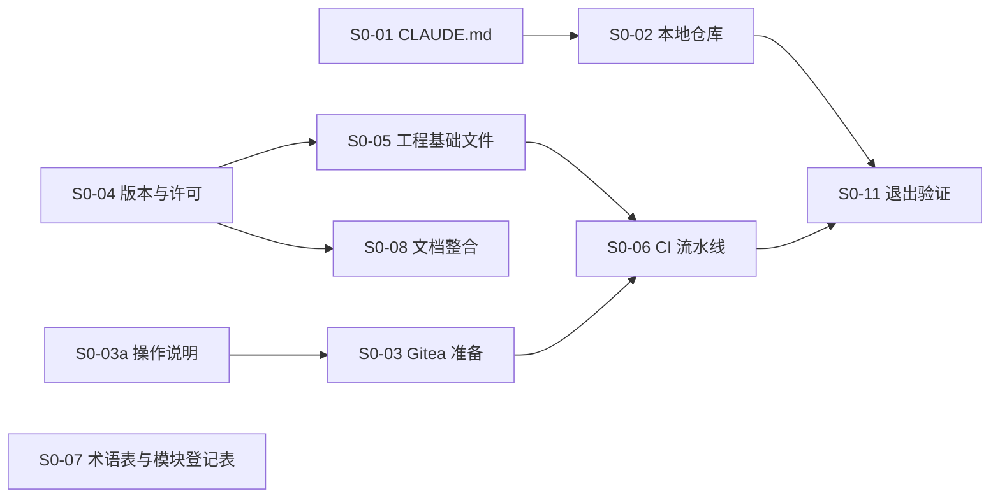

# 阶段 0：开工准备

- 状态：进行中（2026-11-05 起）
- 依据：08 第 2.2 节（阶段 0）、第 6 节（新仓库）；R01 L2（文档整合）、L3（开发规则）；ADR-0032（CI/CD 平台、镜像仓库与镜像扫描）；06 D1、D10（工程配置、版本控制）；03 第 7～8 节（版本与许可）
- 目标：具备“写第一行代码”的全部前提（08）

## 1. 退出标准（08 第 2.2 节）

| # | 标准 | 状态 |
|---|---|---|
| 1 | 一个空的合并请求能跑完整条流水线 | 未开始 |
| 2 | 任一门禁失败能阻断合并 | 未开始 |

## 2. 任务清单

“负责”一列：**开发**指在本仓库中完成的工作（由 AI 助手执行、用户审核）；**运维**指需要 Gitea 服务器管理员权限的操作；**用户**指需要用户拍板的事项。

| 编号 | 任务 | 负责 | 依赖 | 状态 | 交付物 / 说明 |
|---|---|---|---|---|---|
| S0-01 | 修订 `CLAUDE.md`：进入实施阶段，加入开发规则（R01 L3） | 开发 | — | 完成（2026-11-05） | `CLAUDE.md`“当前阶段”“实施阶段的开发规则” |
| S0-02 | 建立本地 Git 仓库：在 `KMIC.Platform/` 初始化独立仓库，提交现有文档；旧仓库忽略此文件夹 | 开发 + 用户 | 第 3 节问题 1 | 完成（2026-11-05） | 原地初始化，分支 `main`；首个提交 `d787d04`（70 个文件，统一为 LF）；新增 `.gitattributes`、`.gitignore`；旧仓库 `.gitignore` 改为忽略 `/KMIC.Platform` |
| S0-03 | Gitea 准备：升级并启用 HTTPS → 启用 Actions → 注册 `build` / `release` 两类执行机 → 新建远程仓库 `KMIC.Platform` → 分支保护（06 D10） | 运维 | 第 3 节问题 4 | 未开始 | 操作说明由开发编写（S0-03a），运维执行 |
| S0-03a | Gitea 准备的操作说明 | 开发 | — | 未开始 | `docs/implementation/S0-Gitea准备.md` |
| S0-04 | 锁定依赖版本并复核许可：03 第 7～8 节中“中 / 未核实”的项；ADR-0032 的 Grype、Syft、Gitleaks、act_runner；VXE Table 的 MIT 边界（F07）；阿里云验证码与短信的接入方式与费用（R01 L1） | 开发 | — | 未开始 | 版本与许可核实记录；修订 03 |
| S0-05 | 工程基础文件：`global.json`、`Directory.Build.props`、`Directory.Packages.props`、`.editorconfig`、`.gitattributes`、`BannedSymbols.txt`、`CODEOWNERS`、cspell 与 Gitleaks 配置、空的解决方案 | 开发 | S0-04 | 未开始 | 仓库根目录文件（06 第 3 节、F04 第 3 节） |
| S0-06 | CI 流水线：格式 → 编译 → 测试 → OpenAPI 检查 → 依赖漏洞 → 密钥扫描 → 镜像扫描（ADR-0032） | 开发；验证需运维 | S0-03、S0-05 | 未开始 | `.gitea/workflows/` |
| S0-07 | 术语表、模块登记表初版 | 开发 | — | 未开始 | `docs/glossary.md`、`docs/modules/README.md` |
| S0-08 | 文档整合（R01 L2）：补充说明并入正文，文末保留修订记录；00-README 进度表区分“已确认 / 已实现 / 已验收” | 开发 | S0-04（版本结果先写入 03） | 未开始 | 全部设计文档；整理期间不新增设计内容 |
| S0-09 | 待决：OpenAPI 架构名的唯一性（后端 00-README 待决表，截止阶段 0） | 用户 | — | 完成（2026-11-05） | 类名全系统唯一、重名即构建失败（05-06 第 7.2 节补充说明）；已从待决表删除 |
| S0-10 | 本机开发环境：容器运行时、pnpm | 用户 | — | 进行中 | 已选 Docker Desktop（2026-11-05），由用户安装；安装前确认公司是否符合 Docker 的免费使用条件，否则需订阅。pnpm 由 Node 自带的 corepack 启用。阶段 1 开始前完成 |
| S0-11 | 退出验证：按第 1 节逐项验证并记录 | 开发 + 运维 | S0-02～S0-06 | 未开始 | 本文第 1 节状态 |

建议顺序：S0-02 → S0-04 → S0-05 → S0-07 → S0-03a → S0-06 → S0-08（最后整合，把阶段 0 中对文档的修订一并并入）→ S0-11。S0-03 由运维与开发工作并行。

## 3. 待用户决定的事项

### 问题 1：本地仓库放在哪里（S0-02）

| 选项 | 做法 | 优点 | 缺点 |
|---|---|---|---|
| **A 留在原处，原地初始化** | 在 `C:\开发项目\kelong.web\KMIC.Platform` 中初始化独立的 Git 仓库；旧仓库的 `.gitignore` 忽略 `/KMIC.Platform` | 不搬动文件；旧系统源码照常可读；AI 助手的项目记忆不需要迁移 | 本机上新仓库嵌在旧仓库的文件夹里（远程仓库与其他开发者的克隆不受影响） |
| B 移到独立文件夹 | 移到 `C:\开发项目\KMIC.Platform` 后初始化 | 本机目录结构清楚 | 以后要从新位置启动 AI 助手，项目记忆要手工复制（08 第 6 节） |

- **建议**：A。远程仓库建好后，其他开发者直接克隆，与本机的放置位置无关；旧系统还要继续参考一段时间。
- 附带发现：旧仓库已暂存的 `.gitignore` 修改忽略的是改名前的 `/Kelong.Platform`，改名后的 `KMIC.Platform/` 仍显示为未跟踪。选 A 时一并改为 `/KMIC.Platform`。

### 问题 2：OpenAPI 架构名的唯一性（S0-09）

| 选项 | 做法 | 优点 | 缺点 |
|---|---|---|---|
| **A 类名全系统唯一，重名即生成失败** | 请求、响应类名带资源名（如 `SampleListItem`）；生成文档时发现重名即构建失败 | 前端类型名清楚；问题在构建时暴露 | 后端不能用泛泛的类名（如 `ListItem`） |
| B 架构名自动加模块前缀 | 生成时统一加前缀 | 后端命名无约束 | 前端类型名冗长（如 `Sample_SampleListItem`） |

- **建议**：A。

### 问题 3：本机容器运行时（S0-10）

本机已有 .NET SDK 10.0.403、Node.js 24、WSL2；没有容器运行时。本地数据库、集成测试与 Aspire 编排都需要容器。

| 选项 | 说明 |
|---|---|
| Docker Desktop | 与 Aspire、测试容器配合最省事；公司规模超过 Docker 免费条件时需要付费订阅（以 Docker 官网条款为准） |
| Podman Desktop | 开源免费；Aspire 支持（需设置容器运行时为 Podman）；个别工具需要额外配置 |

- **建议**：符合 Docker 免费条件或已有订阅时用 Docker Desktop，否则用 Podman Desktop。

### 问题 4：远程仓库放在哪里（用户 2026-11-05 提出用个人 GitHub 私有仓库 `gw-hhh/KMIC.Platform`）

ADR-0032 已定：代码仓库、CI（Gitea Actions）与镜像仓库都用公司自建的 Gitea（部署在阿里云）。

| 选项 | 做法 | 优点 | 缺点 |
|---|---|---|---|
| A 按 ADR-0032 | Gitea 准备好之前只在本地提交，之后推送到公司 Gitea | 不改已确认的决定；代码一直在公司的服务器上 | Gitea 准备好之前没有远程备份 |
| B 改用 GitHub 私有仓库为正式仓库 | 修订 ADR-0032：GitHub Actions、GitHub 的镜像仓库 | 现在就能用；GitHub 功能成熟 | 公司源码长期放在个人账号下（归属、交接、公司制度）；个人免费版的私有仓库不能设置分支保护（需付费方案，以 GitHub 官网为准），阶段 0 的退出标准“门禁失败能阻断合并”做不到；部署在阿里云，国内服务器访问 GitHub 与其镜像仓库常不稳定；私有仓库的 Actions 免费分钟数有限 |
| C GitHub 作过渡与备份，正式仓库仍是公司 Gitea | 现在推送到 GitHub 私有仓库；Gitea 准备好后推送完整历史到 Gitea，以 Gitea 为准；工作流放在 `.gitea/workflows/`，GitHub 不会执行 | 现在就有远程备份；不改 ADR-0032；以后迁移只是换远程地址 | 过渡期间公司源码在个人账号下；过渡期没有门禁（与 A 相同） |

- **建议**：公司制度允许把源码放在个人 GitHub 私有仓库时选 C；不确定时选 A，先向公司确认。不建议 B。
- **决定（已确认，2026-11-05）**：C。用户确认过渡期间放在个人 GitHub 私有仓库 `gw-hhh/KMIC.Platform` 没有问题；正式仓库仍按 ADR-0032 为公司 Gitea，S0-03 完成后推送完整历史到 Gitea 并以 Gitea 为准，届时 GitHub 仓库停止使用或只作只读备份。

## 4. 进展记录

| 日期 | 内容 |
|---|---|
| 2026-11-05 | 进入阶段 0；完成 S0-01（`CLAUDE.md`）；建立本清单 |
| 2026-11-05 | 完成 S0-02（本地仓库，首个提交 `d787d04`）、S0-09（架构名唯一）；S0-10 选定 Docker Desktop；用户提出远程仓库用个人 GitHub，记为问题 4，确认选 C（GitHub 作过渡） |
