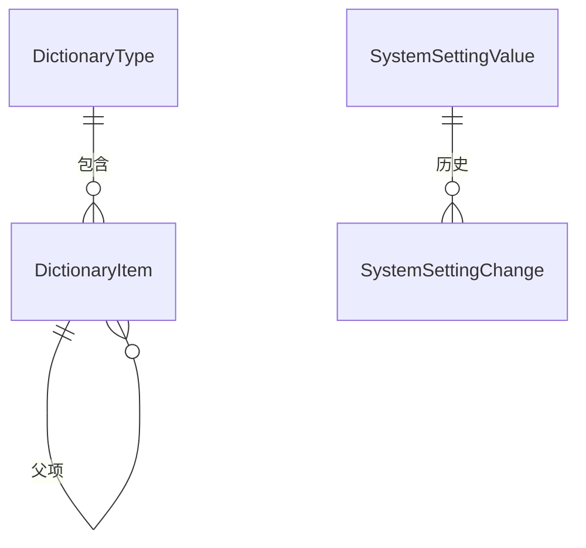
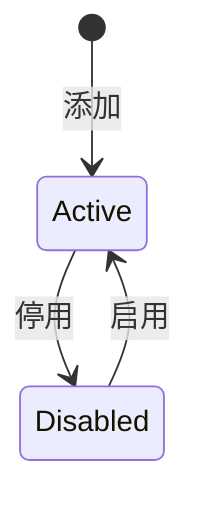

# Configuration 模块设计

- 实现：字典、系统设置、偏好已实现并通过端到端测试（2026-11-13）；功能开关查询（`GetFeaturesQuery`，P2）未做，等第一个有前端开关的功能出现（4.4）。实现时发现的差异已就地订正，汇总见第 13 节末。
- 状态：**已确认**（2026-11-12）。起草当天，用户授权“遇到需要选择的地方，默认采用最推荐的方案”，第 12 节的决定均按建议确定；第 12.3 节的待确认事项是需要业务方或旧库数据回答的事实，不阻塞编码。
- 模块名 / schema / 编号：`Configuration` / `"Configuration"` / 12（平台模块，登记见 `docs/modules/README.md`）；`[LoggerMessage]` 的 `EventId` 使用 12000～12999
- 项目：`Kmic.Configuration.Domain`、`Application`、`Infrastructure`、`Presentation`、`Contracts`（07 第 2 节）
- 依据：ADR-0012、0016、0017、0027；05-10（本模块的框架设计，机制已确认，本文不重复，只引用并补全模块自己的部分）；05-02 第 6.3 节；05-05 第 6 节；Identity 模块设计（`docs/modules/identity/README.md`）；旧系统源码与 `docs/legacy/01-legacy-analysis.md`

## 0. 概述

### 0.1 职责与边界

05-10 把“配置”拆成七类，各自只有一个构件。**本模块只承载其中需要数据库存储和管理界面的三类**：字典、系统设置、偏好。部署配置（Options）、缓存、功能开关、多语言是框架能力，不在本模块。

| 做 | 不做 |
|---|---|
| 字典：代码声明的类型登记与退役；字典项的维护（增、改名、移动、排序、停用、启用）；字典读取与可选性校验（`IDictionaries`） | 字典类型的新建：类型由代码声明，界面不能新建（05-10 D3） |
| 系统设置：存被修改过的值、变更历史、读取（`ISettings` 的实现）、管理页面 | 设置的定义：由各模块在代码中声明（键、类型、默认值、校验、修改权限） |
| 偏好：四层覆盖的存储与解析、`GET preferences/me`、系统层与角色层的管理 | 偏好的使用：前端表格列设置、外壳设置等由前端读写；授权、数据范围不得依赖偏好（架构测试） |
| 前端功能开关的查询端点 `GET features`（P2） | 功能开关的存储与切换：现在只用部署配置，数据库存储登记为延后事项（05-10 D6） |
| 缓存标签的使用：读取走 `HybridCache`，写入命令提交后失效并广播（05-10 4.2、D2） | 缓存机制本身：框架（已实现） |
| | 密钥、连接串：部署配置与生产密钥源（05-10 2.2，09 D5） |
| | 规则集：延后（ADR-0017，00-README 延后事项） |
| | 编号规则：编号服务属框架，规则行在各业务模块自己的表里（05-13） |

### 0.2 本文与框架文档的关系

05-10 已确认的决定（D1～D6）全部沿用。本文补的是 07 第 8 节要求、框架文档留给模块的内容：聚合与表、用例与权限点清单、前端页面、旧系统对照（含旧系统“字典”其实是什么）、数据迁移、框架在本模块开工前要补的东西，以及三项模块层面的取舍（第 12 节）。

### 0.3 模块划分检查表（07 第 6.3 节）

| # | 检查项 | 结论 |
|---|---|---|
| 1 | 强不变量是否都归本模块 | 是。清单见下 |
| 2 | 每个命令是否只改本模块的数据 | 是。命令只写本模块的表；缓存失效和广播是框架在提交后的动作，不是跨模块写入 |
| 3 | 跨模块“先检查、后写入” | 有一处：业务模块的命令用 `IDictionaries.EnsureSelectableAsync` 校验字典编码。它是只读的 `Reference` 类查询，结果只在命令内使用；校验之后字典项被停用的窗口，业务数据仍保存原编码，显示时标“已禁用”（ADR-0012 第 3 条），不构成不一致 |
| 4 | 订阅事件失败时的处理 | Configuration 不订阅任何事件 |
| 5 | 其他模块的数据怎么取 | 只需要显示名：操作人经 `IUserReferences`，角色名经 `IRoleReferences`（`Reference` 查询，05-07 D3） |
| 6 | 依赖是否单向无环 | 是。`DependsOn("Identity")`；Identity 不依赖 Configuration。其他模块读取设置或字典时，在自己的 `DeclareDependencies` 里写 `DependsOn("Configuration")`（启动校验：被依赖的模块关闭则拒绝启动） |
| 7 | 拆成两个模块的理由 | 不拆。字典、设置、偏好都是“管理员维护的、读多写少的配置数据”，共用缓存失效机制、权限点分组与前端区域（ADR-0027） |

本模块的强不变量：

| 编号 | 不变量 | 由谁保证 |
|---|---|---|
| C1 | 同一字典类型内，字典项编码唯一，创建后不可修改 | 唯一索引 `(TypeCode, Code)` + 聚合方法不提供改编码 |
| C2 | 字典项的父项存在于同一类型、不成环；只有层级字典可以有父项；停用的项下不能有启用的子项 | `DictionaryType` 聚合（子实体在同一聚合内检查） |
| C3 | 每个设置值都通过它自己的类型声明的校验后才保存；值与变更历史在同一事务提交 | 命令处理器 + `SystemSettingChange` 只追加 |
| C4 | 同一偏好键在同一层只有一行 | 唯一索引 `(Key, Layer, RoleId, UserId)`，`NULL` 视为相等（PG 15 的 `NULLS NOT DISTINCT`） |
| C5 | 已退役的字典类型不能再添加字典项；代码里没有声明的设置不能被修改 | 聚合方法与命令处理器 |

---

## 1. 旧系统对照

### 1.1 旧系统的“配置”到底是什么

05-10 第 1 节说旧系统有四处配置存储。读了旧代码后，“字典”这一处的实际用途与名字不符：

| 旧存储 | 实际内容 | 新系统 |
|---|---|---|
| `Web.config` 的 `appSettings`（约 130 项） | 连接串与密钥、技术开关、业务参数（税率、当前年份、分页大小、产品名单、国外工厂、敏感客户关键词）、审批人用户 ID、邮件收件人 | 逐项归类：技术参数与密钥是部署配置；业务参数是系统设置，由使用它的业务模块声明；审批人改为权限点 + 数据范围；邮件收件人改为通知规则（见第 9 节） |
| `Base_Dictionary`（`Dict_ID`、`Dict_Name`、`Dict_Code`、`Dict_Value`、`Dict_Type`、`Dict_Type_Name`、`Sort_Order`、`Description`、`Is_Enabled`、`Delete_Mark`、审计列） | 代码里的类型枚举只有一个 `SystemConfig = 1`（`DictionaryConfig.cs`）。已知的用途是全局错误邮件的白名单与模板（`GLOBAL_ERROR_EMAIL_WHITELIST_*`）。**它是键值配置，不是选项列表** | 不进入字典。能确定是业务参数的进系统设置；错误邮件的白名单与模板由观测平台告警取代（05-12），不迁移。逐行核对见第 9 节 |
| 行业、职称、客户编码、项目编码、SIC 码等（系统管理菜单里的 `Industry`、`ZhiCheng`、`CustomerCode`、`ProjectCode`、`SICCode`，各有自己的表） | 业务人员维护的选项 | 由各业务模块设计时决定：只存储、显示、筛选的做字典类型；有业务规则的做业务表或智能枚举（05-10 第 5.1 节的边界） |
| `PreferenceConfig`（JSON 格式，有 JSON 校验约束） | `待确认`：存的是用户偏好还是系统参数（第 12.3 节） | 偏好 |
| `Rule_Tongyong` | `待确认`：通用规则，可能是价格或审批的参数 | 业务模块设计时分类：当前值设置，或规则集（延后） |
| `ConfigHelper.WriteConfig`（约 79 处调用，运行时写回 `Web.config`，每次触发应用池重启） | 业务参数在线修改 | 系统设置：存数据库，修改后经缓存失效在全部实例毫秒级生效；不再写配置文件 |

### 1.2 旧系统页面

| 旧页面（`Web/Manage`） | 新系统 | 说明 |
|---|---|---|
| `SystemSet`（系统管理菜单里的“系统设置”） | 系统设置页 | 旧页面内容 `待确认`（第 12.3 节）；新页面按代码声明的设置分组列出 |
| 行业、职称等维护页 | 各业务模块 | 若判为字典，则用本模块的字典维护页，不再有各自的页面 |

### 1.3 旧表对照

| 旧表 / 字段 | 新模型 | 备注 |
|---|---|---|
| `Base_Dictionary` | 无直接对应 | 见 1.1；逐行归类后处理，第 9 节 |
| `Base_Dictionary.Delete_Mark`、`Is_Enabled` | `DictionaryItem.Status` | 若某类选项迁入字典：删除与停用都迁为 `Disabled`，历史数据显示“已禁用” |
| `PreferenceConfig` | `PreferenceValue` | 第 9 节 |

---

## 2. 术语

确认本文后一并登记到 `docs/glossary.md`（Configuration 名下已有：偏好、系统设置、字典）。

| 中文 | 英文标识符 | 含义 |
|---|---|---|
| 字典类型 | `DictionaryType` | 一类候选值，由代码声明，编码形如 `Sample.Industry` |
| 字典项 | `DictionaryItem` | 类型下的一个候选值，按稳定编码引用，创建后编码不可改 |
| 层级字典 | `IsHierarchical` | 字典项可以有父项的字典类型 |
| 系统设置定义 | `SystemSettingDefinition` | 代码中声明的设置：键、显示名、分组、默认值、校验、修改权限（目录在内存，不进数据库） |
| 设置值 | `SystemSettingValue` | 数据库里被修改过的设置值；没有行表示使用代码默认值 |
| 设置变更 | `SystemSettingChange` | 一次修改的新旧值、原因、操作人，只追加 |
| 偏好层 | `PreferenceLayer` | `System` / `Role` / `UserRole`，解析时由下往上取第一个有值的 |
| 偏好族 | `PreferenceFamily` | 键带后缀的偏好集合（`Ui.Shell`、`Ui.Table.*`），后端只校验格式与大小（05-10 7.2） |

---

## 3. 聚合与表

### 3.1 总览

| 聚合 / 表 | 内容 | 类型 |
|---|---|---|
| `DictionaryType` + `DictionaryItem` | 字典类型与它的全部字典项（一个类型一个聚合，12 节 D-C1） | 聚合 |
| `SystemSettingValue` | 被修改过的设置值 | 聚合（一行一个，主键是设置键） |
| `SystemSettingChange` | 设置变更历史 | 只追加表，不作为聚合的子实体（量随修改次数增长，只插入） |
| `PreferenceValue` | 偏好值 | 聚合（一行一个） |

强类型：`DictionaryItemId`、`PreferenceValueId` 在本模块 Domain；字典类型用 `DictionaryTypeCode`、设置用 `SettingKey` 这样的值对象包装字符串（Vogen），不暴露裸字符串。

以上聚合都**不**声明数据范围：`HasNoDataScope("配置数据对所有登录用户一致，按权限点管理")`。偏好的用户层按 `UserId` 显式过滤（不是数据范围）。

### 3.2 `DictionaryType` 与 `DictionaryItem`

`"Configuration"."DictionaryType"`：

| 字段 | 说明 |
|---|---|
| `Id` | `uuid`，主键（实现时定：与其他聚合一致用 Guid 主键，编码另设唯一索引） |
| `Code` | `varchar(100)`，唯一（违反返回 `DictionaryTypeCodeExists`），如 `Sample.Industry`。以声明它的模块名开头 |
| `DisplayName` | `varchar(100)`，来自代码声明，每次同步更新 |
| `OwnerModule` | `varchar(50)` |
| `IsHierarchical` | `boolean`，来自代码声明 |
| `Status` | `Active` / `Retired`（代码里已删除的类型标为退役，数据保留） |
| `ConcurrencyVersion` | 05-03；任何字典项的变化都递增它 |
| 审计字段 | 05-03 |

`"Configuration"."DictionaryItem"`（`DictionaryType` 的子实体）：

| 字段 | 说明 |
|---|---|
| `Id` | `uuid` |
| `TypeId` | 外键，指向 `DictionaryType.Id` |
| `Code` | `varchar(50)`，同类型内唯一（不区分大小写，列声明 `CaseInsensitive`，ADR-0030），**创建后不可修改**；业务数据存的就是它 |
| `Name` | `varchar(200)`，显示名，可改名 |
| `ParentCode` | `varchar(50) null`，层级字典的父项编码 |
| `SortOrder` | `int`，同一父项下的次序 |
| `Status` | `Active` / `Disabled`（状态图见下） |
| 审计字段 | 05-03 |

与 05-10 第 5.2 节的差别：字典项不单独带 `ConcurrencyVersion`，用类型的版本控制并发（D-C1）。字典项不提供“附加属性”列（05-10 5.2）；也不提供删除，只停用。

- 聚合方法（`DictionaryType`）：`Synchronize(displayName, isHierarchical)`、`Retire()`、`AddItem(code, name, parentCode?, sortOrder?)`、`RenameItem`、`MoveItem(code, newParentCode?)`、`ReorderItems(parentCode?, orderedCodes)`、`DisableItem`、`EnableItem`。
- `AddItem` 的前置：类型启用（C5）；编码格式合法（字母、数字、点、短横线、下划线，1～50 位）；类型不是层级字典时 `parentCode` 必须为空；父项存在且启用；总数不超过上限（配置，默认 2000）。
- `MoveItem`：只对层级字典；新父项不能是自己或自己的后代（C2）。
- `DisableItem`：下面有启用的子项时拒绝（`Configuration.DictionaryItemHasEnabledChildren`），先停用子项；`EnableItem`：父项必须启用。
- `ReorderItems`：参数是同一父项下全部项的新次序，缺项或多项都拒绝（避免并发添加时丢项）；结果 `SortOrder` 重排为 10、20、30……
- 同步（`Synchronize`、`Retire`）由启动任务调用，不经管理命令；类型重新出现在代码里时从 `Retired` 回到 `Active`。

### 3.3 `SystemSettingValue` 与 `SystemSettingChange`

`"Configuration"."SystemSettingValue"`：`Id`（`uuid`，主键）、`Key`（`varchar(200)`，唯一，以模块名开头；违反唯一约束按版本冲突处理）、`Value`（`jsonb`）、`ConcurrencyVersion`、审计字段。方法：`Set(json)`。

`"Configuration"."SystemSettingChange"`（只追加，运行账号撤销修改与删除权限，05-09 D7）：`Id`、`Key`、`OldValue jsonb null`、`NewValue jsonb null`（恢复默认时为空）、`Reason varchar(500)`（必填）、`TraceId`；谁改的、什么时候改的就是审计的创建人和创建时间列，不另设 `ChangedBy`、`ChangedAt`；索引 `Key`、`CreatedAt`。它自己是一个聚合根（不是设置值的子实体：恢复默认会删除值行，历史要留下），因此带一列并发版本号，但从不更新。

- 值的校验不在聚合里：校验函数是各模块 Application 里设置类型的静态成员 `Validate`，由命令处理器经**设置目录**取到并执行（聚合只存已校验的 JSON）。
- 值敏感度：设置里不放密钥（05-10 6.1）；变更历史里的新旧值原样保存，查看变更历史需要 `Configuration.Setting.View`。
- 代码中删除的设置：值行保留，管理页标“已不存在”，需要 `Configuration.Setting.Manage` 才能清除（清除也写一条变更）。

### 3.4 `PreferenceValue`

`"Configuration"."PreferenceValue"`：`Id`、`Key`（`varchar(128)`）、`Layer`（`System` / `Role` / `UserRole`）、`RoleId null`、`UserId null`、`Value jsonb`、`ConcurrencyVersion`、审计字段；唯一 `(Key, Layer, RoleId, UserId)`（`NULLS NOT DISTINCT`）。

- 层与列的对应：`System` 的 `RoleId`、`UserId` 都为空；`Role` 只有 `RoleId`；`UserRole` 两者都有。由工厂方法 `ForSystem`、`ForRole`、`ForUserRole` 保证，数据库另加检查约束。
- 解析：`UserRole` → `Role` → `System` → 代码默认，取第一个有值的（05-10 7.1）。用户换角色后，用户层按“用户 + 当前角色”取，所以每个角色下的偏好互相独立。
- 值的大小：普通偏好由类型的成员限定；偏好族的值是 JSON 对象，不超过 16 KB（05-10 7.2）。

### 3.5 模块内的其他表

| 表 | 关键列 | 规则 |
|---|---|---|
| （无） | | 实现时没有建 `CatalogState`：字典类型目录只有几十行，每次启动读一次类型表（不含字典项）逐行比较，没有变化就不写；多个实例同时启动由事务级咨询锁串行化，后到的看到的已经是同步好的结果。内容哈希表是为一千多行的权限点目录设计的，本模块用不上 |

设置与偏好的**定义目录**在启动时由各模块汇总到内存（`SystemSettingCatalog`、`PreferenceCatalog`，已实现于 BuildingBlocks.Application），不进数据库（05-10 6.2）。

---

## 4. 用例

命名遵循 05-02。**授权**为权限点或声明；管理命令都 `[Idempotent]`（HTTP 来源须带幂等键）、`[Audited]`、携带 `ExpectedVersion`（有版本的对象）。

### 4.1 字典

| 用例 | 授权 | 说明 |
|---|---|---|
| `GetDictionariesQuery(types)` | `[AllowAuthenticated]` | `GET /api/v1/configuration/dictionaries?types=a,b`，一次最多 20 个类型；响应带 `ETag`（各类型版本的组合），支持 `If-None-Match` 返回 304（05-10 D4）；包含停用项并带状态，前端据此显示“已禁用”；经缓存（键 `Configuration:Dictionary:{type}`，标签 `Configuration:Dictionary`） |
| `ListDictionaryTypesQuery` | `Configuration.Dictionary.Manage` | 类型、所属模块、项数、状态 |
| `GetDictionaryTypeQuery` | 同上 | 全部项（含停用）与类型版本，管理页使用 |
| `AddDictionaryItemCommand` | 同上 | 编码已存在 `Configuration.DictionaryItemCodeExists`（409） |
| `RenameDictionaryItemCommand` | 同上 | 只改显示名 |
| `MoveDictionaryItemCommand` | 同上 | 层级字典改父项 |
| `ReorderDictionaryItemsCommand` | 同上 | 见 3.2 |
| `DisableDictionaryItemCommand` / `EnableDictionaryItemCommand` | 同上 | 停用的影响（历史数据显示“已禁用”、新数据不可选）在界面提示 |
| `IDictionaries.GetAsync` / `IsSelectableAsync` | Contracts 查询，`Reference` 类 | 05-10 5.3；不检查权限点、不套数据范围；`IsSelectableAsync` 只返回能不能选（类型存在、项存在且启用），不返回错误：调用方知道输入框的路径，自己拒绝并带上字段错误比 Configuration 替它拒绝更好用。设计里的 `Configuration.DictionaryItemNotSelectable` 错误码因此取消 |

提交后失效标签 `Configuration:Dictionary:{type}`（`IAfterCommit.InvalidateTags`，05-10 4.2）。

### 4.2 系统设置

| 用例 | 授权 | 说明 |
|---|---|---|
| `ListSettingsQuery` | `Configuration.Setting.View` | 设置目录里全部定义，按分组：键、显示名、说明、所属模块、字段清单（名称、类型、显示名、单位）、默认值、当前值、是否被修改、版本、修改所需权限点（用户是否有它也一并返回，页面据此显示编辑按钮）；另列“已不存在”的值行 |
| `GetSettingQuery` | 同上 | 单项详情 |
| `SetSettingCommand(key, value, reason, expectedVersion?)` | `Configuration.Setting.View` + 资源策略 `Setting` 的动作 `Edit`（12 节 D-C2） | 值是 JSON 对象，按设置类型反序列化后执行 `Validate`；通不过设置自己的校验返回 `Configuration.SettingInvalid`（400，逐字段错误写入 `errors[]`；值读不出来、不是对象、超过大小是同一错误码的 422）；原因必填；同一事务写 `SystemSettingChange`；提交后失效 `Configuration:Settings` |
| `ResetSettingCommand(key, reason, expectedVersion)` | 同上 | 恢复默认：删除值行并写一条 `NewValue` 为空的变更 |
| `ListSettingChangesQuery` | `Configuration.Setting.View` | 按键与时间范围；操作人名经 `IUserReferences` |
| `PurgeObsoleteSettingCommand` | `Configuration.Setting.Manage`（敏感） | 清除代码里已不存在的设置的值行，写变更 |
| `ISettings.GetAsync<T>` | 框架接口，本模块实现 | 05-10 6.3；一个键存全部已修改值（`Configuration:Settings`），反序列化后缓存为各类型的不可变记录 |

### 4.3 偏好

| 用例 | 授权 | 说明 |
|---|---|---|
| `GetMyPreferencesQuery` | `[AllowAuthenticated]` | `GET /api/v1/configuration/preferences/me`：当前用户在当前角色下全部偏好的解析结果（含偏好族已有的键），每项带来源层（默认 / 系统 / 角色 / 本人），前端启动时拉一次 |
| `SetMyPreferenceCommand(key, value)` | `[AllowAuthenticated]`，`[NotAudited("个人体验配置")]`，`[NotIdempotent("按键覆盖，重复执行结果相同")]`，`PUT preferences/me/{key}`，204 | 写 `UserRole` 层，只能改自己；键必须在目录里或符合偏好族的键格式；`Layers` 不含 `UserRole` 的偏好拒绝（`Configuration.PreferenceLayerNotAllowed`）；值校验失败 `Configuration.PreferenceInvalid`（422） |
| `ResetMyPreferenceCommand(key)` | 同上，`POST preferences/me/{key}/reset`，204 | 删除当前层那一行，本来没有就什么也不做；偏好族的重置按键 |
| `ListPreferenceDefinitionsQuery` | `Configuration.Preference.Manage`，`GET preferences` | 目录里的偏好和偏好族里已经有系统层或角色层值的键：允许的层、默认值、系统层与各角色层的现有值和版本、角色名称（`IRoleReferences`） |
| `SetPreferenceLayerCommand(key, roleId?, value, expectedVersion?)` | `Configuration.Preference.Manage`，`[Audited]`，`[Idempotent]`，`PUT preferences/{key}/layers/system` 与 `…/layers/roles/{roleId}` | 不给角色是系统层，给了是角色层（角色必须存在，否则 `PreferenceRoleNotFound`）；`expectedVersion` 的含义与设置相同：这一层还没有值时不给，已有值而没给或不一致都是版本冲突 |
| `ResetPreferenceLayerCommand(key, roleId?, expectedVersion)` | 同上，`POST …/layers/system/reset` 与 `…/layers/roles/{roleId}/reset` | 只删这一层；这一层已经没有值是版本冲突 |

- 模拟身份：模拟会话默认只读（05-04 D7），`SetMyPreference` 在只读模拟中被框架拒绝；`GetMyPreferences` 返回被模拟用户的偏好。
- 缓存：系统层与角色层按标签缓存（`Configuration:Preferences:System`、`…:Role:{roleId}`），用户层不缓存（05-10 7.2）。
- 值的校验：目录里的偏好按值类型读出后执行它自己的 `Validate`（逐字段错误 400，读不出来 422）；偏好族的值只要求是不超过 `Configuration:Preference:FamilyValueMaxKb` 的 JSON 对象，键不在目录里也不属于任何族是 `PreferenceNotFound`（404）。读取时某一层存着的值已经读不出来（值类型后来改过）就跳到下一层，不报错。
- 偏好的“重置只删当前层”：删除 `UserRole` 层的行后，值回落到角色层，这是设计内的行为，界面提示“恢复为角色默认”。

### 4.4 功能开关与系统任务

| 用例 | 声明 | 说明 |
|---|---|---|
| `GetFeaturesQuery` | `[AllowAuthenticated]` | `GET /api/v1/configuration/features`：当前对其开放的开关名列表（`待确认`：第一个有前端开关的功能出现时再核对返回结构；P2，首期只有端点，没有管理页面） |
| `SyncDictionaryTypesCommand` | `[SystemOnly]`，启动任务 | 迁移之后、接收请求之前：按 `DictionaryTypeCatalog` 登记新类型、更新显示名、把代码里已删除的类型标为 `Retired`；内容哈希未变则跳过；`[NotAudited("目录同步")]` |

本模块没有定时任务。

---

## 4A. 前端

路由名前缀 `configuration.`，菜单归属“系统管理 / 配置”。偏好的个人层由外壳与表格组件直接读写，不在本模块有页面。

### 页面清单

| 路由名 | 类型 | 所需权限点 | 打开方式与理由 |
|---|---|---|---|
| `configuration.dictionaries` | 左右分栏：类型列表 + 字典项表 / 树 | `Configuration.Dictionary.Manage` | 单页；层级字典用树表，非层级用普通表格；字典项的新增、改名、移动用抽屉（4 个字段，无明细，F05 D3）；排序通过“上移 / 下移”按钮与拖动两种方式（不依赖拖动）；停用有确认框，说明“历史数据显示已禁用、新数据不可选” |
| `configuration.settings` | 分组列表 | `Configuration.Setting.View` | 按设置的分组折叠；行内显示默认值、当前值、是否被修改；编辑用抽屉：按字段类型生成表单（12 节 D-C3），底部必填“修改原因”，保存前显示新旧值对比；“恢复默认”有确认框 |
| `configuration.settings.history` | 列表（抽屉或标签页） | `Configuration.Setting.View` | 某设置的变更历史，新旧值对比 |
| `configuration.preferences` | 列表 | `Configuration.Preference.Manage` | 系统层与角色层偏好的管理，选择层与角色后编辑；个人偏好不在这里 |

### 动作

字典类型详情的动作与后端动作目录一致：`addItem`、`renameItem`、`moveItem`、`reorderItems`、`disableItem`、`enableItem`。设置的 `edit`、`reset` 由 `ListSettingsQuery` 对每个设置返回（因为每个设置的修改权限点不同，是逐项判断，不是页面级权限）。

### 旧系统页面对照

见 1.2。不保留的交互：旧系统运行时修改配置文件、修改后重启。

---

## 5. 授权

### 5.1 权限点

`Configuration` 分组；资源名一律单数（Identity 设计 5.1 的约定；05-10 原写的复数形式 `Dictionaries`、`Preferences` 据此更正，见第 13 节）。

| 权限点 | 敏感 | 说明 |
|---|---|---|
| `Configuration.Dictionary.Manage` | | 维护字典项。读取字典不需要权限点（登录即可，05-10 5.3） |
| `Configuration.Setting.View` | | 查看设置、变更历史；修改还要该设置自己声明的权限点 |
| `Configuration.Setting.Manage` | ✓ | 清除已不存在的设置值 |
| `Configuration.Preference.Manage` | | 管理系统层、角色层偏好 |

设置自己的修改权限点由声明它的模块定义（如 `Sample.Setting.Manage`），不在本模块的目录里。设置的修改是否敏感，由那个权限点决定（敏感的权限点要求命令 `[Audited]`，本模块的设置修改命令本来就是）。

### 5.2 范围对象

没有。理由见 3.1。

### 5.3 资源策略与动作目录

一类资源：`Setting`（动作：`Edit`、`Reset`）。策略是纯函数：参数是访问上下文与“设置定义的摘要”（键、该设置声明的修改权限点），规则只有一条——**操作者的当前角色拥有该设置的修改权限点**。设置定义的摘要由处理器从目录取得后传入（策略不访问目录以外的东西，05-05 第 6 节）。字典与偏好没有按资源的策略：权限点就是授权的全部。

---

## 6. 跨模块

### 6.1 对外提供的 Contracts（`Kmic.Configuration.Contracts`）

| 接口 | 声明 | 用途 |
|---|---|---|
| `IDictionaries.GetAsync(typeCode)` | `Reference` 类（05-07 D3 的白名单，返回类型不是 `ReferenceInfo`） | 取字典快照（含停用项与状态）；后端导出、通知内容需要名称时使用 |
| `IDictionaries.IsSelectableAsync(typeCode, itemCode)` | 同上 | 命令中校验用户输入的字典编码：返回 `bool`，编码不区分大小写 |

`ISettings`、`IPreferences` 是 `BuildingBlocks.Application` 里的框架接口，实现由本模块注册，不在 Contracts。

### 6.2 依赖的 Contracts

Identity：`IUserReferences`、`IRoleReferences`（变更历史与角色层偏好里显示名称）。

### 6.3 事件

首期不发布、不订阅。设置变化由缓存标签失效让各实例读到新值；需要对设置变化做出反应的业务模块出现时再设计（第 10 节）。

---

## 7. 后台处理

只有启动任务 `SyncDictionaryTypesCommand`（4.4）。缓存失效的监听连接是框架的，已有。

---

## 8. 其他构件

| 构件 | 内容 |
|---|---|
| 配置（部署配置，05-10） | `Configuration:Dictionary:MaxItemsPerType`（默认 2000）、`Configuration:Setting:ValueMaxKb`（默认 16）、`Configuration:Preference:FamilyValueMaxKb`（默认 16） |
| 错误码（`ConfigurationErrors`） | `DictionaryTypeNotFound`（404）、`DictionaryTypeRetired`（422）、`DictionaryItemNotFound`（404）、`DictionaryItemCodeExists`（409）、`DictionaryItemCodeInvalid`（422）、`DictionaryParentInvalid`（422，不存在、不是层级字典、会成环）、`DictionaryItemHasEnabledChildren`（422）、`DictionaryTooManyItems`（422）、`SettingNotFound`（404）、`SettingInvalid`（400 逐字段错误 / 422 值读不出来）、`PreferenceNotFound`（404）、`PreferenceLayerNotAllowed`（422）、`PreferenceInvalid`（400 逐字段错误 / 422 值读不出来、偏好族的值不是对象或超大小）、`PreferenceRoleNotFound`（404，给角色层指定的角色不存在） |
| 通知模板 | 无 |
| 编号、字典、附件 | 无（本模块是字典的提供方） |
| 缓存键（`ConfigurationCacheKeys`） | `Configuration:Dictionary:{type}`、`Configuration:Settings`、`Configuration:Preferences:System`、`Configuration:Preferences:Role:{roleId}`（05-10 第 3.2 节） |

---

## 9. 数据迁移

本模块没有“整体搬过来”的旧数据，因为旧系统的配置存储与新系统的构件不是一一对应。迁移由各业务模块在设计时按下表归类，本模块提供落点与迁移工具的写入入口。

### 9.1 归类方法（并行线 C 与各业务模块使用）

| 旧项 | 判断问题 | 落点 |
|---|---|---|
| `appSettings` 里的业务参数（税率、当前年份、分页大小、产品名单等） | 运行中会被业务人员调整吗？ | 会：系统设置（声明在使用它的模块）；不会：部署配置；能由别的数据算出来的（如当前年份）：不存，现算 |
| `appSettings` 里的审批人用户 ID | 是“谁有权处理”吗？ | 权限点 + 数据范围（05-10 6.1），不是设置 |
| `appSettings` 里的邮件收件人 | 是固定收件人还是按业务关系？ | 固定的：系统设置里存用户 ID 列表（`Guid[]`），发送时经通知模块解析；按业务关系的：业务规则，在业务模块里 |
| `Base_Dictionary` 行 | 看 `Dict_Code`：是键值参数还是选项？目前已知只有 `SystemConfig` 一种类型 | 键值参数 → 系统设置；错误邮件白名单与模板 → 不迁（观测平台告警取代）；选项 → 字典 |
| 业务选项表（行业、职称、SIC 码等） | 代码是否按取值做不同处理？ | 否：字典类型；是：智能枚举或业务表 |
| `PreferenceConfig` | 见 12.3 | 偏好 |
| `Rule_Tongyong` | 是当前值还是需要追溯依据的规则？ | 当前值：系统设置；需要追溯：规则集（延后事项“版本化规则集”由此触发） |

### 9.2 写入入口

- **字典项**：迁移工具调用 Application 层的 `AddDictionaryItemCommand`（以运维身份、系统账号执行），不直接写表，保证不变量；旧 ID 与新编码的对照保留在迁移工具里，供业务数据迁移时把旧 ID 转成编码。已删除、已停用的旧选项迁为 `Disabled`，历史数据显示“已禁用”。编码取旧表的稳定编码（如 `Dict_Code`）；没有稳定编码时迁移工具按规则生成，生成规则由使用该字典的业务模块确认。
- **系统设置**：只有被改过的值才写；默认值不写。迁移时对“当前线上值与代码默认不同”的设置调用 `SetSettingCommand`，原因写“迁移自旧系统”。
- **偏好**：用户的个人偏好是界面体验配置，旧系统的数据 `待确认` 后再决定是否迁移（建议不迁，用户重新设置，不影响业务）。

### 9.3 编号

无。

---

## 10. 延后事项对照

对照 `docs/framework/00-README.md` 的“延后事项”表：

| 事项 | 结论 |
|---|---|
| 数据库存储、可运行中切换的功能开关 | **相邻，不命中**。本模块只提供 `GetFeaturesQuery`，开关的值仍来自部署配置（05-10 D6）。触发条件出现时，通过 Feature Management 的提供程序接口接入本模块，`[FeatureGate]` 与开关名不变 |
| 版本化规则集 | 不命中。系统设置只保存当前值，边界见 05-10 6.4。迁移 `Rule_Tongyong` 时若发现需要追溯依据的规则，再触发 |
| Redis 二级缓存 | 不命中。本模块的缓存键与标签沿用框架约定，启用 L2 时不改代码 |
| 关系可见、扩展维度、授予有效期、API 版本、创建键、trigram 等 | 不命中 |

**新登记的延后事项**：无。

---

## 11. 框架负责 / 业务负责

| 框架负责 | Configuration 负责 |
|---|---|
| `AddKmicOptions`、配置清单、`[Secret]` 检查（部署配置，已实现部分见 05-10 修订记录） | 无 |
| HybridCache 配置、`CacheKey`、`IAfterCommit.InvalidateTags`、跨实例广播（已实现） | 读取走缓存、写入命令提交后失效 |
| 设置、偏好、字典类型的声明特性与目录（`ISystemSetting<T>`、`IPreference<T>`、`DictionaryTypeCatalog`，已实现） | 存储、读取实现（`ISettings`、`IPreferences`）、管理命令与页面、目录同步 |
| 偏好族 `Ui.Shell`、`Ui.Table.*` 的声明与键格式规则（框架在偏好目录里声明，`待确认`：实现时核对是否已有，没有则在开工前补） | 存储与解析 |
| `IDictionaries` 的白名单校验、`[Dictionary]` 属性与 `x-dictionary` OpenAPI 扩展 | 字典快照的读取与可选性校验 |
| 业务模块里：设置、字典类型、偏好的声明 | 不声明业务设置 |

### 11.1 开工前框架要确认或补的东西

| 事项 | 说明 |
|---|---|
| 偏好族 | 核对 `PreferenceCatalog` 是否支持“键带后缀的族”与格式校验；没有则补（框架，S3 开工项） |
| `ISettings` 的缓存读取 | 框架只有接口与目录；“一个键存全部已修改值”的缓存读取由本模块实现 |
| `HybridCache` 序列化 | 单实例本地缓存不序列化；启用 L2 时按 `KmicJsonOptions` 配置（05-10 修订记录），本模块的缓存值必须是不可变记录 |

---

## 12. 待决与待确认

### 12.1 待决（均已按建议决定，2026-11-12）

下面的“建议”即决定。

#### D-C1 字典项的聚合边界

05-10 5.2 把 `DictionaryItem` 写成带自己版本号的行，没有说它是否属于某个聚合。

| 选项 | 做法 | 优点 | 缺点 |
|---|---|---|---|
| **A 类型是聚合根，字典项是子实体，用类型的版本** | 加载一个类型的全部项，在聚合里检查编码唯一、父项存在、不成环、停用有无启用的子项 | 跨项的不变量（C2）在一处保证，不用手写多行锁定；与框架的聚合约定一致（子实体变化递增根版本） | 同一类型的两个管理员同时改不同的项也会冲突（概率极低，只有管理员维护）；一个类型的项数受限（上限 2000，足够候选值） |
| B 每个字典项独立聚合，各自带版本 | 项之间的不变量靠数据库约束和处理器里的查询保证 | 并发粒度细 | 成环、停用与子项的关系要在命令里先查后写，竞争窗口要自己处理，与框架“聚合内保证强不变量”的原则相违背 |

- **建议**：A。**理由**：字典项之间有强不变量，应在聚合内保证；并发粒度的代价在管理场景下可忽略。**取舍**：05-10 5.2 里字典项的 `ConcurrencyVersion` 列取消（第 13 节修订）；单类型项数设上限。

#### D-C2 设置的修改权限怎样执行

05-10 6.1 规定每个设置声明自己的修改权限点，但授权行为（05-02、05-05）按命令上静态声明的权限点执行，一个命令对应不同设置时权限点不同。

| 选项 | 做法 | 优点 | 缺点 |
|---|---|---|---|
| **A 资源策略：命令声明基础权限点 `Setting.View`，再用 `Setting` 资源策略检查该设置的修改权限点** | 处理器从目录取到设置定义，传给 `IResourceAuthorizer`；策略是纯函数；`allowedActions` 的写法与别的资源一致，列表返回每项能否 `Edit` | 复用现有机制，授权矩阵测试与动作目录一致性测试能覆盖；与“资源动作”概念吻合（设置就是资源，修改权限是动作所需的权限） | 命令的静态权限点是 `View`，读代码的人要知道真正的检查在策略里（模板与文档说明） |
| B 命令标 `[AllowAuthenticated]`，处理器里手工检查权限点 | 处理器里 `if (!context.HasPermission(...))` | 写法直接 | 绕开授权管线的声明式约定，漏检查时没有启动校验和矩阵测试保护 |
| C 每个设置一个命令类型 | 各模块为各设置写命令 | 静态权限点精确 | 每个设置要写一套命令与端点，违背“设置由代码声明、管理界面通用”的目的 |

- **建议**：A。**取舍**：策略资源里要带“设置声明的权限点”这一数据。

#### D-C3 设置页面的编辑控件

ADR-0016 第 3 节写“复杂设置结构与自动生成设置界面，需求出现再扩展”。05-10 6.1 已把值类型限定为 `sealed record` 且成员只能是标量、日期时间、`Guid`、数组及其可空形式。

| 选项 | 做法 | 优点 | 缺点 |
|---|---|---|---|
| **A 通用编辑器，按成员类型生成表单** | `ListSettingsQuery` 返回字段清单（名称、类型、显示名、单位、可空、是否数组），前端按类型渲染文本、数字、开关、日期、选人（`Guid` 成员标 `[SettingField(Kind = User)]` 时）等控件；服务端校验错误按成员名回到字段 | 设置只写声明就有管理界面，业务模块不写前端；与“结构在代码、内容由管理员维护”一致；标量成员的表单很简单，不属于 ADR-0016 说的“复杂结构” | 没有自定义布局与联动校验；成员的显示名要用特性声明（`[SettingField("显示名", Unit = "元")]`） |
| B 每个模块自己做设置页面，本模块只做列表与历史 | 业务模块各写页面 | 可以定制 | 每个设置都要写前端，约束了“新增设置不发前端版本”，管理入口分散 |

- **建议**：A，且仅支持 05-10 6.1 已限定的成员类型；超出范围的设置（复杂结构）仍走 ADR-0016 的“需求出现再扩展”。**取舍**：框架的设置声明要增加 `[SettingField]` 特性（成员显示名、单位、选人类型），属于小改动，在 S3 开工前补。

### 12.2 按建议默认的小项

以下按建议执行（已确认，2026-11-12）：

| 事项 | 默认 |
|---|---|
| 字典项不删除只停用；编码创建后不可改 | 是（05-10 5.2 已定） |
| 一次拉取字典的类型数上限 | 20 |
| 单个字典类型的项数上限 | 2000（配置项） |
| 设置值大小上限 | 16 KB（配置项） |
| 设置变更必须填原因 | 是（05-10 6.2 已定） |
| 偏好的个人层修改不写审计，系统层与角色层修改写审计 | 是（05-10 7.2 已定） |
| 个人偏好不从旧系统迁移 | 是，`待确认` `PreferenceConfig` 的内容后执行 |

### 12.3 待确认（需要业务方或数据）

| 事项 | 需要什么 | 影响 |
|---|---|---|
| `Base_Dictionary` 现存的行：有哪些 `Dict_Code`、各自用途 | 旧库查询 | 9.1 逐行归类 |
| `PreferenceConfig` 存什么、是否按用户 | 旧库与代码核对 | 偏好的键设计与是否迁移 |
| `Rule_Tongyong` 存什么 | 旧库与代码核对 | 是否触发“版本化规则集” |
| 旧系统“系统设置”页面（`SystemSet`）里有哪些设置项 | 旧库与代码核对 | 迁入哪些业务模块的设置 |
| 行业、职称、SIC 码等选项的维护方与变化频率 | 业务方 | 是否做成字典类型 |
| 各类缓存过期时间 | 上线后按命中率调整（05-10 待确认） | `Kmic:Cache` 配置 |

---

## 13. 与其他文档的接口（含需要同步修订的条目）

按 R01 L2 修订下列已确认文档的正文并登记修订记录（只落实决定，不改原决定）：

| 文档 | 修订 | 来源 |
|---|---|---|
| 05-10 第 5.2 节 | `DictionaryItem` 作为 `DictionaryType` 的子实体，不单独带 `ConcurrencyVersion`，用类型的版本；单类型项数上限 | 本文 D-C1 |
| 05-10 第 5.2、6.1、7.1 节 | 权限点资源名改为单数：`Configuration.Dictionary.Manage`、`Configuration.Setting.View`、`Configuration.Preference.Manage`，并新增 `Configuration.Setting.Manage`（清除已不存在的设置值） | 本文 5.1 |
| 05-10 第 6.1 节 | 设置声明增加 `[SettingField]` 特性（成员显示名、单位、选人类型）；设置的修改权限由 `Setting` 资源策略执行 | 本文 D-C2、D-C3 |
| `docs/glossary.md`、`docs/modules/README.md` | 登记第 2 节术语与模块状态 | 本文 |

本文自己发现的差异：05-10 第 1 节对旧 `Base_Dictionary` 的描述（“字典：代码中按名称或 ID 引用”）与旧代码不符，旧表实际是键值配置存储，见本文 1.1；决定不变。

### 实现时的其他差异（2026-11-13）

- 聚合的主键统一用 Guid，编码列另设唯一索引（`DictionaryType.Code`、`SystemSettingValue.Key`）；唯一约束违反都映射为明确的错误码（字典类型编码重复、版本冲突）。
- `GetDictionariesQuery` 的 ETag 是各类型的编码与版本号拼起来取 SHA-256 的前 16 位（任何一个类型变了整体就变）；框架增加 `ToOkWithETag`（`If-None-Match`、304、`Cache-Control: private, no-cache`）。
- 设置的值类型成员标 `[SettingField]`（显示名、单位），已在 `BuildingBlocks.Application.Settings` 实现，设置列表据此返回字段清单。
- 偏好族键格式、系统层/角色层缓存、四层解析都在本模块；框架增加 `PreferenceFamily` / `PreferenceFamilies`（05-10 7.2）。
- 偏好的各层读取放在 Application 的 `IPreferenceLayers` 接口后面（实现在 Infrastructure，用 HybridCache），读取逻辑与 `IPreferences`、`GetMyPreferencesQuery` 共用。
- 尚未实现：`GetFeaturesQuery`（4.4，P2）。

---

## 14. 决策汇总

| 编号 | 事项 | 决定（已确认，2026-11-12） |
|---|---|---|
| D-C1 | 字典项的聚合边界 | A：类型是聚合根，项是子实体，用类型的版本 |
| D-C2 | 设置的修改权限怎样执行 | A：命令声明基础权限点，`Setting` 资源策略检查该设置的修改权限点 |
| D-C3 | 设置页面的编辑控件 | A：通用编辑器按成员类型生成表单，需 `[SettingField]` 特性 |

| 待确认 | 处理方式 |
|---|---|
| 12.3 全部 | 业务方回答或旧库查询 |
