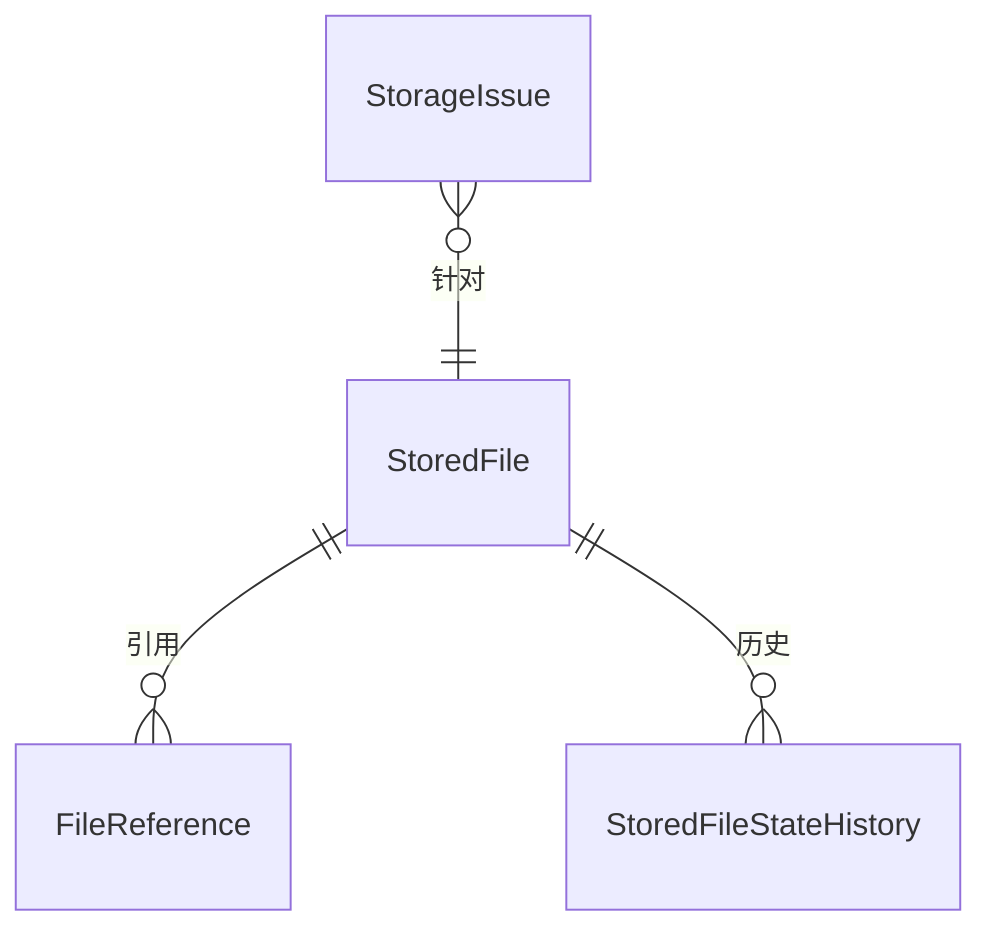
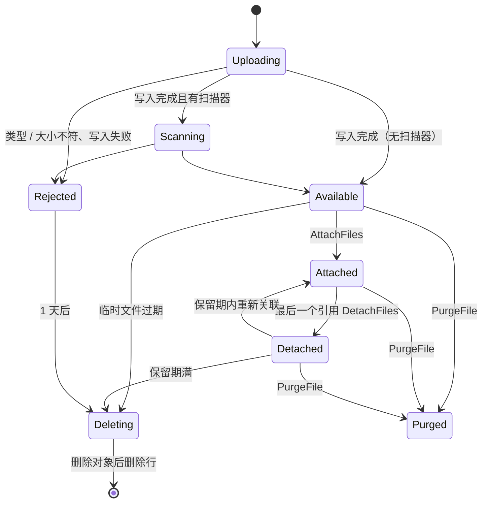

# Files 模块设计

- 状态：**已确认**（2026-11-12）。起草当天，用户授权“遇到需要选择的地方，默认采用最推荐的方案”，第 12 节的决定均按建议确定；第 12.3 节的待确认事项是需要业务方或旧库数据回答的事实，不阻塞编码。
- 模块名 / schema / 编号：`Files` / `"Files"` / 13（平台模块，登记见 `docs/modules/README.md`）；`[LoggerMessage]` 的 `EventId` 使用 13000～13999
- 项目：`Kmic.Files.Domain`、`Application`、`Infrastructure`、`Presentation`、`Contracts`（07 第 2 节）
- 依据：ADR-0006、0020、0022、0027；05-11（本模块的框架设计，机制已确认，含原型 #18 验证的关联与清理互斥协议，本文不重复，只引用并补全模块自己的部分）；05-07 D6、第 6.1、9.1 节；05-08 第 4.1、6.8 节；05-09 D5、D7；09 第 4、11 节；Identity 模块设计

## 0. 概述

### 0.1 职责与边界

| 做 | 不做 |
|---|---|
| 文件元数据 `StoredFile`：状态流转、引用登记、生命周期（临时、已关联、已解除、保留期、删除） | 文件的业务含义：哪个业务对象有哪些附件、附件类别，由业务模块自己的关联表保存（05-11 D1） |
| 上传：上传档案的校验、流式写入存储、类型识别、临时文件（上传端点由本模块提供） | 下载端点：**Files 没有下载端点**，下载权限完全继承业务对象（05-11 5.1）；本模块只提供文件描述（`IFileDescriptors`） |
| 处理请求型消息 `AttachFiles`、`DetachFiles`、`RegisterGeneratedFile`，维护引用 | 对象存储抽象 `IFileStorage` 本身：框架（已实现） |
| 清理与对账：过期文件、中断的上传、存储与元数据的核对，待还原清单 | 图片处理、文档预览、Excel / PDF 生成（02 第 6 节按需能力） |
| 管理页面：文件列表与详情、彻底删除（应用层）、运维彻底删除历史版本的登记 | 病毒扫描：只留扩展点 `IFileScanner`（ADR-0020 待决，阶段 5） |
| 对外提供 `IFileDescriptors`、`IFileAttachability`、`IFileContents`（第 6 节） | 每日上传配额（P2）：不预建表，登记为延后事项（第 10 节） |

### 0.2 本文与框架文档的关系

05-11 已确认的决定（D1、D2，关联与清理的互斥协议，生成文件登记，下载规则，彻底删除）全部沿用。本文补的是 07 第 8 节要求、框架文档留给模块的内容：聚合与表、用例与权限点清单、前端页面、旧系统对照、导入旧文件的迁移方案、框架在本模块开工前要补的东西，以及三项模块层面的取舍（第 12 节）。

### 0.3 模块划分检查表（07 第 6.3 节）

| # | 检查项 | 结论 |
|---|---|---|
| 1 | 强不变量是否都归本模块 | 是。清单见下 |
| 2 | 每个命令是否只改本模块的数据 | 是。业务模块的关联表由业务模块自己写；Files 里的引用登记是它的“最终一致的副本”，只被 `AttachFiles` / `DetachFiles` 的处理改写（05-11 D1） |
| 3 | 跨模块“先检查、后写入” | 有且仅有一处：业务命令关联文件前经 `IFileAttachability` 检查可关联性，并按互斥协议持有文件 ID 的咨询锁直到业务事务结束（05-11 3.3）。协议保证检查与提交之间文件不会被清理 |
| 4 | 订阅事件失败时的处理 | 三个请求型消息的处理失败进入死信。`AttachFiles` 引用 `Available` 或 `Detached` 文件时**不能人工放弃**（05-11，关联消息不能放弃），只能重试；其余可放弃 |
| 5 | 其他模块的数据怎么取 | 上传者显示名经 Identity 的 `IUserReferences` |
| 6 | 依赖是否单向无环 | 是。`DependsOn("Identity")`；Identity 不依赖 Files。使用附件的业务模块在自己的 `DeclareDependencies` 里写 `DependsOn("Files")`；Notifications 读取附件内容也依赖 Files（第 6 节） |
| 7 | 拆成两个模块的理由 | 不拆。元数据、引用、清理、对账共享同一个状态机与锁协议（ADR-0027） |

本模块的强不变量：

| 编号 | 不变量 | 由谁保证 |
|---|---|---|
| F1 | 文件处于 `Attached` 当且仅当至少有一个引用；`Detached` 当且仅当引用从有变为无 | `StoredFile` 聚合的状态机与引用集合 |
| F2 | 一个文件被清理（`Deleting`）之后不能再关联；关联与清理互斥，不靠时钟 | 按文件 ID 的咨询锁协议（05-11 3.3，已由原型 #18 验证）+ 带状态条件的更新 |
| F3 | 同一文件对同一业务对象的引用只有一条 | 唯一索引 `(FileId, OwnerModule, OwnerType, OwnerId)` |
| F4 | 存储键由文件 ID 生成，对象从不覆盖 | `FileStorageKeys`（框架，已实现）+ 文件 ID 为 UUID v7 |
| F5 | 状态流转全部留痕，可回答“文件何时、因何被删除” | `StoredFileStateHistory` 只追加（05-09 D7） |
| F6 | 被彻底删除（`Purged`）的文件，内容没有任何应用层读取路径 | `Purged` 为终态，描述查询返回 410，下载查询拿不到存储键 |

---

## 1. 旧系统对照

### 1.1 旧系统怎么处理文件

| 方面 | 旧系统 | 新系统 |
|---|---|---|
| 存放 | 站点目录 `Web/userfiles/...`，按业务分子目录，相对 URL 直接存在业务表字段里 | 对象存储（开发用本地磁盘）；业务只存文件 ID；存储键与原始文件名无关 |
| 上传组件 | 7 套（`UpLoadFile`、`UploadFile_1`、`Upload`、`UpLoadImg_File`、PCommon `UploadFile`、`Uploadify.ashx`、`Ajax/UploadFile.ashx`），较新的 `UploadSecurityHelper` 统一了认证、目录与扩展名校验（黑名单 `UploadBlockedExtensions`），是否全部接入 `待确认` | 一个上传端点 + 按用途声明的上传档案；扩展名白名单 + 文件头识别，两者必须一致 |
| 下载 | IIS 静态路径直接访问，**没有鉴权** | 经业务端点，先校验业务对象的授权；每次下载审计 |
| 删除 | 直接删文件或不删 | 解除关联 → 保留期 → 无引用后清理；对象与元数据补偿一致 |
| 图片压缩 | `ImageHelper`（Common、PCommon 各一份） | 不在本模块（按需能力）；第一个需要的业务模块出现时再设计 |
| 附件运维中心（`AttachmentMaintenance`） | 按库里配置的 SQL 模板查询和修改业务附件，配置在 `SQL_Scripts/20260708_*` | 不原样复制“执行配置的 SQL 模板”的做法；合理用途（按业务对象查附件、补传、替换）由业务模块自己的命令承担，文件层面的运维由本模块的管理页面承担（第 4 节），使用场景在 12.3 核对 |
| 导出文件 | `userfiles/ToExcelLog*`，导出后留存 | 作业结果文件：`IGeneratedFiles` + `RegisterGeneratedFile`，保留期到期清理（05-08 第 6.8 节） |

### 1.2 旧表对照

旧系统没有独立的文件表：文件路径分散在各业务表的字段里（报价附件、合同、签收单等）。因此没有“旧文件表”可对照，迁移按**业务表的文件路径列**进行，见第 9 节。

---

## 2. 术语

确认本文后一并登记到 `docs/glossary.md`（Files 名下已有：上传档案）。

| 中文 | 英文标识符 | 含义 |
|---|---|---|
| 文件 | `StoredFile` | 一个已上传或生成的文件的元数据，内容在对象存储 |
| 上传档案 | `UploadProfile` | 一类附件的大小、类型与权限规定，由业务模块在代码中声明（05-11 3.1） |
| 临时文件 | `Available`（未关联） | 已上传、尚未被业务关联的文件，到期（默认 24 小时）成为清理候选 |
| 引用 | `FileReference` | 文件被某个业务对象关联的登记，只由 `AttachFiles` / `DetachFiles` 维护 |
| 关联 / 解除关联 | `Attach` / `Detach` | 业务命令把文件挂到业务对象上 / 取消，经 `IFileAttachments` 完成 |
| 保留期 | `DetachedRetention` | 解除关联后保留的时间（默认 30 天），期内可重新关联 |
| 生成文件 | `GeneratedFile` | 作业或系统生成的文件（导出结果、PDF），不经上传 |
| 文件描述 | `FileDescriptor` | 文件的元数据（不含内容），业务查询据它组装下载 |
| 存储问题 | `StorageIssue` | 对账发现的“库中有记录、存储中没有对象”，等待还原或处理 |
| 彻底删除 | `Purge` | 误传敏感文件时，应用层删除对象并把元数据标为已删除；历史版本由运维另行彻底删除 |

---

## 3. 聚合与表

### 3.1 总览

| 聚合 / 表 | 内容 | 类型 |
|---|---|---|
| `StoredFile` + `FileReference` | 文件元数据与引用 | 聚合（引用是子实体，12 节 D-F1） |
| `StoredFileStateHistory` | 状态流转记录 | 只追加表（框架的业务历史，05-09） |
| `StorageIssue` | 对账发现的问题 | 聚合（生命周期短：`Open` → `Resolved`） |
| `CatalogState` | 本模块无目录同步 | 不建（上传档案的目录在内存，不同步到数据库） |

强类型：`StoredFileId` 属框架（跨模块引用，05-02 第 7.1 节，横切所有模块）；`FileReferenceId`、`StorageIssueId` 在本模块 Domain。

聚合都**不**声明数据范围：`HasNoDataScope("文件元数据按权限点管理；业务访问权限由业务对象决定")`。

### 3.2 `StoredFile`

字段沿用 05-11 第 4.1 节，补充如下：

| 字段 | 说明 |
|---|---|
| `Id`、`StorageKey`、`OriginalName`、`FileType`、`ContentType`、`Size`、`Sha256`、`ObjectVersionId`、`Profile`、`UploadedBy`、`UploadedAt`、`Status`、`ExpiresAt`、`ConcurrencyVersion` | 05-11 第 4.1 节 |
| `Status` | `Uploading` / `Scanning` / `Available` / `Attached` / `Detached` / `Rejected` / `Deleting` / **`Purged`**（本文新增，D-F2） |
| `PurgedAt`、`PurgedBy`、`PurgeReason` | 彻底删除的记录（`Status = Purged`） |
| `HistoryPurgedAt`、`HistoryPurgeNote` | 运维彻底删除历史版本之后登记（05-11 第 6 节），为空表示历史版本可能仍在 |
| `RejectReason` | `Rejected` 的原因（类型不符、超过大小、扫描未通过、写入失败） |
| 审计字段 | 05-03；`UploadedBy` 为空表示系统生成 |

`FileReference`（子实体）：`Id`、`OwnerModule`、`OwnerType`、`OwnerId`、`AttachedAt`；唯一 `(FileId, OwnerModule, OwnerType, OwnerId)`。

- 状态机用框架的 `StateMachine`（05-01），流转记入 `StoredFileStateHistory`（`FromStatus`、`ToStatus`、`Reason`、`ChangedBy`、`ChangedAt`；`ChangedBy` 为空表示系统任务）。
- 方法：`Start`（创建 `Uploading`）、`CompleteUpload(type, contentType, size, sha256, objectVersionId, scanner?)`、`RejectUpload(reason)`、`MarkScanned(passed)`、`Attach(owner)`、`Detach(owner)`、`ExpireTemporary`、`ExpireDetached`、`ExpireRejected`、`StartDeleting`、`Purge(reason, by)`、`RecordHistoryPurge(note)`、`RegisterGenerated(...)`（工厂，直接 `Available`，带到期时间）。
- **清理不经聚合方法的整体加载**：把文件改为 `Deleting` 要按 05-11 3.3 的协议（排他咨询锁 + 探查未完成消息 + 带状态条件的更新）批量执行，由 Infrastructure 里的 `StoredFilePurgeStore` 用 SQL 完成，聚合方法 `StartDeleting` 只用于单个文件的人工处理与测试。
- `Purge`：任何非 `Deleting` 的状态都可以进入 `Purged`；对象立即由删除工作器删除（只留删除标记），引用保留，使引用方显示“[文件已删除]”；`Purged` 是终态，之后不能关联、不能恢复。

### 3.3 `StorageIssue`

| 字段 | 说明 |
|---|---|
| `Id`、`FileId` | |
| `Kind` | `RestorableMissing`（记录的对象版本仍在、只是被删除标记覆盖）/ `LostMissing`（记录的版本也不存在，文件已标 `Rejected`） |
| `ObjectVersionId` | 发现时记录的版本 |
| `FoundAt`、`Status`（`Open` / `Resolved`）、`ResolvedAt`、`ResolvedBy`、`ResolutionNote` | |
| `ConcurrencyVersion` | |

- 由对账任务创建（同一文件已有 `Open` 的问题时不重复创建）；运维按 09 第 11.2 节还原后在页面上标为已解决。文件在还原之前保持原状态，下载会因对象不存在而失败，下载响应返回 409 `Common.FileContentMissing`（不可重试，错误信息写“文件正在恢复”），避免误导为权限问题。错误码由框架的下载响应给出，所以不用 `Files.NotReady`（框架不能引用 Files 的错误目录）。

### 3.4 模块内的其他表

| 表 | 说明 |
|---|---|
| 删除队列 | 不单独建表：`Status = Deleting` 的行就是队列，租约列（`LeaseToken`、`LeaseUntil`、`Attempts`、`NextAttemptAt`）放在 `StoredFile`；由 `LeasedQueueWorker`（05-08 第 4.1 节）领取，先删对象、再删行。这些列只由删除工作器与清理的状态条件更新，不经聚合 |

---

## 4. 用例

命名遵循 05-02。**授权**为权限点或声明；**幂等**为 `[Idempotent]`；**审计**为 `[Audited]` 或 `[NotAudited("原因")]`。

### 4.1 上传

文件流不进入消息（05-11 3.2）。上传端点按下面三步调用命令，中间的流式写入由 `FileUploadService`（Infrastructure）完成，不在数据库事务里：

| 用例 | 授权 | 幂等 | 审计 | 说明 |
|---|---|---|---|---|
| `StartUploadCommand(profile, fileName, declaredSize)` | 资源策略：档案声明的权限点（D-F3） | 否 | `[NotAudited("上传结果由文件状态历史记录")]` | 短事务插入 `Uploading` 行，返回文件 ID；档案不存在返回 400；声明大小超过档案上限直接 413 |
| `CompleteUploadCommand(fileId, detectedType, size, sha256, objectVersionId)` | `[AllowAuthenticated]`，处理器核对 `UploadedBy = 当前用户` 且状态为 `Uploading` | 否 | 同上 | 有扫描器时转 `Scanning`，否则 `Available`，`ExpiresAt` = 现在 + 24 小时 |
| `RejectUploadCommand(fileId, reason)` | 同上 | 否 | 同上 | `Rejected`，写入的对象由上传服务同时删除（失败则留给清理与对账） |

上传端点的其余规则（大小、超时、并发限流 `upload`、流式、类型识别、文件名清理、扫描扩展点）按 05-11 第 3.2 节。取消、客户端断开或超时：行进入 `Rejected`；取消后迟到写成的对象由清理或对账删除；未完成的分段上传被中止。

### 4.2 请求型消息的处理（系统任务）

| 用例 | 声明 | 说明 |
|---|---|---|
| `AttachFilesCommand` | `[SystemOnly]`，订阅 `Files.AttachFiles`（请求型） | 对每个文件：`Available` 或 `Detached` → `Attached`，登记引用；已是 `Attached` 且已有同一引用时幂等成功；文件是 `Deleting` / `Purged` / 不存在属于程序缺陷（业务事务已在锁内检查过，05-11），进入死信，**不可放弃** |
| `DetachFilesCommand` | `[SystemOnly]`，订阅 `Files.DetachFiles` | 删除引用；引用为零则转 `Detached`，`ExpiresAt` = 现在 + 保留期；引用不存在时幂等成功 |
| `RegisterGeneratedFileCommand` | `[SystemOnly]`，订阅 `Files.RegisterGeneratedFile` | 按消息里的文件 ID 插入 `Available` 行（带到期时间）；已存在时幂等成功 |

三个命令都 `[NotAudited("文件状态历史记录")]`。

### 4.3 管理

| 用例 | 权限点 | 说明 |
|---|---|---|
| `ListFilesQuery` | `Files.File.View` | 状态、档案、上传者、时间范围、引用方（模块、类型、ID）、文件名关键字；游标分页不需要（后台列表，普通分页） |
| `GetFileQuery` | 同上 | 元数据、引用、状态历史；**不返回存储键与下载地址**（管理员也不经这里下载） |
| `PurgeFileCommand(fileId, reason, expectedVersion)` | `Files.File.Purge`（敏感，`[Audited]`、`[Idempotent]`） | 05-11 第 6 节；原因必填；已 `Purged` 或 `Deleting` 的幂等成功 |
| `RecordHistoryPurgeCommand(fileId, note, expectedVersion)` | `Files.File.Purge` | 运维在阿里云彻底删除历史版本之后，在这里登记执行记录（工单号等写进 `note`） |
| `ListStorageIssuesQuery` | `Files.File.View` | 待还原清单 |
| `ResolveStorageIssueCommand(issueId, note, expectedVersion)` | `Files.File.Manage` | 运维还原之后标为已解决；`[Audited]` |
| `RetryDeletionCommand(fileId)` | `Files.File.Manage` | 删除失败反复重试仍失败的 `Deleting` 行：清零重试次数；`[Audited]` |

### 4.4 供业务模块使用的查询（Contracts，第 6 节）

`IFileDownloads.GetAsync(fileId)` 返回 `Result<FileDownload>`（元数据与存储键，`FileDownload` 在框架 Contracts）；状态判断集中在这里：只有 `Attached` 的文件可以下载，`Purged` 返回 410 `Files.Purged`，还没登记完（`Uploading`、`Scanning`、`Available`）返回可重试的 409 `Files.NotReady`，其余（已解除关联、被拒绝、清理中）按 404 `Files.NotFound`（05-11 5.1）。`IFileAttachability.CheckAsync(fileIds, uploaderId)` 供 `IFileAttachments` 在互斥协议的第 2 步调用。`IFileContents.OpenReadAsync(fileId)` 供 Notifications 投递时读取附件（`SystemOnly`）。

### 4.5 系统任务

| 用例 | 声明 | 说明 |
|---|---|---|
| `PurgeExpiredFilesCommand` | `[SystemOnly]`，定时每小时（`Files.PurgeExpired`） | 05-11 第 4.3 节：按协议把到期的 `Available` / `Detached` / `Rejected` 标为 `Deleting`，每次最多 1000 个（配置项）；剩下的下次处理 |
| `ResetStaleUploadsCommand` | `[SystemOnly]`，每小时（`Files.ResetStaleUploads`） | `Uploading` 超过 1 小时的转 `Rejected`（原因“上传中断”）并进入清理 |
| `ReconcileStorageCommand` | `[SystemOnly]`，每周日 04:00（`Files.ReconcileStorage`） | 05-11 第 4.3 节的对账；发现的问题写 `StorageIssue`；删除“库中无记录”的对象前先探查未完成的 `RegisterGeneratedFile` |
| 删除工作器 | `LeasedQueueWorker`（Worker 角色） | 领取 `Deleting` 行，事务外先删对象、再删行；失败保留行，退避重试，超过次数转人工（`RetryDeletion`） |

---

## 4A. 前端

文件上传组件（选择文件、进度、重试、取消、批量上传）属于前端框架的通用组件（并行线 A），不在本模块；本模块的前端是管理页面。路由名前缀 `files.`，菜单归属“系统管理 / 文件”。

### 页面清单

| 路由名 | 类型 | 所需权限点 | 打开方式与理由 |
|---|---|---|---|
| `files.files` | 列表 | `Files.File.View` | 筛选：状态、档案、上传者、时间范围、引用方；行操作：详情、彻底删除（有权限才显示） |
| `files.files.detail` | 详情 | 同上 | 标签页：元数据、引用、状态历史；动作：`purge`、`recordHistoryPurge`；彻底删除确认框写明后果（“文件内容将无法再读取，引用它的单据显示‘文件已删除’，历史版本需由运维另行清除”），原因必填 |
| `files.storageIssues` | 列表 | `Files.File.View` | 待还原清单；标记已解决（`Files.File.Manage`）；页面顶部说明还原步骤指向运维手册 |

不提供：下载按钮（管理员也不能经文件管理下载内容，下载走业务对象）、上传页面（上传发生在业务页面）。

### 动作

文件详情：`purge`、`recordHistoryPurge`、`retryDeletion`；存储问题：`resolve`。与后端动作目录一致。

### 旧系统页面对照

旧系统的“附件运维中心”见 1.1。不保留的交互：按配置的 SQL 模板批量修改附件数据。

---

## 5. 授权

### 5.1 权限点

`Files` 分组（资源名单数；05-11 原写的 `Files.Files.Purge` 据此更正为 `Files.File.Purge`，见第 13 节）。

| 权限点 | 敏感 | 说明 |
|---|---|---|
| `Files.File.View` | | 查看文件元数据、引用、历史、存储问题 |
| `Files.File.Manage` | | 标记存储问题已解决、重试删除 |
| `Files.File.Purge` | ✓ | 彻底删除、登记历史版本清除 |

上传与下载没有 Files 自己的权限点：上传由上传档案声明的权限点决定（业务模块的“编辑”类权限，05-11 3.1），下载由业务对象的授权决定。

### 5.2 范围对象与资源策略

没有范围对象。资源策略一类：`UploadProfile`（动作 `Upload`）：纯函数，规则是“操作者的当前角色拥有该档案声明的权限点”（D-F3）；其余命令用权限点。

### 5.3 敏感权限点的管理

`Files.File.Purge` 能让一个文件的内容消失且不可恢复（历史版本之外），只给少数人；系统管理员角色自动拥有它（`GrantsAllPermissions`）。

---

## 6. 跨模块

### 6.1 对外提供的 Contracts（`Kmic.Files.Contracts`）

| 接口 | 声明 | 用途 |
|---|---|---|
| `IFileDownloads.GetAsync(fileId)` | `Reference` 类白名单例外（05-11 5.1：返回 `FileDownload`，含存储键，不含内容） | 业务下载查询取下载信息；**调用方必须先完成业务对象的授权**，由代码评审与模板写法保证；文件状态由它判断，业务不重复 |
| `IFileAttachability.CheckAsync(fileIds, uploaderId)` | `SystemOnly` | `IFileAttachments` 在互斥协议的第 2 步使用：读主实例的新快照检查可关联性，不经缓存 |
| `IFileContents.OpenReadAsync(fileId)` | `SystemOnly` | Notifications 投递邮件时读取附件内容；返回流，调用方负责释放 |
| 请求型消息 `AttachFiles`、`DetachFiles`、`RegisterGeneratedFile` | 请求型（05-07 D6），声明 `SubjectIds`（文件 ID） | 由框架的 `IFileAttachments`、`IGeneratedFiles` 发送，业务模块不直接 `Send`（分析器拦截） |

### 6.2 依赖的 Contracts

Identity：`IUserReferences`（上传者显示名）。

### 6.3 事件

不发布集成事件。订阅（请求型消息的接收）：`Files.AttachFiles`、`Files.DetachFiles`、`Files.RegisterGeneratedFile`，订阅名 `Files.Attach`、`Files.Detach`、`Files.RegisterGenerated`。

---

## 7. 后台处理

| 项 | 类型 | 说明 |
|---|---|---|
| 三个请求型消息的处理 | Inbox 订阅 | Worker 角色（ADR-0025） |
| `Files.PurgeExpired`、`Files.ResetStaleUploads`、`Files.ReconcileStorage` | 定时任务 | 4.5；开关与 Cron 可由 Operations 覆盖 |
| 删除工作器 | `LeasedQueueWorker` | 4.5；Worker 角色 |

上传在 Api 角色同步处理，不使用后台作业。

---

## 8. 其他构件

| 构件 | 内容 |
|---|---|
| 配置（部署配置，05-10、05-11 第 10 节） | `Files:Storage:Provider` / `LocalRoot` / `S3:*`；`Files:TempExpiryHours`（24）、`DetachedRetentionDays`（30）、`RejectedRetentionDays`（1）；`Files:UploadTimeoutMinutes`（10）、`MaxConcurrentUploadsPerUser`（3）；`Files:PresignThresholdMb`（100）、`PresignValidMinutes`（5）；`Files:MaxFilesPerCommand`（50）、`AttachLockTimeoutSeconds`（5）、`PurgeBatchSize`（1000）；`Files:Deletion:Parallelism`（4）、`MaxAttempts`（8） |
| 错误码（`FilesErrors`） | `TooLarge`（413）、`TypeNotAllowed`（415）、`ProfileNotFound`（400）、`NotFound`（404）、`NotReady`（409，`retryable`，登记前下载）；下载时对象在存储里读不到是框架的 `Common.FileContentMissing`（409，还原中）、`Purged`（410）、`TooManyFiles`（400）、`NotAttachable`（422，文件不是本人上传、已过期被清理、已被拒绝）、`AlreadyPurged`（幂等成功，不返回错误） |
| 通知模板、字典、编号 | 无 |
| 上传档案目录 | 框架的 `UploadProfileCatalog`（`[UploadProfile]` 在各业务模块声明）；本模块不声明档案（没有自己的附件） |

---

## 9. 数据迁移

旧文件散在各业务表的路径列里，没有统一的文件表（1.2）。迁移分两层：**文件内容与元数据**由本模块的导入入口完成，**关联行**由各业务模块自己的迁移完成，两者用“旧路径 → 新文件 ID”的对照连接。

### 9.1 导入入口

`Kmic.MigrationRunner files import --manifest <文件>`（迁移账号，ADR-0029）：

| 项 | 说明 |
|---|---|
| 清单 | 每行：旧相对路径、所属业务模块、所属对象类型与旧 ID（对应表）、原始文件名、旧上传人（可空）、旧上传时间（可空）、期望档案或业务来源。由各业务模块的迁移分析产出 |
| 内容 | 从旧 `userfiles` 目录（或其备份）流式读取，写入存储，键按框架规则 |
| 元数据 | 创建 `Attached` 的 `StoredFile`（直接带引用，`Profile = Legacy:{来源}`，`UploadedBy` 经旧用户 ID → 新用户 ID 对照，对不上的置为系统账号），`Sha256` 现算，类型识别（D-F4） |
| 对照输出 | 输出“旧相对路径 → 新文件 ID”的映射文件，业务模块迁移关联行时使用；同一旧路径重复导入时返回同一文件 ID（幂等，按清单行的旧路径记录已导入） |
| 缺失文件 | 清单里有、旧目录里找不到的文件：记入报告，不创建文件，业务关联行迁移时按报告决定（建议保留关联行并标记文件缺失，由业务确认） |
| 容量 | 估算旧目录总大小与文件数，用于规划对象存储容量与导入窗口（并行线 C，`待确认`） |

### 9.2 类型校验与旧文件

旧系统只有扩展名黑名单，没有内容校验（1.1）。D-F4：导入时识别类型但**不拒绝**不在白名单内或扩展名与内容不符的文件，只在报告里列出，由业务确认是否保留；这类文件的下载仍走业务对象授权，响应头强制 `attachment` 且 `nosniff`（05-11 5.2），不会在站点下执行。

### 9.3 编号

无。

---

## 10. 延后事项对照

对照 `docs/framework/00-README.md` 的“延后事项”表：

| 事项 | 结论 |
|---|---|
| 关系可见、资源可见性 | 不命中（文件元数据不声明数据范围，访问权限由业务对象决定） |
| `AuditLog`、`SecurityEvent` 按月分区 | 不命中 |
| Redis 二级缓存 | 不命中（本模块不缓存文件描述：描述查询要读最新状态，用于下载鉴权后的组装，量小） |
| 其余 | 不命中 |

**新登记的延后事项**（确认本文后加入 00-README）：

| 事项 | 触发条件 | 已定的约束 |
|---|---|---|
| 每日上传配额（FR-FILE-04，P2） | 安全验收（阶段 5）要求或出现批量灌入存储的滥用 | 按用户每日累计字节数，超出返回 429 `Files.DailyQuotaExceeded`，删除不返还（05-11 3.2、ADR-0020）；表 `UploadQuota(UserId, Date, Bytes)`，在上传完成后原子累加；不改变已有表 |
| 病毒扫描实现（FR-FILE-06） | ADR-0020 待决项，阶段 5 | `IFileScanner` 扩展点已有，状态 `Scanning` 已在状态机里 |
| 浏览器直传对象存储（预签名上传，05-11 D1 选项 C） | 第一个超大文件需求 | 作为第二类上传入口，不改变业务命令引用文件 ID 的方式 |

---

## 11. 框架负责 / 业务负责

| 框架负责 | Files 负责 |
|---|---|
| `IFileStorage`、本地与 S3 实现、键规则、分段上传（已实现） | 使用存储：上传服务、删除工作器、对账 |
| `FileType` 白名单与文件头识别、`[UploadProfile]` 声明与目录、上传端点的流式读取与限制（**待补**，见 11.1） | 档案的权限点校验（`UploadProfile` 资源策略）、元数据状态机 |
| `IFileAttachments`（互斥协议的唯一入口）、`IGeneratedFiles`、分析器拦截直接 `Send(AttachFiles)`（**待补**） | 三个请求型消息的处理与引用登记、可关联性检查 |
| `FileResults.Stream`（Range、ETag、响应头）、下载查询必须 `[AuditedRead]` 的启动校验（**待补** / 部分已有） | `IFileDescriptors`；没有下载端点 |
| `LeasedQueueWorker` 模板（**待补**）、定时任务与作业机制（已实现） | 清理、对账、删除队列的具体逻辑 |
| 业务模块：声明上传档案、在自己的关联表里保存文件快照、调用 `IFileAttachments`、写下载查询 | 不管业务对象与附件的对应关系 |

### 11.1 开工前框架要补的东西

| 事项 | 说明 | 出处 |
|---|---|---|
| `LeasedQueueWorker` 模板 | 租约领取、事务外执行、带状态条件的结果写入；Notifications 投递与 `ExternalCallQueue` 同用 | 05-08 第 4.1 节 |
| 上传档案与文件类型 | `FileType` 白名单（扩展名与文件头签名）、`[UploadProfile]` 与 `UploadProfileCatalog`（启动校验：名称以模块名开头、唯一） | 05-11 3.1 |
| 上传流处理 | `MultipartReader` 流式读取、边读边算 SHA-256、按档案上限截断、文件头识别、文件名清理 | 05-11 3.2 |
| `IFileAttachments` | 咨询锁（共享，按文件 ID 排序）、经 `IFileAttachability` 检查、发送 `AttachFiles`、返回快照；锁等待上限与文件数上限 | 05-11 3.3 |
| `IGeneratedFiles` | 预生成 ID、写对象、发送 `RegisterGeneratedFile` | 05-11 4.4 |
| `FileResults.Stream` | `Range`、`ETag`、`Content-Disposition`（RFC 6266）、`nosniff`、CSP | 05-11 5.1、5.2 |
| 消息的 `SubjectIds` | 请求型消息声明主体 ID 列，写入 Outbox / Inbox 的 `SubjectIds` 列（探查未完成消息用）；核对框架是否已实现 | 05-07 第 6.1 节 |

---

## 12. 待决与待确认

### 12.1 待决（均已按建议决定，2026-11-12）

下面的“建议”即决定。

#### D-F1 引用是聚合的子实体，还是单独的表

05-11 把 `FileReference` 说成“只由 `AttachFiles` / `DetachFiles` 维护的登记”，没有说它与 `StoredFile` 的关系。

| 选项 | 做法 | 优点 | 缺点 |
|---|---|---|---|
| **A `StoredFile` 聚合的子实体** | 加载文件时带出引用，`Attach` / `Detach` 在聚合内维护，“Attached 当且仅当有引用”（F1）由聚合保证 | 强不变量在聚合内；引用变化递增文件版本，与状态变化一起并发控制；状态历史自然记录 | 一个文件被很多对象引用时聚合变大（现实中一个文件只被一个业务对象引用，复制单据时才会多一个，量极小） |
| B 引用独立聚合 | 引用行自己维护，文件状态靠处理器里先查后改 | 并发粒度细 | “最后一个引用解除就转 `Detached`”要在命令里先数后改，竞争窗口要自己处理，违背“强不变量在聚合内”的原则 |

- **建议**：A。**取舍**：单个文件的引用数没有上限，但设一个防御性的上限（100）并在超出时拒绝，避免异常数据把聚合撑大。

#### D-F2 彻底删除怎样表示

05-11 第 6 节说“元数据标为已删除并保留记录；引用方显示‘[文件已删除]’”，但状态机里没有对应状态：`Deleting` 之后行会被删掉。

| 选项 | 做法 | 优点 | 缺点 |
|---|---|---|---|
| **A 新增终态 `Purged`，行保留** | `PurgeFile` 把任何非 `Deleting` 的文件转为 `Purged`，删除对象，行与引用保留，记录原因与操作人 | 记录保留（“谁、何时、因何”）；业务引用方有明确的状态可显示；不会因行被删而让关联行指向不存在的文件 | 多一个状态；`Purged` 行永远保留（量极小，只有误传敏感文件） |
| B 复用 `Deleting`，删行 | 与过期清理相同 | 状态机不变 | 业务关联行指向不存在的 ID，无法区分“被彻底删除”和“数据错误”；彻底删除的记录只靠审计事件 |

- **建议**：A。**取舍**：状态机与 05-11 第 4.2 节的图增加一个状态（第 13 节修订）。

#### D-F3 上传的权限怎样执行

05-11 3.1 规定上传档案声明 `Permission`，上传命令按档案不同权限点不同，与 Configuration 的设置权限同一类问题（Configuration 设计 D-C2）。

| 选项 | 做法 | 优点 | 缺点 |
|---|---|---|---|
| **A 资源策略：命令声明 `[AllowAuthenticated]`，`UploadProfile` 资源策略检查档案声明的权限点** | 处理器从档案目录取到档案，传给 `IResourceAuthorizer` | 复用资源策略与动作目录机制；授权矩阵测试覆盖 | 命令上看不到静态权限点，靠文档说明 |
| B 处理器手工检查权限点 | | 写法直接 | 绕开声明式授权约定，没有启动校验保护 |

- **建议**：A，与 Configuration D-C2 一致。

#### D-F4 导入旧文件时对类型的处理

| 选项 | 做法 | 优点 | 缺点 |
|---|---|---|---|
| **A 识别并报告，不拒绝** | 迁入全部文件，类型不符或不在白名单的列入报告，业务确认；响应头强制下载与 `nosniff` | 不丢任何旧文件（业务可能需要）；风险由下载响应头控制 | 存储里会有不在白名单的文件 |
| B 按新规则拒绝 | 不符合的不迁入 | 存储里只有合规文件 | 旧业务附件丢失，业务无法接受“历史单据的附件打不开” |

- **建议**：A。**取舍**：报告需要业务逐项确认；这类文件的 `FileType` 记为 `Unknown`，`ContentType` 取 `application/octet-stream`。

### 12.2 按建议默认的小项

以下按建议执行（已确认，2026-11-12）：

| 事项 | 默认 |
|---|---|
| 管理员也不能经文件管理页面下载内容 | 是（下载走业务对象） |
| 单个文件的引用数防御性上限 | 100 |
| 删除工作器重试次数 | 8 次后转人工（`RetryDeletion`） |
| 文件列表使用普通分页，不用游标 | 是（后台列表，量小） |
| 文件名只作显示，保存前去掉路径与控制字符，长度上限 200 | 是（05-11 已定） |

### 12.3 待确认（需要业务方或数据）

| 事项 | 需要什么 | 影响 |
|---|---|---|
| 旧 `userfiles` 的总大小、文件数、扩展名分布 | 旧服务器统计 | 对象存储容量、导入窗口、D-F4 的报告规模 |
| 旧业务表里文件路径列的清单（表、列、含义） | 各业务模块迁移分析 | 导入清单的产出 |
| 旧上传组件是否都已接入 `UploadSecurityHelper` | 旧代码核对 | 旧文件里是否有危险类型 |
| 附件运维中心的实际使用场景 | 业务方 | 是否需要本模块提供更多运维能力 |
| 上传档案的大小与类型（每类附件） | 各业务模块设计 | 业务模块声明 |
| 每日配额、病毒扫描 | 阶段 5 安全验收 | 延后事项 |
| OSS 上的版本控制、删除标记与 RAM 权限行为 | 原型 #14（非阻断，需 OSS） | `ObjectVersionId` 的恢复流程验证 |

---

## 13. 与其他文档的接口（含需要同步修订的条目）

按 R01 L2 修订下列已确认文档的正文并登记修订记录（只落实决定，不改原决定）：

| 文档 | 修订 | 来源 |
|---|---|---|
| 05-11 第 4.1、4.2 节 | 状态增加 `Purged`；`FileReference` 作为 `StoredFile` 的子实体；增加 `PurgedAt`、`PurgedBy`、`PurgeReason`、`HistoryPurgedAt`、`HistoryPurgeNote`、`RejectReason` 列与删除租约列 | 本文 D-F1、D-F2、3.2、3.4 |
| 05-11 第 6 节、第 4.3 节 | 权限点改为单数 `Files.File.Purge`，新增 `Files.File.View`、`Files.File.Manage`；对账的待还原清单落为 `StorageIssue` | 本文 5.1、3.3 |
| 05-11 第 3.1、3.2 节 | 上传权限由 `UploadProfile` 资源策略执行；上传分 `StartUpload` / `CompleteUpload` / `RejectUpload` 三个命令，流式写入不在事务里 | 本文 D-F3、4.1 |
| 05-11 第 5.1 节 | 补：状态为 `Purged` 的文件描述查询返回 410 | 本文 F6 |
| `docs/glossary.md`、`docs/modules/README.md`、`docs/framework/00-README.md` | 登记第 2 节术语、模块状态、第 10 节新增延后事项 | 本文 |

---

## 13.1 实现中的调整（2026-11-13，决定不变）

| 项 | 设计原文 | 实现 | 理由 |
|---|---|---|---|
| 下载信息的取法 | `IFileDescriptors.GetAsync` 返回 `FileDescriptor`，业务自己判断状态 | `IFileDownloads.GetAsync` 返回 `Result<FileDownload>`，状态判断在 Files 里 | 每个业务模块都要重复同一段状态判断和对应的错误码，写漏一处就是“已删除的文件还能下载”或错误码不一致；`FileDownload` 放在框架 Contracts，Files.Contracts 才能引用它 |
| 对象读不到 | 409 `Files.NotReady`，`retryable = false` | 409 `Common.FileContentMissing` | 下载响应在框架里，不能引用 Files 的错误目录；与“登记前下载”的 `Files.NotReady`（可重试）本来也是两回事 |
| 读取内容 | 端点直接用 `IFileStorage` | 框架的 `IFileContentReader`（Application），Files 模块用存储实现它 | 框架 Presentation 不能引用 Infrastructure；窄接口只读、只认存储键 |
| 返回 `FileDownload` 的查询 | 必须 `[AuditedRead]` | 启动校验已实现；模块之间的契约查询（`[ContractQuery]`）除外 | 契约查询只是给业务的下载查询取信息，审计记在业务的下载查询上 |
| `IFileAttachments` 的位置 | 框架 | `Kmic.Files.Contracts`，实现在 Files.Application | 框架不能引用模块的 Contracts，它要发 `AttachFiles` |
| 删除工作器 | 模块里的 `LeasedQueueWorker` 子类 | 模块实现框架的 `ILeasedWork<DeletionItem>`，循环由框架运行，在 `IModule.AddWorkerServices` 里登记 | 架构规则不许模块实现后台组件；循环的细节（槽位、退避、停机）本来也不该每个模块写一遍 |
| 彻底删除后的对象 | “对象立即由删除工作器删除”，没有说怎样标记待删 | `StoredFile.ObjectDeletedAt`：空表示对象还在，删除队列领取“删除中”和“已彻底删除且 `ObjectDeletedAt` 为空”的行；删完记下时间，行保留 | 不另建队列表，也不用状态表示“对象已删”；管理员能看到对象删除的时间 |
| 彻底删除与关联的互斥 | 没写 | `PurgeFile` 也取排他锁并探查未完成的关联请求，取不到或有请求在路上返回暂时冲突（503，可重试） | 否则关联请求会落在已彻底删除的文件上，变成不可放弃的死信 |
| 文件详情里的状态历史 | 详情含状态历史 | 暂时没有：框架的 `IStateHistoryQuery` 只有接口、没有实现，等有实现再加 | 不在模块里重复写一份读历史表的 SQL |
| 清理候选的读取 | “决定删不删的是锁 + 探查 + 状态条件” | 候选只取 ID；取锁、探查之后才加载聚合，核对状态与到期时间，再用状态机改状态，状态历史照常写入 | 不用批量 SQL 改状态，状态历史才完整；一次最多一批（`Files:PurgeBatchSize`，默认 1000），一个事务持有的锁有限 |

## 14. 决策汇总

| 编号 | 事项 | 决定（已确认，2026-11-12） |
|---|---|---|
| D-F1 | 引用与文件的关系 | A：引用是 `StoredFile` 的子实体，防御性上限 100 |
| D-F2 | 彻底删除怎样表示 | A：新增终态 `Purged`，行保留 |
| D-F3 | 上传的权限怎样执行 | A：`UploadProfile` 资源策略 |
| D-F4 | 导入旧文件时对类型的处理 | A：识别并报告，不拒绝 |

| 待确认 | 处理方式 |
|---|---|
| 12.3 全部 | 业务方回答、旧库统计或阶段 5 |

## 15. 实现进度

2026-11-13 完成：`StoredFile` / `FileReference` 聚合与状态机（含状态历史）、迁移、上传三步（端点、`StartUpload`、`CompleteUpload`、`RejectUpload`）、三个请求型消息的订阅与处理、`IFileAttachments`（互斥协议）、`IFileAttachability`、`IFileDownloads`、`FileResults.Stream`；`Sample` 接入附件作为业务模块的标准写法（上传档案、添加、移除、下载）。端到端测试用真实宿主（Api + Worker 角色）和本地存储：上传的成功与各种拒绝、关联与解除关联被 Worker 处理、下载的头与 Range、权限与数据范围、被彻底删除与对象丢失。

同日完成：管理查询与命令（列表、详情、彻底删除、登记历史版本清除、重试删除）、定时任务 `Files.PurgeExpired`（每小时 15 分）与 `Files.ResetStaleUploads`（每小时 45 分）、删除队列；权限点 `Files.File.View`、`Files.File.Manage`、`Files.File.Purge`。

未做（按设计 4.3、4.5、7 节）：对账任务 `Files.ReconcileStorage` 与 `StorageIssue`（待还原清单、标记已解决）、`IGeneratedFiles` 与 `RegisterGeneratedFile` 的发送端、`IFileContents`、文件详情里的状态历史、直接 `Send(AttachFiles)` 的分析器、预签名下载与 S3 的范围读取（已登记延后事项）。

