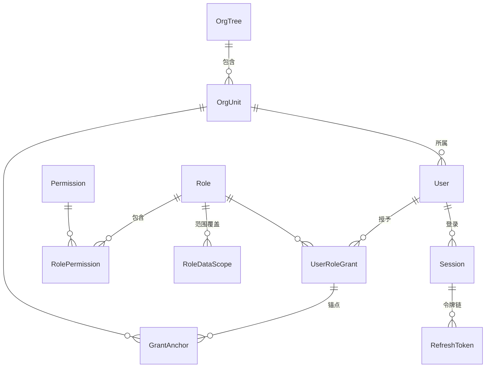
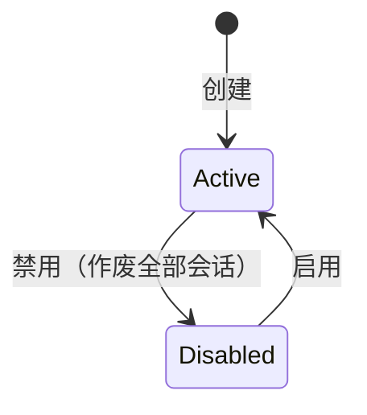
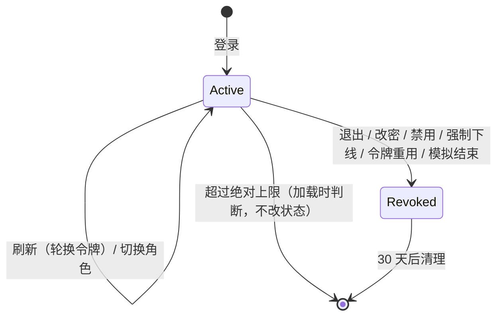

# Identity 模块设计

- 状态：**已确认**（2026-11-12）。起草当天，用户授权“遇到需要选择的地方，默认采用最推荐的方案”，D-A～D-G 与第 12.2 节小项均按建议决定；第 12.3 节的待确认事项是需要业务方回答或旧库统计的事实，不阻塞编码，对应的迁移部分待事实确认后再做。已同步修订的框架文档见第 13 节（修订记录登记于各文档文末）。
- 模块名 / schema / 编号：`Identity` / `"Identity"` / 10（平台模块，登记见 `docs/modules/README.md`）
- 项目：`Kmic.Identity.Domain`、`Application`、`Infrastructure`、`Presentation`、`Contracts`（07 第 2 节）
- 依据：ADR-0001、0015、0026、0027、0031；05-04 认证与会话、05-05 授权（本模块的框架设计，机制已确认，本文不重复，只引用并补全模块自己的部分）；05-09 第 6 节（安全事件）；05-11 第 7.3 节（联系方式）；旧系统源码与 `docs/legacy/01-legacy-analysis.md`

## 0. 概述

### 0.1 职责与边界

| 做 | 不做 |
|---|---|
| 用户账号、登录凭据（密码、手机验证码）、状态 | 菜单：由前端路由声明所需权限点，后端没有菜单概念（05-05 D3） |
| 认证：令牌签发与刷新、会话、重用检测、登录限制 | 业务上对人员的描述（职称、行业、ERP 编码、合同编码、名字缩写等）：由使用它们的业务模块自己保存（第 12 节 D-B） |
| 角色、权限点目录、授予、数据范围配置 | 汇报线、直属上级、审批人：不是授权的输入，延后（第 12 节 D-C） |
| 组织单元树（ADR-0031）与用户所属组织 | 审计日志的长期存储与查询：Operations 模块（05-09） |
| 访问上下文加载（`IAccessContextLoader` 的实现，05-04 第 6 节） | 短信、邮件的发送：Notifications 模块，Identity 只发请求（第 6 节） |
| 安全事件的表与查询（写入器是框架基础设施，05-09 第 6 节） | 文件、编号、业务字典 |
| 模拟身份、首个管理员初始化（与 `Kmic.Operator` 配合） | 多租户（ADR-0023） |
| 对其他模块提供人员、角色、组织单元的引用查询与联系方式查询（第 6 节） | 单个用户的个人权限（ADR-0015：权限只来自当前角色） |

### 0.2 本文与框架文档的关系

05-04、05-05 已确认的决定（D1～D12，含登录递增等待、令牌轮换、版本快照、撤权重查、受保护角色）全部沿用，本文不重新讨论。本文补的是 07 第 8 节要求、框架文档留给模块的内容：聚合的字段与不变量、用例与权限点清单、前端页面、旧数据怎么迁、框架文档之间发现的不一致，以及需要业务方回答的问题。

### 0.3 模块划分检查表（07 第 6.3 节）

| # | 检查项 | 结论 |
|---|---|---|
| 1 | 强不变量是否都归本模块 | 是。清单见下 |
| 2 | 每个命令是否只改本模块的数据 | 是。唯一的跨模块动作是向 Notifications 发送通知请求（验证码、账号锁定提示、改密提示），异步、最终一致：验证码没收到用户可以重发，提示晚到不影响安全 |
| 3 | 跨模块“先检查、后写入” | 没有。Identity 不调用其他模块的 Contracts 查询 |
| 4 | 订阅事件失败时的处理 | Identity 不订阅任何事件，没有死信问题 |
| 5 | 其他模块的数据怎么取 | 不需要其他模块的数据 |
| 6 | 依赖是否单向无环 | 是。Identity 不 `DependsOn` 任何模块（向 Notifications 发的是请求型消息，不是 Contracts 调用，05-07 D6）；反方向 Notifications `DependsOn` Identity，因为它要同步调用 `IUserContacts`（05-11 D3）。这一点在 Notifications 设计评审时再核对一次 |
| 7 | 拆成两个模块的理由 | 不拆。组织单元树与角色、授予必须同一次提交可见（ADR-0031 第 2 条），拆开就要副本和最终一致 |

本模块的强不变量：

| 编号 | 不变量 | 由谁保证 |
|---|---|---|
| I1 | 登录名唯一；手机号（填写时）在用户之间唯一；工号（填写时）唯一 | 唯一索引 + 错误码映射 |
| I2 | 角色的权限点、范围配置、状态与授权版本一起变化 | `Role` 聚合 + 并发版本拦截器（05-05 D9） |
| I3 | 组织树不成环；停用的组织单元下没有启用的下级和用户 | `OrgTree` 聚合（05-05 D8） |
| I4 | 撤权与授权管理命令按串行顺序生效 | 授权管理命令提交前的重查（05-05 第 4.6 节） |
| I5 | 受保护角色只有受保护角色的持有人能管；任何人不能改自己的授予；**系统中始终至少有一个启用的受保护角色持有人** | `Role`、`User` 的方法 + 资源策略。最后一条是本文新增，见 D-D |
| I6 | 一个会话同一时刻只有一个当前刷新令牌；旧令牌再次出现（宽限期外）即作废整个会话 | `Session` 聚合（05-04 第 3.4 节） |
| I7 | 同一登录名的失败计数原子递增；验证码一次性、次数有限 | 单行原子更新（第 3.6 节） |

---

## 1. 旧系统对照

### 1.1 页面与功能

| 旧系统（`Web/Manage`） | 做什么 | 新系统 | 说明 |
|---|---|---|---|
| `Login.aspx` + `Ajax/LoginOn.ashx` 等 | 登录，登录时选角色 | 登录页（外壳）+ `auth/*` 端点 | 登录方式的差别见 1.2 |
| `UserInfo/UserList` + `Edit` + `SaveUserInfo` | 用户列表、添加、修改、删除（打删除标记）、分配权限、切换身份 | 用户管理页 | “删除”改为禁用（用户被大量业务数据引用）；“分配权限”按用户给权限的做法取消，见 1.3 |
| `Role/List`、`AddOrEdit`、`SaveRole`、`SetPermissions`（三个版本） | 角色维护、按菜单勾选权限 | 角色管理页 | 三个权限分配页合并为一个：按模块分组勾选权限点 |
| `SysMenu/*` | 菜单树维护（目录、页面、按钮混在一张表） | 不做 | 菜单在前端路由，按钮由 `allowedActions` 决定 |
| `UserCode/List2`、`SaveCode2`（`CodeType=1`） | 大区维护：名称、顺序、是否显示、主要负责人、参与负责人 | 组织单元树 | 负责人不放进 Identity，见 D-C |
| `UserInfo/User_Parent`、`SaveUserParent` | 给上级配置下属（多对多） | 不做 | 汇报线延后，见 D-C |
| `UserInfo/GetUserSee` | 给用户配置“额外可见的地区” | 授予的锚点 | `待确认`：`DIQU` 存的是大区名还是编号，见第 9 节 |
| `UpdatePassword` | 改自己的密码 | 个人页中的修改密码 | |
| `LoginLog/*` | 登录日志（`J_LoginLog`，约 39 万行） | 安全事件页 | 历史不迁移，见第 9 节 |
| `UserInfo/UserList` 的“切换身份”（权限按钮 10405） | 改写 Cookie 冒用他人身份，无审计 | 模拟身份（05-04 第 9 节） | 默认只读，全程审计 |
| `Authorization/*`（“授权书申请”） | 业务功能，与账号授权无关 | 不属于 Identity | 之前容易误认，记在这里 |

### 1.2 旧系统的登录实际怎么工作（按源码阅读，未在运行系统上验证）

05-04 第 1 节写的是“密码明文比对”。读了登录页和三个登录处理程序后，实际情况有出入，会影响登录方式的取舍（D-A）：

| 方面 | 旧系统 |
|---|---|
| 账号 | `User_Account` 是**手机号**；另有 `SendCodePhone`（收验证码的号码） |
| 员工的登录 | 输入账号后，页面向服务器查询：本浏览器保存的“信任标记”（`Token`）等于用户表里的 `DengluBiaoshi_PC`，且上次登录在一个月内，则**免验证码**，直接选角色登录；否则要输入 4 位短信验证码。**员工没有密码这一步** |
| 服务站用户（`FuwuZhan = 1`） | 用账号 + 明文密码登录，不用验证码 |
| 验证码 | 服务端生成后放进 DES 加密的 Cookie（5 分钟），比对也在同一个 Cookie 上；是否校验由配置 `DuanxianYanzhengma` 和**前端提交的 `yzmvalue` 参数**共同决定 |
| 选角色 | 输入账号后页面列出该用户的全部角色，登录请求带 `roleid`，服务端只检查它在 `RoleId_List`（逗号分隔字符串）里 |
| 信任标记 | 每个用户只有一个 PC 标记和一个手机标记，换设备登录就覆盖前一个，所以不是“挤下线”，只是前一台设备下次要重新验证 |

两个值得注意的发现：

1. **日常登录靠短信，不靠密码。** 新系统若只把短信登录定为 P1（02 的 FR-AUTHN-07），迁移后绝大多数员工没有可用的密码，也就无法登录。
2. **服务端只在 `yzmvalue = 1` 时校验验证码，该值由前端提交。** 按代码阅读，直接向登录处理程序提交其他值就可以跳过验证，只要知道某人的账号和他的一个角色编号即可登录；而登录前的查询接口（`LoginYanzheng.ashx`）不需要任何凭据，就会返回该账号的手机号和全部角色。`PhoneLoginOn.ashx` 同样没有密码检查。**这只是读代码得出的判断，没有也不应该在运行中的系统上试**，但如果旧系统仍在线，建议另行评估。

### 1.3 旧表对照

| 旧表 / 字段 | 新模型 | 备注 |
|---|---|---|
| `Base_UserInfo`（用户） | `User` + `UserRoleGrant` | 逐列去向见第 9 节 |
| `Base_Role` | `Role` | `Paixu` → `SortOrder`；`Department`（部门）`待确认` 用途，建议不迁 |
| `Base_SysMenu`（444 项：25 目录、142 页面、277 按钮） | 不迁移 | 需要“旧按钮 ID → 新权限点”对照表，由各业务模块设计时产出（第 9 节） |
| `Base_Role_Class`（角色 ↔ 菜单） | `RolePermission` | 经上面的对照表转换 |
| `Base_User_Class`（用户个人授权） | 无对应（ADR-0015） | 迁移前先统计有多少用户、多少条，再决定并入角色还是新建补充角色 |
| `User_Role` 与 `UserInfo.RoleId_List` | `UserRoleGrant` | 登录实际读的是 `RoleId_List`；`User_Role` 是否仍在用、两者是否一致 `待确认` |
| `Base_UserCode`（`CodeType = 1`，大区） | `OrgUnit` | 平铺的大区列表，没有层级 |
| `Base_UserSee` | 授予锚点 | `DIQU` 含义 `待确认` |
| `Base_User_Parent`、`ZhuyaoShangjiID/2/3` | 延后（D-C） | 05-05 第 5.11 节 `待确认`：与组织层级是否一致 |
| `Base_User_Parent_Weekly` | 周报业务模块 | 只属于周报 |
| `J_LoginLog` | 不迁移 | 旧库留作归档；新系统写安全事件 |
| `DengluBiaoshi_PC/PHONE`、`Kehuduan`、`FirstDate` | 不迁移 | 信任标记，由会话取代 |

---

## 2. 术语

本模块新增的术语。确认本文后一并登记到 `docs/glossary.md`。

| 中文 | 英文标识符 | 含义 |
|---|---|---|
| 用户 | `User` | 能登录系统的人或系统账号 |
| 账号 | `Account` | 登录名，唯一，不区分大小写 |
| 角色 | `Role` | 一组权限点 + 数据范围配置 |
| 授予 | `UserRoleGrant` | 用户拥有某个角色，可带锚点 |
| 锚点 | `GrantAnchor` | 授予上指定的组织单元，作为“本组织及下级”的计算起点（05-05 D5） |
| 受保护角色 | `ProtectedRole`（`Role.IsProtected`） | 只能由受保护角色的持有人管理的角色，如系统管理员 |
| 组织单元 / 组织树 | `OrgUnit` / `OrgTree` | 最小组织结构（ADR-0031） |
| 权限点目录 | `PermissionCatalog` | 代码中声明、启动时同步到数据库的权限点集合 |
| 会话 | `Session` | 一次登录；退出、禁用、改密可使其作废 |
| 刷新令牌 | `RefreshToken` | 换取新访问令牌的不透明令牌，只存哈希 |
| 验证码 | `VerificationCode` | 短信验证码，只存哈希 |
| 登录限制 | `LoginThrottle` | 按登录名累计的失败次数与等待、锁定状态 |
| 安全事件 | `SecurityEvent` | 登录、授权拒绝、授权配置变更等记录，独立通道写入 |
| 模拟会话 | `ImpersonationSession` | 管理员以他人身份查看系统的会话 |
| 系统账号 | `SystemUser` | 代表“系统”的固定账号，不可登录（05-03 第 4 节） |

---

## 3. 聚合与表

### 3.1 总览

| 聚合 / 表 | 内容 | 类型 |
|---|---|---|
| `User` + `UserRoleGrant` + `GrantAnchor` | 账号与授予 | 聚合 |
| `Role` + `RolePermission` + `RoleDataScope` | 角色 | 聚合 |
| `OrgTree` + `OrgUnit` | 整棵树一个聚合（05-05 D8） | 聚合 |
| `Session` + `RefreshToken` | 会话与令牌链 | 聚合 |
| `VerificationCode` | 短信验证码 | 聚合（生命周期短） |
| `LoginThrottle` | 登录失败计数 | 模块内框架表，原子 SQL 更新，不走聚合 |
| `Permission`、`DataScopeObject`、`CatalogState` | 权限点与范围对象目录（05-05 第 3.2、5.1 节） | 模块内框架表，只由同步任务写。实现时的差异：①`Permission.Status` 拆成 `IsRetired` 加 `RetiredAt`；②角色上配置的权限点存**编码**（`RolePermissionEntry.PermissionCode`），不是 `Permission.Id`，所以没有外键：改名时同步任务原地改 `Permission.Code`，同时把角色条目里的旧编码换成新编码（角色版本递增），效果与“按 ID 引用、改名不影响角色”相同；③没有 `PermissionId` 强类型 ID |
| `SecurityEvent` | 05-09 第 6.3 节 | 框架建表语句 + 只追加；写入器是框架 |

强类型 ID：`UserId`、`RoleId`、`SessionId`、`OrgUnitId` 属框架（05-02 第 7.1 节，横切所有模块）；`PermissionId`、`GrantId`、`RefreshTokenId`、`VerificationCodeId` 在本模块 Domain。

以上聚合都**不**声明数据范围：`HasNoDataScope("身份与授权数据按权限点管理，不按归属过滤")`。分级管理员（只能管本区域用户）的场景本文不支持，理由同 05-05 D11 的选项 C：场景少，规则会复杂很多。

### 3.2 `User`

| 字段 | 类型 | 说明 |
|---|---|---|
| `Id` | `uuid` | |
| `Account` | `varchar(100)` | 登录名，唯一，不区分大小写（ADR-0030，列声明 `CaseInsensitive`）。迁移用户沿用旧 `User_Account`（手机号） |
| `DisplayName` | `varchar(100)` | 中文姓名，别的模块显示人名时经 `IUserReferences` 取 |
| `EnglishName` | `varchar(100) null` | 英文名：合同、报告上要印，多个业务模块都用（D-B） |
| `EmployeeNo` | `varchar(50) null` | 工号，填写时唯一；`ReferenceInfo.Code` 取它 |
| `Mobile` | `varchar(20) null` | 规范化后的手机号（国内号码存 `+86…`），填写时唯一；短信登录需要它 |
| `Email` | `varchar(200) null` | |
| `OrgUnitId` | `uuid null` | 所属组织单元，只能经 `AssignUserOrgUnit` 改（影响数据范围，需要 `Identity.OrgUnit.Manage`）。为空时没有可用的锚点，“本组织”“本组织及下级”两个等级只剩“本人”的数据 |
| `Kind` | `varchar(16)` | `Normal` / `System`。`System` 即 `SystemUserId` 对应的账号：不可登录、不可授予、不可修改 |
| `Status` | `varchar(16)` | `Active` / `Disabled`（状态图见下） |
| `PasswordHash` | `varchar(200) null` | `IPasswordHasher` 的输出；为空表示还没有设置过密码 |
| `PasswordChangeRequired` | `boolean` | 05-04 第 6.2 节 |
| `PasswordChangedAt` | `timestamptz null` | |
| `LastRoleId` | `uuid null` | 上次使用的角色（05-04 D3） |
| 审计字段、`ConcurrencyVersion` | | 05-03 |

子实体：`UserRoleGrant`（`Id`、`RoleId`、`GrantedAt`、`GrantedBy`；`UserId + RoleId` 唯一）与 `GrantAnchor`（`GrantId + OrgUnitId`）。模型与 05-05 第 4.1 节一致。

- **不提供删除。** 旧系统的“删除”是打标记，而用户被大量业务数据引用（负责人、创建人、审批人），所以只有禁用；已禁用的用户在别的模块里显示为“已停用”（`ReferenceStatus.Disabled`，ADR-0012）。
- 方法：`Create`、`UpdateProfile`、`AssignOrgUnit`、`Disable`、`Enable`、`SetPassword(hash, mustChange)`、`Grant(role, anchors)`、`Revoke(role)`、`SetAnchors(role, anchors)`、`RecordRoleUsed(role)`。
- `Grant` 的前置：目标角色启用；锚点所指的组织单元启用（`Identity.OrgUnitDisabled`）；同一角色不能重复授予。
- 领域事件（本模块内处理，同一事务）：`UserDisabled` → 作废该用户全部会话；`PasswordChanged` → 作废该用户其他会话；`GrantRevoked` → 若该角色是某些会话的当前角色，不需要处理（加载器每个请求读授予，已收回即 403）。会话状态字段只是记录，**正确性不依赖这些事件**：每个请求都会连同用户状态一起查（05-04 第 6 节）。
- 修正（相对 05-04）：**“锁定”不是用户状态。** 05-04 第 6.1 节的流程与第 12 节的描述里，“用户禁用 / 锁定”都会使请求 401，但 D4 之后锁定计数放在 `LoginThrottle`、按登录名哈希计数，用户表上没有锁定列。账号被锁定只影响**新的登录尝试**，已有会话不受影响；否则别人故意输错密码，就能把受害者踢下线。加载器与授权管理命令的重查（05-05 第 4.6 节）都不检查锁定。同一原因，05-09 第 6.2 节“账号锁定计数使用 `User` 表上的计数”也应改为 `LoginThrottle`。

### 3.3 `Role`

字段与 05-05 第 4.1 节一致：`Id`、`Name`（不区分大小写唯一）、`Description`、`Status`、`IsProtected`、`GrantsAllPermissions`、`DefaultScopeLevel`、`ConcurrencyVersion`；本文新增 `SortOrder`（旧系统 `Paixu`，登录时角色下拉的排序）。

- 状态：`Active` ⇄ `Disabled`。**不提供删除**，理由同用户：授予与历史引用它。
- 内置角色只有一个：“系统管理员”，`IsProtected = true`、`GrantsAllPermissions = true`、默认范围 `All`，由 `Operator identity bootstrap` 创建（第 7 节）。它不能被停用，权限点不能手工编辑（同步任务自动补齐）。其余角色（销售、区域经理……）是业务配置，由管理员或迁移创建。
- 方法：`Create`、`Rename`、`Describe`、`Reorder`、`SetDefaultScope`、`SetPermissions(set)`、`OverrideScope(scopeObject, level)`、`ClearScopeOverride`、`Disable`、`Enable`、`SyncPermissions(catalog changes)`。
- `SetPermissions` 只接受 `Active` 的权限点；`Retired` 的保留不动（05-05 D2）。
- 停用有授予的角色：允许，持有人的当前会话下一个请求得到 403 `Identity.CurrentRoleUnavailable`，需要重新选择角色。界面在停用前提示受影响的人数。

### 3.4 `OrgTree` / `OrgUnit`

字段与规则全部沿用 05-05 第 4.1、4.4 节（`OrgUnit`：`Id`、`ParentId`、`Name`、`Code`、`Status`、`SortOrder`）。补充：

- 同一父节点下名称不重复（不区分大小写）。
- 根节点只有一个，由迁移或初始化创建；根不能停用、不能移动。
- 方法：`AddUnit`、`Rename`、`Move`、`Reorder`、`Disable`、`Enable`、`Ancestors`、`SelfAndDescendants`。
- 旧系统的“大区负责人”“是否显示”不进入组织单元（ADR-0031 第 3 条：业务上对组织的其他描述由业务模块定义）。“是否显示”对应停用状态。

### 3.5 `Session` + `RefreshToken`

字段沿用 05-04 第 5.1 节。补充实现要点：

- 刷新处理在 `GetByRefreshTokenHashAsync` 取到会话后，用 `GetForUpdateAsync`（行锁）完成轮换，所以两个并发刷新请求被串行化，第二个落入 10 秒宽限期的判断（05-04 第 3.4 节）。
- 模拟会话（`ImpersonatorUserId` 不为空）没有 `RefreshToken` 子实体，续期是用模拟令牌本身换新令牌，不超过 1 小时上限。
- 方法：`Start`、`Rotate(presentedHash, now)`、`Revoke(reason)`、`SwitchRole(role)`、`StartImpersonation`、`ExtendImpersonation`。

### 3.6 模块内的表

| 表 | 关键列 | 规则 |
|---|---|---|
| `VerificationCode` | `Id`、`PhoneHash`、`UserId null`、`Purpose`（`Login` / `ResetPassword`）、`CodeHash`、`ExpiresAt`、`AttemptsLeft`、`Status`（`Pending` / `Used` / `Expired` / `Exhausted`）、`RequestIp`、`CreatedAt` | 手机号不存在时也写一行（`UserId` 为空、不生成验证码），使频率限制对存在与不存在的号码一致（05-04 第 7.3 节防枚举）；手机号只存哈希；校验用 `UPDATE … SET AttemptsLeft = AttemptsLeft - 1 WHERE … RETURNING`，避免并发尝试突破次数 |
| `LoginThrottle` | `LoginNameHash`（PK）、`FailureCount`、`Level`、`NextAllowedAt`、`LockedUntil`、`LastFailedAt` | 05-04 D4 的阶梯；`INSERT … ON CONFLICT DO UPDATE` 原子累加，不经聚合（同一登录名的并发失败不能丢计数）；不存在的登录名只存哈希 |
| `Permission`、`DataScopeObject`、`CatalogState` | 05-05 第 3.2、5.1 节 | 只由 `SyncPermissionCatalog` 写 |
| `SecurityEvent` | 05-09 第 6.3 节 | 迁移用框架的建表语句（只追加、撤销运行账号的修改与删除权限） |

访问上下文的状态查询（05-04 第 6.1 节）要命中的索引：`Session` 主键、`User` 主键、`UserRoleGrant(UserId, RoleId)`、`GrantAnchor(GrantId)`、`Role` 主键。具体覆盖索引随阶段 3 压测（原型 #12）确定。

---

## 4. 用例

命名遵循 05-02（`XxxCommand` / `XxxQuery`）。列说明：**授权**为权限点或声明；**幂等**为 `[Idempotent]`（HTTP 来源须带幂等键）；**审计**为 `[Audited]`（写审计事件）或 `[NotAudited("原因")]`（原因统一写“结果记入安全事件”，事件清单见 05-04 第 11 节）；“重查”指继承 `AuthorizationAdminCommandHandler`（05-05 第 4.6 节）。

### 4.1 认证与自助

| 用例 | 授权 | 幂等 | 审计 | 说明 |
|---|---|---|---|---|
| `LoginCommand` | `[AllowAnonymous]` | 否 | `[NotAudited]` | 05-04 第 7.1 节。登录与刷新的结果是新的凭据，重试会产生新会话，所以不用幂等键，靠限流（05-04 第 11 节） |
| `SendSmsCodeCommand` | `[AllowAnonymous]` | 否 | `[NotAudited]` | 先过 `IHumanVerification`；频率限制按 05-04 第 7.3 节 |
| `LoginBySmsCommand` | `[AllowAnonymous]` | 否 | `[NotAudited]` | 校验验证码后创建会话；该用户还没有密码时，`PasswordChangeRequired = true` |
| `RefreshTokenCommand` | `[AllowAnonymous]`（凭刷新令牌） | 否 | `[NotAudited]` | Cookie 端点校验 Origin 与自定义头 |
| `LogoutCommand` | `[AllowAuthenticated]` + `[AllowWhenPasswordChangeRequired]` | 否 | `[NotAudited]` | 天然幂等 |
| `SwitchRoleCommand` | `[AllowAuthenticated]` | 否 | `[NotAudited]` | 05-04 第 8 节；写安全事件 `RoleSwitched` |
| `ChangePasswordCommand` | `[AllowAuthenticated]` + `[AllowWhenPasswordChangeRequired]` | 否 | `[NotAudited]` | 已有密码时需要旧密码（管理员重置后的临时密码也算旧密码）；`PasswordHash` 为空（迁移后还没设置过密码、靠短信登录进来）时不要求旧密码，这个会话刚通过验证码验证了手机号。成功后作废该用户其他会话 |
| `ResetPasswordBySmsCommand`（P1） | `[AllowAnonymous]` | 否 | `[NotAudited]` | 05-04 第 7.5 节自助重置 |
| `GetMeQuery` | `[AllowAuthenticated]` + `[AllowWhenPasswordChangeRequired]` | — | — | 05-04 第 4 节，含业务时区 |
| `ListMySessionsQuery`、`RevokeMySessionCommand` | `[AllowAuthenticated]` | 否 | `[NotAudited]` | “我的登录设备”，建议纳入（小项，第 12 节） |

### 4.2 管理

`ResetUserPasswordCommand`、`UnlockLoginCommand`、`ForceLogoutCommand` 不带 `ExpectedVersion`：它们不依赖界面上看到的某个状态，版本比较没有意义。除最后一行 `EndImpersonationCommand`（自助命令，不在 05-05 第 4.6 节的范围内，`[NotAudited]`、结束时写安全事件 `ImpersonationEnded`）外，以下命令都继承 `AuthorizationAdminCommandHandler`、`[Idempotent]`（创建类必须，其余按 05-05 第 11 节一律加）、`[Audited]`、携带 `ExpectedVersion`；影响授权的另写安全事件 `AuthorizationConfigChanged`。

| 用例 | 权限点 | 说明与规则 |
|---|---|---|
| `CreateUserCommand` | `Identity.User.Manage` | 不设置密码、不设置所属组织（后者经 `AssignUserOrgUnit`）。账号、手机号、工号重复分别返回 `Identity.AccountExists` / `MobileExists` / `EmployeeNoExists`（唯一索引映射，05-02 第 4.3 节） |
| `UpdateUserProfileCommand` | `Identity.User.Manage` | 显示名、英文名、工号、手机号、邮箱、账号。**账号与手机号是登录凭据**，对持有受保护角色的用户改这两项受 D-D 约束 |
| `AssignUserOrgUnitCommand` | `Identity.OrgUnit.Manage` | 单独成命令，因为它直接改变用户的数据范围（05-05 第 11 节归在组织管理名下）；界面上新建用户的抽屉在操作人同时有两个权限点时顺序调用两个命令 |
| `DisableUserCommand` / `EnableUserCommand` | `Identity.User.Manage` | 不能禁用自己；不能禁用最后一个启用的受保护角色持有人（I5）；禁用即作废全部会话 |
| `ResetUserPasswordCommand` | `Identity.User.ResetPassword`（敏感） | 生成一次性临时密码（只在响应中出现一次、不写日志与审计内容），置 `PasswordChangeRequired`，作废该用户全部会话（05-04 第 7.5 节）。临时密码不能经短信发送。**不做幂等**（`[NotIdempotent]`）：幂等记录会把响应存进数据库，临时密码就留在库里；重复提交等于重新生成，之前的临时密码随之失效。响应带 `Cache-Control: no-store` |
| `UnlockLoginCommand` | `Identity.User.Unlock`（敏感） | 清零 `LoginThrottle`（05-04 D4） |
| `ForceLogoutCommand` | `Identity.User.ForceLogout`（敏感） | 指定会话或该用户全部会话（含其发起的模拟会话，05-04 第 5.2 节） |
| `GrantRoleCommand` / `RevokeRoleCommand` / `SetGrantAnchorsCommand` | `Identity.User.Grant`（敏感） | D11：不能改自己的授予（`Identity.CannotChangeOwnGrants`）；受保护角色只有受保护角色的持有人能授予、收回（`Identity.ProtectedRoleChangeDenied`） |
| `CreateRoleCommand` / `UpdateRoleCommand` | `Identity.Role.Manage` | 名称、说明、排序、默认范围等级 |
| `SetRolePermissionsCommand` / `SetRoleDataScopesCommand` | `Identity.Role.Manage`（敏感） | 整体替换；受保护角色受 D11 约束 |
| `DisableRoleCommand` / `EnableRoleCommand` | `Identity.Role.Manage` | 系统管理员角色不能停用 |
| `CreateOrgUnitCommand`、`UpdateOrgUnitCommand`（名称与编码一起改）、`MoveOrgUnitCommand`、`ReorderOrgUnitsCommand`、`DisableOrgUnitCommand`、`EnableOrgUnitCommand` | `Identity.OrgUnit.Manage` | 规则与错误码见 05-05 第 4.4 节 |
| `StartImpersonationCommand` | `Identity.User.Impersonate`（敏感） | 05-04 第 9 节；原因必填；不能模拟自己、不能模拟受保护角色的持有人 |
| `EndImpersonationCommand` | `[AllowAuthenticated]` | 只在模拟会话中有效 |

### 4.3 查询

| 用例 | 授权 | 说明 |
|---|---|---|
| `ListUsersQuery`、`GetUserQuery`、`ListUserSessionsQuery` | `Identity.User.View` | 列表带角色、状态、组织、关键字筛选；详情含 `allowedActions`（第 5 节）与授予；会话含设备、IP、时间 |
| `ListRolesQuery`、`GetRoleQuery`、`ListPermissionsQuery`、`ListDataScopeObjectsQuery` | `Identity.Role.View` | 角色详情含持有人数。05-05 第 11 节把目录查询归在 `Role.Manage` 下，会让只负责授予的人看不到角色列表，所以拆出 `View`（第 13 节） |
| `GetOrgTreeQuery` | `Identity.OrgUnit.View`，或登录即可（D-E） | 整棵树，含停用节点 |
| `SearchUserOptionsQuery` | 登录即可（D-E） | 选人下拉：只返回 `Id`、显示名、工号、所属组织名、状态；**不含手机号、邮箱**。按关键字分页，不返回全部 |
| `ListSecurityEventsQuery` | `Identity.SecurityEvent.View`（敏感，`[AuditedRead]`） | 时间范围必填（05-09 第 6.3 节） |
| `ExplainAuthorizationQuery` | `Identity.Authorization.Explain`（敏感，`[AuditedRead]`） | 05-05 第 9 节，P2 |

### 4.4 系统任务

| 用例 | 声明 | 说明 |
|---|---|---|
| `SyncPermissionCatalogCommand` | `[SystemOnly]`，启动任务 | 05-05 第 3.2 节；目录哈希没变就跳过；有变化时按 `RenamedFrom` 改名、新增与更新、代码里没有的标为退役（重新出现时恢复）、全权限角色同步指纹（授权版本递增）、写安全事件 `PermissionCatalogSynced`；多实例由事务级咨询锁串行化 |
| `PurgeSessionsCommand` | `[SystemOnly]`，每日 03:30 | 删除过期或作废 30 天以上的会话与令牌（05-08 第 5.7 节） |
| `PurgeRetiredPermissionsCommand` | `[SystemOnly]`，每周日 05:00 | 删除退役 180 天以上的权限点与范围对象，同时去掉角色上对它们的配置；保留期配置 `Identity:Catalog:RetiredRetention`（05-05 D2） |
| `PurgeLoginThrottleCommand` | `[SystemOnly]`，每日 | 删除 24 小时没有新失败的行（05-04 D4） |
| `PurgeVerificationCodesCommand` | `[SystemOnly]`，每日 | 删除过期超过 1 天的验证码 |

### 4.5 运维命令（`Kmic.Operator`，用迁移账号连接）

| 命令 | 说明 |
|---|---|
| `identity bootstrap` | 05-04 第 10 节：只在没有任何用户时执行；创建首个管理员、系统管理员角色、授予 |
| `identity reset-admin-password`（D-G） | 应急：为一个持有受保护角色的账号设置新密码，作废其全部会话，写安全事件 `PasswordReset`（操作人为运维） |

---

## 4A. 前端

登录页、会话过期对话框、顶栏的角色切换、模拟身份的警示条属于外壳（F03、F06），不在本模块；本模块的前端是管理页面与个人页。路由名前缀 `identity.`。

### 页面清单

| 路由名 | 类型 | 菜单归属 | 所需权限点 | 打开方式与理由 |
|---|---|---|---|---|
| `identity.users` | 列表 | 系统管理 / 用户 | `Identity.User.View` | — |
| `identity.users.detail` | 详情 | — | `Identity.User.View` | 标签页；含基本信息、角色授予、登录会话三块，动作见下 |
| 用户新建、修改 | 抽屉（`page.openDialog`） | — | `Identity.User.Manage` | 7 个字段，无明细、无附件，按 F05 D3 用抽屉 |
| 授予角色（含锚点） | 抽屉 | — | `Identity.User.Grant` | 从详情的“角色授予”块打开 |
| `identity.roles` | 列表 | 系统管理 / 角色 | `Identity.Role.View` | — |
| `identity.roles.detail` | 详情 | — | `Identity.Role.View` | 标签页；权限点按模块分组展示，范围配置显示默认与覆盖两层 |
| `identity.roles.create`、`identity.roles.edit` | 新建 / 编辑 | — | `Identity.Role.Manage` | 标签页：权限点勾选与范围覆盖内容多，F05 D3 默认；`edit` 的 `tab.mode = byParams`（F05 D4） |
| `identity.orgUnits` | 树 + 详情面板 | 系统管理 / 组织 | `Identity.OrgUnit.View`（D-E 选 A 时，只读的人不需要专门的页面，改为 `Identity.OrgUnit.Manage`） | 树上操作（新建下级、改名、移动、停用）用抽屉或确认框；拖动移动需要提供不依赖拖动的替代方式（键盘与按钮） |
| `identity.securityEvents` | 列表 | 系统管理 / 安全事件 | `Identity.SecurityEvent.View` | 时间范围必填，默认最近 24 小时 |
| `identity.authorizationExplain`（P2） | 查询页 | 系统管理 / 授权诊断 | `Identity.Authorization.Explain` | |
| `identity.profile` | 个人页 | 头像下拉：个人信息 | 登录即可 | 基本信息只读；修改密码；“我的登录设备”（建议纳入） |
| `identity.passwordChange` | 页面 | — | 登录即可，`AllowWhenPasswordChangeRequired` | `me` 返回 `passwordChangeRequired = true` 时外壳只允许进入此页与退出 |

### 动作（与后端动作目录一致）

| 详情页 | 动作编码 | 说明 |
|---|---|---|
| 用户 | `edit`、`disable`、`enable`、`resetPassword`、`unlock`、`forceLogout`、`impersonate`、`grant` | 按 `allowedActions`；对自己、系统账号、受保护用户的限制由资源策略给出（第 5 节） |
| 角色 | `edit`、`setPermissions`、`setDataScopes`、`disable`、`enable` | |
| 组织单元 | 树节点上的 `addChild`、`rename`、`move`、`disable`、`enable` | 树是一个整体对象，动作按钮来自树详情，不逐节点请求 |

### 列表要点

- 用户列表：关键字（姓名、账号、工号、手机号的后四位）、状态、角色、组织（含下级）；列：账号、姓名、工号、组织、角色（逗号合并展示）、状态、上次登录；行操作按 F07 D7 在代码中定义；不提供批量操作；不提供导出（含手机号等个人信息，需要时单独设计）。
- 角色列表：名称、说明、持有人数、状态、是否受保护。
- 安全事件：时间、类型、严重级别、用户、IP、原因、追踪 ID；类型与严重级别筛选。

### 旧系统页面对照

见 1.1。保留的交互：用户列表的筛选项（状态、职称、大区、角色、关键字）；改变的：“职称”筛选去掉（职称不在 Identity，D-B）、“分配权限”入口取消、“切换身份”改为详情页的“模拟身份”并要求填原因。

---

## 5. 授权

### 5.1 权限点

`Identity` 分组。敏感列为 `Sensitive = true`（角色管理界面单独提示；用到它的命令必须 `[Audited]`，查询用 `[AuditedRead]`）。

| 权限点 | 敏感 | 说明 |
|---|---|---|
| `Identity.User.View` | | 查看用户、会话 |
| `Identity.User.Manage` | | 新建、修改资料、禁用、启用 |
| `Identity.User.Grant` | ✓ | 授予、收回角色与锚点 |
| `Identity.User.ResetPassword` | ✓ | 管理员重置密码 |
| `Identity.User.Unlock` | ✓ | 解锁登录 |
| `Identity.User.ForceLogout` | ✓ | 强制下线 |
| `Identity.User.Impersonate` | ✓ | 模拟身份（只读） |
| `Identity.User.ImpersonateWrite` | ✓ | 模拟身份时允许写（05-04 D7） |
| `Identity.Role.View` | | 查看角色、权限点目录、范围对象 |
| `Identity.Role.Manage` | ✓ | 角色的增改停用、权限点与范围配置 |
| `Identity.OrgUnit.View` | | 查看组织树（D-E 若选“登录即可”则不需要这一条） |
| `Identity.OrgUnit.Manage` | ✓ | 组织树维护与用户归属 |
| `Identity.SecurityEvent.View` | ✓ | 查看安全事件 |
| `Identity.Authorization.Explain` | ✓ | 授权诊断 |

### 5.2 范围对象

没有。原因见 3.1。`IAuthorizedUserQuery` 是 Contracts 查询，使用 `[BypassesDataScope]`（05-05 第 8 节），其余用例不需要绕过。

### 5.3 资源策略与动作目录

两类资源：`User`（动作：`Edit`、`ChangeCredentials`、`Disable`、`Enable`、`ResetPassword`、`Unlock`、`ForceLogout`、`Impersonate`；角色授予是单独的一类资源 `Grant`，动作 `Grant`、`Revoke`、`SetAnchors`，策略 `GrantPolicy`，目标是“用户 + 角色”，因为规则要看被授予的角色是否受保护；`ChangeCredentials` 是改账号、手机号，D-D 的凭据规则落在它上面，`UpdateUserProfileCommand` 只在账号或手机号真的变了时才检查它，界面据此把这两个输入框置灰）与 `Role`（`Edit`、`SetPermissions`、`SetDataScopes`、`Disable`、`Enable`）。策略是纯函数，规则：

| 规则 | 拒绝原因 |
|---|---|
| 对自己：不能禁用、不能强制下线全部、不能模拟、不能改自己的授予 | `ResourceDenied`（`Identity.CannotChangeOwnGrants` 等） |
| 目标是系统账号：所有动作拒绝 | `ResourceDenied` |
| 目标角色 / 用户涉及受保护角色，而操作者的当前角色不是受保护角色：授予、收回、改角色配置、停用（D11）；以及 D-D 选定的凭据类动作 | `ResourceDenied`（`Identity.ProtectedRoleChangeDenied`） |
| 目标是最后一个启用的受保护角色持有人：禁用、收回受保护角色 | `ResourceDenied`（`Identity.LastProtectedHolder`） |
| 模拟会话中：写动作按 05-04 D7 移除 | — |

“目标是否持有受保护角色”“是否最后一个”不是聚合内能判断的事实，由处理器加载后作为资源的一部分传入策略（05-05 第 6 节：策略不访问数据库）。

### 5.4 敏感权限点的管理

系统管理员角色（`GrantsAllPermissions`）拥有全部权限点，包括新增的敏感点。除系统管理员外，建议只给少数人 `Identity.User.Grant`、`Role.Manage`、`OrgUnit.Manage`，这是 D11 选项 C 的使用前提，写进运维手册（阶段 5）。

---

## 6. 跨模块

### 6.1 对外提供的 Contracts（`Kmic.Identity.Contracts`）

| 接口 | 声明 | 用途 |
|---|---|---|
| `IUserReferences.ResolveAsync(ids)` | `Reference` | 解析人员显示名：`ReferenceInfo(Id, DisplayName, Code = 工号, Status)`，已禁用显示为 `Disabled` |
| `IRoleReferences.ResolveAsync(ids)` | `Reference` | 解析角色名（审计、历史里显示） |
| `IOrgUnitReferences.ResolveAsync(ids)` | `Reference` | 解析组织单元名与编码 |
| `IUserContacts.GetAsync(userIds)` | `SystemOnly` | Notifications 发送时取邮箱、手机号（05-11 D3） |
| `IAuthorizedUserQuery.FindUsersAsync(...)` | `Reference`，05-07 第 4.3 节唯一的白名单例外 | 候选人员（05-05 第 8 节） |

### 6.2 依赖的 Contracts

Notifications 的请求型消息 `SendNotification`（05-11 第 7.2 节）。收件人按该节的规则写 `UserId`，手机号与邮箱由 Notifications 经 `IUserContacts` 取；手机号不属于任何用户时不发送消息（05-04 第 7.3 节防枚举）。将来用户自助修改手机号（延后事项）要给**尚未绑定**的新号码发验证码，那时才需要直接写号码。

### 6.3 事件

首期**不发布**任何集成事件，也不订阅。人员调动、离职时业务数据是否移交、待办是否转交，是业务模块的事（05-05 第 4.4 节）；第一个需要对用户状态变化做出反应的业务模块出现时再发布，登记为延后事项（第 10 节）。

---

## 7. 后台处理

| 项 | 类型 | 说明 |
|---|---|---|
| 权限点目录同步 | 启动任务 | 迁移之后、接收请求之前（05-05 第 3.2 节、05-08 角色启动顺序） |
| 四个清理任务 | 定时任务 | 见 4.4 |
| 初始化 | `Kmic.Operator` | 见 4.5；系统账号 `SystemUser` 由迁移创建 |

登录、刷新等请求内的处理不用后台作业。

---

## 8. 其他构件

| 构件 | 内容 |
|---|---|
| 配置（部署选项，05-10） | `Kmic:Auth`（令牌签名密钥、签发者，已实现）；`Identity:Session`（访问令牌 15 分钟；刷新令牌滑动续期，Web 7 天、App 30 天；会话绝对上限 Web 30 天、App 90 天；并发刷新宽限 10 秒；模拟会话 1 小时）、`Identity:LoginThrottle`（05-04 D4 的阶梯）、`Identity:Password`（最短 10 位、最长 128 位）、`Identity:Sms`（6 位、5 分钟、校验 5 次、每号码每分钟 1 次每天 10 次、每 IP 每小时 20 次）、可信来源列表（Cookie 端点的 Origin 校验）。安全类阈值放配置而不是系统设置：改动需要发布并留痕，不在界面上调 |
| 通知模板（05-11 D4，代码声明） | `Identity.SmsCode`（短信，`High`）、`Identity.AccountLocked`（站内消息与邮件）、`Identity.PasswordChanged`（站内消息与邮件，提示本人） |
| 人机验证 | `IHumanVerification`（Identity.Application）；非生产环境“总是通过”，生产为阿里云验证码 2.0（05-04 D5，开通见待办 T-08） |
| 弱密码清单 | 随模块嵌入的资源文件，来源与许可 `待确认`（实现前选定，不选来源不明的清单） |
| 编号、字典、附件 | 无。工号手工填写 |

---

## 9. 数据迁移

迁移工具保留“旧 ID → 新 ID”对照表，供各业务模块迁移使用（并行线 C 设计，08 第 2.3 节）；本节只写 Identity 自己的数据。

### 9.1 用户（`Base_UserInfo`）

| 旧列 | 新列 | 处理 |
|---|---|---|
| `User_Account` | `Account` | 去空白；重复的账号先人工处理 |
| `UserName` | `DisplayName` | |
| `UserNameEN` | `EnglishName` | |
| `SortCode` | `EmployeeNo` | 编辑页的“工号” |
| `SendCodePhone`（缺失时取手机号形式的 `User_Account`） | `Mobile` | 规范化为 `+86…`；非法或重复的号码列入清单人工处理 |
| `Email` | `Email` | |
| `DayuId` | `OrgUnitId` | 经大区 → 组织单元的对照 |
| `Status`、`DeleteMark` | `Status` | `Status = 1` 且未删除 → `Active`；其他都迁为 `Disabled`，**包括已删除的用户**：业务数据里还引用着他们，ID 必须能解析，显示为“已停用” |
| `UserPwd` | `PasswordHash` | **员工不导入密码**（D-A 选 B 时）；服务站用户（`FuwuZhan = 1`）的明文密码经同一哈希器导入并置 `PasswordChangeRequired`（05-04 第 7.1 节） |
| `RoleId_List` | `UserRoleGrant` | 每个角色一条；先核对 `User_Role` 是否一致 |
| `Zhicheng`、`Industry_ID`、`ERPCode`、`HTCode`、`NameSuoXie`、`ShouhouNameSuoXie`、`ZuojiTel`、`ZhuyaoShangjiID/2/3` | 不进 Identity | 交给使用它们的业务模块（D-B、D-C）；这些列在迁移工具中保留 |
| `ShenfenCode`（身份证号） | 不迁移 | 个人敏感信息；没有核实过它有无业务用途，`待确认`（12.2） |
| `DengluBiaoshi_*`、`Kehuduan`、`FirstDate`、`FuwuZhan` | 不迁移 | 登录方式相关，由会话和统一的登录规则取代 |

### 9.2 角色、权限与范围

- `Base_Role` 未删除的角色迁为 `Role`，`Paixu` → `SortOrder`。
- 权限点：`Base_Role_Class` 要经“旧按钮 ID → 新权限点”对照表转换，对照表由各业务模块设计时产出。**因此角色的权限点要等业务模块的权限点声明出来之后才能迁**：先迁用户、组织、角色（无权限点），再随各业务模块补权限。
- **数据范围没有旧数据可迁。** 旧系统的范围写在约 170 处代码里（05-05 第 5.11 节），角色上没有“看多深”的配置。每个角色的默认等级与覆盖，要由迁移分析从代码规则推出初稿，再由业务确认。典型对应：拥有经理类按钮（如 10224、10267）的角色 → `All`。
- 用户个人授权（`Base_User_Class`）：统计条数与涉及的用户；少量的并入角色，多的新建“补充角色”并记录来源。

### 9.3 组织

- `Base_UserCode`（`CodeType = 1`、未删除）→ 根节点下的一级组织单元；`Paixu` → `SortOrder`；`IsShow = 0` → `Disabled`。
- 根节点名称、是否需要更多层级（例如大区下再分组）由业务方提供（第 12 节待确认）；本文不替业务定组织结构。
- `Base_UserSee` → 对应用户授予上的锚点，**前提**是 `DIQU` 能一一对应到组织单元。

### 9.4 其他

- 登录日志（`J_LoginLog`）不迁移，旧库留作归档。
- 导入密码、锚点、角色配置后，写一批 `AuthorizationConfigChanged`（操作人为运维），使迁移可追溯。
- 若迁移期间新旧系统并行，用户资料在两边都可能被改，同步策略归并行线 C 的切换方案，本文不设计。

---

## 10. 延后事项对照

对照 `docs/framework/00-README.md` 的“延后事项”表：

| 事项 | 结论 |
|---|---|
| 关系可见、资源可见性 | 不命中（Identity 没有范围对象） |
| 数据范围扩展维度（行业） | 不命中。旧用户表有 `Industry_ID`，但没有业务提出按行业限制数据可见；第一个这样的业务出现时，用户的行业取值挂在授予上（05-05 第 5.9 节） |
| 单条数据的授权诊断 | 不命中 |
| 授予有效期 | 不命中：旧系统没有临时授权 |
| 旧系统数据范围维度的对应 | **部分命中，留在表中**：第 9 节处理了用户、角色、组织；上级链与组织层级是否一致、`Base_UserSee` 的含义仍等业务确认 |
| 第二个 API 版本、版本化规则集、功能开关、Redis、创建键、订阅替代切换、trigram 索引 | 不命中。`CreateUser` 重复创建由账号唯一约束拦截；用户列表规模为几千，不需要 trigram |
| `SecurityEvent` 按月分区 | 不命中，但这张表是 Identity 的：旧登录日志 39 万行，新系统记录的事件种类更多，上线后观察表大小，触发条件按 05-09 D8 |

**新登记的延后事项**（确认本文后加入 00-README）：

| 事项 | 触发条件 | 已定的约束 |
|---|---|---|
| 汇报线（直属上级 / 下属） | 第一个需要按汇报线选审批人或查看下属数据的业务模块；或迁移分析确认旧上级链与组织层级不一致 | 新增 `User` 的关联，不改变已有数据含义；先做数据迁移分析（05-05 第 5.11 节）。见 D-C |
| Identity 发布用户变更集成事件 | 第一个需要对人员调动、离职、禁用做出反应的业务模块 | 事件载荷不含手机号、邮箱（05-07 第 5.3 节）；用快照事件 |
| 用户自助修改手机号、邮箱 | 业务提出 | 新号码必须先通过验证码验证；手机号是登录凭据，改动写安全事件并通知旧号码 |

实施待办（`docs/implementation/00-README.md`）：T-08（阿里云验证码 2.0 与短信服务）已搁置（2026-11-13，用户决定）。首期只做账号密码登录：短信登录与重置、登录人机验证都先不做，登记在框架文档的延后事项表里，需要时再补；原来 D-A 选 B 要求的“首次用手机号加验证码登录”，改成由管理员设置初始密码，用户首次登录后修改。

---

## 11. 框架负责 / 业务负责

| 框架负责 | Identity 负责 |
|---|---|
| 令牌验证（JwtBearer、签名密钥、`SigningKeyStore`）、访问上下文中间件、`X-Authz-Version`（05-04，已实现） | 令牌签发、会话、刷新、重用检测、访问上下文的**加载**（`IAccessContextLoader` 的实现） |
| `IDataScope`、EF 过滤器、`IOrgHierarchy` 接口、`IAllowedActions` 抽象 | 组织树快照（`IOrgHierarchy` 的实现）、角色快照与按版本缓存的读取 |
| 权限点与范围对象的声明特性、目录构建与启动校验 | 目录同步到数据库、角色与授予的管理 |
| 安全事件写入器、队列、批量写库、只追加表（05-09，已实现） | `SecurityEvent` 的迁移、查询与页面 |
| 管道授权行为（`AllowAnonymous` 等声明的执行）、模拟只读检查 | 声明的使用、登录规则、密码规则、模拟身份的会话 |
| 通知请求消息（05-11） | 用哪个模板、什么时候发、验证码的生成与校验 |
| 限流、Origin / CSRF 的框架能力（05-06） | 各认证端点的限额配置 |

---

## 12. 待决与待确认

### 12.1 待决（均已按建议决定，2026-11-12）

下面的“建议”即决定。

#### D-A 登录方式与迁移后的首次登录

旧系统员工靠短信验证码登录、没有密码（1.2）；05-04 把密码登录定为 P0、短信登录定为 P1。

| 选项 | 做法 | 优点 | 缺点 |
|---|---|---|---|
| A 照 05-04：密码 P0，短信 P1 | 迁移后员工没有密码，管理员逐个重置并告知临时密码 | 与已确认设计一致；不依赖短信上线 | 全部员工账号都要逐个重置、线下传递临时密码；用户首次登录体验差；与旧习惯完全不同 |
| **B 短信登录提升为 P0，密码保留** | 迁移后员工无密码；首次用手机号 + 验证码登录，随后被要求设置密码；之后可用密码登录，短信用于忘记密码 | 不需要批量发密码；贴近旧习惯；首次登录即完成凭据建立；设置密码后日常登录不再产生短信费用 | 短信与人机验证（阿里云验证码 2.0）要在首个测试环境就绪，T-08 提前；没有手机号的用户要走管理员重置 |
| C 只做短信登录，不设密码 | | 最简单；没有密码泄露面 | 每次会话到期都要发短信（费用、短信延迟或故障时无法登录）；换号、SIM 卡被劫持风险；服务站账号没有手机号时无法登录 |

- **建议**：B。
- **理由**：迁移后可用性靠它；而且“设置密码后日常不用短信”把费用和对短信服务的依赖压到最低。
- **取舍**：FR-AUTHN-07 由 P1 改为 P0；短信与阿里云验证码要提前开通；没有手机号的账号（可能是服务站）要走管理员重置。
- 会话到期的体验差别：旧系统信任标记一个月内免验证码；新系统刷新令牌滑动续期、绝对上限 Web 30 天（05-04 第 5.1 节），到期后用密码重新登录，不需要短信。

#### D-B 账号、手机号与用户资料字段

旧用户表有 40 来列，其中账号 / 手机号 / 工号是身份，职称、行业、ERP 编码、合同编码、名字缩写、座机、英文名是业务使用的属性（报价、合同、售后报告等处的代码里能看到对它们的引用，哪些是用户的、哪些是客户的同名字段，没有逐处核实）。

| 选项 | 做法 | 优点 | 缺点 |
|---|---|---|---|
| A 全带上 | `User` 带全部旧列 | 迁移最简单 | Identity 变成业务属性的容器，每加一个业务字段都要改它；违反“与业务无关才进框架”的边界 |
| **B 只带身份与通用展示字段**（`Account`、`DisplayName`、`EnglishName`、`EmployeeNo`、`Mobile`、`Email`、`OrgUnitId`） | 其余属性由用到它的业务模块按 `UserId` 自己存 | 边界清楚；Identity 稳定；个人敏感信息少 | 业务模块设计时要各自处理这些属性；迁移时要把列分发到各模块 |
| C 带一个“扩展属性”JSON 列 | | 灵活 | 没有结构、没有校验、没有类型，权限和脱敏无法按字段管；以后很难拆 |

- **建议**：B。`EnglishName` 因为合同与报告多处使用，放在 Identity；`ShenfenCode` 不迁移。
- **理由**：Identity 的变化频率应当最低，业务属性随业务模块演进。
- **取舍**：业务模块设计时多一件事（登记自己需要的人员属性）。
- **关联小项**：账号 = 登录名（迁移用户沿用手机号），手机号允许为空但填写时唯一；登录时账号与手机号都可输入——**不做**，保持“账号”一个入口。

#### D-C 汇报线与大区负责人

旧系统有三级“主要上级”、多对多的“下属”配置、大区的主要负责人与参与负责人，业务代码用它们找审批人、决定可见范围。

| 选项 | 做法 | 优点 | 缺点 |
|---|---|---|---|
| A Identity 现在就存汇报线 | `User` 增加直属上级（或关联表） | 业务模块直接用 | 旧数据是多对多、三级、含大区经理自动挂靠，是否与组织层级一致还不清楚（05-05 第 5.11 节），现在建模容易定错；不是授权的输入，不符合 ADR-0031 的“最小组织树” |
| **B 延后，按触发条件做** | 数据范围里“看下属的数据”由组织树 + 锚点覆盖；审批人由业务模块按 `IAuthorizedUserQuery`（权限点 + 范围）找 | 不提前定错；后加一个关联不影响已有数据 | 第一个需要审批路由的业务模块设计时会马上触发，需要先做迁移分析 |
| C 用组织单元的“负责人”代替 | `OrgUnit` 加负责人列 | 汇报关系跟着组织走，维护一处 | 把大区负责人放进了组织模型，而旧系统“主要 / 参与”两类负责人和多负责人表达不了 |

- **建议**：B，并登记延后事项（第 10 节）。
- **理由**：加列或加关联表是增量变化；错误的建模才是返工。
- **取舍**：试点业务模块若需要，会提前触发这项工作；大区负责人数据在迁移工具中保留，不丢失。

#### D-D 受保护用户的凭据保护，与“至少保留一个管理员”

05-05 D11 保护的是**角色**：受保护角色只能由受保护角色的持有人授予、收回、修改。但还有一条绕开它的路径：有 `Identity.User.ResetPassword` 或能改手机号 / 账号的人，可以为系统管理员重置密码或改手机号，再用验证码登录，等于得到系统管理员权限。05-04 D7 对模拟身份已有“不能模拟受保护角色持有人”的同类规则。另外，没有规则防止把最后一个管理员禁用或收回，造成无人能管理。

| 选项 | 做法 | 优点 | 缺点 |
|---|---|---|---|
| A 不处理 | 信任有这些权限的人 | 规则最少 | 自我提权的最短路径没有堵上，与 D11 的目的矛盾 |
| **B 两条规则** | ① 对持有受保护角色的用户，重置密码、改账号 / 手机号、强制下线，要求操作者的当前角色也是受保护角色（与 D11、05-04 D7 同一条线）；② 禁用用户、收回受保护角色时，若会使系统中没有启用的受保护角色持有人，拒绝（`Identity.LastProtectedHolder`） | 堵住绕过路径；不会把系统锁死；规则与 D11 一致 | 普通的用户管理员不能给管理员重置密码，需要找另一位管理员 |
| C 在 B 之外，受保护用户的改动都要求第二人批准 | | 最严格 | 需要审批流程，已经超出平台模块的范围 |

- **建议**：B。
- **理由**：D11 的决定是“受保护角色单独保护，其余信任”，B 只是把这条线补全到凭据上，没有改变其意图。
- **取舍**：管理员的凭据维护集中在少数人手里；应急路径见 D-G。

#### D-E 用户目录与组织树的可读范围

各业务页面要选人（负责人、协作者）、按组织筛选。

| 选项 | 做法 | 优点 | 缺点 |
|---|---|---|---|
| **A 登录即可读，字段受限** | 选人下拉只返回 ID、姓名、工号、所属组织名、状态；组织树只返回名称与层级；不含手机号、邮箱 | 业务页面不需要为选人单独授权；信息不属于敏感范围 | 所有登录用户能看到全员姓名和组织（企业内部系统常见做法） |
| B 需要权限点 | 新增 `Identity.User.Directory` | 可以限制 | 每个业务角色都要勾，容易漏，选人组件失败的原因难排查 |

- **建议**：A。
- **理由**：这些信息不构成授权，限制它们的收益远小于业务页面全部依赖权限点的代价。
- **取舍**：员工目录对所有登录用户可见。若采纳，`Identity.OrgUnit.View` 这个权限点不需要。

#### D-F 验证码进入消息载荷

05-07 第 5.3 节要求载荷不含密码、令牌等敏感字段，而验证码经 `SendNotification` 发送，会出现在 Outbox、Inbox 和 Notifications 的投递记录里（05-11 第 8.1 节 `Delivery` 表的 `Body`）。

| 选项 | 做法 | 优点 | 缺点 |
|---|---|---|---|
| **A 允许“一次性短时凭据”例外** | 条件：服务端只存哈希、有效期不超过 10 分钟、使用即作废；模板声明为含密，投递成功后 `Body` 清空 | 沿用统一的通知通道，限流、重试、捕获、审计都复用；过期的验证码没有价值 | 要给 05-07 第 5.3 节加一条例外、给 05-11 加“含密模板”处理 |
| B Identity 自己同步调用短信网关 | 不经 Notifications | 载荷里没有验证码 | 绕开通知通道；命令内调用外部服务要走外部调用守卫（05-11 第 9 节），有超时、重试与结果未知的问题；短信渠道要写两遍 |
| C 载荷里放加密后的验证码 | 投递时再解密 | 载荷里不是明文 | 密钥管理与解密时机增加复杂度，收益有限 |

- **建议**：A。
- **理由**：验证码的价值只在 5 分钟内，且一次有效；真正需要避免的是长期有效的凭据进入消息。
- **取舍**：例外规则要写清边界，防止被扩大到令牌或临时密码（管理员重置的临时密码**不**经消息发送，4.2 已规定）。

#### D-G 运维应急重置管理员密码

05-04 第 10 节只有“没有任何用户时才能初始化”。如果唯一的管理员忘了密码、也没有手机号可用，没有任何办法恢复。

| 选项 | 做法 | 优点 | 缺点 |
|---|---|---|---|
| **A 增加 `identity reset-admin-password`** | 用迁移账号连接，只允许对持有受保护角色的账号；密码从标准输入读；写安全事件 `PasswordReset`，操作人为运维；作废全部会话 | 有受控的恢复路径，全程留痕 | 运维账号能重置管理员密码（但本来就能直接改库，反而更可审计） |
| B 不做，要恢复就直接改数据库 | | 少一个命令 | 改库没有审计，操作易错，哈希参数要手工对 |

- **建议**：A。
- **取舍**：多一个高权限运维命令；需要在 ADR-0029 的权限说明里列出它。

### 12.2 按建议默认的小项

以下按建议执行（已确认，2026-11-12）：

| 事项 | 默认 |
|---|---|
| 用户、角色不提供删除，只禁用 / 停用 | 是 |
| 提供“我的登录设备”（自己查看并结束其他会话） | 是（会话表和强制下线都已有，成本低） |
| 管理员重置的临时密码只在响应里出现一次，不进日志、审计内容和通知 | 是 |
| 用户不能自助修改手机号、邮箱 | 是，登记延后事项 |
| 旧登录日志不迁移 | 是 |
| 个人敏感信息（身份证号）不迁移 | 是，`待确认`无业务用途后执行 |
| 登录名与手机号只提供“账号”一个登录入口 | 是 |

### 12.3 待确认（需要业务方或数据）

| 事项 | 需要什么 | 影响 |
|---|---|---|
| 组织结构：根节点叫什么、大区下是否还有层级 | 业务方提供 | 9.3 组织迁移，数据范围的使用方式 |
| 组织单元数量（05-05 的假设为不超过 5000） | 业务方或旧库统计 | 05-05 D7、D8 的前提 |
| 服务站账号：数量、是否有手机号、业务含义 | 旧库统计 + 业务方 | D-A 的没有手机号用户如何登录 |
| 旧用户总数、启用数、一人多角色的分布 | 旧库统计 | 迁移批量与测试数据 |
| `Base_User_Class` 个人授权：涉及的用户与条数 | 旧库统计 | 9.2 并入角色还是新建补充角色 |
| `RoleId_List` 与 `User_Role` 是否一致 | 旧库核对 | 9.1 授予来源 |
| `Base_UserSee.DIQU` 存的是什么 | 旧库核对 | 9.3 锚点迁移 |
| 汇报线与组织层级是否一致 | 旧库核对 + 业务方 | D-C 的触发 |
| 角色的 `Department` 列用途 | 业务方 | 是否迁移 |
| 旧系统是否仍在线运行；1.2 的登录判断是否需要处理 | 用户 | 与新系统无关，但属于已发现的安全风险 |
| `AuthorizationAdminCommandHandler` 基类实现的处理器，Mediator 源码生成器能否识别 | 阶段 3 实现时验证（05-05 第 14 节遗留项） | 不支持时改为处理器第一行调用重查 + 架构测试，重查机制不变 |
| 弱密码清单的来源与许可 | 实现前选定 | 8 节 |

---

## 13. 与其他文档的接口（含需要同步修订的条目）

按 R01 L2 修订下列已确认文档的正文并登记修订记录（只落实决定，不改原决定）。**2026-11-12 已全部完成**（除 `docs/framework/00-README.md` 的进度表随实现更新）：

| 文档 | 修订 | 来源 |
|---|---|---|
| 05-04 第 6.1、12 节，05-05 第 4.6 节 | 加载器与撤权重查不检查“锁定”：锁定是登录限制，不是用户状态（3.2） | 本文 3.2 |
| 05-09 第 6.2 节 | “账号锁定计数使用 `User` 表上的计数”改为 `LoginThrottle` | 本文 3.2 |
| 05-09 第 6.3 节 | 权限点 `Identity.SecurityEvents.View` 改为 `Identity.SecurityEvent.View`，与其他权限点资源名（单数）一致 | 本文 5.1 |
| 05-05 第 11 节 | 角色、权限点、范围对象的只读查询由 `Identity.Role.Manage` 拆出 `Identity.Role.View`；新增 `Identity.User.Manage` 等权限点的完整清单见本文 5.1 | 本文 4.3 |
| 05-04 第 7.3 节、02 的 FR-AUTHN-07 | D-A 选 B 时，短信登录由 P1 改为 P0 | 本文 D-A |
| 05-07 第 5.3 节、05-11 第 7.2 节 | D-F 选 A 时，加“一次性短时凭据”例外与含密模板的处理 | 本文 D-F |
| 05-04 第 10 节、ADR-0029 | D-G 选 A 时，增加应急重置命令 | 本文 D-G |
| 05-05 D11 | D-D 选 B 时，把受保护的范围从“角色管理”扩到“受保护用户的凭据与最后一个持有人” | 本文 D-D |
| `docs/glossary.md`、`docs/modules/README.md`、`docs/framework/00-README.md` | 登记第 2 节术语；模块登记表状态；新登记的延后事项（第 10 节） | 本文 |

---

## 14. 决策汇总

| 编号 | 事项 | 决定（已确认，2026-11-12） |
|---|---|---|
| D-A | 登录方式与迁移后的首次登录 | B：短信登录提升为 P0，密码保留；首次登录用验证码再设密码 |
| D-B | 用户资料字段 | B：Identity 只带身份与通用展示字段，业务属性归业务模块 |
| D-C | 汇报线与大区负责人 | B：延后，登记触发条件 |
| D-D | 受保护用户的凭据保护、至少保留一个管理员 | B：两条规则 |
| D-E | 用户目录与组织树的可读范围 | A：登录即可，字段受限 |
| D-F | 验证码进入消息载荷 | A：一次性短时凭据例外 |
| D-G | 运维应急重置管理员密码 | A：增加受控命令 |

| 待确认 | 处理方式 |
|---|---|
| 12.3 全部 | 业务方回答或旧库统计 |
