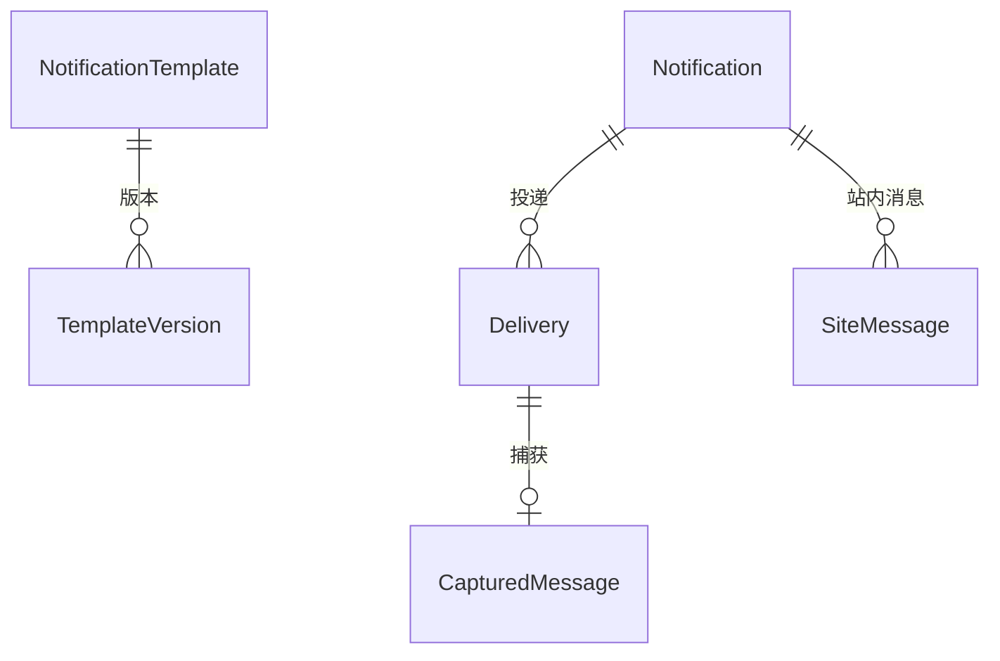
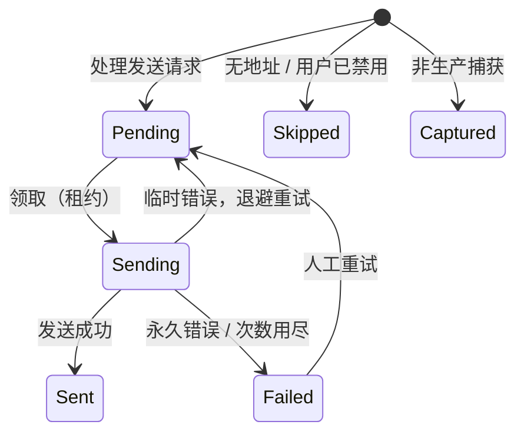

# Notifications 模块设计

- 状态：**已确认**（2026-11-12）。起草当天，用户授权“遇到需要选择的地方，默认采用最推荐的方案”，第 12 节的决定均按建议确定；第 12.3 节的待确认事项是需要业务方、合规或外部服务数据回答的事实，不阻塞编码。
- 模块名 / schema / 编号：`Notifications` / `"Notifications"` / 14（平台模块，登记见 `docs/modules/README.md`）；`[LoggerMessage]` 的 `EventId` 使用 14000～14999
- 项目：`Kmic.Notifications.Domain`、`Application`、`Infrastructure`、`Presentation`、`Contracts`（07 第 2 节）
- 依据：ADR-0006、0020、0022、0027；05-11 第 7～9 节（本模块的框架设计，机制已确认，本文不重复，只引用并补全模块自己的部分）；05-04 第 7.3 节（短信验证码）；05-07 D6、第 5.3、7.6 节；05-08 第 4.1 节；05-10 第 2.2 节；Identity 模块设计（D-F 验证码载荷例外）、Files 模块设计

## 0. 概述

### 0.1 职责与边界

| 做 | 不做 |
|---|---|
| 接收请求型消息 `SendNotification`：去重、解析收件人、按模板渲染、生成投递与站内消息 | 通知的内容与时机：由业务模块声明模板、决定何时发送（05-11 D4） |
| 模板：代码声明（键、渠道、变量结构、示例、默认内容）的登记与退役；管理员发布修改后的版本；预览 | 模板声明本身：在各业务模块的 Application 里（`[NotificationTemplate]`） |
| 投递：邮件（MailKit）、短信（`ISmsGateway`，生产为阿里云短信服务）、站内消息；重试、失败分类、人工重试与放弃 | 外部调用的通用守卫与类型化客户端：框架（已实现，05-11 第 9 节） |
| 非生产捕获通道：完整保存本应发出的内容，供测试人员查看 | 实时推送（SignalR）：ADR-0020 待决，首期轮询 |
| 站内消息：本人的列表、未读数、已读 | 订阅偏好（用户选择接收哪类通知）：延后（第 10 节） |
| 发送与投递记录的查询、管理 | 邮件到达后的行为（打开、点击追踪）：不做 |

### 0.2 本文与框架文档的关系

05-11 第 7～9 节已确认的决定（D3 收件人联系方式、D4 模板来源、D5 渲染时机、D6 外部调用守卫，投递语义，捕获规则，外部调用幂等表）全部沿用。本文补的是 07 第 8 节要求、框架文档留给模块的内容：聚合与表、用例与权限点清单、前端页面、旧系统对照、迁移、框架在本模块开工前要补的东西，以及留给“实现 Notifications 时确定”的事项（地址存储，D-N2）。

### 0.3 模块划分检查表（07 第 6.3 节）

| # | 检查项 | 结论 |
|---|---|---|
| 1 | 强不变量是否都归本模块 | 是。清单见下 |
| 2 | 每个命令是否只改本模块的数据 | 是。投递时调用外部渠道（邮件服务器、短信网关）在数据库事务之外，由投递工作器执行（D6）；调用结果写回本模块的投递行 |
| 3 | 跨模块“先检查、后写入” | 没有。处理发送请求时读取联系方式（`IUserContacts`）和附件内容（`IFileContents`）是只读查询，结果只用于渲染与投递 |
| 4 | 订阅事件失败时的处理 | `SendNotification` 处理失败（模型与模板声明不符、模板不存在）是业务失败，进入死信（05-07 D10）；死信在 Operations 的消息管理页可见，因为模板与调用方都是代码，死信意味着程序缺陷，需要修复后重试 |
| 5 | 其他模块的数据怎么取 | 联系方式：Identity 的 `IUserContacts`（`SystemOnly`，D3）；附件：Files 的 `IFileContents`（`SystemOnly`） |
| 6 | 依赖是否单向无环 | 是。`DependsOn("Identity")`、`DependsOn("Files")`。Identity 向 Notifications 发的是请求型消息，只引用 `Notifications.Contracts` 里的消息类型，不调用它的查询，不构成 `DependsOn`（05-07 D6，与 Identity 设计 0.3 第 6 项一致）；本文复核了这一点：Notifications 同步调用 Identity、Identity 异步请求 Notifications，两个方向分属不同机制，没有循环等待 |
| 7 | 拆成两个模块的理由 | 不拆。模板、投递、站内消息共享同一个收件人解析与渲染流程（ADR-0027） |

本模块的强不变量：

| 编号 | 不变量 | 由谁保证 |
|---|---|---|
| N1 | 同一模板、同一收件人、同一去重键、同一渠道只发送一次 | 唯一索引 `(TemplateKey, RecipientKey, DedupKey, Channel)`，重复请求忽略并记 Information（FR-NOTIFY-04） |
| N2 | 投递记录保存的是实际发出的内容（主题、正文、模板版本），重试不重新渲染 | 处理发送请求时渲染并落库（D5） |
| N3 | 非生产环境不可能发出真实邮件与短信；生产环境不可能误用捕获通道 | 启动保护（05-11 第 8.4 节）：非生产配置真实通道则启动失败，生产存在捕获通道则启动失败 |
| N4 | 投递的状态流转只前进：`Pending → Sending → Sent / Failed`；`Skipped`、`Captured` 是终态；`Sending` 的租约到期后可被重新领取 | 带状态条件和租约令牌的更新（05-08 第 4.1 节） |
| N5 | 含密模板（验证码）投递完成后正文被清空，日志里没有它的内容 | 处理逻辑 + 日志不输出渲染结果 |
| N6 | 站内消息只有收件人本人可读可改；访问他人的消息是 404 | 所有查询与命令的条件固定包含 `RecipientUserId = 当前用户` |

---

## 1. 旧系统对照

### 1.1 旧系统怎么发通知

| 方面 | 旧系统 | 新系统 |
|---|---|---|
| 邮件发送 | `PCommon.OutlookDotComMail(n)` 按编号选 4 组发件账号（默认、盖章、售后、Outlook 365），每组有 `IsSendEmail_*` 开关；另有 `Common/SendMail.cs`、`AfterSale/SendEmail.cs`（6300 行）。**在请求线程内同步发送**，没有队列与重试，失败只记日志（另有“邮件发送失败记录”表）；业务回滚后邮件已经发出 | 发送请求随业务事务写入 Outbox，独立投递、重试；业务回滚则不发（D1 的同类机制） |
| 发件账号 | 4 组账号，按场景选 | 模板声明 `SenderProfile`，对应部署配置 `Notifications:Email:Senders:{名称}` |
| 邮件模板 | 代码拼接为主；部分在主库模板表与售后库 `Table_Email`（Forecast 等主库模块也从售后库读模板）；全局错误邮件的模板与白名单存在字典表 | 代码声明模板（含默认内容），数据库保存修改后的版本；沙箱化 Liquid（Fluid）；可预览 |
| 测试环境 | 主题加 `EmailTest` 前缀，靠开关 | 非生产强制捕获通道，配置真实通道即启动失败 |
| 短信 | 阿里云 SDK，签名与模板号在配置里；登录验证码放进 DES 加密的 Cookie 后发送（`SendCodePhone`） | `ISmsGateway` 抽象，生产实现为阿里云短信服务；验证码由 Identity 生成并存哈希，经本模块发送（Identity 设计 D-A、D-F） |
| 站内消息 | `Base_MessageInfo`、`Base_ShenHeMessage`（审批消息）、`Base_RenwuRead`（任务已读）三张表 | 一张 `SiteMessage`，只有收件人本人可读 |
| 全局错误邮件 | `Global.Application_Error` 发错误邮件，同类错误 1 小时去重，白名单在字典表 | 不迁移：日志与告警进观测平台（05-12），邮件由观测平台的告警规则发送，不经本模块 |

### 1.2 旧表对照

| 旧表 | 新模型 | 备注 |
|---|---|---|
| 主库模板表、售后库 `Table_Email`（邮件模板） | 模板声明（代码）+ `TemplateVersion`（仅当现有内容需要沿用时） | 各业务模块设计时逐个决定：旧模板内容作为新模板的默认内容写进代码，不导入数据库；见第 9 节 |
| 邮件发送失败记录 | 不迁移 | 新系统的 `Delivery` 记录发送状态，旧失败记录只作归档 |
| `Base_MessageInfo`、`Base_ShenHeMessage`、`Base_RenwuRead` | `SiteMessage` | 站内消息是瞬时性数据；是否迁移历史消息由业务确认，建议只迁未读（第 9 节） |

---

## 2. 术语

确认本文后一并登记到 `docs/glossary.md`。

| 中文 | 英文标识符 | 含义 |
|---|---|---|
| 通知 | `Notification` | 一次发送请求的记录：用哪个模板、谁请求、来源消息 |
| 投递 | `Delivery` | 通知在一个渠道上给一个收件人的一次发送，是租约队列的一行 |
| 渠道 | `Channel` | `Email` / `Sms` / `InApp` |
| 通知模板 | `NotificationTemplate` | 代码声明的一种通知：键、渠道、变量结构、示例、默认内容 |
| 模板版本 | `TemplateVersion` | 管理员发布的修改后内容，只增不改 |
| 含密模板 | `CarriesSecret` | 内容含一次性短时凭据（验证码）的模板，投递后清空正文 |
| 发件账号 | `SenderProfile` | 部署配置里的一组 SMTP 账号，模板按场景选择 |
| 去重键 | `DedupKey` | 业务给出的“同一件事只通知一次”的键 |
| 站内消息 | `SiteMessage` | 只有收件人本人可见的系统内消息，带已读状态 |
| 捕获消息 | `CapturedMessage` | 非生产环境本应发出的内容，供测试人员查看 |

---

## 3. 聚合与表

### 3.1 总览

| 聚合 / 表 | 内容 | 类型 |
|---|---|---|
| `NotificationTemplate` + `TemplateVersion` | 模板登记与发布的版本 | 聚合（一个模板一个聚合，版本是子实体） |
| `Notification` | 发送请求的记录 | 聚合（只插入，不再修改） |
| `Delivery` | 投递队列 | **模块内框架表**，状态靠带条件的 SQL 更新，不经聚合（D-N1） |
| `SiteMessage` | 站内消息 | 聚合（行级，已读是唯一的修改） |
| `CapturedMessage` | 非生产的捕获内容 | 只插入表（仅非生产环境有写入） |
| `CatalogState` | 模板目录的内容哈希 | 模块内框架表，只由同步任务写 |

强类型：`NotificationId`、`DeliveryId`、`SiteMessageId`、`TemplateVersionId`、`CapturedMessageId` 在本模块 Domain。

`NotificationTemplate` 与 `SiteMessage` 之外的表都不声明数据范围；`SiteMessage` 声明 `HasNoDataScope("按 RecipientUserId 显式过滤，不按组织范围")`（05-11 对延后事项“关系可见、资源可见性”的结论：站内消息不声明为数据范围对象）。

### 3.2 `NotificationTemplate` 与 `TemplateVersion`

`"Notifications"."NotificationTemplate"`：

| 字段 | 说明 |
|---|---|
| `Key` | `varchar(200)`，主键，如 `Identity.SmsCode`，以声明它的模块名开头 |
| `DisplayName`、`OwnerModule` | 来自代码声明，每次同步更新 |
| `Channels` | 代码声明的渠道集合（`Email`、`Sms`、`InApp` 的组合） |
| `SenderProfile` | 发件账号名（只对邮件渠道有意义） |
| `CarriesSecret` | 含密模板标记（05-11 第 7.2 节） |
| `Status` | `Active` / `Retired`（代码里已删除的模板标为退役，版本数据保留，不能再用于发送） |
| `CodeHash` | 代码声明内容（默认主题、正文、变量结构）的哈希，用于同步时判断是否变化 |
| `ActiveVersions` | 每个渠道当前生效的发布版本号（空表示使用代码默认内容） |
| `ConcurrencyVersion`、审计字段 | 05-03 |

`"Notifications"."TemplateVersion"`（子实体，只增不改）：`Id`、`TemplateKey`、`Version`（同一模板内递增）、`Channel`、`Subject`、`Body`、`PublishedBy`、`PublishedAt`、`Remark`；唯一 `(TemplateKey, Channel, Version)`。

- 渲染使用的内容：渠道的 `ActiveVersions` 有值取对应版本，否则取代码默认内容；投递记录里保存**实际使用的内容与版本号**（版本号 0 表示代码默认内容，同时保存 `CodeHash`），因此事后能回答“发出的是什么”。
- 方法：`Synchronize(declaration)`（更新显示名、渠道、发件账号、含密标记与哈希）、`Retire()`、`Publish(channel, subject, body, by, remark)`（生成新版本并设为生效）、`RevertToDefault(channel, by)`（把该渠道的生效版本置空，历史版本保留）。
- `Publish` 的前置：模板启用；该渠道在模板声明的渠道内；主题与正文通过 Fluid 语法解析，且能用示例数据在限时内渲染成功（输出不超过上限）；正文里出现的变量必须在模板的变量结构里（声明之外的变量拒绝）。
- 含密模板**不能**被管理员改成在正文里带任意内容以外的东西：含密模板允许修改文案，但变量结构固定（验证码变量由代码保证），预览用示例验证码。

### 3.3 `Notification`

`"Notifications"."Notification"`：`Id`、`TemplateKey`、`TemplateVersions`（本次各渠道实际使用的版本号，jsonb）、`DedupKey`、`SourceMessageId`、`SourceModule`、`CreatedAt`、`InitiatorUserId`（来自消息信封，05-07 第 5.3 节）。

- 只在处理 `SendNotification` 时插入一行，之后不再修改；用于从投递或站内消息反查“这是哪次请求产生的”，也是按来源消息幂等的依据（`SourceMessageId` 唯一）。

### 3.4 `Delivery`（投递队列）

`"Notifications"."Delivery"`：

| 列 | 说明 |
|---|---|
| `Id`、`NotificationId` | |
| `Channel` | `Email` / `Sms` |
| `RecipientUserId` | 用户收件人；直接地址的收件人为空 |
| `RecipientKey` | 去重用：`u:{userId}` 或 `a:{地址小写的 SHA-256}` |
| `AddressMasked` | 脱敏显示（`138****0000`、`a***@example.com`），管理页与日志使用 |
| `Address` | 仅直接地址的收件人保存，用户收件人为空，发送时经 `IUserContacts` 取最新值（D-N2） |
| `Role` | 邮件的 `To` / `Cc` / `Bcc` |
| `Subject`、`Body` | 渲染结果（短信渠道的 `Body` 是渲染出的内容文本，供查看；实际发送用模板参数，见 8.2）；含密模板投递完成后 `Body` 置空 |
| `TemplateKey`、`TemplateVersion`、`CodeHash` | 实际使用的版本 |
| `Priority` | `Normal` / `High` |
| `Status` | `Pending` / `Sending` / `Sent` / `Failed` / `Skipped` / `Captured` |
| `SkipReason` | `NoAddress` / `UserDisabled` |
| `Attempts`、`NextAttemptAt`、`LeaseToken`、`LeaseUntil` | 租约队列（05-08 第 4.1 节） |
| `ProviderMessageId`、`LastError`、`SentAt`、`CreatedAt` | |
| `AttachmentFileIds` | 邮件附件的文件 ID 数组（内容投递时读取） |

- 唯一约束：`(TemplateKey, RecipientKey, DedupKey, Channel)`（N1）。
- 索引：领取用 `(Status, Priority DESC, NextAttemptAt)`（部分索引，只含 `Pending` 与租约到期的 `Sending`）；按收件人、模板、时间查询用 `(RecipientUserId, CreatedAt DESC)`、`(TemplateKey, CreatedAt DESC)`。
- 状态图：

### 3.5 `SiteMessage`

字段沿用 05-11 第 8.3 节：`Id`、`RecipientUserId`、`NotificationId`、`Title`、`Body`（纯文本或受限 Markdown，前端渲染时转义）、`Link`（只允许站内相对路径）、`Category`、`CreatedAt`、`ReadAt`。

- 方法：`Create(...)`（工厂，校验 `Link` 是站内相对路径：以 `/` 开头、不含 `//`、不含协议）、`MarkRead(now)`（已读幂等）。
- 索引：`(RecipientUserId, ReadAt NULLS FIRST, CreatedAt DESC)`，未读数与列表都命中它。
- 保留：已读超过 90 天、未读超过 365 天的由清理任务删除（配置项，`待确认`，第 8 节）。

### 3.6 `CapturedMessage`

`"Notifications"."CapturedMessage"`：`Id`、`DeliveryId`、`Channel`、`From`（所用发件账号）、`To`、`Cc`、`Bcc`、`Subject`、`Body`、`AttachmentNames`（名称与大小的 jsonb）、`CapturedAt`。只在非生产环境写入；生产环境这张表存在但没有写入（迁移里照常建，避免环境之间表结构不同）。

---

## 4. 用例

命名遵循 05-02。**授权**为权限点或声明；**幂等**为 `[Idempotent]`；**审计**为 `[Audited]` 或 `[NotAudited("原因")]`。

### 4.1 发送请求与投递（系统任务）

| 用例 | 声明 | 说明 |
|---|---|---|
| `ProcessSendNotificationCommand` | `[SystemOnly]`，订阅 `Notifications.SendNotification`（请求型） | 05-11 第 7.1 节：校验模板启用且模型符合声明（不符合是业务失败，进入死信）；按 `SourceMessageId` 幂等；解析收件人（`IUserContacts`）；对每个渠道渲染（D5）并写 `Delivery` 或 `SiteMessage`；`DedupKey` 冲突的跳过并记 Information；`[NotAudited("通知记录即投递记录")]` |
| `DeliverNextCommand`（投递工作器内部） | 无外部入口 | `LeasedQueueWorker` 领取 `Pending` 或租约到期的 `Sending`，**事务外**调用渠道，再用带租约令牌与状态条件的更新写结果（05-08 第 4.1 节，05-11 第 8.2 节） |

投递工作器不是命令，是后台服务；它调用的渠道客户端是类型化客户端，受 05-11 D6 的运行时守卫约束（事务外调用）。

### 4.2 管理

| 用例 | 权限点 | 说明 |
|---|---|---|
| `ListTemplatesQuery` | `Notifications.Template.View` | 模板、渠道、状态、当前生效的版本、最近发布 |
| `GetTemplateQuery` | 同上 | 代码默认内容、各渠道当前内容、变量结构（名称与类型）、示例数据、版本历史 |
| `PreviewTemplateQuery(key, channel, subject, body, model?)` | 同上 | 用示例数据（或传入的数据，仅非含密模板）渲染，返回渲染结果与错误位置；渲染限时与输出上限同正式处理 |
| `PublishTemplateCommand(key, channel, subject, body, remark, expectedVersion)` | `Notifications.Template.Manage`，`[Audited]`、`[Idempotent]` | 3.2 的前置；提交后无缓存要失效（渲染时读库，模板读取量小；12 节 D-N3） |
| `RevertTemplateCommand(key, channel, expectedVersion)` | 同上 | 恢复代码默认内容 |
| `ListDeliveriesQuery` | `Notifications.Delivery.View`（敏感，`[AuditedRead]`） | 按收件人、渠道、状态、模板、时间；显示脱敏地址与状态，**不含正文** |
| `GetDeliveryQuery` | 同上 | 含渲染后的主题与正文（含密模板投递完成后为空）；查看正文写读审计 |
| `RetryDeliveryCommand(deliveryId)` | `Notifications.Delivery.Manage`，`[Audited]` | `Failed` → `Pending`，次数清零；含密模板已过期的（验证码有效期已过）拒绝 |
| `AbandonDeliveryCommand(deliveryId, reason)` | 同上 | 失败的投递标记为已放弃（保持 `Failed`，加放弃标记），不再出现在待处理清单；原因必填 |
| `ListCapturedQuery`、`GetCapturedQuery` | `Notifications.Captured.View`（敏感，`[AuditedRead]`） | 仅非生产环境的端点可用；生产环境返回 404 |

### 4.3 站内消息（本人）

全部 `[AllowAuthenticated]`，查询与命令的条件固定包含 `RecipientUserId = 当前用户`，访问他人的消息返回 404（N6）。

| 用例 | 说明 |
|---|---|
| `ListMySiteMessagesQuery` | `GET /api/v1/notifications/site-messages`：未读优先、时间倒序，分页，可筛选已读状态与类别 |
| `GetMyUnreadCountQuery` | `GET …/unread-count`：前端每 30 秒轮询（05-11 第 8.3 节），只读，响应要小 |
| `MarkSiteMessageReadCommand` | `POST …/{id}/read`，`[NotAudited("个人已读状态")]`，幂等 |
| `MarkAllSiteMessagesReadCommand` | `POST …/read-all`，同上 |

模拟身份时：可以查看被模拟人的消息列表，“标为已读”在只读模拟中被框架拒绝（05-04 D7）。

### 4.4 系统任务

| 用例 | 声明 | 说明 |
|---|---|---|
| `SyncTemplateCatalogCommand` | `[SystemOnly]`，启动任务 | 按 `NotificationTemplateCatalog` 登记新模板、更新声明、退役已删除的模板；哈希未变则跳过；`[NotAudited("目录同步")]` |
| `PurgeDeliveriesCommand` | `[SystemOnly]`，每日（`Notifications.PurgeDeliveries`） | 删除超过保留期（默认 180 天，`待确认`）的已完成投递与通知记录 |
| `PurgeSiteMessagesCommand` | `[SystemOnly]`，每日 | 3.5 的保留规则 |
| `PurgeCapturedCommand` | `[SystemOnly]`，每日，仅非生产 | 删除 30 天前的捕获内容 |
| `ClearSecretBodiesCommand` | `[SystemOnly]`，每小时 | 兜底：含密模板的投递已 `Sent` / `Failed` / 已过期，但 `Body` 仍非空的，清空（正常路径在投递完成时已清空，这是对崩溃等极端情况的补救） |

---

## 4A. 前端

通知铃铛、未读角标、站内消息抽屉属于外壳（F03、F06，并行线 A）；本模块的前端是管理页面与站内消息的完整列表页。路由名前缀 `notifications.`，菜单归属“系统管理 / 通知”（站内消息页在头像下拉里）。

### 页面清单

| 路由名 | 类型 | 所需权限点 | 打开方式与理由 |
|---|---|---|---|
| `notifications.siteMessages` | 列表 | 登录即可 | 本人的站内消息；未读标记；点击标为已读并跳转 `Link`；“全部已读” |
| `notifications.templates` | 列表 | `Notifications.Template.View` | 模板、渠道、当前生效版本 |
| `notifications.templates.detail` | 详情 | 同上 | 标签页：当前内容（按渠道）、代码默认内容、变量清单、版本历史；编辑是**独立标签页**（内容多：主题、正文、预览并排，F05 D3），`edit` 的 `tab.mode = byParams`；预览用示例数据，含密模板的预览显示示例验证码 |
| `notifications.deliveries` | 列表 | `Notifications.Delivery.View` | 筛选：收件人、渠道、状态、模板、时间；失败的投递可勾选批量重试（F07 批量模式）；详情用抽屉（含渲染正文，写读审计） |
| `notifications.captured` | 列表 | `Notifications.Captured.View` | 仅非生产显示菜单；点开看完整内容，测试人员据此验证通知 |

### 动作

模板详情：`edit`（发布新版本）、`revert`；投递：`retry`、`abandon`（列表行操作或批量）。与后端动作目录一致。

### 旧系统页面对照

旧系统没有通知管理页面，站内消息在各业务页面里分散展示。不保留的交互：无。

---

## 5. 授权

### 5.1 权限点

`Notifications` 分组（资源名单数；05-11 原写的 `Notifications.Deliveries.*` 据此更正为 `Notifications.Delivery.*`，见第 13 节）。

| 权限点 | 敏感 | 说明 |
|---|---|---|
| `Notifications.Template.View` | | 查看模板与版本 |
| `Notifications.Template.Manage` | | 发布模板版本、恢复默认（模板内容会发给收件人，要求谨慎，但不含个人数据，故不标敏感） |
| `Notifications.Delivery.View` | ✓ | 查看发送记录与正文（含收件人、可能含个人信息，查看写读审计） |
| `Notifications.Delivery.Manage` | ✓ | 重试、放弃失败的投递 |
| `Notifications.Captured.View` | ✓ | 查看非生产的捕获内容（可能含验证码，只在非生产环境存在） |

站内消息没有权限点（本人访问，N6）。

### 5.2 范围对象与资源策略

没有范围对象。没有按资源的策略：权限点是授权的全部，站内消息靠固定的收件人条件。

### 5.3 敏感权限点的管理

发送记录与捕获内容可能含个人联系方式；系统管理员自动拥有；是否需要把查看发送记录与系统管理分权，沿用 Operations 设计 D-O3 的结论（靠留痕）。

---

## 6. 跨模块

### 6.1 对外提供的 Contracts（`Kmic.Notifications.Contracts`）

| 接口 / 类型 | 声明 | 用途 |
|---|---|---|
| 请求型消息 `SendNotification`、`Recipient`、`NotificationPriority`、`RecipientRole` | 请求型（05-07 D6）；没有 `SubjectIds` | 业务模块与 Identity 发送通知；发送方用 `SendNotification.For(模型, 收件人, 去重键)` 构造，`Model` 是 `JsonElement`，由 `NotificationModelJson` 序列化，保证与模板声明一致 |
| 请求型消息 `SendSecretNotification` | 请求型，`CarriesSecret = true`、`SecretLifetimeSeconds = 300`（05-07 第 5.3 节例外） | 含密模板（验证码）专用：和 `SendNotification` 字段相近但没有附件与优先级；含密模板只能用它，普通模板只能用 `SendNotification`，Notifications 处理时两边互查，不符的进死信 |
| `[NotificationTemplate]`、`INotificationModel<TSelf>`、`ISmsTemplateModel`、`NotificationChannels`、`NotificationModelJson` | 在 `BuildingBlocks.Contracts`（`Kmic.BuildingBlocks.Contracts.Notifications`，已实现）：Notifications.Contracts 只能引用这个框架项目，而 `For` 要读模板声明 | 声明模板；发送方与 Notifications 用同一份 JSON 选项（属性名保持原样、不认识的属性是错误） |

没有对外的查询接口：业务模块不读取通知的状态。

### 6.2 依赖的 Contracts

| 来源 | 接口 | 用途 |
|---|---|---|
| Identity | `IUserContacts.GetAsync(userIds)`（`SystemOnly`，05-11 D3） | 取邮箱与手机号、用户状态；已禁用或没有地址的渠道标 `Skipped` |
| Identity | `IUserReferences` | 管理页显示收件人姓名 |
| Files | `IFileContents.OpenReadAsync(fileId)`（`SystemOnly`） | 投递邮件时读取附件内容 |

### 6.3 事件

不发布集成事件。订阅（请求型消息的接收）：`Notifications.SendNotification`，订阅名 `Notifications.Process`。

---

## 7. 后台处理

| 项 | 类型 | 说明 |
|---|---|---|
| `SendNotification` 的处理 | Inbox 订阅 | Worker 角色；高优先级（验证码）的消息在 Inbox 里优先处理（`Priority` 来自消息，05-07 的有序与优先机制不做特殊设计：验证码消息数量小，Inbox 处理本身是毫秒级） |
| 投递工作器 | `LeasedQueueWorker`（`Priority DESC, NextAttemptAt`） | Worker 角色；并行度默认 4 |
| 清理任务 | 定时任务 | 4.4 |
| 模板目录同步 | 启动任务 | 迁移之后、接收请求之前 |

---

## 8. 其他构件

### 8.1 配置（部署配置）

| 配置 | 默认值 |
|---|---|
| `Notifications:Email:Senders:{名称}` | 地址、显示名、SMTP 主机、端口、加密方式、账号、密码（`[Secret]`）；至少一个名为 `Default` |
| `Notifications:Sms:Provider` | `Aliyun`（生产）；非生产为捕获 |
| `Notifications:Sms:Aliyun` | 区域、`AccessKeyId`、`AccessKeySecret`（`[Secret]`）、默认签名 |
| `Notifications:Sms:Templates:{模板键}` | 阿里云短信模板编码、签名、参数映射（8.2） |
| `Notifications:Delivery:Parallelism` / `MaxAttempts` | 4 / 5 |
| `Notifications:MaxAttachmentMb` | 20 |
| `Notifications:Template:RenderTimeoutMs` / `MaxOutputKb` | 1000 / 1024 |
| `Notifications:Retention:DeliveryDays` / `SiteMessageReadDays` / `SiteMessageUnreadDays` / `CapturedDays` | 180 / 90 / 365 / 30（`待确认`，与审计保留期一起定） |
| 含密消息的有效期 | 不另设配置：用消息类型上声明的 `SecretLifetimeSeconds`（`SendSecretNotification` 为 300 秒，不超过 600）；投递超过这个时间仍未发送的不再发送 |

### 8.2 短信渠道与模板参数

阿里云短信要求模板与签名在控制台审核通过，发送时传**模板编码与参数**，不能发送自由文本。因此短信渠道的模板声明要多一层映射：

- 模板模型实现 `ISmsTemplateModel`：`IReadOnlyDictionary<string, string> ToSmsParameters()`，把模型映射为阿里云模板的参数（如 `{ "code": "123456" }`）；
- 部署配置 `Notifications:Sms:Templates:{模板键}` 给出阿里云模板编码与签名；缺配置的短信模板在启动时校验失败（非生产的捕获通道不需要，捕获时用本地渲染的 `Body`）；
- 本地仍按 Fluid 渲染一份 `Body` 写入投递记录，仅供查看；它与阿里云审核通过的模板文本应当一致，由模板声明的维护者保证（实现时写入一条测试：默认内容渲染结果与文档里登记的阿里云模板文本一致，`待确认`模板文本来源）。

### 8.3 渲染

Fluid（03 第 4.4 节），只能访问模型中的数据；禁用 `include` 文件系统访问；单次渲染限时 1 秒、输出上限 1 MB；HTML 默认转义（05-11 第 7.4 节）。**实施前原型验证**（05-11 待确认）：`TemplateOptions` 的成员访问限制、`Task` 取消与限时的实现方式、输出大小限制的方式，在 S3 开工时先做一个小验证并记录结论。

**验证结论（2026-11-13，Fluid 2.41.1，测试在 `TemplateRendererTests`）**：

| 问题 | 结论 |
|---|---|
| 成员访问限制 | 默认只能访问登记过的类型。渲染器沿着数据模型的公开属性登记模型本身、嵌套对象和集合里的元素，别的类型一概读不到；方法不能调用；字符串自己的成员（如 `Length`）读不到，只能用 Liquid 的过滤器（`size`、`upcase` 等） |
| 文件访问 | 不设文件提供器，`include`、`render` 一律报错，读不到任何文件 |
| 限时 | Fluid 没有挂钟时间的限制，只有 `MaxSteps`（步数）和 `MaxRecursion`。步数上限兜住不产生输出的死循环；用时上限放在输出写入器里，渲染往里写的每一次都检查已用时间，超时抛异常；它也不等同于对任意单步的硬中断，所以步数上限必须开 |
| 输出大小 | 写入器超过上限就抛异常，输出再大也不会占满内存 |
| HTML 转义 | HTML 渲染要用 `HtmlEncoder.Create(UnicodeRanges.All)`：默认编码器会把中文也转成 `&#x…;` 实体 |
| 配置 | `Notifications:Template:RenderTimeoutMs`（1000）、`MaxOutputKb`（1024）、`MaxSteps`（100000） |

没有做的：发布前检查“正文里出现的变量必须在模板的变量结构里”。Fluid 的语法树不容易枚举变量引用，先用“用示例数据渲染并检查未定义变量为空的位置”近似，等写发布用例时再定（见 15 节）。

### 8.4 渠道实现

| 渠道 | 实现 | 说明 |
|---|---|---|
| 邮件 | `MailKitEmailSender`（`IEmailSender`） | 每个发件账号一个连接配置；正文 HTML + 自动生成的纯文本备选；附件流式读取；邮件头 `Message-ID: <{DeliveryId}@kmic>` 稳定，帮助收件端去重 |
| 短信 | `AliyunSmsGateway`（`ISmsGateway`） | 外部流水号传 `DeliveryId`；错误码分类：限流类（如 `isv.BUSINESS_LIMIT_CONTROL`）退避重试；号码非法、模板无效等永久错误不重试（具体码表实现时对照阿里云文档确定，不凭记忆写） |
| 站内消息 | 处理发送请求时直接写 `SiteMessage` | 同一事务，无外部调用，不进投递队列 |
| 捕获 | `CaptureEmailSender`、`CaptureSmsSender`（非生产） | 写 `CapturedMessage`，投递状态 `Captured` |

### 8.5 错误码（`NotificationsErrors`）

`TemplateNotFound`（404）、`TemplateRetired`（422）、`TemplateChannelNotDeclared`（422）、`TemplateInvalid`（422，语法错误或超限，带位置）、`TemplateVariableUnknown`（422）、`DeliveryNotFound`（404）、`DeliveryNotRetryable`（409）、`SiteMessageNotFound`（404）、`CapturedUnavailable`（404，生产环境）。发送请求处理中的业务失败（模板不存在、模型不符）是死信，不是对用户的错误。

### 8.6 通知模板

Identity 声明的三个（`Identity.SmsCode`、`Identity.AccountLocked`、`Identity.PasswordChanged`，Identity 设计第 8 节）是第一批使用者；本模块自己不声明业务模板。

---

## 9. 数据迁移

1. **模板**：旧邮件模板（主库模板表、售后库 `Table_Email`）的内容不导入数据库，由各业务模块设计时把仍需要的模板声明为代码里的默认内容（变量改为模板模型的属性）；旧模板里的占位符对应到新模型，由业务模块迁移分析给出对照。已停用或没有引用的模板不迁。
2. **发送记录**：旧邮件发送失败记录不迁移，旧库留作归档。
3. **站内消息**：`Base_MessageInfo`、`Base_ShenHeMessage`、`Base_RenwuRead` 的历史消息是瞬时性数据；建议只迁移**未读**的、仍有意义的（如待办提醒），已读的不迁；是否迁移由业务确认（第 12.3 节）。迁移通过 `SiteMessage` 的工厂方法写入，`Link` 由旧页面地址映射到新路由（映射表由各业务模块迁移时给出，对应不上的不迁）。
4. **发件账号与短信签名**：4 组旧发件账号的用途（默认、盖章、售后、Outlook 365）映射为 `SenderProfile` 名称，凭据由运维在新环境的密钥源里配置，不从旧配置复制明文；短信签名与模板编码需要在阿里云重新确认，两个环境可以共用同一个阿里云账号，但模板编码按环境配置。
5. 编号：无。

---

## 10. 延后事项对照

对照 `docs/framework/00-README.md` 的“延后事项”表：

| 事项 | 结论 |
|---|---|
| 关系可见、资源可见性的声明方法 | **不命中**（05-11 第 0.1 节已论证）：站内消息按 `RecipientUserId` 显式过滤，不声明为数据范围对象 |
| 业务事实类订阅的替代切换 | 不命中 |
| 数据库存储、可运行中切换的功能开关 | 不命中 |
| 其余 | 不命中 |

**新登记的延后事项**（确认本文后加入 00-README）：

| 事项 | 触发条件 | 已定的约束 |
|---|---|---|
| 用户通知订阅偏好（按类别开关邮件 / 站内消息） | 业务提出“用户希望关闭某类通知” | 偏好存在 Configuration 的偏好构件里（键 `Notifications.Subscription.{模板键}`，用户层）；渲染前按偏好过滤渠道；验证码、账号安全类模板声明为不可关闭 |
| 站内消息实时推送（SignalR） | ADR-0020 待决事项，不设时点 | 首期轮询未读数（30 秒） |
| 邮件到达回执、退信处理 | 业务提出需要判断邮件是否送达 | 供应商回调需要公网入口与签名校验；不改变 `Delivery` 的状态含义，增加“已送达 / 退信”两个状态 |

---

## 11. 框架负责 / 业务负责

| 框架负责 | Notifications 负责 |
|---|---|
| 请求型消息的投递与 Inbox 处理、重试与死信（已实现） | `SendNotification` 的处理逻辑：去重、收件人、渲染、落库 |
| 外部调用守卫、类型化客户端、韧性管道（已实现，05-11 第 9 节） | 邮件、短信渠道的实现与错误分类 |
| `LeasedQueueWorker` 模板（**待补**）、`ExternalCallQueue` 模板（**待补**） | `Delivery` 队列的具体实现 |
| `[NotificationTemplate]` 声明、`NotificationTemplateCatalog`、`SendNotification.For(…)`（**待补**） | 目录同步、渲染、版本发布 |
| 含密消息类型的声明与启动校验（05-07 第 5.3 节例外，**待补**） | 含密模板的正文清空与日志规则 |
| 业务模块：声明模板与模型、在命令里发送请求、给出去重键 | 不决定通知的时机与内容 |

### 11.1 开工前框架要补的东西

| 事项 | 说明 | 出处 |
|---|---|---|
| `LeasedQueueWorker` 模板 | 同 Files 设计 11.1，只做一次 | 05-08 第 4.1 节 |
| `[NotificationTemplate]` 与目录 | **声明类型已实现**（`BuildingBlocks.Contracts.Notifications`）；**目录与启动校验待补**：`NotificationTemplateCatalog` 从各模块 Application 程序集读取，校验模板键以模块名开头且唯一、默认内容能用示例数据渲染、短信渠道的模型实现 `ISmsTemplateModel`、含密模板不带附件 | 05-11 第 7.4 节 |
| `SendNotification` 的契约 | **已实现**（`Kmic.Notifications.Contracts`，含 `For`） | 05-11 第 7.2 节 |
| 含密消息类型 | **已实现**：`[IntegrationMessage(CarriesSecret = true, SecretLifetimeSeconds = …)]`，目录校验只有请求型可声明、有效期 1～600 秒；契约快照照常；日志不输出载荷的约束由各处写日志的代码遵守（Operations 的死信查看同样不显示含密消息的载荷） | Identity 设计 D-F |
| 渲染原型 | Fluid 的访问限制、限时与输出上限，在开工时做一个小验证并记录 | 05-11 待确认 |
| 阿里云短信 SDK | 版本与许可在 `docs/implementation/S0-04-版本与许可.md` 核对后锁定；开通与费用见实施待办 T-08 | 05-11 第 8.3 节 |

---

## 12. 待决与待确认

### 12.1 待决（均已按建议决定，2026-11-12）

下面的“建议”即决定。

#### D-N1 投递是聚合还是队列表

05-11 第 8.1 节给了 `Delivery` 的列，没有说它与 `Notification` 的关系。

| 选项 | 做法 | 优点 | 缺点 |
|---|---|---|---|
| A `Notification` 聚合带 `Delivery` 子实体 | 加载通知时带出投递 | 模型直观 | 投递工作器每次更新一行都要递增通知的版本、与处理请求的事务竞争；一次群发要加载全部投递；租约更新很频繁，不适合聚合的乐观并发 |
| **B `Delivery` 是模块内框架表，状态靠带条件的 SQL 更新，不经聚合；`Notification` 只插入** | 与框架的 Outbox / Inbox 同类；工作器按状态条件与租约令牌更新 | 符合 05-08 第 4.1 节“带状态条件的更新”写法；群发时没有大聚合；并发最简单 | `Delivery` 没有领域行为，状态流转的规则靠 SQL 条件和测试保证（N4） |

- **建议**：B。**取舍**：Delivery 的状态规则不在聚合里，要由 Infrastructure 的状态更新方法集中表达，并有状态流转的专门测试。

#### D-N2 投递地址怎么存（05-11 留给“实现 Notifications 时确定”）

05-11 第 8.1 节写“`Address`（已脱敏显示，实际地址加密存储，`待确认`加密方式随密钥方案）”。

| 选项 | 做法 | 优点 | 缺点 |
|---|---|---|---|
| A 全部明文保存 | 每条投递存完整地址 | 简单 | 联系方式在多处存副本，违反“最少副本”（05-11 D3） |
| B 应用层加密列 | 用 Data Protection 或 KMS 派生密钥加密 `Address` | 数据库里没有明文 | 密钥与轮换管理复杂（Data Protection 密钥环要存储与保护）；同一个人的手机号在 Identity 的用户表里本来就是明文，加密 Delivery 里的副本收益很小；检索与去重需要另存哈希 |
| **C 用户收件人不存地址，发送时按 `UserId` 取；直接地址的收件人才存明文；两类都只存脱敏显示** | `Delivery.RecipientUserId` + `AddressMasked`；`Address` 只在收件人是系统外对象（客户邮箱）时保存 | 联系方式只存在 Identity 一处（用户）；重试时总是最新的地址；直接地址本来就来自业务模块的业务数据，并非 Notifications 新增的暴露面；不引入密钥管理 | 重试时 Identity 必须可用（同一进程，实际无影响）；直接地址以明文保存在 Delivery 里，靠保留期清理与数据库访问控制保护（与业务表里的客户联系人邮箱同一水平） |

- **建议**：C。**理由**：没有新增密钥管理，同时让用户的联系方式只在 Identity 保存；直接地址的保护水平与它们在业务表里的现状一致。**取舍**：直接地址在保留期内明文存在；以后若合规要求加密，只需要把 `Address` 一列改为加密（不影响其他列）。

#### D-N3 模板要不要缓存

| 选项 | 做法 | 优点 | 缺点 |
|---|---|---|---|
| **A 不缓存，处理发送请求时读库** | 每次处理读取模板与生效版本 | 没有失效问题；发布后立即生效；通知量很小（每秒个位数） | 每条通知多一次读库（毫秒级） |
| B 按版本缓存模板内容 | `Notifications:Template:{key}:{channel}:{version}` | 少读库 | 要处理发布后的失效与广播；收益很小 |

- **建议**：A。**取舍**：吞吐上限由数据库读取决定，对这套系统的通知量不构成限制；量大了再引入缓存，不改接口。

### 12.2 按建议默认的小项

以下按建议执行（已确认，2026-11-12）：

| 事项 | 默认 |
|---|---|
| 站内消息保留：已读 90 天、未读 365 天 | 是，配置项，`待确认` |
| 投递与通知记录保留 180 天 | 是，配置项，`待确认`（与审计保留期一起定） |
| 捕获内容保留 30 天 | 是，配置项 |
| 含密模板：投递成功后立即清空正文；超过消息声明的有效期（300 秒）仍未发送的不再发送 | 是（Identity 设计 D-F） |
| 失败的投递可人工重试一次到多次，放弃要写原因 | 是 |
| 邮件附件总量上限 20 MB | 是（05-11 已定） |
| 管理页的发送记录不显示正文，进入详情才显示并写读审计 | 是 |
| 通知的优先级只有 `Normal` 和 `High` | 是（05-11 已定） |

### 12.3 待确认（需要业务方、合规或外部服务数据）

| 事项 | 需要什么 | 影响 |
|---|---|---|
| 阿里云短信的签名与模板：验证码模板的审核文本、模板编码 | 阿里云控制台开通与审核（实施待办 T-08） | 8.2 的映射与测试；测试环境无法验证真实短信前，只用捕获通道 |
| 阿里云短信错误码的分类表 | 对照官方文档实现 | 8.4 的重试与永久错误 |
| 旧 4 组发件账号的用途与是否都要保留 | 业务方 | `SenderProfile` 清单 |
| 旧模板的使用范围与占位符 | 各业务模块迁移分析 | 第 9 节 |
| 投递记录、站内消息、捕获的保留期 | 合规（与审计保留期一起，阶段 5） | 清理任务参数 |
| 站内消息历史是否迁移 | 业务方 | 第 9 节 |
| 通知量级估算 | 业务方 | 投递并行度与队列表索引 |
| Fluid 的限时与输出上限的实现方式 | 开工时的小验证（8.3） | 渲染保护 |

---

## 13. 与其他文档的接口（含需要同步修订的条目）

按 R01 L2 修订下列已确认文档的正文并登记修订记录（只落实决定，不改原决定）：

| 文档 | 修订 | 来源 |
|---|---|---|
| 05-11 第 8.1 节 | `Address` 的存储方式定为 D-N2 的 C：用户收件人不存地址、发送时取；`待确认`关闭。`Delivery` 增加 `RecipientKey`、`AddressMasked`、`Role`、`SkipReason`、`AttachmentFileIds`、`TemplateVersion`/`CodeHash`；`Notification` 增加 `TemplateVersions`；`Delivery` 是模块内框架表（D-N1） | 本文 D-N1、D-N2、3.3、3.4 |
| 05-11 第 8.2、8.3 节 | 权限点改为单数：`Notifications.Delivery.View / Manage`、`Notifications.Template.View / Manage`、`Notifications.Captured.View`；短信渠道的模板编码与参数映射（8.2） | 本文 5.1、8.2 |
| 05-11 第 7.4 节 | 模板版本表：渠道独立生效版本（`ActiveVersions`），`RevertToDefault`；含密模板的变量结构固定 | 本文 3.2 |
| 05-11 第 13 节待确认 | “投递地址的加密存储方式”关闭（D-N2）；“Fluid 的渲染超时、输出上限”转为开工时的小验证（8.3） | 本文 |
| `docs/glossary.md`、`docs/modules/README.md`、`docs/framework/00-README.md` | 登记第 2 节术语、模块状态、第 10 节新增延后事项；模块登记表的依赖写 `Identity、Files` | 本文 |

---

## 14. 决策汇总

| 编号 | 事项 | 决定（已确认，2026-11-12） |
|---|---|---|
| D-N1 | 投递是聚合还是队列表 | B：`Delivery` 是模块内框架表，带条件的 SQL 更新；`Notification` 只插入 |
| D-N2 | 投递地址怎么存 | C：用户收件人不存地址、发送时按 `UserId` 取；直接地址才存明文；都存脱敏显示 |
| D-N3 | 模板要不要缓存 | A：不缓存，处理时读库 |

| 待确认 | 处理方式 |
|---|---|
| 12.3 全部 | 业务方回答、阿里云开通（T-08）、合规确认或开工时的小验证 |

## 15. 实现进度

2026-11-13 完成：模块项目与迁移；`SiteMessage` 聚合与本人访问的四个用例（列表、未读数、已读、全部已读）、过期清理任务（每天 03:20）；保留期配置 `Notifications:Retention`（站内消息已读 90 天、未读 365 天，投递 180 天、捕获 30 天已定义，后两个等清理任务实现时使用）。站内消息没有权限点，只按收件人访问；别人的消息与不存在的一样返回 404。

实现时的小调整（决定不变）：①`SiteMessage` 用 `SentAt` 表示发出的时间，没有自己定义 `CreatedAt`——审计字段里已经有一个同名的创建时间列；②列表默认排序“未读在前、新的在前”用 `isRead,-sentAt` 两个字段表达，响应里每条带 `isRead`；③“全部已读”返回这次标了几条（命令的响应是回执，用 `{ count }`）。

同日完成：框架的模板声明目录 `NotificationTemplateCatalog`（启动时核对：键以模块名开头且唯一、至少一个渠道、含密模板不发邮件、发短信的模型要实现 `ISmsTemplateModel`）、渲染器（8.3 的验证结论已写入）。

未做：模板同步到数据库、发送请求的处理、`Notification` 与 `Delivery`、投递工作器与邮件、短信渠道、捕获、模板管理与投递管理用例、清理投递与捕获内容、含密正文清理。
